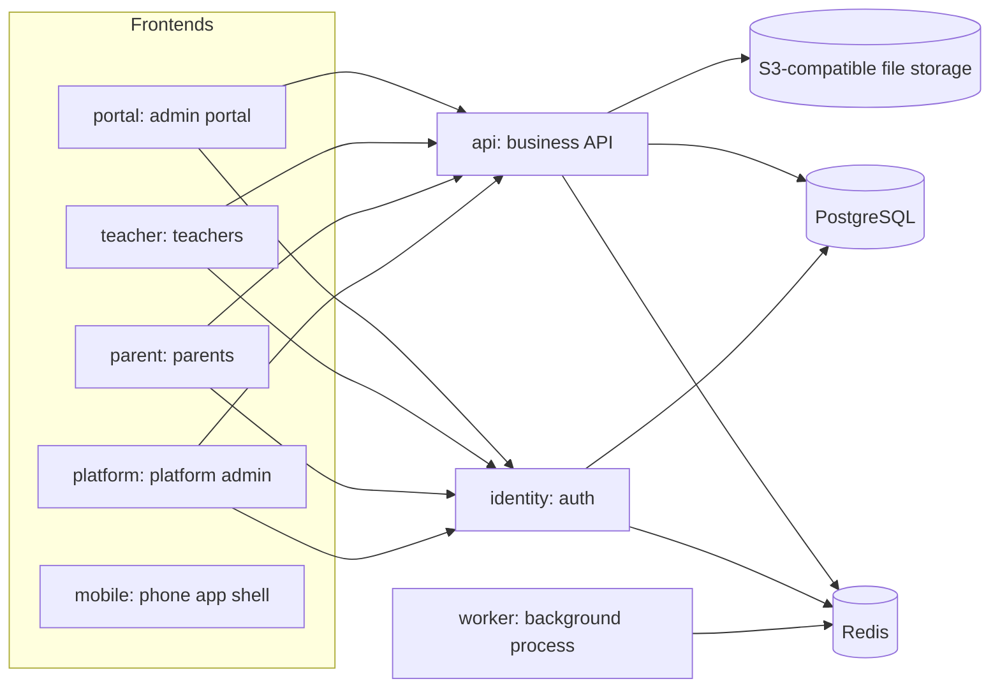

**English** | [Tiếng Việt](README.md)

# School Management

A multi-school management system (SaaS) for Vietnamese schools at the preschool (Mầm non), primary (Tiểu học), lower-secondary (THCS) and upper-secondary (THPT) levels, built around Vietnamese education-management practice. Each school is configured for its own level(s); a school may span several levels.

This is an independent product. It is not a product of any education authority. The project is under active development: scope, per-part status and decisions are recorded in the numbered documents under [`tai_lieu/`](tai_lieu/index.md), which is the project's source of truth. Those documents are written in Vietnamese; the Vietnamese [README](README.md) is the primary version of this file.

## Main features

The full list lives in the documents; below are the main groups.

| Group                                      | Summary                                                                                                   | Documents                                                                                                                                                                                                                       |
| ------------------------------------------ | --------------------------------------------------------------------------------------------------------- | ------------------------------------------------------------------------------------------------------------------------------------------------------------------------------------------------------------------------------- |
| Platform, units, access control            | Unit tree (main school, branches, satellite sites), school years, accounts, roles, permissions, audit log | [05 Scope](tai_lieu/05_PHAM_VI.md), [08 Roles](tai_lieu/08_VAI_TRO_NGUOI_DUNG.md)                                                                                                                                               |
| Students, parents, classes                 | Records, class assignment, transfers, admissions                                                          | [06 Business requirements](tai_lieu/06_YEU_CAU_NGHIEP_VU.md), [40 Processes](tai_lieu/40_QUY_TRINH_NGHIEP_VU)                                                                                                                   |
| Teaching by school level                   | Curriculum, timetables, class logs, grade books, report cards, promotion, graduation (per level)          | [10 Functional requirements](tai_lieu/10_YEU_CAU_CHUC_NANG.md), [47 Plan](tai_lieu/47_KE_HOACH_THEO_HE_THONG_SO.md)                                                                                                             |
| Attendance, care, health, kitchen          | Attendance, pick-up, daily log, medication, health checks, menus, meals                                   | [QT-02](tai_lieu/40_QUY_TRINH_NGHIEP_VU/QT-02_DIEM_DANH_BAO_VANG.md), [QT-07](tai_lieu/40_QUY_TRINH_NGHIEP_VU/QT-07_DAN_THUOC_VA_CHAM_SOC_SUC_KHOE.md)                                                                          |
| Finance                                    | Tuition, discounts, receivables, receipts, payment vouchers, cash funds                                   | [QT-03](tai_lieu/40_QUY_TRINH_NGHIEP_VU/QT-03_DANG_KY_DICH_VU_VA_TINH_HOC_PHI.md), [QT-04](tai_lieu/40_QUY_TRINH_NGHIEP_VU/QT-04_THU_HOC_PHI_VA_CONG_NO.md), [QT-05](tai_lieu/40_QUY_TRINH_NGHIEP_VU/QT-05_PHIEU_CHI_VA_QUY.md) |
| HR, timekeeping, payroll                   | Staff records, contracts, timekeeping, leave, payroll                                                     | [QT-06](tai_lieu/40_QUY_TRINH_NGHIEP_VU/QT-06_CHAM_CONG_VA_TINH_LUONG.md)                                                                                                                                                       |
| Inventory, assets, purchasing, recruitment | Assets, issuing, stock, purchase requests, job postings                                                   | [05 Scope](tai_lieu/05_PHAM_VI.md)                                                                                                                                                                                              |
| Communication and engagement               | Notifications (including push), activities, albums, surveys, public school website                        | [QT-09](tai_lieu/40_QUY_TRINH_NGHIEP_VU/QT-09_NHAT_KY_VA_TRAO_DOI.md), [QT-10](tai_lieu/40_QUY_TRINH_NGHIEP_VU/QT-10_HOAT_DONG_VA_CONG_BO.md)                                                                                   |
| Online learning and exams                  | Assignments, online exams, live classes, recorded courses                                                 | [47 Plan](tai_lieu/47_KE_HOACH_THEO_HE_THONG_SO.md)                                                                                                                                                                             |
| Multi-school platform                      | Service plans and plan limits, custom domains, platform administration                                    | [12 Architecture](tai_lieu/12_KIEN_TRUC_HE_THONG.md), [47 Plan](tai_lieu/47_KE_HOACH_THEO_HE_THONG_SO.md)                                                                                                                       |
| Reporting                                  | Role-based dashboards, reports per module and per level                                                   | [49 Feature summary](tai_lieu/49_TONG_HOP_CHUC_NANG_HE_THONG/00_MUC_LUC.md)                                                                                                                                                     |

A detailed description of what exists on `main`: [49 System feature summary](tai_lieu/49_TONG_HOP_CHUC_NANG_HE_THONG/00_MUC_LUC.md). Document [48](tai_lieu/48_HO_SO_PHAP_LY/00_MUC_LUC.md) is only a set of legal document templates for reference; it is neither legal advice nor a compliance certification.

## Architecture

The repository is a pnpm monorepo (`pnpm-workspace.yaml`: `apps/*`, `packages/*`, `database`, `tests`) written in TypeScript.



| Directory                       | Role                                                                                      |
| ------------------------------- | ----------------------------------------------------------------------------------------- |
| `apps/api`                      | Business API server (NestJS), notification dispatcher, scheduled jobs                     |
| `apps/identity`                 | Identity service: accounts, roles, permissions, sign-in, sessions                         |
| `apps/worker`                   | Background process, currently the timetable generator, fed from a Redis queue             |
| `apps/portal`                   | Admin portal for school staff                                                             |
| `apps/teacher`                  | Teacher app (web, usable on phones)                                                       |
| `apps/parent`                   | Parent app                                                                                |
| `apps/platform`                 | Multi-school platform admin portal                                                        |
| `apps/mobile`                   | Phone app shell (Capacitor)                                                               |
| `apps/student`                  | Student app, **being split out in PR 224, not yet on `main`**                             |
| `packages/`                     | Shared code: `config` (TypeScript configs), `shared`, `server`, `ui`, `pwa`               |
| `database/`                     | Schemas and migrations for each kind of database: identity, system, school year, platform |
| `tests/`                        | Playwright e2e tests and repository-level tests                                           |
| `deploy/`                       | Deployment profiles and configuration                                                     |
| `docker/`, `docker-compose.yml` | Local development environment                                                             |
| `tai_lieu/`                     | Project documentation                                                                     |

Data: the identity service has its own database; the API server uses one system database plus one business database per school year. In multi-school mode each school's data is isolated, using either a dedicated database or a dedicated schema (trial profile). Details: [12 Architecture](tai_lieu/12_KIEN_TRUC_HE_THONG.md), [13 Technology](tai_lieu/13_CONG_NGHE_SU_DUNG.md), [16 Database](tai_lieu/16_CO_SO_DU_LIEU.md).

## Running locally

Requirements:

- Node.js 24 or newer (`engines` in `package.json`).
- pnpm 10.12.1 (`packageManager`; enable via Corepack).
- Docker and Docker Compose, for PostgreSQL 17, Redis 7 and SeaweedFS file storage.

```bash
pnpm install
cp .env.example .env        # then adjust values for your machine
pnpm environment:start      # docker compose up -d
pnpm build
pnpm database:migrate
```

`.env.example` contains sample values only; read its comments to see which variables you must fill in (keys, passwords, payment integrations). Never commit your `.env`.

Run services (after building):

```bash
pnpm --filter @school-management/identity start
pnpm --filter @school-management/api start
pnpm --filter @school-management/portal dev     # likewise for teacher, parent, platform
```

Default ports, taken from the repository's configuration:

| Component                            | Port                   |
| ------------------------------------ | ---------------------- |
| API                                  | 3000 (`API_PORT`)      |
| Identity service                     | 3001 (`IDENTITY_PORT`) |
| portal / teacher / parent            | 5173 / 5174 / 5175     |
| platform                             | 5177                   |
| PostgreSQL / Redis / S3 file storage | 5432 / 6379 / 8333     |

Local multi-school setup (unit login with Department → Level, Ward/Commune → School at `http://truong.localhost:5190/`), running
alongside the single-school setup above: build it with `pnpm --filter @school-management/database nhieu-truong-cuc-bo …`, then run
`node scripts/chay-nhieu-truong.mjs`; full steps (Vietnamese) in `tai_lieu/47_KE_HOACH_THEO_HE_THONG_SO.md` section 16.10.

Root scripts: `pnpm build`, `pnpm typecheck`, `pnpm lint`, `pnpm format`, `pnpm format:check`, `pnpm test`, `pnpm test:e2e`, `pnpm database:migrate`, `pnpm environment:start`, `pnpm environment:stop`.

## Testing

- **Unit and API tests**: `pnpm test` (runs package by package, sequentially). Requires PostgreSQL, Redis and file storage running and `pnpm database:migrate` applied.
- **UI e2e**: `pnpm test:e2e` (Playwright, Chromium, in `tests/`). Multi-school suite: `pnpm --filter @school-management/tests e2e:multi`.
- **e2e with parallel working sessions**: e2e runs share the database and ports, so the project convention is to hold the `.claude/e2e.lock` lock while running and not to run e2e together with the whole-repo unit tests (per-batch gates in [47 Plan](tai_lieu/47_KE_HOACH_THEO_HE_THONG_SO.md)). The lock is a working convention, not a Playwright mechanism.
- **CI** (`.github/workflows/ci.yml`): `kiem-thu` (formatting, change-fragment check, generated-index check, lint, build, typecheck, migrate, unit tests), `kiem-thu-giao-dien` (UI), `kiem-thu-thiet-bi` (per device size), `kiem-thu-nhieu-truong` (multi-school), `quet-phu-thuoc` (`pnpm audit`), `dung-anh-docker` (image build, Compose and Caddy syntax checks).

Test plan and scenarios: [20](tai_lieu/20_KE_HOACH_KIEM_THU.md), [21](tai_lieu/21_KICH_BAN_KIEM_THU.md).

## Deployment

Configuration lives in [`deploy/`](deploy/README.md). Two profiles share the same source and container images:

- **Trial**: [`deploy/profiles/trial/`](deploy/profiles/trial/README.md), the multi-school platform on free-tier services.
- **Production**: [`deploy/profiles/production/`](deploy/profiles/production/README.md), multi-school on virtual servers (VPS) with Docker Compose, Caddy, PgBouncer, monitoring and zero-downtime deploys.

The single-school, single-server setup is in [`deploy/README.md`](deploy/README.md). Template files contain placeholder values only; real secrets stay outside the repository.

## Contributing

Documentation and UI text are in Vietnamese. Main conventions:

- **Numbered documents** in `tai_lieu/`: see [`index.md`](tai_lieu/index.md). When behavior or features change, update the related documents in the same PR.
- **Change fragments**: each PR adds exactly one file `tai_lieu/thay_doi_cho_gom/YCTD-<number>-<short-name>.md` instead of editing the project log, version history or change-request documents directly. Validate with `node scripts/gom-thay-doi.mjs --kiem` (CI runs it too). Convention: [`thay_doi_cho_gom/README.md`](tai_lieu/thay_doi_cho_gom/README.md).
- **Automatic registration**: do not edit shared lists. Put migrations in `database/<kind>/migrations/`, table types in `database/<kind>/schema-parts/`, API modules in `apps/api/src/dang-ky/`; indexes are generated at build time (`database/sinh-chi-muc.mjs`, `apps/api/sinh-dang-ky.mjs`; CI runs them with `--kiem`).
- **One part per PR** of a work item (`DT-xx`, e.g. part `27f`), with its YCTD change-request code.
- **Merge, do not rebase.** To update a branch from `main`, merge `main` into it.
- Before pushing: `pnpm format:check`, `pnpm lint`, `pnpm typecheck`.

## License

No license yet: the repository has no `LICENSE` file. Without a license, no one is by default permitted to copy, modify or redistribute the source code. Contact the project owner if you need permission.
