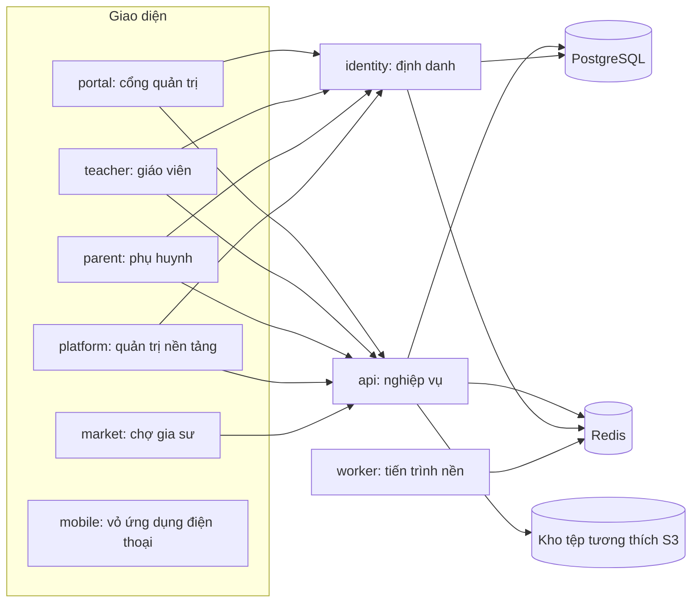

[English](README.en.md) | **Tiếng Việt**

# School Management

Hệ thống quản lý trường học nhiều trường (SaaS) cho các cấp Mầm non, Tiểu học, THCS và THPT, xây dựng theo các quy định và thông lệ quản lý giáo dục ở Việt Nam. Mỗi trường được cấu hình theo cấp học của mình; một trường có thể là trường liên cấp.

Đây là sản phẩm độc lập, không phải sản phẩm của cơ quan quản lý giáo dục nào. Dự án đang được phát triển: phạm vi, trạng thái từng phần và các quyết định nằm trong bộ tài liệu đánh số ở [`tai_lieu/`](tai_lieu/index.md), đó là nguồn chính thức của dự án.

## Tính năng chính

Danh sách đầy đủ nằm ở tài liệu; bên dưới chỉ là các nhóm chính.

| Nhóm                               | Nội dung tóm tắt                                                                                        | Xem thêm                                                                                                                                                                                                                        |
| ---------------------------------- | ------------------------------------------------------------------------------------------------------- | ------------------------------------------------------------------------------------------------------------------------------------------------------------------------------------------------------------------------------- |
| Nền tảng, đơn vị, phân quyền       | Cây đơn vị (trường chính, phân hiệu, điểm trường), năm học, tài khoản, vai trò, quyền, nhật ký thao tác | [05 Phạm vi](tai_lieu/05_PHAM_VI.md), [08 Vai trò](tai_lieu/08_VAI_TRO_NGUOI_DUNG.md)                                                                                                                                           |
| Học sinh, phụ huynh, lớp học       | Hồ sơ, phân lớp, chuyển lớp, tuyển sinh                                                                 | [06 Yêu cầu nghiệp vụ](tai_lieu/06_YEU_CAU_NGHIEP_VU.md), [25 Quy trình](tai_lieu/25_QUY_TRINH_NGHIEP_VU)                                                                                                                       |
| Giảng dạy theo cấp học             | Chương trình, thời khoá biểu, sổ đầu bài, sổ điểm, học bạ, xét lên lớp, tốt nghiệp (theo từng cấp)      | [10 Yêu cầu chức năng](tai_lieu/10_YEU_CAU_CHUC_NANG.md), [32 Kế hoạch](tai_lieu/32_KE_HOACH_THEO_HE_THONG_SO.md)                                                                                                               |
| Điểm danh, chăm sóc, y tế, bếp     | Điểm danh, đón trả, nhật ký, thuốc, khám sức khoẻ, thực đơn, suất ăn                                    | [QT-02](tai_lieu/25_QUY_TRINH_NGHIEP_VU/QT-02_DIEM_DANH_BAO_VANG.md), [QT-07](tai_lieu/25_QUY_TRINH_NGHIEP_VU/QT-07_DAN_THUOC_VA_CHAM_SOC_SUC_KHOE.md)                                                                          |
| Tài chính                          | Học phí, miễn giảm, công nợ, phiếu thu, phiếu chi, quỹ                                                  | [QT-03](tai_lieu/25_QUY_TRINH_NGHIEP_VU/QT-03_DANG_KY_DICH_VU_VA_TINH_HOC_PHI.md), [QT-04](tai_lieu/25_QUY_TRINH_NGHIEP_VU/QT-04_THU_HOC_PHI_VA_CONG_NO.md), [QT-05](tai_lieu/25_QUY_TRINH_NGHIEP_VU/QT-05_PHIEU_CHI_VA_QUY.md) |
| Nhân sự, chấm công, lương          | Hồ sơ nhân sự, hợp đồng, chấm công, nghỉ phép, bảng lương                                               | [QT-06](tai_lieu/25_QUY_TRINH_NGHIEP_VU/QT-06_CHAM_CONG_VA_TINH_LUONG.md)                                                                                                                                                       |
| Kho, tài sản, mua hàng, tuyển dụng | Tài sản, cấp phát, tồn kho, đề nghị mua, tin tuyển dụng                                                 | [05 Phạm vi](tai_lieu/05_PHAM_VI.md)                                                                                                                                                                                            |
| Truyền thông và tương tác          | Thông báo (kể cả thông báo đẩy), hoạt động, album, khảo sát, website công khai của trường               | [QT-09](tai_lieu/25_QUY_TRINH_NGHIEP_VU/QT-09_NHAT_KY_VA_TRAO_DOI.md), [QT-10](tai_lieu/25_QUY_TRINH_NGHIEP_VU/QT-10_HOAT_DONG_VA_CONG_BO.md)                                                                                   |
| Học trực tuyến và thi              | Bài tập, thi trực tuyến, lớp học trực tiếp, khoá học ghi sẵn                                            | [32 Kế hoạch](tai_lieu/32_KE_HOACH_THEO_HE_THONG_SO.md)                                                                                                                                                                         |
| Chợ gia sư                         | Gia sư trong trường và chợ gia sư                                                                       | [32 Kế hoạch](tai_lieu/32_KE_HOACH_THEO_HE_THONG_SO.md)                                                                                                                                                                         |
| Nền tảng nhiều trường              | Gói dịch vụ, giới hạn theo gói, tên miền riêng, quản trị nền tảng                                       | [12 Kiến trúc](tai_lieu/12_KIEN_TRUC_HE_THONG.md), [32 Kế hoạch](tai_lieu/32_KE_HOACH_THEO_HE_THONG_SO.md)                                                                                                                      |
| Báo cáo                            | Bảng điều khiển theo vai trò, báo cáo theo phân hệ và theo cấp                                          | [34 Tổng hợp chức năng](tai_lieu/34_TONG_HOP_CHUC_NANG_HE_THONG/00_MUC_LUC.md)                                                                                                                                                  |

Mô tả chi tiết chức năng đã có trên nhánh `main`: [34 Tổng hợp chức năng hệ thống](tai_lieu/34_TONG_HOP_CHUC_NANG_HE_THONG/00_MUC_LUC.md). Tài liệu [33](tai_lieu/33_HO_SO_PHAP_LY/00_MUC_LUC.md) chỉ là bộ mẫu hồ sơ pháp lý để tham khảo, không phải tư vấn pháp lý và không phải chứng nhận tuân thủ.

## Kiến trúc

Kho mã là monorepo pnpm (`pnpm-workspace.yaml`: `apps/*`, `packages/*`, `database`, `tests`), viết bằng TypeScript.



| Thư mục                         | Vai trò                                                                                                               |
| ------------------------------- | --------------------------------------------------------------------------------------------------------------------- |
| `apps/api`                      | Máy chủ API nghiệp vụ (NestJS), tiến trình gửi thông báo, việc định kỳ                                                |
| `apps/identity`                 | Dịch vụ định danh: tài khoản, vai trò, quyền, đăng nhập, phiên                                                        |
| `apps/worker`                   | Tiến trình chạy nền, hiện là máy xếp thời khoá biểu, lấy việc từ hàng đợi Redis                                       |
| `apps/portal`                   | Cổng quản trị cho cán bộ nhà trường                                                                                   |
| `apps/teacher`                  | Ứng dụng giáo viên (web, dùng được trên điện thoại)                                                                   |
| `apps/parent`                   | Ứng dụng phụ huynh                                                                                                    |
| `apps/platform`                 | Cổng quản trị nền tảng nhiều trường                                                                                   |
| `apps/market`                   | Chợ gia sư                                                                                                            |
| `apps/mobile`                   | Vỏ ứng dụng điện thoại (Capacitor)                                                                                    |
| `apps/student`                  | Ứng dụng học sinh, **đang được tách riêng ở PR 224, chưa có trên `main`**                                             |
| `apps/tutor`                    | Ứng dụng gia sư, **đang được tách khỏi chợ gia sư ở PR 223, chưa có trên `main`**                                     |
| `packages/`                     | Mã dùng chung: `config` (cấu hình TypeScript), `shared`, `server`, `ui`, `pwa`                                        |
| `database/`                     | Lược đồ và tệp thay đổi cấu trúc (migration) của từng loại cơ sở dữ liệu: định danh, hệ thống, năm học, nền tảng, chợ |
| `tests/`                        | Kiểm thử e2e Playwright và các kiểm thử mức kho mã                                                                    |
| `deploy/`                       | Hồ sơ và cấu hình triển khai                                                                                          |
| `docker/`, `docker-compose.yml` | Môi trường phát triển trên máy                                                                                        |
| `tai_lieu/`                     | Bộ tài liệu của dự án                                                                                                 |

Về dữ liệu: dịch vụ định danh có cơ sở dữ liệu riêng; máy chủ API dùng một cơ sở dữ liệu hệ thống và mỗi năm học một cơ sở dữ liệu nghiệp vụ. Ở chế độ nhiều trường, mỗi trường có dữ liệu tách biệt, theo bố cục một cơ sở dữ liệu riêng hoặc một schema riêng (hồ sơ thử nghiệm). Chi tiết: [12 Kiến trúc hệ thống](tai_lieu/12_KIEN_TRUC_HE_THONG.md), [13 Công nghệ](tai_lieu/13_CONG_NGHE_SU_DUNG.md), [16 Cơ sở dữ liệu](tai_lieu/16_CO_SO_DU_LIEU.md).

## Chạy trên máy

Yêu cầu:

- Node.js 24 trở lên (`engines` trong `package.json`).
- pnpm 10.12.1 (`packageManager`; bật bằng Corepack).
- Docker và Docker Compose, để chạy PostgreSQL 17, Redis 7 và kho tệp SeaweedFS.

```bash
pnpm install
cp .env.example .env        # rồi chỉnh giá trị cho máy của bạn
pnpm environment:start      # docker compose up -d
pnpm build
pnpm database:migrate
```

`.env.example` chỉ chứa giá trị mẫu; đọc chú thích trong tệp để biết biến nào cần điền (khoá, mật khẩu, tích hợp thanh toán). Không đưa `.env` lên kho mã.

Chạy dịch vụ (sau khi dựng):

```bash
pnpm --filter @school-management/identity start
pnpm --filter @school-management/api start
pnpm --filter @school-management/portal dev     # tương tự cho teacher, parent, platform, market
```

Cổng mặc định lấy từ cấu hình trong kho mã:

| Thành phần                      | Cổng                   |
| ------------------------------- | ---------------------- |
| API                             | 3000 (`API_PORT`)      |
| Dịch vụ định danh               | 3001 (`IDENTITY_PORT`) |
| portal / teacher / parent       | 5173 / 5174 / 5175     |
| platform / market               | 5177 / 5178            |
| student / tutor                 | 5179 / 5181            |
| PostgreSQL / Redis / kho tệp S3 | 5432 / 6379 / 8333     |

Các lệnh có sẵn ở thư mục gốc: `pnpm build`, `pnpm typecheck`, `pnpm lint`, `pnpm format`, `pnpm format:check`, `pnpm test`, `pnpm test:e2e`, `pnpm database:migrate`, `pnpm environment:start`, `pnpm environment:stop`.

## Kiểm thử

- **Kiểm thử đơn vị và API**: `pnpm test` (chạy từng gói, tuần tự). Cần PostgreSQL, Redis và kho tệp đang chạy và đã `pnpm database:migrate`.
- **e2e giao diện**: `pnpm test:e2e` (Playwright, Chromium, thư mục `tests/`). Bộ nhiều trường: `pnpm --filter @school-management/tests e2e:multi`.
- **Chạy e2e khi nhiều phiên làm việc song song**: các lần chạy e2e dùng chung cơ sở dữ liệu và cổng, nên theo quy ước của dự án là giữ khoá `.claude/e2e.lock` trong lúc chạy và không chạy cùng lúc với kiểm thử đơn vị toàn kho (cổng kiểm của từng đợt ở [32 Kế hoạch](tai_lieu/32_KE_HOACH_THEO_HE_THONG_SO.md)). Khoá này là quy ước làm việc, không phải cơ chế của Playwright.
- **CI** (`.github/workflows/ci.yml`): `kiem-thu` (định dạng, kiểm tệp mảnh, kiểm chỉ mục sinh tự động, lint, build, typecheck, migrate, kiểm thử đơn vị), `kiem-thu-giao-dien`, `kiem-thu-thiet-bi` (theo khổ thiết bị), `kiem-thu-nhieu-truong`, `quet-phu-thuoc` (`pnpm audit`), `dung-anh-docker` (dựng ảnh, kiểm cú pháp Compose và Caddy).

Kế hoạch và kịch bản kiểm thử: [20](tai_lieu/20_KE_HOACH_KIEM_THU.md), [21](tai_lieu/21_KICH_BAN_KIEM_THU.md).

## Triển khai

Cấu hình nằm trong [`deploy/`](deploy/README.md). Có hai hồ sơ dùng chung mã nguồn và ảnh container:

- **Thử nghiệm**: [`deploy/profiles/trial/`](deploy/profiles/trial/README.md), nền tảng nhiều trường trên các dịch vụ gói miễn phí.
- **Vận hành**: [`deploy/profiles/production/`](deploy/profiles/production/README.md), nhiều trường trên máy chủ ảo (VPS) với Docker Compose, Caddy, PgBouncer, giám sát và triển khai không gián đoạn.

Bản một trường, một máy chủ nằm ở [`deploy/README.md`](deploy/README.md). Tệp mẫu chỉ chứa giá trị giả; bí mật thật để ngoài kho mã.

## Đóng góp

Ngôn ngữ của tài liệu và giao diện là tiếng Việt. Quy ước chính:

- **Tài liệu đánh số** ở `tai_lieu/`: mục lục ở [`index.md`](tai_lieu/index.md). Đổi hành vi hoặc thêm chức năng thì cập nhật tài liệu liên quan trong cùng PR.
- **Tệp mảnh thay đổi**: mỗi PR thêm đúng một tệp `tai_lieu/thay_doi_cho_gom/YCTD-<số>-<tên-ngắn>.md` thay vì sửa trực tiếp nhật ký, lịch sử phiên bản, yêu cầu thay đổi. Kiểm định dạng bằng `node scripts/gom-thay-doi.mjs --kiem` (CI cũng chạy). Quy ước: [`thay_doi_cho_gom/README.md`](tai_lieu/thay_doi_cho_gom/README.md).
- **Đăng ký tự động**: không sửa danh sách chung. Tệp migration đặt ở `database/<loại>/migrations/`, kiểu bảng ở `database/<loại>/schema-parts/`, mô-đun API ở `apps/api/src/dang-ky/`; chỉ mục được sinh khi dựng (`database/sinh-chi-muc.mjs`, `apps/api/sinh-dang-ky.mjs`, CI chạy với `--kiem`).
- **Mỗi PR một phần** của một đầu việc (mã `DT-xx`, ví dụ phần `27f`), kèm mã YCTD.
- **Gộp nhánh bằng merge, không rebase.** Muốn cập nhật nhánh theo `main` thì merge `main` vào nhánh.
- Trước khi đẩy: `pnpm format:check`, `pnpm lint`, `pnpm typecheck`.

## Giấy phép

Chưa có giấy phép: kho mã không có tệp `LICENSE`. Khi chưa có giấy phép, mặc định chưa ai được phép sao chép, sửa hay phân phối lại mã nguồn. Liên hệ chủ dự án nếu cần.
