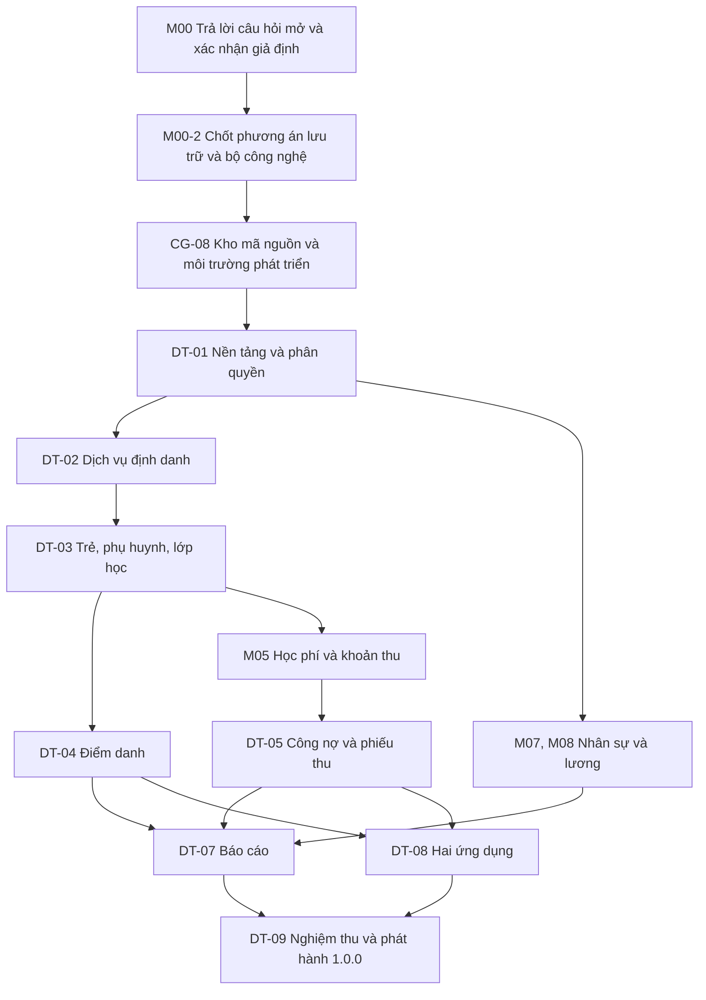

# 01. KẾ HOẠCH TỔNG THỂ

- Mô tả: Tài liệu điều phối cấp cao nhất của dự án: mười hai giai đoạn kèm cổng kiểm soát, các mốc phát hành, kế hoạch thực thi theo đợt, đường găng, tổ chức thực hiện, quản lý thay đổi và rủi ro.
- Phiên bản: 1.72
- Ngày cập nhật: 2026-10-26
- Trạng thái: Đã phê duyệt
- Người phê duyệt: Eric, ngày 2026-10-09

## 1. Mục đích và phạm vi áp dụng

Tài liệu này là kế hoạch tổng thể của dự án. Nó trả lời bốn câu hỏi mà các tài liệu khác không trả lời: dự án đi qua những bước nào, mỗi bước kết thúc bằng điều kiện gì, ai quyết định ở mỗi bước, và việc gì chặn việc gì.

Tài liệu này **không thay thế** các tài liệu khác. Nó chỉ đứng trên và trỏ xuống:

| Tài liệu | Vai trò |
|---|---|
| `01_KE_HOACH_TONG_THE.md` (tệp này) | Thứ tự, cổng, trách nhiệm, rủi ro |
| `03_DANH_SACH_CONG_VIEC.md` | Việc cụ thể hằng ngày và tiến độ theo phân hệ |
| `02_NHAT_KY_DU_AN.md` | Việc đã làm, theo ngày |
| `23_LICH_SU_PHIEN_BAN.md` | Phiên bản đã phát hành |
| `04` đến `22` | Nội dung nghiệp vụ, thiết kế, kiểm thử, bảo mật |
| `24_YEU_CAU_THAY_DOI.md` | Yêu cầu thay đổi và đánh giá ảnh hưởng |
| `25_QUY_TRINH_NGHIEP_VU/` | Đặc tả quy trình nghiệp vụ `QT-01` đến `QT-10` |

Đối tượng đọc: người quyết định (Eric), người thực hiện (Minh), và bất kỳ ai tham gia dự án về sau.

Phạm vi áp dụng: từ giai đoạn 01 Xác định ý tưởng tới giai đoạn 12 Vận hành và cải tiến, không bỏ giai đoạn nào.

## 2. Nguyên tắc điều hành

Kế hoạch này vận hành trên bảy nguyên tắc bất biến của quy trình, không thương lượng, không được bỏ qua kể cả khi được yêu cầu:

1. **Con người quyết định, trí tuệ nhân tạo thực hiện.** Eric quyết định mục tiêu, nghiệp vụ, phạm vi, quyền hạn, quy tắc dữ liệu, tiêu chuẩn chất lượng và nghiệm thu cuối cùng.
2. **Không đoán.** Thiếu thông tin thì dừng lại, làm đủ năm việc: phát hiện, mô tả, xác định thành phần ảnh hưởng, đưa phương án, xin xác nhận.
3. **Không phá vỡ.** Mọi thay đổi phải bảo toàn dữ liệu, giao diện lập trình, nghiệp vụ, phân quyền, giao diện và chức năng đang có.
4. **Không xóa chức năng** nếu Eric không yêu cầu rõ ràng.
5. **Không tự phát sinh chức năng.** Chỉ đề xuất, chờ phê duyệt.
6. **Xây nhỏ, kiểm tra, tiếp tục.** Chia theo cấp bậc sản phẩm, phân hệ, chức năng, nhiệm vụ.
7. **Không có tiêu chí nghiệm thu thì không được coi là hoàn thành.**

Bốn câu kiểm soát của quy trình, áp dụng cho mọi cổng trong tài liệu này:

- Không có đầu vào đạt chuẩn thì không bắt đầu.
- Không có đầu ra đạt chuẩn thì không chuyển tiếp.
- Không có tiêu chí nghiệm thu thì không được coi là hoàn thành.
- Không có kiểm soát thay đổi thì không được coi là phát triển có kiểm soát.

## 3. Sản phẩm và các mốc phát hành

Sản phẩm: School Management, hệ thống quản lý trường mầm non cho một trường công lập có cây đơn vị hai cấp: Trường chính và các Phân hiệu, Điểm trường trực thuộc (QĐ-23). Gồm cổng quản trị trên trình duyệt, ứng dụng giáo viên và ứng dụng phụ huynh; một máy chủ giao diện lập trình ứng dụng nghiệp vụ và một dịch vụ định danh độc lập; cơ sở dữ liệu định danh, cơ sở dữ liệu hệ thống và mỗi năm học một cơ sở dữ liệu; API chỉ đọc cho đối tác.

| Mốc | Nội dung | Giai đoạn quy trình | Trạng thái |
|---|---|---|---|
| 0.1.0 | Khởi tạo bộ tài liệu thiết kế | 01 đến 07 | Đã có |
| 0.2.0 | Bốn thay đổi: Ban Giám hiệu, nhiều cấp đơn vị, tách giao diện và máy chủ, dịch vụ định danh | 01 đến 07 | Đã có |
| 0.3.0 | Kế hoạch tổng thể dự án | 08 | Đã có |
| 0.3.1 | Đổi tên dự án thành School Management | 01 đến 08 | Đã có |
| 0.84.0 | DT-17 phần 17e, 1.7 Rà soát thông tin kiểm định CLGD đủ ô như Sở: tên trường, mã trường, loại hình, cấp học; năm, ngày công nhận và mức độ chuẩn quốc gia; năm, ngày công nhận và cấp độ kiểm định CLGD; diện tích sàn xây dựng/học sinh; thời điểm đăng ký chuẩn quốc gia; ghi chú tối đa 500 ký tự; hồ sơ trường thêm tám ô khóa cố định (YCTD-136) | 13, 21 | Đã có |
| 0.85.0 | DT-17 phần 17b, phân hệ Quản lý kí hồ sơ theo bốn mẫu hồ sơ của Sở: nội dung hồ sơ trường, lớp, nhân sự, học sinh theo phần và mục của Sở, tệp dữ liệu XML, cửa sổ Xem hồ sơ kí, kiểu chữ ký và năm nhà phát hành của Sở, lưới 2.2, 2.3 theo cột của Sở, bỏ sổ đầu bài ở cấp Mầm non (YCTD-133) | 01, 02, 03, 07, 08, 10, 11, 14, 16, 17, 21, 23, 24, 32, index | Đã có |
| 0.86.0 | DT-17 phần 17a, báo cáo số liệu EMIS theo chỉ tiêu và mã số của Sở: Biểu 01.ĐN-MN năm thẻ mã 01 đến 217, Biểu 08.ĐN-NSNN mã 1 đến 71, 1.2.1 mã 01 đến 84 có cột Xây dựng mới, 2.1, 2.2, 2.3 theo cấu trúc của Sở, 2.4 trống ở học kỳ I, Xóa dữ liệu, trang 1.1.2 Gửi báo cáo đầu năm chạy nội bộ (YCTD-132) | 01, 02, 03, 07, 08, 10, 11, 14, 16, 17, 21, 23, 24, 32, index | Đã có |
| 0.87.0 | DT-17 phần 17c, phân hệ Tuyển sinh đầu cấp phần 1 theo hệ thống của Sở, bản chạy nội bộ: 1.1 Hồ sơ học sinh cuối cấp mầm non (luồng sáu trạng thái, kiểm dò, hạn điều chỉnh, duyệt, cập nhật từ Excel, PDF A5, A4 gập đôi), màn hình Hồ sơ cuối cấp của ứng dụng phụ huynh, 1.2 Gửi xác nhận hoàn thành (đánh dấu tay), 1.8 Thông tin trường theo bản đồ, 2.1 Dịch vụ tại trường, 3.1 đến 3.4, 4.1 Thống kê hồ sơ cuối cấp, 5.1 Hỗ trợ tuyển sinh; không kết nối phân tuyến của Sở (YCTD-134) | 01, 02, 03, 07, 08, 10, 11, 14, 16, 17, 21, 23, 24, 32, index | Đã có |
| 0.88.0 | DT-17 phần 17d, phân hệ Tuyển sinh đầu cấp phần 2 theo hệ thống của Sở, bản chạy nội bộ: 1.3 Danh sách học sinh đăng ký trường tiên tiến, 1.4 Tiếp nhận hồ sơ tuyển sinh (danh sách phân tuyến nhập từ Excel, giấy tờ đã nộp, đồng ý nhập học), 1.5 Gửi thông báo tuyển sinh đầu cấp (ứng dụng phụ huynh, Zalo OA), 1.6 Chuyển hồ sơ trúng tuyển sang CSDL (mã gói tin, mã GUID), 1.7 Danh sách kết quả chuyển hồ sơ (Hủy nhập học), 5.11 Danh sách trúng tuyển ở phân hệ Mầm non; không kết nối phân tuyến của Sở (YCTD-135) | 01, 02, 03, 07, 08, 10, 11, 14, 16, 17, 21, 23, 24, 32, index | Đã có |
| 0.89.0 | DT-18 phần 18a, văn bản đến theo VNPT iOffice: phân hệ "Quản lý văn bản và điều hành", sổ văn bản đến, vào sổ theo biểu mẫu THÔNG TIN VĂN BẢN ĐẾN, luồng xử lý (trình lãnh đạo, chuyển xử lý chính, phối hợp, xem để biết, chuyển trực tiếp, luân chuyển, trả lại, từ chối, lấy lại, xin gia hạn, kết thúc, kết thúc và lưu hồ sơ hàng loạt), hạn chế xem, đánh dấu, theo dõi, phiếu trình, phiếu xử lý, phiếu giao nhận, sổ đăng ký xuất Excel, đơn vị bên ngoài, nhóm đơn vị ban hành, danh mục văn bản, liên thông bản chạy nội bộ (YCTD-138) | 01, 02, 03, 07, 08, 10, 11, 14, 16, 17, 21, 23, 24, 32, index | Đã có |
| 0.90.0 | DT-18 phần 18d, phân hệ KPI chuyển từ hệ thống KPI riêng của trường: kỳ và lịch kỳ, hai bộ quy tắc chấm cấu hình được có phiên bản (Bộ quy tắc 1 theo tiến độ và kết quả, Bộ quy tắc 2 theo thang 6 mức của Nghị định 233/2026), tiêu chí chung theo Mẫu 01-A, 01-B, đối tượng đánh giá, danh mục công việc chuẩn, giao việc, đăng ký, minh chứng, tự đánh giá, chấm, ủy quyền chấm, hạn tự động, kết luận, tham mưu, biểu quyết, báo cáo Excel, Word, PDF, chuyển dữ liệu từ hệ thống cũ (YCTD-139) | 01, 02, 03, 07, 08, 10, 11, 14, 16, 17, 21, 23, 24, 32, index | Đã có |
| 0.91.0 | DT-18 phần 18b, văn bản đi theo VNPT iOffice: dự thảo theo biểu mẫu văn bản đi, lấy ý kiến, cho ý kiến, trình ký, ký nội bộ (quy trình kí của Quản lý kí hồ sơ, mã QR tra cứu), không ký, trả lại, cấp số và phát hành theo sổ văn bản đi, liên thông nội bộ thành văn bản đến của đơn vị nhận, liên thông ra ngoài bản chạy nội bộ, public lên cổng TTĐT, đóng băng, lưu hồ sơ, sổ đăng ký văn bản đi, phiếu trình ký (YCTD-140) | 01, 02, 03, 07, 08, 10, 11, 14, 16, 17, 21, 23, 24, 32, index | Đã có |
| 0.92.0 | DT-18 phần 18c theo VNPT iOffice: giao việc theo cây đơn vị (xử lý chính, phối hợp, theo dõi), phê duyệt, nhắc việc định kì, tạo việc từ văn bản đến; lịch đơn vị tuần sáng, chiều, mẫu lịch, lịch họp, phòng họp có duyệt; hồ sơ công việc cá nhân, chia sẻ, chuyển giao, nộp lưu sang văn thư lưu trữ; báo cáo xử lý văn bản đến, tổng hợp, thống kê (YCTD-141) | 01, 02, 03, 07, 08, 10, 11, 14, 16, 17, 21, 23, 24, 32, index | Đã có |
| 0.93.0 | DT-18 phần 18g, thiết bị: nơi để (phòng, kho, vị trí), tem QR in khổ A4, kiểm kê bằng điện thoại (ứng dụng giáo viên, web di động), đối chiếu, tỷ lệ sử dụng được, duyệt, chốt chênh lệch, biên bản; đối sánh danh mục tối thiểu theo cấp học, nạp mẫu Mầm non theo TT 02/2010 sửa đổi bởi TT 34/2013 (YCTD-143) | 01, 02, 03, 07, 08, 10, 11, 14, 16, 17, 21, 23, 24, 32, index | Đã có |
| 0.94.0 | DT-18 phần 18f: website trường trên tên miền riêng (tên miền lưu ở cơ sở dữ liệu, Caddy cấp chứng chỉ theo yêu cầu cho tên miền đã đăng ký), trang công khai (tin tức, thông báo, văn bản công khai từ 18b, tuyển sinh, công khai theo Thông tư 09/2024/TT-BGDĐT, thư viện ảnh, liên hệ), soạn, duyệt, đăng, gỡ, lọc HTML, chế độ trình diễn (YCTD-144) | 01, 02, 03, 07, 08, 10, 11, 14, 16, 17, 21, 23, 24, 32, index | Đã có |
| 0.95.0 | DT-18 phần 18e, hồ sơ chuyên môn và Việc của tôi theo mô tả công khai của GIKIDI Nhà Trường: phân hệ mới "Hồ sơ chuyên môn": Việc của tôi gom việc đang chờ ở văn bản đến, văn bản đi, giao việc, phòng họp, KPI, hồ sơ chuyên môn, kế hoạch bài dạy, kí hồ sơ, nghỉ phép, có lọc và số đếm trên menu; kho hồ sơ ba nhánh (cá nhân, tổ hoặc nhóm, trường) theo năm học, danh mục thư mục mặc định theo cấp học; đợt nộp có hạn, bảng ai chưa nộp, nhắc hạn; luồng duyệt theo thư mục (tổ trưởng rồi Ban Giám hiệu), trả lại, phiên bản khi nộp lại, kí nội bộ; thống kê nộp đúng hạn, trễ, chưa nộp; nhóm công tác; khóa năm học (YCTD-142) | 01, 02, 03, 07, 08, 10, 11, 14, 16, 17, 21, 23, 24, 32, index | Đã có |
| 0.96.0 | DT-18 phần 18h: đăng nhập thay (lý do, thanh báo, thoát, nhật ký, không vào tài khoản quyền cao hơn), gói ZIP toàn bộ dữ liệu của trường (tiến trình nền, hạn tải, nhật ký), bản trình diễn (dữ liệu giả, trang chọn vai, chặn gửi tin và thanh toán, tự đặt lại) | YCTD-145 |
| 0.97.0 | DT-18 phần 22i: kế hoạch giáo dục (thư viện mẫu theo cấp học, duyệt tổ trưởng, Phó Hiệu trưởng, Hiệu trưởng, kí nội bộ, lưu kho hồ sơ, phiên bản và so sánh, sao chép từ năm trước, xuất Word, PDF, tiến độ duyệt, tạo kế hoạch công việc) (YCTD-147) | 2026-10-21 |
| 0.98.0 | DT-18 phần 22b: lô hàng nhập, hồ sơ an toàn thực phẩm của nhà cung cấp (cảnh báo hết hạn), kiểm thực ba bước, lưu và hủy mẫu thức ăn, truy xuất nguồn gốc, sổ in theo Quyết định 1246/QĐ-BYT | YCTD-146 |
| 0.99.0 | DT-18 phần 22d: phân hệ Thi đua, khen thưởng (danh mục cấu hình, đợt, đăng ký, hồ sơ đề nghị lấy KPI và minh chứng, hội đồng bỏ phiếu kín, phúc khảo, quyết định, giấy khen có mã tra cứu, sổ nhiều năm) | YCTD-148 |
| 0.100.0 | DT-18 phần 22f: phân hệ Bảo đảm chất lượng; bộ tiêu chuẩn cấu hình được, đợt tự đánh giá, hội đồng, nhóm công tác, phiếu tiêu chí, minh chứng có mã, kế hoạch cải tiến, báo cáo tự đánh giá, theo dõi công nhận nối 1.7 | YCTD-149 |
| 0.101.0 | DT-19 phần 19a: nền cấp học của trường (bảng `school_levels`, `SchoolLevelResolver`, phạm vi cấp của người dùng, thẻ Cấp học của trường; ô ngữ cảnh, website đọc cấp từ một nguồn) | YCTD-151 |
| 0.102.0 | DT-19 phần 19b: cấu trúc theo cấp học (khối, chương trình, lớp, đơn vị, học kỳ, tuần theo cấp; khối mẫu Tiểu học, THCS, THPT; trường Mầm non giữ nguyên) | YCTD-152 |
| 0.103.0 | DT-19 phần 19c: menu và phân hệ theo cấp học (thuộc tính `levels`, tên phân hệ theo cấp, bộ chọn cấp đang làm việc, tham số cấp dùng chung, nhãn thuật ngữ theo cấp) | YCTD-153 |
| 0.104.0 | DT-19 phần 19d: số liệu theo cấp học (tham số cấp dùng chung; thống kê, chấm công và suất ăn theo cấp; EMIS, tăng trưởng, hồ sơ cuối cấp chỉ Mầm non; biểu phí theo cấp) | YCTD-154 |
| 0.105.0 | DT-19 phần 19e: cổng phụ huynh và ứng dụng giáo viên đa cấp (chức năng theo cấp, tên cấp của con và lớp, tin tức có cấp nhận, số người nhận trước khi công bố) | YCTD-155 |
| 0.106.0 | DT-19 phần 19f: tệp vá cấp học chạy lặp được, lệnh kiểm đối chiếu chỉ đọc, trường liên cấp trong bản trình diễn, e2e liên cấp, ghi chú chuẩn bị DT-20, DT-21 | YCTD-156 |
| 0.107.0 | DT-20 phần 20a: nền Tiểu học (môn học và hoạt động giáo dục, số tiết theo khối, phân công giảng dạy theo môn, môn tự chọn, menu Tiểu học) | YCTD-158 |
| 0.108.0 | DT-20 phần 20b: bán trú Tiểu học (danh sách ăn, cắt suất, chốt suất, nối bếp và tiền ăn); nề nếp, thi đua lớp tuỳ trường | YCTD-159 |
| 0.109.0 | DT-20 phần 22c1: thời khoá biểu phần khung (khung giờ tiết, bản thời khoá biểu, nhập Excel, kiểm tra xung đột, ban hành, xem ở ứng dụng giáo viên, phụ huynh, website) | YCTD-160 |
| 0.110.0 | DT-20 phần 20c: đánh giá học sinh theo Thông tư 27/2020 (cấu hình theo cấp, nhập theo phân công, nhận xét thường xuyên, tổng hợp cuối kỳ, cuối năm, khoá số liệu, phụ huynh xem) | YCTD-161 |
| 0.114.0 | DT-21 phần 21a: nền THCS, THPT (bộ môn mẫu khối 6 đến 12, tổ hợp môn, đăng ký tổ hợp, tổ bộ môn) | YCTD-167 |
| 0.115.0 | DT-21 phần 21c: sổ điểm THCS, THPT theo Thông tư 22/2021 (điểm, trung bình, xếp loại, khoá điểm, cấu hình) | YCTD-170 |
| 0.120.0 | DT-21 phần 21e: học bạ số, khen thưởng, xét lên lớp THCS, THPT (danh hiệu Xuất sắc, Giỏi, lên lớp, hoàn thành cấp học, học bạ có điểm trung bình hai học kỳ) | YCTD-172 |
| 0.121.0 | DT-21 phần 22g2: kiểm tra, đánh giá phần chấm (phiếu trả lời, nhập bài, tệp quét, chấm tự luận, khoá điểm, chuyển sổ điểm, báo cáo theo câu, chủ đề, mức nhận thức) | YCTD-173 |
| 0.124.0 | DT-21 phần 21f: xét tốt nghiệp THCS, THPT và hồ sơ thi (danh sách đủ điều kiện, hồ sơ dự thi, số báo danh, phòng thi, điểm thi, công nhận, giấy chứng nhận, biên bản, tệp xuất, hồ sơ chuyển cấp) | YCTD-174 |
| 0.125.0 | DT-22 phần 22h1: kho học liệu số phần lõi (tải lên, liên kết, phiên bản, giấy phép bắt buộc, kiểm duyệt phân luồng, bộ sưu tập, báo lỗi, thống kê) | YCTD-183 |
| 0.126.0 | DT-22 phần 22h2: kho học liệu số, câu hỏi và chia sẻ (câu hỏi, đề, ma trận của ngân hàng trong kho, thống kê sử dụng, rubric, gói chia sẻ liên trường) | YCTD-184 |
| 0.127.0 | DT-21 phần 21g: báo cáo, thống kê THCS, THPT (sĩ số, tổ hợp, kết quả cuối năm, phổ điểm, theo giáo viên, tổ bộ môn) và biểu EMIS THCS, THPT cấu hình được | YCTD-175 |
| 0.128.0 | DT-SaaS phần S7a: hạ tầng VPS trong nước, phần dựng sẵn (hồ sơ "Vận hành": Compose T1 đến T3, PgBouncer, Caddy bắt mọi tên miền, giám sát, staging, triển khai không gián đoạn) | YCTD-198 |
| 0.116.0 | DT-20 phần 20f: báo cáo, thống kê Tiểu học (sĩ số, kết quả đánh giá, cuối năm, chuyên cần, bán trú; xuất Excel, PDF) và khung biểu EMIS Tiểu học cấu hình được | YCTD-165 |
| 0.117.0 | DT-21 phần 22g1: kiểm tra, đánh giá phần đề (ngân hàng câu hỏi, ma trận, kế hoạch kiểm tra, đề nhiều mã, thẩm định, khoá đề, xuất đề và đáp án) | YCTD-168 |
| 0.111.0 | DT-20 phần 20d: sổ đầu bài và điểm danh theo tiết (ghi, ký tiết theo thời khoá biểu, Ban giám hiệu ký sổ tuần, phụ huynh xem, tổng hợp chuyên cần) | YCTD-162 |
| 0.112.0 | DT-20 phần 20e: học bạ số (kí nội bộ), khen thưởng cuối năm có giấy khen mã tra cứu, hoàn thành chương trình lớp học, chương trình tiểu học, rèn luyện trong hè, kiểm tra lại, lên lớp; kết chuyển năm học | YCTD-163 |
| 0.113.0 | DT-20 phần 22c2: máy xếp thời khoá biểu chạy nền (ràng buộc có mức quan trọng, nhiều phương án), chỉnh tay có kiểm tra ngay, dạy thay, đổi tiết, báo cáo tiết dạy, dùng phòng, mã QR tra cứu | YCTD-164 |
| 0.118.0 | DT-21 phần 21b: thời khoá biểu THCS, THPT (dùng chung ba cấp, tiết học nhóm, tiết đôi, phòng bộ môn, nhập Excel có nhóm) | YCTD-169 |
| 0.119.0 | DT-22 phần 22e: hồ sơ bồi dưỡng giáo viên (khoá, đăng ký, kết quả, chứng nhận có mã tra cứu công khai, chứng chỉ, năng lực số) | YCTD-182 |
| 0.122.0 | DT-22 phần 22a: thư viện trường học (danh mục, bản sao, thẻ bạn đọc, mượn trả, đặt trước, sách giáo khoa, kiểm kê, báo cáo theo chuẩn) | YCTD-181 |
| 0.123.0 | DT-21 phần 21d: sổ đầu bài, điểm danh theo tiết THCS, THPT (tiết nhóm, quy tắc xếp loại theo cấp, xuất sổ tuần); sơ đồ chỗ ngồi; thi đua lớp, sao đỏ, điểm tiết | YCTD-171 |
| 0.83.0 | DT-15 phần 15f3, các phân hệ Bếp – kho, mua hàng; Tương tác – truyền thông; Giảng dạy; Tuyển sinh, tuyển dụng; Báo cáo theo giao diện chung của Sở: tiêu đề đánh số theo menu, 32 lưới dữ liệu chung, biểu mẫu Thêm mới theo khối; nghiệp vụ không đổi (YCTD-115) | 13, 21 | Đã có |
| 0.81.0 | DT-15 phần 15f2, phân hệ Nhân sự – chấm công, lương theo giao diện chung của Sở: tiêu đề đánh số theo menu, 17 lưới dữ liệu chung, biểu mẫu Thêm mới theo khối, hộp xác nhận xóa; nghiệp vụ không đổi (YCTD-113) | 13, 21 | Đã có |
| 0.82.0 | DT-15 phần 15f1, phân hệ Tài chính – học phí theo giao diện chung của Sở: tiêu đề đánh số theo menu, 20 lưới dữ liệu chung, biểu mẫu Thêm mới theo khối, hộp xác nhận xóa; nghiệp vụ không đổi (YCTD-114) | 13, 21 | Đã có |
| 0.80.1 | 2.1 Hồ sơ lớp học: cột hiện mặc định và 50 dòng mỗi trang theo Sở (YCTD-117) | 13, 21 | Đã có |
| 0.76.0 | DT-16 phần 16g, nhóm Học sinh đủ theo hệ thống của Sở: 4.1.1 Thay đổi, Xóa, Cấp mã định danh Bộ, Xuất file lỗi; 4.1.2, 4.1.3, 4.1.5, 4.1.8, 4.1.10, 5.4, 5.5; 4.1.11 nhập địa chỉ mới; 4.2 chuyển lớp hàng loạt, chuyển trường chạy nội bộ (YCTD-126) | 13, 21 | Đã có |
| 0.74.0 | DT-16 phần 16f, nhóm Nhân sự đủ theo hệ thống của Sở: 3.1.1 Thay đổi, Xóa, Xuất tệp theo mẫu Bộ, Xuất file lỗi, danh mục của Bộ, tài khoản ngân hàng, mã số thuế, xã ĐBKK; 3.1.2 Nhân sự phân hiệu; 3.1.3 Nhập nhân sự từ Excel; 3.1.5 Xác thực số định danh nhân sự (bản chạy nội bộ); 3.2 nhập mức đánh giá từ Excel; 3.5 Biến động nhân sự (bản chạy nội bộ); 5.2, 5.6, 5.9 (YCTD-124) | 13, 21 | Đã có |
| 0.75.0 | DT-16 phần 16h, sức khỏe, dinh dưỡng và thống kê học sinh theo hệ thống của Sở: nhập thông tin sức khỏe học sinh theo học kỳ, lấy số đo từ 4.3, tổng hợp cân đo theo học kỳ và so sánh hai lần cân đo, thực đơn theo mẫu của Sở và nhập thực đơn từ Excel, 5.3 Thống kê học sinh đủ các phần, số liệu báo cáo sức khỏe học sinh đầu năm (YCTD-125) | 13, 21 | Đã có |
| 0.78.0 | DT-16 phần 16i, cơ sở vật chất và thiết bị dạy học đủ theo hệ thống của Sở: 1.2 Báo cáo cơ sở vật chất (số liệu phòng, nhà vệ sinh, mức độ đạt chuẩn, gửi lên cấp trên chạy nội bộ), 6.1 Thực trạng và nhu cầu đầu tư, 6.2, 2.2 mục riêng, 2.3 Gửi thiết bị dạy học lên cấp trên (chạy nội bộ), nhập phòng và danh mục thiết bị từ Excel, gắn tài sản với thiết bị (YCTD-128) | 01, 02, 03, 07, 10, 11, 14, 16, 17, 21, 23, 24, 32, index | Đã có |
| 0.79.0 | DT-16 phần 16j, báo cáo số liệu EMIS theo hệ thống của Sở: đủ bảy biểu 1.1 (thêm thẻ Ngân sách nhà nước), 1.2 Báo cáo cơ sở vật chất, 1.3 Báo cáo sức khỏe học sinh đầu năm, 2.1 Báo cáo EMIS cuối năm, 2.2 Báo cáo đội ngũ, 2.3 Đề án ngoại ngữ, 2.4 Báo cáo giáo dục mầm non cuối năm; thẻ nhập tay có Lấy dữ liệu, Lấy dữ liệu năm trước, Ghi; danh sách gửi báo cáo bảy biểu, Xuất file lỗi (bản chạy nội bộ) (YCTD-129) | 13, 21 | Đã có |
| 0.80.0 | DT-16 phần 16k, phân hệ Quản lý kí hồ sơ theo hệ thống của Sở, bản chạy nội bộ: 1.1 Chứng thư số nhà trường (thông tin chứng thư, ảnh con dấu, đăng ký kí nội bộ), 2.1 Đồng bộ chứng thư số (đánh dấu đã đồng bộ), 2.2 Kí hồ sơ trường, lớp, nhân sự, học sinh, sổ đầu bài (tạo hồ sơ PDF, kí xác nhận nội bộ, tải thông tin thay đổi, hủy hồ sơ, xuất dữ liệu sổ đầu bài), 2.3 Xác nhận hoàn thành và gửi hồ sơ (đánh dấu đã gửi); không có chữ ký số thật (YCTD-130) |
| 0.77.0 | DT-16 phần 16e, trường, lớp và lịch năm học theo hệ thống của Sở: 1.4 khối Cấu hình trường (tên trường hiển thị, tên đơn vị hành chính, tính cân nặng/chiều cao cho trẻ suy dinh dưỡng thể nhẹ cân), 1.7 Rà soát thông tin kiểm định CLGD, 1.8 Tách trường (bản chạy nội bộ), 2.1 chọn nhiều lớp, thay đổi hàng loạt, xóa lớp, 2.2 nhập lớp đủ cột của Sở, 3.3 giáo viên chưa phân công, 3.4 Khai báo tuần, 5.7 Chuyển hồ sơ lên năm học mới (Thực hiện, Hủy) (YCTD-127) | 13, 21 | Đã có |
| 0.73.0 | DT-16 phần 16c, khung trang và đăng nhập theo hệ thống của Sở: tên trường và ngữ cảnh trên thanh đầu trang, ứng dụng liên kết, menu người dùng bảy mục, hộp thông báo khi vào trang, mã xác nhận, ghi nhớ tài khoản, quên mật khẩu, lịch sử mật khẩu, đường dây nóng, mã định danh tổ chức theo NĐ 69 (YCTD-123) | 13, 21 | Đã có |
| 0.69.0 | DT-16 phần 16b, lưới dữ liệu chung, hộp xác nhận xóa, Xuất Excel cho các màn hình còn lại theo hệ thống của Sở: cơ sở vật chất, thiết bị dạy học, cân đo, hồ sơ chưa nhập đủ, hoàn thành chương trình, nhóm học sinh, chuẩn nghề nghiệp, thực đơn, y tế, thuốc, quản trị hệ thống; Xuất Excel phân hiệu, điểm trường, địa danh hành chính, người dùng, nhóm người dùng (YCTD-119) | 13, 21 | Đã có |
| 0.72.0 | DT-15 phần 15h2, sửa hạn chế của văn thư lưu trữ: chia theo đơn vị, người giải quyết theo nhân sự, nhắc hạn, xóa lại tệp (YCTD-122) | 13, 21 | Đã có |
| 0.71.0 | DT-16 phần 16a, công cụ xuất, nhập dùng chung theo hệ thống của Sở: Xuất PDF trên lưới, tác vụ xuất nền và Tệp đã tạo, nhập Excel với file mẫu kèm dữ liệu, tra cứu danh mục, chọn cột, xuất file lỗi; mẫu gửi lên cấp trên chạy nội bộ (YCTD-121) | 13, 21 | Đã có |
| 0.68.0 | DT-15 phần 15h2, văn thư lưu trữ theo hệ thống của Sở: hồ sơ tài liệu hoàn thành, chưa hoàn thành, phông lưu trữ, thông tin lưu trữ, báo cáo lưu trữ (YCTD-118) | 13, 21 | Đã có |
| 0.70.0 | DT-16 phần 16d, quản trị hệ thống đủ theo hệ thống của Sở: hiệu lực, sửa, xóa nhóm; 1.2 phân quyền nhóm theo phần mềm; 1.4 đủ cột, bộ lọc, thao tác hàng loạt; 1.6 tài khoản đồng bộ của Bộ, của Sở (YCTD-120) | 13, 21 | Đã có |
| 0.66.0 | DT-15 phần 15h1, cập nhật địa danh hành chính theo hệ thống của Sở: lưới 4.1.11 địa chỉ học sinh theo địa danh cũ, đề xuất và chuyển hàng loạt, bảng đối chiếu Thành phố Hồ Chí Minh, nhập từ Excel (YCTD-116) | 13, 21 | Đã có |
| 0.65.0 | DT-15 phần 15d, nhân sự theo hệ thống của Sở: lưới 3.1.1 Hồ sơ cán bộ, giáo viên, mở rộng tìm kiếm, xuất Excel, hồ sơ hai thẻ, biểu mẫu thêm mới theo khối (YCTD-112) | 13, 21 | Đã có |
| 0.64.0 | DT-15 phần 15b, trường học, lớp học theo hệ thống của Sở: quản lý phân hiệu, điểm trường, hồ sơ lớp học, nhập lớp học, phân công phụ trách lớp (YCTD-111) | 13, 21 | Đã có |
| 0.63.0 | DT-15 phần 15g, gửi phản hồi ở chân trang, danh sách và xử lý ý kiến phản hồi, hết hạn mật khẩu (YCTD-110) | 13, 21 | Đã có |
| 0.62.0 | DT-15 phần 15e, quản trị hệ thống theo hệ thống của Sở: nhóm người dùng, phân quyền nhóm theo menu, danh sách người dùng (YCTD-109) | 13, 21 | Đã có |
| 0.61.0 | DT-15 phần 15c, học sinh theo hệ thống của Sở: Quản lý hồ sơ học sinh, điện thoại nhận tin, học 2 buổi/ngày và bán trú, biến động học sinh (YCTD-108) | 13, 21 | Đã có |
| 0.60.0 | DT-15 phần 15a, menu ngang đánh số, menu người dùng, lưới dữ liệu dùng chung, cấu hình lưới theo người dùng (YCTD-107) | 13, 21 | Đã có |
| 0.59.0 | DT-14 phần 14d, hồ sơ trường, khai báo cơ sở vật chất, thiết bị dạy học, biểu EMIS đầu năm (YCTD-106) | 13, 21 | Đã có |
| 0.58.0 | DT-14 phần 14a, cân nặng, chiều cao theo chuẩn WHO, thống kê theo tiêu chí ngành, hồ sơ chưa nhập đủ (YCTD-105) | 13, 21 | Đã có |
| 0.57.0 | DT-14 phần 14c, hoàn thành chương trình mầm non, chuẩn nghề nghiệp, nhóm học sinh (YCTD-104) | 13, 21 | Đã có |
| 0.56.0 | DT-14 phần 14b, năm học ở thanh đầu trang và Truy cập nhanh (YCTD-102) | 13, 21 | Đã có |
| 0.55.0 | DT-13 phần 13c, báo cáo điểm danh và suất ăn theo ngày, tuần, tháng (YCTD-103) | 13, 21 | Đã có |
| 0.54.0 | DT-13 phần 13a, nhập thẳng tệp học sinh, cán bộ theo mẫu CSDL ngành (YCTD-100) | 13, 21 | Đã có |
| 0.53.0 | DT-12 phần 12d, cấu hình triển khai môi trường chạy thật (YCTD-98) | 13, 21 | Đã có |
| 0.52.0 | DT-12 phần 12c, Fanpage và Zalo Official Account chạy thật (YCTD-95) | 13, 21 | Đã có |
| 0.51.0 | DT-12 phần 12b, cổng thanh toán PayOS, SePay, Casso, VNPay (YCTD-94) | 13, 21 | Đã có |
| 0.50.0 | DT-12 phần 12a, nối nhà cung cấp tin nhắn eSMS.vn (YCTD-93) | 13, 21 | Đã có |
| 0.49.0 | Eric nghiệm thu ba bản 1.0.0, 1.1.0, 1.2.0, chọn nhà cung cấp, lập đợt DT-12 (YCTD-92) | 01, 03 | Đã có |
| 0.48.0 | DT-11: báo cáo kiểm thử giai đoạn 3, bản ứng viên phát hành 1.2.0 (YCTD-91) | 01, 03, 30 | Đã có |
| 0.47.0 | DT-11 phần 11c, sổ kế toán kép theo chế độ kế toán hành chính, sự nghiệp (YCTD-88) | 09, 10 | Đã có |
| 0.46.0 | DT-11 phần 11d, nhập sao kê ngân hàng, đối soát tự động, nhiều cổng thanh toán (YCTD-89) | 09, 10 | Đã có |
| 0.45.0 | DT-11 phần 11a, tuyển sinh trực tuyến và tin tuyển sinh (YCTD-86) | 09, 10 | Đã có |
| 0.44.0 | DT-11 phần 11b, tuyển dụng: đề nghị, tin, ứng viên, phỏng vấn (YCTD-87) | 09, 10 | Đã có |
| 0.43.0 | DT-11 phần 11e, kết nối Facebook, Fanpage và Zalo Official Account (YCTD-90) | 09, 10 | Đã có |
| 0.42.0 | DT-10: báo cáo kiểm thử giai đoạn 2, bản ứng viên phát hành 1.1.0 (YCTD-84) | 01, 03, 21, 29 | Đã có |
| 0.41.0 | DT-10 phần 10i, nhắc nợ, xử lý công nợ quá hạn, đối chiếu ngân hàng, công nợ phải trả, chốt kỳ tài chính (YCTD-82) | 09, 10 | Đã có |
| 0.40.0 | DT-10 phần 10h, công việc, kế hoạch, đánh giá nhân sự, quá trình công tác, thưởng và khấu trừ (YCTD-81) | 09, 10 | Đã có |
| 0.39.0 | DT-10 phần 10j, báo cáo hoạt động và công việc, báo cáo hợp nhất, xuất dữ liệu (YCTD-83) | 09, 10 | Đã có |
| 0.38.0 | DT-10 phần 10g, giảng dạy: bài học, giáo án, thời khóa biểu, kế hoạch, tiến độ học tập (YCTD-80) | 09, 10 | Đã có |
| 0.37.0 | DT-10 phần 10f, tương tác với phụ huynh và đồ bị mất của trẻ (YCTD-79) | 09, 10 | Đã có |
| 0.36.0 | DT-10 phần 10e, hoạt động, hình ảnh, tin tức, thư viện, ngoại khóa (YCTD-78) | 09, 10 | Đã có |
| 0.35.0 | DT-10 phần 10c, bếp, thực đơn, định lượng và báo cáo ăn (YCTD-76) | 09, 10 | Đã có |
| 0.34.0 | DT-10 phần 10b, thuốc: danh mục, dặn thuốc, cho uống, mua và cấp thuốc (YCTD-75) | 09, 10 | Đã có |
| 0.33.0 | DT-10 phần 10d: kho, tài sản, mua hàng (YCTD-77) | 09, 10 | Đã có |
| 0.32.0 | DT-10 phần 10a: y tế học đường phần hồ sơ, khám, sự kiện, chăm sóc, báo cáo (YCTD-73, YCTD-74) | 09, 10 | Đã có |
| 0.31.0 | DT-09 phần 9g: báo cáo cổng CG-10, bản ứng viên phát hành 1.0.0 (YCTD-72) | 01, 03, 10, 28 | Đã có |
| 0.30.9 | DT-09 phần 9f: tiến trình gửi thông báo, gửi lại khi lỗi, giới hạn tin nhắn, nhắc ghi nhật ký (YCTD-71) | 09, 10 | Đã có |
| 0.30.8 | DT-09 phần 9e: sĩ số và nhật ký truy cập theo cấu hình, báo cáo thu chi theo nhóm (YCTD-70) | 09, 10 | Đã có |
| 0.30.7 | DT-09 phần 9d: chuyển trẻ, lớp, quỹ, công nợ sang năm học mới (YCTD-69) | 09, 10 | Đã có |
| 0.30.6 | DT-09 phần 9c: lịch nghỉ và lịch công tác (YCTD-68) | 09, 10 | Đã có |
| 0.30.5 | DT-09 phần 9b: chuyển đơn vị, thôi học, đồng ý hình ảnh, cờ trẻ con nhân viên (YCTD-67) | 09, 10 | Đã có |
| 0.30.4 | DT-09 phần 9a: kiểm thử bổ sung, ghi kết quả kiểm thử tự động (YCTD-66) | 10 | Đã có |
| 0.30.3 | DT-08 phần 8b: nhật ký của bé; hoàn thành đợt DT-08 (YCTD-65) | 08, 09 | Đã có |
| 0.30.2 | DT-08 phần 8a: trung tâm thông báo và mẫu thông báo (YCTD-64) | 08, 09 | Đã có |
| 0.30.1 | DT-07 phần 7b: khóa API cho đối tác chỉ đọc; hoàn thành đợt DT-07 (YCTD-63) | 08, 09 | Đã có |
| 0.30.0 | DT-07 phần 7a: bảng điều khiển và báo cáo cơ bản (YCTD-62) | 08, 09 | Đã có |
| 0.29.7 | DT-06 phần 6c-2: phiếu chi lương, bảng quyết toán, phiếu thu thu hồi lương, khoản điều chỉnh kỳ sau; hoàn thành đợt DT-06 (YCTD-61) | 08, 09 | Đã có |
| 0.29.6 | DT-06 phần 6c-1: danh mục lương, biểu thuế, bảng lương toàn trường, duyệt theo hạn mức, phiếu lương (YCTD-60) | 08, 09 | Đã có |
| 0.29.5 | DT-06 phần 6b-2: quy định và số ngày phép năm, đơn nghỉ phép, chốt và mở lại bảng công (YCTD-59) | 08, 09 | Đã có |
| 0.29.4 | DT-06 phần 6b-1: ngày nghỉ lễ, lịch học bù và nghỉ bù, giờ làm, thuộc tính loại nghỉ, chấm công (YCTD-59) | 08, 09 | Đã có |
| 0.29.3 | DT-06 phần 6a: hồ sơ nhân sự, hợp đồng lao động, liên kết tài khoản, nhập nhân sự từ Excel (YCTD-58) | 08, 09 | Đã có |
| 0.29.2 | DT-05 phần 5f: thanh toán trực tuyến qua tài khoản ảo và mã QR dùng một lần, đối chiếu tự lập phiếu thu (YCTD-57) | 08, 09 | Đã có |
| 0.29.1 | DT-05 phần 5e-2: phiếu đảo phiếu chi duyệt theo hạn mức (YCTD-56) | 08, 09 | Đã có |
| 0.29.0 | DT-05 phần 5e-1: phiếu chi duyệt theo hạn mức, hoàn tiền thôi học, sổ quỹ (YCTD-55) | 08, 09 | Đã có |
| 0.28.9 | DT-05 phần 5d-2: đảo phiếu thu, nhập công nợ đầu kỳ (YCTD-54) | 08, 09 | Đã có |
| 0.28.8 | DT-05 phần 5d-1: phiếu thu, phân bổ, quỹ và tài khoản, công nợ phải thu (YCTD-53) | 08, 09 | Đã có |
| 0.28.7 | DT-05 phần 5c-2: miễn giảm và phiếu điều chỉnh hóa đơn, duyệt theo hạn mức (YCTD-52) | 08, 09 | Đã có |
| 0.28.6 | DT-05 phần 5c-1: tính học phí, phát hành hóa đơn chính và bổ sung (YCTD-51) | 08, 09 | Đã có |
| 0.28.5 | DT-05 phần 5b: đăng ký dịch vụ, chốt kỳ, đăng ký và hủy trễ, học hè (YCTD-50) | 08, 09 | Đã có |
| 0.28.4 | DT-05 phần 5a: danh mục dịch vụ, biểu phí, loại miễn giảm, khoản mục thu chi (YCTD-49) | 08, 09 | Đã có |
| 0.28.3 | DT-04 phần 4b: người được ủy quyền đón trẻ, bàn giao, xác nhận tại cổng (YCTD-48) | 08, 09 | Đã có |
| 0.28.2 | DT-04 phần 4a: điểm danh, chốt ngày, báo vắng, ứng dụng giáo viên (YCTD-47) | 08, 09 | Đã có |
| 0.28.1 | DT-03 phần 3c: nhập lớp, trẻ và phụ huynh từ Excel, nhập mã định danh ngành (YCTD-46) | 08, 09 | Đã có |
| 0.28.0 | DT-03 phần 3b: hồ sơ trẻ, phụ huynh, duyệt và phân lớp, chuyển lớp, kho tệp, mã hóa số định danh (YCTD-45) | 08, 09 | Đã có |
| 0.27.9 | DT-03 phần 3a: lớp học và phân công giáo viên (YCTD-44) | 08, 09 | Đã có |
| 0.27.8 | DT-02: mật khẩu mặc định của phụ huynh, mã một lần, kích hoạt, ứng dụng phụ huynh, cookie riêng theo kênh (YCTD-43) | 08, 09 | Đã có |
| 0.27.7 | DT-01 phần 6b: phòng ban, chức danh, danh mục dùng chung, hạn mức phê duyệt, phòng học, bậc học (YCTD-42) | 08, 09 | Đã có |
| 0.27.6 | Chốt học phí mặc định mùng 1 tháng sau, chốt công cố định mùng 1 tháng sau (YCTD-41) | 01 đến 08 | Đã có |
| 0.27.5 | DT-01 phần 6a: cấu hình theo đơn vị, nhật ký thao tác, tự khóa tài khoản | 09 | Đã có |
| 0.27.4 | Cấu hình theo đơn vị, kế thừa từ Trường chính, tự khóa tài khoản lâu không dùng (YCTD-40) | 01 đến 08 | Đã có |
| 0.27.3 | DT-01 phần 5: tài khoản, vai trò, quyền | 09 | Đã có |
| 0.27.2 | Phân quyền quản lý tài khoản, mật khẩu tạm, nhật ký của dịch vụ định danh (YCTD-39) | 01 đến 08 | Đã có |
| 0.27.1 | DT-01 phần 4: cây đơn vị hai cấp, nhật ký thao tác | 09 | Đã có |
| 0.27.0 | Cây đơn vị hai cấp, nhãn cố định (YCTD-38) | 01 đến 08 | Đã có |
| 0.26.6 | DT-01 phần 3: năm học, lịch năm học, mở năm học | 09 | Đã có |
| 0.26.5 | Mở năm học mới là đóng năm cũ, sửa lịch tới khi đóng, quyền `P01.academic-year.manage` (YCTD-37) | 01 đến 08 | Đã có |
| 0.26.4 | DT-01 phần 2: máy chủ API kiểm tra mã phiên và quyền, màn hình đăng nhập | 09 | Đã có |
| 0.26.3 | Cookie httpOnly cho mã làm mới, gói `packages/server`, điều hướng dọc, MH-47 và MH-48 (YCTD-36) | 01 đến 08 | Đã có |
| 0.26.2 | DT-01 phần 1: phần lõi dịch vụ định danh | 09 | Đã có |
| 0.26.1 | Chốt quy tắc mật khẩu, tạm khóa, mã quyền, tài khoản đầu tiên VT-01 (YCTD-35) | 01 đến 08 | Đã có |
| 0.26.0 | Gộp phần lõi dịch vụ định danh vào DT-01, chia sáu phần; QĐ-20 đến QĐ-22 (YCTD-34) | 01 đến 08 | Đã có |
| 0.25.5 | Qua cổng CG-08, hoàn thành đợt DT-00 | 01 đến 08 | Đã có |
| 0.25.4 | Thêm điểm cuối kiểm tra sức khỏe cho đợt DT-00 | 01 đến 08 | Đã có |
| 0.25.3 | Chọn Kysely, quy ước nhánh và yêu cầu gộp (YCTD-33) | 01 đến 08 | Đã có |
| 0.25.2 | Chỉ dùng GitHub trước, hạ tầng đám mây khi triển khai (YCTD-32) | 01 đến 08 | Đã có |
| 0.25.1 | Bỏ xác thực hai lớp (YCTD-31) | 01 đến 08 | Đã có |
| 0.25.0 | Lịch năm học: học kỳ, kỳ hè, tuần học, tuần nghỉ; đăng ký học hè; số phiếu theo năm học (YCTD-30) | 01 đến 08 | Đã có |
| 0.24.1 | N21 đợt 5: bộ ca kiểm thử chi tiết P08 | 01 đến 08 | Đã có |
| 0.24.0 | Lương trả trước đầu tháng, điều chỉnh theo công tháng trước; bảng quyết toán khi nghỉ việc (YCTD-29) | 01 đến 08 | Đã có |
| 0.23.3 | N21 đợt 4: bộ ca kiểm thử chi tiết P06; trả lời Q-152 (YCTD-28) | 01 đến 08 | Đã có |
| 0.23.2 | N21 đợt 3: bộ ca kiểm thử chi tiết P05; trả lời Q-150, Q-151 (YCTD-27) | 01 đến 08 | Đã có |
| 0.23.1 | N21 đợt 2: bộ ca kiểm thử chi tiết P02 và P04 | 01 đến 08 | Đã có |
| 0.23.0 | N21 đợt 1: bộ ca kiểm thử chi tiết dịch vụ định danh và P01; trả lời Q-147 đến Q-149 (YCTD-26) | 01 đến 08 | Đã có |
| 0.22.2 | Rà duyệt QT-10 | 01 đến 08 | Đã có |
| 0.22.1 | Rà duyệt QT-09 | 01 đến 08 | Đã có |
| 0.22.0 | Rà duyệt QT-07; bổ sung gửi thuốc và chăm sóc sức khỏe: giáo viên nhận thuốc khi đơn vị không có y tế, ảnh thuốc, chăm sóc hằng ngày P10-12, phụ huynh xác nhận đã biết (YCTD-25) | 01 đến 08 | Đã có |
| 0.21.2 | Rà duyệt QT-06 | 01 đến 08 | Đã có |
| 0.21.1 | Rà duyệt QT-05; Ban Giám hiệu duyệt phiếu đảo phiếu chi (YCTD-24) | 01 đến 08 | Đã có |
| 0.21.0 | Rà duyệt QT-04; thêm P05-12 xử lý công nợ quá hạn; Ban Giám hiệu duyệt phiếu đảo phiếu thu (YCTD-23) | 01 đến 08 | Đã có |
| 0.20.3 | Rà duyệt QT-03 | 01 đến 08 | Đã có |
| 0.20.2 | Rà duyệt QT-02 | 01 đến 08 | Đã có |
| 0.20.1 | Rà duyệt QT-01 | 01 đến 08 | Đã có |
| 0.20.0 | Rà duyệt tài liệu 01; xếp năm chức năng giai đoạn 1 mới vào các đợt DT-00, DT-03, DT-05, DT-06, DT-07 | 01 đến 08 | Đã có |
| 0.19.7 | Rà duyệt tài liệu 23; sửa cấp tiêu đề mục phiên bản | 01 đến 08 | Đã có |
| 0.19.6 | Rà duyệt tài liệu 22; thêm BM-70; sắp lại BM-61 đến BM-69 theo mục | 01 đến 08 | Đã có |
| 0.19.5 | Rà duyệt tài liệu 21; thêm AC-211, CT-167 | 01 đến 08 | Đã có |
| 0.19.4 | Rà duyệt tài liệu 20; thêm PV-13 đến PV-15, DL-11 đến DL-13 | 01 đến 08 | Đã có |
| 0.19.3 | Rà duyệt tài liệu 19; câu lệnh hệ thống thêm nguyên tắc 17; bổ sung bảng quy ước mã | 01 đến 08 | Đã có |
| 0.19.2 | Rà duyệt tài liệu 18; thêm AI-41, AI-42 | 01 đến 08 | Đã có |
| 0.19.1 | Rà duyệt tài liệu 17; thêm điểm cuối còn thiếu cho chức năng đã duyệt | 01 đến 08 | Đã có |
| 0.19.0 | Rà duyệt tài liệu 16; hóa đơn bổ sung cùng kỳ; cơ sở dữ liệu hệ thống; thêm năm bảng | 01 đến 08 | Đã có |
| 0.18.1 | Rà duyệt tài liệu 15; cỡ chữ tối thiểu 14; mức tương phản; thành phần TD-16, TD-17 | 01 đến 08 | Đã có |
| 0.18.0 | Rà duyệt tài liệu 14; thêm MH-44 cho nhân sự tự phục vụ trên cổng quản trị | 01 đến 08 | Đã có |
| 0.17.2 | Rà duyệt tài liệu 13; thêm QU-11 cho cơ sở dữ liệu theo năm học | 01 đến 08 | Đã có |
| 0.17.1 | Rà duyệt tài liệu 12; chốt QĐ-01, QĐ-03, QĐ-05; sửa kiến trúc theo QĐ-15, QĐ-16 | 01 đến 08 | Đã có |
| 0.17.0 | Rà duyệt tài liệu 11; bỏ bữa tối; ba bữa sáng, trưa, xế thuộc bán trú; buffet theo dịp | 01 đến 08 | Đã có |
| 0.16.0 | Rà duyệt tài liệu 10; phiếu chi và quỹ tiền mặt chuyển sang giai đoạn 1 | 01 đến 08 | Đã có |
| 0.15.1 | Rà duyệt tài liệu 09; sửa luồng cho khớp quy tắc đã chốt | 01 đến 08 | Đã có |
| 0.15.0 | Rà duyệt tài liệu 08; kiểm toán viên xem toàn trường; bổ sung quyền phê duyệt và đăng nhập còn thiếu trong ma trận | 01 đến 08 | Đã có |
| 0.14.0 | Rà duyệt tài liệu 07; quyền xem sức khỏe thêm Ban Giám hiệu; hoàn tiền khi thôi học do Hiệu trưởng phê duyệt | 01 đến 08 | Đã có |
| 0.13.0 | Rà duyệt tài liệu 04 đến 06; bỏ dịch vụ học thứ bảy, lịch học bù thứ bảy chung toàn trường do Ban Giám hiệu lập | 01 đến 08 | Đã có |
| 0.12.0 | Xác nhận toàn bộ giả định; bán trú bắt buộc; đăng ký trễ do Ban Giám hiệu duyệt; mã trẻ theo số định danh và mã ngành; mật khẩu mặc định chung | 01 đến 08 | Đã có |
| 0.11.0 | Trả lời toàn bộ câu hỏi mở: bỏ xe đưa đón, thêm năm vai trò, cây đơn vị không giới hạn cấp, mỗi năm học một cơ sở dữ liệu, API cho đối tác, tiền làm thêm giờ, quy tắc AI chặt hơn | 01 đến 08 | Đã có |
| 0.10.0 | Bỏ ứng lương; quỹ tiền mặt không âm bắt buộc; đồng ý hình ảnh trên ứng dụng hoặc giấy ký tay; lưu và che số định danh của trẻ | 01 đến 08 | Đã có |
| 0.9.0 | Nhập dữ liệu ban đầu từ Excel; thanh toán trực tuyến bằng mã QR ở giai đoạn 1; không nhận thanh toán một phần; Zalo ở giai đoạn 3; người cùng nghiệm thu | 01 đến 08 | Đã có |
| 0.8.0 | Điểm danh một lần mỗi ngày; phụ huynh đăng nhập thêm bằng mã một lần; hạ tầng đám mây trong nước; GitHub kèm tự động hóa; chốt công và học phí cuối tháng; chặn đăng ký dịch vụ khi nợ quá hạn cấu hình theo đơn vị | 01 đến 08 | Đã có |
| 0.7.0 | Chế độ kế toán hành chính, sự nghiệp; học phí chính khóa cấu hình được; thêm P05-11 và P08-11 để nhà trường tự cấu hình miễn giảm, khấu trừ, phép năm | 01 đến 08 | Đã có |
| 0.6.0 | Chốt phương án lưu trữ, bộ công nghệ, công thức học phí giữa tháng, cách tính tiền ăn, sổ kế toán kép ở giai đoạn 3, biểu phí dùng chung, cách xếp ba giai đoạn | 01 đến 08 | Đã có |
| 0.5.3 | Trả lời Q-139, xác nhận GD-86 | 04 | Đã có |
| 0.5.2 | Bổ sung điểm cuối cho phân hệ Giảng dạy và bảng lịch hoạt động lớp | 07 | Đã có |
| 0.5.1 | Trả lời Q-136 đến Q-138: tiêu chuẩn sức khỏe theo Bộ Y tế, phí ngoại khóa theo hoạt động hoặc theo tháng, nghỉ thứ bảy định kỳ trừ lịch học bù | 01 đến 08 | Đã có |
| 0.5.0 | Bổ sung hai mươi chức năng theo tám ảnh sơ đồ chức năng | 01 đến 08 | Đã có |
| 0.4.0 | Chuyển bộ tài liệu sang cấu trúc Vibecoding_Flow, sửa các chỗ chưa khớp, thống nhất phân cấp phê duyệt, đổi mã dự án thành SM | 01 đến 08 | Đã có |
| 0.129.0 | DT-SaaS phần S1a: nền đa thuê bao, phần lõi (cơ sở dữ liệu nền tảng, nhận diện trường theo tên miền, cơ sở dữ liệu theo trường ở hai bố cục, mã phiên mang mã trường, khóa dữ liệu trẻ riêng, nhận bản đang chạy làm trường số 1, đăng nhập vận hành nền tảng, bộ kiểm thử cách ly) | YCTD-191 |
| 0.130.0 | DT-SaaS phần S1b: nền đa thuê bao, phần chạy nền và công khai (bộ lập lịch việc nền theo trường, điểm tick ngoài, hàng đợi máy xếp theo trường, domain-check theo danh mục tên miền nền tảng, trang chọn trường) | YCTD-192 |
| 0.131.0 | DT-SaaS phần S2: khởi tạo và vòng đời trường (bước setup ở cổng nền tảng, tiến trình khởi tạo chạy tiếp được hoặc hoàn tác, tên miền mặc định hoặc tên miền riêng qua bộ nối `DomainProvider`, hồ sơ đồng ý dữ liệu thật, kích hoạt quản trị viên đầu tiên, tạm dừng, mở lại, xóa có thời gian chờ, xuất dữ liệu, migrate cuốn chiếu) | YCTD-193 |
| 0.132.0 | DT-SaaS phần S9: triển khai thử nghiệm miễn phí (hồ sơ `deploy/profiles/trial/`: cổng biên Cloudflare Worker, container gộp, Render hoặc Koyeb, Neon hoặc Supabase, R2 hoặc Supabase Storage, Vercel; bộ nối tên miền Cloudflare for SaaS, Vercel Domains; chính sách dữ liệu; công cụ chuyển sang VPS trong nước) | YCTD-203 |
| 0.133.0 | DT-SaaS phần S3: cấu hình riêng từng trường (khóa kết nối ngoài mã hóa theo trường, đổi khóa dữ liệu trẻ và khóa gốc, thương hiệu) | YCTD-195 |
| 0.134.0 | DT-SaaS phần S5a: gói dịch vụ và giới hạn (phân hệ theo gói, giới hạn học sinh, dung lượng, cấp học, trạng thái trường, chế độ chỉ đọc khi hết hạn, trang gói ở cổng nền tảng) | YCTD-194 |
| 0.135.0 | DT-SaaS phần S7b: vận hành nhiều trường (sao lưu logic và khôi phục theo từng trường ở cả hai bố cục, diễn tập khôi phục tự động, chuyển trường sang cụm khác, khôi phục về một thời điểm bằng WAL-G, mục tiêu RPO, RTO) | YCTD-199 |
| 0.136.0 | DT-SaaS phần S8b: bảo mật mã (xác thực hai lớp TOTP, chính sách mật khẩu và khóa tạm theo trường, tiêu đề bảo mật, cookie `__Secure-`, xoay khóa ký, quét bí mật và thành phần phụ thuộc ở CI, danh sách kiểm ASVS) | YCTD-201 |
| 0.137.0 | DT-SaaS phần S5b: thu phí tự động (quy tắc tính phí cấu hình được, chốt số liệu kỳ, hóa đơn, thu qua mã QR và cổng của nền tảng, đối soát, gia hạn và mở lại trường, nhắc gia hạn, điều chỉnh tay, hóa đơn điện tử qua bộ nối giả lập) | YCTD-196 |
| 0.138.0 | DT-SaaS phần S4: bảng điều khiển nền tảng (số liệu theo trường thu mỗi giờ, lỗi theo trường, cảnh báo, thông báo bảo trì, đăng nhập hỗ trợ có đồng ý của trường và ghi nhật ký hai phía) | YCTD-197 |
| 0.139.0 | DT-SaaS phần S6: đơn vị cấp trên (cây Bộ, Sở, Phòng Văn hóa – Xã hội cấu hình được; tài khoản cấp trên có xác thực hai lớp; đồng ý của trường theo cấp và nhóm số liệu; bản chụp tổng hợp, so sánh trường, xuất Excel, PDF; xem chi tiết qua phiên hỗ trợ chỉ đọc khi trường duyệt), YCTD-202 | 2026-10-26 |
| 0.140.0 | DT-23 phần 23b: công cụ lớp học trên ứng dụng giáo viên (gọi tên ngẫu nhiên, chia nhóm, đếm ngược, bấm giờ, bảng điểm nhanh gắn nề nếp có xác nhận; ngoại tuyến bằng service worker và manifest, bản chụp danh sách lớp 24 giờ, hàng đợi đồng bộ, công tắc tắt theo trường), YCTD-212 | 2026-10-26 |
| 0.141.0 | DT-24: danh mục đơn vị toàn quốc nạp từ CSV, đăng nhập theo đơn vị (chọn Sở, Cấp, Trường ở tên miền chung, chuyển phiên sang tên miền của trường), quản trị nền tảng vào mọi trường theo chính sách (xác thực hai lớp, lý do, có hạn, biểu ngữ, nhật ký) | 2026-10-26 |
| 0.142.0 | DT-25: bộ nối nhà cung cấp định danh OIDC sẵn cho VNeID, phần máy chủ (lớp `IdentityProvider`, bộ nối OIDC chung có PKCE, JWKS, quay khóa; hồ sơ `vneid` cấu hình được; liên kết tài khoản chỉ lưu subject mã hóa; nhật ký liên kết), YCTD-225 | 2026-10-26 |
| 0.143.0 | DT-23 phần 23d: trợ lý AI soạn câu hỏi nháp và kế hoạch bài dạy nháp (bộ nối nhà cung cấp, hai cấu hình khóa `school` và `platform`, bật tắt theo trường, quét dữ liệu cá nhân, nhật ký, hạn mức theo gói, phí theo token qua thu phí S5b), YCTD-214 | 2026-10-26 |
| 0.144.0 | DT-23 phần 23a: thi trực tuyến cho học sinh (kênh student, giao đề, làm bài, khóa toàn màn hình và camera trên máy, chấm, chuyển điểm theo luồng 22g2) | YCTD-211 |
| 1.0.0 | Giai đoạn 1 chạy thật: nền tảng, trẻ, điểm danh, học phí, thanh toán mã QR, phiếu thu, phiếu chi, quỹ tiền mặt, nhân sự, lương cơ bản, hai ứng dụng, báo cáo cơ bản, nhập dữ liệu từ Excel, nhập mã định danh của Bộ, API đối tác | 09 đến 11 | Eric nghiệm thu ngày 13/10/2026, thẻ `v1.0.0` (tài liệu 0.31.0, YCTD-92); chờ triển khai ở việc T6 |
| 1.1.0 | Giai đoạn 2: giảng dạy, y tế, bếp, kho, hoạt động, tương tác, công việc, tài khoản ngân hàng và công nợ phải trả, báo cáo hợp nhất | 09 đến 11 | Eric nghiệm thu ngày 13/10/2026, thẻ `v1.1.0` (tài liệu 0.42.0, YCTD-92) |
| 1.2.0 | Giai đoạn 3: tuyển sinh, tuyển dụng, kết nối Facebook và Zalo, đối soát thanh toán, sổ kế toán kép | 09 đến 11 | Eric nghiệm thu ngày 13/10/2026, thẻ `v1.2.0` (tài liệu 0.48.0, YCTD-92) |

Ba giai đoạn sản phẩm nêu trong `05_PHAM_VI.md` mục 4 đến mục 6, đã được Eric xác nhận ngày 09/10/2026 (`Q-07`, `M00-3`).

## 4. Mười hai giai đoạn và cổng kiểm soát

Mỗi giai đoạn kết thúc bằng một cổng. Cổng không đạt thì không chuyển tiếp. Mã cổng dùng tiền tố `CG-nn`.

| Giai đoạn | Đầu ra bắt buộc | Cổng | Trạng thái hiện tại |
|---|---|---|---|
| 01 Xác định ý tưởng | `04_TONG_QUAN_DU_AN.md` | CG-01 | Đã đạt ngày 09/10/2026 |
| 02 Xác định phạm vi | `05_PHAM_VI.md` | CG-02 | Đã đạt ngày 09/10/2026 |
| 03 Phân tích nghiệp vụ | `06`, `07`, `08`, `09` và 10 đặc tả `QT-01` đến `QT-10` | CG-03 | Đã đạt ngày 09/10/2026 |
| 04 Đặc tả yêu cầu | `10_YEU_CAU_CHUC_NANG.md`, `11_TIEU_CHI_NGHIEM_THU.md` | CG-04 | Đã đạt ngày 09/10/2026 |
| 05 Thiết kế kiến trúc | `12_KIEN_TRUC_HE_THONG.md`, `13_CONG_NGHE_SU_DUNG.md` | CG-05 | Đã đạt ngày 09/10/2026 |
| 06 Thiết kế giao diện | `14_DAC_TA_GIAO_DIEN.md`, `15_HE_THONG_THIET_KE.md` | CG-06 | Đã đạt ngày 09/10/2026 |
| 07 Thiết kế dữ liệu và giao diện lập trình | `16_CO_SO_DU_LIEU.md`, `17_DAC_TA_API.md` | CG-07 | Đã đạt ngày 09/10/2026 |
| 08 Chuẩn bị môi trường | `18_QUY_TAC_PHAT_TRIEN_AI.md`, `19_CHI_DAN_HE_THONG_AI.md`, kho mã nguồn GitHub, môi trường phát triển | CG-08 | Đã đạt ngày 09/10/2026 |
| 09 Xây dựng theo phân hệ | Mã nguồn, thay đổi dữ liệu, kiểm thử tự động | CG-09 | Đã đạt theo từng đợt DT-01 đến DT-09, mỗi phần qua tích hợp liên tục trước khi gộp |
| 10 Kiểm thử và kiểm soát chất lượng | `20_KE_HOACH_KIEM_THU.md`, `21_KICH_BAN_KIEM_THU.md`, kết quả chạy thật | CG-10 | Đã đạt ngày 11/10/2026, xem `28_BAO_CAO_KIEM_THU_CG_10.md` (YCTD-72) |
| 11 Nghiệm thu và phát hành | Bản phát hành 1.0.0, `23_LICH_SU_PHIEN_BAN.md`, biên bản triển khai | CG-11 | Eric nghiệm thu 1.0.0, 1.1.0, 1.2.0 ngày 13/10/2026 (YCTD-92); còn xác nhận sau triển khai ở việc T6 |
| 12 Vận hành và cải tiến | Sửa lỗi, cải tiến, `24_YEU_CAU_THAY_DOI.md`, tài liệu cập nhật | CG-12 | Chưa bắt đầu |

Vị trí hiện tại của dự án (13/10/2026): các đợt DT-00 đến DT-11 đã gộp vào nhánh `main`; CG-01 đến CG-10 đã đạt; Eric nghiệm thu ba bản 1.0.0, 1.1.0, 1.2.0 (thẻ `v1.0.0`, `v1.1.0`, `v1.2.0`, YCTD-92). G3-04 chưa làm theo quyết định của Eric, phụ huynh dùng ứng dụng trên trình duyệt; G3-09 chưa có giao diện lập trình của Bộ. Đang làm đợt DT-12: nối nhà cung cấp thật (eSMS, PayOS, SePay, Casso, VNPay, Fanpage, Zalo Official Account) và chuẩn bị cấu hình triển khai. Việc tiếp theo cần Eric: thuê máy chủ đám mây, cấp khóa của nhà cung cấp, triển khai và chạy kiểm thử hiệu năng, phục hồi (việc T6), xác nhận sau triển khai để đóng cổng CG-11.

### 4.1 Giai đoạn 01 — Xác định ý tưởng

Nội dung: tên sản phẩm, vấn đề cần giải quyết, mục tiêu, đối tượng sử dụng, giá trị mang lại, yêu cầu cấp cao, giới hạn ban đầu.

Đầu ra: `04_TONG_QUAN_DU_AN.md`, đã có mục "Chưa xác minh được" và `YCC-01` đến `YCC-11`.

Cổng CG-01 đạt khi: vấn đề và mục tiêu rõ; tuyên bố sản phẩm không chứa yêu cầu kỹ thuật chưa xác định; Eric xác nhận.

Việc cần làm: không còn; `04_TONG_QUAN_DU_AN.md` đã phê duyệt, `GD-71` đã xác nhận.

### 4.2 Giai đoạn 02 — Xác định phạm vi

Nội dung: phạm vi trong, phạm vi ngoài, chức năng bắt buộc giai đoạn 1, chức năng ưu tiên giai đoạn 2, chức năng để giai đoạn sau, giới hạn của phiên bản.

Đầu ra: `05_PHAM_VI.md` với 19 phân hệ `P01` đến `P19`, `G1-01` đến `G1-20`, `G2-01` đến `G2-17`, `G3-01` đến `G3-09`.

Cổng CG-02 đạt khi: trả lời được sản phẩm làm gì, không làm gì, phiên bản hiện tại gồm gì; không còn chức năng ở trạng thái không rõ thuộc phạm vi hay không.

Việc cần làm: không còn; cách xếp ba giai đoạn đã xác nhận (`Q-07`, `M00-3`).

### 4.3 Giai đoạn 03 — Phân tích nghiệp vụ

Nội dung: nhóm người dùng, vai trò, trách nhiệm, quyền hạn; quy trình chính, quy trình phụ, quy trình ngoại lệ; quy tắc nghiệp vụ; dữ liệu nghiệp vụ.

Đầu ra: `06_YEU_CAU_NGHIEP_VU.md`, `07_QUY_TAC_NGHIEP_VU.md` với `BR-01` đến `BR-85`, `08_VAI_TRO_NGUOI_DUNG.md` với `VT-01` đến `VT-20` (VT-13 đã bỏ) và ma trận 19 cột, `09_LUONG_NGHIEP_VU.md`, cùng 10 đặc tả `QT-01` đến `QT-10` đủ mười lăm mục theo khuôn.

Cổng CG-03 đạt khi: bao phủ toàn bộ nghiệp vụ trong phạm vi; không có quy tắc nghiệp vụ quan trọng chưa xác định; mỗi quy trình có ít nhất một trường hợp thất bại về quyền; không có mâu thuẫn nội bộ.

Việc cần làm: không còn; các đặc tả QT đã phê duyệt, QT-08 đã bỏ.

### 4.4 Giai đoạn 04 — Đặc tả yêu cầu

Nội dung: chuyển nghiệp vụ thành yêu cầu chức năng có mã, mục tiêu, người sử dụng, điều kiện trước, dữ liệu vào, xử lý, dữ liệu ra, quy tắc, ngoại lệ, phân quyền, thông báo lỗi, tiêu chí nghiệm thu.

Đầu ra: `10_YEU_CAU_CHUC_NANG.md` với 171 mã chức năng trên 19 phân hệ, 161 còn hiệu lực và `PCF-11` đến `PCF-13`; `11_TIEU_CHI_NGHIEM_THU.md` với `AC-01` đến `AC-232`.

Cổng CG-04 đạt khi: hiểu được mà không cần suy đoán; triển khai được; kiểm thử được; mỗi chức năng có tiêu chí xác định đúng hoặc sai.

Việc cần làm: không còn; hai tài liệu đã phê duyệt.

### 4.5 Giai đoạn 05 — Thiết kế kiến trúc

Nội dung: kiến trúc tổng thể, thành phần, công nghệ, bảo mật, triển khai, ràng buộc kỹ thuật.

Đầu ra: `12_KIEN_TRUC_HE_THONG.md` với `TP-01` đến `TP-11`, `XT-01` đến `XT-09`, `QĐ-01` đến `QĐ-17`; `13_CONG_NGHE_SU_DUNG.md` với `QU-01` đến `QU-11`.

Cổng CG-05 đạt khi: đáp ứng yêu cầu nghiệp vụ và phi chức năng; có phương án triển khai; không còn quyết định kiến trúc quan trọng chưa xác định.

Việc cần làm: không còn; hai tài liệu đã phê duyệt. Hai điểm chặn cũ đã được chốt ngày 09/10/2026:

1. Phương án lưu trữ nhiều đơn vị: chọn phương án A (`Q-77`, `QĐ-02`).
2. Bộ công nghệ: dùng bộ đề xuất tại `13_CONG_NGHE_SU_DUNG.md` (`Q-79`, `QĐ-11`).

Năm quyết định đã chốt ngày 09/10/2026, ghi tại `QĐ-06` đến `QĐ-10`: tách giao diện khỏi máy chủ; một máy chủ giao diện lập trình ứng dụng duy nhất; một dịch vụ định danh tự viết; nhiều cấp đơn vị; Ban Giám hiệu tách thành Hiệu trưởng và Phó Hiệu trưởng kèm hạn mức.

### 4.6 Giai đoạn 06 — Thiết kế giao diện

Nội dung: danh sách màn hình, điều hướng, bố cục, thành phần, dữ liệu hiển thị, thao tác, trạng thái, thông báo, xử lý lỗi, quyền hiển thị, thích ứng màn hình, quy tắc thiết kế thống nhất.

Đầu ra: `14_DAC_TA_GIAO_DIEN.md` với 51 màn hình cổng quản trị `MH-01` đến `MH-51`, 16 màn hình giáo viên `MG-xx`, 19 màn hình phụ huynh `MP-xx`, và `RG-01` đến `RG-06` về ranh giới với máy chủ; `15_HE_THONG_THIET_KE.md`.

Cổng CG-06 đạt khi: bao phủ chức năng và vai trò; có đầy đủ trạng thái rỗng, đang tải, lỗi; điều hướng rõ; chuyển được thành giao diện thật.

Việc cần làm: không còn; ba kênh và cách chia màn hình đã phê duyệt.

### 4.7 Giai đoạn 07 — Thiết kế dữ liệu và giao diện lập trình

Nội dung: thực thể, trường, kiểu, khóa, quan hệ, ràng buộc, chỉ mục, trạng thái, lịch sử thay đổi, chính sách xóa dữ liệu; điểm cuối, phương thức, yêu cầu, phản hồi, xác thực, phân quyền, kiểm tra dữ liệu, xử lý lỗi, phân trang, lọc, sắp xếp, phiên bản.

Đầu ra: `16_CO_SO_DU_LIEU.md` với 162 bảng dự kiến, bảng `org_units` hai cấp (QĐ-23) và cột `org_unit_id`; `17_DAC_TA_API.md` với quy ước 8 và 9 về hai dịch vụ phục vụ và giao diện không truy cập cơ sở dữ liệu; ba loại cơ sở dữ liệu theo `QĐ-15`, `QĐ-17`.

Cổng CG-07 đạt khi: bao phủ toàn bộ dữ liệu cần thiết; quan hệ rõ; có kiểm tra dữ liệu; giao kèo giao diện lập trình rõ; phân quyền truy cập dữ liệu đã xác định.

Việc cần làm: không còn; hai tài liệu đã phê duyệt. Phương án A đã chốt nên mọi bảng nghiệp vụ có `org_unit_id` kèm chính sách bảo vệ mức bản ghi.

### 4.8 Giai đoạn 08 — Chuẩn bị môi trường

Nội dung: ngữ cảnh cho trí tuệ nhân tạo, câu lệnh hệ thống, quy tắc phát triển, quy tắc viết mã nguồn, kho mã nguồn, chiến lược phân nhánh, môi trường, khuôn khổ kiểm thử, tích hợp và triển khai liên tục.

Đầu ra: `18_QUY_TAC_PHAT_TRIEN_AI.md` với `AI-01` đến `AI-42`; `19_CHI_DAN_HE_THONG_AI.md`; kho mã nguồn; môi trường phát triển và thử nghiệm.

Cổng CG-08 đạt khi: trí tuệ nhân tạo có đủ thông tin để hiểu sản phẩm, phạm vi, nghiệp vụ, kiến trúc, dữ liệu, tiêu chuẩn viết mã, cách kiểm thử và giới hạn quyền hạn.

Việc cần làm: Eric tạo kho riêng trên GitHub; dựng môi trường phát triển chạy Docker trên máy cục bộ và tích hợp liên tục chỉ chạy kiểm thử; thuê máy chủ đám mây trong nước cho môi trường thử nghiệm và chạy thật khi triển khai (YCTD-32). Nơi lưu mã, hạ tầng và cách đánh phiên bản đã chốt ngày 09/10/2026 (`QĐ-12`, `QĐ-13`).

### 4.9 Giai đoạn 09 — Xây dựng theo phân hệ

Nguyên tắc: không xây toàn bộ trong một lần. Chia theo cấp bậc sản phẩm, phân hệ, chức năng, nhiệm vụ. Chi tiết ở mục 5 của tài liệu này.

Một nhiệm vụ chỉ được đưa vào xây dựng khi có mục tiêu rõ, phạm vi rõ, dữ liệu vào, kết quả ra, tiêu chí nghiệm thu, ràng buộc cần tuân thủ và không phụ thuộc thông tin chưa xác định.

Cổng CG-09 đạt khi: mã nguồn đúng yêu cầu, đúng kiến trúc, đúng quy tắc nghiệp vụ, đúng bảo mật, có kiểm thử, không gây lỗi cho chức năng đang có, không có thay đổi ngoài phạm vi.

### 4.10 Giai đoạn 10 — Kiểm thử và kiểm soát chất lượng

Bảy lớp kiểm thử bắt buộc cho mỗi chức năng: chức năng, nghiệp vụ, giao diện, phân quyền, dữ liệu, bảo mật, hồi quy.

Đầu ra: `20_KE_HOACH_KIEM_THU.md` với `PV-01` đến `PV-15`; `21_KICH_BAN_KIEM_THU.md` với `CT-001` đến `CT-188` và `27_BO_CA_KIEM_THU_CHI_TIET/`; kết quả chạy thật.

Cổng CG-10 đạt khi: không có lỗi nghiêm trọng chưa xử lý; tiêu chí nghiệm thu bắt buộc đạt; lỗi còn lại được phân loại theo mức nghiêm trọng, cao, trung bình, thấp và có quyết định xử lý.

Việc cần làm: dựng môi trường kiểm thử; chạy bộ ca kiểm thử trên môi trường thật, không chạy trên giấy.

### 4.11 Giai đoạn 11 — Nghiệm thu và phát hành

Trình tự: chức năng, được phê duyệt, lưu vào hệ thống quản lý phiên bản, đóng gói, phát hành.

Cổng CG-11 đạt khi: phiên bản được nghiệm thu; được xác định phiên bản; có lịch sử thay đổi; có khả năng truy xuất; có phương án quay lui; đã xác nhận sau triển khai.

Việc cần làm: có hạ tầng chạy thật, việc `T6`; Eric nghiệm thu và phê duyệt phát hành.

### 4.12 Giai đoạn 12 — Vận hành và cải tiến

Nội dung duy trì: theo dõi lỗi, hiệu năng, bảo mật; sao lưu; phục hồi; quản lý phiên bản; quản lý thay đổi; quản lý yêu cầu mới; cập nhật tài liệu.

Cổng CG-12 đạt khi: mọi thay đổi có lý do, có phạm vi, có đánh giá ảnh hưởng, được kiểm thử, được ghi nhận phiên bản, không làm mất kiểm soát hệ thống.

Quy tắc bắt buộc: không thực hiện thay đổi trực tiếp trên hệ thống đang chạy mà không qua quản lý thay đổi.

## 5. Kế hoạch thực thi giai đoạn xây dựng theo đợt

Đợt là đơn vị công việc lớn nhất trong giai đoạn 09. Mã đợt dùng tiền tố `DT-nn`. Mỗi đợt kết thúc bằng một lần kiểm tra và nghiệm thu trước khi sang đợt kế tiếp.

| Đợt | Nội dung | Phân hệ | Việc | Phụ thuộc | Điều kiện ra |
|---|---|---|---|---|---|
| DT-00 | Nền móng kỹ thuật: kho mã nguồn GitHub, cấu trúc dự án nhiều gói, môi trường phát triển chạy Docker trên máy cục bộ, khuôn khổ kiểm thử, tích hợp liên tục chỉ chạy kiểm thử (YCTD-32), cơ sở dữ liệu định danh, hệ thống và theo năm học (`QĐ-15`, `QĐ-17`, `QU-11`) | Toàn dự án | `M01-3` | CG-08 | Dựng được môi trường trống, chạy được một kiểm thử mẫu |
| DT-01 | Nền tảng và phần lõi dịch vụ định danh, làm theo sáu phần (YCTD-34): (1) tài khoản, vai trò, quyền, đăng nhập bằng mật khẩu, làm mới phiên, đăng xuất, đổi mật khẩu, khóa khi sai nhiều lần, tạo tài khoản quản trị đầu tiên; (2) máy chủ API kiểm tra mã phiên và quyền ở mọi yêu cầu; (3) năm học, học kỳ, tuần học (G1-20), mở năm học tạo cơ sở dữ liệu năm học; (4) cây đơn vị hai cấp (QĐ-23); (5) quản lý tài khoản, vai trò, ma trận quyền; (6) cấu hình theo đơn vị, nhật ký thao tác, phòng ban, chức danh, danh mục, phòng học, bậc học, hạn mức phê duyệt | P01 | `M01`, `M01-2` | DT-00 | Đăng nhập được, phân quyền ba lớp chạy đúng |
| DT-02 | Dịch vụ định danh, phần dành cho phụ huynh: mã một lần, kích hoạt tài khoản bằng mật khẩu mặc định (YCTD-34) | P01 | `M01-2` | DT-01 | Cấp mã một lần cho phụ huynh, phụ huynh kích hoạt được tài khoản |
| DT-03 | Hồ sơ trẻ, phụ huynh, lớp học, phân lớp; nhập Excel phần trẻ, phụ huynh, lớp (G1-15); nhập mã định danh của Bộ (G1-18) | P02 | `M02` | DT-01 | Tiếp nhận được một trẻ thật theo `QT-01` |
| DT-04 | Điểm danh, báo vắng, đón trả trẻ | P04 | `M04` | DT-03 | Điểm danh đúng theo `QT-02` |
| DT-05 | Biểu phí, đăng ký dịch vụ, tính học phí, miễn giảm, phiếu thu, công nợ, thanh toán mã QR (G1-16), phiếu chi, quỹ tiền mặt (G1-19); nhập công nợ đầu kỳ từ Excel; đăng ký học hè (G1-20) | P05, P06 | `M05`, `M06` | DT-03 | Tính đúng học phí một tháng thật theo `QT-03` và `QT-04` |
| DT-06 | Hồ sơ nhân sự, hợp đồng lao động, chấm công, nghỉ phép, bảng lương cơ bản; nhập Excel phần nhân sự | P07, P08 | `M07`, `M08` | DT-01 | Tính đúng bảng lương một tháng thật theo `QT-06` |
| DT-07 | Bảng điều khiển và báo cáo cơ bản; API chỉ đọc cho đối tác (G1-17) | P17, P01 | `M17` | DT-04, DT-05, DT-06 | Số liệu báo cáo khớp dữ liệu gốc; khóa API đúng phạm vi, có nhật ký |
| DT-08 | Ứng dụng giáo viên và ứng dụng phụ huynh | P19 | `M19` | DT-03, DT-04, DT-05 | Phụ huynh xem được điểm danh, học phí, thông báo, nhật ký |
| DT-09 | Kiểm thử toàn bộ giai đoạn 1, nghiệm thu, phát hành 1.0.0; làm theo bảy phần 9a đến 9g (YCTD-66) | Toàn dự án | — | DT-07, DT-08 | Qua cổng CG-10 và CG-11 |
| DT-10 | Giai đoạn 2: giảng dạy, công việc, y tế, bếp, kho, hoạt động, tương tác, tài khoản ngân hàng và công nợ phải trả, báo cáo hợp nhất | P03, P06, P09, P10, P12 đến P15, P17 | `M03`, `M09`, `M10`, `M12` đến `M15` | 1.0.0 (làm song song khi 1.0.0 chờ nghiệm thu, YCTD-73) | Mười phần 10a đến 10j đã gộp vào `main` ngày 12/10/2026; báo cáo kiểm thử `29_BAO_CAO_KIEM_THU_G2.md`; bản ứng viên 1.1.0 là phiên bản tài liệu 0.42.0 (YCTD-84) |
| DT-11 | Giai đoạn 3: tuyển sinh, tuyển dụng, kết nối Facebook và Zalo, đối soát thanh toán, sổ kế toán kép | P01, P06, P14, P16, P18 | `M16`, `M18`, `N3` đến `N5` | 1.1.0 (làm song song khi 1.0.0, 1.1.0 chờ nghiệm thu, YCTD-85) | Năm phần 11a đến 11e đã gộp vào `main` ngày 12/10/2026; báo cáo kiểm thử `30_BAO_CAO_KIEM_THU_G3.md`; bản ứng viên 1.2.0 là phiên bản tài liệu 0.48.0 (YCTD-91); G3-04, G3-09 chưa làm |
| DT-12 | Nối nhà cung cấp thật và chuẩn bị triển khai: tin nhắn eSMS, cổng thanh toán PayOS, SePay, Casso, VNPay, Fanpage và Zalo Official Account, cấu hình triển khai Docker Compose, sao lưu và phục hồi | P01, P06, P14, P19 | `T1`, `T4`, `T5`, `T7`, chuẩn bị `T6` | 1.2.0 | Bốn phần 12a đến 12d (YCTD-92) |
| DT-SaaS | Enterprise SaaS nhiều trường (làm sau DT-22, kế hoạch ở `32_KE_HOACH_THEO_HE_THONG_SO.md` mục 14, YCTD-190): nền đa thuê bao (mỗi trường một bộ cơ sở dữ liệu, tên miền con và tên miền riêng, mã phiên gắn mã trường), khởi tạo và vòng đời trường, cấu hình riêng từng trường, gói dịch vụ và thu phí tự động, bảng điều khiển nền tảng, hạ tầng VPS trong nước, sao lưu và khôi phục từng trường, pháp lý và bảo mật; mười ba phần S1a đến S9 (kèm hai hồ sơ triển khai: thử nghiệm miễn phí trên Cloudflare và nền tảng miễn phí, vận hành trên VPS trong nước) chạy năm đợt (S6 ở đợt 5 đã được Eric duyệt ngày 2026-10-25) | Toàn dự án | `T6` (hạ tầng chạy thật), `T7` | DT-22 (22a, 22e, 22h1, 22h2 đã gộp); DT-21 (đã gộp) | Bộ kiểm thử cách ly dữ liệu giữa các trường đạt; hai trường chạy trên một nền tảng ở môi trường thử; chu kỳ gia hạn chạy hết một vòng bằng dữ liệu giả; khôi phục một trường diễn tập đạt RPO, RTO đã ghi |
| DT-23 | Thi trực tuyến, công cụ lớp học, trò chơi kiến thức và trợ lý AI (làm sau DT-SaaS, kế hoạch ở `32_KE_HOACH_THEO_HE_THONG_SO.md` mục 15, YCTD-210; Eric chọn bốn đề xuất 1, 2, 3, 5 từ báo cáo khảo sát ngày 2026-10-26, chỉ học ý tưởng tính năng): 23a thi trực tuyến cho học sinh (kênh đăng nhập học sinh, giao đề, làm bài có đếm ngược, chấm tự động, chuyển điểm vào sổ điểm theo luồng 22g2), 23b công cụ lớp học trên ứng dụng giáo viên (gọi tên, chia nhóm, đếm ngược, bảng điểm nhanh, ngoại tuyến), 23c trò chơi kiến thức và thẻ đáp án giấy, 23d trợ lý AI soạn câu hỏi và kế hoạch bài dạy nháp (tắt mặc định theo trường, chỉ gửi nội dung chương trình, hạn mức và thu phí theo gói và theo token, hai cấu hình khóa); bốn phần chạy hai đợt (đợt 1: 23a, 23b, 23d; đợt 2: 23c) | Thi, ngân hàng câu hỏi, ứng dụng giáo viên, ứng dụng phụ huynh, kho học liệu | Theo phần 23a đến 23d (mục 15.3 của 32) | DT-SaaS (S3, S5a đã gộp); DT-22 (22g1, 22g2, 22h1 đã gộp); DT-21 (nề nếp) | Một lớp thử làm trọn một bài thi trực tuyến đến điểm vào sổ điểm ở cả hai bố cục cơ sở dữ liệu; công cụ lớp học chạy khi ngắt mạng; trò chơi và thẻ đáp án ghi được vào lịch sử câu hỏi; AI soạn được bản nháp bằng bộ giả lập, không dùng được trước khi duyệt; kiểm thử cách ly đạt |
| DT-24 | Danh mục đơn vị toàn quốc, đăng nhập theo đơn vị, quyền vào mọi trường của quản trị nền tảng (Eric yêu cầu ngày 2026-10-26, kế hoạch và mã trong một PR, `32_KE_HOACH_THEO_HE_THONG_SO.md` mục 16, YCTD-220): danh mục sở, cấp học, phường xã, trường theo mã Bộ nạp từ CSV ngoài kho mã (kho chỉ có tệp mẫu giả); trang đăng nhập chọn Sở → Cấp → Trường ở tên miền chung, chuyển phiên sang tên miền của trường; quản trị nền tảng vào mọi trường theo chính sách nền tảng (mặc định bật, xác thực hai lớp, lý do, có hạn, biểu ngữ, nhật ký trường xem được) | Nền tảng, đăng nhập, cổng nền tảng, phiên hỗ trợ | YCTD-220 | DT-SaaS (S1a, S2, S3, S4, S8b đã gộp) | Nhập được danh mục mẫu và bản thật (báo cáo thêm, sửa, bỏ qua); đăng nhập theo đơn vị vào đúng trường ở cả hai bố cục; đơn vị chưa dùng nền tảng báo rõ; quản trị nền tảng vào trường chưa cho phép có xác thực hai lớp, biểu ngữ, nhật ký; e2e cũ không sửa vẫn đạt |
| DT-25 | Bộ nối nhà cung cấp định danh bên ngoài theo chuẩn OIDC, sẵn cho VNeID qua Trung tâm RAR (kế hoạch ở `32_KE_HOACH_THEO_HE_THONG_SO.md` mục 17, YCTD-225): lớp `IdentityProvider`, bộ nối OIDC chung, hồ sơ `vneid`, cấu hình theo nền tảng và theo trường, liên kết tài khoản chỉ lưu subject, nhật ký; bước 25a máy chủ, 25b giao diện sau DT-24 | Định danh | 25a, 25b | DT-SaaS (S1a, S3, S8b đã gộp); 25b sau DT-24 | Liên kết, đăng nhập, từ chối chữ ký sai, nonce sai, subject của người khác, trường tắt nhà cung cấp chạy được với nhà cung cấp giả lập; cách ly giữa các trường đạt |
| DT-26 | Ứng dụng web cài được (PWA), bố cục máy tính bảng, ứng dụng cài đặt iOS và Android (kế hoạch ở `32_KE_HOACH_THEO_HE_THONG_SO.md` mục 18, YCTD-230; Eric yêu cầu ngày 2026-10-26 theo thứ tự PWA, máy tính bảng, ứng dụng cài đặt): đợt 1 vỏ PWA dùng chung theo thương hiệu từng trường (26a), thông báo đẩy Web Push qua hàng đợi thông báo chung (26b), khung kiểm thử theo khổ thiết bị (26c); đợt 2 bố cục máy tính bảng của ứng dụng giáo viên, phụ huynh (26d) và cổng quản trị, cổng nền tảng (26e); đợt 3 ứng dụng Capacitor đóng gói mã web có chọn trường, sinh trắc học, liên kết sâu (26f), đẩy native FCM, APNs (26g), ký, dựng bản trên CI, phát hành và hồ sơ cửa hàng (26h) | Ứng dụng giáo viên, ứng dụng phụ huynh, cổng quản trị, cổng nền tảng, thông báo, kiểm thử giao diện | Theo phần 26a đến 26h (mục 18.3 của 32) | DT-23 (23a, 23b đã gộp); DT-24, DT-25 đã gộp trước đợt 3; PR 177 | Cài được lên màn hình chính theo thương hiệu trường và nhận đẩy ở hai trường thử; spec thiết bị đạt ở khổ điện thoại và máy tính bảng, CI yêu cầu kéo không chậm quá 5 phút; bản Android, iOS dựng và ký được trên CI, nhận đẩy native, nộp được lên hai cửa hàng (Eric bấm nộp) |
| DT-27 | Nền tảng gia sư trực tuyến (kế hoạch ở `32_KE_HOACH_THEO_HE_THONG_SO.md` mục 19, YCTD-250; Eric quyết định ngày 2026-10-26: làm cả gia sư trong trường rồi chợ gia sư mở, cả ba hình thức học, thu phí qua nền tảng): mốc 1 gia sư trong trường (27a lớp video trực tiếp LiveKit tự host, 27b chương trình, lịch, đăng ký, điểm danh theo Thông tư 29/2024 sửa bởi Thông tư 19/2026, 27c thu phí vào tài khoản trường và thù lao qua bảng lương, dạy thêm trong trường không thu tiền); mốc 2 (27d khoá học ghi sẵn, 27e hỏi đáp có gợi ý AI nháp); mốc 3 chợ mở (27f nền chợ và cơ sở dữ liệu `marketplace`, 27g hồ sơ và xác minh gia sư, 27h đặt buổi, thanh toán qua tổ chức có giấy phép, hoa hồng, hoàn tiền, tranh chấp, 27i an toàn trẻ em); bốn đợt, tối đa ba phiên | Phân hệ mới Gia sư trực tuyến, ứng dụng giáo viên, phụ huynh, ứng dụng chợ mới, học phí, bảng lương, AI | Theo phần 27a đến 27i (mục 19.4 của 32) | DT-23 (23a, 23d, coturn của 23e), DT-24, DT-25, 22c, 22g1, 22h1, S3, S5a, S5b | Mốc 1, 2, 3 ở mục 19.4 của 32; không mở chợ có tiền thật trước khi Eric xong việc E-01 đến E-07 |

Thứ tự trong bảng là thứ tự đề xuất, không phải thứ tự cứng. Đổi thứ tự phải qua quản lý thay đổi và phải giữ nguyên các phụ thuộc ở cột thứ sáu.

## 6. Đường găng và các điểm chặn



Đường găng thật của dự án hiện tại gồm bảy mắt xích, mắt xích nào đứt thì lùi toàn bộ:

1. `M00` — đã xử lý ngày 09/10/2026: không còn câu hỏi mở và giả định chờ xác nhận.
2. `M00-2` — đã chốt ngày 09/10/2026: phương án lưu trữ A và bộ công nghệ đề xuất.
3. `M00-3` — đã xác nhận ngày 09/10/2026: cách xếp ba giai đoạn như đề xuất.
4. `M00-4` — đã trả lời ngày 09/10/2026: nhà trường tự tạo cây đơn vị trong phần Cấu hình; biểu phí dùng chung.
5. `M00-5` — đã trả lời ngày 09/10/2026: chưa có mức, cấu hình sau; khi chưa cấu hình Hiệu trưởng duyệt mọi chứng từ; `Q-123` đã trả lời.
6. Đã xử lý ngày 09/10/2026: mức miễn giảm do nhà trường cấu hình (P05-11), công thức học phí giữa tháng và tiền ăn đã chốt.
7. Đã xử lý ngày 09/10/2026: danh mục khấu trừ và số ngày phép năm do nhà trường cấu hình (P08-11).

Từ ngày 09/10/2026 không còn việc xây dựng nào bị chặn bởi câu hỏi nghiệp vụ. Tài liệu và các đặc tả QT đã phê duyệt; CG-08 đã đạt ngày 09/10/2026; việc tiếp theo là đợt DT-01.

## 7. Tổ chức thực hiện và trách nhiệm

| Vai trò | Người | Trách nhiệm |
|---|---|---|
| Người quyết định | Eric | Mục tiêu, nghiệp vụ, phạm vi, quyền hạn, quy tắc dữ liệu, tiêu chuẩn chất lượng, phê duyệt từng cổng, nghiệm thu cuối cùng |
| Người thực hiện | Minh | Phân tích, đề xuất, thiết kế kỹ thuật, viết mã nguồn, viết và chạy kiểm thử, tài liệu hóa, cập nhật nhật ký và checklist |
| Người cung cấp nghiệp vụ | Ban Giám hiệu, kế toán trưởng, giáo viên, phụ huynh đại diện | Cung cấp biểu mẫu thật, quy trình thật, con số thật; nghiệm thu nghiệp vụ |
| Người cùng nghiệm thu | Hiệu trưởng | Nghiệm thu nghiệp vụ chung của từng phân hệ trước khi Eric phê duyệt cổng (Q-129) |
| Người cùng nghiệm thu tài chính | Kế toán trưởng | Nghiệm thu phân hệ P05, P06, P08 |

Ma trận trách nhiệm theo giai đoạn. Ký hiệu: A là người phê duyệt, R là người thực hiện, C là người được hỏi ý kiến, I là người được thông báo.

| Giai đoạn | Eric | Minh | Nghiệp vụ nhà trường |
|---|---|---|---|
| 01 Xác định ý tưởng | A | R | C |
| 02 Xác định phạm vi | A | R | C |
| 03 Phân tích nghiệp vụ | A | R | C |
| 04 Đặc tả yêu cầu | A | R | C |
| 05 Thiết kế kiến trúc | A | R | I |
| 06 Thiết kế giao diện | A | R | C |
| 07 Thiết kế dữ liệu và giao diện lập trình | A | R | I |
| 08 Chuẩn bị môi trường | A | R | I |
| 09 Xây dựng theo phân hệ | A | R | C |
| 10 Kiểm thử | A | R | C |
| 11 Nghiệm thu và phát hành | A | R | C |
| 12 Vận hành và cải tiến | A | R | C |

Nguyên tắc: không có cổng nào tự đạt. Mỗi cổng cần một dòng xác nhận của Eric ghi vào `02_NHAT_KY_DU_AN.md`.

## 8. Cổng kiểm soát chất lượng

Sáu yếu tố phải kiểm tra trước mỗi giai đoạn: đầy đủ, rõ ràng, nhất quán, có thể kiểm tra, có thể truy xuất, được phê duyệt.

Sáu tiêu chí một đầu ra phải đạt: đầy đủ theo phạm vi, đúng yêu cầu, không mâu thuẫn với tài liệu khác, có thể kiểm thử, truy xuất được về yêu cầu ban đầu, được xác nhận trước khi trở thành đầu vào của giai đoạn sau.

| Cổng | Sau giai đoạn | Điều kiện đạt | Bằng chứng |
|---|---|---|---|
| CG-01 | 01 | Vấn đề, mục tiêu, đối tượng, giá trị rõ | `04_TONG_QUAN_DU_AN.md` được Eric xác nhận |
| CG-02 | 02 | Ranh giới sản phẩm rõ, không có chức năng mơ hồ | `05_PHAM_VI.md` được Eric xác nhận |
| CG-03 | 03 | Nghiệp vụ đầy đủ, không mâu thuẫn nội bộ | Bốn tài liệu `06` đến `09` và mười đặc tả `QT` |
| CG-04 | 04 | Mỗi chức năng có tiêu chí xác định đúng hoặc sai | `10_YEU_CAU_CHUC_NANG.md`, `11_TIEU_CHI_NGHIEM_THU.md` |
| CG-05 | 05 | Không còn quyết định kiến trúc quan trọng chưa xác định | `QĐ-xx` đã chốt; `Q-77` và bộ công nghệ đã chốt |
| CG-06 | 06 | Bao phủ chức năng và vai trò, đủ trạng thái | `14_DAC_TA_GIAO_DIEN.md`, `15_HE_THONG_THIET_KE.md` |
| CG-07 | 07 | Giao kèo dữ liệu và giao diện lập trình rõ | `16_CO_SO_DU_LIEU.md`, `17_DAC_TA_API.md` |
| CG-08 | 08 | Trí tuệ nhân tạo đủ ngữ cảnh và có kho mã nguồn | `18`, `19`, kho mã nguồn GitHub, môi trường phát triển (YCTD-32) |
| CG-09 | 09 | Mã nguồn đạt định nghĩa hoàn thành mười một điều kiện | Mã nguồn, kiểm thử tự động, tài liệu cập nhật |
| CG-10 | 10 | Không còn lỗi nghiêm trọng chưa xử lý | Kết quả chạy thật của `CT-001` đến `CT-188` và các ca `CTC-...` |
| CG-11 | 11 | Bản phát hành được nghiệm thu, có phương án quay lui | Ghi chú phát hành, biên bản triển khai |
| CG-12 | 12 | Mọi thay đổi có kiểm soát thay đổi | Nhật ký thay đổi, phiên bản mới |

## 9. Quản lý thay đổi

Mọi thay đổi phát sinh sau khi một cổng đã đạt phải được đánh giá đủ chín mục trước khi triển khai: lý do thay đổi, nội dung thay đổi, thành phần bị ảnh hưởng, dữ liệu bị ảnh hưởng, giao diện lập trình bị ảnh hưởng, giao diện bị ảnh hưởng, quyền bị ảnh hưởng, kiểm thử cần thực hiện, khả năng ảnh hưởng chức năng đang có.

Ngưỡng phê duyệt:

| Loại thay đổi | Người phê duyệt | Ghi vào |
|---|---|---|
| Đổi quy tắc nghiệp vụ đã duyệt | Eric | `07_QUY_TAC_NGHIEP_VU.md`, `02_NHAT_KY_DU_AN.md` |
| Đổi phạm vi hoặc thứ tự giai đoạn | Eric | `05_PHAM_VI.md`, `01_KE_HOACH_TONG_THE.md` |
| Đổi kiến trúc, dữ liệu, giao diện lập trình đã duyệt | Eric | `12`, `16`, `17`, `23_LICH_SU_PHIEN_BAN.md` |
| Đổi phân quyền hoặc hạn mức phê duyệt | Eric | `08_VAI_TRO_NGUOI_DUNG.md`, `07_QUY_TAC_NGHIEP_VU.md` |
| Sửa lỗi trong phạm vi đã duyệt | Eric xác nhận trước khi sửa (AI-40) | `02_NHAT_KY_DU_AN.md` |
| Sửa lỗi ngoài phạm vi đã duyệt | Eric | `02_NHAT_KY_DU_AN.md`, `23_LICH_SU_PHIEN_BAN.md` |

Mỗi thay đổi ghi thành một mục `YCTD-nn` trong `24_YEU_CAU_THAY_DOI.md` trước khi triển khai.

Thay đổi quan trọng phải được phê duyệt trước khi triển khai. Mọi thay đổi quay lại đúng quy trình: yêu cầu mới, phân tích, đánh giá ảnh hưởng, cập nhật đặc tả, thiết kế, xây dựng, kiểm thử, nghiệm thu, phát hành.

## 10. Rủi ro và phương án xử lý

Mã rủi ro dùng tiền tố `RR-nn`. Mức đánh giá theo ba bậc: cao, trung bình, thấp.

| Mã | Rủi ro | Mức | Ảnh hưởng | Ứng phó |
|---|---|---|---|---|
| RR-01 | Đã xử lý: mọi câu hỏi và giả định đã được Eric trả lời ngày 09/10/2026; nguồn nghiệp vụ vẫn chỉ là tám ảnh và câu trả lời của Eric | Thấp | Xây sai nghiệp vụ, phải làm lại | Trả lời theo nhóm ưu tiên trước khi mở đợt DT-01 |
| RR-02 | Phương án lưu trữ nhiều đơn vị: đã chốt phương án A ngày 09/10/2026 | Thấp | Rò dữ liệu giữa đơn vị nếu sót điều kiện | Chính sách bảo vệ mức bản ghi; ca kiểm thử `CT-001`, `CT-095`, `CT-096` |
| RR-03 | Công thức học phí, tiền ăn và mức miễn giảm: đã xử lý ngày 09/10/2026 | Thấp | Cấu hình sai mức miễn giảm khi vận hành | Kiểm thử `CT-133`; nhà trường rà soát cấu hình trước kỳ thu đầu tiên |
| RR-04 | Danh mục khấu trừ và số ngày phép năm: nhà trường tự cấu hình | Thấp | Cấu hình sai khấu trừ khi vận hành | Kiểm thử `CT-134`, `CT-135`; kế toán rà soát cấu hình trước kỳ lương đầu tiên |
| RR-05 | Sổ kế toán kép theo chế độ kế toán hành chính, sự nghiệp ở giai đoạn 3 | Trung bình | Phiếu thu, phiếu chi giai đoạn 1 phải ghép được bút toán về sau | Dùng khoản mục thu chi (P06-10) làm cầu nối sang tài khoản kế toán; kế toán trưởng kiểm tra văn bản áp dụng trước đợt DT-11 |
| RR-06 | Mức hạn mức phê duyệt chưa cấu hình; khi chưa cấu hình Hiệu trưởng duyệt mọi chứng từ | Thấp | Kiểm thử luồng phê duyệt phải dùng mức giả định | Nhà trường cấu hình khi vận hành |
| RR-07 | Quy mô dưới 1 000 trẻ, khoảng 100 người dùng đồng thời (Q-31) | Thấp | Thấp | Kiểm thử hiệu năng theo `20_KE_HOACH_KIEM_THU.md` mục 7 (HN-01 đến HN-05) với dữ liệu môi trường thử nghiệm |
| RR-08 | Chưa thuê hạ tầng đám mây trong nước, việc `T6` | Trung bình | Không nghiệm thu được, chặn cổng CG-11 | Chọn nhà cung cấp và thuê máy chủ khi triển khai, trước đợt DT-09; môi trường phát triển chạy Docker trên máy cục bộ từ đợt DT-00 (YCTD-32) |
| RR-09 | Dịch vụ định danh tự viết có thể sai sót về bảo mật | Cao | Rò rỉ tài khoản, mất kiểm soát phiên | Bám chuẩn giao thức, có ca kiểm thử bảo mật riêng, `BM-54` đến `BM-59` |
| RR-10 | Không có nghiệp vụ thật để đối chiếu: không biểu mẫu, không phỏng vấn | Cao | Tài liệu lệch thực tế, phải sửa nhiều | Xin biểu mẫu thật và phỏng vấn trước khi mở đợt DT-03 |
| RR-11 | Nút thắt ở khâu phê duyệt vì người quyết định và người thực hiện không tách rời về thời gian | Trung bình | Cổng bị treo, tiến độ dồn cục | Gộp câu hỏi thành nhóm, mỗi lần xin xác nhận một lượt |
| RR-12 | Kế hoạch không có mốc ngày theo quyết định của Eric (Q-128) | Thấp | Khó đo tiến độ theo lịch | Đo tiến độ bằng điều kiện ra của từng đợt |
| RR-13 | Mỗi năm học một cơ sở dữ liệu (QĐ-15) | Cao | Chuyển dữ liệu khi mở năm học có thể sai hoặc thiếu; báo cáo nhiều năm phức tạp; thay đổi cấu trúc dữ liệu phải chạy trên mọi cơ sở dữ liệu năm học | Kiểm thử chuyển năm học với dữ liệu một năm học đầy đủ (`DL-11`, `CT-150`); công cụ thay đổi cấu trúc chạy lần lượt mọi cơ sở dữ liệu; báo cáo nhiều năm đi qua lớp tổng hợp riêng |
| RR-14 | Mật khẩu mặc định chung cho mọi tài khoản phụ huynh (GD-21) | Trung bình | Người biết mật khẩu chung và số điện thoại có thể vào tài khoản chưa đổi mật khẩu | Bắt buộc đổi mật khẩu lần đầu; phiên đăng nhập bằng mật khẩu mặc định chỉ vào được màn hình đổi mật khẩu; mã một lần gửi tới đúng số điện thoại của phụ huynh nên vẫn dùng được (Q-147); theo dõi đăng nhập sai (BM-69) |
| RR-15 | Không dùng xác thực hai lớp cho Hiệu trưởng, Phó Hiệu trưởng, kế toán trưởng, quản trị nền tảng (YCTD-31) | Trung bình | Lộ mật khẩu của vai trò phê duyệt có thể dẫn tới phê duyệt chứng từ trái phép | Mật khẩu đủ độ dài và độ phức tạp (BM-03), khóa khi sai nhiều lần (BM-04), theo dõi đăng nhập sai (BM-36), thu hồi phiên khi đăng nhập bất thường (BM-56), nhật ký phê duyệt (BR-80) |
| RR-16 | Lộ dữ liệu giữa các trường khi chạy nhiều trường trên một nền tảng (DT-SaaS) | Cao | Lộ dữ liệu trẻ em của trường này cho trường khác, vi phạm Nghị định 13/2023/NĐ-CP | Mô hình A (mỗi trường một bộ cơ sở dữ liệu, một vai trò PostgreSQL), đóng chặt khi thiếu ngữ cảnh trường, kiểm thử cách ly nhiều lớp ở `32` mục 14.7; không bật nhiều trường ở môi trường chạy thật trước khi S1a, S1b gộp và kiểm thử đạt |
| RR-17 | VPS trong nước là điểm lỗi duy nhất ở cách đặt một máy; chưa chọn nhà cung cấp, chưa đo năng lực (DT-SaaS) | Trung bình | Mất dịch vụ nhiều trường cùng lúc, mất dữ liệu nếu sao lưu ngoài máy không dùng được | Ba cách đặt máy T1 đến T3, sao lưu ngoài máy và lưu nhật ký giao dịch, diễn tập khôi phục hằng tháng, đo RPO và RTO ở S7b trước khi cam kết |
| RR-18 | Phần chưa chốt của SaaS (cách tính phí, cổng thanh toán, hóa đơn điện tử, tên sản phẩm) và tài liệu pháp lý do Claude soạn (DT-SaaS) | Trung bình | Làm lại phần thu phí, hóa đơn; điều khoản sai hoặc lỗi thời | Cấu hình được, bộ giả lập thay nhà cung cấp chưa chốt, giả định GD-93 đến GD-101, luật sư của Eric rà tài liệu pháp lý trước khi dùng |
| RR-19 | Dữ liệu cá nhân của học sinh, giáo viên lọt vào lời nhắc gửi nhà cung cấp AI (DT-23, 23d) | Cao | Lộ dữ liệu trẻ em cho bên thứ ba, có thể ở nước ngoài, vi phạm Luật Bảo vệ dữ liệu cá nhân | Lời nhắc dựng từ mẫu cố định chỉ có nội dung chương trình, quét mẫu cá nhân và tên trong danh sách của trường ở máy chủ, tắt mặc định theo trường, nhật ký, bộ giả lập kiểm thử có chuỗi mồi, luật sư của Eric rà hồ sơ trước khi bật ở trường thật (`32` mục 15.4, 15.6) |
| RR-20 | Thi trực tuyến: gian lận, lộ đáp án, mất bài khi mạng chập chờn; học sinh đăng nhập lần đầu có tài khoản riêng (DT-23, 23a) | Trung bình | Điểm thi không đáng tin, học sinh xem được dữ liệu người khác | Đồng hồ và đáp án ở máy chủ, một phiên mỗi lượt, ghi sự kiện, điểm do giáo viên xác nhận mới vào sổ, kênh `student` chỉ trả dữ liệu của chính học sinh, ma trận cách ly mọi tuyến (`32` mục 15.6) |
| RR-21 | Quản trị nền tảng vào trường không cần trường đồng ý từng lần (DT-24) | Cao | Vượt phạm vi của bên xử lý theo Luật Bảo vệ dữ liệu cá nhân, mất niềm tin của trường | Ghi quyền vào PL-02 Điều 5a; xác thực hai lớp lúc mở, lý do, phạm vi, có hạn, biểu ngữ, nhật ký từng thao tác trường xem được; chính sách đổi sang chỉ khi trường cho phép không cần sửa mã; luật sư rà trước khi nhận dữ liệu thật (`32` mục 16.7, GD-110) |
| RR-22 | Dữ liệu danh mục thu thập lọt vào kho mã công khai hoặc mang số căn cước của chủ nhóm trẻ (DT-24) | Trung bình | Công bố lại dữ liệu của cơ quan nhà nước, lộ dữ liệu cá nhân | Kho chỉ có tệp mẫu giả; công cụ đọc tệp ở ngoài kho; bộ đọc loại mã trùng khuôn số căn cước, báo cáo không ghi giá trị mã; người duyệt rà danh sách tệp của PR (`32` mục 16.7) |
| RR-25 | Bộ nhớ đệm ngoại tuyến, đăng ký đẩy, nội dung đẩy làm lộ dữ liệu cá nhân hoặc lẫn giữa các trường, giữa người dùng trên máy dùng chung (DT-26, 26a, 26b, 26g) | Cao | Lộ dữ liệu trẻ em qua máy, qua máy chủ đẩy của Google, Apple ở nước ngoài | Không giữ phản hồi `/api` trong bộ nhớ đệm, đăng xuất xóa và hủy đăng ký, đăng ký lưu ở cơ sở dữ liệu của trường mã hóa bằng khóa của trường, nội dung đẩy không có dữ liệu cá nhân, kiểm thử chuỗi mồi và ma trận cách ly (`32` mục 18.6) |
| RR-26 | Ứng dụng cài đặt bị cửa hàng từ chối hoặc chậm duyệt; phụ thuộc tài khoản, pháp nhân, khóa ký do Eric giữ (DT-26, 26f, 26h) | Trung bình | Chậm có ứng dụng trên cửa hàng; mất khóa thì không cập nhật được ứng dụng | PWA của đợt 1 dùng được trước; bản đóng gói có chức năng gốc; tài khoản trình diễn dữ liệu giả; Play App Signing; khóa chỉ ở secrets và bản sao lưu ngoại tuyến; danh sách việc của Eric (`32` mục 18.10) |
| RR-27 | Kiểm thử theo khổ thiết bị làm CI chậm hoặc chập chờn (DT-26, 26c) | Thấp | Yêu cầu kéo chờ lâu, kiểm thử hỏng không do lỗi | Việc CI riêng chạy song song, yêu cầu kéo chỉ chạy tập con, chạy đủ ở nhánh chính và hằng đêm, chia mảnh, đo số phút (`32` mục 18.3, 18.6) |
| RR-23 | Đăng nhập bằng nhà cung cấp định danh bên ngoài (VNeID) bị lợi dụng để chiếm tài khoản, lộ số định danh, hoặc phụ thuộc một nhà cung cấp chưa công bố chuẩn (DT-25) | Trung bình | Chiếm tài khoản, lộ dữ liệu định danh, phải sửa khi RAR công bố chuẩn khác | Chuẩn OIDC có PKCE, state, nonce, kiểm chữ ký JWKS; không tự tạo tài khoản, liên kết cần mật khẩu và mã hai lớp; chỉ lưu subject mã hóa; tắt mặc định theo trường; tham số là cấu hình; mật khẩu và xác thực hai lớp luôn là đường dự phòng (`32` mục 17.6) |
| RR-28 | Chợ gia sư giữ tiền rồi chi lại bị coi là trung gian thanh toán không phép (Nghị định 52/2024/NĐ-CP) (DT-27) | Cao | Vi phạm điều kiện kinh doanh, phải dừng chợ | Trong trường tiền vào tài khoản trường; chợ qua tổ chức có giấy phép hoặc trả thẳng gia sư; luật sư rà trước khi bật (`32` mục 19.2, 19.10) |
| RR-29 | Sản phẩm cho phép dạy thêm trái Thông tư 29/2024 (thu tiền trong trường, giáo viên thu tiền học sinh mình, quá 2 tiết/tuần, Tiểu học) (DT-27) | Cao | Trường và giáo viên bị xử lý, mất uy tín sản phẩm | Khóa ở máy chủ theo loại nội dung `curriculum`, so khớp phân công, báo cáo Mẫu 03, ngưỡng là dữ liệu có ngày hiệu lực, luật sư rà bản gốc (`32` mục 19.2) |
| RR-30 | Trẻ bị tiếp cận qua lớp video, tin nhắn ở chợ mở; bản ghi video của trẻ bị lộ (DT-27) | Cao | Tổn hại cho trẻ, vi phạm Luật Trẻ em, Luật Bảo vệ dữ liệu cá nhân | Phụ huynh luôn thấy, không kênh riêng, xác minh và lý lịch tư pháp, ghi hình có hạn, báo cáo và khóa ngay, lưu mã hóa, không tải xuống (`32` mục 19.5, 19.7) |
| RR-31 | Chi phí băng thông video vượt doanh thu (DT-27) | Trung bình | Lỗ khi số buổi tăng | Giới hạn phút và dung lượng bản ghi theo gói, đo thật ở 27a, báo giá VPS trước khi chốt giá (`32` mục 19.2 mục 4) |

## 11. Định nghĩa hoàn thành

Một nhiệm vụ chỉ được đánh dấu Hoàn thành khi đáp ứng đủ mười một điều kiện:

1. Đúng yêu cầu.
2. Đúng nghiệp vụ.
3. Đúng giao diện.
4. Đúng phân quyền.
5. Đúng dữ liệu.
6. Đã xử lý lỗi.
7. Đã kiểm thử.
8. Không phá vỡ chức năng cũ.
9. Đạt tiêu chí nghiệm thu.
10. Đã rà soát.
11. Đã cập nhật tài liệu.

Thiếu bất kỳ điều kiện bắt buộc nào thì trạng thái phải là Đang thực hiện, Cần sửa hoặc Bị chặn, không được là Hoàn thành. Không được xem một phiên bản chưa được lưu vào hệ thống quản lý phiên bản hoặc chưa được kiểm thử là phiên bản hoàn thành.

Áp dụng cho cả ba mức: nhiệm vụ, chức năng và phiên bản phát hành.

## 12. Nhịp làm việc và báo cáo

Mỗi phiên làm việc đi theo trình tự cố định:

```
Nhận nhiệm vụ
    ↓
Đọc index.md, 02_NHAT_KY_DU_AN.md, 03_DANH_SACH_CONG_VIEC.md
    ↓
Phân tích và xác nhận phạm vi
    ↓
Thiết kế giải pháp
    ↓
Eric xác nhận
    ↓
Triển khai
    ↓
Kiểm thử
    ↓
Rà soát và sửa lỗi
    ↓
Nghiệm thu
    ↓
Ghi 02_NHAT_KY_DU_AN.md và cập nhật 03_DANH_SACH_CONG_VIEC.md
    ↓
Bàn giao
```

Quy tắc báo cáo:

- Sau mỗi lần cập nhật checklist, báo lại một dòng gồm mã công việc và trạng thái mới.
- Mọi phát biểu về hệ thống phải trỏ được đường dẫn tệp và số dòng.
- Điều gì chưa rõ phải thành `GD-xx` hoặc `Q-xx`, không được bịa.
- Tài liệu phải được cập nhật cùng lượt với mã nguồn, không để lệch.

Về mốc thời gian: tài liệu này dùng **thứ tự và điều kiện vào, điều kiện ra** thay cho hạn ngày, theo quyết định của Eric tại `Q-128`.

## 13. Trạng thái hiện tại và việc trước mắt

Dự án chưa có mã nguồn. Tài liệu `01`, `04` đến `22` và các đặc tả QT đã được Eric phê duyệt ngày 09/10/2026.

| Thứ tự | Việc | Mã | Chặn cái gì |
|---|---|---|---|
| 1 | Xác nhận giả định — đã xong ngày 09/10/2026, ưu tiên học phí, lương, phê duyệt | `M00` | Toàn bộ giai đoạn 09 |
| 2 | Chốt phương án lưu trữ nhiều đơn vị và bộ công nghệ — đã chốt ngày 09/10/2026 | `M00-2` | CG-05, CG-07, DT-00 |
| 3 | Xác nhận cách xếp ba giai đoạn — đã xác nhận ngày 09/10/2026 | `M00-3` | CG-02, thứ tự các đợt |
| 4 | Xác nhận cây đơn vị thật — nhà trường tự tạo trong Cấu hình | `M00-4` | DT-01, ước lượng khối lượng |
| 5 | Chốt mức hạn mức phê duyệt — để cấu hình sau | `M00-5` | Kiểm thử luồng phê duyệt |
| 6 | Phê duyệt bộ tài liệu — đã xong ngày 09/10/2026 | `M00` | CG-01 đến CG-07 |
| 7 | Tạo kho mã nguồn GitHub và môi trường phát triển — đã xong ngày 09/10/2026; môi trường thử nghiệm và chạy thật khi triển khai | `M01-3`, `T6` | CG-08, DT-00 |
| 8 | Chế độ kế toán cho sổ kế toán kép — đã chốt hành chính, sự nghiệp | `N5` | DT-11 |
| 9 | Mức miễn giảm — nhà trường tự cấu hình | `M05` | DT-05, DT-07, DT-08 |
| 10 | Danh mục khấu trừ và số ngày phép năm — nhà trường tự cấu hình | `M08` | DT-06 |

Việc 1 đến 6 và 8 đến 10 đã xong. Việc 7 là việc của Minh sau khi có phê duyệt.

## 14. Chưa xác minh được

Không còn mục chưa xác minh. Các mục trước đây đã được trả lời: cách xếp giai đoạn (`Q-07`), không đặt mốc ngày (`Q-128`), thuê hạ tầng đám mây trong nước (`QĐ-13`, việc `T6`), người cùng nghiệm thu (`Q-129`), nhập dữ liệu cũ từ Excel (`Q-02`, G1-15).

## 15. Giả định và câu hỏi mở

| Mã | Nội dung | Cần ai trả lời |
|---|---|---|
| GD-82 | Đã xác nhận ngày 09/10/2026 (theo Q-07): Kế hoạch tổng thể này là đề xuất của Minh; thứ tự đợt và cách xếp giai đoạn có thể đổi sau khi Eric xác nhận | Eric |
| GD-83 | Đã xác nhận ngày 09/10/2026 (theo Q-128): Kế hoạch dùng thứ tự và điều kiện vào, điều kiện ra thay cho hạn ngày, cho tới khi Eric xác nhận nguồn lực và ngày bắt đầu | Eric |
| GD-93 | Giả định (kế hoạch DT-SaaS, ngày 2026-10-25): tên sản phẩm lấy từ cấu hình, mặc định "School Management"; tên miền hệ thống là cấu hình của nền tảng, không ghi cứng, kiểm thử dùng `e2e.localhost` | Eric |
| GD-94 | Eric đã chốt ngày 2026-10-25 (DT-SaaS): thu phí cấu hình được cả ba cách (theo học sinh, theo trường, theo phân hệ), mặc định theo số học sinh đang học; quản trị nền tảng chọn cách tính cho từng gói; số tiền, bậc thang là dữ liệu cấu hình | Eric (đã chốt) |
| GD-95 | Giả định (DT-SaaS): dùng lại bộ nối PayOS, SePay, Casso, VNPay cho tiền nền tảng thu của trường (tài khoản nhận tiền của nền tảng chưa có); hóa đơn điện tử qua bộ nối có bộ giả lập, nhà cung cấp chưa chọn | Eric |
| GD-96 | Giả định (DT-SaaS): chưa chọn nhà cung cấp VPS trong nước; bộ Compose không phụ thuộc nhà cung cấp, ba cách đặt máy T1 đến T3, quy mô gợi ý chỉ là giả định đến khi S7b đo | Eric |
| GD-97 | Giả định (DT-SaaS): xác thực hai lớp bắt buộc cho tài khoản vận hành nền tảng, tuỳ chọn theo trường cho quản trị trường; chưa đổi quyết định YCTD-31, RR-15 (không dùng xác thực hai lớp cho Hiệu trưởng, Phó Hiệu trưởng, kế toán trưởng) | Eric |
| GD-98 | Eric đã chốt ngày 2026-10-25 (DT-SaaS): S6 làm ở đợt 5, đủ ba cấp Bộ, Sở, Phòng Văn hóa – Xã hội (cấp xã), cây đơn vị hành chính cấu hình được, mỗi cấp xem số liệu tổng hợp của trường đã đồng ý | Eric (đã chốt) |
| GD-99 | Giả định (DT-SaaS): dùng thử 30 ngày; nhắc gia hạn trước hạn 15, 7, 1 ngày; chỉ đọc sau hạn 7 ngày; tạm ngưng sau 30 ngày; chờ xóa 30 ngày; sao lưu giữ tối thiểu 30 ngày (SL-01); không xóa dữ liệu tự động khi hết hạn | Eric |
| GD-100 | Eric đã chốt ngày 2026-10-25 (DT-SaaS): hồ sơ thử nghiệm dùng cả ba phương án viết theo kiểu bộ nối chọn bằng cấu hình: web tĩnh Cloudflare Worker hoặc Vercel, cơ sở dữ liệu Neon hoặc Supabase, tệp R2 hoặc Supabase Storage, máy chủ Render (dự phòng Koyeb); số giới hạn tra ngày 2026-10-25, kiểm lại khi làm | Eric (đã chốt) |
| GD-101 | Eric đã chốt ngày 2026-10-25 (DT-SaaS): trường thật dùng thử với dữ liệu thật khi đã có văn bản đồng ý của trường (bỏ ràng buộc "chỉ dữ liệu giả" và tự xóa sau 30 ngày với trường thật); biện pháp tuân thủ: hợp đồng hoặc thỏa thuận xử lý dữ liệu và văn bản đồng ý lưu ở `platform`, vùng Singapore, mã hóa trường dữ liệu trẻ em bằng khóa riêng của trường, hồ sơ đánh giá tác động và chuyển dữ liệu ra nước ngoài (Nghị định 13/2023/NĐ-CP); rủi ro Nghị định 53/2022/NĐ-CP do Eric chấp nhận; lộ trình chuyển về VPS trong nước | Eric (đã chốt) |
| GD-102 | Eric đã chốt ngày 2026-10-26 (DT-23): AI có cả hai cấu hình, `school` (trường tự nhập khóa, miễn phí) và `platform` (nền tảng giữ khóa, thu phí theo gói và theo token sử dụng) (`32` mục 15.9) | Eric (đã chốt) |
| GD-103 | Eric đã chốt ngày 2026-10-26 (DT-23): AI thu theo gói và theo token sử dụng, có màn hình thiết lập riêng; số tiền cụ thể là dữ liệu quản trị nền tảng nhập | Eric (số tiền) |
| GD-104 | DT-23: thời hạn giữ nhật ký yêu cầu AI (12 tháng) | Eric |
| GD-105 | Eric đã chốt ngày 2026-10-26 (DT-23): học sinh tự đăng nhập làm bài ở mọi cấp học, trường có công tắc tắt theo cấp | Eric (đã chốt) |
| GD-106 | Eric đã chốt ngày 2026-10-26 (DT-23): chống gian lận bằng khóa toàn màn hình và camera; camera xử lý trên máy học sinh, chỉ gửi sự kiện, không gửi hình hay video; ảnh định kỳ tắt mặc định, chỉ bật khi có đồng ý của cha mẹ; điểm cần giáo viên xác nhận | Eric (đã chốt hướng) |
| GD-107 | DT-23: thư viện đọc thẻ đáp án giấy, chọn và ghi giấy phép lúc làm | Claude (theo ủy quyền) |
| GD-108 | Eric đã chốt ngày 2026-10-26 (DT-23): ngoại tuyến của ứng dụng giáo viên chỉ cho công cụ lớp học, danh sách lớp lưu 24 giờ | Eric (đã chốt) |
| GD-109 | DT-24: danh mục lấy từ trang công khai của hệ thống ngành chỉ dùng làm dữ liệu tham chiếu nội bộ, không công bố lại cả danh sách; hướng lâu dài là kết nối chính thức theo Điều 14 Thông tư 42/2021/TT-BGDĐT (`32` mục 16.9) | Eric, luật sư |
| GD-110 | Eric đã chốt ngày 2026-10-26 (DT-24): quản trị nền tảng vào mọi trường mặc định không cần trường đồng ý, bắt buộc xác thực hai lớp, lý do, nhật ký, có hạn, biểu ngữ; chính sách cấu hình được; luật sư rà PL-02 Điều 5a | Eric (đã chốt), luật sư |
| GD-111 | DT-24: tiêu đề trang đăng nhập ở tên miền chung "Hệ thống quản lý trường học" đến khi chốt tên sản phẩm | Eric |
| GD-112 | DT-24: danh mục nạp tay mỗi năm học, chưa tự động | Eric |
| GD-120 | DT-26: tên ứng dụng trên cửa hàng, mã gói, tên miền hệ thống cho liên kết sâu; tạm dùng tên sản phẩm của cấu hình nền tảng, đổi trước lần nộp đầu | Eric |
| GD-121 | DT-26: một ứng dụng cài đặt có chọn vai trò (giả định) hay hai ứng dụng Giáo viên, Phụ huynh | Eric |
| GD-122 | DT-26: nội dung thông báo đẩy chỉ có tiêu đề theo nhóm và tên trường, không dữ liệu cá nhân | Eric |
| GD-123 | DT-26: học sinh không dùng ứng dụng cài đặt ở DT-26, dùng PWA (tránh chính sách ứng dụng có người dùng dưới 13 tuổi) | Eric |
| GD-124 | DT-26: tài khoản nhà phát triển đứng tên tổ chức (pháp nhân, mã D-U-N-S) | Eric |
| GD-125 | DT-26: đòi mở khóa sinh trắc học sau 5 phút; trường có công tắc tắt nhớ đăng nhập | Eric |
| GD-126 | DT-26: dọn đăng ký đẩy không dùng sau 90 ngày | Claude (theo ủy quyền) |
| GD-127 | DT-26: phiên bản iOS, Android thấp nhất theo phiên bản Capacitor chọn lúc làm; PWA đẩy trên iOS từ 16.4 | Claude (theo ủy quyền) |
| GD-113 | DT-25: giao thức và tham số kỹ thuật của Trung tâm RAR chưa công bố; giả định OIDC, discovery, phạm vi `openid`, subject ở `sub`, mức đảm bảo ở `acr`, ngày sinh ở `birthdate`, đều là cấu hình (`32` mục 17.8) | Trung tâm RAR (qua Eric) |
| GD-114 | DT-25: đăng nhập VNeID có được coi là đạt xác thực hai lớp; giả định không, trừ khi trường bật và mức đảm bảo nằm trong danh sách nền tảng khai | Eric (sau khi có tài liệu RAR) |
| GD-115 | DT-25: nhóm vai trò được đăng nhập bằng nhà cung cấp ngoài mặc định là mọi vai trò trừ học sinh; học sinh dưới 14 tuổi không tự đăng nhập | Eric |
| GD-130 đến GD-138 | DT-27: số người tối đa lớp nhóm nhỏ (8), ghi hình (trong trường tắt mặc định, chợ bắt buộc với trẻ vị thành niên), giữ bản ghi 30 ngày, khiếu nại 48 giờ, chính sách hủy, không tài khoản riêng dưới 16 tuổi ở chợ, hạn lý lịch tư pháp, thư viện bảng trắng, khấu trừ thuế tắt đến khi luật sư kết luận (`32` mục 19.11) | Eric (GD-137: Claude) |
| Q-128 | Đã trả lời ngày 09/10/2026: giữ cách dùng điều kiện vào, điều kiện ra, không đặt mốc ngày | Eric |
| Q-129 | Đã trả lời ngày 09/10/2026: Eric duyệt mọi cổng; Hiệu trưởng cùng nghiệm thu nghiệp vụ; kế toán trưởng cùng nghiệm thu phân hệ học phí, tài chính, lương | Eric |
| Q-130 | Đã trả lời ngày 09/10/2026: dùng Git trên GitHub, kho riêng; dựng tích hợp và triển khai tự động ngay từ đợt DT-00 | Eric |
