# 14. ĐẶC TẢ GIAO DIỆN

- Mô tả: Danh sách màn hình, điều hướng, bố cục, thành phần, dữ liệu hiển thị, thao tác, trạng thái, thông báo, xử lý lỗi, quyền hiển thị, khả năng thích ứng màn hình.
- Phiên bản: 1.117
- Ngày cập nhật: 2026-10-26
- Trạng thái: Đã phê duyệt
- Người phê duyệt: Eric, ngày 2026-10-09

## 1. Cấu trúc thông tin

Ba kênh, ba cấu trúc điều hướng khác nhau, dùng chung một hệ thống thiết kế.

```mermaid
flowchart TD
  R[Vai tro dang nhap] --> C{Kenh nao}
  C -- Cong quan tri --> A[Menu ngang danh so theo phan he]
  C -- Ung dung giao vien --> B[Dieu huong day theo lop phu trach]
  C -- Ung dung phu huynh --> D[Dieu huong day theo con]
  A --> A0[Trang chu]
  A --> A1[Quan ly giao duc Mam non]
  A --> A2[Quan ly co so vat chat, TBDH]
  A --> A3[Bao cao so lieu]
  A --> A4[Quan tri he thong]
  A --> A5[Tai chinh - hoc phi]
  A --> A6[Nhan su - cham cong, luong]
  A --> A7[Bep - kho, mua hang]
  A --> A8[Tuong tac - truyen thong]
  A --> A9[Giang day]
  A --> A10[Tuyen sinh, tuyen dung]
  A --> A11[Bao cao]
  A --> A12[Menu nguoi dung: thong bao, doi mat khau, cau hinh luoi, thoat]
  B --> B1[Lop cua toi]
  B --> B2[Diem danh]
  B --> B3[Nhat ky cua be]
  B --> B4[Giao an va ke hoach]
  B --> B5[Cong viec duoc giao]
  B --> B6[Ca nhan]
  D --> D1[Trang cua con]
  D --> D2[Theo doi va hoc tap]
  D --> D3[Trao doi va suc khoe]
  D --> D4[Dich vu va hoc phi]
  D --> D5[Hoat dong va dinh duong]
  D --> D6[Noi dung va tien ich]
  D --> D7[Y kien va tham gia]
```

Sơ đồ chỉ vẽ cấp phân hệ của cổng quản trị (YCTD-107); cây menu nhiều cấp có gần chín mươi mục, vẽ bằng sơ đồ không đọc được nên ghi bằng bảng ở mục 1.1.

### 1.1 Cây menu cổng quản trị

Từ YCTD-107 (DT-15 phần 15a), cổng quản trị dùng menu ngang nhiều cấp đánh số thay thanh điều hướng bên trái (BC-01, BC-10). Cây menu Claude tự chọn theo ủy quyền của Eric ngày 2026-10-11, dựa trên `32_KE_HOACH_THEO_HE_THONG_SO.md` mục 3: bốn phân hệ đầu giữ đúng số thứ tự của Sở, mục Sở có mà mình chưa có thì để trống số (ví dụ 1.2, 1.3 Phân hiệu, Điểm trường làm ở phần 15b); bảy phân hệ riêng đánh số liên tục cùng kiểu. Mỗi trang của cổng quản trị có đúng một mục (66 trang, 67 trang từ YCTD-108 thêm "4.2. Biến động học sinh", 68 trang từ YCTD-109 thêm "1.3. Phân quyền nhóm theo menu", 69 trang từ YCTD-110 thêm "3.4. Ý kiến phản hồi", 73 trang từ YCTD-111 thêm "1.2. Quản lý phân hiệu", "1.3. Quản lý điểm trường", "2.2. Nhập lớp học từ Excel", "3.3. Phân công phụ trách lớp", 74 trang từ YCTD-116 thêm "4.1.11. Cập nhật địa danh hành chính"); Trang chủ ở đầu thanh menu; Thông báo, Đổi mật khẩu, Danh sách ý kiến đã gửi (`/my-feedback`, từ YCTD-110) ở menu người dùng (MH-84). Cây menu đặt ở gói dùng chung (`PORTAL_WORKSPACES`), điều kiện hiện từng mục giữ như thanh điều hướng cũ (`apps/portal/src/pages/menu-permissions.ts`; từ YCTD-109 chuyển sang gói dùng chung `packages/shared/src/menu-permissions.ts`, `MENU_PERMISSION_RULES`, dạng khai báo, kết quả hiện, ẩn giữ như trước); nhóm không còn mục thì ẩn, phân hệ không còn mục thì không có trong ô Phân hệ. "(nhóm)" là mục mở menu con. Tên nhóm, mục ghi trong các dòng MH trước YCTD-107 là tên trên thanh điều hướng cũ; vị trí hiện hành theo bảng dưới; tên tiêu đề của từng màn hình đổi ở các phần 15c, 15e. Từ YCTD-108 (phần 15c), tiêu đề trang của nhóm "4. Học sinh" lấy theo mục menu kèm số thứ bậc (hàm `menuPageTitle`), ví dụ MH-02 là "4.1.1. Quản lý hồ sơ học sinh", và chữ "trẻ" trên các màn hình học sinh của cổng quản trị đổi thành "học sinh". Từ YCTD-109 (phần 15e), tiêu đề các màn hình của phân hệ Quản trị hệ thống cũng kèm số menu lấy từ cây menu (`apps/portal/src/pages/page-title.ts`): 1.1. Nhóm người dùng, 1.3. Phân quyền nhóm theo menu, 1.4. Danh sách người dùng, 2.1. Năm học, 2.2. Cây đơn vị, 2.3. Phòng ban và chức danh, 2.4. Danh mục dùng chung, 2.5. Phòng học và bậc học, 2.6. Hạn mức phê duyệt, 3.1. Khóa API cho đối tác, 3.2. Kết nối ngoài, 3.3. Nhật ký thao tác (từ YCTD-110 thêm 3.4. Ý kiến phản hồi). Các màn hình 2.1 đến 2.6, 3.2 chỉ đổi tiêu đề, chưa chuyển sang lưới dữ liệu chung. Từ YCTD-111 (phần 15b), tiêu đề các trang của nhóm "1. Trường học", "2. Lớp học" và mục 3.3 cũng lấy từ cây menu kèm số: 1.1. Hồ sơ trường, 1.2. Quản lý phân hiệu, 1.3. Quản lý điểm trường, 1.4. Cấu hình trường (trước là "Cấu hình"), 2.1. Hồ sơ lớp học (trước là "Lớp học"), 2.2. Nhập lớp học từ Excel, 3.3. Phân công phụ trách lớp; 1.1 và 1.4 chỉ đổi tiêu đề. Từ YCTD-112 (phần 15d), tiêu đề MH-12 cũng lấy từ cây menu: "3.1.1. Hồ sơ cán bộ, giáo viên" (trước là "Hồ sơ nhân sự"); đường dẫn và mục menu không đổi. Từ YCTD-113 (phần 15f2), tiêu đề 12 trang của phân hệ "Nhân sự – chấm công, lương" cũng lấy từ cây menu kèm số (tên giữ như trước, chỉ thêm số): 1.1. Chấm công, 1.2. Đơn nghỉ phép, 1.3. Quy định phép năm, 1.4. Ngày lễ và lịch bù, 1.5. Lịch công tác, 2.1. Bảng lương, 2.2. Quyết toán và điều chỉnh lương, 2.3. Danh mục lương và biểu thuế, 2.4. Thưởng và khấu trừ, 2.5. Phiếu lương của tôi, 3.1. Công việc và kế hoạch, 3.2. Đánh giá nhân sự; đường dẫn và mục menu không đổi. Từ YCTD-114 (phần 15f1), tiêu đề 15 trang của phân hệ "Tài chính – học phí" cũng lấy từ cây menu kèm số: 1.1. Biểu phí và dịch vụ, 1.2. Đăng ký dịch vụ, 1.3. Học phí, 1.4. Duyệt miễn giảm và điều chỉnh, 1.5. Công nợ, 1.6. Nhắc nợ và xử lý quá hạn, 2.1. Phiếu thu, 2.2. Phiếu chi, 2.3. Quỹ và ngân hàng, 2.4. Sổ quỹ, 2.5. Đối chiếu ngân hàng, 2.6. Nợ nhà cung cấp, 2.7. Khoản mục thu chi, 3.1. Sổ kế toán, 3.2. Chốt kỳ tài chính; đường dẫn và mục menu không đổi. Từ YCTD-115 (phần 15f3), tiêu đề 8 trang của các phân hệ Bếp – kho, mua hàng; Tương tác – truyền thông; Giảng dạy; Tuyển sinh, tuyển dụng; Báo cáo cũng lấy từ cây menu kèm số: 1. Kho và tài sản, 2. Đề nghị mua hàng, 1. Tương tác với phụ huynh, 2. Hoạt động và tin tức, 1. Bài học và giáo án, 1. Tuyển sinh, 2. Tuyển dụng, 1. Báo cáo và bảng điều khiển; đường dẫn và mục menu không đổi.

| Phân hệ | Số | Mục | Đường dẫn |
|---|---|---|---|
| Quản lý giáo dục Mầm non | 1. | Trường học | (nhóm) |
| Quản lý giáo dục Mầm non | 1.1. | Hồ sơ trường | `/school-profile` |
| Quản lý giáo dục Mầm non | 1.2. | Quản lý phân hiệu | `/branches` |
| Quản lý giáo dục Mầm non | 1.3. | Quản lý điểm trường | `/school-sites` |
| Quản lý giáo dục Mầm non | 1.4. | Cấu hình trường | `/settings` |
| Quản lý giáo dục Mầm non | 1.6. | Tài khoản đồng bộ của Bộ, của Sở | `/sync-accounts` |
| Quản lý giáo dục Mầm non | 1.7. | Rà soát thông tin kiểm định CLGD | `/accreditation-review` |
| Quản lý giáo dục Mầm non | 1.8. | Tách trường | `/school-splits` |
| Quản lý giáo dục Mầm non | 2. | Lớp học | (nhóm) |
| Quản lý giáo dục Mầm non | 2.1. | Hồ sơ lớp học | `/classes` |
| Quản lý giáo dục Mầm non | 2.2. | Nhập lớp học từ Excel | `/class-imports` |
| Quản lý giáo dục Mầm non | 3. | Nhân sự | (nhóm) |
| Quản lý giáo dục Mầm non | 3.1. | Hồ sơ nhân sự | (nhóm) |
| Quản lý giáo dục Mầm non | 3.1.1. | Hồ sơ cán bộ, giáo viên | `/staff` |
| Quản lý giáo dục Mầm non | 3.1.2. | Nhân sự phân hiệu | `/staff-branches` |
| Quản lý giáo dục Mầm non | 3.1.3. | Nhập nhân sự từ Excel | `/staff-imports` |
| Quản lý giáo dục Mầm non | 3.1.5. | Xác thực số định danh nhân sự với CSDLQG về dân cư | `/staff-identity` |
| Quản lý giáo dục Mầm non | 3.2. | Đánh giá chuẩn nghề nghiệp | `/professional-standards` |
| Quản lý giáo dục Mầm non | 3.3. | Phân công phụ trách lớp | `/class-assignments` |
| Quản lý giáo dục Mầm non | 3.4. | Khai báo tuần | `/school-weeks` |
| Quản lý giáo dục Mầm non | 3.5. | Biến động nhân sự | `/staff-movements` |
| Quản lý giáo dục Mầm non | 4. | Học sinh | (nhóm) |
| Quản lý giáo dục Mầm non | 4.1. | Hồ sơ học sinh | (nhóm) |
| Quản lý giáo dục Mầm non | 4.1.1. | Quản lý hồ sơ học sinh | `/children` |
| Quản lý giáo dục Mầm non | 4.1.2. | Nhập học sinh từ Excel | `/student-imports` |
| Quản lý giáo dục Mầm non | 4.1.3. | Sắp xếp học sinh | `/student-order` |
| Quản lý giáo dục Mầm non | 4.1.5. | Điện thoại nhận tin của phụ huynh | `/sms-phones` |
| Quản lý giáo dục Mầm non | 4.1.6. | Nhóm học sinh | `/child-groups` |
| Quản lý giáo dục Mầm non | 4.1.8. | Thu thập, xác thực số định danh | `/national-ids` |
| Quản lý giáo dục Mầm non | 4.1.10. | Tài khoản học và thi | `/learning-accounts` |
| Quản lý giáo dục Mầm non | 4.1.11. | Cập nhật địa danh hành chính | `/administrative-units` |
| Quản lý giáo dục Mầm non | 4.1.13. | Nhập dữ liệu khác từ Excel | `/imports` |
| Quản lý giáo dục Mầm non | 4.2. | Biến động học sinh | `/student-movements` |
| Quản lý giáo dục Mầm non | 4.3. | Cân nặng, chiều cao | (nhóm) |
| Quản lý giáo dục Mầm non | 4.3.1. | Nhập kết quả sức khỏe nuôi dưỡng | `/growth` |
| Quản lý giáo dục Mầm non | 4.3.2. | Tổng hợp cân nặng, chiều cao | `/growth-report` |
| Quản lý giáo dục Mầm non | 4.4. | Hoàn thành chương trình | `/program-completion` |
| Quản lý giáo dục Mầm non | 4.5. | Thực đơn bữa ăn | `/kitchen` |
| Quản lý giáo dục Mầm non | 4.6. | Sức khỏe học sinh | (nhóm) |
| Quản lý giáo dục Mầm non | 4.6.1. | Nhập thông tin sức khỏe học sinh | `/student-health` |
| Quản lý giáo dục Mầm non | 4.6.2. | Y tế học đường | `/health` |
| Quản lý giáo dục Mầm non | 4.6.3. | Thuốc và dặn thuốc | `/medicines` |
| Quản lý giáo dục Mầm non | 4.7. | Điểm danh | `/attendance` |
| Quản lý giáo dục Mầm non | 5. | Công cụ hỗ trợ | (nhóm) |
| Quản lý giáo dục Mầm non | 5.1. | Thống kê lớp, nhân sự, học sinh | `/statistics` |
| Quản lý giáo dục Mầm non | 5.2. | Thống kê nhân sự | `/staff-statistics` |
| Quản lý giáo dục Mầm non | 5.3. | Thống kê học sinh | `/student-statistics` |
| Quản lý giáo dục Mầm non | 5.4. | Mã định danh, mật khẩu mặc định | `/default-passwords` |
| Quản lý giáo dục Mầm non | 5.5. | Tiến độ xác thực số định danh học sinh | `/national-id-progress` |
| Quản lý giáo dục Mầm non | 5.6. | Tiến độ xác thực số định danh nhân sự | `/staff-identity-progress` |
| Quản lý giáo dục Mầm non | 5.7. | Chuyển hồ sơ lên năm học mới | `/year-rollover` |
| Quản lý giáo dục Mầm non | 5.8. | Thống kê hồ sơ chưa nhập đủ | `/missing-profiles` |
| Quản lý giáo dục Mầm non | 5.10. | Văn thư lưu trữ | (nhóm) |
| Quản lý giáo dục Mầm non | 5.10.1. | Hồ sơ tài liệu | `/archive-records` |
| Quản lý giáo dục Mầm non | 5.10.2. | Phông lưu trữ | `/archive-fonds` |
| Quản lý giáo dục Mầm non | 5.10.3. | Thông tin lưu trữ | `/archive-holdings` |
| Quản lý giáo dục Mầm non | 5.10.4. | Báo cáo lưu trữ | `/archive-report` |
| Quản lý giáo dục Mầm non | 5.11. | Danh sách trúng tuyển Tuyển sinh đầu cấp | `/admitted-students` |
| Quản lý giáo dục Mầm non | 6. | Cơ sở vật chất | (nhóm) |
| Quản lý giáo dục Mầm non | 6.1. | Thực trạng và nhu cầu đầu tư phòng học, nhà công vụ | `/facility-investments` |
| Quản lý giáo dục Mầm non | 6.2. | Nhập liệu cơ sở vật chất | `/facility-input` |
| Quản lý cơ sở vật chất, TBDH | 1. | Cơ sở vật chất | (nhóm) |
| Quản lý cơ sở vật chất, TBDH | 1.1. | Khai báo cơ sở vật chất | `/facility-rooms` |
| Quản lý cơ sở vật chất, TBDH | 1.2. | Báo cáo cơ sở vật chất | `/facility-report` |
| Quản lý cơ sở vật chất, TBDH | 2. | Thiết bị dạy học | (nhóm) |
| Quản lý cơ sở vật chất, TBDH | 2.1. | Tổng hợp thiết bị dạy học | `/equipment` |
| Quản lý cơ sở vật chất, TBDH | 2.2. | Thiết bị ngoài danh mục tối thiểu | `/equipment-outside` |
| Quản lý cơ sở vật chất, TBDH | 2.3. | Gửi thiết bị dạy học lên cấp trên | `/equipment-submission` |
| Tuyển sinh đầu cấp | 1. | Hồ sơ tuyển sinh | (nhóm) |
| Tuyển sinh đầu cấp | 1.1. | Hồ sơ học sinh cuối cấp mầm non | `/entry-admissions/final-year` |
| Tuyển sinh đầu cấp | 1.2. | Gửi xác nhận hoàn thành hồ sơ cuối cấp lên cấp trên | `/entry-admissions/completion` |
| Tuyển sinh đầu cấp | 1.3. | Danh sách học sinh đăng ký trường tiên tiến | `/entry-admissions/advanced` |
| Tuyển sinh đầu cấp | 1.4. | Tiếp nhận hồ sơ tuyển sinh | `/entry-admissions/intake` |
| Tuyển sinh đầu cấp | 1.5. | Gửi thông báo tuyển sinh đầu cấp | `/entry-admissions/notices` |
| Tuyển sinh đầu cấp | 1.6. | Chuyển hồ sơ trúng tuyển sang CSDL | `/entry-admissions/transfer` |
| Tuyển sinh đầu cấp | 1.7. | Danh sách kết quả chuyển hồ sơ | `/entry-admissions/transfer-results` |
| Tuyển sinh đầu cấp | 1.8. | Thông tin trường tuyển sinh theo bản đồ GIS | `/entry-admissions/school-map` |
| Tuyển sinh đầu cấp | 2. | Danh mục | (nhóm) |
| Tuyển sinh đầu cấp | 2.1. | Các dịch vụ được đăng ký tại trường | `/entry-admissions/services` |
| Tuyển sinh đầu cấp | 3. | Người dùng | (nhóm) |
| Tuyển sinh đầu cấp | 3.1. | Nhóm người dùng | `/entry-admissions/roles` |
| Tuyển sinh đầu cấp | 3.2. | Danh sách người dùng | `/entry-admissions/users` |
| Tuyển sinh đầu cấp | 3.3. | Danh sách nhân sự | `/entry-admissions/staff` |
| Tuyển sinh đầu cấp | 3.4. | Danh sách lớp | `/entry-admissions/classes` |
| Tuyển sinh đầu cấp | 4. | Thống kê | (nhóm) |
| Tuyển sinh đầu cấp | 4.1. | Thống kê hồ sơ cuối cấp | `/entry-admissions/statistics` |
| Tuyển sinh đầu cấp | 5. | Hỗ trợ | (nhóm) |
| Tuyển sinh đầu cấp | 5.1. | Danh sách hỗ trợ tuyển sinh | `/entry-admissions/support` |
| Báo cáo số liệu | 1. | Báo cáo đầu năm | (nhóm) |
| Báo cáo số liệu | 1.1. | Báo cáo EMIS đầu năm | (nhóm, từ YCTD-132) |
| Báo cáo số liệu | 1.1.1. | Lập báo cáo đầu năm | `/emis` |
| Báo cáo số liệu | 1.1.2. | Gửi báo cáo đầu năm | `/emis/send` |
| Báo cáo số liệu | 1.2. | Báo cáo cơ sở vật chất | `/emis/facilities` |
| Báo cáo số liệu | 1.3. | Báo cáo sức khỏe học sinh đầu năm | `/emis/health` |
| Báo cáo số liệu | 2. | Báo cáo cuối năm | (nhóm) |
| Báo cáo số liệu | 2.1. | Báo cáo EMIS cuối năm | `/emis/end-of-year` |
| Báo cáo số liệu | 2.2. | Báo cáo đội ngũ | `/emis/staff` |
| Báo cáo số liệu | 2.3. | Đề án ngoại ngữ | `/emis/foreign-language` |
| Báo cáo số liệu | 2.4. | Báo cáo giáo dục mầm non cuối năm | `/emis/preschool-end-of-year` |
| Quản lý kí hồ sơ | 1. | Chứng thư số | (nhóm) |
| Quản lý kí hồ sơ | 1.1. | Chứng thư số nhà trường | `/signing-certificate` |
| Quản lý kí hồ sơ | 2. | Kí hồ sơ | (nhóm) |
| Quản lý kí hồ sơ | 2.1. | Đồng bộ chứng thư số | `/signing-certificate-sync` |
| Quản lý kí hồ sơ | 2.2. | Kí hồ sơ trường, lớp, nhân sự, học sinh | `/signing-dossiers` |
| Quản lý kí hồ sơ | 2.3. | Xác nhận hoàn thành và gửi hồ sơ | `/signing-submissions` |
| Quản lý văn bản và điều hành | 1. | Văn bản đến | (nhóm) |
| Quản lý văn bản và điều hành | 1.1. | Văn bản đến | `/incoming-documents` |
| Quản lý văn bản và điều hành | 1.2. | Quản lý văn bản đến | `/incoming-documents/manage` |
| Quản lý văn bản và điều hành | 1.3. | Văn bản xem để biết | `/incoming-documents/for-information` |
| Quản lý văn bản và điều hành | 1.4. | Văn bản đánh dấu | `/incoming-documents/starred` |
| Quản lý văn bản và điều hành | 1.5. | Văn bản theo dõi | `/incoming-documents/followed` |
| Quản lý văn bản và điều hành | 1.6. | Tra cứu văn bản | `/incoming-documents/search` |
| Quản lý văn bản và điều hành | 1.7. | Liên thông văn bản | `/incoming-documents/interconnect` |
| Quản lý văn bản và điều hành | 2. | Quản trị văn bản | (nhóm) |
| Quản lý văn bản và điều hành | 2.1. | Sổ văn bản | `/document-books` |
| Quản lý văn bản và điều hành | 2.2. | Đơn vị bên ngoài | `/external-units` |
| Quản lý văn bản và điều hành | 2.3. | Khai báo nhóm đơn vị ban hành | `/external-unit-groups` |
| Quản lý văn bản và điều hành | 2.4. | Danh mục văn bản | `/document-catalogs` |
| Quản lý văn bản và điều hành | 2.5. | Lãnh đạo nhận văn bản | `/document-leaders` |
| Quản lý văn bản và điều hành | 3. | Văn bản đi | (nhóm) |
| Quản lý văn bản và điều hành | 3.1. | Văn bản đi | `/outgoing-documents` |
| Quản lý văn bản và điều hành | 3.2. | Quản lý văn bản đi | `/outgoing-documents/manage` |
| Quản lý văn bản và điều hành | 3.3. | Liên thông văn bản đi | `/outgoing-documents/interconnect` |
| Quản lý văn bản và điều hành | 3.4. | Tra cứu văn bản đi | `/outgoing-documents/search` |
| Quản lý văn bản và điều hành | 4. | Quản lý công việc | (nhóm) |
| Quản lý văn bản và điều hành | 4.1. | Giao việc | `/directives/new` |
| Quản lý văn bản và điều hành | 4.2. | Công việc cần xử lý | `/directives/inbox` |
| Quản lý văn bản và điều hành | 4.3. | Công việc đã giao | `/directives/outbox` |
| Quản lý văn bản và điều hành | 5. | Hồ sơ công việc | (nhóm) |
| Quản lý văn bản và điều hành | 5.1. | Hồ sơ cá nhân | `/work-files` |
| Quản lý văn bản và điều hành | 5.2. | Hồ sơ được chia sẻ | `/work-files/shared` |
| Quản lý văn bản và điều hành | 5.3. | Hồ sơ được chuyển giao | `/work-files/transferred` |
| Quản lý văn bản và điều hành | 5.4. | Hồ sơ nộp lưu | `/work-files/archive` |
| Quản lý văn bản và điều hành | 5.5. | Hồ sơ hết hạn bảo quản | `/work-files/expired` |
| Quản lý văn bản và điều hành | 6. | Quản lý lịch đơn vị | (nhóm) |
| Quản lý văn bản và điều hành | 6.1. | Đăng ký lịch đơn vị | `/unit-schedules` |
| Quản lý văn bản và điều hành | 6.2. | Lịch họp | `/meeting-schedules` |
| Quản lý văn bản và điều hành | 6.3. | Đăng ký phòng họp | `/room-bookings` |
| Quản lý văn bản và điều hành | 6.4. | Phòng họp | `/meeting-rooms` |
| Quản lý văn bản và điều hành | 6.5. | Mẫu lịch | `/schedule-templates` |
| Quản lý văn bản và điều hành | 7. | Báo cáo | (nhóm) |
| Quản lý văn bản và điều hành | 7.1. | Báo cáo thực hiện văn bản đến | `/document-reports/incoming` |
| Quản lý văn bản và điều hành | 7.2. | Báo cáo tổng hợp | `/document-reports/summary` |
| Quản lý văn bản và điều hành | 7.3. | Thống kê số liệu trong đơn vị | `/document-reports/statistics` |
| Quản lý văn bản và điều hành | 8. | Công văn của tôi | `/my-documents` |
| Quản trị hệ thống | 1. | Người dùng và phân quyền | (nhóm) |
| Quản trị hệ thống | 1.1. | Nhóm người dùng | `/roles` |
| Quản trị hệ thống | 1.2. | Phân quyền nhóm theo phần mềm | `/role-workspaces` |
| Quản trị hệ thống | 1.3. | Phân quyền nhóm theo menu | `/role-permissions` |
| Quản trị hệ thống | 1.4. | Danh sách người dùng | `/accounts` |
| Quản trị hệ thống | 2. | Thiết lập | (nhóm) |
| Quản trị hệ thống | 2.1. | Năm học | `/academic-years` |
| Quản trị hệ thống | 2.2. | Cây đơn vị | `/org-units` |
| Quản trị hệ thống | 2.3. | Phòng ban và chức danh | `/departments` |
| Quản trị hệ thống | 2.4. | Danh mục dùng chung | `/catalogs` |
| Quản trị hệ thống | 2.5. | Phòng học và bậc học | `/rooms` |
| Quản trị hệ thống | 2.6. | Hạn mức phê duyệt | `/approval-thresholds` |
| Quản trị hệ thống | 3. | Kết nối và nhật ký | (nhóm) |
| Quản trị hệ thống | 3.1. | Khóa API cho đối tác | `/api-clients` |
| Quản trị hệ thống | 3.2. | Kết nối ngoài | `/integrations` |
| Quản trị hệ thống | 3.3. | Nhật ký thao tác | `/audit-logs` |
| Quản trị hệ thống | 3.4. | Ý kiến phản hồi | `/feedback` |
| Quản trị hệ thống | 3.5. | Tệp đã tạo | `/generated-files` |
| Quản trị hệ thống | 3.6. | Thông báo hệ thống | `/system-announcements` |
| Quản trị hệ thống | 3.7. | Ứng dụng liên kết | `/app-links` |
| Quản trị hệ thống | 3.8. | Trợ lý AI | `/ai-assistant` |
| Quản trị hệ thống | 4. | Quản trị và trình diễn | (nhóm) |
| Quản trị hệ thống | 4.1. | Đăng nhập thay | `/impersonations` |
| Quản trị hệ thống | 4.2. | Xuất toàn bộ dữ liệu | `/school-data-export` |
| Quản trị hệ thống | 4.3. | Bản trình diễn | `/demo-environment` |
| Quản trị hệ thống | 4.5. | Cho phép hỗ trợ | `/support-access` |
| Quản trị hệ thống | 4.6. | Chia sẻ số liệu cấp trên | `/parent-org-consents` |
| Tài chính – học phí | 1. | Học phí và dịch vụ | (nhóm) |
| Tài chính – học phí | 1.1. | Biểu phí và dịch vụ | `/fees` |
| Tài chính – học phí | 1.2. | Đăng ký dịch vụ | `/registrations` |
| Tài chính – học phí | 1.3. | Học phí | `/invoices` |
| Tài chính – học phí | 1.4. | Duyệt miễn giảm và điều chỉnh | `/fee-approvals` |
| Tài chính – học phí | 1.5. | Công nợ | `/debts` |
| Tài chính – học phí | 1.6. | Nhắc nợ và xử lý quá hạn | `/debt-collection` |
| Tài chính – học phí | 2. | Thu chi | (nhóm) |
| Tài chính – học phí | 2.1. | Phiếu thu | `/receipts` |
| Tài chính – học phí | 2.2. | Phiếu chi | `/payments` |
| Tài chính – học phí | 2.3. | Quỹ và ngân hàng | `/cash-accounts` |
| Tài chính – học phí | 2.4. | Sổ quỹ | `/cash-book` |
| Tài chính – học phí | 2.5. | Đối chiếu ngân hàng | `/bank-reconciliation` |
| Tài chính – học phí | 2.6. | Nợ nhà cung cấp | `/payables` |
| Tài chính – học phí | 2.7. | Khoản mục thu chi | `/cashflow-categories` |
| Tài chính – học phí | 3. | Kế toán | (nhóm) |
| Tài chính – học phí | 3.1. | Sổ kế toán | `/ledger` |
| Tài chính – học phí | 3.2. | Chốt kỳ tài chính | `/fiscal-periods` |
| Nhân sự – chấm công, lương | 1. | Chấm công và nghỉ phép | (nhóm) |
| Nhân sự – chấm công, lương | 1.1. | Chấm công | `/staff-attendance` |
| Nhân sự – chấm công, lương | 1.2. | Đơn nghỉ phép | `/leave-requests` |
| Nhân sự – chấm công, lương | 1.3. | Quy định phép năm | `/leave-policies` |
| Nhân sự – chấm công, lương | 1.4. | Ngày lễ và lịch bù | `/school-days` |
| Nhân sự – chấm công, lương | 1.5. | Lịch công tác | `/work-schedules` |
| Nhân sự – chấm công, lương | 2. | Lương | (nhóm) |
| Nhân sự – chấm công, lương | 2.1. | Bảng lương | `/payrolls` |
| Nhân sự – chấm công, lương | 2.2. | Quyết toán và điều chỉnh lương | `/payroll-settlements` |
| Nhân sự – chấm công, lương | 2.3. | Danh mục lương và biểu thuế | `/pay-items` |
| Nhân sự – chấm công, lương | 2.4. | Thưởng và khấu trừ | `/bonus-deductions` |
| Nhân sự – chấm công, lương | 2.5. | Phiếu lương của tôi | `/my-payslips` |
| Nhân sự – chấm công, lương | 3. | Công việc và đánh giá | (nhóm) |
| Nhân sự – chấm công, lương | 3.1. | Công việc và kế hoạch | `/work` |
| Nhân sự – chấm công, lương | 3.2. | Đánh giá nhân sự | `/evaluations` |
| Bếp – kho, mua hàng | 1. | Kho và tài sản | `/inventory` |
| Bếp – kho, mua hàng | 2. | Đề nghị mua hàng | `/purchase-requests` |
| Bếp – kho, mua hàng | 3. | Bán trú và an toàn thực phẩm | (nhóm) |
| Bếp – kho, mua hàng | 3.1. | Kiểm thực ba bước | `/food-safety/inspections` |
| Bếp – kho, mua hàng | 3.2. | Lưu và hủy mẫu thức ăn | `/food-safety/samples` |
| Bếp – kho, mua hàng | 3.3. | Lô hàng nhập | `/food-safety/lots` |
| Bếp – kho, mua hàng | 3.4. | Hồ sơ an toàn thực phẩm của nhà cung cấp | `/food-safety/supplier-records` |
| Bếp – kho, mua hàng | 3.5. | Truy xuất nguồn gốc | `/food-safety/trace` |
| Tương tác – truyền thông | 1. | Tương tác với phụ huynh | `/interactions` |
| Tương tác – truyền thông | 2. | Hoạt động và tin tức | `/activities` |
| Giảng dạy | 1. | Bài học và giáo án | `/teaching` |
| Tuyển sinh, tuyển dụng | 1. | Tuyển sinh | `/admissions` |
| Tuyển sinh, tuyển dụng | 2. | Tuyển dụng | `/recruitment` |
| Báo cáo | 1. | Báo cáo và bảng điều khiển | `/reports` |
| Đánh giá KPI | 1. | Thiết lập | (nhóm) |
| Đánh giá KPI | 1.1. | Kỳ đánh giá | `/kpi/periods` |
| Đánh giá KPI | 1.2. | Bộ quy tắc chấm | `/kpi/rule-sets` |
| Đánh giá KPI | 1.3. | Đối tượng đánh giá | `/kpi/profiles` |
| Đánh giá KPI | 1.4. | Nhập dữ liệu từ hệ thống KPI cũ | `/kpi/legacy-import` |
| Đánh giá KPI | 2. | Danh mục | (nhóm) |
| Đánh giá KPI | 2.1. | Danh mục công việc chuẩn | `/kpi/catalog` |
| Đánh giá KPI | 3. | Công việc | (nhóm) |
| Đánh giá KPI | 3.1. | Việc của tôi | `/kpi/my-tasks` |
| Đánh giá KPI | 3.2. | Giao việc và duyệt đăng ký | `/kpi/assignments` |
| Đánh giá KPI | 3.3. | Chấm điểm công việc | `/kpi/grading` |
| Đánh giá KPI | 4. | Đánh giá, xếp loại | (nhóm) |
| Đánh giá KPI | 4.1. | Tự đánh giá, xếp loại | `/kpi/my-evaluation` |
| Đánh giá KPI | 4.2. | Đánh giá, xếp loại cán bộ | `/kpi/evaluations` |
| Đánh giá KPI | 4.3. | Tổng hợp tham mưu | `/kpi/advisory` |
| Đánh giá KPI | 4.4. | Biểu quyết xếp loại | `/kpi/voting` |
| Đánh giá KPI | 5. | Báo cáo | (nhóm) |
| Đánh giá KPI | 5.1. | Báo cáo KPI | `/kpi/reports` |
| Website trường | 1. | Thiết lập | (nhóm) |
| Website trường | 1.1. | Thông tin website | `/website/settings` |
| Website trường | 1.2. | Tên miền | `/website/domains` |
| Website trường | 2. | Nội dung | (nhóm) |
| Website trường | 2.1. | Tin tức | `/website/news` |
| Website trường | 2.2. | Thông báo | `/website/announcements` |
| Website trường | 2.3. | Giới thiệu, cơ cấu tổ chức | `/website/pages` |
| Website trường | 2.4. | Công khai theo quy định | `/website/disclosures` |
| Website trường | 2.5. | Thư viện ảnh | `/website/albums` |
| Website trường | 3. | Duyệt và liên hệ | (nhóm) |
| Website trường | 3.1. | Nội dung chờ duyệt | `/website/review` |
| Website trường | 3.2. | Thư liên hệ | `/website/contacts` |
| Hồ sơ chuyên môn | 1. | Việc của tôi | `/my-work` |
| Hồ sơ chuyên môn | 2. | Kho hồ sơ | (nhóm) |
| Hồ sơ chuyên môn | 2.1. | Hồ sơ cá nhân | `/professional-records` |
| Hồ sơ chuyên môn | 2.2. | Hồ sơ tổ, nhóm | `/professional-records/groups` |
| Hồ sơ chuyên môn | 2.3. | Hồ sơ trường | `/professional-records/school` |
| Hồ sơ chuyên môn | 3. | Nộp và duyệt | (nhóm) |
| Hồ sơ chuyên môn | 3.1. | Đợt nộp hồ sơ | `/professional-rounds` |
| Hồ sơ chuyên môn | 3.2. | Duyệt hồ sơ | `/professional-records/review` |
| Hồ sơ chuyên môn | 3.3. | Thống kê nộp hồ sơ | `/professional-records/statistics` |
| Hồ sơ chuyên môn | 4. | Thiết lập | (nhóm) |
| Hồ sơ chuyên môn | 4.1. | Thư mục và luồng duyệt | `/professional-folders` |
| Hồ sơ chuyên môn | 4.2. | Nhóm công tác | `/professional-work-groups` |
| Hồ sơ chuyên môn | 5. | Kế hoạch giáo dục | (nhóm) |
| Hồ sơ chuyên môn | 5.1. | Kế hoạch của tôi | `/education-plans` |
| Hồ sơ chuyên môn | 5.2. | Kế hoạch tổ, nhóm | `/education-plans/groups` |
| Hồ sơ chuyên môn | 5.3. | Kế hoạch của trường | `/education-plans/school` |
| Hồ sơ chuyên môn | 5.4. | Duyệt kế hoạch | `/education-plans/review` |
| Hồ sơ chuyên môn | 5.5. | Tiến độ duyệt kế hoạch | `/education-plans/progress` |
| Hồ sơ chuyên môn | 5.6. | Thư viện mẫu kế hoạch | `/education-plan-templates` |
| Thi đua, khen thưởng | 1. | Phong trào thi đua | (nhóm) |
| Thi đua, khen thưởng | 1.1. | Đợt thi đua | `/emulation/campaigns` |
| Thi đua, khen thưởng | 1.2. | Đăng ký thi đua | `/emulation/registrations` |
| Thi đua, khen thưởng | 2. | Hồ sơ đề nghị | (nhóm) |
| Thi đua, khen thưởng | 2.1. | Hồ sơ đề nghị của tôi | `/emulation/nominations` |
| Thi đua, khen thưởng | 2.2. | Tiếp nhận hồ sơ | `/emulation/nominations/review` |
| Thi đua, khen thưởng | 3. | Hội đồng thi đua | (nhóm) |
| Thi đua, khen thưởng | 3.1. | Hội đồng và phiên họp | `/emulation/council` |
| Thi đua, khen thưởng | 3.2. | Bỏ phiếu bình xét | `/emulation/voting` |
| Thi đua, khen thưởng | 3.3. | Phúc khảo, khiếu nại | `/emulation/appeals` |
| Thi đua, khen thưởng | 4. | Khen thưởng | (nhóm) |
| Thi đua, khen thưởng | 4.1. | Quyết định khen thưởng | `/emulation/decisions` |
| Thi đua, khen thưởng | 5. | Báo cáo | (nhóm) |
| Thi đua, khen thưởng | 5.1. | Sổ theo dõi khen thưởng | `/emulation/history` |
| Thi đua, khen thưởng | 5.2. | Báo cáo đợt thi đua | `/emulation/reports` |
| Thi đua, khen thưởng | 6. | Danh mục | (nhóm) |
| Thi đua, khen thưởng | 6.1. | Danh hiệu và hình thức khen thưởng | `/emulation/titles` |
| Bảo đảm chất lượng | 1. | Tự đánh giá | (nhóm) |
| Bảo đảm chất lượng | 1.1. | Đợt tự đánh giá | `/quality/assessments` |
| Bảo đảm chất lượng | 1.2. | Phiếu đánh giá tiêu chí | `/quality/reports` |
| Bảo đảm chất lượng | 1.3. | Minh chứng | `/quality/evidences` |
| Bảo đảm chất lượng | 2. | Kiểm định và thiết lập | (nhóm) |
| Bảo đảm chất lượng | 2.1. | Theo dõi công nhận | `/quality/recognition` |
| Bảo đảm chất lượng | 2.2. | Bộ tiêu chuẩn đánh giá | `/quality/frameworks` |

Từ YCTD-134 (DT-17 phần 17c), phân hệ "Tuyển sinh đầu cấp" (khóa `entry-admissions`) đứng sau "Quản lý cơ sở vật chất, TBDH" trên ô chọn phân hệ; số mục giữ như trang riêng `truong-tsdc` của Sở (khảo sát tài liệu 31 mục 10.2.2), tên năm nhóm 1. đến 5. do Claude tự đặt vì khảo sát không ghi; mục 1.3 đến 1.7 thêm ở phần 17d. Tiêu đề trang lấy từ cây menu kèm số (`menuPageTitle`). Cổng quản trị có 13 phân hệ.

Từ YCTD-135 (DT-17 phần 17d), nhóm "1. Hồ sơ tuyển sinh" có đủ 1.1 đến 1.8 như Sở; phân hệ "Quản lý giáo dục Mầm non" thêm 5.11 "Danh sách trúng tuyển Tuyển sinh đầu cấp" (khảo sát tài liệu 31 mục 10.2.1, 10.2.4). Sáu mục mới hiện khi có một trong ba quyền `P02.entry-intake.*` (`MENU_PERMISSION_RULES`). MH-26 (trang Tuyển sinh) hiện nguồn "Phân tuyến (Tuyển sinh đầu cấp)" và trạng thái "Đã hủy nhập học".

Từ YCTD-138 (DT-18 phần 18a), phân hệ "Quản lý văn bản và điều hành" (khóa `documents`) đứng sau "Quản lý kí hồ sơ" trên ô chọn phân hệ, làm theo hệ thống quản lý văn bản và điều hành VNPT iOffice (quyết định của Eric ngày 2026-10-19). Nhóm 1. Văn bản đến, 2. Quản trị văn bản; văn bản đi (18b), giao việc, lịch, hồ sơ công việc, báo cáo (18c) thêm nhóm sau. Số nhóm, tên mục Claude tự đặt theo menu của iOffice. Mục 1.1, 1.3 đến 1.5 hiện với người có một quyền `P09.incoming-document.*`; 1.2, 1.7 cần quyền văn thư; 1.6 cần quyền tra cứu hoặc văn thư; 2.1 cần quyền quản trị văn bản hoặc văn thư; 2.2 đến 2.5 cần quyền quản trị văn bản (`MENU_PERMISSION_RULES`).

Từ YCTD-139 (DT-18 phần 18d), phân hệ "Đánh giá KPI" (khóa `kpi`) đứng cuối ô chọn phân hệ; phân hệ riêng nên đánh số liên tục, tên mục do Claude tự chọn theo ủy quyền của Eric ngày 2026-10-11. Mục hiện theo quyền `P09.kpi.*` (PQ-79).

Từ YCTD-142 (DT-18 phần 18e), phân hệ "Hồ sơ chuyên môn" (khóa `professional-records`) đứng cuối ô chọn phân hệ, theo mô tả công khai của GIKIDI Nhà Trường; phân hệ riêng nên đánh số liên tục, tên mục do Claude tự chọn theo ủy quyền của Eric ngày 2026-10-11. Mục 1. Việc của tôi không có điều kiện quyền (ai đăng nhập cũng thấy) và hiện số việc đang chờ cạnh tên mục (nền đỏ khi có việc quá hạn); đầu trang có thêm nút "Việc của tôi" kèm số, cạnh chuông thông báo; số làm mới mỗi phút. Các mục khác hiện theo quyền `P09.professional-record.*` (PQ-84).

Từ YCTD-149 (DT-18 phần 22f), phân hệ "Bảo đảm chất lượng" (khóa `quality-assurance`) đứng cuối ô chọn phân hệ, cổng quản trị có 19 phân hệ; phân hệ riêng nên đánh số liên tục, tên mục do Claude tự chọn theo ủy quyền của Eric ngày 2026-10-11. Mục hiện theo quyền `P09.quality.*` (PQ-89). Mục 1.7 Rà soát thông tin kiểm định CLGD vẫn ở phân hệ Quản lý giáo dục Mầm non như Sở.

Từ YCTD-182 (DT-22 phần 22e), phân hệ "Hồ sơ chuyên môn" có thêm nhóm "6. Bồi dưỡng giáo viên" (6.1 đến 6.5, MH-282 đến MH-286); trang công khai "Tra cứu chứng nhận bồi dưỡng" (MH-287).

Từ YCTD-183 (DT-22 phần 22h1), phân hệ "Kho học liệu" (khóa `learning-resources`) đứng cuối ô chọn phân hệ, cổng quản trị có 21 phân hệ; phân hệ riêng nên đánh số liên tục (MH-302 đến MH-308).

Từ YCTD-184 (DT-22 phần 22h2), phân hệ "Kho học liệu" thêm 8. Câu hỏi, đề trong kho, 9. Rubric, 10. Gói chia sẻ liên trường (MH-309 đến MH-311).

Từ YCTD-211 (DT-23 phần 23a), thêm phân hệ "Thi trực tuyến" (1. Giao đề, 2. Theo dõi bài làm, 3. Cấu hình) và màn hình học sinh trong ứng dụng phụ huynh (MH-342 đến MH-347); 4.1.10 Tài khoản học và thi thêm cột "Đăng nhập làm bài thi".

## 2. Danh sách màn hình theo kênh

### 2.1 Cổng quản trị

| Mã | Màn hình | Vai trò chính |
|---|---|---|
| MH-01 | Bảng điều khiển trên trang chủ: số trẻ, lớp, nhân sự, học phí tháng, công nợ, tỷ lệ đi học; sinh nhật trẻ trong tháng (YCTD-62); vùng "Truy cập nhanh" ngay dưới lời chào: nút "Thêm truy cập nhanh" mở bộ chọn các trang người dùng đang thấy trong cây menu đã lọc theo quyền (đủ mục kể cả khi các menu sổ xuống đang đóng), nhóm theo phân hệ của mục 1.1, nhãn theo tên mục menu không kèm số (YCTD-107); mỗi ô có biểu tượng phân hệ, tên trang, nút đưa lên trước, đưa ra sau, bỏ; kéo thả để đổi chỗ; tối đa 12 ô, lưu theo tài khoản ở máy chủ (YCTD-102) | VT-02, VT-15, VT-03; sinh nhật cho cả giáo viên; Truy cập nhanh cho mọi người dùng cổng quản trị |
| MH-02 | 4.1.1. Quản lý hồ sơ học sinh (mục "4.1.1. Quản lý hồ sơ học sinh", đường dẫn `/children`; trước YCTD-108 là "Hồ sơ trẻ"): danh sách học sinh và hồ sơ học sinh; chi tiết có lịch sử đồng ý hình ảnh, ghi nhận giấy ký tay, cờ học sinh là con nhân viên, chuyển đơn vị, thôi học (YCTD-67); lọc theo nhóm học sinh, ô lọc chỉ hiện khi đơn vị có nhóm (YCTD-104). Từ YCTD-108: lưới dữ liệu chung (BC-13, khóa `children`, phân trang ở máy chủ 10 đến 200 dòng) với cột hiện mặc định theo Sở (Mã định danh Bộ GD&ĐT tô đỏ "Chưa có" khi trống, Họ tên, Ngày sinh, Giới tính, Dân tộc, Trạng thái, Số điện thoại liên hệ, Khối, Lớp) và cột ẩn mặc định (Điện thoại nhận tin, Học 2 buổi/ngày, Bán trú, Diện chính sách, Khuyết tật, Biết bơi, Số định danh đã che, Đơn vị); xếp A–Z theo tên rồi họ tên; ô "Tìm theo họ tên"; "Mở rộng tìm kiếm" theo đơn vị, khối, lớp, trạng thái, giới tính, dân tộc, diện chính sách, khuyết tật, học 2 buổi/ngày, bán trú, biết bơi, nhóm học sinh, mã định danh Bộ GD&ĐT, số định danh cá nhân, thiếu giấy khai sinh; nút Thêm mới, Cập nhật hàng loạt (học 2 buổi/ngày, bán trú: Giữ nguyên, Có, Không), Xuất Excel (đúng các cột đang hiện), Cấu hình cột hiển thị; nút "Hồ sơ" trên dòng, bấm dòng mở hồ sơ ngay dưới dòng. Hồ sơ hai thẻ: "Hồ sơ học sinh" chia khối Thông tin chung, Địa chỉ, Thông tin khác, Thông tin gia đình (chọn điện thoại nhận tin) theo thứ tự ô nhập của Sở, nhãn bên trái (BC-16), nút Ghi, bên dưới là thông tin theo CSDL ngành chỉ đọc; "Thông tin riêng của trường" (giấy khai sinh, đồng ý hình ảnh, con nhân viên, ngày nhập học, ghi chú, sức khỏe, lịch sử lớp); cảnh báo thiếu giấy khai sinh ở đầu; sửa thông tin định danh của học sinh đã duyệt cần "Lý do sửa thông tin định danh". Biểu mẫu Thêm mới theo cùng khối (thêm ô Đơn vị và khối Thông tin riêng của trường), nút Ghi lưu hồ sơ nháp. Từ YCTD-319 lưới thêm cột Phụ huynh (người liên hệ chính) và Chuyên cần (tỷ lệ ngày có mặt ở năm học) hiện mặc định sau cột Số điện thoại liên hệ; nút "Đồng bộ CSDL ngành" (người có quyền nhập học sinh) mở hộp đồng bộ bằng tệp 82 cột: "Tải tệp kèm dữ liệu để nộp", "Nhập tệp từ CSDL ngành" (sang 4.1.2); hệ thống không gửi dữ liệu đi. Từ YCTD-338 (thiết kế cổng quản trị Eric duyệt ngày 2026-10-28): đầu trang chỉ còn nút chính Nhập từ Excel, Thêm mới; Thay đổi, Xóa, Cập nhật hàng loạt, Cấp mã định danh Bộ (ghi mã cho dòng đã chọn) chỉ hiện ở thanh "Đã chọn" khi có dòng được chọn; menu "Thêm" của lưới có Cấp mã định danh Bộ (xuất tệp theo mẫu Bộ cho học sinh chưa có mã), Xuất Excel, Xuất file lỗi, Đồng bộ CSDL ngành, Xuất PDF, Cấu hình cột hiển thị; cột hiện mặc định là Mã định danh Bộ GD&ĐT, Họ tên, Ngày sinh, Giới tính, Lớp, Trạng thái, Số điện thoại liên hệ, còn Dân tộc, Phụ huynh, Chuyên cần, Khối ẩn mặc định; ô mã định danh Bộ trống ghi "Chưa có" chữ xám; bỏ ảnh chữ cái đầu ở ô Họ tên | VT-03, VT-04, VT-12; Xuất Excel cho người có quyền xuất dữ liệu; cột dân tộc, diện chính sách, khuyết tật, biết bơi theo BR-53 |
| MH-03 | Danh sách lớp, phân công giáo viên và phân lớp (YCTD-44). Từ YCTD-111 (phần 15b) là "2.1. Hồ sơ lớp học" theo mục 2.1 của Sở: lưới dữ liệu chung (khóa `classes`) gồm mọi lớp trong phạm vi xem, không còn ô chọn đơn vị ở đầu trang và khung "Tạo lớp"; xếp theo Thứ tự rồi mã lớp; cột hiện mặc định theo thứ tự và cột hiện của Sở (YCTD-117): Mã lớp, Tên lớp, Khối (trước là "Bậc học"), Nhóm lớp, Nhóm trẻ, Nhóm tuổi, Thứ tự, Số học sinh (đang học/sĩ số tối đa), Học 2 buổi/ngày, Lớp ghép, Ghép vào lớp, Lớp bán trú, Lớp giải thể; cột ẩn mặc định Phân hiệu, Giáo viên chủ nhiệm, Lớp mẫu giáo ghép 2 hoặc 3 độ tuổi, Điểm trường, Phòng học, Sĩ số tối đa; 50 dòng mỗi trang khi người dùng chưa chọn số dòng của lưới và chưa chọn số dòng mặc định chung. Cột Phân hiệu, Điểm trường hiện tên đơn vị khi lớp thuộc phân hiệu, điểm trường, lớp của Trường chính để trống; nhóm trẻ hiện ở cột Nhóm trẻ, lớp mẫu giáo ở cột Nhóm tuổi. Thanh công cụ: ô "Tìm theo tên, mã lớp", Mở rộng tìm kiếm theo đơn vị, khối, nhóm lớp, nhóm tuổi, học 2 buổi/ngày, lớp bán trú, lớp ghép, trạng thái; Thêm mới; Xuất Excel (các cột đang hiện); Cấu hình cột hiển thị. Trên dòng: Sửa, Giáo viên (phân công giáo viên như trước), Giải thể lớp (trước là "Đóng lớp", điều kiện như BR-02) hoặc Mở lại. Biểu mẫu theo khối (BC-16), nút Ghi: "Thông tin chung" (đơn vị, mã lớp, tên lớp, khối, nhóm tuổi, thứ tự, giáo viên chủ nhiệm chỉ đọc khi sửa), "Thông tin khác" (học 2 buổi/ngày, lớp mẫu giáo ghép 2 hoặc 3 độ tuổi, lớp ghép, ghép vào lớp chỉ mở khi đánh dấu lớp ghép, lớp bán trú), "Thông tin riêng của trường" (phòng học, sĩ số tối đa; thêm mới điền sẵn sĩ số theo cấu hình BR-04); lỗi quy tắc hiện trong biểu mẫu (BR-112). Từ YCTD-127 (DT-16 phần 16e) lưới có ô chọn dòng; thanh công cụ thêm nút "Thay đổi" (hộp "Thay đổi N lớp đã chọn" với Học 2 buổi/ngày, Lớp bán trú chọn Không đổi, Có, Không; nút Ghi), "Giải thể lớp" (hộp "Giải thể N lớp đã chọn?"), "Xóa lớp" (hộp xác nhận xóa "Xóa lớp" cần tích "Tôi đã đọc và đồng ý xóa N lớp đã chọn"); xong báo "Đã cập nhật", "Đã giải thể" hoặc "Đã xóa N lớp", lớp không làm được hiện thành danh sách kèm lý do; cột của lưới không đổi (BR-125) | VT-03; Xuất Excel cho người có `P17.data.export`; Thay đổi, Giải thể lớp, Xóa lớp: `P02.class.manage` |
| MH-04 | Biểu phí và danh mục dịch vụ: dịch vụ, biểu phí theo phiên bản, loại miễn giảm (YCTD-49). Từ YCTD-114 (phần 15f1) là "1.1. Biểu phí và dịch vụ": lưới dữ liệu chung "Danh mục dịch vụ" (khóa `services`) và "Loại miễn giảm" (khóa `discount-types`), Trạng thái ở "Mở rộng tìm kiếm"; Thêm mới mở biểu mẫu theo khối, Sửa trên dòng mở biểu mẫu dưới dòng, nút "Thêm", "Lưu", "Thêm loại miễn giảm" đổi thành "Ghi"; biểu phí theo phiên bản giữ bảng bậc học nhân khoản phí, tên và tháng hiệu lực theo khối, nút "Lưu biểu phí" đổi thành "Ghi", xóa phiên bản chưa hiệu lực qua hộp xác nhận xóa | VT-04, VT-02 |
| MH-05 | Đăng ký dịch vụ theo kỳ: bảng trẻ nhân dịch vụ, đăng ký học hè, chốt danh sách; duyệt đăng ký trễ và hủy trễ (YCTD-50). Từ YCTD-114 (phần 15f1) là "1.2. Đăng ký dịch vụ": bảng học sinh nhân dịch vụ giữ bố cục, cột "Trẻ" đổi thành "Học sinh"; danh sách đăng ký và hủy sau ngày chốt chờ duyệt thành lưới (khóa `late-registrations`), nhóm "Yêu cầu của …" dưới dòng có Duyệt, Lý do từ chối, Từ chối | VT-04, VT-15, VT-02 |
| MH-06 | Học phí: tính học phí kỳ, bảng hóa đơn kèm dòng cần kiểm tra, phát hành, hóa đơn bổ sung (YCTD-51). Từ YCTD-114 (phần 15f1) là "1.3. Học phí": "Bảng tính học phí" là lưới dữ liệu chung (khóa `invoices`, tìm theo học sinh, số hóa đơn; Loại, Trạng thái ở "Mở rộng tìm kiếm"); nút Chi tiết mở chi tiết hóa đơn dưới dòng | VT-04 |
| MH-07 | Miễn giảm và học phí đặc biệt: lập miễn giảm và phiếu điều chỉnh trong chi tiết hóa đơn của MH-06; trang Duyệt miễn giảm và điều chỉnh cho Ban Giám hiệu (YCTD-52). Từ YCTD-114 (phần 15f1) trang "1.4. Duyệt miễn giảm và điều chỉnh" có hai lưới "Miễn giảm chờ duyệt" (khóa `fee-approval-discounts`) và "Phiếu điều chỉnh chờ duyệt" (khóa `fee-approval-adjustments`), nhóm Duyệt, Lý do từ chối, Từ chối dưới dòng | VT-04, VT-05, VT-15, VT-02 |
| MH-08 | Danh sách công nợ, nhắc nợ và xử lý công nợ quá hạn: phần 5d-1 có danh sách công nợ theo trẻ (phải thu, đã thu, còn lại, số dư có, quá hạn), chi tiết của trẻ có lịch sử phiếu thu, biểu mẫu lập phiếu thu và nút dùng số dư có (YCTD-53); trang Nhắc nợ và xử lý quá hạn có danh sách hóa đơn quá hạn theo mốc, chọn và gửi nhắc nợ, lập đề xuất xử lý, Ban Giám hiệu ghi quyết định (YCTD-82). Từ YCTD-114 (phần 15f1) là "1.5. Công nợ" và "1.6. Nhắc nợ và xử lý quá hạn": lưới "Danh sách công nợ" (khóa `debts`, "Chỉ học sinh có công nợ quá hạn" ở "Mở rộng tìm kiếm", Chi tiết dưới dòng), "Danh sách nhắc nợ" (khóa `debt-reminders`, ô chọn của lưới, nút "Gửi nhắc nợ (n)" trên thanh công cụ), "Đề xuất xử lý công nợ quá hạn" (khóa `debt-resolutions`, nhóm "Quyết định cho …" dưới dòng); biểu mẫu lập đề xuất theo khối | VT-04, VT-03, VT-15, VT-02, VT-05, VT-16 |
| MH-09 | Phiếu thu và màn hình phân bổ: danh sách phiếu thu lọc theo đơn vị và ngày; lập phiếu thu và phân bổ trong chi tiết công nợ của trẻ ở MH-08 (YCTD-53); lập phiếu đảo kèm lý do; Ban Giám hiệu duyệt hoặc từ chối phiếu đảo chờ duyệt (YCTD-54); giao dịch chuyển khoản chờ xử lý (YCTD-57). Từ YCTD-114 (phần 15f1) là "2.1. Phiếu thu": lưới "Danh sách phiếu thu" (khóa `receipts`, Từ ngày, Đến ngày, Trạng thái ở "Mở rộng tìm kiếm"; Lập phiếu đảo dưới dòng) và "Phiếu đảo chờ duyệt" (khóa `receipt-reversals`); Giao dịch chuyển khoản chờ xử lý giữ nguyên | VT-04, VT-05, VT-16, VT-15, VT-02 |
| MH-10 | Phiếu chi và phê duyệt: biểu mẫu lập phiếu chi kèm chứng từ, lưu nháp hoặc trình duyệt; danh sách phiếu chi; mục phiếu chi chờ duyệt cho Ban Giám hiệu (YCTD-55); lập phiếu đảo trên phiếu đã phát hành và mục phiếu đảo phiếu chi chờ duyệt (YCTD-56). Từ YCTD-114 (phần 15f1) là "2.2. Phiếu chi": lưới "Danh sách phiếu chi" (khóa `payments`, Loại, Trạng thái ở "Mở rộng tìm kiếm"), "Phiếu chi chờ duyệt" (khóa `payment-approvals`), "Phiếu đảo phiếu chi chờ duyệt" (khóa `payment-reversals`); Thêm mới mở biểu mẫu "Lập phiếu chi" theo khối, nút "Lưu nháp", "Lưu và trình duyệt" đổi thành "Ghi", "Ghi và trình duyệt"; xóa phiếu chi nháp qua hộp xác nhận xóa | VT-04, VT-05, VT-16, VT-15, VT-02 |
| MH-11 | Sổ quỹ và tài khoản ngân hàng: trang Quỹ và ngân hàng để khai báo và xem số dư (YCTD-53), chọn tài khoản nhận thanh toán trực tuyến (YCTD-57) kèm cổng thanh toán và mã BIN ngân hàng (YCTD-89); trang Sổ quỹ theo quỹ hoặc tài khoản và khoảng ngày, có số dư đầu kỳ, từng phiếu, tổng thu, tổng chi, số dư cuối kỳ (YCTD-55); trang Đối chiếu ngân hàng: ghi dòng sao kê, phát sinh theo sổ và sao kê, chênh lệch, khớp tay, khớp tự động, bỏ khớp (YCTD-82), đề xuất lập phiếu thu với nút Lập phiếu thu và Bỏ đề xuất, chọn khoản mục thu (YCTD-89). Từ YCTD-114 (phần 15f1) là "2.3. Quỹ và ngân hàng" (lưới "Quỹ và tài khoản của đơn vị", khóa `cash-accounts`, Thêm mới, Sửa theo khối; Tài khoản nhận thanh toán trực tuyến giữ nguyên), "2.4. Sổ quỹ" (giữ bố cục sổ) và "2.5. Đối chiếu ngân hàng" (giữ bố cục hai bên, ghi dòng sao kê theo khối, nút "Ghi dòng sao kê" đổi thành "Ghi", xóa dòng sao kê qua hộp xác nhận xóa) | VT-04, VT-05, VT-16 |
| MH-12 | Hồ sơ nhân sự và hợp đồng: danh sách theo đơn vị, tìm theo tên hoặc mã; thêm hồ sơ; chi tiết có liên kết tài khoản, lập và chấm dứt hợp đồng (YCTD-58); mục Quá trình công tác và chứng chỉ: phòng nhân sự ghi thêm mốc công tác, ghi chứng chỉ; nhân sự và người xem hồ sơ xem (YCTD-81); danh sách dùng lưới dữ liệu chung (BC-13) phân trang tại chỗ: tìm theo tên hoặc mã, chọn dòng, nút Chi tiết trên dòng mở hồ sơ ngay dưới dòng, cấu hình cột, số dòng mỗi trang; cột ẩn mặc định Ngày sinh, Giới tính, Điện thoại, Email, Ngày vào làm, Đơn vị; ô chọn đơn vị và biểu mẫu thêm hồ sơ giữ nguyên (YCTD-107). Từ YCTD-112 (phần 15d) là "3.1.1. Hồ sơ cán bộ, giáo viên" theo mục 3.1.1 và 3.1.4 của Sở: lưới khóa `staff` phân trang ở máy chủ (10 đến 200 dòng), mọi nhân sự trong phạm vi xem, xếp A–Z theo tên rồi họ tên; cột hiện mặc định Mã định danh Bộ GD&ĐT (tô đỏ "Chưa có" khi trống), Mã nhân sự, Họ tên, Ngày sinh, Giới tính, Trạng thái (Đang làm việc, Đã nghỉ việc), Dân tộc, Điện thoại, Vị trí việc làm, Nhóm chức vụ, Hình thức hợp đồng, Trình độ chuyên môn; cột ẩn mặc định Phòng ban, Chức danh, Đảng viên, Email, Ngày vào làm, Số định danh đã che, Tài khoản, Đơn vị, và với người xem được hợp đồng thêm Số hợp đồng, Hợp đồng đến ngày, Lương thỏa thuận; ô "Tìm theo tên hoặc mã"; "Mở rộng tìm kiếm" theo đơn vị (thay ô chọn đơn vị ở đầu trang), phòng ban, trạng thái, giới tính, vị trí việc làm, Đảng viên, tuổi từ, tuổi đến, mã định danh Bộ GD&ĐT, số định danh cá nhân; nút Thêm mới, Xuất Excel (đúng các cột đang hiện), Cấu hình cột hiển thị; nút "Hồ sơ" trên dòng (thay "Chi tiết"), bấm dòng mở hồ sơ ngay dưới dòng. Hồ sơ hai thẻ: "Hồ sơ cán bộ, giáo viên" theo thứ tự cột của tệp CSDL ngành, khối Thông tin chung, Địa chỉ, Đoàn, Đảng, Tuyển dụng, công tác, Lương, phụ cấp theo ngạch bậc, Trình độ, Đánh giá, khen thưởng (BC-16), nhãn bên trái, nút Ghi, báo "Đã ghi hồ sơ cán bộ, giáo viên", bên dưới là thông tin theo CSDL ngành chỉ đọc; "Thông tin riêng của trường" gồm khối Thông tin của trường (mã nhân sự, đơn vị chỉ đọc, phòng ban, chức danh, ngày vào làm, ngày nghỉ việc, nút Ghi), tài khoản liên kết, hợp đồng lao động, lương và phụ cấp, quá trình công tác. Biểu mẫu Thêm mới theo khối Thông tin chung, Thông tin riêng của trường (có ô Đơn vị), nút Ghi, Hủy, tạo xong mở hồ sơ vừa tạo (BR-114). Từ YCTD-124 (phần 16f) thanh công cụ của lưới thêm "Thay đổi" (bấm được khi chọn đúng một dòng, mở hồ sơ của dòng), "Xóa" (hộp xác nhận xóa BC-15; báo "Đã xóa N hồ sơ", hồ sơ không xóa được liệt kê dưới dòng "Không xóa được N hồ sơ:" kèm lý do), "Xuất tệp theo mẫu Bộ" (tệp `ho-so-can-bo-theo-mau-bo-….xlsx` gồm trang "Hồ sơ" 75 cột, "Kiểm tra dữ liệu", "Danh mục"; chỉ tải tệp, không gửi đi), "Xuất file lỗi" (hồ sơ thiếu, sai ô bắt buộc), cả hai theo bộ lọc đang chọn; Mở rộng tìm kiếm thêm "Xã ĐBKK" (Có, Không), "Xác thực số định danh" (Chưa xác thực, Đã xác thực, Sai thông tin); cột ẩn mặc định thêm Xã ĐBKK, Xác thực số định danh, Tài khoản ngân hàng, Mã số thuế. Biểu mẫu "Hồ sơ cán bộ, giáo viên": Trạng thái cán bộ, Dân tộc, Tôn giáo, Vị trí việc làm, Nhóm chức vụ, Hình thức hợp đồng, Trình độ chuyên môn nghiệp vụ là danh sách chọn theo danh mục của Bộ, giá trị cũ ngoài danh mục hiện "<giá trị> (giá trị cũ, ngoài danh mục)"; khối Địa chỉ có ô "Ở xã đặc biệt khó khăn (ĐBKK)"; khối mới "Tài khoản ngân hàng, mã số thuế" (Số tài khoản ngân hàng, Ngân hàng, Mã số thuế cá nhân) (BR-122). Từ YCTD-309 hồ sơ không mở dưới dòng nữa mà mở ở trang riêng `/staff/$staffId`: bấm dòng, nút "Thay đổi", liên kết "Hồ sơ" trên dòng hay tạo hồ sơ mới xong đều mở trang này; lưới dùng toàn chiều rộng. Đầu trang có liên kết "Quay lại 3.1.1. Hồ sơ cán bộ, giáo viên", họ tên, trạng thái, dòng chức danh · phòng ban · đơn vị, mã nhân sự. Năm thẻ (cuộn ngang trên màn hình hẹp, thẻ đang mở ở `?tab=`): Thông tin chung (khối Thông tin của trường, tài khoản liên kết), Hồ sơ CSDL Bộ (`moet`; biểu mẫu "Hồ sơ cán bộ, giáo viên" theo Sở, thông tin theo CSDL ngành), Hợp đồng (`contracts`; chỉ người xem được hợp đồng), Lương và phụ cấp (`pay`), Quá trình công tác (`history`); hai thẻ cuối ẩn khi máy chủ từ chối quyền xem. Từ YCTD-316 thêm thẻ Phân công giảng dạy (`teaching`): bảng Lớp, Vai trò, Môn, Số tiết/tuần, Từ ngày và tổng số tiết mỗi tuần; hiện khi nhân sự có phân công đang hiệu lực hoặc hồ sơ chưa liên kết tài khoản (nhắc liên kết). 5.9 Thống kê hồ sơ nhân sự chưa nhập đủ mở trang này ở thẻ Hồ sơ CSDL Bộ | VT-06, VT-02, VT-15, VT-03, VT-04, VT-05; từ YCTD-112 Thêm mới, Ghi cho người có `P07.staff.manage` ở đơn vị của nhân sự; cột và khối hợp đồng cho người có `P07.contract.view`; Xuất Excel cho người có `P17.data.export`; từ YCTD-124 Thay đổi, Xóa theo `P07.staff.manage`, Xuất tệp theo mẫu Bộ, Xuất file lỗi theo `P17.data.export` |
| MH-13 | Chấm công: bảng chấm công của đơn vị theo tháng, nhập và sửa giờ, chốt bảng công, đề nghị và duyệt mở lại kỳ công; đơn nghỉ của đơn vị (YCTD-59). Từ YCTD-113 (phần 15f2) là "1.1. Chấm công": biểu mẫu "Nhập giờ chấm công" theo khối (BC-16), nút "Lưu chấm công" đổi thành "Ghi"; bảng chấm công tháng (ma trận ngày × nhân sự), kỳ công và chấm công của tôi giữ bố cục; đơn nghỉ của đơn vị ở trang "1.2. Đơn nghỉ phép" (MH-14) | VT-06, VT-15, VT-02, VT-03, VT-04, VT-05 |
| MH-14 | Đơn nghỉ phép. Từ YCTD-113 (phần 15f2) là "1.2. Đơn nghỉ phép": lưới dữ liệu chung "Đơn nghỉ của tôi" (khóa `my-leave-requests`, tìm theo loại nghỉ, lý do; Hủy đơn chờ duyệt trên dòng) và "Đơn nghỉ của đơn vị" (khóa `leave-requests`, tìm theo tên, mã nhân sự, loại nghỉ, lý do; bộ lọc "Trạng thái đơn", mặc định Chờ duyệt, ở "Mở rộng tìm kiếm"; Duyệt, ô lý do và Từ chối, Hủy đơn trên dòng); nút Thêm mới mở biểu mẫu theo khối "Gửi đơn nghỉ của tôi", "Lập đơn nghỉ hộ", nút "Gửi đơn nghỉ" đổi thành "Ghi" | VT-06, VT-03 |
| MH-15 | Bảng lương toàn trường theo tháng: tính, trình, duyệt, trả lại; phiếu từng người kèm căn cứ; danh sách chưa tính lương (YCTD-60); lập phiếu chi lương (YCTD-61). Từ YCTD-113 (phần 15f2) là "2.1. Bảng lương": bảng lương tháng (chứng từ có trạng thái và thao tác Tính bảng lương, Trình duyệt, Duyệt bảng lương, Trả lại) giữ bố cục; phiếu lương từng người vào lưới dữ liệu chung (khóa `payslips`, tìm theo tên, mã nhân sự, đơn vị; dòng "Lương của <họ tên>"; nút Chi tiết, Ẩn mở căn cứ dưới dòng; cột ẩn mặc định Mã nhân sự, Thu nhập chịu thuế) | VT-04, VT-05, VT-06, VT-20, VT-15, VT-02 |
| MH-16 | Y tế học đường: đợt khám, lịch khám theo lớp, ghi và công bố kết quả khám kèm đánh giá theo tiêu chuẩn; sự kiện y tế và trạng thái phụ huynh xác nhận; yêu cầu báo cáo sức khỏe; tiêu chuẩn sức khỏe (YCTD-74). Từ YCTD-119 (DT-16 phần 16b, tiêu đề "4.6.1. Y tế học đường"): đợt khám, lịch khám, sự kiện y tế, yêu cầu báo cáo sức khỏe, tiêu chuẩn sức khỏe trên lưới dữ liệu chung (khóa `health-campaigns`, `health-schedules`, `medical-events`, `health-report-requests`, `health-standards`), ô tìm kiếm tại chỗ (ví dụ "Tìm theo tên đợt khám", "Tìm theo học sinh, triệu chứng, xử lý"), Mở rộng tìm kiếm, Thêm mới mở biểu mẫu; Xóa tiêu chuẩn qua hộp xác nhận xóa; bảng nhập kết quả khám giữ dạng nhập liệu. Từ YCTD-125 (DT-16 phần 16h) mục đổi số thành "4.6.2. Y tế học đường" vì 4.6.1 là "Nhập thông tin sức khỏe học sinh" (MH-114) | VT-09; người có quyền ghi sự kiện y tế |
| MH-17 | Thuốc và dặn thuốc: yêu cầu dặn thuốc chờ nhận, nhận hoặc từ chối, xem ảnh thuốc và đơn thuốc; liều cần cho uống theo ngày, ghi đã cho uống hoặc bỏ liều kèm lý do, trạng thái phụ huynh đã biết; danh mục thuốc, nhà thuốc; đề nghị mua thuốc, duyệt theo hạn mức, phiếu mua thuốc; phiếu cấp thuốc (YCTD-75). Từ YCTD-119 (tiêu đề "4.6.2. Thuốc và dặn thuốc"): mọi danh sách trên lưới dữ liệu chung (khóa `medication-requests`, `medication-schedule`, `medicines`, `pharmacies`, `medicine-purchase-requests`, `medicine-purchase-orders`, `medicine-issues`), tìm tại chỗ, Mở rộng tìm kiếm, Thêm mới mở biểu mẫu; từ chối nhận thuốc, bỏ liều, lập phiếu mua mở biểu mẫu ngay dưới dòng. Từ YCTD-125 mục đổi số thành "4.6.3. Thuốc và dặn thuốc". Từ YCTD-344 (QT-07): trạng thái Chờ nhận thuốc, Đã nhận thuốc, Đang cho uống, Hoàn thành, Từ chối; "Nhận thuốc" mở biểu mẫu ngay dưới dòng với Số lượng thực nhận, Tình trạng thuốc rồi "Xác nhận đã nhận thuốc"; cột trạng thái hiện thuốc thực nhận; "Kết thúc" có ở phiếu đã nhận thuốc và đang cho uống | VT-09; người có quyền duyệt mua thuốc, người có quyền ghi liều |
| MH-18 | Bếp và thực đơn: thực đơn tuần (lập, thêm món theo thứ và bữa, trình duyệt; quản lý đơn vị duyệt và công bố hoặc trả lại), định lượng theo ngày, suất ăn theo ngày theo lớp và tính lưu số suất, món ăn, nguyên liệu, định lượng trên một suất, buffet theo dịp, thẻ báo cáo ăn và bếp (YCTD-76). Từ YCTD-119 (tiêu đề "4.5. Thực đơn bữa ăn"): thực đơn tuần (khóa `kitchen-menus`, ô "Tìm theo tuần, độ tuổi"), nguyên liệu (`kitchen-ingredients`), món ăn (`kitchen-dishes`) trên lưới dữ liệu chung, trạng thái ở Mở rộng tìm kiếm; Bỏ món khỏi thực đơn, Bỏ nguyên liệu khỏi định lượng qua hộp xác nhận xóa; ma trận thực đơn tuần, bảng định lượng, suất ăn theo lớp, báo cáo đối chiếu giữ dạng bảng. Từ YCTD-125 (DT-16 phần 16h) thực đơn theo mẫu của Sở: biểu mẫu "Lập thực đơn" có Tên thực đơn, Tháng, Tuần, Từ ngày (bắt buộc), Đến ngày, Khối áp dụng (ô tích từng khối đang dùng, không chọn là mọi khối) thay ô "Tuần bắt đầu (thứ hai)", "Độ tuổi (mã khối hoặc all)"; lưới thực đơn có cột Tên thực đơn, Tháng, Tuần, Từ ngày, Đến ngày, Khối áp dụng ("Mọi khối" khi trống), cột Tuần bắt đầu, Độ tuổi ẩn mặc định, ô tìm theo cả tên thực đơn; chi tiết thực đơn ghi tên, tháng, tuần, từ ngày, đến ngày, khối; thực đơn nháp có nút "Thay đổi" mở biểu mẫu "Thay đổi thông tin thực đơn" với nút Ghi, báo "Đã thay đổi thông tin thực đơn"; nút "Nhập từ Excel" mở khối "Nhập thực đơn bữa ăn từ Excel" của công cụ nhập chung (Tải file mẫu, Tra cứu danh mục, chọn cột, xuất file lỗi; ghi xong báo "Đã nhập N thực đơn nháp từ Excel") (BR-123) | VT-10, VT-03; VT-04 xem |
| MH-19 | Suất ăn theo ngày và buffet theo dịp. Từ YCTD-119 danh sách buffet trên lưới dữ liệu chung (khóa `kitchen-buffets`, ô "Tìm theo ngày, dịp, phạm vi, thực đơn"); suất ăn theo lớp giữ dạng bảng | VT-10 |
| MH-20 | Tài sản, mượn trả, hỏng và mất: trang Kho và tài sản, thẻ Tài sản: thêm tài sản, cấp phát, cho mượn, thu hồi hoặc nhận trả, ghi nhận hỏng; Ban Giám hiệu duyệt hoặc từ chối hỏng mất chờ duyệt (YCTD-77). Từ YCTD-115 (phần 15f3) là thẻ Tài sản của trang "1. Kho và tài sản": lưới dữ liệu chung "Danh mục tài sản" (khóa `assets`, tìm theo mã, tên, nhóm, vị trí, Trạng thái tài sản ở "Mở rộng tìm kiếm"; cột "Thiết bị dạy học" chỉ hiện khi có quyền `P13.equipment.manage`, khối gắn tài sản với thiết bị dạy học của YCTD-128 giữ phía trên lưới) và "Hỏng và mất chờ duyệt" (khóa `asset-damages`, tìm theo mã, tài sản, mô tả; Duyệt, Từ chối trên dòng); Thêm mới mở biểu mẫu "Thêm tài sản" theo khối, nút Ghi; cấp phát, cho mượn, thu hồi, nhận trả, ghi hỏng mở biểu mẫu theo khối dưới dòng tài sản | VT-11, VT-02, VT-15 |
| MH-21 | Đề nghị mua hàng, phiếu mua hàng, nhà cung cấp: trang Đề nghị mua hàng cho mọi nhân sự lập và xem đề nghị của mình, Ban Giám hiệu duyệt hoặc từ chối đề nghị chờ duyệt; trang Kho và tài sản, thẻ Phiếu mua hàng lập phiếu từ đề nghị đã duyệt, nhận hàng, xem trạng thái chờ thanh toán; thẻ Nhà cung cấp (YCTD-77). Từ YCTD-115 (phần 15f3) là trang "2. Đề nghị mua hàng": lưới dữ liệu chung "Đề nghị của tôi" (khóa `my-purchase-requests`, tìm theo mã, nội dung đề nghị) và "Đề nghị chờ duyệt" (khóa `purchase-requests`, tìm theo mã, người đề nghị, nội dung; Duyệt, ô Lý do từ chối và Từ chối trên dòng); Thêm mới mở biểu mẫu "Lập đề nghị mua hàng" theo khối, nút "Gửi đề nghị" đổi thành "Ghi". Ở trang "1. Kho và tài sản", lưới "Phiếu mua hàng" (khóa `purchase-orders`, tìm theo mã phiếu, đề nghị, tên nhà cung cấp; Nhận hàng trên dòng) và "Nhà cung cấp" (khóa `suppliers`, tìm theo tên, mã số thuế, điện thoại); Thêm mới mở biểu mẫu "Lập phiếu mua hàng", "Thêm nhà cung cấp" theo khối, nút cùng tên đổi thành "Ghi" | Mọi nhân sự, VT-11, VT-04, VT-02, VT-15 |
| MH-22 | Nhập xuất tồn kho và kiểm kê: trang Kho và tài sản, thẻ Mặt hàng và tồn kho (thêm mặt hàng, ghi phiếu nhập, phiếu xuất, tồn kho ban đầu, sổ kho) và thẻ Kiểm kê (lập biên bản, kế toán trưởng duyệt hoặc từ chối chênh lệch) (YCTD-77). Từ YCTD-115 (phần 15f3) là các thẻ của trang "1. Kho và tài sản": lưới dữ liệu chung "Tồn kho" (khóa `stock-items`, tìm theo mã, tên mặt hàng), "Sổ kho" (khóa `stock-transactions`, tìm theo số phiếu, mặt hàng) và "Biên bản kiểm kê" (khóa `stock-counts`, tìm theo mã biên bản, ngày; chi tiết và duyệt biên bản mở dưới dòng); Thêm mới mở biểu mẫu "Thêm mặt hàng", "Lập biên bản kiểm kê" theo khối, nút "Ghi phiếu kho" trên thanh công cụ của lưới Tồn kho mở biểu mẫu "Ghi phiếu kho"; nút "Thêm mặt hàng" đổi thành "Ghi" | VT-11, VT-05 |
| MH-23 | Danh sách hoạt động và duyệt hoạt động: trang Hoạt động và tin tức, thẻ Duyệt hoạt động lọc theo trạng thái, duyệt và công bố, từ chối hoặc ẩn kèm lý do, công bố lại; cảnh báo ảnh có trẻ chưa đồng ý hình ảnh (YCTD-78); hoạt động và tin tức phạm vi toàn trường hoặc đơn vị đã công bố có nút Đăng lên Fanpage, hiện mã bài, số hình bị loại vì trẻ chưa đồng ý, lỗi và nút thử đăng lại (YCTD-90). Từ YCTD-115 (phần 15f3) trang có tiêu đề "2. Hoạt động và tin tức" (phân hệ Tương tác – truyền thông); thẻ Duyệt hoạt động giữ dạng thẻ từng hoạt động (tên thẻ theo tiêu đề hoạt động) vì người duyệt cần xem nội dung, hình và cảnh báo đồng ý hình ảnh trước khi duyệt | VT-03, VT-15, VT-02 |
| MH-24 | Tin tức, thư viện, thông báo: trang Hoạt động và tin tức, thẻ Danh mục (danh mục hoạt động, danh mục tin tức, chủ đề thư viện), Tin tức (soạn, công bố, ẩn, xem và ẩn bình luận kèm lý do), Thư viện và hình tô màu (tải tệp, lưu, công bố, ẩn); thông báo ở trang Thông báo (YCTD-64, YCTD-78). Từ YCTD-115 (phần 15f3): lưới dữ liệu chung "Danh mục hoạt động", "Danh mục tin tức", "Chủ đề thư viện" (chung khóa `content-catalogs`, tìm theo tên danh mục), "Danh sách tin tức" (khóa `news`, tìm theo tiêu đề, trạng thái ở "Mở rộng tìm kiếm"; bình luận của tin mở dưới dòng), "Nội dung thư viện", "Hình tô màu" (chung khóa `library-items`, tìm theo tiêu đề, trạng thái ở "Mở rộng tìm kiếm"); Thêm mới mở biểu mẫu "Thêm danh mục", "Thêm tin tức (lưu nháp)", "Thêm nội dung (lưu nháp)" theo khối, nút Ghi | VT-03, VT-07 |
| MH-25 | Tương tác với phụ huynh: bình chọn, biểu quyết, khảo sát (lập nháp, mở, đóng, kết quả, công bố kết quả); danh mục khảo sát; góp ý và xử lý; trao đổi với phụ huynh của đơn vị; phiếu đồ bị mất; bình luận bị báo cần xử lý (YCTD-79). Từ YCTD-115 (phần 15f3) là "1. Tương tác với phụ huynh" (phân hệ Tương tác – truyền thông): lưới dữ liệu chung "Bình chọn và khảo sát" (khóa `polls`, tìm theo tiêu đề; kết quả mở dưới dòng), "Danh mục khảo sát" (khóa `survey-templates`, tìm theo tên mẫu), "Góp ý" (khóa `interaction-feedbacks`, tìm theo người gửi, học sinh, nội dung), "Đồ bị mất" (khóa `lost-items`, tìm theo mã, học sinh, lớp, mô tả), "Bình luận cần xử lý" (khóa `reported-comments`, tìm theo người viết, nội dung); Thêm mới mở biểu mẫu "Lập bình chọn, biểu quyết hoặc khảo sát", "Thêm mẫu khảo sát" theo khối, nút Ghi; xử lý góp ý, đồ bị mất, bình luận mở biểu mẫu theo khối dưới dòng; thẻ Trao đổi giữ khung trò chuyện | VT-03, VT-02, VT-15; VT-07 thẻ trao đổi và đồ bị mất |
| MH-26 | Hồ sơ tuyển sinh và xét duyệt: trang Tuyển sinh thẻ Hồ sơ tuyển sinh, chọn đợt, lọc trạng thái, xem hồ sơ, tiếp nhận, xét đạt hoặc không đạt kèm lý do, chuyển hồ sơ đạt thành hồ sơ trẻ (chọn lớp, giấy khai sinh, số định danh, quan hệ) (YCTD-86). Từ YCTD-115 (phần 15f3) là "1. Tuyển sinh" (phân hệ Tuyển sinh, tuyển dụng): lưới dữ liệu chung "Hồ sơ tuyển sinh" (khóa `admission-applications`, tìm theo mã hồ sơ, tên học sinh, phụ huynh, điện thoại); Xem hồ sơ trên dòng mở chi tiết (tiếp nhận, xét đạt, không đạt, chuyển thành hồ sơ) ngay dưới dòng; biểu mẫu chuyển hồ sơ theo khối đổi tên thành "Chuyển thành hồ sơ học sinh", ô "Số định danh cá nhân của học sinh", thông báo "Đã chuyển thành hồ sơ học sinh …" | VT-12, VT-03 |
| MH-27 | Tuyển dụng (YCTD-87): đề nghị tuyển dụng (lập, đóng, số đã tuyển so với cần), đề nghị chờ duyệt (duyệt, từ chối kèm lý do), tin tuyển dụng (soạn từ đề nghị đã duyệt, công bố, đóng), ứng viên (danh sách theo tin, nhập ứng viên, chi tiết kèm hồ sơ xin việc, sàng lọc, lịch và kết quả phỏng vấn, quyết định tuyển, tạo hồ sơ nhân sự). Từ YCTD-115 (phần 15f3) là "2. Tuyển dụng": lưới dữ liệu chung "Đề nghị tuyển dụng" (khóa `recruitment-requests`) và "Đề nghị chờ duyệt" (khóa `recruitment-approvals`), cả hai tìm theo mã, đơn vị, vị trí, người đề nghị; "Tin tuyển dụng" (khóa `job-postings`, tìm theo tiêu đề, mã đề nghị, vị trí; Công bố, Đóng tin trên dòng); "Ứng viên" (khóa `candidates`, tìm theo họ tên, tin tuyển dụng; Xem hồ sơ trên dòng); Thêm mới mở biểu mẫu "Lập đề nghị tuyển dụng", "Soạn tin tuyển dụng", "Thêm ứng viên" theo khối, nút "Gửi đề nghị tuyển dụng", "Lưu tin" đổi thành "Ghi"; hồ sơ ứng viên nhiều bước giữ dạng chi tiết dưới lưới Ứng viên | VT-06, VT-03; VT-02, VT-15 duyệt đề nghị và xem tin |
| MH-28 | Báo cáo theo phân hệ: học phí, công nợ, thu chi, điểm danh, chấm công, học thứ 7; mỗi báo cáo một thẻ theo quyền (YCTD-62); báo cáo thu chi có bảng theo nhóm và theo tháng (YCTD-70); thẻ "Hoạt động và công việc" gồm các bảng điểm danh, sổ liên lạc, y tế, dặn thuốc, thông báo theo lớp và đơn vị; nút "Xuất Excel" trên từng báo cáo và thẻ "Nhật ký xuất" cho người có quyền xuất dữ liệu (YCTD-83). Từ YCTD-115 (phần 15f3) là "1. Báo cáo và bảng điều khiển" (phân hệ Báo cáo): thẻ "Nhật ký xuất" dùng lưới dữ liệu chung "Các lần xuất dữ liệu" (khóa `export-logs`, tìm theo người xuất, báo cáo, tên tệp; khoảng ngày vẫn lọc ở máy chủ); các bảng báo cáo tổng hợp giữ bố cục | VT-02, VT-15, VT-03, VT-04, VT-05, VT-06, VT-07, VT-08, VT-19, VT-20 |
| MH-29 | Báo cáo hợp nhất nhiều đơn vị: thẻ "Hợp nhất đơn vị" trên trang Báo cáo, chọn tháng và các đơn vị so sánh (không chọn là mọi đơn vị), bảng so sánh theo đơn vị kèm dòng tổng, chỉ số liệu tổng hợp; nút "Xuất Excel" khi có quyền xuất (YCTD-83). VT-15 chưa được cấp quyền ở tệp 0034 nên chưa thấy thẻ này. Từ YCTD-115 (phần 15f3) thẻ "Hợp nhất đơn vị" nằm trên trang "1. Báo cáo và bảng điều khiển", bảng so sánh giữ bố cục | VT-02, VT-19 |
| MH-30 | Tài khoản, vai trò, quyền, cấu hình đơn vị; danh sách tài khoản dùng lưới dữ liệu chung (BC-13) phân trang ở máy chủ: tìm kiếm, Mở rộng tìm kiếm theo trạng thái, Thêm mới mở biểu mẫu tạo tài khoản, chọn dòng, nút Hồ sơ trên dòng (bấm dòng vẫn mở chi tiết), cấu hình cột, số dòng mỗi trang đến 200; cột ẩn mặc định Tên đăng nhập, Số điện thoại, Ngày hết hiệu lực, Đổi mật khẩu; gỡ vai trò qua hộp xác nhận xóa (BC-15) (YCTD-107). Từ YCTD-109 (phần 15e) tách theo Sở: "1.1. Nhóm người dùng" (`/roles`) là lưới dữ liệu chung khóa `roles`, cột Mã nhóm, Tên nhóm, Hiệu lực (luôn "Có" vì chưa có chức năng ngừng dùng nhóm), Là nhóm quản trị (nhóm có `P01.account.manage` hoặc `P01.account.manage-in-unit`), Là nhóm hệ thống, cột ẩn mặc định Số quyền; tìm theo mã, tên; Thêm mới mở biểu mẫu "Thêm nhóm người dùng" theo khối (BC-16), nhãn Mã nhóm, Tên nhóm, nút Ghi, Đóng; nút "Phân quyền" trên dòng mở MH-86 với nhóm chọn sẵn; ma trận quyền theo phân hệ chức năng chuyển sang MH-86. "1.4. Danh sách người dùng" (`/accounts`) có cột Tên đăng nhập (không có thì số điện thoại), Tên hiển thị (luôn hiện), Nhóm quyền, Loại tài khoản (Phụ huynh khi chỉ có VT-14; Cán bộ, nhân viên; Chưa có nhóm quyền), Trạng thái, Trạng thái đổi mật khẩu (Chờ đổi mật khẩu, Đã đổi), cột ẩn mặc định Ngày hết hiệu lực, Số điện thoại, Đăng nhập gần nhất; Mở rộng tìm kiếm có Nhóm quyền, Trạng thái, Trạng thái đổi mật khẩu, Tên đăng nhập, Tên nhân sự; ô tìm kiếm chung giữ nguyên; biểu mẫu tạo tài khoản và chi tiết tài khoản ở khung bên phải giữ như phần 15a; cấu hình cột đã lưu có mã cột `username` cũ thì bỏ qua mã đó. Từ YCTD-110 (phần 15g) 1.4 thêm cột ẩn mặc định "Thời gian đổi mật khẩu" theo cột của Sở và khối "Chính sách mật khẩu" ở cuối màn hình: Số ngày hết hạn mật khẩu (0 đến 3650, 0 là không giới hạn), Số ngày báo trước khi hết hạn (0 đến 90), nút Ghi, lỗi hiện dưới ô (BR-110). Từ YCTD-119 (DT-16 phần 16b) 1.1 có nút Xuất Excel trên thanh công cụ của lưới cho người có `P17.data.export`: tệp `nhom-nguoi-dung-…` theo từ khóa, có STT và các cột đang hiện (BR-117). Từ YCTD-120: 1.1 có Hiệu lực theo dữ liệu, nút Sửa (biểu mẫu theo khối, mã nhóm chỉ đọc, ô "Nhóm đang có hiệu lực") và Xóa qua hộp xác nhận xóa (nhóm hệ thống không có nút Xóa); 1.4 có cột Mã nhân sự, Mã Bộ, Thời gian đổi mật khẩu, Ngày hết hạn mật khẩu, bộ lọc Mã định danh, Hết hạn mật khẩu từ ngày, đến ngày, nút Phân nhóm quyền, Cấp mật khẩu (theo dòng đã chọn), Lấy danh sách CBQL/GV, Xuất Excel; mật khẩu tạm hàng loạt hiện một lần trong bảng kết quả. | VT-02, VT-03; chỉ `P01.account.manage` thêm được nhóm; khối Chính sách mật khẩu chỉ hiện với `P01.account.manage` (VT-01, VT-02) |
| MH-31 | Nhật ký thao tác; từ YCTD-109 là "3.3. Nhật ký thao tác": hai thẻ Nghiệp vụ, Tài khoản và quyền giữ nguyên, mỗi thẻ là lưới dữ liệu chung (khóa `audit-logs`, phân trang ở máy chủ, số dòng mỗi trang theo cấu hình lưới, đến 200); Mở rộng tìm kiếm có Đối tượng (thẻ Nghiệp vụ), Từ ngày, Đến ngày; bộ lọc Trạng thái và lựa chọn Đối tượng cũ chuyển vào Mở rộng tìm kiếm | VT-02, VT-03 |
| MH-32 | Cây đơn vị tổ chức hai cấp, dạng cây và danh sách phẳng lọc theo loại (YCTD-38). Từ YCTD-111 phân hiệu, điểm trường còn thêm, sửa được ở MH-90, MH-91; Trường chính vẫn tạo ở đây. Từ YCTD-119 (tiêu đề "2.2. Cây đơn vị") chế độ Danh sách phẳng là lưới dữ liệu chung (khóa `org-units`), ô "Tìm theo mã, tên, địa chỉ", lọc theo loại ở Mở rộng tìm kiếm, Sửa mở biểu mẫu dưới dòng, Ngừng sử dụng vẫn qua hộp xác nhận; dạng cây giữ nguyên | VT-02 |
| MH-33 | Hạn mức phê duyệt theo đơn vị và loại chứng từ | VT-02 |
| MH-34 | Danh mục phòng học và bậc học. Từ YCTD-119 (tiêu đề "2.5. Phòng học và bậc học") hai lưới dữ liệu chung (khóa `rooms`, `grade-levels`), tìm tại chỗ theo các trường của mục, Thêm mới mở biểu mẫu "Thêm mới phòng học", "Thêm mới bậc học" với nút Ghi, Sửa mở biểu mẫu ngay dưới dòng | VT-02, VT-03 |
| MH-35 | Đồ bị mất của trẻ | VT-03 |
| MH-36 | Hoạt động ngoại khóa và danh sách đăng ký: trang Hoạt động và tin tức, thẻ Ngoại khóa: lập hoạt động có chỉ tiêu, cách thu phí, mức phí; công bố, đóng; xem danh sách đăng ký (YCTD-78). Từ YCTD-115 (phần 15f3): lưới dữ liệu chung "Danh sách hoạt động ngoại khóa" (khóa `extracurricular-activities`, tìm theo tên hoạt động; danh sách đăng ký mở dưới dòng); Thêm mới mở biểu mẫu "Lập hoạt động ngoại khóa" theo khối, nút Ghi | VT-03, VT-07 |
| MH-37 | Ngày lễ và lịch bù: ngày nghỉ lễ, ngày học bù thứ bảy, ngày nghỉ bù theo năm (YCTD-59). Từ YCTD-113 (phần 15f2) là "1.4. Ngày lễ và lịch bù": hai lưới dữ liệu chung "Ngày nghỉ lễ" (khóa `holidays`, tìm theo tên, ngày; Đổi thành có lương hoặc không lương, Xóa trên dòng) và "Lịch học bù và nghỉ bù" (khóa `school-day-changes`, tìm theo ngày, ghi chú; Loại lịch ở "Mở rộng tìm kiếm"; Xóa trên dòng); nút Thêm mới mở biểu mẫu theo khối, nút "Thêm ngày lễ", "Thêm lịch" đổi thành "Ghi"; xóa qua hộp xác nhận xóa dùng chung (BC-15) thay hộp xác nhận thường; chữ "trẻ" trên trang đổi thành "học sinh" | VT-06 gán ở Trường chính (ngày nghỉ lễ), VT-02, VT-15 (học bù và nghỉ bù); mọi người xem |
| MH-38 | Phiếu đi chợ và nhà cung cấp thực phẩm: thẻ trong trang Bếp và thực đơn; lập phiếu theo định lượng của ngày, xác nhận nhập, chênh lệch với định lượng, kế toán gắn phiếu chi (YCTD-76). Từ YCTD-119 nhà cung cấp (khóa `kitchen-suppliers`) và phiếu đi chợ (khóa `kitchen-purchases`, ô "Tìm theo số phiếu, nhà cung cấp, ngày", trạng thái gộp trạng thái phiếu và thanh toán ở Mở rộng tìm kiếm) trên lưới dữ liệu chung | VT-10; VT-04 gắn phiếu chi |
| MH-39 | Khoản mục và nhóm thu chi. Từ YCTD-114 (phần 15f1) là "2.7. Khoản mục thu chi": lưới dữ liệu chung "Khoản mục và nhóm thu chi" (khóa `cashflow-categories`, Trạng thái ở "Mở rộng tìm kiếm"), Thêm mới, Sửa theo khối, nút Ghi | VT-04, VT-05 |
| MH-40 | Nhập dữ liệu ban đầu từ Excel và nhập mã định danh ngành từ tệp; kế toán nhập công nợ đầu kỳ (YCTD-54); nhân sự nhập hồ sơ nhân sự (YCTD-58). Từ YCTD-111 không còn phần Lớp học, nhập lớp học chuyển sang MH-92. Từ YCTD-121 mỗi phần dùng thành phần nhập Excel dùng chung (BC-17): Tải file mẫu, Tra cứu danh mục, Chọn cột để nhập, Tải lên, Xuất file lỗi, Ghi dữ liệu; phần mã định danh ngành ghi ngay khi bấm "Nhập mã ngành"; hai phần tệp CSDL ngành có Xuất file lỗi. Từ YCTD-124 không còn hai phần Nhân sự, Nhân sự từ CSDL ngành, nhập nhân sự chuyển sang MH-109 | VT-02, VT-04, VT-06, VT-12, VT-03 |
| MH-41 | Giao dịch chuyển khoản trực tuyến cần xử lý | VT-04 |
| MH-42 | Khóa API của đối tác: cấp khóa theo phạm vi, căn cứ pháp lý, địa chỉ mạng, ngày hết hạn; khóa hiện một lần; thu hồi (YCTD-63). Từ YCTD-109 là "3.1. Khóa API cho đối tác": danh sách khóa trên lưới dữ liệu chung (khóa `api-clients`), cột Đối tác, Phạm vi, Khóa, Hết hạn, Trạng thái, cột ẩn mặc định Địa chỉ mạng cho phép, Căn cứ pháp lý, Dùng gần nhất, nút Thu hồi trên dòng; biểu mẫu cấp khóa giữ nguyên | VT-02 |
| MH-43 | Mở năm học mới và chuyển dữ liệu. Từ YCTD-119 (tiêu đề "2.1. Năm học") danh sách năm học trên lưới dữ liệu chung (khóa `academic-years`), ô "Tìm theo tên năm học", bấm dòng để xem lịch | VT-02 |
| MH-44 | Cá nhân: chấm công và đơn nghỉ của tôi, phiếu lương của tôi; việc của tôi (được giao và cá nhân) cập nhật tiến độ ở trang Công việc và kế hoạch, kết quả đánh giá của tôi ở trang Đánh giá nhân sự (YCTD-81). Từ YCTD-113 (phần 15f2) đơn nghỉ của tôi là lưới "Đơn nghỉ của tôi" ở "1.2. Đơn nghỉ phép" (MH-14), gửi đơn bằng nút Thêm mới rồi Ghi; trang "2.5. Phiếu lương của tôi" chỉ đổi tiêu đề; chấm công của tôi (1.1) và kết quả đánh giá của tôi (3.2) giữ bố cục | Mọi nhân sự dùng cổng quản trị |
| MH-45 | Lịch năm học: học kỳ, kỳ hè, ngày học trong tuần, danh sách tuần và tuần nghỉ. Từ YCTD-119 danh sách tuần giữ bảng nhập trực tiếp từng ô | VT-02 |
| MH-46 | Đăng ký học hè theo tháng | VT-04 |
| MH-47 | Đăng nhập, dùng chung cho ba kênh (YCTD-36). Từ YCTD-123 (DT-16 phần 16c) trang đăng nhập cổng quản trị theo Sở: tên trường, mã trường, năm học đang dùng (thay bước chọn Năm học, Cấp học, Phường/Xã, Trường của Sở vì chỉ có một trường; chưa có Trường chính thì không hiện); ô "Ghi nhớ tài khoản" (chỉ lưu tên đăng nhập ở bộ nhớ trình duyệt, không lưu mật khẩu); ảnh mã xác nhận, ô "Mã xác nhận" và nút "Làm mới mã" hiện khi cấu hình luôn hiện hoặc sau lần nhập sai đầu tiên trên trang; liên kết "Quên mật khẩu?" mở MH-102; dòng "Đường dây nóng hỗ trợ: …" khi đã cấu hình. Các cấu hình này ở khối "Đăng nhập và bảo mật" của "1.4. Cấu hình trường" (Số lần nhập sai mật khẩu thì hiện mã xác nhận, Số mật khẩu gần nhất không được dùng lại, Đường dây nóng, Luôn hiện mã xác nhận; nút "Lưu đăng nhập và bảo mật"), chỉ hiện với người có `P01.setting.manage` toàn trường (BR-121) | Mọi vai trò |
| MH-48 | Đổi mật khẩu, kể cả khi bắt buộc đổi ở lần đăng nhập đầu hoặc sau khi được đặt lại (YCTD-36). Từ YCTD-110 mật khẩu của tài khoản nhân sự quá số ngày hết hạn thì đăng nhập chuyển thẳng tới màn hình này với dòng "Mật khẩu đã hết hạn, vui lòng đổi mật khẩu"; mật khẩu mới trùng mật khẩu hiện tại bị từ chối; đổi xong vào trang chủ (BR-110). Ứng dụng giáo viên vẫn bắt đổi nhưng chưa hiện dòng này | Mọi vai trò |
| MH-49 | Phòng ban dạng cây và chức danh theo đơn vị (YCTD-42). Từ YCTD-119 (tiêu đề "2.3. Phòng ban và chức danh") hai lưới dữ liệu chung (khóa `departments`, `job-titles`), Thêm mới mở biểu mẫu "Thêm mới phòng ban", "Thêm mới chức danh" với nút Ghi, Sửa mở biểu mẫu dưới dòng | VT-02, VT-06 |
| MH-50 | Danh mục dùng chung: chọn loại, thêm, sửa, ngừng sử dụng mục (YCTD-42). Từ YCTD-119 (tiêu đề "2.4. Danh mục dùng chung") lưới dữ liệu chung (khóa `catalog-items`), ô "Tìm trong <loại danh mục>", Thêm mới mở biểu mẫu "Thêm mới <loại danh mục>" với nút Ghi | VT-02 |
| MH-51 | Điểm danh của lớp theo ngày: xem, chốt thay, sửa sau khi chốt kèm lý do, mở lại (YCTD-47) | VT-03, VT-02, VT-15 |
| MH-52 | Quy định phép năm theo chức danh và thâm niên; số ngày phép năm của nhân sự trong đơn vị, chỉnh kèm lý do (YCTD-59). Từ YCTD-113 (phần 15f2) là "1.3. Quy định phép năm": lưới dữ liệu chung "Quy định theo chức danh" (khóa `leave-policies`, tìm theo chức danh, Trạng thái ở "Mở rộng tìm kiếm", Ngừng dùng, Dùng lại trên dòng; Thêm mới mở biểu mẫu theo khối có dòng "Đơn vị", nút "Thêm quy định" đổi thành "Ghi") và "Số ngày phép năm" (khóa `leave-balances`, tìm theo tên, mã nhân sự, cột Mã nhân sự ẩn mặc định); nút "Chỉnh số ngày" trên dòng nhân sự mở biểu mẫu dưới dòng, không còn ô chọn nhân sự, ghi bằng nút "Ghi" | VT-06, VT-02, VT-15, VT-03, VT-04, VT-05 |
| MH-53 | Danh mục lương và biểu thuế: phụ cấp, thưởng, khấu trừ chung toàn trường; các phiên bản biểu thuế thu nhập cá nhân (YCTD-60). Từ YCTD-113 (phần 15f2) là "2.3. Danh mục lương và biểu thuế": lưới dữ liệu chung "Khoản phụ cấp và khấu trừ" (khóa `pay-item-types`, tìm theo mã, tên khoản, Loại, Trạng thái ở "Mở rộng tìm kiếm", Ngừng dùng, Dùng lại trên dòng); các phiên bản biểu thuế giữ dạng từng phiên bản; Thêm mới mở biểu mẫu theo khối, nút "Thêm khoản", "Thêm biểu thuế" đổi thành "Ghi" | VT-04, VT-05, người xem bảng lương |
| MH-54 | Quyết toán và điều chỉnh lương: hợp đồng đã chấm dứt, bảng quyết toán, trình và duyệt, phiếu chi quyết toán, phiếu thu thu hồi lương; khoản điều chỉnh lương kỳ sau (YCTD-61). Từ YCTD-113 (phần 15f2) là "2.2. Quyết toán và điều chỉnh lương": lưới dữ liệu chung "Hợp đồng đã chấm dứt" (khóa `payroll-settlements`, tìm theo tên nhân sự, số hợp đồng; Lập bảng quyết toán, Tính lại, Chi tiết trên dòng) và "Khoản điều chỉnh lương" (khóa `payroll-adjustments`, tìm theo tên nhân sự, lý do, Trạng thái ở "Mở rộng tìm kiếm"; Duyệt, ô lý do và Từ chối trên dòng); bảng quyết toán giữ bố cục; Thêm mới khoản điều chỉnh mở biểu mẫu theo khối có dòng "Đơn vị", nút "Lập khoản điều chỉnh" đổi thành "Ghi" | VT-04, VT-15, VT-02, người xem bảng lương |
| MH-56 | Lịch công tác: chọn đơn vị và tháng, lập lịch công tác hoặc nghỉ cho nhân sự, xóa, công bố lịch nháp của tháng (YCTD-68). Từ YCTD-113 (phần 15f2) là "1.5. Lịch công tác": lưới dữ liệu chung "Danh sách lịch công tác" (khóa `work-schedules`, tìm theo nhân sự, Loại, Trạng thái ở "Mở rộng tìm kiếm"); nút Thêm mới, Công bố lịch tháng trên thanh công cụ của lưới; biểu mẫu theo khối, nút "Thêm lịch" đổi thành "Ghi"; xóa qua hộp xác nhận xóa dùng chung (BC-15), trước đây xóa ngay không hỏi | VT-06, VT-03; người xem chấm công chỉ xem |
| MH-55 | Thông báo: thông báo của tôi, chỉ chưa đọc, đánh dấu đã đọc, ai đã đọc; mẫu thông báo (YCTD-64) | Mọi nhân sự dùng cổng quản trị; mẫu cho VT-02, VT-03 gán ở Trường chính |
| MH-57 | Bài học và giáo án: thẻ Giáo án chờ duyệt, thẻ Bài học lọc theo lĩnh vực, thẻ Lĩnh vực và chủ đề (thêm lĩnh vực, nhóm, chủ đề của đơn vị), thẻ Thời khóa biểu và kế hoạch (chọn lớp và tuần, lưu bản nháp, công bố thời khóa biểu; lập kế hoạch học kỳ) (YCTD-80). Từ YCTD-115 (phần 15f3) là "1. Bài học và giáo án" (phân hệ Giảng dạy): lưới dữ liệu chung "Giáo án chờ duyệt" (khóa `lesson-plan-reviews`, tìm theo lớp, giáo viên, bài học; ô Góp ý, Duyệt, Trả lại trên dòng), "Bài học" (khóa `lessons`, tìm theo tên bài học, mục tiêu, nhóm, chủ đề; lọc lĩnh vực ở đầu thẻ), "Lĩnh vực" (khóa `lesson-domains`), "Nhóm bài học" (khóa `lesson-groups`), "Chủ đề" (khóa `lesson-themes`), "Kế hoạch giảng dạy" (khóa `teaching-plans`, tìm theo học kỳ, mục tiêu, nội dung); thêm lĩnh vực, nhóm, chủ đề và "Lập kế hoạch giảng dạy" theo biểu mẫu khối, nút Ghi; thời khóa biểu giữ lịch theo tuần | VT-17, VT-03, VT-07 |
| MH-58 | Công việc và kế hoạch: việc của tôi, thêm việc cá nhân, cập nhật tiến độ; giao việc, bảng tiến độ theo người nhận, việc đã giao trong đơn vị; lập, kích hoạt, đóng kế hoạch theo kỳ kèm tiến độ (YCTD-81). Từ YCTD-113 (phần 15f2) là "3.1. Công việc và kế hoạch": lưới dữ liệu chung "Danh sách việc của tôi" (khóa `my-tasks`, cập nhật tiến độ trên dòng), "Việc đã giao trong đơn vị" (khóa `unit-tasks`), cả hai tìm theo nội dung việc, người nhận, Trạng thái việc, Ưu tiên ở "Mở rộng tìm kiếm"; "Danh sách kế hoạch" (khóa `work-plans`, tìm theo tên kế hoạch, Trạng thái kế hoạch ở "Mở rộng tìm kiếm", Kích hoạt, Đóng kế hoạch trên dòng); Thêm mới mở biểu mẫu theo khối, nút "Thêm việc cá nhân", "Giao việc", "Lập kế hoạch" đổi thành "Ghi"; bảng tiến độ theo người nhận giữ bố cục | Mọi nhân sự; VT-03, VT-06 giao việc; VT-03 lập kế hoạch; VT-02, VT-15 xem |
| MH-59 | Đánh giá nhân sự: chỉ số đánh giá của đơn vị, lập phiếu nháp, công bố, đánh giá lại có lý do; kết quả đánh giá của tôi (YCTD-81). Từ YCTD-113 (phần 15f2) là "3.2. Đánh giá nhân sự": lưới dữ liệu chung "Chỉ số đánh giá" (khóa `evaluation-criteria`, tìm theo mã, tên chỉ số, Ngừng dùng, Dùng lại trên dòng) và "Phiếu đánh giá của đơn vị" (khóa `evaluations`, tìm theo tên nhân sự, kỳ, Trạng thái phiếu ở "Mở rộng tìm kiếm"; Chi tiết mở điểm từng chỉ số dưới dòng, Công bố trên dòng; cột ẩn mặc định Người đánh giá, Nhận xét); biểu mẫu chỉ số và biểu mẫu lập phiếu đánh giá theo khối, nút "Thêm chỉ số", "Lưu phiếu nháp" đổi thành "Ghi"; kết quả đánh giá của tôi giữ bố cục | VT-03, VT-06; VT-02, VT-15 xem; mọi nhân sự xem phiếu của mình |
| MH-60 | Thưởng và khấu trừ theo tháng bảng lương: ghi khoản có căn cứ, hủy khi bảng lương còn nháp (YCTD-81). Từ YCTD-113 (phần 15f2) là "2.4. Thưởng và khấu trừ": lưới dữ liệu chung "Khoản thưởng và khấu trừ" (khóa `bonus-deductions`, tìm theo nhân sự, khoản, căn cứ, Loại, Trạng thái ở "Mở rộng tìm kiếm", Hủy trên dòng với lý do cố định "Hủy khoản ghi nhầm" như trước); Thêm mới mở biểu mẫu theo khối có dòng "Đơn vị", nút "Ghi khoản" đổi thành "Ghi" | VT-04, VT-05; người xem bảng lương xem |
| MH-61 | Công nợ phải trả (trang Nợ nhà cung cấp): tổng còn phải trả, quá hạn, theo nhà cung cấp; ghi từ phiếu mua hàng, phiếu mua thuốc chưa ghi hoặc lập tay; ghi đã trả bằng phiếu chi đã phát hành; hủy (YCTD-82). Từ YCTD-114 (phần 15f1) là "2.6. Nợ nhà cung cấp": lưới "Bảng phải trả" (khóa `payables`, Trạng thái ở "Mở rộng tìm kiếm"); lập tay theo khối, nút "Ghi công nợ phải trả" đổi thành "Ghi"; "Trả …" mở biểu mẫu chọn phiếu chi dưới dòng | VT-04, VT-05; người có P06.view xem |
| MH-62 | Chốt kỳ tài chính: các tháng của năm học kèm trạng thái và số liệu kỳ; kế toán trưởng đề nghị chốt kèm ghi chú; Hiệu trưởng duyệt hoặc từ chối kèm lý do (YCTD-82). Từ YCTD-114 (phần 15f1) là "3.2. Chốt kỳ tài chính": lưới "Kỳ tài chính" (khóa `fiscal-periods`, Trạng thái ở "Mở rộng tìm kiếm"); ô ghi chú đề nghị, lý do từ chối giữ ở đầu trang | VT-05, VT-02 |
| MH-71 | Kết nối ngoài: Hiệu trưởng bật, tắt Fanpage và Zalo Official Account, nhập mã trang, mã Official Account (khóa truy cập đặt ở máy chủ, trang chỉ báo đã có hay chưa); liên kết số điện thoại phụ huynh với mã người dùng Zalo, bỏ liên kết (YCTD-90). Từ YCTD-119 (tiêu đề "3.2. Kết nối ngoài") danh sách phụ huynh quan tâm Zalo trên lưới dữ liệu chung (khóa `zalo-followers`), ô "Tìm theo số điện thoại, phụ huynh, mã Zalo"; Bỏ liên kết qua hộp xác nhận xóa | VT-02 |
| MH-65 | Trang tuyển dụng công khai trong ứng dụng phụ huynh, mở từ liên kết “Tuyển dụng giáo viên và nhân viên” trên màn hình đăng nhập, không cần tài khoản: tin đã công bố còn hạn, biểu mẫu nộp hồ sơ kèm hồ sơ xin việc và đồng ý xử lý dữ liệu cá nhân (YCTD-87) | Người ngoài trường |
| MH-63 | Đợt và tin tuyển sinh: trang Tuyển sinh thẻ Đợt tuyển sinh (lập, mở, đóng đợt, số hồ sơ và chỉ tiêu) và thẻ Tin tuyển sinh (soạn, công bố, ẩn tin kèm thời hạn) (YCTD-86). Từ YCTD-115 (phần 15f3): lưới dữ liệu chung "Đợt tuyển sinh" (khóa `admission-campaigns`, tìm theo tên đợt, đơn vị) và "Tin tuyển sinh" (khóa `admission-posts`, tìm theo tiêu đề, nội dung); Thêm mới mở biểu mẫu "Lập đợt tuyển sinh", "Soạn tin tuyển sinh" theo khối, nút Ghi | VT-12, VT-03 |
| MH-70 | Nhập tệp sao kê (phần của trang Đối chiếu ngân hàng): cấu hình cột theo tài khoản (dòng tiêu đề, cột ngày và cách ghi ngày, một cột số tiền có dấu hoặc hai cột tiền vào, tiền ra, cột diễn giải, cột số tham chiếu), chọn tệp Excel hoặc CSV, kết quả nhập (đã ghi, trùng bỏ qua, lỗi theo dòng, khớp tự động, đề xuất lập phiếu thu) (YCTD-89) | VT-04, VT-05 |
| MH-67 | Sổ kế toán, thẻ Nhật ký chung: lọc đơn vị (hoặc mọi đơn vị trong phạm vi) và khoảng ngày; nút Ghi sổ chứng từ; bút toán theo ngày kèm dòng Nợ / Có, loại (tự động, thủ công, số dư đầu năm, đã hủy); ghi bút toán thủ công nhiều dòng có tổng Nợ / Có; hủy bút toán thủ công kèm lý do; xuất Excel (YCTD-88). Từ YCTD-114 (phần 15f1) trang có tiêu đề "3.1. Sổ kế toán"; nhật ký giữ bố cục sổ; bút toán thủ công nhập ngày, diễn giải theo khối | VT-04, VT-05 ghi; VT-02, VT-15, VT-20 xem |
| MH-68 | Sổ kế toán, thẻ Sổ cái (chọn tài khoản, số dư đầu, dòng có tài khoản đối ứng, số dư lũy kế, số dư cuối) và thẻ Cân đối số phát sinh (theo tài khoản, tài khoản chi tiết thụt vào, dòng tổng, báo sổ cân hoặc lệch); xuất Excel (YCTD-88). Từ YCTD-114 (phần 15f1) giữ bố cục sổ, chỉ đổi tiêu đề trang | VT-02, VT-15, VT-04, VT-05, VT-20 |
| MH-69 | Sổ kế toán, thẻ Hệ thống tài khoản kế toán (danh sách theo cấp, thêm tài khoản chi tiết) và thẻ Quy tắc ghi sổ (theo loại chứng từ và khoản mục, sửa tài khoản Nợ / Có, bỏ quy tắc theo khoản mục) (YCTD-88). Từ YCTD-114 (phần 15f1) hệ thống tài khoản là lưới (khóa `ledger-accounts`), Thêm mới mở biểu mẫu "Thêm tài khoản chi tiết" theo khối, nút Ghi; quy tắc ghi sổ là lưới (khóa `ledger-rules`), biểu mẫu theo khối, nút "Lưu quy tắc" đổi thành "Ghi", "Bỏ quy tắc" qua hộp xác nhận xóa | VT-04, VT-05 ở Trường chính sửa; người xem sổ xem |
| MH-72 | Hoàn thành chương trình (nhóm Trẻ và lớp, đường dẫn `/program-completion`): thống kê theo đơn vị; danh sách lớp mẫu giáo 5-6 tuổi kèm số trẻ, số hoàn thành, chưa ghi, tỷ lệ, trạng thái xác nhận; mở lớp để ghi kết quả từng trẻ hoặc đánh dấu cả lớp hoàn thành; xác nhận, hủy xác nhận kèm lý do; xuất Excel một lớp hoặc các lớp (YCTD-104). Từ YCTD-119 (tiêu đề "4.4. Hoàn thành chương trình") danh sách lớp (khóa `program-completion-classes`, ô "Tìm theo lớp, đơn vị") và danh sách học sinh của lớp (khóa `program-completion-children`, ô "Tìm theo họ tên", kết quả, ghi chú nhập ngay trong ô) trên lưới dữ liệu chung; bảng thống kê theo đơn vị giữ nguyên | VT-07 (lớp chủ nhiệm), VT-03 ghi; VT-02, VT-15 xác nhận |
| MH-73 | Nhóm học sinh (nhóm Trẻ và lớp, đường dẫn `/child-groups`): danh sách nhóm theo đơn vị; lập, sửa nhóm, giáo viên phụ trách, ngừng dùng; xem trẻ của nhóm; thêm trẻ theo lớp (chọn trẻ hoặc cả lớp), bớt trẻ (YCTD-104). Từ YCTD-119 (tiêu đề "4.1.6. Nhóm học sinh") danh sách nhóm (khóa `child-groups`, ô "Tìm theo tên nhóm", trạng thái ở Mở rộng tìm kiếm, Thêm mới mở biểu mẫu "Lập nhóm học sinh") và bảng "Học sinh trong nhóm" (khóa `child-group-members`, ô "Tìm theo họ tên, lớp") trên lưới dữ liệu chung; ô chọn từng dòng và nút "Bỏ khỏi nhóm" bỏ nhiều học sinh một lần; bỏ một hoặc nhiều học sinh đều qua hộp xác nhận xóa "Bỏ học sinh khỏi nhóm"; chữ "trẻ" trên màn hình đổi thành "học sinh" | VT-02, VT-15, VT-03; giáo viên chỉ xem |
| MH-74 | Chuẩn nghề nghiệp (nhóm Nhân sự, đường dẫn `/professional-standards`): phiếu tự đánh giá của tôi (mức, minh chứng từng tiêu chí, lưu, gửi); mở phiếu cho nhiều nhân sự; thống kê xếp loại; phiếu của đơn vị, đánh giá từng tiêu chí, nhận xét, chốt; danh mục tiêu chuẩn, tiêu chí (sửa tên, tiêu chí trọng yếu, ngừng dùng, thêm tiêu chí) (YCTD-104). Từ YCTD-119 (tiêu đề "3.2. Đánh giá chuẩn nghề nghiệp") phiếu của đơn vị trên lưới dữ liệu chung (khóa `professional-evaluations`), ô "Tìm theo tên nhân sự", Mở rộng tìm kiếm theo Loại chuẩn, Trạng thái; phiếu tự đánh giá, thống kê xếp loại, bảng tiêu chí giữ bố cục cũ. Từ YCTD-124 có khối "Nhập mức đánh giá từ Excel" (thành phần nhập Excel dùng chung BC-17, loại `professional_ratings`): Tải file mẫu, Tải file mẫu kèm dữ liệu (phiếu chưa chốt), Tra cứu danh mục (loại chuẩn, mức, tiêu chí theo thứ tự), Tải lên, Xuất file lỗi, Ghi dữ liệu; cột Mã nhân sự, Họ tên, Loại chuẩn, Tiêu chí 1 đến Tiêu chí 20, Nhận xét, Chốt phiếu (BR-122) | Mọi nhân sự tự đánh giá; VT-03, VT-02 đánh giá; VT-02 sửa danh mục; khối nhập Excel cho người có `P07.professional-standard.assess` |
| MH-75 | Nhập kết quả sức khỏe nuôi dưỡng (nhóm Y tế, mục "Nhập cân đo", đường dẫn `/growth`): chọn đơn vị, đợt cân đo, lớp; lập, xóa đợt; bảng học sinh nhập cân nặng, chiều cao, hiện tháng tuổi, BMI, kết quả cân nặng theo tuổi, chiều cao theo tuổi, cân nặng theo chiều cao, kênh tăng trưởng; nút "Tính và lưu"; tải tệp mẫu của lớp, nhập từ Excel kèm lỗi từng dòng; mở biểu đồ tăng trưởng của học sinh (cân nặng, chiều cao theo tuổi với đường trung vị, ±2SD, ±3SD theo WHO) (YCTD-105). Từ YCTD-119 tiêu đề "4.3.1. Nhập kết quả sức khỏe nuôi dưỡng" theo menu; bảng cân đo giữ dạng nhập theo ô | VT-09 nhập; VT-02, VT-15, VT-03, VT-04 và giáo viên chủ nhiệm (lớp mình) xem |
| MH-76 | Tổng hợp cân nặng, chiều cao (nhóm Y tế, mục "Tổng hợp cân đo", đường dẫn `/growth-report`): lọc đơn vị, đợt hoặc tháng, giới tính, kênh; bảng theo khối kèm dòng tổng cộng, bảng theo lớp, danh sách học sinh theo kênh; xuất Excel (YCTD-105). Từ YCTD-119 (tiêu đề "4.3.2. Tổng hợp cân nặng, chiều cao") danh sách học sinh theo kênh trên lưới dữ liệu chung (khóa `growth-report-children`, ô "Tìm theo họ tên, lớp"); bảng theo khối, theo lớp giữ nguyên | VT-02, VT-15, VT-03, VT-09 |
| MH-77 | Thống kê theo tiêu chí ngành (nhóm Báo cáo, mục "Thống kê theo tiêu chí ngành", đường dẫn `/statistics`): ba thẻ Thống kê lớp học, Thống kê nhân sự, Thống kê học sinh, tiêu đề trang theo thẻ đang chọn; lọc đơn vị; mỗi nhóm có số lượng, nữ, tỷ lệ, giá trị trống gom vào "Chưa nhập" (YCTD-105) | VT-02, VT-15, VT-03; VT-06 thẻ nhân sự |
| MH-78 | Hồ sơ chưa nhập đủ (nhóm Báo cáo, mục "Hồ sơ chưa nhập đủ", đường dẫn `/missing-profiles`): thẻ Hồ sơ học sinh chưa nhập đủ và Hồ sơ nhân sự chưa nhập đủ; số hồ sơ thiếu theo từng trường; bấm số để xem danh sách (họ tên, đơn vị, lớp), bấm họ tên để mở hồ sơ ngay trên trang (YCTD-105). Từ YCTD-119 (tiêu đề "5.8. Thống kê hồ sơ chưa nhập đủ") danh sách hồ sơ thiếu trên lưới dữ liệu chung (khóa `missing-child-profiles`, `missing-staff-profiles`), ô "Tìm theo họ tên, lớp" hoặc "Tìm theo họ tên, mã", Mở rộng tìm kiếm chọn trường thông tin thiếu và đơn vị; bảng số hồ sơ thiếu giữ nguyên. Từ YCTD-124 thẻ hồ sơ nhân sự (mục 5.9 của Sở) thêm hai trường Tài khoản ngân hàng, Mã số thuế | VT-02, VT-15, VT-03; VT-06 thẻ nhân sự |
| MH-76 | Tổng hợp cân nặng, chiều cao (nhóm Y tế, mục "Tổng hợp cân đo", đường dẫn `/growth-report`): lọc đơn vị, đợt hoặc tháng, giới tính, kênh; bảng theo khối kèm dòng tổng cộng, bảng theo lớp, danh sách học sinh theo kênh; xuất Excel (YCTD-105). Từ YCTD-119 (tiêu đề "4.3.2. Tổng hợp cân nặng, chiều cao") danh sách học sinh theo kênh trên lưới dữ liệu chung (khóa `growth-report-children`, ô "Tìm theo họ tên, lớp"); bảng theo khối, theo lớp giữ nguyên. Từ YCTD-125 (DT-16 phần 16h) ô "Tổng hợp theo" Tháng hoặc Học kỳ (khi chọn Học kỳ thì ô Học kỳ thay ô Tháng, ô đợt có lựa chọn "Mọi đợt trong học kỳ"); khi chọn một đợt thì có ô "So sánh với đợt"; bảng theo lớp, theo khối có cột "Được khám định kỳ"; khối "So sánh hai lần cân đo" nêu tên đợt lần đầu, lần sau và bảng theo lớp kèm Tổng cộng, mỗi ô dạng "lần đầu → lần sau (chênh lệch)" cho Số học sinh, Được cân đo, SDD thể nhẹ cân, SDD thể thấp còi, SDD thể gầy còm, Thừa cân, Béo phì, Bình thường cả ba kênh (BR-123) | VT-02, VT-15, VT-03, VT-09 |
| MH-77 | Thống kê theo tiêu chí ngành (nhóm Báo cáo, mục "Thống kê theo tiêu chí ngành", đường dẫn `/statistics`): ba thẻ Thống kê lớp học, Thống kê nhân sự, Thống kê học sinh, tiêu đề trang theo thẻ đang chọn; lọc đơn vị; mỗi nhóm có số lượng, nữ, tỷ lệ, giá trị trống gom vào "Chưa nhập" (YCTD-105). Từ YCTD-125 thẻ Thống kê học sinh hiện màn hình 5.3 đủ phần (MH-115) thay các bảng cũ | VT-02, VT-15, VT-03; VT-06 thẻ nhân sự |
| MH-78 | Hồ sơ chưa nhập đủ (nhóm Báo cáo, mục "Hồ sơ chưa nhập đủ", đường dẫn `/missing-profiles`): thẻ Hồ sơ học sinh chưa nhập đủ và Hồ sơ nhân sự chưa nhập đủ; số hồ sơ thiếu theo từng trường; bấm số để xem danh sách (họ tên, đơn vị, lớp), bấm họ tên để mở hồ sơ ngay trên trang (YCTD-105). Từ YCTD-119 (tiêu đề "5.8. Thống kê hồ sơ chưa nhập đủ") danh sách hồ sơ thiếu trên lưới dữ liệu chung (khóa `missing-child-profiles`, `missing-staff-profiles`), ô "Tìm theo họ tên, lớp" hoặc "Tìm theo họ tên, mã", Mở rộng tìm kiếm chọn trường thông tin thiếu và đơn vị; bảng số hồ sơ thiếu giữ nguyên | VT-02, VT-15, VT-03; VT-06 thẻ nhân sự |
| MH-79 | Hồ sơ trường (nhóm Thiết lập, mục "1.1 Hồ sơ trường", đường dẫn `/school-profile`): sáu thẻ Thông tin chung, Thông tin khác, Trường có yếu tố nước ngoài, Kết nối internet, Hạ tầng, thiết bị, ứng dụng CNTT, Tài khoản văn phòng điện tử (bảng thêm, xóa dòng, không có ô mật khẩu); nút "Ghi" gửi cả sáu thẻ (YCTD-106); từ YCTD-136 thẻ Thông tin chung thêm Diện tích sàn xây dựng (m²), Chuẩn quốc gia mức độ, Năm công nhận chuẩn quốc gia, Ngày công nhận chuẩn quốc gia, Thời điểm đăng ký chuẩn quốc gia, Kiểm định CLGD cấp độ, Năm công nhận kiểm định CLGD, Ngày công nhận kiểm định CLGD | VT-02 ghi; VT-15 xem |
| MH-80 | Khai báo cơ sở vật chất (nhóm mới Cơ sở vật chất, mục "1.1 Khai báo cơ sở vật chất", đường dẫn `/facility-rooms`): thẻ năm khối phòng; lọc đơn vị, loại phòng, hiện trạng, trạng thái; danh sách phòng kèm nhóm, lớp; thêm và sửa phòng kèm khối, loại, hiện trạng, diện tích, thuộc tính; bảng tổng hợp theo khối và hiện trạng; Xuất Excel (YCTD-106). Từ YCTD-119 (tiêu đề "1.1. Khai báo cơ sở vật chất") danh sách phòng trên lưới dữ liệu chung (khóa `facility-rooms`), ô "Tìm theo tên, mã phòng, điểm trường", Loại phòng, Hiện trạng ở Mở rộng tìm kiếm; nút "Thêm phòng" đổi thành "Thêm mới", Xuất Excel trên thanh công cụ của lưới, Sửa mở biểu mẫu ngay dưới dòng; Đơn vị, khối phòng vẫn ở trên lưới | VT-02, VT-03 thêm, sửa; VT-15, VT-11 xem; từ YCTD-340 người có quyền quản lý thiết bị (`P13.equipment.manage`) cũng xem và xuất được, khớp với điều kiện hiện mục menu |
| MH-81 | Tổng hợp thiết bị dạy học (nhóm Cơ sở vật chất, mục "2.1 Tổng hợp thiết bị dạy học", đường dẫn `/equipment`): thẻ Tổng hợp (lọc đơn vị, nhóm tuổi, nhóm thiết bị, lĩnh vực, lớp, loại danh mục; tỷ lệ đáp ứng chung; lớp chưa xếp nhóm tuổi; Xuất Excel), Nhập số hiện có (theo đơn vị hoặc lớp, nhu cầu năm sau), 2.2 Thiết bị ngoài danh mục tối thiểu, Danh mục tối thiểu (sửa định mức, ghi chú "Cần đối chiếu văn bản") (YCTD-106). Từ YCTD-119 (tiêu đề "2.1. Tổng hợp thiết bị dạy học") thẻ Tổng hợp (khóa `equipment-summary`, ô "Tìm theo tên thiết bị", nhóm tuổi, nhóm thiết bị ở Mở rộng tìm kiếm), Thiết bị ngoài danh mục (`equipment-outside`), Danh mục tối thiểu (`equipment-catalog`, ô "Tìm theo mã, tên thiết bị", sửa định mức trong ô rồi bấm Lưu ở dòng) trên lưới dữ liệu chung; thẻ Nhập số hiện có giữ bảng nhập theo ô. Từ YCTD-345: cột, ô lọc "Nhóm tuổi, khối" (nhóm tuổi Mầm non, Khối 1 đến Khối 12 của cấp đang bật); thẻ Danh mục tối thiểu có ô Cấp học (cấp đang bật), ô Nhóm tuổi hoặc Khối, thông báo nguồn danh mục (Mầm non: danh mục mẫu nạp ở 2.6; Tiểu học, THCS, THPT: "Chưa có danh mục chuẩn, trường tự nhập" kèm văn bản căn cứ), khối "Thêm thiết bị vào danh mục tối thiểu" (Tên, Đơn vị tính, Nhóm thiết bị, Loại thiết bị, môn học, Nhóm tuổi hoặc Khối, Lĩnh vực phát triển chỉ ở Mầm non, Đối tượng sử dụng, Tính theo, Định mức một nhóm, lớp; nút "Thêm thiết bị"); 2.2 có ô Cấp học, khối "Thêm thiết bị ngoài danh mục" theo cấp | VT-02 sửa danh mục; VT-02, VT-03, VT-11 nhập số hiện có; VT-15 xem |
| MH-82 | Báo cáo EMIS đầu năm (nhóm Báo cáo, mục "1.1 Biểu EMIS đầu năm", đường dẫn `/emis`): năm thẻ của Biểu 1 (Trường – lớp học, Học sinh, Học sinh theo độ tuổi, Đội ngũ, Phòng học), cột tổng số, công lập, tư thục, dân lập, nữ, dân tộc thiểu số; cảnh báo chưa khai báo loại hình, lưu ý đối chiếu chỉ tiêu; Xuất Excel năm trang. Tên mục không chứa chữ "Báo cáo" để kiểm thử giao diện tìm mục theo chữ không trùng mục báo cáo hiện có (YCTD-106). Từ YCTD-121 có khối "Gửi lên cấp trên" (BC-17) với dòng "Báo cáo EMIS đầu năm – Biểu 1": Hoàn thành dữ liệu (loại hình trường, nhóm tuổi của lớp, hiện trạng phòng), Trạng thái, Ngày gửi, Tệp gửi; Xuất tệp gửi, Đánh dấu đã gửi, Gửi yêu cầu mở khóa; người có `P01.school-profile.manage` có Xử lý yêu cầu mở khóa (Mở khóa, Từ chối mở khóa), Đặt trạng thái gửi lại. Từ YCTD-129 (DT-16 phần 16j) là mục "1.1. Báo cáo EMIS đầu năm" dùng màn hình chung của bảy biểu (`EmisFormPage`): tiêu đề "1.1 Báo cáo EMIS đầu năm", nút Xuất Excel (sáu trang); dòng tên đơn vị hành chính (khi đã đặt ở 1.4), tên trường, năm học; thêm thẻ nhập tay "Ngân sách nhà nước" (ô "<cột> <mã>", ví dụ "Quyết toán năm trước 6.01"; nút Ghi; dòng "Ghi lần cuối <ngày giờ>, <người>" hoặc "Thẻ chưa ghi", "Có thay đổi chưa ghi"); khối "Gửi lên cấp trên" hiện dòng tổng hợp "Tổng hợp gửi báo cáo" (Số đã gửi, Số cần gửi, Lần gửi cuối) và bảy dòng biểu tên "<số> <tên>", mỗi dòng có thêm "Xuất file lỗi" khi dữ liệu chưa hoàn thành; không có nút "Gửi" (BR-127). Từ YCTD-132 (DT-17 phần 17a) là mục "1.1.1. Lập báo cáo đầu năm", tiêu đề "1.1.1 Lập báo cáo đầu năm": năm thẻ "1. Trường – Lớp", "2. Trẻ em", "3. Đội ngũ", "4. Cơ sở vật chất", "5. Ngân sách nhà nước" theo Biểu 01.ĐN-MN và Biểu 08.ĐN-NSNN; bảng cột TT, Chỉ tiêu, Mã số, Đơn vị và cột của thẻ (cột nhóm hai hàng, ví dụ "Tổng số" gồm Tổng, Nữ; "Phân loại" gồm bốn cột hợp đồng), dòng tiêu đề in đậm không có mã; nút "Lấy dữ liệu từ hệ thống"; thẻ 5 có ô "<cột> <mã>" (ví dụ "Dự toán 71"), nút Ghi, "Xóa dữ liệu" (hộp xác nhận "Xóa dữ liệu: …"); thẻ của biểu mẫu đã gửi khóa riêng; không còn khối "Gửi lên cấp trên", thay bằng dòng dẫn tới "1.1.2 Gửi báo cáo đầu năm" (BR-131) | VT-02, VT-15 (phạm vi toàn trường) |
| MH-83 | Khung trang cổng quản trị (YCTD-107, thay thanh điều hướng bên trái của YCTD-99): thanh đầu trang màu xanh (tên phần mềm, ô Phân hệ, ô năm học, chuông thông báo, menu người dùng) và thanh menu ngang đánh số của phân hệ đang chọn (BC-01, BC-10, cây menu mục 1.1); màn hình hẹp có nút "☰" mở cây menu gập (BC-11). Từ YCTD-110 chân mọi trang có nút "Gửi phản hồi" mở MH-87; khi mật khẩu còn trong khoảng báo trước, đầu trang có dòng "Mật khẩu sẽ hết hạn sau N ngày." kèm liên kết Đổi mật khẩu (BR-110). Từ YCTD-123 thanh đầu trang theo Sở: tên Trường chính màu vàng thay "School Management" (chưa có Trường chính thì giữ "School Management"); nút năm học (BC-09) hiện ngữ cảnh "Cấp MN · <năm học> · <học kỳ>"; nút "Ứng dụng liên kết" mở lưới ứng dụng liên kết (MH-106), ẩn khi chưa có ứng dụng, liên kết mở thẻ mới; khi vào trang có hộp "Thông báo" (MH-107) | Mọi người dùng cổng quản trị |
| MH-84 | Menu người dùng (YCTD-107): bấm tên người dùng ở thanh đầu trang mở Thông báo, Đổi mật khẩu, Cấu hình hiển thị lưới (hộp chọn số dòng mỗi trang mặc định cho mọi lưới), Thoát; thay nút "Đăng xuất" và liên kết "Đổi mật khẩu" trên thanh đầu trang (BC-12). Từ YCTD-110 có năm mục: Thông báo, Đổi mật khẩu, Cấu hình hiển thị lưới, Danh sách ý kiến đã gửi (MH-88), Thoát. Từ YCTD-123 có đủ bảy mục theo Sở: Thông báo, Hồ sơ nhân sự cá nhân (MH-103), Đổi mật khẩu, Cấu hình hiển thị lưới (vẫn chỉ có số dòng mặc định), Danh sách ý kiến đã gửi, Hướng dẫn (MH-104), Thoát | Mọi người dùng cổng quản trị |
| MH-85 | Biến động học sinh (YCTD-108; mục "4.2. Biến động học sinh", đường dẫn `/student-movements`): ô Từ ngày, Đến ngày; số biến động theo loại (nhập học, chuyển lớp, chuyển đơn vị, thôi học); lưới dữ liệu chung (khóa `student-movements`) cột ngày, loại biến động, mã định danh Bộ GD&ĐT, họ tên, ngày sinh, giới tính (ẩn mặc định), từ, đến, lý do, mới nhất trước; ô tìm theo họ tên; Mở rộng tìm kiếm theo loại và đơn vị; Xuất Excel theo bộ lọc. Chỉ xem, ghi nhận chuyển lớp, chuyển đơn vị, thôi học vẫn làm ở MH-02 | VT-02, VT-15, VT-03, VT-12 (người có quyền lập hoặc duyệt hồ sơ trẻ); Xuất Excel cho người có quyền xuất dữ liệu |
| MH-86 | Phân quyền nhóm theo menu (YCTD-109; mục "1.3. Phân quyền nhóm theo menu", đường dẫn `/role-permissions`, mở từ nút "Phân quyền" của MH-30 với `?role=<mã nhóm>`): chọn Nhóm người dùng và Phân hệ (mặc định tất cả phân hệ và quyền khác; ô Phân hệ chỉ lọc hiển thị); cây menu đánh số của từng phân hệ, nhóm menu hiện số và tên; mỗi mục lá có ô "Chọn mục <số> <tên>" (đánh dấu khi đã chọn hết quyền của mục, lưng chừng khi mới chọn một phần), dưới là từng quyền của mục (mô tả và mã) chỉnh được riêng; dòng "Mục chỉ hiện khi nhóm có thêm một trong các quyền: …" nêu quyền ở cổng; mục không có điều kiện ghi "mọi người dùng đều thấy mục này"; một quyền thuộc nhiều mục thì tích ở mục nào cũng đổi ở mọi mục; khối "Quyền khác" gồm quyền không gắn với mục menu nào, nhóm theo phân hệ chức năng, có ô chọn cả nhóm; nút Ghi (ở đầu và cuối), Chọn tất cả quyền, Bỏ chọn tất cả, dòng "Đã chọn N/M quyền". Ghi bằng `PUT /api/v1/roles/{id}/permissions` (thay toàn bộ quyền của nhóm). Quyền của mục và quyền ở cổng suy ra từ `MENU_PERMISSION_RULES` (`menuPermissionCodes`, `menuGatePermissionCodes`); quyền ở cổng không tính là quyền của mục | Hiện như MH-30 (`P01.account.manage` hoặc `P01.account.manage-in-unit`); chỉ `P01.account.manage` (VT-01, VT-02) sửa được, VT-03 xem chỉ đọc kèm thông báo, không có nút Ghi |
| MH-87 | Gửi phản hồi (YCTD-110; hộp thoại mở từ nút "Gửi phản hồi" ở chân mọi trang của MH-83, theo biểu mẫu của Sở): nhãn bên trái; ô theo thứ tự Đường dẫn trang (tự điền trang đang mở, chỉ đọc), Loại ý kiến (Góp ý, Báo lỗi, Đề nghị), Tiêu đề (bắt buộc, tối đa 200 ký tự), Nội dung (bắt buộc, tối đa 5000 ký tự), Số điện thoại, Thư điện tử (không bắt buộc), Ảnh chụp màn hình (không bắt buộc, JPEG hoặc PNG đến 5 MB); nút Hủy, Gửi; lỗi hiện dưới từng ô; gửi xong đóng hộp thoại và báo "Đã gửi ý kiến phản hồi"; quá 10 ý kiến trong một giờ thì báo lỗi kèm thời gian chờ (BR-108) | Mọi người dùng cổng quản trị |
| MH-88 | Danh sách ý kiến đã gửi (YCTD-110; mục "Danh sách ý kiến đã gửi" của menu người dùng MH-84, đường dẫn `/my-feedback`): lưới dữ liệu chung (khóa `my-feedback`) cột Ngày gửi, Loại, Tiêu đề, Trang, Trạng thái, Ngày trả lời, mới nhất trước; tìm theo tiêu đề, nội dung; nút "Chi tiết" mở nội dung, số điện thoại, thư điện tử, ảnh đính kèm (mở ở thẻ mới), câu trả lời hoặc "Chưa trả lời" | Mọi người dùng cổng quản trị (chỉ ý kiến của mình) |
| MH-89 | Ý kiến phản hồi (YCTD-110; mục "3.4. Ý kiến phản hồi" của Quản trị hệ thống, đường dẫn `/feedback`): lưới dữ liệu chung (khóa `feedback`) cột Ngày gửi, Người gửi, Đơn vị, Loại, Tiêu đề, Trang, Trạng thái, cột ẩn mặc định Người trả lời, Ngày trả lời, Số điện thoại, Thư điện tử; tìm theo tiêu đề, nội dung, người gửi; Mở rộng tìm kiếm lọc Trạng thái (lọc ở máy chủ) và Loại; nút "Xử lý" trên dòng mở chi tiết ý kiến (kèm ảnh) và khối Trạng thái (Mới, Đang xử lý, Đã xử lý), Trả lời, nút Ghi; ghi xong báo "Đã ghi xử lý ý kiến"; trả lời mới thì người gửi nhận thông báo trong ứng dụng (BR-109) | VT-01, VT-02 (`P01.feedback.manage`) |
| MH-90 | Quản lý phân hiệu (YCTD-111; mục "1.2. Quản lý phân hiệu", đường dẫn `/branches`, theo mục 1.2 của Sở): lưới dữ liệu chung (khóa `branches`) gồm các phân hiệu của cây đơn vị, cột Mã, Tên, Địa chỉ, Khoảng cách đến cơ sở chính (km), Diện tích (m²), Điện thoại, Trạng thái; tìm theo tên, mã; Mở rộng tìm kiếm theo trạng thái; Thêm mới, Sửa trên dòng mở biểu mẫu khối "Thông tin chung" (BC-16) nhãn bên trái, nút Ghi, khoảng cách và diện tích nhập được dấu phẩy thập phân, lỗi hiện dưới ô; Ngừng sử dụng, Dùng lại thay nút Xóa của Sở (BR-111). Từ YCTD-119 nút Xuất Excel trên thanh công cụ của lưới cho người có `P17.data.export`: tệp `danh-sach-phan-hieu-…` theo trạng thái, từ khóa và các cột đang hiện (BR-117) | Xem: người có `P01.view` hoặc `P01.org-unit.manage`; thêm, sửa: VT-02 (`P01.org-unit.manage`) |
| MH-91 | Quản lý điểm trường (YCTD-111; mục "1.3. Quản lý điểm trường", đường dẫn `/school-sites`, theo mục 1.3 của Sở): như MH-90 cho điểm trường (khóa `school-sites`). Từ YCTD-119 Xuất Excel như MH-90, tệp `danh-sach-diem-truong-…` | Như MH-90 |
| MH-92 | Nhập lớp học từ Excel (YCTD-111; mục "2.2. Nhập lớp học từ Excel", đường dẫn `/class-imports`): phần "Lớp học" tách khỏi MH-40, giữ nguyên tải mẫu Excel, kiểm tra tệp, báo dòng lỗi, ghi dữ liệu (P01-13). Từ YCTD-121 dùng thành phần nhập Excel dùng chung (BC-17) có thêm Tải file mẫu kèm dữ liệu (các lớp đang dùng trong phạm vi); lớp đã có (cùng mã đơn vị, mã lớp) cập nhật các cột được chọn. Từ YCTD-127 mẫu có thêm bảy cột Nhóm tuổi, Thứ tự, Học 2 buổi/ngày, Lớp mẫu giáo ghép 2 hoặc 3 độ tuổi, Lớp ghép, Ghép vào lớp, Lớp bán trú; Tra cứu danh mục có thêm danh mục "Nhóm tuổi" (BR-125) | Người có `P01.import.children` và thấy nhóm lớp học |
| MH-93 | Phân công phụ trách lớp (YCTD-111; mục "3.3. Phân công phụ trách lớp", đường dẫn `/class-assignments`, theo mục 3.3 của Sở): lưới dữ liệu chung (khóa `class-assignments`), mỗi dòng là một phân công còn hiệu lực của lớp đang dùng; cột Giáo viên, Vai trò trong lớp, Môn dạy, Lớp, Khối, Đơn vị, Từ ngày; xếp theo tên giáo viên rồi tên lớp; ô "Tìm theo tên giáo viên"; Mở rộng tìm kiếm theo đơn vị, vai trò trong lớp; Xuất Excel; Thêm mới chọn lớp rồi phân công giáo viên như nút "Giáo viên" của MH-03; "Kết thúc phân công" trên dòng có hộp xác nhận (BR-113). Từ YCTD-127 lưới có thêm dòng giáo viên chưa phân công (lớp trống, Vai trò trong lớp "Chưa phân công"); Mở rộng tìm kiếm thêm ô "Tình trạng phân công" (Tất cả, Đã phân công, Chưa phân công); người không đọc được danh bạ tài khoản chỉ thấy dòng đã phân công (BR-125) | Xem: như MH-03; Thêm mới, Kết thúc phân công: `P02.class.manage`; Xuất Excel: `P17.data.export` |
| MH-94 | Cập nhật địa danh hành chính (YCTD-116; mục "4.1.11. Cập nhật địa danh hành chính", đường dẫn `/administrative-units`, theo mục 4.1.11 của Sở): số địa chỉ theo tình trạng (Có đề xuất, Nhiều xã/phường mới, Chưa có đối chiếu); lưới dữ liệu chung (khóa `administrative-addresses`), mỗi dòng là một địa chỉ của học sinh còn theo địa danh cũ ở năm loại địa chỉ (Thường trú, Quê quán, Nơi khai sinh, Nơi sinh, Chỗ ở hiện nay); cột Mã định danh Bộ GD&ĐT, Họ tên, Ngày sinh, Lớp, Loại địa chỉ, Tỉnh/Thành phố cũ, Quận/Huyện cũ, Xã/Phường cũ, Tỉnh/Thành phố mới, Xã/Phường mới (ô chọn khi có nhiều xã mới), Tình trạng; ẩn mặc định Mã xã/phường cũ, Mã xã/phường mới; ô "Tìm theo họ tên", Mở rộng tìm kiếm theo Loại địa chỉ, Tình trạng, Đơn vị; ô chọn từng dòng, nút "Chuyển địa danh mới" mở hộp xác nhận, nút "Chuyển". Khối "Bảng đối chiếu địa danh": lưới (khóa `administrative-unit-mappings`) tìm theo tên xã, quận/huyện; người có quyền quản lý danh mục có "Tải mẫu Excel", ô chọn tệp, "Nhập từ Excel", báo cáo dòng lỗi (BR-115). Từ YCTD-119 nút Xuất Excel trên thanh công cụ của lưới địa chỉ cho người có `P17.data.export`: tệp `dia-chi-dia-danh-cu-…` theo bộ lọc, từ khóa và các cột đang hiện (BR-117) | VT-12, VT-03, VT-02, VT-15; nhập bảng đối chiếu cho người có `P01.catalog.manage` |
| MH-95 | Hồ sơ tài liệu (YCTD-118; mục "5.10.1. Hồ sơ tài liệu", đường dẫn `/archive-records`, theo mục 5.10 của Sở): hai thẻ "Chưa hoàn thành", "Hoàn thành" trên lưới dữ liệu chung (khóa `archive-records`) phân trang ở máy chủ; cột Số, ký hiệu, Tiêu đề hồ sơ, Phông, Người giải quyết, Ngày mở hồ sơ, Thời hạn (nhãn "Quá hạn"), Ngày hoàn thành (thẻ Hoàn thành), Thời hạn bảo quản, Tệp đính kèm, ẩn mặc định Số tờ, Ghi chú; ô "Tìm theo số, ký hiệu hoặc tiêu đề"; Mở rộng tìm kiếm theo phông, người giải quyết, thời hạn từ, đến ngày, chỉ hồ sơ quá hạn; Thêm mới, Sửa bằng biểu mẫu khối "Thông tin hồ sơ", "Giải quyết", "Bảo quản" với nút Ghi; khối "Tệp đính kèm" (Tải về, Xóa tệp, chọn tệp để tải lên); Xóa qua hộp xác nhận xóa; Xuất Excel các cột đang hiện | Xem: `P09.archive.view`; Thêm mới, Sửa, Xóa, tải lên tệp: `P09.archive.manage`; Xuất Excel: `P09.archive.export` |
| MH-96 | Phông lưu trữ (YCTD-118; mục "5.10.2. Phông lưu trữ", đường dẫn `/archive-fonds`): lưới dữ liệu chung (khóa `archive-fonds`) cột Mã phông, Tên phông, Số dòng thông tin lưu trữ, Số hồ sơ, Ghi chú; ô tìm theo mã, tên; Thêm mới, Sửa bằng biểu mẫu khối "Thông tin phông" với nút Ghi; Xóa qua hộp xác nhận xóa, phông còn dữ liệu thì báo không xóa được | Xem: `P09.archive.view`; Thêm mới, Sửa, Xóa: `P09.archive.manage` |
| MH-97 | Thông tin lưu trữ (YCTD-118; mục "5.10.3. Thông tin lưu trữ", đường dẫn `/archive-holdings`): lưới dữ liệu chung (khóa `archive-holdings`) cột Phông, Giai đoạn, Chỉnh lý, Giá trị, Thời hạn bảo quản, Số bó, Số hộp, Số mét giá, Nơi bảo quản, ẩn mặc định Ghi chú; ô tìm theo phông, nơi bảo quản; Mở rộng tìm kiếm theo phông, tình trạng chỉnh lý; Thêm mới, Sửa bằng biểu mẫu khối "Phông và giai đoạn", "Tình trạng tài liệu" (ô Hết giá trị chỉ hiện khi có thời hạn), "Số lượng và nơi bảo quản" với nút Ghi; Xóa qua hộp xác nhận xóa | Xem: `P09.archive.view`; Thêm mới, Sửa, Xóa: `P09.archive.manage` |
| MH-98 | Báo cáo lưu trữ (YCTD-118; mục "5.10.4. Báo cáo lưu trữ", đường dẫn `/archive-report`): lưới dữ liệu chung (khóa `archive-report`) mỗi dòng một phông và giai đoạn, cột Phông lưu trữ, Giai đoạn, Tổng số mét giá, Đã chỉnh lý, Chưa chỉnh lý, Hết giá trị, Vĩnh viễn, Có thời hạn (mét), Số bó, Số hộp, Nơi bảo quản; dòng cuối Tổng cộng; ô Nơi bảo quản; Mở rộng tìm kiếm theo phông; Xuất Excel theo bộ lọc | Xem: `P09.archive.view`; Xuất Excel: `P09.archive.export` |
| MH-99 | Phân quyền nhóm theo phần mềm (YCTD-120; mục "1.2. Phân quyền nhóm theo phần mềm", đường dẫn `/role-workspaces`, mở sẵn nhóm qua `?role=`): ô Nhóm người dùng; khối "Phân hệ của <mã nhóm>" có nhãn Nhóm hệ thống, Hết hiệu lực; danh sách 11 phân hệ của cổng quản trị dạng ô tích; dòng giải thích phân hệ chỉ quyết định menu, quyền vẫn theo 1.3; nút Ghi, Chọn tất cả, Bỏ chọn tất cả, dòng "Đã chọn N/11 phân hệ". Người không có `P01.account.manage` xem chỉ đọc kèm thông báo | P01-18 |
| MH-100 | Tài khoản đồng bộ của Bộ, của Sở (YCTD-120; mục "1.6. Tài khoản đồng bộ của Bộ, của Sở" của phân hệ Mầm non, đường dẫn `/sync-accounts`): dòng thông báo chưa đồng bộ được vì chưa có giao diện lập trình của Bộ, Sở; hai biểu mẫu theo khối "Tài khoản đồng bộ của Bộ GD&ĐT", "Tài khoản đồng bộ của Sở GD&ĐT", nhãn bên trái Tên đăng nhập, Mật khẩu (ô mật khẩu luôn trống, gợi ý "Để trống để giữ mật khẩu đã lưu"), Cập nhật lúc; nhãn Đã lưu hoặc Chưa lưu, "Chưa đồng bộ được"; nút Ghi, Xóa thông tin (hộp xác nhận xóa) | P01-19 |
| MH-101 | Tệp đã tạo (YCTD-121; mục "3.5. Tệp đã tạo", đường dẫn `/generated-files`, theo mục 2.3 của Sở "Tác vụ nền: xuất tệp lớn tạo tác vụ, danh sách Tệp đã tạo"): lưới dữ liệu chung (khóa `generated-files`) các tác vụ xuất nền của chính người dùng, mới nhất trước; cột Tệp, Định dạng, Trạng thái (Đang chờ, Đang tạo, Đã tạo xong, Lỗi, Hết hạn), Số dòng, Thời gian tạo, Thời gian xong, Hạn tải về, Ghi chú (lỗi), ẩn mặc định Dung lượng; nút "Tải về" trên dòng đã tạo xong; nút "Làm mới"; tự làm mới mỗi 5 giây khi còn tác vụ đang chờ hoặc đang tạo | Người có `P17.data.export`; máy chủ chỉ trả tác vụ của người dùng |
| MH-102 | Quên mật khẩu (YCTD-123; đường dẫn `/forgot-password`, mở từ liên kết "Quên mật khẩu?" của MH-47, không cần đăng nhập): bước 1 ô "Số điện thoại hoặc tên đăng nhập", ảnh mã xác nhận có nút "Làm mới mã", ô "Mã xác nhận", nút "Gửi mã"; bước 2 ô "Mã trong tin nhắn", "Mật khẩu mới", "Nhập lại mật khẩu mới", nút "Đặt lại mật khẩu", "Gửi lại mã"; liên kết "Quay lại đăng nhập"; đặt lại xong báo "Đã đặt lại mật khẩu, vui lòng đăng nhập bằng mật khẩu mới" (BR-121) | Tài khoản nhân sự có số điện thoại; tài khoản chỉ có vai trò Phụ huynh dùng mã một lần (YCTD-43) |
| MH-103 | Hồ sơ nhân sự cá nhân (YCTD-123; mục "Hồ sơ nhân sự cá nhân" của menu người dùng, đường dẫn `/my-profile`): khối "Tài khoản" (Họ và tên, Tên đăng nhập, Số điện thoại đăng nhập, Vai trò, liên kết Đổi mật khẩu); khối "Thông tin nhân sự" của hồ sơ nhân sự gắn với tài khoản, chỉ đọc; khối "Thông tin liên hệ" sửa được Điện thoại, Thư điện tử, Chỗ ở hiện nay, nút Ghi; tài khoản chưa gắn với hồ sơ nhân sự thì báo "Tài khoản chưa gắn với hồ sơ nhân sự." | Mọi người dùng cổng quản trị; chỉ hồ sơ của chính mình |
| MH-104 | Hướng dẫn (YCTD-123; mục "Hướng dẫn" của menu người dùng, đường dẫn `/help`): trang tĩnh hướng dẫn ngắn bốn mục "1. Đăng nhập", "2. Thanh đầu trang", "3. Màn hình danh sách", "4. Hỗ trợ" (gửi phản hồi, đường dây nóng khi đã cấu hình) | Mọi người dùng cổng quản trị |
| MH-105 | Thông báo hệ thống (YCTD-123; mục "3.6. Thông báo hệ thống" của Quản trị hệ thống, đường dẫn `/system-announcements`): lưới dữ liệu chung (khóa `system-announcements`) cột Tiêu đề, Từ ngày, Đến ngày ("Không hết hạn" khi trống), Trạng thái (Đang hiển thị, Chưa đến ngày, Hết hiệu lực, Đang tắt), Người soạn; tìm theo tiêu đề, nội dung; Thêm mới, Sửa bằng biểu mẫu khối "Thông tin thông báo" (Tiêu đề, Nội dung, Hiệu lực từ ngày, Đến ngày, Đang bật) với nút Ghi; Xóa qua hộp xác nhận xóa (BR-121) | `P01.announcement.manage` (VT-01, VT-02) |
| MH-106 | Ứng dụng liên kết (YCTD-123; mục "3.7. Ứng dụng liên kết" của Quản trị hệ thống, đường dẫn `/app-links`): bảng nhập mỗi dòng Tên ứng dụng, Đường dẫn, Mô tả, nút đưa lên, đưa xuống, Bỏ; nút "Thêm ứng dụng", Ghi (thay cả danh sách, tối đa 20). Lưới ứng dụng liên kết mở từ nút "Ứng dụng liên kết" trên thanh đầu trang hiện các ứng dụng theo thứ tự, mở thẻ mới; không gắn sẵn ứng dụng của bên thứ ba (BR-121) | Cấu hình: `P01.announcement.manage`; lưới trên thanh đầu trang: mọi người dùng cổng quản trị |
| MH-107 | Hộp "Thông báo" khi vào trang (YCTD-123, theo Sở): hiện thông báo hệ thống đang hiệu lực (tiêu đề, nội dung, hiệu lực từ, đến ngày); mật khẩu sắp hết hạn (BR-110) kèm liên kết Đổi mật khẩu; nhắc cập nhật mã định danh điện tử của tổ chức theo NĐ 69 kèm liên kết "Cập nhật hồ sơ trường"; nút Đóng. Hiện một lần mỗi lần đăng nhập trên một thẻ trình duyệt (ghi dấu ở bộ nhớ phiên, đăng xuất thì xóa); không có nội dung thì không hiện. Dòng báo mật khẩu sắp hết hạn ở đầu trang vẫn giữ | Mọi người dùng cổng quản trị; lời nhắc mã định danh chỉ với người có `P01.school-profile.manage` |
| MH-108 | Nhân sự phân hiệu (YCTD-124; mục "3.1.2. Nhân sự phân hiệu", đường dẫn `/staff-branches`, theo mục 3.1.2 của Sở): lưới dữ liệu chung (khóa `staff-branches`) cột Mã nhân sự, Họ tên, Đơn vị chính, Phân hiệu, điểm trường (đã gán, "Chưa gán" khi trống, nhãn nguồn gán tay hoặc theo giảng dạy), Tài khoản ("Đã liên kết", "Chưa có"); ô "Tìm theo tên hoặc mã"; lọc Đơn vị, Phân hiệu; chọn dòng rồi chọn phân hiệu, bấm "Gán phân hiệu", "Bỏ gán"; "Lấy theo phân hiệu giảng dạy" cho dòng đã chọn, không chọn thì cho mọi nhân sự trong trang (BR-122) | Xem: `P07.staff.view`; gán, bỏ gán, lấy theo giảng dạy: `P07.staff.manage` |
| MH-109 | Nhập nhân sự từ Excel (YCTD-124; mục "3.1.3. Nhập nhân sự từ Excel", đường dẫn `/staff-imports`, theo mục 3.1.3 của Sở): hai phần tách từ MH-40. Phần "Nhân sự từ CSDL ngành": Tải file mẫu (`mau-nhap-nhan-su-75-cot.xlsx`), Tải file mẫu kèm dữ liệu, Tra cứu danh mục (chọn danh mục của Bộ, danh sách mục), tải tệp lên, Xuất file lỗi, ghi (tạo mới, cập nhật hồ sơ đã có theo mã định danh Bộ). Phần "Nhân sự": thành phần nhập Excel dùng chung (BC-17) | `P07.staff.view` kèm `P01.import.staff` |
| MH-110 | Xác thực số định danh nhân sự với CSDLQG về dân cư (YCTD-124; mục "3.1.5. Xác thực số định danh nhân sự với CSDLQG về dân cư", đường dẫn `/staff-identity`, theo mục 3.1.5 của Sở, bản chạy nội bộ): dòng thông báo "Chưa kết nối CSDLQG về dân cư" (người quản lý hồ sơ đối chiếu rồi đánh dấu); lưới dữ liệu chung (khóa `staff-identity`) cột Mã nhân sự, Mã định danh Bộ GD&ĐT, Họ tên, Ngày sinh, CMND/CCCD (đã che), Thông tin thường trú, Đơn vị, Phòng ban, Trạng thái xác thực (Chưa xác thực, Đã xác thực, Sai thông tin), Ngày đánh dấu, Người đánh dấu, Ghi chú; ô "Tìm theo tên hoặc mã", lọc Đơn vị, Trạng thái xác thực; chọn dòng rồi bấm "Đánh dấu đã xác thực", "Đánh dấu sai thông tin" (bấm được khi đã nhập ô Ghi chú), "Đặt lại chưa xác thực"; báo "Đã cập nhật N hồ sơ", hồ sơ không cập nhật được liệt kê kèm lý do (BR-122) | Xem: `P07.staff.view`; đánh dấu: `P07.staff.manage` |
| MH-111 | Biến động nhân sự (YCTD-124; mục "3.5. Biến động nhân sự", đường dẫn `/staff-movements`, theo mục 3.5 của Sở, bản chạy nội bộ): bốn thẻ "Tiếp nhận nhân sự chuyển đến", "Duyệt chuyển đi", "Giáo viên đi thỉnh giảng", "Giáo viên đến thỉnh giảng", mỗi thẻ một lưới dữ liệu chung (khóa `staff-movements-in`, `staff-movements-out`, `staff-guests-out`, `staff-guests-in`) cột theo thẻ (Họ tên, Ngày sinh, chuyển từ hoặc đến tỉnh, xã, trường, môn dạy, ngày, đến ngày, số quyết định, Trạng thái duyệt, Người xử lý), ô "Tìm theo họ tên hoặc trường", lọc trạng thái; "Thêm mới" mở biểu mẫu "Thêm <tên thẻ>" khối "Thông tin" (Nhân sự hoặc Đơn vị tiếp nhận, Tệp hồ sơ chuyển (mẫu Bộ), Họ tên, Ngày sinh, Giới tính, tỉnh, xã, trường, Môn dạy, ngày, Đến ngày, Số quyết định, Lý do, Ghi chú) với nút Ghi; nút "Hồ sơ" trên dòng mở vùng thao tác: Tiếp nhận, Duyệt hoặc Xác nhận, Từ chối (cần Lý do từ chối), "Xem và in PDF", với phiếu chuyển đi đã duyệt thêm ô "Ngày trường đến tiếp nhận", nút "Đánh dấu trường đến đã tiếp nhận", "Xuất tệp theo mẫu Bộ" (tệp 75 cột một dòng để trao cho trường đến, hệ thống không gửi đi) (BR-122) | Xem, PDF: `P07.staff.view`; lập, duyệt, từ chối, đánh dấu: `P07.staff.manage`; tệp theo mẫu Bộ: `P17.data.export` |
| MH-112 | Thống kê nhân sự (YCTD-124; mục "5.2. Thống kê nhân sự", đường dẫn `/staff-statistics`, theo mục 5.2 của Sở): lọc đơn vị (mặc định "Tất cả đơn vị trong phạm vi"); bốn bảng "Theo trình độ đào tạo", "Theo vị trí việc làm", "Theo hình thức hợp đồng", "Theo nhóm chức vụ" cột Nội dung, Số lượng, Nữ, Tỷ lệ (%), đủ dòng của danh mục Bộ kể cả dòng 0, giá trị ngoài danh mục, "Chưa nhập"; hai bảng "Theo chuẩn nghề nghiệp cán bộ quản lý (chuẩn hiệu trưởng)", "Theo chuẩn nghề nghiệp giáo viên" theo từng tiêu chí và xếp loại chung với số phiếu ở mức Tốt, Khá, Đạt, Chưa đạt. Màn hình 5.1 (MH-77) giữ nguyên | `P17.staff-statistics.view` |
| MH-113 | Tiến độ xác thực số định danh nhân sự (YCTD-124; mục "5.6. Tiến độ xác thực số định danh nhân sự", đường dẫn `/staff-identity-progress`, theo mục 5.6 của Sở): lọc đơn vị, "Thống kê theo" Đơn vị hoặc Bộ phận; bảng "Tiến độ xác thực" cột Đơn vị hoặc Bộ phận, Tổng số, Đã xác thực, Sai thông tin, Tỷ lệ (%), dòng Tổng cộng; "Danh sách trùng số định danh" cột Số định danh (đã che), Mã nhân sự, Họ tên, Ngày sinh, Đơn vị, Trạng thái (Đang làm việc, Đã nghỉ việc), không có thì báo "Không có hồ sơ trùng số định danh." | `P17.staff-statistics.view` |
| MH-114 | Nhập thông tin sức khỏe học sinh (YCTD-125; mục "4.6.1. Nhập thông tin sức khỏe học sinh", đường dẫn `/student-health`, theo mục 4.6 của Sở): ô Đơn vị, Lớp, Học kỳ (Học kỳ I, Học kỳ II); khối "Bảng thông tin sức khỏe" có tiêu đề "Lớp <tên>, <học kỳ> (<từ ngày> – <đến ngày>)", nút Ghi, "Lấy dữ liệu từ 4.3" (chỉ người được ghi), Xuất Excel; bảng mỗi học sinh một dòng: STT, Họ tên, Ngày sinh, Giới tính, Cân nặng (kg), Chiều cao (cm), Ngày đo, Số đo 4.3 gần nhất (tên đợt, ngày, cân nặng, chiều cao hoặc "Chưa có"), Giáo dục thể chất (Đạt, Chưa đạt), Biết bơi (Có, Không), Bệnh về mắt (bảy ô tích: Cận thị, Viễn thị, Loạn thị, Đục thủy tinh thể, Thoái hóa điểm vàng, Khô mắt, Lác), Ghi chú; ô có nhãn "<cột> của <họ tên>"; người chỉ xem thấy giá trị dạng chữ; ghi xong báo "Đã ghi thông tin sức khỏe của N học sinh"; lấy dữ liệu xong báo "Đã lấy số đo của N học sinh từ 4.3" kèm số học sinh chưa có số đo; chú thích dòng để trống mọi ô thì bị xóa khi Ghi (BR-123) | VT-09 ghi; người xem số đo cân đo của đơn vị, giáo viên chủ nhiệm của lớp xem |
| MH-115 | Thống kê học sinh (YCTD-125; mục "5.3. Thống kê học sinh", đường dẫn `/student-statistics`, theo mục 5.3 của Sở; cũng hiện ở thẻ 5.3 của MH-77): ô Đơn vị, Học kỳ, nút Xuất Excel, Xuất PDF; dòng tổng số học sinh và ngày tính tuổi; sáu thẻ: "Trẻ trong độ tuổi theo nhóm, lớp" (bảng theo độ tuổi, bảng độ tuổi theo lớp), "Biểu đồ hoàn thành chương trình" (số lớp mẫu giáo 5–6 tuổi, thanh tỷ lệ hoàn thành của Số trẻ 5–6 tuổi, Nữ, Khuyết tật, Dân tộc thiểu số, Con thương binh, liệt sĩ kèm bảng), "Diện chính sách theo độ tuổi", "Biết bơi, bệnh về mắt theo học kỳ" (số học sinh đã nhập 4.6.1, bảng "Biết bơi theo học kỳ", bảng "Bệnh về mắt theo học kỳ" theo nhóm tuổi và bảy loại), "Học sinh dân tộc" (bảng "Học sinh theo dân tộc" theo nhóm tuổi, lưới dữ liệu chung khóa `student-statistics-ethnic` "Danh sách học sinh dân tộc thiểu số" với ô "Tìm theo họ tên, lớp, dân tộc"), "Tìm học sinh thiếu thông tin" (danh sách hồ sơ học sinh thiếu của MH-78) (BR-123) | `P17.child-statistics.view` (VT-02, VT-15, VT-03) |
| MH-116 | Nhập học sinh từ Excel (YCTD-126; mục "4.1.2. Nhập học sinh từ Excel", đường dẫn `/student-imports`, theo mục 4.1.2 của Sở): phần "Trẻ từ CSDL ngành" có Tải file mẫu, Tải file mẫu kèm dữ liệu, Tra cứu danh mục, chọn đơn vị, tệp, Kiểm tra tệp, ô "Đồng ý cập nhật dữ liệu học sinh" khi tệp cập nhật học sinh đã có, Ghi dữ liệu; phần "Trẻ và phụ huynh", "Mã định danh ngành" dùng thành phần nhập chung | VT-02, VT-15, VT-03, VT-12 |
| MH-117 | Sắp xếp học sinh (YCTD-126; mục "4.1.3. Sắp xếp học sinh", đường dẫn `/student-order`): ô Lớp; nút "Sắp xếp A–Z lớp đã chọn", "Sắp xếp A–Z tất cả lớp"; lưới (khóa `student-order`) STT, Mã định danh Bộ GD&ĐT, Họ tên, Ngày sinh, Giới tính, Số thứ tự đã ghi (ẩn mặc định); nút Lên, Xuống trên dòng, "Ghi thứ tự" | VT-02, VT-15, VT-03, VT-12 |
| MH-118 | Điện thoại nhận tin của phụ huynh (YCTD-126; mục "4.1.5. Điện thoại nhận tin của phụ huynh", đường dẫn `/sms-phones`): lưới (khóa `sms-phones`) Mã định danh Bộ GD&ĐT, Họ tên, Lớp, Số điện thoại liên hệ, Điện thoại nhận tin; tìm theo họ tên, mở rộng tìm kiếm theo đơn vị, lớp; "Sửa hàng loạt"; nút "Phụ huynh" mở bảng cha, mẹ, người giám hộ có "Chọn số này", "Bỏ chọn"; khối nhập "Điện thoại nhận tin" | VT-02, VT-15, VT-03, VT-12 |
| MH-119 | Thu thập, xác thực số định danh (YCTD-126; mục "4.1.8. Thu thập, xác thực số định danh", đường dẫn `/national-ids`, theo mục 4.1.8–4.1.9 của Sở): dòng "Hệ thống chưa kết nối CSDL quốc gia về dân cư"; lưới (khóa `national-ids`) Mã định danh Bộ GD&ĐT, Họ tên, Ngày sinh, Lớp, Số định danh (che), Tình trạng xác thực, Ngày xác thực, Người xác thực, Biến động cư trú; mở rộng tìm kiếm thêm tình trạng xác thực; "Đánh dấu đã xác thực", "Bỏ đánh dấu xác thực"; nút "Biến động cư trú" trên dòng; khối nhập "Số định danh" | VT-02, VT-15, VT-03, VT-12 |
| MH-120 | Tài khoản học và thi (YCTD-126; mục "4.1.10. Tài khoản học và thi", đường dẫn `/learning-accounts`): lưới (khóa `learning-accounts`) Mã định danh Bộ GD&ĐT, Họ tên, Lớp, Tên đăng nhập, Tình trạng, Ngày cấp mật khẩu, Người cấp, Số lần cấp lại; "Khởi tạo tài khoản", "Cấp lại mật khẩu", "Xuất Excel"; hộp kết quả hiện mật khẩu một lần kèm "Tải danh sách tài khoản" | VT-01, VT-02 |
| MH-121 | Mã định danh, mật khẩu mặc định (YCTD-126; mục "5.4. Mã định danh, mật khẩu mặc định", đường dẫn `/default-passwords`): ba thẻ Trường (mã, tên, mã định danh điện tử, tài khoản Hiệu trưởng), Giáo viên (Mã nhân sự, Mã định danh Bộ GD&ĐT, Họ tên, Tên đăng nhập, Mật khẩu tạm chưa đổi hay đã đổi, Nhóm người dùng), Học sinh (lưới của MH-120); "Tạo mật khẩu" hiện mật khẩu tạm một lần | VT-01, VT-02 |
| MH-122 | Tiến độ xác thực số định danh học sinh (YCTD-126; mục "5.5. Tiến độ xác thực số định danh học sinh", đường dẫn `/national-id-progress`): tổng số, đã xác thực, tỷ lệ; lưới theo lớp (khóa `national-id-progress`) Đơn vị, Lớp, Tổng số, Đã xác thực, Chưa xác thực, Tỷ lệ (%); "Danh sách trùng số định danh" (khóa `national-id-duplicates`) Nhóm, Mã định danh Bộ GD&ĐT, Họ tên, Ngày sinh, Số định danh, Lớp, Trạng thái | VT-02, VT-15, VT-03, VT-12 |
| MH-123 | Rà soát thông tin kiểm định CLGD (YCTD-127, YCTD-136; mục "1.7. Rà soát thông tin kiểm định CLGD", đường dẫn `/accreditation-review`, theo mục 1.7 của Sở và khảo sát bổ sung mục 10.5): vùng "Thông tin kiểm định chất lượng giáo dục" gồm năm khối theo thứ tự của Sở: "Thông tin trường" (Tên trường bắt buộc, tối đa 200 ký tự; Mã trường bắt buộc, tối đa 20 ký tự; Loại hình bắt buộc: Công lập, Tư thục, Dân lập; Cấp học "Mầm non" chỉ đọc; Số lớp); "Chuẩn quốc gia" (Năm công nhận chuẩn quốc gia, Ngày công nhận chuẩn quốc gia, Mức độ 1, 2); "Kiểm định chất lượng giáo dục" (Năm công nhận kiểm định CLGD, Ngày công nhận kiểm định CLGD, Cấp độ 1 đến 4); "Cơ sở vật chất và học sinh" (Số phòng học, Số phòng bộ môn, Diện tích đất (m²), Diện tích sàn xây dựng (m²), Số học sinh, Diện tích đất/Học sinh (m²), Diện tích sàn xây dựng/Học sinh (m²), Thời điểm đăng ký chuẩn quốc gia tối đa 100 ký tự); "Ghi chú" với nhãn "Trường chưa đạt tiêu chí nào, lý do và nội dung đề nghị hỗ trợ để đạt chuẩn", tối đa 500 ký tự, bộ đếm "n/500 ký tự"; lỗi kiểm tra hiện dưới đúng ô (ví dụ "Bắt buộc nhập tên trường"); dòng "Đã ghi lúc …" hoặc "Chưa ghi bản rà soát của năm học."; nút "Lấy dữ liệu" điền số tính từ dữ liệu sẵn có và thông tin trường, chuẩn quốc gia, kiểm định từ cây đơn vị, hồ sơ trường (BR-129), báo "Đã lấy dữ liệu, kiểm tra rồi bấm Ghi để lưu"; nút Ghi báo "Đã ghi bản rà soát"; người chỉ xem không có nút Lấy dữ liệu, Ghi (BR-125, BR-129) | Xem: `P01.school-profile.manage` hoặc `P17.report.emis`; Ghi: `P01.school-profile.manage` toàn trường |
| MH-124 | Tách trường (YCTD-127; mục "1.8. Tách trường", đường dẫn `/school-splits`, theo mục 1.8 của Sở, bản chạy nội bộ): dòng thông báo phần mềm không gửi dữ liệu sang trường khác; lưới dữ liệu chung "Danh sách yêu cầu tách hồ sơ" (khóa `school-splits`) cột Mã yêu cầu, Trường đến, Mã trường đến, Lý do, Số học sinh, Số nhân sự, Trạng thái (Chưa xác nhận, Đã xác nhận đi, Đã tiếp nhận), Ngày xác nhận đi, Ngày tiếp nhận; Thêm mới mở biểu mẫu "Tạo yêu cầu tách hồ sơ" (Trường đến, Mã trường đến, Lý do, nhóm "Học sinh tách đi", "Nhân sự tách đi" có ô tìm và ô chọn, dòng "Đã chọn N"), nút Ghi, báo "Đã tạo yêu cầu TT-…"; trên dòng: Sửa, Xóa (hộp xác nhận xóa) khi chưa xác nhận; Xác nhận đi, Hủy xác nhận, Đánh dấu đã tiếp nhận (hộp có ô Ghi chú tiếp nhận) qua hộp xác nhận; Xuất hồ sơ học sinh, Xuất hồ sơ nhân sự (tệp theo mẫu CSDL ngành); khối "Tiếp nhận hồ sơ tách trường" dùng bộ nhập tệp CSDL ngành sẵn có (BR-125) | `P01.school-profile.manage` toàn trường; xuất hồ sơ thêm `P17.data.export` |
| MH-125 | Khai báo tuần (YCTD-127; mục "3.4. Khai báo tuần", đường dẫn `/school-weeks`, theo mục 3.4 của Sở): ô chọn năm học; bảng "Danh sách tuần" cột Tuần học, Ngày bắt đầu, Ngày kết thúc, Học kỳ (ô chọn "Theo lịch (Học kỳ n)" hoặc học kỳ riêng), Hiển thị (ô tích), Tuần đệm (ô tích), Tên tuần đệm; nút Ghi gửi các tuần đã đổi, báo "Đã ghi N tuần"; năm học chưa có lịch thì báo lưu lịch ở 2.1 Năm học; năm học đã đóng hoặc người chỉ xem thấy bảng chỉ đọc (BR-125, BR-91) | Xem: `P01.view` hoặc `P01.academic-year.manage`; Ghi: `P01.academic-year.manage` |
| MH-126 | Chuyển hồ sơ lên năm học mới (YCTD-127; mục "5.7. Chuyển hồ sơ lên năm học mới", đường dẫn `/year-rollover`, theo mục 5.7 của Sở): khối "Chuyển hồ sơ lên năm học mới" hiện Năm học đang dùng, ô chọn Năm học mới (năm chờ mở đã có lịch), nút "Thực hiện" (hộp xác nhận "Chuyển hồ sơ lên năm học …?", báo "Đã chuyển hồ sơ lên năm học …"), nút "Hủy" (hộp xác nhận "Hủy chuyển hồ sơ lên năm học …?", báo "Đã hủy chuyển hồ sơ lên năm học …"); không hủy được thì nút Hủy khóa và hiện "Không hủy được: <lý do>" (BR-125, BR-93) | `P01.academic-year.manage` |
| MH-127 | Báo cáo cơ sở vật chất (YCTD-128; mục "1.2. Báo cáo cơ sở vật chất", đường dẫn `/facility-report`, theo dòng 1.2 mục 4 của Sở): nút Xuất Excel, Xuất PDF; ô Đơn vị (Toàn trường); danh sách "Hoàn thành dữ liệu báo cáo" (Đã đủ, Chưa đủ); ba thẻ "Số liệu phòng" (Chỉ tiêu, Tổng số, Kiên cố, Bán kiên cố, Tạm, Nhờ mượn thuê, Chưa khai báo hiện trạng, Diện tích; dòng "Trong đó: …" thụt vào), "Nhà vệ sinh" (Số phòng, Đạt chuẩn, Chưa đạt chuẩn, Chưa đánh giá, Riêng nam nữ, Số chỗ; dòng phòng sinh hoạt chung có vệ sinh khép kín, liền kề), "Mức độ đạt chuẩn" (dòng "Mức độ đạt chuẩn của trường"; mỗi khối phòng ô chọn Chưa đánh giá, Chưa đạt, Mức độ 1, Mức độ 2, Số liệu tham khảo, Ghi chú; nút "Ghi mức độ đạt chuẩn" khi xem toàn trường và có quyền); khối "Gửi lên cấp trên" của 16a với biểu mẫu "Báo cáo cơ sở vật chất" (Xuất tệp gửi, Đánh dấu đã gửi, Gửi yêu cầu mở khóa) | P17-23 |
| MH-128 | Thực trạng và nhu cầu đầu tư phòng học, nhà công vụ (YCTD-128; mục "6.1.", đường dẫn `/facility-investments`, theo mục 3.6 dòng 6.1 của Sở): nút Xuất Excel; dòng số nhóm, lớp và số nhóm, lớp chưa gán phòng; bảng nhập theo ô hai dòng Phòng học, Nhà công vụ cho giáo viên, nhóm cột Thực trạng (Kiên cố, Bán kiên cố, Cấp 4 xuống cấp, Nhờ, mượn) và Nhu cầu đầu tư (Số lớp, Số phòng, Kinh phí triệu đồng), Ghi chú; dưới tên chỉ tiêu ghi số phòng theo khai báo (kèm số phòng tạm, chưa khai báo hiện trạng); nút "Lấy số liệu từ khai báo phòng", "Ghi" (người có quyền); người chỉ xem thấy số | P13-13 |
| MH-129 | Thiết bị ngoài danh mục tối thiểu (YCTD-128; mục "2.2.", đường dẫn `/equipment-outside`): nội dung thẻ 2.2 cũ của MH-81 (khối Thêm thiết bị ngoài danh mục, lưới "Thiết bị ngoài danh mục"); thêm nút "Nhập từ Excel" mở công cụ nhập chung "Nhập danh mục thiết bị từ Excel" | P13-12, P13-14 |
| MH-130 | Gửi thiết bị dạy học lên cấp trên (YCTD-128; mục "2.3.", đường dẫn `/equipment-submission`, theo dòng 2.3 mục 4 của Sở, bản chạy nội bộ): khối "Biểu mẫu gửi" (số thiết bị đang dùng, số đủ định mức, tỷ lệ đáp ứng chung; ghi chú tệp gửi và "Trường không có dữ liệu"); khối "Gửi lên cấp trên" với biểu mẫu "Tổng hợp thiết bị dạy học" (hoàn thành dữ liệu, Xuất tệp gửi, Đánh dấu đã gửi kèm ô Trường không có dữ liệu, Gửi yêu cầu mở khóa) | P13-15 |
| MH-131 | Báo cáo cơ sở vật chất (YCTD-129; mục "1.2. Báo cáo cơ sở vật chất" của phân hệ Báo cáo số liệu, đường dẫn `/emis/facilities`, theo mục 5 dòng 1.2 của Sở; màn hình chung như MH-82): năm thẻ nhập tay "Cơ sở vật chất", "Nhà vệ sinh", "Cơ sở vật chất khác", "Thiết bị dạy học", "Thông tin khác"; bảng cột Chỉ tiêu, Đơn vị, Mã số và cột của thẻ; mỗi thẻ có nút "Lấy dữ liệu" (báo "Đã điền số liệu từ dữ liệu của hệ thống…"), "Lấy dữ liệu năm trước", "Ghi"; khối "Gửi lên cấp trên" với dòng "1.2 Báo cáo cơ sở vật chất" (BR-127). Từ YCTD-132 thẻ "1. Cơ sở vật chất" theo 1.2.1 của TP.HCM: khối A đến F, mã 01 đến 84, cột Tổng số, Kiên cố (Tổng số, Xây dựng mới), Bán kiên cố (Tổng số, Xây dựng mới), Tạm; thẻ khác đặt số "2." đến "5." trước tên, ghi chú chờ đối chiếu; thẻ nhập tay có "Xóa dữ liệu"; khối gửi chỉ còn nút "Gửi dữ liệu" (xuất tệp gửi và đánh dấu đã gửi hôm nay) (BR-131) | `P17.report.emis` toàn trường |
| MH-132 | Báo cáo sức khỏe học sinh đầu năm (YCTD-129; mục "1.3. Báo cáo sức khỏe học sinh đầu năm", đường dẫn `/emis/health`): một thẻ "Sức khỏe học sinh đầu năm" chỉ xem, dòng 1.3.01 đến 1.3.17, cột Tổng số học sinh, Công lập, Tư thục, Dân lập, Nữ, Dân tộc; Xuất Excel; khối "Gửi lên cấp trên" với dòng của biểu (BR-127, BR-123) | `P17.report.emis` toàn trường |
| MH-133 | Báo cáo EMIS cuối năm (YCTD-129; mục "2.1. Báo cáo EMIS cuối năm", đường dẫn `/emis/end-of-year`): sáu thẻ chỉ xem "I. Trường, lớp", "II. Học sinh", "III. Nuôi dưỡng, chăm sóc sức khỏe", "IV. Kết quả giáo dục", "V. Đội ngũ", "VI. Cơ sở vật chất"; Xuất Excel; khối "Gửi lên cấp trên" (BR-127). Từ YCTD-132 một thẻ "Báo cáo cuối năm" cột Tổng số, các mục I Trường, II Nhóm lớp, III Trẻ em, VI Cán bộ quản lý, giáo viên, nhân viên như Sở (BR-131) | `P17.report.emis` toàn trường |
| MH-134 | Báo cáo đội ngũ (YCTD-129; mục "2.2. Báo cáo đội ngũ", đường dẫn `/emis/staff`): ba thẻ chỉ xem "Tổng hợp chung", "Ngoại ngữ – tin học", "Chuẩn nghề nghiệp" (cột Số được đánh giá, Chưa đạt, Đạt, Khá, Tốt); Xuất Excel `emis-doi-ngu-…xlsx`; khối "Gửi lên cấp trên" (BR-127). Từ YCTD-132 sáu thẻ theo ba biểu 2.2.1 (cán bộ quản lý; giáo viên, nhân viên), 2.2.2 (ngoại ngữ khung 6 bậc, tin học), 2.2.3 (cán bộ quản lý; giáo viên), cột Tổng số, Nữ; 2.2.3 cột Tổng số, Tốt, Khá, Đạt, Chưa đạt (BR-131) | `P17.report.emis` toàn trường |
| MH-135 | Đề án ngoại ngữ (YCTD-129; mục "2.3. Đề án ngoại ngữ", đường dẫn `/emis/foreign-language`): hai thẻ nhập tay "Trẻ làm quen tiếng Anh" (ô ví dụ "Số trẻ NN.03"), "Giáo viên dạy tiếng Anh"; nút "Lấy dữ liệu năm trước", "Ghi"; khối "Gửi lên cấp trên", hộp "Đánh dấu đã gửi" có ô "Trường không có dữ liệu"; đã gửi thì báo "Biểu đã đánh dấu đã gửi nên đang khóa…", ô nhập và nút Ghi bị vô hiệu (BR-127). Từ YCTD-132 một thẻ "Thống kê số trường, số trẻ" năm chỉ tiêu, chỉ tiêu 1 đến 4 chỉ đọc, chỉ tiêu 5 nhập ở cột Tổng số; nút "Ghi", "Xóa dữ liệu" (BR-131) | `P17.report.emis` toàn trường |
| MH-136 | Báo cáo giáo dục mầm non cuối năm (YCTD-129; mục "2.4. Báo cáo giáo dục mầm non cuối năm", đường dẫn `/emis/preschool-end-of-year`): năm thẻ chỉ xem như Biểu 1 và thẻ "Kết quả giáo dục"; Xuất Excel; khối "Gửi lên cấp trên" (BR-127). Từ YCTD-132 ở học kỳ I biểu trống kèm cảnh báo "Biểu lập ở học kỳ II như hệ thống của Sở: ở học kỳ I biểu trống" (BR-131) | `P17.report.emis` toàn trường |
| MH-137 | Chứng thư số nhà trường (YCTD-130; mục "1.1. Chứng thư số nhà trường" của phân hệ Quản lý kí hồ sơ, đường dẫn `/signing-certificate`, theo mục 6 dòng 1.1 của Sở): thông báo phần mềm chưa kết nối nhà cung cấp chữ ký số; khối "Trạng thái" (Trạng thái chữ ký, Trạng thái đồng bộ với Bộ); khối "Thông tin chứng thư" (Kiểu chữ ký, Nhà phát hành, Tên đăng nhập, Người đứng tên, Chức danh, Số sê-ri chứng thư, Hiệu lực từ ngày, Hiệu lực đến ngày; nút Ghi); khối "Ảnh con dấu" (ảnh hiện tại, chọn ảnh PNG, JPEG tối đa 1 MB); nút "Đăng ký kí nội bộ" hoặc "Hủy đăng ký", "Xóa ảnh con dấu" (hộp xác nhận); lịch sử thao tác. Khi đã đăng ký thì các ô và chọn ảnh bị khóa (BR-128) Từ YCTD-133: khối "Thông tin trường" (Mã trường, Tên trường, Email, Website); Kiểu chữ ký chọn REMOTE SIGNING, USB TOKEN; Nhà phát hành là ô chọn VNPT-CA, BkavCA, VIETTEL, Ban Cơ yếu Chính phủ, MISA (giá trị cũ hiện "(giá trị cũ, chọn lại)" kèm cảnh báo); hộp đăng ký có ô Lý do; bảng "Lịch sử yêu cầu đăng ký chứng thư số" (Thời điểm, Yêu cầu, Thông tin đăng ký, Người thực hiện). | `P01.signing.view` xem; `P01.signing.certificate` sửa |
| MH-138 | Đồng bộ chứng thư số (YCTD-130; mục "2.1. Đồng bộ chứng thư số", đường dẫn `/signing-certificate-sync`): thông báo phần mềm chưa kết nối hệ thống của Bộ; thông tin chứng thư; trạng thái; khối "Đánh dấu đã đồng bộ" (Ngày đồng bộ, Ghi chú, nút "Đánh dấu đã đồng bộ" khi chứng thư đã đăng ký) hoặc nút "Đặt lại chưa đồng bộ"; lịch sử Từ YCTD-133: có khối "Thông tin trường". | `P01.signing.view` xem; `P01.signing.certificate` đánh dấu |
| MH-139 | Kí hồ sơ trường, lớp, nhân sự, học sinh (YCTD-130; mục "2.2. Kí hồ sơ trường, lớp, nhân sự, học sinh", đường dẫn `/signing-dossiers`, theo mục 6 dòng 2.2 của Sở): thẻ Trường, Lớp, Nhân sự, Học sinh, Sổ đầu bài (ô Tháng của sổ đầu bài); lưới dữ liệu chung (khóa `signing-dossiers`, ô chọn dòng, ô tìm theo tên, thông tin, mã hồ sơ) cột Đối tượng, Thông tin, Trạng thái, Mã định danh hồ sơ, Xem hồ sơ (mở PDF ở thẻ mới), Tệp hồ sơ (tải tệp gốc, tệp đã kí), Ngày tạo, Ngày kí, Người kí (ẩn mặc định), Ngày thay đổi (kèm nội dung khác biệt); nút "Tạo hồ sơ", "Kí xác nhận nội bộ", "Tải thông tin thay đổi", "Xuất dữ liệu sổ đầu bài" (thẻ Sổ đầu bài, một dòng); "Hủy hồ sơ" trên dòng kèm lý do. Không có nút "Ký số", "Đăng nhập và kí" vì không có chữ ký số thật (quyết định của Eric ngày 2026-10-16); cảnh báo khi chứng thư chưa đăng ký kí nội bộ Từ YCTD-133: bốn thẻ Trường, Lớp, Nhân sự, Học sinh (bỏ Sổ đầu bài và "Xuất dữ liệu sổ đầu bài"); cột theo loại: Mã trường, Tên trường, Tên hiệu trưởng; Lớp, Khối; Mã nhân sự, Họ tên, Ngày sinh, Trạng thái nhân sự, Vị trí việc làm; Mã học sinh, Tên học sinh, Ngày sinh, Lớp, Trạng thái học sinh; rồi Trạng thái ("Chưa tạo hồ sơ", "Chờ ký", …), Xem hồ sơ, Tệp hồ sơ, Ngày tạo, Ngày ký, Ghi chú (lý do tạo không được màu đỏ), Ngày thay đổi; Mã định danh hồ sơ, Người kí ẩn mặc định. Lọc Khối (thẻ Lớp), Khối và Lớp (thẻ Học sinh). Nút "Tải file lỗi", "Tải thông tin thay đổi", "Kí xác nhận nội bộ", "Đăng nhập và kí" (chỉ khi có nhà cung cấp kí số thật), "Tạo hồ sơ" (hộp có ô Ghi chú); hộp kí hiện Nhà phát hành, Tên đăng nhập. Thẻ Nhân sự, Học sinh khi thiếu quyền xem số định danh: cảnh báo, nút Tạo hồ sơ, Xem, tệp bị vô hiệu. "Xem" mở cửa sổ "Xem hồ sơ kí": khung "Thông tin chữ ký số" và nội dung theo phần, mục; nút Phóng to, Tải xuống, Tải tệp XML, In, Đóng. | `P01.signing.view`, `P01.signing.manage`, `P01.signing.sign` |
| MH-140 | Xác nhận hoàn thành và gửi hồ sơ (YCTD-130; mục "2.3. Xác nhận hoàn thành và gửi hồ sơ", đường dẫn `/signing-submissions`): thông báo phần mềm không gửi hồ sơ lên cấp trên; lọc Loại hồ sơ, Trạng thái; lưới dữ liệu chung (khóa `signing-submissions`, ô chọn dòng) cột Mã định danh hồ sơ, Đối tượng, Loại hồ sơ, Trạng thái, Ngày kí, Người kí, Ngày xác nhận, Ngày gửi, Người đánh dấu gửi, Ghi chú gửi, Ngày thay đổi (ba cột cuối ẩn mặc định); nút "Xác nhận hoàn thành", "Đánh dấu đã gửi" (hộp có Ngày gửi, Ghi chú); trên dòng "Tải tệp gửi", "Hủy xác nhận" Từ YCTD-133: cột Tên trường, Tên hiệu trưởng, Loại hồ sơ, Đối tượng, Trạng thái, Xem hồ sơ, Tệp hồ sơ, Xác nhận hoàn thành, Trạng thái gửi, Mã định danh hồ sơ, Ghi chú, Ngày xác nhận hoàn thành, Xác nhận gửi, Ngày gửi (Ngày ký, Người kí, Ngày thay đổi ẩn mặc định); bộ lọc áp dụng khi bấm "Tìm kiếm"; nút "Xác nhận hoàn thành", "Hủy xác nhận hoàn thành", "Đánh dấu đã gửi"; trên dòng "Tải tệp gửi". | `P01.signing.view` xem; `P01.signing.manage` thao tác |
| MH-141 | Gửi báo cáo đầu năm (YCTD-132; mục "1.1.2. Gửi báo cáo đầu năm" của phân hệ Báo cáo số liệu, đường dẫn `/emis/send`, theo trang 1.1.2 của Sở, bản chạy nội bộ): tiêu đề "1.1.2 Gửi báo cáo đầu năm"; dòng ghi chưa kết nối với hệ thống của Bộ, Sở, "Gửi hồ sơ" lập tệp gửi và đánh dấu đã gửi hôm nay, hồ sơ đánh dấu gửi ở phân hệ Quản lý kí hồ sơ cũng tính là đã gửi; bảng "Hồ sơ cần gửi" năm dòng (Hồ sơ trường, Hồ sơ giáo viên, Hồ sơ lớp, Hồ sơ học sinh, Sức khỏe nuôi dưỡng kỳ I) cột STT, Chọn, Tên hồ sơ, Tổng số, Số đã gửi thành công, Số cần gửi, Lần gửi cuối, Trạng thái ("Chưa gửi", "Còn hồ sơ cần gửi", "Đã gửi đủ", "Không có hồ sơ"); bảng "Biểu mẫu báo cáo" năm dòng (bốn thẻ của Biểu 01.ĐN-MN, Biểu 08.ĐN-NSNN) cột STT, Chọn, Biểu mẫu báo cáo, Ngày gửi, Trạng thái ("Chưa gửi", "Đã gửi", "Đã gửi yêu cầu mở khóa", "Cần gửi lại"), Hoàn thành dữ liệu ("Đã đầy đủ dữ liệu", "Không có dữ liệu", "Chưa đầy đủ dữ liệu"), Trạng thái dữ liệu; nút "Gửi hồ sơ" (tải tệp `gui-bao-cao-dau-nam-….xlsx`), "Xuất file lỗi" (tải tệp `file-loi-bao-cao-dau-nam-….xlsx`), "Đặt trạng thái gửi lại" (hộp xác nhận có ô Ghi chú, chỉ hiện với người có quyền mở khóa), "Hủy" (bỏ các dòng đã chọn) (BR-131, BR-119) | `P17.report.emis` toàn trường; Đặt trạng thái gửi lại cần thêm `P01.school-profile.manage` |
| MH-142 | Hồ sơ học sinh cuối cấp mầm non (YCTD-134; mục "1.1. Hồ sơ học sinh cuối cấp mầm non" của phân hệ Tuyển sinh đầu cấp, đường dẫn `/entry-admissions/final-year`, theo mục 10.2.3 của khảo sát): dòng thông báo hạn điều chỉnh thông tin (ngày hoặc "chưa đặt"), nội dung kiểm dò và các ô do nhà trường nhập vì không có kết nối phân tuyến của Sở; bộ lọc (áp dụng khi bấm "Tìm kiếm") Lớp, Số định danh, Họ và tên, Kiểm dò (Đủ thông tin, Thiếu thông tin), Trạng thái định danh, Trạng thái hồ sơ (sáu giá trị), Nguồn đăng ký, Trạng thái duyệt, Có vị trí, Đồng ý nhập học, Xem theo (Alphabet toàn trường, Alphabet lớp); lưới dữ liệu chung "Danh sách hồ sơ học sinh cuối cấp" (khóa `final-year-records`, ô chọn dòng) cột Mã định danh, Họ và tên, Ngày sinh, Giới tính, Mật khẩu ("Đã có tài khoản phụ huynh" hoặc "Chưa có tài khoản"), Nơi sinh, Lớp, Số định danh cá nhân (do Công An phường/xã cấp) (số che kèm loại định danh), Nơi ở hiện tại (nhập theo VNEID) (kèm diện cư trú), Xem vị trí (mở OpenStreetMap ở thẻ mới), Thông tin liên hệ, Nội dung kiểm dò, PHHS Đề xuất, Trạng thái hồ sơ, Trạng thái duyệt (kèm người duyệt), PHHS đăng ký, Giấy khai sinh, Hình ảnh Thông tin cư trú trên VNEID (hoặc giấy xác nhận cư trú), Trường phân tuyến, PH đồng ý nhập học, Minh chứng (tên tệp mở được), Đối tượng, Hình thức ưu tiên, Số nhà, Đường, Tổ, Khu phố (bốn cột ẩn mặc định), Phường/Xã, Thành phố (Tỉnh); thanh công cụ: Cập nhật từ Excel, Xác nhận hồ sơ, Đã chỉnh sửa thông tin, Duyệt hồ sơ, Hủy duyệt hồ sơ, Xuất Excel, Thông tin tài khoản, Khởi tạo mật khẩu (hộp mật khẩu tạm hiện một lần), sáu nút "Xuất PDF A5 toàn bộ hồ sơ", "Xuất PDF A4 gập đôi toàn bộ hồ sơ", "Xuất PDF A5 hồ sơ chọn", "Xuất PDF A4 gập đôi hồ sơ chọn", "Xuất PDF A5 toàn bộ hồ sơ (Tách file)", "Xuất PDF A5 hồ sơ chọn (Tách file)", Tải danh sách lỗi, In phiếu kê khai, In phiếu thông tin, Hạn điều chỉnh thông tin (hộp chọn ngày, bỏ trống là không giới hạn); thao tác hàng loạt báo "Đã thực hiện cho N hồ sơ; bỏ qua …" kèm lý do; "Cập nhật" trên dòng mở hộp sửa ô thông tin, giấy tờ đã tải (gỡ, tải thêm theo loại), báo "Đã cập nhật hồ sơ của <họ tên>"; hộp "Cập nhật từ Excel" nhận tệp của Xuất Excel, liệt kê lỗi theo dòng, cột (BR-132) | Xem: `P02.final-year.view`, `.manage` hoặc `.approve`; nút cập nhật: `P02.final-year.manage`; Duyệt: `P02.final-year.approve` |
| MH-143 | Gửi xác nhận hoàn thành hồ sơ cuối cấp lên cấp trên (YCTD-134; mục "1.2. Gửi xác nhận hoàn thành hồ sơ cuối cấp lên cấp trên", đường dẫn `/entry-admissions/completion`): thông báo phần mềm không gửi lên hệ thống của cấp trên; lưới (khóa `final-year-completion`) "Xác nhận hoàn thành hồ sơ cuối cấp theo lớp" cột Lớp, Đơn vị (ẩn mặc định), Tổng số hồ sơ cuối cấp, Số hồ sơ đủ thông tin/Tổng số, Hồ sơ thiếu thông tin, Xác nhận hoàn thành hồ sơ cuối cấp (ô tích), Người xác nhận, Ngày xác nhận; nút Ghi báo "Đã ghi xác nhận hoàn thành hồ sơ cuối cấp", Xuất Excel (BR-132) | Xem: `P02.final-year.*`; Ghi: `P02.final-year.manage` |
| MH-144 | Thông tin trường tuyển sinh theo bản đồ GIS (YCTD-134; mục "1.8. Thông tin trường tuyển sinh theo bản đồ GIS", đường dẫn `/entry-admissions/school-map`): khối "Thông tin trường" (Tên trường, Vĩ độ, Kinh độ, Tỉnh/Thành phố (*), Phường/Xã (*), Khu phố (*), Điện thoại, Địa chỉ, Trạng thái kiểm dò kèm lần xác nhận); nút Cập nhật ("Đã cập nhật thông tin trường"), Xác nhận ("Đã xác nhận thông tin trường"), Xem vị trí; lưới "Danh sách điểm trường" (khóa `entry-school-sites`) cột Mã điểm trường, Tên điểm trường, Địa chỉ, Kinh tuyến, Vĩ tuyến, Xem vị trí, Trạng thái kiểm dò, sửa tọa độ trên dòng (BR-132) | Xem: `P02.final-year.*`; sửa: `P02.final-year.manage` |
| MH-145 | Các dịch vụ được đăng ký tại trường (YCTD-134; mục "2.1. Các dịch vụ được đăng ký tại trường", đường dẫn `/entry-admissions/services`): lọc Mã dịch vụ, Tên dịch vụ, "Tìm kiếm"; lưới (khóa `entry-school-services`, ô chọn dòng) cột Mã dịch vụ, Tên dịch vụ, Thứ tự, Dịch vụ tài chính cùng mã; Thêm mới, Sửa (hộp "Thêm dịch vụ", "Sửa dịch vụ", nút Ghi, báo "Đã ghi dịch vụ"), Xóa (hộp xác nhận), Xuất Excel (BR-132) | Xem: `P02.final-year.*`; thêm, sửa, xóa: `P02.final-year.manage` toàn trường |
| MH-146 | Nhóm người dùng (YCTD-134; mục "3.1. Nhóm người dùng" của phân hệ Tuyển sinh đầu cấp, đường dẫn `/entry-admissions/roles`): dòng thông báo phân hệ dùng chung nhóm người dùng của hệ thống, thêm, sửa, phân quyền, xóa ở Quản trị hệ thống; lưới chỉ xem (khóa `entry-roles`) cột Mã, Tên, Hiệu lực, Là nhóm quản trị | `P02.final-year.*` kèm `P01.account.manage` hoặc `P01.account.manage-in-unit` |
| MH-147 | Danh sách người dùng (YCTD-134; mục "3.2. Danh sách người dùng", đường dẫn `/entry-admissions/users`): lọc Mã nhân sự, Họ tên, Nhóm quyền, "Tìm kiếm"; lưới chỉ xem có phân trang ở máy chủ (khóa `entry-users`) cột Mã nhân sự, Họ tên, Tên đăng nhập, Nhóm quyền, Tài khoản gốc (tài khoản có VT-01 hoặc VT-02); Xuất Excel dùng xuất danh sách người dùng của 1.4 (cần `P17.data.export`) | `P02.final-year.*` kèm `P01.account.manage` hoặc `P01.account.manage-in-unit` |
| MH-148 | Danh sách nhân sự (YCTD-134; mục "3.3. Danh sách nhân sự", đường dẫn `/entry-admissions/staff`): lọc Mã định danh, Họ tên, Điện thoại, "Tìm kiếm"; lưới chỉ xem (khóa `entry-staff`) cột Mã định danh (mã định danh Bộ GD&ĐT, chưa có thì mã nhân sự), Họ tên, Ngày sinh, Giới tính, Điện thoại, Chức vụ; Xuất Excel; không có Đồng bộ dữ liệu, Xóa | `P02.final-year.*` |
| MH-149 | Danh sách lớp (YCTD-134; mục "3.4. Danh sách lớp", đường dẫn `/entry-admissions/classes`): lọc Khối; lưới chỉ xem (khóa `entry-classes`) cột Tên lớp, Khối, Thứ tự, Giáo viên chủ nhiệm; không có Đồng bộ dữ liệu, Xóa | `P02.final-year.*` |
| MH-150 | Thống kê hồ sơ cuối cấp (YCTD-134; mục "4.1. Thống kê hồ sơ cuối cấp", đường dẫn `/entry-admissions/statistics`): lưới (khóa `final-year-statistics`) "Thống kê hồ sơ cuối cấp" cột Đơn vị, Tổng số hồ sơ cuối cấp đã lấy sang TSDC, Tổng số hồ sơ thiếu thông tin, Tỷ lệ số hồ sơ đủ thông tin/tổng hồ sơ cuối cấp (%); Xuất Excel (BR-132) | `P02.final-year.*` |
| MH-151 | Danh sách hỗ trợ tuyển sinh (YCTD-134; mục "5.1. Danh sách hỗ trợ tuyển sinh", đường dẫn `/entry-admissions/support`): lọc Họ và tên, Số ĐDCN, Trạng thái (Chưa trả lời, Đã trả lời), "Tìm kiếm"; lưới (khóa `admission-support-requests`, ô chọn dòng) cột Họ tên, Ngày sinh, Mã số ĐDCN (che), Địa chỉ email, Điện thoại, Nội dung đề xuất, Ngày gửi, Nội dung câu trả lời, Trạng thái, Người trả lời, Thời gian trả lời; "Cập nhật" trên dòng mở hộp ghi câu trả lời ("Đã ghi câu trả lời"); "Gửi email" gửi câu trả lời các dòng chọn qua ứng dụng phụ huynh (thư điện tử khi có nhà cung cấp gửi thư); Xuất Excel (BR-132) | Xem: `P02.final-year.view` hoặc `P02.admission-support.reply`; Cập nhật, Gửi email: `P02.admission-support.reply` |
| MH-152 | Danh sách học sinh đăng ký trường tiên tiến (YCTD-135; mục "1.3. Danh sách học sinh đăng ký trường tiên tiến" của phân hệ Tuyển sinh đầu cấp, đường dẫn `/entry-admissions/advanced`, theo mục 10.2.4 của khảo sát): dòng thông báo hồ sơ của đợt loại hình tiên tiến, trạng thái xã/phường nhập tay vì không có kết nối của xã/phường; bộ lọc (áp dụng khi bấm "Tìm kiếm") Số định danh, Họ và tên, Trường duyệt, Xã/Phường đồng ý (Trúng tuyển, Không trúng tuyển, Chưa xác nhận); lưới dữ liệu chung "Danh sách học sinh đăng ký trường tiên tiến" (khóa `entry-advanced`, ô chọn dòng) cột Thông tin học sinh (họ tên, ngày sinh, giới tính), Nơi sinh, Thông tin cuối cấp, Số ĐDCN (che), Nơi ở hiện tại (VNEID) (kèm diện cư trú), Họ tên cha, Họ tên mẹ, Số điện thoại, Loại trường, Tên trường, Tiêu chí, Kết quả học tập và thành tích, Ngày đăng ký, Hình ảnh minh chứng (tên tệp mở được), Trạng thái trường, Trạng thái xã/phường, Đồng ý nhập học, Trường, Lớp, Tổ, Khu phố, Phường/Xã, Thành phố (Tỉnh); thanh công cụ Xóa (hộp xác nhận "Xóa hồ sơ đăng ký"), Xuất Excel, In phiếu, Tải minh chứng, Xác nhận hồ sơ, Không đồng ý, Chưa xác nhận; thao tác hàng loạt báo "Đã thực hiện cho N hồ sơ; bỏ qua …" kèm lý do; "Cập nhật" trên dòng mở hộp sửa như MH-153, thêm Tiêu chí, Kết quả học tập và thành tích, Ngày đăng ký, Trạng thái xã/phường (BR-133) | Xem: `P02.entry-intake.view`, `.manage` hoặc `.transfer`; nút cập nhật: `P02.entry-intake.manage` |
| MH-153 | Tiếp nhận hồ sơ tuyển sinh (YCTD-135; mục "1.4. Tiếp nhận hồ sơ tuyển sinh", đường dẫn `/entry-admissions/intake`): dòng thông báo nguồn hồ sơ (danh sách phân tuyến nhập từ Excel thay kết nối phân tuyến của Sở và hồ sơ đã đạt của tuyển sinh trực tuyến), tên đợt đang chọn kèm loại hình, nhắc khi đợt chưa chọn năm học nhận trẻ; biểu mẫu "Tìm kiếm hồ sơ tiếp nhận" có ô Đợt tuyển sinh (tên kèm loại hình, mặc định đợt đầu), Trường cuối cấp, Diện cư trú, Chọn Phường, Chọn Khu phố, Số ĐDCN, Họ và tên, Ngày sinh; "Mở rộng tìm kiếm" thêm Họ tên cha, Họ tên mẹ, PH đồng ý nhập học, PH nộp Giấy báo nhập học, PH nộp Phiếu kê khai, PH nộp Giấy khai sinh; lưới "Danh sách hồ sơ tiếp nhận" (khóa `entry-intake`, ô chọn dòng) cột Thông tin học sinh, Số ĐDCN, Nơi ở hiện tại (VNEID), Thông tin liên hệ, Hồ sơ nhập học (mã hồ sơ kèm "Phân tuyến", "Tuyển sinh trực tuyến", "Đã chuyển sang CSDL" hoặc "Đã hủy nhập học"), Phường/Xã cuối cấp, Trường cuối cấp, Giấy khai sinh, Hình ảnh cư trú VNEID, Minh chứng, Tổ, Khu phố, Phường/Xã, Thành phố (Tỉnh), năm cột ô tích giấy tờ đã nộp (Giấy báo nhập học, Phiếu kê khai, Bản sao giấy khai sinh, Học bạ tiểu học, Giấy xác nhận hoàn thành chương trình tiểu học; hai cột sau ẩn mặc định), Phụ huynh đồng ý nhập học, Phụ huynh từ chối nhập học; thanh công cụ Nhập từ Excel (hộp "Nhập danh sách phân tuyến": Tải tệp mẫu, Tải danh sách lỗi, ô Tệp Excel, nút Nhập, báo "Đã nhập N dòng"), Lưu dữ liệu (khi có ô đã đổi, báo "Đã lưu N hồ sơ"), Xuất Excel, Tải phiếu thông tin, Hủy nhập học (hộp xác nhận), In phiếu đăng ký, Đợt tuyển sinh (hộp Loại hình, Năm học nhận trẻ kèm "(đang dùng)", "(chưa mở)", "(đã đóng)"); "Cập nhật" trên dòng chưa chuyển, chưa hủy mở hộp "Cập nhật hồ sơ tuyển sinh: <họ tên>" có ô Số ĐDCN (nhập lại để thay), Diện cư trú, Nơi sinh, Nơi ở hiện tại (nhập theo VNeID), Tổ, Khu phố, Phường/Xã, Thành phố (Tỉnh), Họ tên cha, Họ tên mẹ, Người liên hệ, Số điện thoại, Thư điện tử, Phường/Xã cuối cấp, Trường cuối cấp, Quan hệ với học sinh, Dị ứng (Chưa khai báo, Không có dị ứng, Có dị ứng), giấy tờ đã tải (nút Gỡ), Loại giấy tờ tải thêm, Tệp (ảnh hoặc PDF), nút Ghi, báo "Đã cập nhật hồ sơ của <họ tên>" (BR-133) | Xem: `P02.entry-intake.*`; nút cập nhật: `P02.entry-intake.manage` |
| MH-154 | Gửi thông báo tuyển sinh đầu cấp (YCTD-135; mục "1.5. Gửi thông báo tuyển sinh đầu cấp", đường dẫn `/entry-admissions/notices`): dòng thông báo kênh gửi (ứng dụng phụ huynh và Zalo OA tới tài khoản cùng số điện thoại, SMS chờ kết nối nhà cung cấp); khối "SOẠN NỘI DUNG TIN NHẮN" ô Nội dung tin nhắn (tối đa 1000 ký tự, bộ đếm); khối "DANH SÁCH NGƯỜI NHẬN": biểu mẫu "Tìm kiếm người nhận" có ô Đợt tuyển sinh, Loại hình, Phân tuyến (Đã phân tuyến, Chưa phân tuyến), Có số điện thoại, Gửi thông báo (Đã gửi, Chưa gửi), PH đồng ý nhập học, Phường/Xã, Khu phố, Số ĐDCN, Họ và tên; lưới "Danh sách người nhận thông báo" (khóa `entry-notices`, ô chọn dòng) cột Số ĐDCN, Họ tên, Ngày sinh, Giới tính, Số điện thoại, Nội dung gửi, Cuối Cấp (học sinh ngoài hệ thống kèm "(ngoài hệ thống)"), API mã bộ, Gửi thông báo ("Đã gửi <thời điểm>", "Chưa gửi" hoặc "Chưa có tài khoản ứng dụng"); nút Gửi thông báo (hộp xác nhận, báo "Đã gửi N/M người nhận; K người chưa có tài khoản ứng dụng phụ huynh (SMS chờ kết nối nhà cung cấp)"), Nhập từ Excel (nội dung gửi theo số ĐDCN hoặc mã hồ sơ), Nhập từ Excel học sinh ngoài hệ thống, Sao chép nội dung (báo "Đã sao chép nội dung cho N người nhận") (BR-133) | Xem: `P02.entry-intake.*`; nút: `P02.entry-intake.manage` |
| MH-155 | Chuyển hồ sơ trúng tuyển sang CSDL (YCTD-135; mục "1.6. Chuyển hồ sơ trúng tuyển sang CSDL", đường dẫn `/entry-admissions/transfer`): dòng thông báo điều kiện chuyển (năm học nhận trẻ đã tạo và đang mở; số định danh, giấy khai sinh, quan hệ của người liên hệ, khai báo dị ứng); hai thẻ "Đồng bộ hồ sơ sang CSDL", "Xem kết quả đồng bộ". Thẻ đầu: biểu mẫu "Tìm kiếm hồ sơ trúng tuyển" có ô Chuyển hồ sơ sang CSDL (Đã chuyển, Chưa chuyển; mặc định Chưa chuyển), Loại hồ sơ (Có tài khoản, Tự do), Tìm kiếm hồ sơ (Họ và tên/Số ĐDCN; toàn chữ số là số định danh); "Mở rộng tìm kiếm" thêm Nơi ở hiện nay: Tỉnh/TP, Phường/Xã, Khu phố, Mã gói tin; lưới "Danh sách hồ sơ trúng tuyển" (khóa `entry-transfer`, ô chọn dòng) cột ID (ẩn mặc định), Mã học sinh, Họ và tên, Số ĐDCN, Giới tính, Ngày sinh, Chuyển hồ sơ sang CSDL ("Đã chuyển", "Chưa chuyển" hoặc "Lỗi lần chuyển trước" kèm ghi chú), Tự do (ô tích), Điểm trường (ô chọn), Xếp lớp, Nơi ở hiện nay, Tổ, Khu phố, Phường/Xã, Thành phố (Tỉnh), Mã gói tin (ẩn mặc định); nút Cập nhật (ghi Tự do, Điểm trường), Chuyển hồ sơ sang CSDL (hộp "Bạn có chắc chắn muốn chuyển N học sinh đã tích chọn sang CSDL?" kèm ô "Vẫn chuyển hồ sơ trùng họ tên và ngày sinh với học sinh đã có"; có học sinh đã xếp lớp thì hộp "Lớp đã xếp" hỏi Xóa lớp đã xếp hoặc Giữ lớp đã xếp), Xuất Excel, Bảng kết quả; chuyển xong báo "Gói tin <mã>: chuyển thành công N/M hồ sơ" và mở thẻ kết quả. Thẻ "Xem kết quả đồng bộ": ô Mã gói tin; lưới (khóa `entry-transfer-results`) cột Mã học sinh, Họ và tên, Số ĐDCN, Kết quả (Thành công, Lỗi), Ghi chú, Mã gói tin, Thời gian (hai cột sau ẩn mặc định) (BR-133) | Xem: `P02.entry-intake.*`; Cập nhật, Chuyển: `P02.entry-intake.transfer` |
| MH-156 | Danh sách kết quả chuyển hồ sơ (YCTD-135; mục "1.7. Danh sách kết quả chuyển hồ sơ", đường dẫn `/entry-admissions/transfer-results`): dòng thông báo Hủy nhập học chỉ với hồ sơ học sinh chưa phát sinh dữ liệu, hồ sơ đã phát sinh dữ liệu xử lý bằng thôi học ở Hồ sơ học sinh; hai thẻ "Danh sách kết quả chuyển hồ sơ", "Xem kết quả hủy nhập học". Thẻ đầu: lọc Họ và tên, Mã học sinh, Mã số ĐDCN, Loại hồ sơ, Mã gói tin, Tìm kiếm hồ sơ (Mã GUID); lưới (khóa `entry-transfer-results`, ô chọn dòng) cột Mã học sinh, Họ và tên, Mã số ĐDCN, Giới tính, Ngày sinh, Lớp cuối cấp, Tự do, Điện thoại liên hệ, Xếp lớp, Mã GUID, Trạng thái (Đã chuyển, Đã hủy nhập học), Mã gói tin (ẩn mặc định); nút Hủy nhập học (hộp "Bạn có chắc chắn muốn hủy nhập học cho những học sinh đã tích chọn (N)?", báo "Đã hủy nhập học N/M học sinh; xem ghi chú ở thẻ kết quả hủy nhập học" và mở thẻ kết quả), Xuất Excel. Thẻ "Xem kết quả hủy nhập học": ô Mã gói tin; lưới (khóa `entry-cancel-results`) cột Mã GUID, Họ và tên, Kết quả, Ghi chú, Thời gian (ẩn mặc định) (BR-133) | Xem: `P02.entry-intake.*`; Hủy nhập học: `P02.entry-intake.transfer` |
| MH-157 | Danh sách trúng tuyển Tuyển sinh đầu cấp (YCTD-135; mục "5.11. Danh sách trúng tuyển Tuyển sinh đầu cấp" của phân hệ Quản lý giáo dục Mầm non, đường dẫn `/admitted-students`, theo mục 3.5 và 10.2.4 của khảo sát): dòng thông báo hai bước; lọc Họ và tên, Số ĐDCN, Chuyển sang hồ sơ học sinh (Đã chuyển, Chưa chuyển; mặc định Chưa chuyển); ô "Lớp xếp cho học sinh đã chọn" (trống là Bỏ xếp lớp); lưới "Danh sách trúng tuyển Tuyển sinh đầu cấp" (khóa `admitted-students`, ô chọn dòng) cột Họ và tên, Ngày sinh, Giới tính, Số ĐDCN, Đợt tuyển sinh, Điểm trường, Lớp đã xếp, Chuyển sang hồ sơ học sinh, Ghi chú (lỗi lần chuyển trước); nút "Bước 1: Xếp lớp" (báo "Đã xếp lớp N hồ sơ" hoặc "Đã bỏ xếp lớp N hồ sơ" kèm hồ sơ bỏ qua), "Bước 2: Chuyển sang hồ sơ học sinh" (cùng hộp hỏi và xử lý với 1.6, báo kết quả kèm lỗi từng hồ sơ) (BR-133) | Xem: `P02.entry-intake.*`; nút: `P02.entry-intake.transfer` |
| MH-158 | Văn bản đến (YCTD-138; mục 1.1, cùng màn hình dùng cho 1.3 Văn bản xem để biết, 1.4 Văn bản đánh dấu, 1.5 Văn bản theo dõi, 1.6 Tra cứu văn bản, theo danh sách văn bản đến của VNPT iOffice): thẻ "Chờ xử lý", "Đã xử lý" (1.1); ô chọn "Vai trò" Tất cả, Xử lý chính, Phối hợp, Xem (1.1, 1.6; YCTD-336 đổi từ các nút radio); không có dòng chú thích màu (YCTD-336): độ khẩn là nhãn chữ "Hỏa tốc" (đỏ), "Khẩn" (cam), văn bản chỉ đạo có nhãn "Chỉ đạo" ngay trong ô trích yếu, ký hiệu [XLC], [PH], [QH], [ĐH] có tên đầy đủ khi trỏ chuột; lưới dùng chung khóa `incoming-documents`: Số đến, Ngày đến, Số ký hiệu, Trích yếu (chữ đậm khi chưa đọc, nhãn hạn chế xem, dấu sao đánh dấu), Đơn vị ban hành, Ngày văn bản, Hình thức, Độ khẩn, Độ mật (ẩn), Hạn xử lý (nhãn Quá hạn, Đến hạn), Vai trò, Xử lý chính, Trạng thái, Sổ văn bản (ẩn), Tệp (ẩn); tìm theo trích yếu; "Tìm kiếm nâng cao" theo số ký hiệu, số đến, đơn vị ban hành, ngày đến, sổ, hình thức, độ khẩn, chỉ quá hạn, chỉ đến hạn; chọn dòng rồi "Kết thúc hàng loạt", "Lưu hồ sơ hàng loạt", "Đánh dấu" (1.4 "Bỏ đánh dấu", 1.5 thêm "Bỏ theo dõi"), các nút này chỉ hiện khi đã chọn ít nhất một dòng (YCTD-336), kết quả từng văn bản ở thông báo; nút "Xem" mở MH-160 dưới dòng; chi tiết văn bản đã vào sổ có nút "Tạo công việc", "Lưu vào hồ sơ công việc" và danh sách việc tạo từ văn bản (YCTD-141) | Mọi người có quyền của phân hệ |
| MH-159 | Quản lý văn bản đến (YCTD-138; mục 1.2): thẻ "Văn bản vào sổ", "Chờ xử lý", "Đã xử lý"; lưới khóa `incoming-manage` như MH-158; nút "Thêm mới" mở biểu mẫu "THÔNG TIN VĂN BẢN ĐẾN" theo khối: Thông tin văn bản (Trích yếu (*), Số ký hiệu (*), Đơn vị ban hành (*) chọn ở danh mục hoặc nhập tên, Ngày văn bản (*), Hình thức, Độ khẩn, Hạn xử lý, Lĩnh vực), Vào sổ (Sổ văn bản (*) theo năm của ngày đến, Số đến (*) hiện sẵn số kế tiếp, Ngày đến (*)), Thông tin nhận (Độ mật, Thẩm quyền, Loại văn bản, Hình thức chuyển, Hình thức sao, Có văn bản giấy, File đính kèm (*) với ô "Tệp quét từ máy quét (Quét tài liệu)" và "Tải tệp tin" nhiều tệp tối đa 50 MB, Nội dung xử lý có ô "Mẫu nhập"); nút "Lưu", "Đóng". Lưu xong mở chi tiết văn bản để "Trình lãnh đạo". Mở từ nút "Vào sổ văn bản đến" của MH-570 (tham số `create=true`) thì biểu mẫu mở sẵn (YCTD-336) | VT-02, VT-15, VT-06 |
| MH-160 | Chi tiết văn bản đến (YCTD-138; mở dưới dòng của MH-158, MH-159, MH-161): thanh "Thao tác văn bản" hiện nút theo thao tác máy chủ cho phép: Vào sổ, Đánh dấu tiếp nhận văn bản hoặc Hủy đánh dấu tiếp nhận, Trình lãnh đạo hoặc Chuyển lãnh đạo, Chuyển trực tiếp hoặc Chuyển xử lý, Luân chuyển, Xử lý xong, Trả lại, Từ chối, Lấy lại, Xin gia hạn, Cập nhật thông tin (biểu mẫu sửa và văn bản liên quan tìm theo trích yếu), Văn bản trả lời, Lưu hồ sơ, Hạn chế xem hoặc Bỏ hạn chế xem, Kết thúc văn bản, Đánh dấu, Theo dõi, Đánh dấu chưa đọc, In phiếu trình, In phiếu xử lý, Phiếu giao nhận, Xóa; bốn thẻ "Thông tin văn bản" (các trường, tệp đính kèm tải về, thêm, xóa), "Thông tin nhận" (người chuyển, người nhận, vai trò, hạn, ý kiến khi chuyển, ý kiến xử lý, trạng thái, gia hạn kèm "Đồng ý gia hạn", "Không đồng ý"), "Sơ đồ luồng văn bản" (cây người nhận từ văn thư), "Lịch sử tham mưu"; hộp thoại chuyển có ô tìm người nhận, cột XLC, PH, Xem (hoặc Trình), hạn từng người, hạn chung, ý kiến | Người trong luồng, văn thư, người tra cứu |
| MH-161 | Liên thông văn bản (YCTD-138; mục 1.7, bản chạy nội bộ): dòng thông báo chưa kết nối trục liên thông văn bản, văn thư nhập văn bản nhận được, đánh dấu tiếp nhận bằng tay, phần mềm không gửi báo nhận; thẻ "Văn bản chờ vào sổ"; lưới khóa `incoming-interconnect`: Nhận lúc, Số ký hiệu, Trích yếu, Đơn vị ban hành, Ngày văn bản, Hình thức, Độ khẩn, Hạn xử lý, Tiếp nhận; nút "Nhập văn bản liên thông" mở biểu mẫu MH-159 không có khối Vào sổ | VT-02, VT-15, VT-06 |
| MH-162 | Sổ văn bản (YCTD-138; mục 2.1): ô Năm; thẻ "Khai báo sổ văn bản đến" (lưới khóa `document-books`: Tên sổ văn bản, Đơn vị áp dụng, Năm, Số bắt đầu, Ngày áp dụng, Ngày kết thúc, STT hiển thị, Người theo dõi, Người quản trị, Số văn bản, Số đến kế tiếp; Thêm mới, Sửa, Xóa với người quản trị văn bản) và "Sổ đăng ký văn bản đến" (chọn sổ, từ ngày, đến ngày; lưới khóa `incoming-register`: Ngày đến, Số đến, Tác giả, Số ký hiệu, Ngày văn bản, Trích yếu, Nơi nhận, Hình thức, Độ khẩn, Lĩnh vực, Xử lý chính; "Xuất Excel") | VT-02, VT-06; văn thư xem sổ |
| MH-163 | Đơn vị bên ngoài (YCTD-138; mục 2.2): lưới khóa `external-units`: Mã đơn vị, Tên đơn vị, Nhóm đơn vị ban hành, Địa chỉ (ẩn), Điện thoại, Thư điện tử, Mã định danh điện tử, Trạng thái; tìm theo mã, tên; Thêm mới, Sửa (biểu mẫu kèm "Đang sử dụng"), Xóa | VT-02, VT-06 |
| MH-164 | Khai báo nhóm đơn vị ban hành (YCTD-138; mục 2.3): lưới khóa `external-unit-groups`: Tên nhóm, Đơn vị trong nhóm, Ghi chú; biểu mẫu tên, ghi chú, danh sách đơn vị chọn bằng ô tích | VT-02, VT-06 |
| MH-165 | Danh mục văn bản (YCTD-138; mục 2.4): thẻ Hình thức văn bản, Độ khẩn, Độ mật, Lĩnh vực; lưới khóa `document-catalogs`: Mã, Tên, Mức (độ khẩn, độ mật), Cấp học, STT hiển thị, Trạng thái; Thêm mới, Sửa, Xóa (mục đã dùng thì bỏ "Đang sử dụng") | VT-02, VT-06 |
| MH-166 | Lãnh đạo nhận văn bản (YCTD-138; mục 2.5): bảng nhân sự đang làm việc có tài khoản với ô "Chọn", Họ và tên, Bộ phận, "Chức vụ in trên phiếu"; nút "Ghi" | VT-02, VT-06 |
| MH-167 | Kỳ đánh giá (YCTD-139; mục "1.1. Kỳ đánh giá", `/kpi/periods`): lưới "Kỳ đánh giá" (khóa `kpi-periods`) cột Mã kỳ, Tên kỳ, Loại kỳ, Thời gian, Đăng ký và thực hiện, Tự đánh giá, Cấp trên đánh giá, Tham mưu (ẩn mặc định), Bộ quy tắc áp dụng, Trạng thái; Thêm mới, Sửa (biểu mẫu "Thông tin kỳ", "Lịch kỳ", nút Ghi); dòng chi tiết chọn phiên bản từng bộ quy tắc; Khóa kỳ (hộp xác nhận kèm ghi chú), Mở lại kỳ (lý do) (BR-135) | `P09.kpi.configure` |
| MH-168 | Bộ quy tắc chấm (YCTD-139; mục "1.2.", `/kpi/rule-sets`): lưới (khóa `kpi-rule-sets`) cột Mã, Tên, Mô tả, Mặc định, Phiên bản mới nhất, Trạng thái; "Cấu hình" mở ô chọn phiên bản, Lập phiên bản mới, Sửa cấu hình (ô JSON, nút Ghi), Ban hành, ô Cấp học của quy chế, Tải mẫu quy chế (Word); "Tóm tắt cấu hình" sáu khối: cách chấm, hạn và giới hạn, mức xếp loại, mức tiến độ và kết quả hoặc thang mức, trục, hệ số độ khó (BR-135) | Xem: mọi quyền KPI; sửa: `P09.kpi.configure` |
| MH-169 | Đối tượng đánh giá (YCTD-139; mục "1.3.", `/kpi/profiles`): ô Đơn vị; lưới (khóa `kpi-profiles`, ô chọn dòng) cột Mã nhân sự, Họ và tên, Chức danh, Bộ quy tắc, Nhóm đối tượng, Cấp học, Vị trí việc làm, Cấp trên trực tiếp, Người đứng đầu, Không đánh giá; "Gán", "Gán cho người đã chọn" mở biểu mẫu "Gán đối tượng đánh giá" (Bộ quy tắc, Nhóm đối tượng, Cấp học, Vị trí việc làm theo cấp, Cấp trên trực tiếp, Người đứng đầu, Không đánh giá KPI, nút Ghi) (BR-135) | `P09.kpi.configure` |
| MH-170 | Nhập dữ liệu từ hệ thống KPI cũ (YCTD-139; mục "1.4.", `/kpi/legacy-import`): ô Tệp sao lưu (.db), Xem trước, Chuyển dữ liệu (sau khi xem trước); khối kết quả số kỳ, công việc trong danh mục, việc, phiếu, đối tượng mới, việc bỏ qua, người không ghép được (BR-135) | `P09.kpi.configure` toàn trường |
| MH-171 | Danh mục công việc chuẩn (YCTD-139; mục "2.1.", `/kpi/catalog`): dòng số chỉ báo đã nhập theo bộ quy tắc và cấp học; ô Danh mục (chung, của đơn vị), Đơn vị, Bộ quy tắc; Tải tệp mẫu, ô Tệp Excel, Nhập từ Excel (có lỗi thì tải danh sách lỗi); lưới (khóa `kpi-catalog`) cột Mã công việc, Tên công việc (kèm "(*)", "(Mật)"), Kết quả đầu ra, Trục, Hệ số độ khó, Thời hạn, Cấp học, Vị trí việc làm, Bộ quy tắc, Thuộc danh mục, Người đề xuất, Trạng thái; mở rộng tìm kiếm Trạng thái, Cấp học; Thêm mới, Đề xuất công việc, Xuất Excel; trên dòng Duyệt, Không duyệt, Ngừng dùng, Dùng lại (BR-135) | Xem, đề xuất: mọi quyền KPI; sửa: `P09.kpi.manage`, `P09.kpi.configure` |
| MH-172 | Việc của tôi (YCTD-139; mục "3.1.", `/kpi/my-tasks`): ô Kỳ đánh giá; lưới (khóa `kpi-my-tasks`) cột Tên công việc, Trục, Nguồn, Hạn, Điểm tối đa, Trạng thái, Điểm quy đổi, Số ký hiệu văn bản, Người chấm được ủy quyền; Đăng ký việc (biểu mẫu chọn từ danh mục hoặc nhập mới, trục, hệ số, hạn, mật, nút Gửi đăng ký); trên dòng Xác nhận, Chuyển trả, Chi tiết (ngày hoàn thành, số ký hiệu văn bản, mô tả minh chứng, tệp, Đính kèm, Ghi minh chứng, Tự đánh giá kết quả, Đề xuất thưởng, Nộp kết quả tự đánh giá, Xin gia hạn) (BR-135) | `P09.kpi.participate` |
| MH-173 | Giao việc và duyệt đăng ký (YCTD-139; mục "3.2.", `/kpi/assignments`): ô Kỳ đánh giá; Giao việc (ô Người thực hiện chọn nhiều người); lưới (khóa `kpi-assignments`, ô chọn dòng) việc đang chờ xử lý; ô Ủy quyền chấm cho, nút Ủy quyền chấm; trên dòng Duyệt, Không duyệt, Giao lại, Duyệt gia hạn, Không gia hạn, Hủy việc (BR-135) | `P09.kpi.manage` |
| MH-174 | Chấm điểm công việc (YCTD-139; mục "3.3.", `/kpi/grading`): ô Kỳ đánh giá; lưới (khóa `kpi-grading`) mặc định việc chờ chấm; "Chấm", "Chấm lại" mở biểu mẫu kèm ngày hoàn thành, số ký hiệu văn bản, minh chứng, tệp, mức tự đánh giá; ô Mức kết quả, Điều chỉnh tiến độ, Lý do, Xác nhận vượt yêu cầu, Xác nhận thưởng, Nhận xét; Chấm, Trả lại làm lại (BR-135) | `P09.kpi.manage` hoặc người được ủy quyền |
| MH-175 | Tự đánh giá, xếp loại (YCTD-139; mục "4.1.", `/kpi/my-evaluation`): ô Kỳ đánh giá; dòng tổng hợp điểm (tiêu chí chung, A, B, kết quả nhiệm vụ, thưởng, tổng, mức đề xuất); bảng tiêu chí chung theo nhóm có ô Đảm bảo; bảng kết quả từng việc; Tự đề xuất xếp loại, Tự nhận xét, Ghi, Nộp bản tự đánh giá; nút tải Bảng tính điểm (Excel), Bản tự đánh giá (Word, PDF), Phiếu theo dõi tháng (Word, bộ quy tắc 2) (BR-135) | `P09.kpi.participate` |
| MH-176 | Đánh giá, xếp loại cán bộ (YCTD-139; mục "4.2.", `/kpi/evaluations`): ô Kỳ đánh giá; lưới (khóa `kpi-evaluations`) đối tượng trong phạm vi kèm trạng thái, điểm, tự xếp loại, cấp trên xếp loại; "Đánh giá", "Xem" mở phiếu: tiêu chí chung (Cấp trên: đảm bảo), kết quả từng việc, Trường hợp loại trừ, Mức xếp loại, Nhận xét, Kết luận, Trả lại, nút tải mẫu (BR-135) | `P09.kpi.manage` hoặc cấp trên trực tiếp |
| MH-177 | Tổng hợp tham mưu (YCTD-139; mục "4.3.", `/kpi/advisory`): dòng tỷ lệ xuất sắc theo bộ quy tắc, nhóm (cảnh báo khi vượt); lưới (khóa `kpi-advisory`) kèm cấp trên xếp loại, kết quả biểu quyết, ô mức và ghi chú tham mưu; Ghi đề xuất (BR-135) | `P09.kpi.advise` |
| MH-178 | Biểu quyết xếp loại (YCTD-139; mục "4.4.", `/kpi/voting`): lưới (khóa `kpi-voting`) phiếu đã kết luận kèm tham mưu đề xuất, kết quả biểu quyết, ô Biểu quyết của tôi; Ghi biểu quyết (BR-135) | `P09.kpi.vote` |
| MH-179 | Báo cáo KPI (YCTD-139; mục "5.1.", `/kpi/reports`): ô Kỳ đánh giá; Bảng tổng hợp kết quả đánh giá, xếp loại (Excel, PDF, Word), Sổ trách nhiệm chấm, duyệt (Excel); kỳ năm có Phiếu xếp loại năm của từng người (Word); lưới tổng hợp và lưới "Trách nhiệm chấm, duyệt" (khóa `kpi-manager-actions`) cột Người quản lý, Đơn vị, Việc phải làm, Tổng số, Đúng hạn, Quá hạn, Hệ thống tự xử lý (BR-135) | `P09.kpi.advise`, `P09.kpi.manage`, `P09.kpi.configure` |
| MH-180 | Văn bản đi (YCTD-140; mục 3.1, cùng màn hình dùng cho 3.2 Quản lý văn bản đi và 3.4 Tra cứu văn bản đi, theo Quản lý văn bản đi của VNPT iOffice): thẻ "Dự thảo", "Chờ xử lý", "Đã xử lý" (3.1), "Chờ cấp số", "Đã ban hành" (3.2); chú thích màu đỏ hỏa tốc, cam khẩn; lưới dùng chung khóa `outgoing-documents` (3.2 khóa `outgoing-manage`): Số eOffice, Số ký hiệu, Ngày ban hành, Trích yếu (nhãn Ưu tiên, Đã public, Đóng băng), Hình thức, Độ khẩn, Người soạn thảo, Đơn vị soạn thảo (ẩn), Người ký, Trạng thái, Số bản (ẩn), Sổ văn bản (ẩn), Chờ gửi (ẩn); tìm theo trích yếu; "Tìm kiếm nâng cao" theo số ký hiệu, số đi, người ký, ngày ban hành, sổ, hình thức, độ khẩn, chỉ văn bản đã public; nút "Thêm mới" (3.1) mở MH-181, mở từ nút "Soạn văn bản đi" của MH-570 (tham số `create=true`) thì MH-181 mở sẵn (YCTD-336); nút "Xem" mở MH-182 dưới dòng | Mọi người có quyền văn bản đi; 3.2 cần `P09.outgoing-document.issue`; 3.4 cần `search` hoặc `issue` |
| MH-181 | Biểu mẫu văn bản đi (YCTD-140): khối "Thông tin văn bản" (Số eOffice do phần mềm cấp, Số trình ký, Trích yếu, Hình thức, Độ khẩn, Độ mật, Lĩnh vực, Loại văn bản, Phân loại VB ưu tiên, Chèn QR code, Nội dung trình), "Người xử lý" (Người soạn thảo, Đơn vị soạn thảo, Người ký trong danh sách lãnh đạo), "Thư mời, giấy mời" (Thời gian họp, Địa điểm), "Đơn vị dự kiến nhận VB" (đơn vị trong trường, đơn vị bên ngoài; nút "Bỏ"), "Văn bản liên quan" (Trả lời văn bản đến, tìm văn bản đi, đến theo trích yếu, "Thêm liên quan", "Là văn bản gốc"); nút "Ghi", "Đóng" | `P09.outgoing-document.draft` |
| MH-182 | Chi tiết văn bản đi (YCTD-140): thanh "Thao tác văn bản đi" hiện theo quyền và trạng thái: "Ký", "Không ký", "Cấp số và phát hành", "Trình ký", "Cho ý kiến", "Kết thúc cho ý kiến", "Lấy ý kiến", "Kết thúc lấy ý kiến", "Cập nhật thông tin", "Lấy lại", "Trả lại", "Public lên cổng TTĐT" hoặc "Ẩn VB trên cổng TTĐT", "Đóng băng" hoặc "Hủy đóng băng", "Lưu hồ sơ", "In phiếu trình KG", "Xóa"; thông báo lý do khi bị trả lại; bốn thẻ "Thông tin văn bản" (thông tin, sổ và số, ký, mã tra cứu, tệp theo loại Dự thảo, File phiếu trình, Văn bản gửi kèm, Bản đã ký; thêm, xóa tệp), "Ý kiến góp ý" (đợt, người, hạn, ý kiến, trạng thái), "Thông tin gửi" (đơn vị nhận, loại, trạng thái liên thông, thời gian, ghi chú; văn thư chọn đơn vị bên ngoài, ghi chú gửi, "Đánh dấu đã gửi", "Hủy đánh dấu gửi", "Tải bản đã ký để gửi"; dòng ghi chưa kết nối trục), "Lịch sử"; hộp thoại Lấy ý kiến, Cho ý kiến, Trình ký, Ký, Không ký, Trả lại, Cấp số và phát hành (sổ, số đi, ký hiệu sau số, ngày ban hành, số bản), Lưu hồ sơ | Theo vai trò trong văn bản |
| MH-183 | 2.1 Sổ văn bản thêm hai thẻ (YCTD-140): "Khai báo sổ văn bản đi" (lưới, biểu mẫu sổ như sổ đến, chiều đi) và "Sổ đăng ký văn bản đi" (lưới khóa `outgoing-register`: Ngày ban hành, Số, Số ký hiệu, Trích yếu, Người ký, Đơn vị soạn thảo, Số bản, Nơi nhận, Hình thức, Độ khẩn, Lĩnh vực; "Xuất Excel") | Quản trị văn bản; văn thư văn bản đến hoặc đi |
| MH-184 | Liên thông văn bản đi (YCTD-140; mục 3.3): thông báo chưa kết nối trục liên thông; thẻ "Chờ gửi", "Đã đánh dấu gửi", "Liên thông nội bộ", "Tất cả"; lưới khóa `outgoing-recipients`: Số ký hiệu, Ngày ban hành, Trích yếu, Đơn vị nhận, Loại, Mã định danh điện tử (ẩn), Trạng thái liên thông, Gửi lúc, Ghi chú; "Xem" mở MH-182 | `P09.outgoing-document.issue` |
| MH-185 | Tra cứu văn bản (trang công khai `/tra-cuu-van-ban`, YCTD-140): ô "Mã tra cứu" (điền sẵn từ mã QR), nút "Tra cứu"; kết quả: trạng thái "Văn bản đã ban hành" hoặc "Văn bản đã ký, chưa ban hành", Đơn vị ban hành, Số ký hiệu, Ngày ban hành, Trích yếu (văn bản không mật), Người ký, Thời điểm ký, Hình thức ký, Mã băm SHA-256 của bản đã ký | Không cần đăng nhập |
| MH-186 | Chi tiết văn bản đến (MH-160) ghi thêm nguồn "Liên thông nội bộ từ văn bản đi của trường" và đơn vị nhận (YCTD-140) | Như MH-160 |
| MH-187 | Giao việc (YCTD-141; mục "4.1.", `/directives/new`, theo biểu mẫu Giao việc của VNPT iOffice): khối THÔNG TIN CÔNG VIỆC (Lãnh đạo giao việc, Nội dung nhiệm vụ (*), Văn bản đến khi mở từ văn bản, Văn bản liên quan, Mức độ công việc, Ngày bắt đầu, Số ngày thực hiện, Nhắc việc cho người giao việc, Nhắc việc định kì); khối PHÂN CÔNG THỰC HIỆN là bảng cây đơn vị, phòng ban, cá nhân với ô Vai (Xử lý chính, Phối hợp, Theo dõi), Ngày bắt đầu, Ngày hết hạn; nút "Tạo công việc" | `P09.task.direct` |
| MH-188 | Công việc cần xử lý (YCTD-141; mục "4.2.", `/directives/inbox`, lưới khóa `directive-inbox`): ô Trạng thái (mười giá trị lọc của iOffice), Vai, Loại (việc cho cá nhân, cho đơn vị), tìm theo nội dung; cột Nội dung công việc ([QH] khi quá hạn), Vai, Loại, Người giao việc, Mức độ, Ngày bắt đầu, Ngày hết hạn, Trạng thái; bấm dòng mở chi tiết việc: thông tin việc, bảng phân công kèm nút Cập nhật tiến độ, Phân công tiếp, Phê duyệt (Duyệt xử lý xong, Chưa xử lý xong), Thu hồi; tệp đính kèm; Lưu vào hồ sơ công việc; lịch sử cập nhật tiến độ; Hủy việc | Người được giao, quản lý đơn vị được giao |
| MH-189 | Công việc đã giao (YCTD-141; mục "4.3.", `/directives/outbox`, lưới khóa `directive-outbox`): ô Trạng thái, tìm theo nội dung; cột Nội dung công việc (kèm số dòng chờ phê duyệt), Xử lý chính, Phối hợp, Theo dõi, Mức độ, Hạn, Trạng thái, Loại giao (theo cây đơn vị hoặc 3.1 Công việc và kế hoạch); bấm dòng mở chi tiết việc như MH-188 | `P09.task.direct`, `P09.task.assign` |
| MH-190 | Hồ sơ cá nhân (YCTD-141; mục "5.1.", `/work-files`, lưới khóa `work-files`): ô Năm, tìm theo ký hiệu, tiêu đề; nút Thêm mới (Số ký hiệu hồ sơ, Tiêu đề hồ sơ, Năm hình thành, Mô tả, Đơn vị, Thời hạn bảo quản, Số năm bảo quản); cột Số ký hiệu hồ sơ, Tiêu đề hồ sơ, Năm, Người lập hồ sơ, Số thành phần, Thời hạn bảo quản, Trạng thái; bấm dòng mở chi tiết: thành phần, Thêm ghi chú, Sửa thông tin, Chia sẻ (Xem, Cập nhật), Chuyển giao, Kết thúc hồ sơ, Mở lại, Nộp lưu, lịch sử hồ sơ | `P09.work-file.use` |
| MH-191 | Hồ sơ được chia sẻ (YCTD-141; mục "5.2.", `/work-files/shared`): như MH-190, thêm cột Quyền; không có Thêm mới | `P09.work-file.use` |
| MH-192 | Hồ sơ được chuyển giao (YCTD-141; mục "5.3.", `/work-files/transferred`): như MH-190, thêm cột Chuyển giao từ | `P09.work-file.use` |
| MH-193 | Hồ sơ nộp lưu (YCTD-141; mục "5.4.", `/work-files/archive`): hồ sơ đã bàn giao, bị trả về, đã lưu trữ; thêm cột Hồ sơ lưu trữ, Năm hết hạn; chi tiết có Tiếp nhận lưu trữ (số, ký hiệu hồ sơ lưu trữ), Trả về (lý do) | `P09.archive.manage` |
| MH-194 | Hồ sơ hết hạn bảo quản (YCTD-141; mục "5.5.", `/work-files/expired`): hồ sơ đã lưu có thời hạn đã quá năm hết hạn; cột như MH-193 | `P09.archive.view`, `P09.archive.manage` |
| MH-195 | Đăng ký lịch đơn vị (YCTD-141; mục "6.1."; `/unit-schedules`): Tuần trước, Tuần có ngày, Tuần sau, ô Đơn vị (Toàn trường hoặc đơn vị); nút Công bố lịch tuần, ô Mẫu lịch và Áp mẫu vào tuần, Xuất PDF; bảng lịch thứ Hai đến Chủ nhật theo buổi Sáng, Chiều (Thứ, ngày; Buổi; Giờ; Nội dung kèm nhãn Nháp và trạng thái phòng họp; Chủ trì; Thành phần kèm người tham dự; Địa điểm; Ghi chú) với nút Thêm của từng buổi, Sửa, Xóa; biểu mẫu dòng lịch (Ngày, Buổi, Giờ bắt đầu, Giờ kết thúc, Nội dung, Chủ trì, Thành phần, Phòng họp, Địa điểm, Người tham dự, Ghi chú) | `P09.schedule.manage` |
| MH-196 | Lịch họp (YCTD-141; mục "6.2.", `/meeting-schedules`): thẻ Lịch tuần, Lịch tháng, Tất cả, Lịch của tôi; chọn tuần, tháng hoặc khoảng ngày; ô Đơn vị, Địa điểm, Thành phần; nút Xuất Excel, Xuất PDF, In lịch; bảng lịch đã công bố như MH-195 | `P09.schedule.view`, `P09.schedule.manage`, `P09.meeting-room.manage` |
| MH-197 | Đăng ký phòng họp (YCTD-141; mục "6.3.", `/room-bookings`, lưới khóa `room-bookings`): ô Từ ngày, Đến ngày, Trạng thái (Chờ phê duyệt, Phê duyệt, Bị từ chối, Đã hủy), Chỉ đăng ký của tôi; nút Đăng ký sử dụng (Phòng họp, Tiêu đề, Chủ trì, Thành phần, Ngày, Từ giờ, Đến giờ, Ghi chú); cột Phòng họp, Trạng thái, Thời gian, Tiêu đề, Chủ trì, Người đăng ký, Người duyệt; nút dòng Phê duyệt, Từ chối (lý do), Hủy đăng ký | Như MH-196 |
| MH-198 | Phòng họp (YCTD-141; mục "6.4.", `/meeting-rooms`, lưới khóa `meeting-rooms`): cột Tên phòng họp, Địa điểm, Sức chứa, Trang thiết bị, Đang sử dụng; Thêm mới, Sửa, Xóa (phòng đã có lượt đăng ký chỉ ngừng sử dụng) | `P09.meeting-room.manage` |
| MH-199 | Mẫu lịch (YCTD-141; mục "6.5.", `/schedule-templates`, lưới khóa `schedule-templates`): cột Tên mẫu, Số dòng, Nội dung; biểu mẫu Tên mẫu, Đơn vị, bảng dòng (Thứ, Buổi, Giờ, Nội dung, Chủ trì, Thành phần, Địa điểm, Bỏ dòng), Thêm dòng | `P09.schedule.manage` |
| MH-200 | Báo cáo thực hiện văn bản đến (YCTD-141; mục "7.1.", `/document-reports/incoming`): ô Đơn vị, Từ ngày (*), Đến ngày (*); nút Xem báo cáo, Xuất Excel, Xuất PDF; bảng Đơn vị, Người xử lý chính, Tổng số, Đã xử lý đúng hạn, Đã xử lý quá hạn, Đang xử lý trong hạn, Đang xử lý quá hạn, Tỷ lệ đúng hạn (%), dòng Tổng cộng | `P09.document-report.view` |
| MH-201 | Báo cáo tổng hợp (YCTD-141; mục "7.2.", `/document-reports/summary`): bộ lọc như MH-200 ("Thống kê theo đơn vị độc lập"); bảng Đơn vị, Văn bản đến xử lý chính, Đã xử lý, Quá hạn, Công việc được giao, Hoàn thành đúng hạn, Hoàn thành quá hạn, Đang thực hiện, Quá hạn chưa xong, Lịch công tác đã công bố | `P09.document-report.view` |
| MH-202 | Thống kê số liệu trong đơn vị (YCTD-141; mục "7.3.", `/document-reports/statistics`): bộ lọc như MH-200; tổng số văn bản đến, phân công; bảng theo hình thức, độ khẩn, lĩnh vực, trạng thái văn bản đến và trạng thái phân công | `P09.document-report.view` |
| MH-203 | Nơi để và tem QR thiết bị (YCTD-143; mục "2.4.", đường dẫn `/equipment-locations`): chọn đơn vị; thẻ "Nơi để" (lưới khóa `equipment-locations`: Mã, Tên nơi để, Loại, Thuộc, Đơn vị, Số thiết bị, lô, Trạng thái; nút "Thêm nơi để", "Sửa", "Ngừng dùng"/"Dùng lại"; biểu mẫu Mã nơi để, Tên nơi để, Loại nơi để, Phòng đã khai báo hoặc Nằm trong, Ghi chú, nút "Ghi"); thẻ "Thiết bị và tem QR" (lọc Nơi để, Loại; lưới chọn nhiều dòng khóa `equipment-labels`: Mã, Tên thiết bị, Loại, Số lượng, Nơi để, Mã tem, Đơn vị; ô "Gán vào nơi để", nút "Gán nơi để", "In tem QR") | `P13.equipment.manage` ghi; `P17.report.facilities` xem |
| MH-204 | Kiểm kê thiết bị (YCTD-143; mục "2.5.", đường dẫn `/equipment-stocktakes`, dùng được trên trình duyệt điện thoại): lọc Đơn vị, Trạng thái; lưới khóa `equipment-stocktakes` (Mã đợt, Tên đợt, Đơn vị, Nơi kiểm kê, Ngày kiểm kê, Đã kiểm, Trạng thái), nút "Lập đợt kiểm kê" (biểu mẫu Tên đợt kiểm kê, Ngày kiểm kê, Nơi kiểm kê, Tổ kiểm kê, Ghi chú), "Mở". Chi tiết: thông tin đợt, sáu ô tổng hợp (Đã kiểm, Khớp sổ, Thiếu, Thừa, Ngoài sổ, Tỷ lệ sử dụng được), nút theo trạng thái "Nộp kết quả", "Hủy đợt", "Duyệt", "Trả lại" (kèm lý do), "Chốt chênh lệch", "Biên bản PDF", "Biên bản Excel"; khối "Quét kiểm kê" (nút "Quét mã QR" bật máy ảnh, ô "Mã tem" và nút "Tra mã"; biểu mẫu "Ghi kết quả kiểm kê": tình trạng hoặc Số đếm được, Số dùng được, Tình trạng phần hỏng; Nơi thấy, Ghi chú, nút "Ghi kết quả", "Bỏ qua"); lưới "Đối chiếu kiểm kê" khóa `equipment-stocktake-lines` (Mã, Tên thiết bị, Nơi để theo sổ, Theo sổ, Đếm được, Dùng được, Chênh lệch, Kết quả, Tình trạng, Nơi thấy, Ghi chú; lọc Kết quả; nút "Ghi kết quả" mỗi dòng) | `P13.equipment.manage` hoặc `P13.equipment.stocktake` |
| MH-205 | Đối sánh danh mục tối thiểu (YCTD-143; mục "2.6.", đường dẫn `/equipment-minimum`): khối "Danh mục mẫu" (mẫu theo cấp học, văn bản gốc, số thiết bị, đã có; ô "Ngừng dùng thiết bị gieo sẵn tạm thời"; nút "Nạp danh mục mẫu") khi có quyền quản lý; lọc Đơn vị, Cấp học, Kết quả; dòng tóm tắt Đủ, Thiếu, Chưa có, tỷ lệ đủ, số không áp dụng; lưới khóa `equipment-minimum` (Mã, Tên thiết bị, Đơn vị tính, Nhóm tuổi, Định mức, Hiện có, Thiếu, Kết quả); nút "Xuất Excel", "Xuất PDF". Từ YCTD-345: ô Cấp học chỉ có cấp đang bật, mặc định cấp đầu tiên; khối Danh mục mẫu liệt kê cấp chưa có danh mục chuẩn ("chưa có danh mục chuẩn, trường tự nhập", văn bản căn cứ, số thiết bị đang có, liên kết tới 2.1); cấp chưa có danh mục chuẩn hiện thông báo "Chưa có danh mục chuẩn, trường tự nhập"; cột "Nhóm tuổi, khối"; cảnh báo lớp chưa xếp được nhóm tuổi hoặc khối | `P17.report.facilities` hoặc `P13.equipment.manage` |
| MH-206 | Thông tin website (YCTD-144; mục "1.1.", `/website/settings`): khối Thông tin hiện trên website (Tên website (*), Khẩu hiệu, Giới thiệu ngắn ở trang chủ, Địa chỉ, Điện thoại, Thư điện tử, Giờ làm việc, Đường dẫn bản đồ, Trang mạng xã hội, Đường dẫn nộp hồ sơ tuyển sinh, Chân trang, Màu chủ đạo, Cấp học của trường, Trang thời khóa biểu, Chế độ trình diễn), nút Ghi; khối Biểu trưng và ảnh đầu trang (tải, xóa ảnh); khối Nội dung mẫu của chế độ trình diễn (Tạo nội dung mẫu, Xóa nội dung mẫu) | `P14.website.configure` |
| MH-207 | Tên miền (YCTD-144; mục "1.2.", `/website/domains`, lưới khóa `website-domains`): khối Hướng dẫn trỏ tên miền; khối Thêm tên miền (Tên miền (*), Loại: chính, phụ, trình diễn; Ghi chú); cột Tên miền, Loại, Trạng thái, Trỏ tên miền, Ghi chú; nút dòng Đánh dấu đã trỏ hoặc Bỏ đánh dấu đã trỏ, Ngừng dùng hoặc Dùng lại, Xóa | `P14.website.configure` |
| MH-208 | Tin tức (YCTD-144; mục "2.1.", `/website/news`, lưới khóa `website-posts`): tìm theo tiêu đề, ô Trạng thái; cột Tiêu đề (ghim), Trạng thái, Ngày đăng, Người soạn, Cập nhật; Thêm mới; bấm dòng mở bài: khối thông tin (Tiêu đề (*), Tóm tắt, Ghim lên đầu, Nội dung có thanh định dạng), khối Ảnh và tệp đính kèm (Ảnh bìa, Tệp đính kèm); nút Ghi, Gửi duyệt, Duyệt và đăng, Trả lại, Gỡ xuống, Xóa theo trạng thái và quyền; lịch sử | `P14.website.edit`, `P14.website.approve` |
| MH-209 | Thông báo (YCTD-144; mục "2.2.", `/website/announcements`): như màn hình Tin tức | `P14.website.edit`, `P14.website.approve` |
| MH-210 | Giới thiệu, cơ cấu tổ chức (YCTD-144; mục "2.3.", `/website/pages`): hai khối Giới thiệu, Cơ cấu tổ chức, mỗi khối một bài như màn hình Tin tức (không có ghim); chưa có thì Ghi để tạo | `P14.website.edit`, `P14.website.approve` |
| MH-211 | Công khai theo quy định (YCTD-144; mục "2.4.", `/website/disclosures`): như màn hình Tin tức, thêm Nhóm công khai (*) theo Thông tư 09/2024/TT-BGDĐT kèm điều, cấp học và Năm học (2026-2027); cột Năm học ẩn mặc định | `P14.website.edit`, `P14.website.approve` |
| MH-212 | Thư viện ảnh (YCTD-144; mục "2.5.", `/website/albums`, lưới khóa `website-albums`): cột Tên album, Ngày sự kiện, Số ảnh, Trạng thái, Ngày đăng, Người tạo; bấm dòng mở album: Tên album (*), Ngày sự kiện, Mô tả; khối Ảnh (lưới ảnh, Làm ảnh bìa, Xóa; Chú thích ảnh, Tải ảnh lên album); ô xác nhận cha mẹ đồng ý; nút như màn hình Tin tức | `P14.website.edit`, `P14.website.approve` |
| MH-213 | Nội dung chờ duyệt (YCTD-144; mục "3.1.", `/website/review`, lưới khóa `website-review`): cột Loại, Tiêu đề, Người gửi duyệt, Ngày gửi; bấm dòng mở bài hoặc album với Duyệt và đăng, Trả lại | `P14.website.approve` |
| MH-214 | Thư liên hệ (YCTD-144; mục "3.2.", `/website/contacts`, lưới khóa `website-contacts`): ô Trạng thái (Chưa xử lý, Đã xử lý); cột Ngày gửi, Người gửi, Liên lạc, Tiêu đề, Trạng thái; bấm dòng xem nội dung; nút Đã xử lý (Cách xử lý (*)) | `P14.website.edit` xem, `P14.website.approve` xử lý |
| MH-215 | Website công khai của trường (YCTD-144; trang HTML do máy chủ API dựng trên tên miền của trường): đầu trang (biểu trưng, tên, khẩu hiệu), dải "Trang trình diễn" khi trình diễn, menu Trang chủ, Giới thiệu, Cơ cấu tổ chức, Tin tức, Thông báo, Văn bản, Tuyển sinh, Công khai, Thời khóa biểu (khi bật), Thư viện ảnh, Liên hệ; chân trang liên hệ; trang Văn bản có ô tìm theo số ký hiệu, trích yếu và bảng Số ký hiệu, Ngày ban hành, Trích yếu, Người ký, Tệp; trang Liên hệ có biểu mẫu Họ và tên (*), Số điện thoại, Thư điện tử, Tiêu đề (*), Nội dung (*), nút Gửi liên hệ | Người ngoài, không cần tài khoản |
| MH-216 | Việc của tôi (YCTD-142; mục "1.", `/my-work`, lưới khóa `my-work`; nút "Việc của tôi" ở đầu trang): dòng tổng "Đang chờ n việc, trong đó m việc quá hạn"; thẻ Tất cả, Quá hạn (số), Sắp đến hạn; ô Phân hệ (kèm số việc của từng phân hệ); tìm theo nội dung; cột Phân hệ, Việc cần làm, Nội dung, Chi tiết, Hạn (nhãn Quá hạn, Sắp đến hạn), Nhận lúc (ẩn mặc định); nút Mở đến màn hình xử lý; báo phân hệ chưa đọc được | Mọi tài khoản |
| MH-217 | Hồ sơ cá nhân (YCTD-142; mục "2.1.", `/professional-records`, lưới khóa `professional-documents`): ô Thư mục (cây thụt lề), Trạng thái; ô "Hồ sơ cá nhân của mọi người trong phạm vi" cho Ban Giám hiệu; tìm theo tên, người nộp; cột Tên hồ sơ, Thư mục, Người nộp, Đợt nộp, Phiên bản, Nộp lúc (nhãn Nộp trễ), Trạng thái (nhãn Đã kí), Đơn vị, Người duyệt; Thêm hồ sơ (Thư mục, Đợt nộp, Tên hồ sơ, Mô tả); Xóa hồ sơ chưa nộp; chi tiết: thông tin, luồng duyệt, bản đã kí, phiên bản (tải), tải phiên bản mới kèm ghi chú, nút Nộp hồ sơ hoặc Nộp lại, Rút lại, Tổ trưởng duyệt, Duyệt hoặc Duyệt và kí, Trả lại (ý kiến, lý do), lịch sử; báo khi năm học đã khóa | `P09.professional-record.*` |
| MH-218 | Hồ sơ tổ, nhóm (YCTD-142; mục "2.2.", `/professional-records/groups`): như MH-217; biểu mẫu thêm có ô Tổ, nhóm (tổ chuyên môn của tôi hoặc nhóm công tác) | `P09.professional-record.*` |
| MH-219 | Hồ sơ trường (YCTD-142; mục "2.3.", `/professional-records/school`): như MH-217; chỉ người quản lý kho thêm hồ sơ | `P09.professional-record.*` |
| MH-220 | Duyệt hồ sơ (YCTD-142; mục "3.2.", `/professional-records/review`, lưới khóa `professional-review`): thẻ Chờ tôi duyệt, Tôi đã duyệt; cột, chi tiết như MH-217 | `P09.professional-record.review`, `.approve` |
| MH-221 | Đợt nộp hồ sơ (YCTD-142; mục "3.1.", `/professional-rounds`, lưới khóa `professional-rounds`): thẻ Đang mở, Đã đóng, Tất cả; cột Đợt nộp, Thư mục, Nộp theo, Đơn vị, Mở từ, Hạn nộp (nhãn Đã quá hạn), Đúng hạn / trễ / chưa nộp, Của tôi, Trạng thái; Thêm đợt nộp, Sửa (Tên đợt, Nộp theo, Thư mục, Đơn vị, Tổ áp dụng, Ngày mở đợt, Hạn nộp, Yêu cầu), Nhắc chưa nộp, Đóng đợt, Mở lại; chi tiết: nút "Nộp hồ sơ cho đợt này" và khối hồ sơ của tôi, lưới tình trạng nộp (khóa `professional-round-status`: Người nộp hoặc Tổ, Tổ, Đơn vị, Nộp lúc, Tình trạng, Trạng thái hồ sơ) | `P09.professional-record.*` |
| MH-222 | Thống kê nộp hồ sơ (YCTD-142; mục "3.3.", `/professional-records/statistics`, lưới khóa `professional-statistics`): dòng tổng lượt phải nộp, đúng hạn, trễ, chưa nộp; lưới Thống kê theo đợt nộp (Phải nộp, Đúng hạn, Nộp trễ, Chưa nộp, Tỷ lệ đúng hạn); lưới Thống kê theo tổ | `P09.professional-record.manage`, `.approve` |
| MH-223 | Thư mục và luồng duyệt (YCTD-142; mục "4.1.", `/professional-folders`, lưới khóa `professional-folders`): khối Khóa năm học (Khóa, Mở khóa); ô Cấp học và nút Nạp danh mục mặc định; cột Nhánh, Thư mục, Thư mục cha, Luồng duyệt, Kí nội bộ, Cấp học, Số hồ sơ, Trạng thái; Thêm thư mục, Sửa (Nhánh, Thư mục cha, Tên, Luồng duyệt, Kí nội bộ khi duyệt, Cấp học, Thứ tự, Trạng thái), Xóa thư mục chưa có hồ sơ | `P09.professional-record.manage` |
| MH-224 | Nhóm công tác (YCTD-142; mục "4.2.", `/professional-work-groups`, lưới khóa `professional-work-groups`): cột Nhóm công tác, Đơn vị, Trưởng nhóm, Số thành viên, Trạng thái; Thêm nhóm, Sửa (Đơn vị, Tên nhóm, Mô tả, Trạng thái, vai trò của từng nhân sự: Không tham gia, Thành viên, Trưởng nhóm) | `P09.professional-record.manage` |
| MH-225 | Đăng nhập thay (YCTD-145; mục "4.1." của Quản trị hệ thống, `/impersonations`, lưới khóa `impersonations`): hướng dẫn; tìm theo người, tài khoản, lý do; cột Bắt đầu, Người đăng nhập thay, Tài khoản được đăng nhập thay, Lý do, Trạng thái (Đang đăng nhập thay, Đã thoát, Hết hạn, Đăng xuất), Kết thúc, Địa chỉ IP (ẩn mặc định); nút dòng Xem thao tác mở lưới thao tác (khóa `impersonation-actions`: Thời điểm, Thao tác, Đường dẫn, Kết quả) | `P01.account.impersonate` |
| MH-226 | Hộp thoại "Đăng nhập thay …" (YCTD-145; nút "Đăng nhập thay" ở khung chi tiết tài khoản của 1.4 Danh sách người dùng, tài khoản đang hoạt động): lời báo 60 phút, ghi nhật ký, không thao tác mật khẩu, kí số; Lý do đăng nhập thay (5 đến 500 ký tự); Hủy, Đăng nhập thay. Thanh đỏ ở đầu mọi trang khi đang đăng nhập thay: "Đang đăng nhập thay tài khoản … (bởi …, đến …). Mọi thao tác đều được ghi nhật ký.", nút Thoát đăng nhập thay (về 4.1) | `P01.account.impersonate` |
| MH-227 | Xuất toàn bộ dữ liệu (YCTD-145; mục "4.2.", `/school-data-export`, lưới khóa `school-data-exports`): lời báo nội dung gói, dữ liệu cá nhân, hạn 48 giờ; nút Tạo gói dữ liệu, Làm mới; báo "Đang tạo gói dữ liệu…", "Gói dữ liệu đã tạo xong, tải về trước …"; cột Thời gian tạo, Người tạo, Trạng thái, Số dòng dữ liệu, Dung lượng, Hạn tải về, Số lần tải, Lần tải gần nhất (ẩn mặc định), Ghi chú; nút dòng Tải về | `P01.data.export-all` |
| MH-228 | Bản trình diễn (YCTD-145; mục "4.3.", `/demo-environment`): máy chủ không phải bản trình diễn thì báo cách tạo; là bản trình diễn thì hiện Tạo dữ liệu lúc, Tự đặt lại (chu kỳ, lần tới), Mật khẩu chung, Gửi tin, thanh toán (chặn) và lưới Tài khoản trình diễn (Vai trò, Họ tên giả, Tên đăng nhập, Ứng dụng) | `P01.account.manage` hoặc `P01.account.impersonate` |
| MH-229 | Trang chọn vai và dải "Bản trình diễn" (YCTD-145): ở màn hình đăng nhập của cổng quản trị, ứng dụng giáo viên, phụ huynh, khi máy chủ là bản trình diễn, khung "Bản trình diễn: chọn vai để vào thử" (mật khẩu chung, mỗi vai một nút đăng nhập); dải vàng "Bản trình diễn: dữ liệu giả, không gửi tin nhắn, Zalo hay thu tiền thật; dữ liệu tự đặt lại lúc …" ở đầu mọi trang | Mọi người |
| MH-230 | Kế hoạch của tôi (YCTD-147; mục "5.1." của Hồ sơ chuyên môn, `/education-plans`, lưới khóa `education-plans`): lọc mẫu, trạng thái, tìm; nút Lập kế hoạch (mẫu cá nhân, nhóm lớp; chọn nhóm, lớp), Sao chép từ năm trước (lưới `education-plan-previous`, chọn, tên, nhóm lớp năm nay); bấm dòng mở chi tiết: thông tin, các bước duyệt, ô nhập theo mục (văn bản, bảng thêm, xóa dòng), Ghi nội dung, Trình duyệt, Rút lại, Xuất Word, Xuất PDF, Tải bản đã kí, so sánh với phiên bản hoặc bản năm trước, lịch sử | Mọi quyền kế hoạch giáo dục |
| MH-231 | Kế hoạch tổ, nhóm (YCTD-147; mục "5.2.", `/education-plans/groups`): như 5.1 với kế hoạch của tổ, nhóm; tổ trưởng, trưởng nhóm lập | Mọi quyền kế hoạch giáo dục |
| MH-232 | Kế hoạch của trường (YCTD-147; mục "5.3.", `/education-plans/school`): như 5.1 với kế hoạch của trường; Ban Giám hiệu lập; kế hoạch đã duyệt mọi cán bộ xem; nút Tạo kế hoạch công việc khi có quyền kế hoạch công việc | Mọi quyền kế hoạch giáo dục |
| MH-233 | Duyệt kế hoạch (YCTD-147; mục "5.4.", `/education-plans/review`, lưới khóa `education-plan-review`): thẻ Chờ tôi duyệt, Tôi đã xử lý; chi tiết có Duyệt, Trả lại (ô Ý kiến, Lý do trả lại) | `.review`, `.approve`, `.finalize` |
| MH-234 | Tiến độ duyệt kế hoạch (YCTD-147; mục "5.5.", `/education-plans/progress`, lưới khóa `education-plan-progress`): lọc mẫu, Xuất Excel; dòng tổng, số chờ từng bước; lưới theo mẫu, theo tổ, kế hoạch đang chờ (số ngày chờ) | `.manage`, `.approve`, `.finalize` |
| MH-235 | Thư viện mẫu kế hoạch (YCTD-147; mục "5.6.", `/education-plan-templates`, lưới khóa `education-plan-templates`): chọn cấp học, Nạp mẫu mặc định; Thêm mẫu, Sửa, Xóa (mẫu chưa có kế hoạch); biểu mẫu: thông tin mẫu, các bước duyệt, kí nội bộ, thư mục lưu kho, các mục (mã, tên, loại, gợi ý, cột). Từ YCTD-345: ô Cấp học và ô Cấp học của biểu mẫu mẫu chỉ có cấp đang bật (mẫu cũ giữ cấp của nó); cấp Tiểu học, THCS, THPT có nút "Nạp khung rỗng" và thông báo "Chưa có mẫu chuẩn cho cấp học này, trường tự nhập" (sáu khung: nhà trường, tổ chuyên môn, dự giờ, thao giảng, giáo viên, chủ nhiệm, bài dạy; mỗi khung một mục trống); thông báo sau khi nạp ghi số khung đã thêm | Xem: mọi quyền kế hoạch giáo dục; sửa: `.manage` |
| MH-236 | Kiểm thực ba bước (YCTD-146; mục "3.1." của Bếp – kho, mua hàng, `/food-safety/inspections`, lưới khóa `food-inspections`): chọn đơn vị, ngày kiểm thực; ba thẻ Bước 1, 2, 3 (kèm nháp, đã xác nhận); chưa có phiếu thì khung "Lập phiếu bước N" (người kiểm tra, chức vụ, giờ, địa điểm); phiếu: bảng dòng theo cột của mẫu số 1, 2, 3 của Quyết định 1246/QĐ-BYT, chọn Đạt, Không đạt, cách xử lý, lô đã dùng (bước 2), thêm lô chờ kiểm tra (bước 1), thêm, bỏ dòng (bước 2, 3), nút Ghi phiếu, Xác nhận phiếu; in sổ kiểm thực theo khoảng ngày (PDF, Excel); lưới phiếu 30 ngày gần đây | Bếp (`P12.kitchen.manage`), người kiểm thực (`P12.food-safety.inspect`), quản lý đơn vị, người xem báo cáo bếp |
| MH-237 | Lưu và hủy mẫu thức ăn (YCTD-146; mục "3.2.", `/food-safety/samples`, lưới khóa `food-samples`): lọc ngày, trạng thái; cột tên mẫu, bữa, số suất, khối lượng, dụng cụ, nhiệt độ, lấy lúc, người lưu, hủy được từ, trạng thái (Đang lưu, Đến hạn hủy, Giữ mẫu, Đã hủy), người hủy, thời điểm hủy; khung "Lưu mẫu thức ăn" có gợi ý món của ngày (bắt buộc lưu mẫu khi từ 30 suất), tối thiểu 100 g, 150 ml; chọn dòng rồi "Hủy mẫu đã chọn" kèm chất lượng mẫu; Giữ mẫu (lý do), Bỏ giữ; In sổ lưu mẫu (PDF, Excel), In nhãn mẫu | Bếp (`P12.kitchen.manage`), người kiểm thực (`P12.food-safety.inspect`), quản lý đơn vị, người xem báo cáo bếp |
| MH-238 | Lô hàng nhập (YCTD-146; mục "3.3.", `/food-safety/lots`, lưới khóa `food-lots`; mở thẳng một lô bằng `?lot_id=`): lọc ngày nhập, trạng thái, hạn dùng (sắp hết hạn, đã hết hạn); cột mã lô, nguyên liệu, nhà cung cấp, ngày nhập, khối lượng, số lô, hạn dùng (nhãn cảnh báo), chứng từ, phiếu đi chợ, trạng thái; khung thông tin lô (sửa, tải tệp chứng từ), kết quả bước 1, món đã dùng lô; Đã dùng hết, Hủy lô (lý do); Thêm lô | Bếp (`P12.kitchen.manage`), người kiểm thực (`P12.food-safety.inspect`), quản lý đơn vị, người xem báo cáo bếp |
| MH-239 | Hồ sơ an toàn thực phẩm của nhà cung cấp (YCTD-146; mục "3.4.", `/food-safety/supplier-records`, lưới khóa `food-supplier-certificates`): cảnh báo giấy sắp hết hạn, hết hạn; bảng tổng hợp theo nhà cung cấp (có, chưa có giấy ATTP còn hiệu lực, số giấy sắp hết hạn, hết hạn, hạn gần nhất); lưới giấy tờ (nhà cung cấp, loại, số, nơi cấp, ngày cấp, hết hạn, còn ngày, hiệu lực, tệp) lọc theo nhà cung cấp, hiệu lực; Thêm giấy tờ, Sửa, Thu hồi | Bếp (`P12.kitchen.manage`), người kiểm thực (`P12.food-safety.inspect`), quản lý đơn vị, người xem báo cáo bếp |
| MH-240 | Truy xuất nguồn gốc (YCTD-146; mục "3.5.", `/food-safety/trace`): chọn ngày ăn, món (mọi món của ngày); mỗi món một thẻ: bữa, số suất, kết quả bước 2, 3, nguồn lô (Đã ghi ở bước 2, Suy ra theo nguyên liệu – cần đối chiếu), từng lô (nguyên liệu, nhà cung cấp, địa chỉ, điện thoại, ngày nhập, số lô, hạn dùng, chứng từ hoặc phiếu đi chợ, kết quả bước 1, giấy tờ kèm hiệu lực vào ngày), mẫu lưu và nút Giữ mẫu; In trang | Bếp (`P12.kitchen.manage`), người kiểm thực (`P12.food-safety.inspect`), quản lý đơn vị, người xem báo cáo bếp |
| MH-241 | Đợt thi đua (YCTD-148; "1.1.", `/emulation/campaigns`, lưới khóa `emulation-campaigns`): cột mã, đợt, loại, hạn đăng ký, hạn nộp hồ sơ, số đăng ký, số hồ sơ, trạng thái; Thêm đợt (mã, tên, loại, nội dung phát động, kỳ KPI, hạn, số ngày phúc khảo, danh hiệu); dòng chi tiết: tải thông báo phát động PDF, Word, Sửa, Phát động, Kết thúc đợt; Xóa đợt đang soạn | Người có quyền của phân hệ (`P09.emulation.use`, `.manage`, `.decide`) |
| MH-242 | Đăng ký thi đua (YCTD-148; "1.2.", `/emulation/registrations`, lưới khóa `emulation-registrations`): chọn đợt; thẻ Đăng ký của tôi, Mọi đăng ký (quản lý); khung đăng ký (danh hiệu, cá nhân hoặc tổ, cam kết); cột cá nhân, tập thể, đối tượng, danh hiệu, cam kết, người đăng ký, trạng thái; quản lý chọn dòng rồi Duyệt đăng ký, Trả lại (lý do) | Người có quyền của phân hệ (`P09.emulation.use`, `.manage`, `.decide`) |
| MH-243 | Hồ sơ đề nghị của tôi (YCTD-148; "2.1.", `/emulation/nominations`, lưới khóa `emulation-nominations`): chọn đợt, trạng thái; Lập hồ sơ đề nghị; cột cá nhân, tập thể, danh hiệu, xếp loại KPI, điểm tiêu chí, điều kiện không đạt, người lập, tỉ lệ đồng ý, trạng thái; dòng chi tiết: kết quả KPI, bảng điều kiện, tóm tắt thành tích, sáng kiến, tự chấm từng tiêu chí (điểm thang 100), minh chứng chọn trong kho hồ sơ chuyên môn (tải tệp, bỏ), kết quả bỏ phiếu, phúc khảo trong hạn; Ghi hồ sơ, Nộp hồ sơ, Rút hồ sơ, tải báo cáo thành tích Word, PDF | Người có quyền của phân hệ (`P09.emulation.use`, `.manage`, `.decide`) |
| MH-244 | Tiếp nhận hồ sơ (YCTD-148; "2.2.", `/emulation/nominations/review`, lưới khóa `emulation-nomination-review`): như 2.1 cho mọi hồ sơ đã nộp; Tiếp nhận, Trả lại hồ sơ (lý do) | Người quản lý (`P09.emulation.manage`), người ban hành (`P09.emulation.decide`) |
| MH-245 | Hội đồng và phiên họp (YCTD-148; "3.1.", `/emulation/council`): chọn đợt; thành viên hội đồng (cán bộ, chức danh; Thêm thành viên, Bỏ, Ghi hội đồng); phiên họp: số hồ sơ chờ bình xét, Mở phiên bỏ phiếu (thời gian, địa điểm), phiên đang mở hiện số thành viên đã bỏ phiếu, số có mặt, kết luận, Đóng phiên, tính kết quả; Công bố kết quả bình xét; các phiên đã họp: Xem kết quả (bảng đồng ý, không đồng ý, không biểu quyết, tỉ lệ, kết quả), Tải biên bản | Người quản lý (`P09.emulation.manage`), người ban hành (`P09.emulation.decide`) |
| MH-246 | Bỏ phiếu bình xét (YCTD-148; "3.2.", `/emulation/voting`): mỗi phiên đang mở mà người dùng là thành viên một phiếu: bảng hồ sơ (cá nhân, tập thể, danh hiệu, xếp loại KPI, điểm, điều kiện không đạt) và nhóm chọn Đồng ý, Không đồng ý, Không biểu quyết; Ghi phiếu | Thành viên hội đồng của đợt |
| MH-247 | Phúc khảo, khiếu nại (YCTD-148; "3.3.", `/emulation/appeals`, lưới khóa `emulation-appeals`): thẻ Tôi đã gửi, Cần giải quyết (quản lý); khung khiếu nại của đợt đã công bố (hạn); cột loại, hồ sơ, nội dung, người gửi, hạn, trạng thái, trả lời; quản lý nhập trả lời, Chấp nhận, Không chấp nhận | Người có quyền của phân hệ (`P09.emulation.use`, `.manage`, `.decide`) |
| MH-248 | Quyết định khen thưởng (YCTD-148; "4.1.", `/emulation/decisions`, lưới khóa `emulation-decisions`): cột loại, trích yếu, đợt, số hồ sơ, số ký hiệu, ngày, trạng thái; Lập quyết định, tờ trình (đợt, loại, trích yếu, căn cứ, người ký, chọn hồ sơ được thông qua); dòng chi tiết: danh sách (mã tra cứu, Tải giấy khen), tải dự thảo Word, PDF, Tạo dự thảo văn bản đi, Ban hành (số, ngày), Kết quả của cấp trên (số, ngày, cấp khen, hồ sơ được khen) | Người quản lý (`P09.emulation.manage`), người ban hành (`P09.emulation.decide`) |
| MH-249 | Sổ theo dõi khen thưởng (YCTD-148; "5.1.", `/emulation/history`, lưới khóa `emulation-history`): lọc đối tượng, danh hiệu, tìm theo tên; tóm tắt đạt nhiều năm; cột năm học, cá nhân, tập thể, tổ, danh hiệu, số quyết định, ngày, cấp khen, nguồn, mã tra cứu; Xuất Excel; Nhập khen thưởng năm trước (quản lý); Giấy khen; Xóa dòng nhập tay | Người có quyền của phân hệ (`P09.emulation.use`, `.manage`, `.decide`) |
| MH-250 | Báo cáo đợt thi đua (YCTD-148; "5.2.", `/emulation/reports`, lưới khóa `emulation-report`): chọn đợt; số cán bộ, phúc khảo, khiếu nại; theo danh hiệu: đăng ký, đăng ký được duyệt, hồ sơ, thông qua, không thông qua, đã khen; Xuất Excel | Người quản lý (`P09.emulation.manage`), người ban hành (`P09.emulation.decide`) |
| MH-251 | Danh hiệu và hình thức khen thưởng (YCTD-148; "6.1.", `/emulation/titles`, lưới khóa `emulation-titles`): cột mã, tên, loại, đối tượng, cấp quyết định, KPI tối thiểu, năm liên tục, tỉ lệ tối đa, phiếu tối thiểu, số tiêu chí, phiên bản, trạng thái; Thêm danh hiệu, Sửa (thông tin, điều kiện, tiêu chí mỗi dòng "mã | tên | trọng số | điểm tối đa"), Xóa, Nạp danh mục mặc định | Người có quyền của phân hệ (`P09.emulation.use`, `.manage`, `.decide`) |
| MH-252 | Tra cứu khen thưởng (YCTD-148; `/tra-cuu-khen-thuong?ma=`, không cần đăng nhập): ô mã tra cứu, Tra cứu; kết quả: trường, cá nhân hoặc tập thể, danh hiệu, năm học, số, ngày quyết định, cấp khen | Công khai |
| MH-253 | Đợt tự đánh giá (YCTD-149; mục "1.1." của Bảo đảm chất lượng, `/quality/assessments`, lưới khóa `quality-assessments`, `quality-assessment-criteria`): cột tên đợt, bộ tiêu chuẩn, quyết định, thời gian, phiếu đã duyệt, minh chứng, trạng thái, mức; Lập đợt tự đánh giá; chi tiết năm thẻ: Thông tin chung (Sửa, đặt vấn đề, kết luận; Bắt đầu đánh giá; Kế thừa minh chứng năm trước), Hội đồng (thành viên, chức danh, nhiệm vụ; Ghi hội đồng), Nhóm công tác (tên, trưởng nhóm, thành viên, ô chọn tiêu chí phân công; Ghi nhóm công tác), Tiến độ tiêu chí (tiêu chí, nhóm, trạng thái phiếu, mức, số minh chứng), Kết quả và báo cáo (tổng hợp mức, mức gợi ý; Hoàn thành đợt, Mở lại đợt; Xuất báo cáo Word, PDF; Tạo kế hoạch cải tiến; kết quả công nhận, Cập nhật vào 1.7) | Ban Giám hiệu (`P09.quality.manage`), thành viên hội đồng, nhóm công tác (`P09.quality.use`) |
| MH-254 | Phiếu đánh giá tiêu chí (YCTD-149; mục "1.2.", `/quality/reports`, lưới khóa `quality-reports`): thẻ Phiếu của nhóm tôi, Tất cả phiếu (Phiếu của đợt tôi tham gia); chọn đợt; cột tiêu chí, tên, nhóm, trạng thái, mức; chi tiết phiếu: chỉ báo theo mức (đánh dấu đạt), mô tả hiện trạng, điểm mạnh, điểm yếu, kế hoạch cải tiến (nội dung, người phụ trách, thời hạn, nguồn lực), tự đánh giá, mức gợi ý, minh chứng của tiêu chí; Ghi phiếu, Nộp phiếu, Duyệt phiếu, Trả lại (lý do), Mở lại phiếu | Ban Giám hiệu (`P09.quality.manage`), thành viên hội đồng, nhóm công tác (`P09.quality.use`) |
| MH-255 | Minh chứng (YCTD-149; mục "1.3.", `/quality/evidences`, lưới khóa `quality-evidences`): chọn đợt, tiêu chí, trạng thái, tìm theo mã, tên, số; cột mã minh chứng, tên, số và ngày ban hành, nơi ban hành, tiêu chí (kèm dùng chung), trạng thái, nguồn, kế thừa; Thêm minh chứng (tiêu chí, số hộp, tên, số kí hiệu, ngày, nơi ban hành, mô tả, trạng thái, nguồn với ô tìm hồ sơ, văn bản, tiêu chí dùng chung), Sửa, Xóa, Tải tệp lên, Xem tệp; Xuất danh mục minh chứng | Ban Giám hiệu (`P09.quality.manage`), thành viên hội đồng, nhóm công tác (`P09.quality.use`) |
| MH-256 | Theo dõi công nhận (YCTD-149; mục "2.1.", `/quality/recognition`, lưới khóa `quality-recognitions`): khung theo mục 1.7 của năm học (cấp độ, ngày công nhận kiểm định, hiệu lực đến, nhãn Còn hiệu lực, Sắp hết hiệu lực, Hết hiệu lực; chuẩn quốc gia); lưới kết quả công nhận của các đợt đã hoàn thành (tự đánh giá, được công nhận, quyết định, ngày, hiệu lực) | Ban Giám hiệu (`P09.quality.manage`), thành viên hội đồng, nhóm công tác (`P09.quality.use`) |
| MH-257 | Bộ tiêu chuẩn đánh giá (YCTD-149; mục "2.2.", `/quality/frameworks`, lưới khóa `quality-frameworks`): chọn cấp học, Nạp bộ tiêu chuẩn mẫu; cột mã, tên, cấp học, số mức, số tiêu chuẩn, tiêu chí, chỉ báo, trạng thái; Thêm bộ tiêu chuẩn, Sửa, Xóa; chi tiết là cây tiêu chuẩn, tiêu chí, chỉ báo với Thêm, Sửa, Xóa từng cấp | Ban Giám hiệu (`P09.quality.manage`), thành viên hội đồng, nhóm công tác (`P09.quality.use`) |
| MH-258 | Cấp học của trường (YCTD-151; thẻ ở "1.4. Cấu hình trường", `/settings`): bảng bốn cấp có ô Bật, Mã, Thứ tự, Tên hiển thị, Gọi người học, Nhãn ô ngữ cảnh, Số lớp năm học này; nút "Ghi cấp học", báo "Đã ghi cấp học của trường"; cảnh báo "Cấp … đang có … lớp" khi bỏ tích cấp có lớp; người không có quyền thấy ô bị khóa, không có nút. Chi tiết tài khoản (1.1) có khối "Phạm vi cấp học" (ô chọn các cấp đang bật, nút "Ghi phạm vi cấp học") khi trường bật từ hai cấp | Mọi người đã đăng nhập xem; sửa: Hiệu trưởng (`P01.school-level.manage`); phạm vi cấp: người quản lý tài khoản |
| MH-259 | Bộ chọn cấp đang làm việc (YCTD-153; thanh đầu trang, ngay trước ô ngữ cảnh năm học): nhãn "Cấp học", ô chọn "Tất cả" và các cấp người dùng được xem (tên hiển thị của cấp); chỉ hiện ở trường từ hai cấp, ẩn ở màn hình hẹp; đổi cấp thì menu, tên phân hệ, ô ngữ cảnh, nhãn thuật ngữ đổi ngay; lưu không được thì báo "Chưa lưu được cấp học" | Mọi người đã đăng nhập |
| MH-260 | Ứng dụng phụ huynh, giáo viên theo cấp và tin tức có cấp nhận (YCTD-155): thẻ con ghi "<tên cấp> · <lớp>" khi các con học nhiều cấp, con cấp khác không có nút Báo vắng, Điểm danh tháng này, Nhật ký, Hồ sơ cuối cấp; Lớp của tôi ghi tên cấp cạnh tên lớp khi giáo viên dạy nhiều cấp, lớp cấp khác không có Nhật ký, Chăm sóc và y tế, Báo cơm, sĩ số "… học sinh"; "Thêm tin tức" có ô "Cấp nhận tin (không chọn là mọi cấp)" ở trường từ hai cấp và dòng "Khi công bố, tin gửi tới … tài khoản phụ huynh" | Phụ huynh; giáo viên; người soạn tin tức |
| MH-261 | 7.1. Môn học và hoạt động giáo dục (YCTD-158, `/subjects`): chọn cấp (khi trường bật nhiều cấp ngoài Mầm non); bảng "Môn học" (mã, tên, loại, cách đánh giá, trạng thái, nút Ngừng dùng/Dùng lại), nút "Nạp môn mẫu", biểu mẫu "Thêm môn"; bảng số tiết theo khối của chương trình chọn được (ô số tiết, ô "TC" tự chọn, dòng "Tổng tiết bắt buộc"), nút "Ghi số tiết" | Mọi người xem; `P01.catalog.manage` sửa |
| MH-262 | 7.2. Phân công giảng dạy theo môn (YCTD-158, `/teaching-assignments`): chọn đơn vị, lớp Tiểu học; bảng môn của lớp (tiết theo chương trình, giáo viên dạy hoặc ô chọn giáo viên bộ môn, ô số tiết phân, nút "Phân công", "Kết thúc"); bảng "Tổng tiết mỗi tuần của giáo viên". Hồ sơ học sinh có khối "Môn tự chọn" (ô chọn các môn tự chọn của khối, nút "Ghi môn tự chọn") khi khối có môn tự chọn | Xem theo phạm vi lớp; `P02.class.manage` phân công; `P02.child.manage` sửa môn tự chọn |
| MH-263 | 7.3. Khung giờ tiết học (YCTD-160, `/period-slots`): chọn cấp (nếu nhiều cấp); bảng "Các tiết trong ngày" (Tiết, Buổi, Bắt đầu, Kết thúc, Bỏ); nút "Thêm tiết", "Điền khung mẫu Tiểu học", "Ghi khung giờ" | Mọi người xem; `P02.timetable.manage` sửa |
| MH-264 | 7.4. Thời khoá biểu (YCTD-160, `/timetables`): bảng "Bản thời khoá biểu" (tên, áp dụng từ, trạng thái Nháp/Đã ban hành/Đang áp dụng, nguồn, Mở); biểu mẫu "Tạo bản thời khoá biểu" (tên, áp dụng từ ngày, chép từ bản); bản nháp có nút "Kiểm tra xung đột", "Ban hành", "Tải mẫu Excel", ô tệp và "Nhập Excel", "Xoá bản nháp"; ô "Xem theo" (Lớp, Giáo viên, Phòng); lưới thứ × tiết (bản nháp theo lớp mỗi ô chọn môn, dòng số tiết đã xếp theo môn, nút "Ghi thời khoá biểu của lớp"); khối "Xung đột" (Phải sửa, Cảnh báo). Ứng dụng giáo viên: "Lịch dạy của tôi" theo thứ; ứng dụng phụ huynh: nút "Thời khoá biểu" ở thẻ con học cấp phổ thông. Từ YCTD-317 nút "Xuất Excel" cạnh ô chọn lớp, giáo viên, phòng: tải tệp thời khoá biểu của đối tượng đang chọn dạng lưới tiết theo thứ (ô ghi môn và giáo viên, phòng hoặc lớp); chưa chọn thì nút là "Xuất Excel mọi lớp", mỗi lớp một trang | Xem: nhân sự xem được lớp; lập, ban hành: `P02.timetable.manage` |
| MH-271 | 7.12. Tổ hợp môn (YCTD-167, `/subject-combinations`): bảng "Tổ hợp môn" (mã, tên, môn lựa chọn, số học sinh bấm xem danh sách, trạng thái, nút Ngừng dùng/Dùng lại); biểu mẫu "Thêm tổ hợp môn" chọn 4 môn lựa chọn theo ba nhóm; mọi người xem, người có `P01.catalog.manage` sửa; chỉ hiện ở THPT |
| MH-272 | 7.13. Tổ bộ môn (YCTD-167, `/subject-teams`): bảng "Tổ bộ môn" (mã, tên, cấp, môn, số thành viên, trạng thái); mở thành viên: danh sách kèm tổ trưởng, tổng tiết mỗi tuần, chọn đơn vị và giáo viên bộ môn để thêm hoặc đặt làm tổ trưởng, bỏ khỏi tổ; biểu mẫu "Thêm tổ bộ môn"; chỉ hiện ở THCS, THPT |
| MH-273 | Hồ sơ học sinh, mục "Tổ hợp môn" (YCTD-167): hiện khi học sinh đang học lớp THPT; tổ hợp đã đăng ký hoặc đề nghị chờ duyệt, ô chọn tổ hợp, nút "Ghi tổ hợp môn", nút "Duyệt đổi tổ hợp", "Từ chối" cho người có quyền quản lý lớp |
| MH-274. Từ YCTD-318 thẻ Nhập điểm có "Tải mẫu Excel" (bảng điểm đang có của môn), "Nhập từ Excel" (người được nhập môn; lỗi của tệp liệt kê theo dòng, có lỗi thì không ghi) và "In sổ" (tệp PDF của môn, học kỳ) | 7.14. Sổ điểm (YCTD-170, `/scores`): chọn đơn vị, lớp THCS, THPT, học kỳ; tab "Nhập điểm" (bảng điểm theo môn: TX1 đến TXn, giữa kỳ, cuối kỳ, trung bình tính ngay, kết quả Đạt, Chưa đạt cho môn nhận xét, nhận xét; nút "Ghi điểm"), "Tổng hợp, xếp loại" (điểm trung bình các môn, gợi ý học tập, ô xếp loại học tập, rèn luyện, nhận xét; nút "Lấy gợi ý học tập", "Ghi xếp loại"), "Khoá điểm" (khoá mọi lớp, mở khoá từng lớp kèm lý do) và "Cấu hình" (hệ số, số tuần, ngưỡng) chỉ cho người có `P02.assessment.manage`; chỉ hiện ở THCS, THPT |
| MH-275 | Ứng dụng giáo viên, lớp THCS, THPT: nút "Sổ điểm" ở danh sách lớp mở bảng điểm theo học kỳ, môn mình được phân công (TX, giữa kỳ, cuối kỳ, kết quả Đạt, Chưa đạt), nút "Lưu điểm" |
| MH-276 | Ứng dụng phụ huynh, con học THCS, THPT: nút "Điểm học tập" hiện điểm các học kỳ đã khoá (điểm từng môn, trung bình, xếp loại học tập, rèn luyện), xếp loại cả năm khi học kỳ II đã khoá |
| MH-288 | 7.8. Học bạ, khen thưởng, lên lớp cho THCS, THPT (YCTD-172, `/learning-records`): chọn lớp Tiểu học, THCS hoặc THPT; tab "Danh hiệu" nạp danh hiệu mặc định theo Thông tư của cấp (Thông tư 22/2021: Xuất sắc, Giỏi, đột xuất); "Khen thưởng", "Hoàn thành chương trình", "Học bạ" như Tiểu học, cột kết quả cuối năm hiện "Học tập: …; rèn luyện: …" cho THCS, THPT; ứng dụng phụ huynh nút "Học bạ" hiện cho THCS, THPT |
| MH-289 | 8.5. Chấm bài kiểm tra (YCTD-173, `/exam-grading`): bảng "Bài kiểm tra của lớp" (đề, lớp, học kỳ, loại điểm, đã chấm, trung bình, trạng thái, Mở); khung bài kiểm tra (Tải phiếu trả lời, Tải mẫu tệp quét, tệp, Nhập tệp quét; Khoá điểm, Mở khoá, Chuyển vào sổ điểm; nhắc các bài chặn khoá; bảng "Bài làm của học sinh": mã đề hoặc vắng, trắc nghiệm, tự luận, tổng, ghi chú, Nhập bài, Sửa bài; khung bài của học sinh: vắng, mã đề, ô đáp án từng câu, điểm tự luận người chấm 1, 2, Lưu bài); khối "Tạo bài kiểm tra của lớp" (đề đã khoá, lớp, học kỳ, loại điểm, lần, chấm đúng sai, học sinh vắng, chấm tự luận hai người, ngưỡng lệch) | `P02.exam.grade`, `P02.exam.manage` |
| MH-290 | 8.6. Báo cáo kết quả kiểm tra (YCTD-173, `/exam-reports`): chọn đề, lớp; Xuất Excel, Xuất PDF; số bài đã khoá, điểm trung bình; bảng "Kết quả theo câu" (câu, nội dung, dạng, mức, chủ đề, độ khó, độ phân biệt, nên xem lại); "Kết quả theo chủ đề", "Kết quả theo mức nhận thức" (số câu, điểm tối đa, tỉ lệ điểm đạt); "Kết quả theo lớp" (giáo viên, số bài, trung bình, thấp nhất, cao nhất, tỉ lệ từ 5 điểm); "Phân bố điểm" | `P02.exam.grade`, `P02.exam.review`, `P02.exam.manage` |
| MH-301 | 7.17. Xét tốt nghiệp, hồ sơ thi THCS, THPT (YCTD-174, `/graduation`): chọn cấp (THCS, THPT) và kỳ, tạo kỳ; các tab "Thí sinh" (lập danh sách, đánh số báo danh, hồ sơ dự thi: bài thi, miễn thi, ưu tiên, khuyến khích, điểm trung bình các lớp), "Phòng thi", "Điểm thi" (chỉ THPT), "Kết quả, công nhận" (xét, công nhận, giấy chứng nhận), "Biên bản, tệp xuất" (lập biên bản, xuất tệp, đánh dấu đã gửi), "Hồ sơ chuyển cấp" (chỉ THCS), "Cấu hình" (hệ số, điểm đạt, điểm liệt); mục chỉ hiện ở THCS, THPT |
| MH-302 | Kho học liệu 1. Tìm học liệu (YCTD-183, `/learning-resources`): biểu mẫu "Tìm học liệu" (từ khoá, loại, cấp, môn, "Tìm"); bảng "Kết quả tìm học liệu" (tiêu đề, loại, môn, khối, giấy phép, người đóng góp, trạng thái, "Mở"); khối chi tiết học liệu (metadata, bảng "Phiên bản" có "Tải về" hoặc "Mở liên kết", lượt xem, tải, biểu mẫu "Báo lỗi học liệu") | Người có quyền kho học liệu |
| MH-303 | Kho học liệu 2. Học liệu của tôi (YCTD-183, `/learning-resources/mine`): bảng "Học liệu của tôi"; khối chi tiết (ô tệp, "Tải tệp lên", địa chỉ, tiêu đề liên kết, "Thêm liên kết", "Gửi duyệt", "Ngừng dùng", lý do bị trả lại, lịch sử duyệt); biểu mẫu "Thêm học liệu" (tiêu đề, loại, phạm vi xem, cấp, khối, môn, chủ đề, từ khoá, tác giả, giấy phép, nơi cấp phép khi cần, nguồn gốc) | Người có quyền kho học liệu |
| MH-304 | Kho học liệu 3. Duyệt học liệu (YCTD-183, `/learning-resources/review`): bảng "Học liệu chờ duyệt" (học liệu chờ chính người dùng duyệt); khối chi tiết có ô "Ý kiến duyệt", "Duyệt", "Trả lại" | Tổ trưởng, Ban Giám hiệu |
| MH-305 | Kho học liệu 4. Bộ sưu tập (YCTD-183, `/learning-resources/collections`): bảng "Danh sách bộ sưu tập"; khối bộ sưu tập (danh sách có "Lên", "Xuống", "Bỏ", ô "Thêm học liệu", "Thêm vào bộ sưu tập", "Xoá bộ sưu tập", "Xuất danh sách"); biểu mẫu "Lập bộ sưu tập" (tên, phạm vi chia sẻ) | Người có quyền kho học liệu |
| MH-306 | Kho học liệu 5. Báo lỗi học liệu (YCTD-183, `/learning-resources/reports`): bảng "Báo lỗi học liệu" (học liệu, loại lỗi, mô tả, người báo, trạng thái, trả lời, "Xử lý"); khối "Xử lý báo lỗi" (trả lời, "Ẩn tạm học liệu", "Đã xử lý", "Không chấp nhận") | Thủ kho xử lý; người khác xem báo lỗi của mình |
| MH-307 | Kho học liệu 6. Thống kê kho (YCTD-183, `/learning-resources/statistics`): dòng tổng quan (tổng, đã công bố, chờ duyệt, quá hạn, giấy phép sắp hết hiệu lực); bảng theo môn, khối, loại, giấy phép, tổ, đóng góp theo giáo viên; bảng "Lượt xem, tải" kèm số báo lỗi | Tổ trưởng (tổ mình), Ban Giám hiệu, thủ kho |
| MH-308 | Kho học liệu 7. Danh mục kho (YCTD-183, `/learning-resources/settings`): loại học liệu (ô "Thêm bước Ban Giám hiệu duyệt"); giấy phép (ô "Chặn công bố", biểu mẫu "Thêm giấy phép"); chủ đề (biểu mẫu "Thêm chủ đề") | `P09.learning-resource.manage` |
| MH-309 | Kho học liệu 8. Câu hỏi, đề trong kho (YCTD-184, `/learning-resources/questions`): loại, tìm, mức nhận thức, "Thêm vào bộ sưu tập"; bảng "Câu hỏi, đề trong kho" (nội dung, môn, khối, chủ đề, mức, đã dùng, trạng thái, "Mở ở ngân hàng", Thêm); "Mục ngân hàng trong bộ sưu tập"; "Thống kê sử dụng câu hỏi" (theo mức nhận thức, chỗ trống chủ đề) | Người dùng kho |
| MH-310 | Kho học liệu 9. Rubric (YCTD-184, `/learning-resources/rubrics`): bảng "Danh sách rubric" (tên, tiêu chí × mức, điểm tối đa, người lập, trạng thái; Sửa, Nhân bản, In, Lưu trữ); khối "Lập rubric" (tên, mô tả, số mức, tên, điểm từng mức, tiêu chí, trọng số, mô tả từng mức; Thêm tiêu chí, Lưu rubric) | Người dùng kho |
| MH-311 | Kho học liệu 10. Gói chia sẻ liên trường (YCTD-184, `/learning-resources/packages`): "Xuất gói" (bộ sưu tập, tên trường nguồn, xem trước xuất được, bỏ qua kèm lý do; Xuất gói); "Nhập gói" (tệp gói, Nhập gói, học liệu bỏ qua; "Lịch sử nhập gói") | `P09.learning-resource.share` |
| MH-312 | 7.18. Báo cáo, thống kê, EMIS THCS, THPT (YCTD-175, `/secondary-reports`): ô "Cấp học" khi trường bật cả THCS, THPT, chọn đơn vị; thẻ "Sĩ số" (bảng "Sĩ số theo khối", bảng "Học sinh theo tổ hợp" ở THPT), "Kết quả cuối năm" (gộp theo lớp, khối, toàn trường; học tập, rèn luyện theo mức, Xuất sắc, Giỏi, lên lớp, rèn luyện hè, ở lại lớp, tốt nghiệp), "Phổ điểm" (kỳ, môn, gộp; khoảng điểm, trung bình, tỉ lệ dưới 5), "Theo giáo viên, tổ bộ môn" (kỳ; hai bảng); mỗi thẻ có "Xuất Excel", "Xuất PDF"; thẻ "EMIS THCS, THPT" như thẻ EMIS của 7.15 với biểu THCS, THPT | Người có `P17.child-statistics.view` (thống kê), `P17.report.emis` (EMIS) |
| MH-277 | 8.1. Ngân hàng câu hỏi (YCTD-168, `/question-bank`): chọn cấp (nếu nhiều), môn, khối; khối "Chủ đề" (danh sách, thêm chủ đề); khối "Soạn câu hỏi" (chủ đề, mức nhận thức, dạng, điểm, nội dung, lựa chọn A đến D hoặc ý a đến d, đáp án, hướng dẫn chấm, "Lưu câu hỏi"); bảng "Câu hỏi" (lọc trạng thái, tìm; nội dung, chủ đề, mức, dạng, trạng thái, người soạn; Sửa, Gửi thẩm định, Duyệt, Trả lại, Ngừng dùng); "Thống kê câu dùng được"; "Nhập câu hỏi từ Excel" (Tải mẫu Excel, tệp, Nhập Excel) | Soạn: `P02.question.author`; duyệt: `P02.exam.review` |
| MH-278 | 8.2. Ma trận đề (YCTD-168, `/exam-matrices`): bảng "Ma trận đề" (tên, khối, số câu, điểm, kiểm tra, Mở); khối "Soạn ma trận" (môn, khối, tên, tỉ lệ bốn mức, bảng dòng: chủ đề, mức, dạng, số câu, điểm mỗi câu, yêu cầu cần đạt, Bỏ; Thêm dòng, Lưu ma trận); "Kiểm tra ma trận" (tổng câu, điểm, tỉ lệ, các điểm lệch) | Xem: người soạn đề; lập: `P02.exam.review` |
| MH-279 | 8.3. Kế hoạch kiểm tra (YCTD-168, `/assessment-plans`): bảng "Kế hoạch kiểm tra" (học kỳ, khối, môn, loại, hình thức, thời gian, ngày kèm nhắc thời khoá biểu, trạng thái, số đề; Gửi duyệt, Duyệt, Trả lại); khối "Thêm kế hoạch kiểm tra" | Lập: `P02.exam.review`; duyệt: `P02.exam.manage` |
| MH-280 | 8.4. Đề kiểm tra (YCTD-168, `/exams`): bảng "Đề kiểm tra" (đề, môn, khối, người ra đề, thẩm định, hạn nộp, quá hạn, trạng thái, Mở); khung đề (Bốc câu theo ma trận, Trộn mã đề, Gửi thẩm định; Duyệt đề, Trả lại; Khoá đề, Mở khoá; bảng "Câu của đề" có Bỏ; Thêm câu đã duyệt; mã đề, Tải đề PDF, Word, Tải đáp án PDF, Word); khối "Giao đề" (môn, khối, kế hoạch, ma trận, người ra đề, người thẩm định, tên đề, số mã đề, hạn nộp) | Người được giao; `P02.exam.manage` |
| MH-265 | 7.6. Sổ đầu bài (YCTD-162, `/class-logs`): ô "Lớp" (lớp cấp phổ thông đang hoạt động), "Ngày trong tuần"; bảng "Các tiết trong tuần" (Ngày, Tiết, Môn, Giáo viên, Tên bài, Vắng, muộn, Trạng thái Chưa ghi/Đã ghi/Đã ký, Xem); khối "Chi tiết tiết dạy" (tên bài, nội dung, nhận xét, xếp loại, học sinh vắng, muộn); ô "Nhận xét của Ban giám hiệu", nút "Ký sổ tuần" hoặc dòng đã ký. Ứng dụng giáo viên: "Sổ đầu bài" (ngày dạy, các tiết trong ngày; biểu mẫu "Ghi tiết dạy": Tên bài, Nội dung, Nhận xét tiết, Xếp loại tiết, điểm danh từng học sinh, nút "Lưu tiết", "Ký sổ"). Từ YCTD-350 tiết chưa ghi điểm danh lấy trạng thái theo điểm danh đầu ngày của lớp; ứng dụng giáo viên ghi "Theo điểm danh đầu ngày: …" dưới tên học sinh, về sớm tô màu nhắc giáo viên chọn vắng có phép cho các tiết sau; giáo viên tiết vẫn sửa được | Xem: nhân sự xem được lớp; ký tuần: `P02.class-log.review`; ghi: giáo viên của tiết |
| MH-266 | 7.7. Chuyên cần theo tiết (YCTD-162, `/period-attendance`): ô "Lớp", "Từ ngày", "Đến ngày"; số tiết đã ghi sổ; bảng "Chuyên cần theo học sinh" (Có mặt, Đi muộn, Vắng có phép, Vắng không phép, Ngày có vắng, Ngày báo vắng, Vắng không báo, Báo vắng nhưng có mặt). Ứng dụng phụ huynh: nút "Điểm danh theo tiết", "Báo vắng" ở thẻ con học cấp phổ thông | Nhân sự xem được lớp; phụ huynh của học sinh |
| MH-267 | 7.9. Xếp thời khoá biểu tự động (YCTD-164, `/timetable-generator`): chọn cấp (nếu nhiều cấp); khối "Xếp tự động" (số lớp, giáo viên, tiết cần xếp, số ô của khung; vấn đề của dữ liệu; nút "Xếp thời khoá biểu"; chọn lần xếp); khối "Lần xếp" (trạng thái, thanh tiến độ, "Huỷ lần xếp", thông báo, vấn đề; bảng "Các phương án": điểm phạt, vi phạm bắt buộc, ràng buộc mềm, "Xem"; xem trước theo lớp, tên bản nháp, áp dụng từ, nút "Tạo bản nháp từ phương án"); khối "Ràng buộc" (ràng buộc bắt buộc, mức 0 đến 10 của năm ràng buộc mềm, giới hạn thời gian, số phương án, "Lưu ràng buộc"); bảng "Quy tắc của môn" (tiết đôi, tránh tiết cuối buổi, tối đa tiết/ngày, phòng riêng, "Lưu quy tắc của môn"); khối "Giáo viên báo bận" (chọn giáo viên, lưới thứ × tiết, "Lưu tiết bận") | `P02.timetable.manage` |
| MH-268 | 7.10. Dạy thay, đổi tiết (YCTD-164, `/timetable-changes`): biểu mẫu "Ghi dạy thay, đổi tiết" (loại, ngày, lớp, tiết theo thời khoá biểu của ngày, giáo viên dạy thay hoặc đổi với ngày, tiết; lý do; "Ghi thay đổi"); bảng "Danh sách thay đổi" từ hôm nay đến 14 ngày tới (ngày, lớp, tiết, loại, theo thời khoá biểu, thực tế, lý do, "Xoá") | Xem: nhân sự xem được thời khoá biểu; ghi, xoá: `P02.timetable.manage` |
| MH-269 | 7.11. Báo cáo tiết dạy, dùng phòng, mã QR (YCTD-164, `/timetable-reports`): thẻ "Tiết dạy theo giáo viên" (từ ngày, đến ngày; bảng theo thời khoá biểu, dạy thay, được dạy thay, đổi tiết, thực dạy); thẻ "Dùng phòng" (ngày áp dụng; bảng tiết/tuần, tỉ lệ dùng, số tiết theo thứ, lớp dùng); thẻ "Mã QR tra cứu" (tra cứu theo lớp hoặc giáo viên, "Tạo mã QR", "In mã QR"; các mã kèm ảnh QR, đường dẫn, "Thu hồi") | Báo cáo: nhân sự xem được thời khoá biểu; mã QR: `P02.timetable.manage` |
| MH-291 | Thư viện 1.1. Ấn phẩm và bản sao (YCTD-181, `/library/titles`): ô tìm theo từ khóa, phân loại, khối; bảng "Danh sách ấn phẩm" (nhan đề, tác giả, số bản, sẵn sàng); biểu mẫu thêm, sửa ấn phẩm; chi tiết ấn phẩm: bảng "Bản sao của ấn phẩm" (số đăng ký, tình trạng, kệ, đang mượn), "Thêm bản sao", thanh lý có lý do, "In tem mã", tệp tài liệu số, "Sổ đăng ký cá biệt" | Xem: `P02.library.view`; ghi: `P02.library.manage` |
| MH-292 | Thư viện 1.2. Bạn đọc (`/library/readers`): bảng "Danh sách bạn đọc" (loại, số thẻ, lớp, trạng thái, đang mượn, quá hạn); "Đồng bộ thẻ", khóa, mở khóa thẻ kèm lý do, "In thẻ", "Lịch sử mượn" | `P02.library.manage` |
| MH-293 | Thư viện 2.1. Mượn, trả, đặt trước (`/library/circulation`): thẻ "Mượn" (tìm bạn đọc theo số thẻ hoặc tên, mượn cho lớp, quét mã bản sao, "Cho mượn"), thẻ "Trả" (quét mã, tình trạng khi trả, tiền phạt, "Đã giữ cho …", bảng "Danh sách lượt mượn" có gia hạn, báo mất, "Nhắc quá hạn"), thẻ "Đặt trước" | `P02.library.manage` |
| MH-294 | Thư viện 2.2. Phát và thu sách giáo khoa (`/library/textbooks`): bộ sách theo khối; chọn lớp, bộ sách, "Phát"; kết quả (đã phát, thiếu đầu sách nào); danh sách sách giáo khoa lớp còn giữ, thu hàng loạt kèm tình trạng | `P02.library.manage` |
| MH-295 | Thư viện 3.1. Kiểm kê (`/library/stocktakes`): danh sách đợt, tạo đợt (cả kho hoặc một kệ), màn quét mã, kết quả thiếu, thừa, hỏng, đóng đợt, xử lý bản thiếu (đánh dấu mất, thanh lý) | `P02.library.manage` |
| MH-296 | Thư viện 3.2. Báo cáo thư viện (`/library/reports`): số liệu kho theo phân loại, khối, mượn theo tháng, lớp, ấn phẩm và bạn đọc tích cực, quá hạn; bảng chỉ tiêu theo chuẩn (giá trị, ngưỡng, Đạt, Chưa đạt, Chưa kết luận); xuất Excel, PDF | `P02.library.manage` |
| MH-297 | Thư viện 4.1. Quy định mượn và phân loại (`/library/settings`): cấp có học sinh mượn, số ngày giữ chỗ, quy định mượn của cán bộ, học sinh, ngưỡng và bật tắt chỉ tiêu, phân loại ấn phẩm (thêm, sửa, cho mượn về hay đọc tại chỗ, ngừng dùng) | `P02.library.manage` |
| MH-298 | Ứng dụng giáo viên "Sách tôi đang mượn" (YCTD-181): số thẻ, từng bản kèm hạn trả và số ngày quá hạn | Giáo viên |
| MH-299 | Ứng dụng phụ huynh "Sách thư viện" ở thẻ con học Tiểu học, THCS, THPT (YCTD-181): sách con đang mượn kèm hạn trả | Phụ huynh của học sinh |
| MH-300 | 7.16. Sơ đồ chỗ ngồi (YCTD-171, `/seating-charts`): chọn lớp THCS, THPT, chọn bản sơ đồ (ngày áp dụng, môn, bản đang dùng); dòng số dãy, bàn, chỗ, sĩ số; khối "Học sinh chưa xếp chỗ"; lưới "Sơ đồ chỗ ngồi" (bàn giáo viên ở trên, mỗi dãy một cột, mỗi bàn các chỗ; kéo thả hoặc bấm chọn rồi bấm chỗ đích, chỗ có người thì đổi chỗ); nút "Lưu sơ đồ", "In sơ đồ", "Xoá bản này"; khối "Lập sơ đồ mới" (ngày áp dụng, số dãy, số bàn mỗi dãy, số chỗ mỗi bàn, áp dụng cho cả lớp hoặc riêng môn, cách xếp theo tên, xoay vòng theo dãy, theo bàn, để trống; nút "Lập sơ đồ") | Chủ nhiệm lớp, người có `P02.seating.manage` sửa; người xem được sổ đầu bài xem |
| MH-270 | Trang tra cứu thời khoá biểu (YCTD-164, `/tra-cuu-thoi-khoa-bieu?ma=…`, không cần đăng nhập): tiêu đề theo lớp hoặc giáo viên, bản đang áp dụng, lưới thứ × tiết, danh sách dạy thay, đổi tiết 7 ngày tới; mã sai hoặc đã thu hồi thì báo lỗi | Mọi người có mã |
| MH-281 | 7.4. Thời khoá biểu ở THCS, THPT (YCTD-169, `/timetables`): cùng màn hình của Tiểu học; khi chọn lớp ở bản nháp có thêm khối "Tiết học nhóm" (mỗi dòng: Thứ, Tiết, Nhóm, Môn; nút "Thêm tiết nhóm", "Xóa"); lưới chung ghi môn theo nhóm ("Nhóm 1 · …"); ô "Kiểm tra ngay" báo tiết cả lớp trùng ô với tiết nhóm; 7.3, 7.4, 7.9, 7.10, 7.11 hiện ở cả ba cấp Tiểu học, THCS, THPT | `P02.timetable.manage` ghi; nhân sự xem được lớp xem |
| MH-282 | 6.1. Bồi dưỡng của tôi (YCTD-182, `/training/mine`): dòng số tiết đã có so với định mức, còn thiếu; khối "Khoá đang mở đăng ký" (nút "Đăng ký"); bảng "Khoá của tôi" (trạng thái, kết quả, tiết ghi nhận, "Huỷ đăng ký"); bảng "Chứng chỉ của tôi" (loại, nơi cấp, ngày cấp, hết hạn, số tiết, mã tra cứu, "Tải chứng nhận", "Xoá"); biểu mẫu "Thêm chứng chỉ"; khối "Năng lực số của tôi" (thẻ kỳ, mức từng miền, "Gửi tự đánh giá", gợi ý bồi dưỡng). Ứng dụng giáo viên: "Bồi dưỡng của tôi" | `P09.training.use` |
| MH-283 | 6.2. Khoá bồi dưỡng (YCTD-182, `/training/courses`): bảng khoá (tên, chuyên đề, thời gian, số tiết, đăng ký, trạng thái, "Mở"); khối chi tiết khoá (nút "Đóng đăng ký", "Mở lại đăng ký", "Kết thúc khoá", "Cấp chứng nhận", "Tải chứng nhận (PDF)"; bảng "Đăng ký khoá" có "Duyệt", "Không duyệt", ô số buổi có mặt, kết quả, nhận xét, "Thu hồi", "Cấp lại"; nút "Ghi kết quả"); biểu mẫu "Tạo khoá bồi dưỡng" | Xem: người có quyền bồi dưỡng; quản lý: `P09.training.manage`; duyệt tổ: tổ trưởng |
| MH-284 | 6.3. Hồ sơ bồi dưỡng (YCTD-182, `/training/records`): dòng năm học, định mức, tiến độ kế hoạch; bảng "Hoàn thành định mức theo tổ"; bảng "Hồ sơ bồi dưỡng theo cá nhân" (số khoá đạt, tiết từ khoá, tiết từ chứng chỉ, tổng, còn thiếu, chứng chỉ sắp hết hạn) | Tổ trưởng (tổ mình), Ban Giám hiệu |
| MH-285 | 6.4. Năng lực số (YCTD-182, `/training/competency`): thẻ kỳ; bảng "Bản đồ năng lực số" (giáo viên × miền, ô dưới ngưỡng tô đỏ nhạt, dòng trung bình, "Xác nhận"); khối xác nhận (mức xác nhận, lý do đổi mức) | Tổ trưởng (tổ mình), Ban Giám hiệu |
| MH-286 | 6.5. Danh mục bồi dưỡng (YCTD-182, `/training/settings`): căn cứ; khối "Thiết lập" (định mức tiết, ngưỡng gợi ý, đơn vị cấp); bảng, biểu mẫu chuyên đề (chương trình, số tiết, miền gắn kèm, đang dùng hoặc ngừng); khung năng lực số (mức, miền, "Thêm miền") | `P09.training.manage` |
| MH-287 | Tra cứu chứng nhận bồi dưỡng (YCTD-182, `/tra-cuu-chung-nhan?ma=…`, công khai): ô mã tra cứu, nút "Tra cứu"; khối "Kết quả tra cứu" (còn hiệu lực hoặc đã thu hồi, người được cấp, khoá, đơn vị cấp, ngày cấp, số tiết) | Không cần đăng nhập |
| MH-313 | Cổng vận hành nền tảng: Đăng nhập (YCTD-191, ứng dụng riêng `apps/platform`, tên miền `PLATFORM_CONSOLE_HOST`): ô tên đăng nhập, mật khẩu, nút Đăng nhập, thông báo lỗi của máy chủ | Người vận hành nền tảng |
| MH-314 | Cổng vận hành nền tảng: khung và Tổng quan (YCTD-191): thanh đầu trang có tên người vận hành và Đăng xuất; menu bên trái theo dữ liệu (mỗi phần sau thêm mục); trang Tổng quan hiện số trường đang quản lý | Người vận hành nền tảng |
| MH-315 | Trang chọn trường (YCTD-192, `GET /api/v1/public/schools/picker` ở tên miền gốc): ô nhập mã trường, nút Vào trường, thông báo "Không tìm thấy trường với mã này"; nhập đúng thì chuyển tới địa chỉ của trường; không liệt kê trường | Người dùng chưa đăng nhập |
| MH-316 | Cổng vận hành nền tảng: Trường, danh sách (YCTD-193, menu "Trường"): nút "Khởi tạo trường mới"; bảng Mã (bấm để xem chi tiết), Tên trường, Trạng thái (Đang khởi tạo, Dùng thử, Hoạt động, Chỉ đọc, Tạm dừng, Chờ xóa, Đã xóa), Loại dữ liệu, Tên miền; khối kết quả khởi tạo gần nhất kèm đường kích hoạt quản trị viên (chỉ hiện một lần) | Người vận hành nền tảng |
| MH-317 | Cổng vận hành nền tảng: Khởi tạo trường (YCTD-193): năm bước bấm chuyển được (1. Thông tin trường: mã, tên, địa chỉ, cấp học, năm học đầu; 2. Tên miền: tên miền hệ thống `<mã>.<tên miền hệ thống>` hoặc tên miền riêng kèm hướng dẫn CNAME, TXT; 3. Loại dữ liệu: dữ liệu giả, dữ liệu thật có đồng ý (bốn hồ sơ: người ký, chức vụ, ngày ký, hiệu lực đến, mã băm bản quét; phạm vi dữ liệu; vùng máy chủ), vận hành chính thức; 4. Quản trị viên đầu tiên: họ tên, tên đăng nhập, số điện thoại; 5. Điều khoản và xác nhận: phiên bản, người đồng ý, chức vụ, ô "Trường đã đồng ý điều khoản sử dụng", tóm tắt); nút Hủy, Quay lại, Tiếp, Khởi tạo trường; lỗi của máy chủ liệt kê theo từng trường | Người vận hành nền tảng |
| MH-318 | Cổng vận hành nền tảng: chi tiết trường (YCTD-193): thông tin (trạng thái, loại dữ liệu, cấp học, năm học đầu, hạn xóa); ô Lý do và các nút theo trạng thái: Tạm dừng, Mở lại, Yêu cầu xóa (hỏi xác nhận), Hủy yêu cầu xóa, Cấp lại đường kích hoạt, Chạy tiếp khởi tạo, Hoàn tác khởi tạo; bảng Tên miền (loại, trạng thái, cấu hình DNS cần đặt, lỗi kiểm tra, nút Kiểm tra), ô "Thêm tên miền riêng"; khối "Loại dữ liệu, hồ sơ đồng ý và vùng máy chủ" (YCTD-343): loại dữ liệu hiện tại, ghi chú chính sách môi trường, danh sách còn thiếu để dùng dữ liệu thật (hoặc "Đủ hồ sơ…"), ô "Chuyển sang loại" và nút "Chuyển loại dữ liệu" (hỏi xác nhận; lỗi nghiệp vụ của máy chủ hiện kèm từng mục còn thiếu), bảng Hồ sơ đồng ý (loại, mẫu, người ký, ngày ký, hiệu lực, trạng thái Còn hiệu lực, Hết hạn, Chưa hiệu lực hoặc Đã rút, mã băm bản quét) với nút "Thêm hồ sơ đồng ý" mở biểu mẫu (loại hồ sơ, mã mẫu, phiên bản mẫu, người ký, chức vụ, ngày ký, hiệu lực từ, đến, phạm vi dữ liệu, mã băm SHA-256), bảng Vùng máy chủ (nhà cung cấp, dịch vụ, vùng, vai trò, lưu dữ liệu cá nhân, thời gian) với nút "Thêm vùng máy chủ"; các nút chỉ hiện cho vai trò quản trị, kỹ thuật, vai trò khác thấy ghi chú; bảng "Sao lưu và khôi phục" (YCTD-199: 20 lần gần nhất gồm thời điểm, việc Sao lưu, Khôi phục, Diễn tập khôi phục hoặc Chuyển cụm, kết quả Đạt, Lỗi hoặc Đang chạy, số bảng và số dòng, tệp và thời gian chạy hoặc lỗi; chưa có thì ghi "Chưa có lần sao lưu nào"); nhật ký vòng đời | Người vận hành nền tảng |
| MH-319 | Kích hoạt tài khoản quản trị (YCTD-193, cổng quản trị `/activate?token=…`, không cần đăng nhập): họ tên, tên đăng nhập của quản trị viên; ô Mật khẩu mới, Nhập lại mật khẩu mới, nút Kích hoạt; báo thành công hoặc "đường kích hoạt không đúng, đã dùng hoặc đã hết hạn"; liên kết "Đến trang đăng nhập" | Quản trị viên đầu tiên của trường mới |
| MH-320 | Cổng biên hồ sơ thử nghiệm (YCTD-203): trang "Hệ thống đang khởi động" (mã 503, tự tải lại sau 10 giây, giải thích máy chủ thử nghiệm ngủ khi không có người dùng và cần khoảng một phút) khi máy chủ ngủ hoặc lỗi cổng; biểu ngữ cố định cuối trang "Môi trường thử nghiệm, máy chủ đặt ngoài Việt Nam" kèm "dữ liệu thật chỉ dùng khi trường đã có văn bản đồng ý" (`consent-required`) hoặc "chỉ dùng dữ liệu giả" (`synthetic-only`) chèn vào mọi trang HTML qua cổng biên; cổng nền tảng (MH-317 bước 3) hiện ghi chú chính sách, MH-318 hiện bản ghi xác nhận theo bộ nối tên miền |
| MH-321 | Khóa kết nối riêng của trường (YCTD-195, trong trang Kết nối ngoài 3.2): mỗi kết nối một thẻ gồm ô bật, các ô nhập (ô bí mật là ô mật khẩu, gợi ý bốn ký tự cuối, để trống là giữ giá trị đã lưu), địa chỉ gọi lại của trường cho cổng thanh toán, nút Lưu, Kiểm tra kết nối, Xóa cấu hình | Hiệu trưởng (VT-02) |
| MH-322 | Thương hiệu của trường (YCTD-195, cùng trang): tên hiển thị, màu chủ đạo, ghi chú biểu trưng lấy từ Cấu hình website, nút Lưu thương hiệu | Hiệu trưởng (VT-02) |
| MH-323 | Cổng vận hành nền tảng: Gói dịch vụ (YCTD-194, mục menu "Gói dịch vụ"): bảng gói (mã, tên, phân hệ, giới hạn học sinh, dung lượng, cấp học, cách tính phí, đơn giá, trạng thái) kèm biểu mẫu thêm, sửa (chọn phân hệ, cách tính phí theo học sinh, theo trường, theo phân hệ); bảng trường (mã, trạng thái, gói hiện hành, hạn dùng thử, hạn đã trả phí) kèm gán gói, đặt hạn, đổi trạng thái; nút Chạy chuyển trạng thái hiện số trường đổi và số nhắc hạn | Người vận hành nền tảng |
| MH-324 | Cổng: gói dịch vụ của trường (YCTD-194): ô Phân hệ chỉ liệt kê phân hệ trong gói; dải báo "Chế độ chỉ đọc" (vai trò alert) khi trường chỉ đọc; dải nhắc hạn gói khi còn từ 15 ngày trở xuống | Mọi người dùng của trường |
| MH-325 | Đăng nhập có mã xác thực hai lớp (YCTD-201, MH-47 mở rộng): sau khi nhập đúng mật khẩu, nếu tài khoản đã bật xác thực hai lớp thì hiện ô "Mã xác thực hai lớp (hoặc mã khôi phục)" (cổng quản trị và ứng dụng giáo viên); cổng vận hành nền tảng luôn có ô này | Người dùng đã bật xác thực hai lớp; người vận hành nền tảng |
| MH-326 | Xác thực hai lớp ở Hồ sơ của tôi (YCTD-201): hiện khi trường đã bật; Bật xác thực hai lớp hiện khóa và địa chỉ cấu hình, ô nhập mã 6 số, Xác nhận và bật, hiện mã khôi phục một lần; khi đang bật có số mã khôi phục còn lại và ô tắt bằng mã | Người dùng của trường |
| MH-327 | Cấu hình bảo mật theo trường (YCTD-201, ở Cấu hình hệ thống): ô Cho phép xác thực hai lớp (khối Đăng nhập và bảo mật) và ba ô chính sách mật khẩu (độ dài tối thiểu, số lần nhập sai, số phút tạm khóa) ở Chính sách mật khẩu | Hiệu trưởng, quản trị |
| MH-328 | Cổng vận hành nền tảng: Thu phí (YCTD-196, mục menu "Thu phí"): bảng công nợ theo trường (còn nợ, số hóa đơn chưa trả, quá hạn, hạn chờ trả, nút Tặng kỳ); biểu mẫu lập hóa đơn tay; bảng hóa đơn lọc theo trạng thái kèm chi tiết (dòng, VAT, tiền đã nhận, hóa đơn điện tử; nút Giảm giá, Ghi nhận tiền tay, Hủy hóa đơn, Phát hành và Hủy hóa đơn điện tử, ô lý do bắt buộc); giao dịch chưa khớp (Gán vào hóa đơn); quy tắc tính phí (thành phần, bậc thang, phí theo trường, giá từng phân hệ, phí tối thiểu, kỳ, VAT, hạn); cấu hình thu phí (tiền tố, tài khoản nhận, bộ nối hóa đơn điện tử, lịch nhắc); khóa cổng của nền tảng (ô bí mật chỉ hiện gợi ý) | Người vận hành nền tảng |
| MH-329 | Cổng: Hóa đơn dịch vụ (YCTD-196, Quản trị hệ thống › 4.4): số còn nợ; bảng hóa đơn (mã, kỳ, tổng, còn nợ, hạn, trạng thái, quá hạn; nút Tải hóa đơn, Thanh toán); khung thanh toán có mã QR hoặc liên kết, số tiền, nội dung chuyển khoản, số tài khoản; nút "Giả lập đã chuyển tiền" khi máy chủ dùng cổng giả lập | Hiệu trưởng, quản trị trường |
| MH-330 | Cổng vận hành nền tảng: Bảng điều khiển (YCTD-197, mục menu "Bảng điều khiển"): ô tổng hợp (số trường, đang phục vụ, có cảnh báo, tài khoản, học sinh, dung lượng, lỗi 24 giờ kèm lỗi không thuộc trường nào); ô "Chỉ trường có cảnh báo", nút Tải lại; bảng trường (mã, tên kèm nhãn "Đang hỗ trợ", trạng thái, gói, tài khoản đang dùng / tổng, học sinh / giới hạn, dung lượng / giới hạn và dung lượng cơ sở dữ liệu, đăng nhập gần nhất, cấu trúc dữ liệu "Mới nhất" hoặc "Chưa mới nhất", lỗi 1 giờ / 24 giờ bấm để mở bảng lỗi theo giờ, danh sách cảnh báo), dòng có cảnh báo tô màu. Trang chi tiết trường (MH-318) thêm khối "Phiên hỗ trợ": cho phép đang hiệu lực của trường, ô Lý do hỗ trợ và nút Mở phiên hỗ trợ (chỉ khi trường cho phép), đường liên kết một lần, bảng lịch sử phiên kèm nút Kết thúc | Người vận hành nền tảng |
| MH-331 | Cổng vận hành nền tảng: Bảo trì (YCTD-197, mục menu "Bảo trì"): biểu mẫu tạo thông báo (tiêu đề, nội dung, mức độ, bắt đầu, kết thúc, mã trường nhận để trống là mọi trường) và bảng thông báo (tiêu đề, mức độ, thời gian, trường nhận, trạng thái Sắp tới, Đang diễn ra, Đã kết thúc, Đã hủy, người tạo, nút Hủy) | Người vận hành nền tảng |
| MH-332 | Cổng: Cho phép hỗ trợ (YCTD-197, mục 4.5 của phân hệ Quản trị hệ thống, `/support-access`): giải thích, khối cho phép đang hiệu lực kèm nút Rút cho phép, biểu mẫu (phạm vi Chỉ đọc hoặc Toàn quyền, thời hạn giờ, lý do), danh sách phiên hỗ trợ mở ra xem từng thao tác (lúc, phương thức và đường dẫn, kết quả), lịch sử cho phép | Quản trị tài khoản (P01.account.manage) |
| MH-333 | Cổng: đăng nhập hỗ trợ và biểu ngữ (YCTD-197): trang `/support-login?code=…` mở được cả khi đang đăng nhập, đổi mã rồi vào trang chủ hoặc báo lỗi đường liên kết; biểu ngữ "Đang trong phiên hỗ trợ của nhân viên nền tảng …" (vai trò status) cho nhân viên hỗ trợ và quản trị tài khoản; biểu ngữ thông báo bảo trì (vai trò note, mức nghiêm trọng là alert) ở đầu mọi trang của cổng và ở ứng dụng giáo viên, phụ huynh khi đã đăng nhập | Mọi người dùng của trường; nhân viên nền tảng trong phiên hỗ trợ |
| MH-334 | Cổng vận hành nền tảng: Đơn vị cấp trên (YCTD-202, mục menu "Đơn vị cấp trên"): nút Nạp bộ nút mặc định; biểu mẫu Thêm đơn vị (cấp, thuộc, mã, tên); bảng Cây đơn vị (thụt lề theo cấp, cấp, mã, trạng thái, số trường, số tài khoản, Đổi tên, Gộp vào…); bảng Trường và đơn vị quản lý (chọn đơn vị cho từng trường); biểu mẫu Thêm tài khoản cấp trên (tên đăng nhập, họ tên, mật khẩu ban đầu, đơn vị) và hộp Khóa xác thực hai lớp hiện một lần (khóa TOTP, mã khôi phục); bảng tài khoản (Cấp lại xác thực hai lớp, Khóa, Mở khóa) | P01-82 |
| MH-335 | Cổng nền tảng, trang Đơn vị cấp trên (`/cap-tren`, YCTD-202): đăng nhập (tên đăng nhập, mật khẩu, mã xác thực hai lớp); thanh đầu trang tên đơn vị, cấp, người dùng, Đăng xuất; menu sáu nhóm số liệu; chọn đơn vị trong phạm vi; Xuất Excel, Xuất PDF; bảng Tổng hợp theo đơn vị (nút đang chọn và nút con, "—" khi tổng bị ẩn), bảng So sánh trường (trường đã đồng ý, ô ít người ghi "ẩn"); khối Đề nghị xem chi tiết (trường, nhóm dữ liệu, lý do, thời hạn; bảng đề nghị kèm Mở xem chi tiết khi đã duyệt, đường liên kết một lần) | P01-83, P01-85 |
| MH-336 | Cổng: Chia sẻ số liệu cấp trên (YCTD-202, mục 4.6 của phân hệ Quản trị hệ thống, `/parent-org-consents`, P01.setting.manage): chuỗi đơn vị quản lý; bảng ô đánh dấu nhóm số liệu × cấp (Bộ, Sở, Phòng) kèm Lưu đồng ý; bảng Đề nghị xem chi tiết (Duyệt, Từ chối, Rút); Lịch sử đồng ý | P01-84, P01-85 |
| MH-337 | Ứng dụng giáo viên: Hộp công cụ giảng dạy (YCTD-325, trước là Công cụ lớp học của YCTD-212; nút "Hộp công cụ giảng dạy" ở Lớp của tôi, đường dẫn `?man=hop-cong-cu`, đường dẫn cũ `?man=cong-cu-lop-hoc` đổi sang tên mới): chọn lớp; ô công cụ theo cấp của lớp, xếp theo nhóm Trên lớp (Gọi tên ngẫu nhiên, Chia nhóm, Đếm ngược và bấm giờ, Bảng điểm nhanh), Trò chơi và câu hỏi (Trò chơi kiến thức, chỉ cấp phổ thông), Giao bài và học trực tuyến (Giáo án và kế hoạch bài dạy, Sổ đầu bài và bài về nhà, Lớp học trực tuyến; cần mạng, quay lại trở về Hộp công cụ); công cụ trường tắt hoặc thuộc tính năng gói chưa bật không hiện. Gọi tên: ô chọn "Không gọi lặp lại trong một lượt", "Loại học sinh vắng hôm nay", nút Gọi tên (hiệu ứng chọn, bỏ khi người dùng chọn giảm chuyển động), Lượt mới, số đã gọi, Lịch sử gọi (Xóa từng lượt, Xóa lịch sử của tôi). Chia nhóm: theo số nhóm hoặc số người mỗi nhóm, Chia nhóm, Chia lại, danh sách nhóm. Đồng hồ: đếm ngược 1, 2, 5, 10 phút hoặc số phút tự chọn, bấm giờ, Chạy, Dừng, Đặt lại, Xóa, giữ màn hình sáng, tiếng báo hết giờ. Bảng điểm: chấm theo nhóm hoặc theo học sinh (+1, +2, +5, −1), tổng điểm, khối Ghi vào nề nếp, thi đua (tiêu chí cùng chiều với tổng, nút Ghi vào nề nếp), Bỏ buổi này | P03-09, P03-10 |
| MH-338 | Ứng dụng giáo viên: chế độ ngoại tuyến (YCTD-212, GD-108): dải "Đang dùng ngoại tuyến" khi mất mạng, số mục chờ gửi, dòng "Danh sách lớp lưu trên máy lúc ... , giữ tối đa N giờ", dải "Có bản mới của ứng dụng" kèm Tải lại; khi mở ứng dụng lúc mất mạng chỉ có công cụ lớp học với các lớp còn bản chụp (không có thì màn "Chưa có kết nối" kèm Thử kết nối lại), nút Xóa dữ liệu công cụ lớp học trên máy này; manifest cho phép thêm vào màn hình chính | P03-11 |
| MH-339 | Cổng: 3.8. Trợ lý AI (YCTD-214, `/ai-assistant`, P01.integration.manage): dải trạng thái sẵn sàng hoặc lý do chưa dùng được; biểu mẫu Thiết lập (Bật trợ lý AI, thông báo bật và ô Đã đọc thông báo bật AI khi chuyển từ tắt sang bật, Cấu hình khóa: Trường tự nhập khóa hoặc Nền tảng cấp khóa kèm cảnh báo thiếu đơn giá hoặc khóa, Nhà cung cấp, Mã mô hình, Yêu cầu mỗi người mỗi ngày, Số tháng giữ nhật ký); khối Khóa nhà cung cấp AI của trường (ô mật khẩu, Lưu khóa, Kiểm tra kết nối, Xóa khóa, chỉ hiện bốn ký tự cuối); khối Mức dùng tháng này (yêu cầu, token, hạn mức còn lại, tạm tính phí kỳ); bảng Nhật ký yêu cầu lọc theo kết quả | P01-86 |
| MH-340 | Hộp Soạn nháp bằng AI (YCTD-214): ở Ngân hàng câu hỏi (8.1) trên phần Soạn câu hỏi (chủ đề, mức nhận thức, dạng câu, số câu, yêu cầu cần đạt, mô tả thêm) và ở Học liệu của tôi (1.2, kho học liệu) (cấp, môn, khối, thời lượng, tên bài, yêu cầu cần đạt, mô tả thêm); nút chỉ hiện khi trường bật AI và đủ khóa; dòng thông báo chỉ gửi nội dung chương trình, không nhập thông tin cá nhân, kết quả là bản nháp; danh sách câu hỏi và học liệu ghi "Do AI soạn, cần giáo viên kiểm tra" | P01-87, P01-88 |
| MH-341 | Cổng nền tảng: trang Trợ lý AI (YCTD-214): biểu mẫu Khóa AI dùng chung (ô mật khẩu, Bật khóa dùng chung, chỉ hiện bốn ký tự cuối), Nhà cung cấp và mô hình của nền tảng, khối Phí AI của gói ngay trang Gói dịch vụ khi sửa gói, cùng nơi đặt quy tắc tính phí (không có màn hình riêng; token miễn phí, đơn giá token vào và ra theo 1.000 token, phí tối thiểu, bước làm tròn, đơn giá theo mô hình dạng JSON; gói chưa nhập hiện cảnh báo), bảng Token AI đã dùng theo trường; trang Gói dịch vụ thêm ô Tối đa yêu cầu AI mỗi tháng và Tối đa token AI mỗi tháng | P01-89 |
| MH-342 | Học sinh: Đăng nhập, Đặt mật khẩu mới (YCTD-211, ứng dụng học sinh `/hoc-sinh/` từ YCTD-300; địa chỉ cũ `#hoc-sinh` của ứng dụng phụ huynh chuyển sang): tên đăng nhập, mật khẩu, mã xác nhận ảnh sau lần nhập sai đầu; mật khẩu mới, nhập lại | Học sinh (VT-21) |
| MH-343 | Học sinh: Bài thi được giao (YCTD-211): thẻ từng bài (môn, thời lượng, số lần, giờ mở, giờ đóng, trạng thái chưa mở, đang mở, đang làm dở, đã xong; Vào làm bài, Làm tiếp bài, Xem kết quả); khối "Kết quả" theo chế độ giáo viên chọn | Học sinh (VT-21) |
| MH-344 | Học sinh: Phòng làm bài (YCTD-211): "Điều cần biết trước khi làm bài" (đồng hồ máy chủ, toàn màn hình, camera chỉ xử lý trên máy, một phiên); thanh trên có đồng hồ đếm ngược, trạng thái lưu, hình camera nhỏ, Nộp bài; ô "Mã phòng thi" ở bài thi tại trường; câu theo dạng (chọn đáp án, đúng sai từng ý, đáp số, tự luận); lớp phủ "Quay lại toàn màn hình"; cảnh báo số lần rời bài; "Xác nhận nộp bài"; "Đã nộp bài" | Học sinh (VT-21) |
| MH-345 | Thi trực tuyến 1. Giao đề thi trực tuyến (YCTD-211, `/online-exams`): bảng "Bài thi đã giao" (bài, môn, giờ mở và đóng, giao, đã vào, đã nộp, cần xét, trạng thái, Theo dõi); khối "Giao đề thi trực tuyến" (đề đã khoá, lớp, tên, giờ mở, giờ đóng, thời lượng, số lần, cách tính, chế độ thi, phát mã đề, hiện kết quả, đảo câu, đảo đáp án, toàn màn hình, số lần rời bài, camera, phiên thứ hai, học kỳ, loại điểm; Giao đề) | `P02.exam.assign` |
| MH-346 | Thi trực tuyến 2. Theo dõi bài làm (YCTD-211, `/online-exams/monitor`): chọn bài thi; cấu hình; Công bố kết quả, Huỷ bài thi; bảng "Học sinh được giao" (tình trạng, điểm từng lần, số lần rời bài, sự kiện, cần xét, Xem bài); khối "Phòng thi" (Mở phòng thi, mã phòng, hạn, đã vào, Đóng phòng thi); khối "Bài làm của …" (điểm, sự kiện, câu trả lời kèm đáp án đúng, Nộp thay học sinh, điểm câu tự luận, Lưu điểm tự luận) | `P02.exam.assign` |
| MH-347 | Thi trực tuyến 3. Cấu hình thi trực tuyến (YCTD-211, `/online-exams/settings`): công tắc "Cho học sinh … đăng nhập làm bài" theo cấp Tiểu học, THCS, THPT; khối "Chế độ thi của trường" (cho phép thi từ xa, chế độ mặc định, dải mạng, hạn mã phòng) | `P02.exam.assign` xem; `P02.exam.manage` đặt |
| MH-348 | Ứng dụng giáo viên (Lớp của tôi) và phụ huynh (trang chủ): khối "Cài … lên màn hình chính" (YCTD-231): Android, máy tính có nút "Cài ứng dụng"; iPhone, iPad hướng dẫn ba bước nút Chia sẻ, "Thêm vào MH chính", ghi chú thông báo đẩy trên iPhone chỉ nhận được khi đã cài; Chrome trên iPhone hướng dẫn mở bằng Safari; trình duyệt nhúng của Zalo, Facebook hướng dẫn mở bằng trình duyệt; nút "Để sau" (ẩn 30 ngày); đã cài thì không hiện. Dải "Có bản mới của ứng dụng. Tải lại để dùng bản mới" ở đầu mọi màn hình (thay dải riêng của trang công cụ lớp học). Cổng quản trị, Cấu hình kết nối, Thương hiệu: thêm ô "Tên ngắn trên màn hình chính (tối đa 9 ký tự)". Màn hình học sinh (danh sách bài của 23a): cùng khối mời cài ("ứng dụng học sinh") và dải "Có bản mới", không hiện trong phòng thi | P19-07 |
| MH-380 | Phụ huynh: Giám sát thi trực tuyến (YCTD-215, nút "Giám sát thi trực tuyến" của từng con, cấp Tiểu học, THCS, THPT): giải thích, hai dòng "Giáo viên coi thi xem camera trực tiếp", "Ghi hình camera trong lúc thi" với Đồng ý, Thu hồi đồng ý, ngày và cách đồng ý | Phụ huynh |
| MH-381 | Thi trực tuyến 2. Theo dõi bài làm, bổ sung (YCTD-215): khối "Camera trực tiếp" (Xem tất cả, Ngừng xem tất cả, nút từng học sinh, lưới khung camera có trạng thái đang kết nối, đang xem, ngắt, Ngừng xem); khối "Đồng ý của cha mẹ" (người đồng ý, bảng tình trạng, Ghi nhận, Thu hồi); trong "Bài làm của …" khối "Giám sát bằng camera" (thời điểm xác nhận thông báo, bản ghi, Xem lại bản ghi với khung video không có nút tải xuống, nhật ký người xem) | `P02.exam.assign` xem; `P02.exam.manage` ghi nhận đồng ý |
| MH-382 | Thi trực tuyến 1., 3. và phòng làm bài, bổ sung (YCTD-215): ô chọn "Giáo viên xem camera trực tiếp", "Ghi hình camera" ở giao đề (chỉ hiện khi trường bật); khối "Giám sát bằng camera (mặc định tắt)" ở cấu hình (cho phép xem trực tiếp, cho phép ghi hình, thời hạn giữ bản ghi); phòng làm bài của học sinh: thông báo giám sát, ô "Em đã đọc thông báo giám sát bằng camera", dòng "Giáo viên coi thi đang xem camera của em" | `P02.exam.assign`, `P02.exam.manage`; học sinh |
| MH-349 | Cổng: Gia sư trực tuyến › 1. Chương trình gia sư (YCTD-252): bảng chương trình; biểu mẫu lập (loại nội dung có giải thích ngay dưới ô chọn, cấp, môn, nhóm đối tượng, câu "không thu tiền" với môn học, hình thức, lớp đối tượng, thời gian, mẫu đơn); khung chi tiết (Nộp duyệt, Duyệt, Không duyệt, Đóng; học sinh được đăng ký và Gợi ý từ sổ điểm; xếp buổi lặp theo tuần; đơn đăng ký và nút duyệt; nhắn cha mẹ) | Giáo viên, Ban Giám hiệu |
| MH-350 | Cổng: Gia sư trực tuyến › 2. Lịch buổi học, điểm danh (YCTD-252): buổi theo khoảng ngày, hủy buổi có lý do, điểm danh từng học sinh (có mặt, vào muộn, về sớm, vắng; gợi ý từ nhật ký phòng), Xác nhận điểm danh | Giáo viên, Ban Giám hiệu |
| MH-351 | Cổng: Gia sư trực tuyến › 3. Quyết định tăng thời lượng (YCTD-252): danh sách và biểu mẫu (số, ngày, môn, số tiết tối đa mỗi tuần, học sinh, tệp quyết định) | Ban Giám hiệu |
| MH-352 | Cổng: Gia sư trực tuyến › 4. Quy định dạy thêm (YCTD-252): quy định đang áp dụng, lịch sử, thêm quy định có ngày hiệu lực (Ban Giám hiệu) | Giáo viên, Ban Giám hiệu |
| MH-353 | Ứng dụng giáo viên: Gia sư trong trường (YCTD-252): buổi dạy hai tuần tới, điểm danh từng học sinh bằng nút, xác nhận | Giáo viên |
| MH-354 | Ứng dụng phụ huynh: mục Gia sư của con (YCTD-252): chương trình mở cho con (thu tiền hay không), đơn đăng ký có ô xác nhận, đơn đã gửi và rút đơn, lịch học và điểm danh đã xác nhận, đường dây nóng, ô phản ánh dạy thêm | Cha mẹ |
| MH-356 | Cổng quản trị: 9.1 Lớp học trực tuyến (YCTD-272, `/online-classes`): bảng lớp học trực tuyến (tên, giáo viên, số hoạt động, Đã mở hoặc Đang ẩn, nút Mở); Ban Giám hiệu, tổ trưởng có "Lớp tôi dạy", "Tất cả lớp", "Đồng bộ từ phân công giảng dạy" và mẫu "Tạo khoá tự chọn". Khung lớp: số học sinh, giáo viên, dòng có quyết định thay thế; nút Mở lớp cho học sinh hoặc Ẩn với học sinh; ba thẻ Nội dung (chương kèm tuần, hoạt động với nhãn loại, Đã giao hoặc Nháp, hình thức, hạn, "Từ khoá mẫu"; nút Giao cho học sinh hoặc Chuyển về nháp, Đổi sang thay thế hoặc hỗ trợ, Xóa; mẫu Thêm chương; mẫu Thêm hoạt động với chương, loại, tên, hạn, nội dung hoặc địa chỉ hoặc mã học liệu, ô "Chỉ mở khi học sinh hoàn thành ..."), Tiến độ (lưới học sinh và hoạt động, nút Đánh dấu hoàn thành), Kế hoạch theo tuần |
| MH-357 | Cổng quản trị: 9.2 Khoá học mẫu (YCTD-272, `/course-templates`): danh sách khoá mẫu (tên, trạng thái Nháp, Chờ tổ duyệt, Chờ Ban Giám hiệu duyệt, Đã duyệt, Bị trả lại, Ngừng dùng; cấp, môn, người soạn, phiên bản); mở một khoá: người soạn thêm chương, trang nội dung, Gửi duyệt; người duyệt có ô Ghi chú duyệt, nút Duyệt, Trả lại (cần ghi chú); khoá đã duyệt có khung "Đẩy xuống lớp học trực tuyến của tôi" chọn lớp cùng cấp; mẫu Tạo khoá mẫu |
| MH-358 | Cổng quản trị: 9.3 Hình thức và nội quy dạy học trực tuyến (YCTD-272, `/online-teaching`): dòng giải thích theo Thông tư 09/2021/TT-BGDĐT; bảng quyết định dạy học trực tuyến thay thế (số, ngày, lý do, thời gian, phạm vi, trạng thái, nút Thu hồi); mẫu Ghi quyết định (số, ngày, từ ngày, đến ngày, lý do bất khả kháng, chọn lớp, không chọn là toàn trường) chỉ cho Hiệu trưởng; khung Nội quy dạy học trực tuyến (phiên bản, người ban hành, số học sinh đã xác nhận, ô nội dung, nút Ban hành phiên bản mới) |
| MH-359 | Ứng dụng giáo viên: Lớp học trực tuyến (YCTD-272, nút "Lớp học trực tuyến" ở Lớp của tôi khi có `P02.learning.teach`): danh sách lớp học trực tuyến của tôi (số hoạt động, Đã mở hoặc Đang ẩn); mở một lớp: nút Mở lớp cho học sinh, chương và hoạt động với nút Giao cho học sinh hoặc Chuyển về nháp, mẫu thêm nhanh trang nội dung vào chương đầu, tiến độ từng học sinh |
| MH-360 | Ứng dụng phụ huynh: khung Học trực tuyến của con (YCTD-272, nút "Học trực tuyến" ở thẻ con cấp TH, THCS, THPT): nội quy dạy học trực tuyến chưa xác nhận kèm nút "Đã đọc cùng con"; mỗi lớp học trực tuyến đã mở: tiến độ, chương, hoạt động đã giao với loại, trạng thái, hạn, lý do khi còn khóa |
| MH-361 | Học sinh: khung Học trực tuyến ở trang chủ học sinh (YCTD-272, ứng dụng học sinh, dưới Bài thi được giao): nội quy chưa xác nhận kèm nút "Em đã đọc nội quy"; mỗi lớp học trực tuyến đã mở: tiến độ hoạt động bắt buộc, số quá hạn, chương, hoạt động (loại, tên, hạn, lý do khóa, trạng thái) và nút "Mở" khi hoạt động đang mở; mở thì hiện nội dung (trang dạng chữ thuần, liên kết mở thẻ mới, tên học liệu) |
| MH-355 | Ứng dụng giáo viên (Lớp của tôi), phụ huynh (trang chủ), học sinh (danh sách bài): nút "Cài đặt thông báo" mở khối cùng tên (YCTD-239): dòng trạng thái máy ("Máy này đang nhận thông báo đẩy." kèm "Tắt trên máy này", hoặc "Máy này chưa nhận thông báo đẩy." kèm "Bật thông báo trên máy này"), hoặc câu giải thích khi không bật được (trình duyệt không hỗ trợ, iPhone chưa cài lên màn hình chính, ứng dụng chưa sẵn sàng, hệ thống chưa bật, trình duyệt đang chặn); ô chọn "Nhận thông báo đẩy về" từng nhóm (vùng chạm 44 px) kèm ghi chú thông báo khẩn vẫn đến; danh sách "Máy đã bật thông báo đẩy" (nhãn máy, lần dùng cuối, nút Gỡ) | P19-08 |
| MH-400 | Ứng dụng giáo viên: Công cụ lớp học › Trò chơi (YCTD-213): chọn môn, chủ đề, mức nhận thức, dạng câu, số câu; bốn trò Hỏi đáp theo vòng, Vòng quay, Ô chữ, Thẻ đáp án giấy; bảng điểm nhóm; Kết thúc và lưu; lịch sử lượt chơi; chuyển điểm nhóm sang bảng điểm nhanh | Giáo viên phụ trách lớp |
| MH-401 | Ứng dụng giáo viên: Thẻ đáp án giấy (YCTD-213): In thẻ (A4 nhiều thẻ, thẻ lẻ), chiếu câu hỏi, Quét bằng camera (khung hình, thẻ đã đọc, sửa tay đáp án từng học sinh), Lưu kết quả | Giáo viên phụ trách lớp |

Từ YCTD-128 (DT-16 phần 16i): MH-80 có nút "Nhập từ Excel" mở công cụ nhập chung "Nhập phòng từ Excel"; biểu mẫu phòng chỉ hiện thuộc tính khai báo được cho loại phòng đang chọn, bốn ô nhà vệ sinh (Đối tượng sử dụng nhà vệ sinh, Nhà vệ sinh đạt chuẩn, Riêng nam nữ, Số chỗ) chỉ hiện với Phòng vệ sinh; MH-80 cũng mở ở mục 6.2 (`/facility-input`) với tiêu đề "6.2. Nhập liệu cơ sở vật chất". MH-81 bỏ thẻ 2.2 (chuyển sang MH-129), thẻ Danh mục tối thiểu có nút "Nhập từ Excel". MH-20 thẻ Tài sản có khối "Gắn thiết bị dạy học" (Tài sản cần gắn, Thiết bị dạy học, Gắn thiết bị dạy học, Bỏ gắn) và cột Thiết bị dạy học khi người dùng có `P13.equipment.manage`.

Từ YCTD-126: MH-02 thêm nút Thay đổi, Xóa (hồ sơ nháp, hộp xác nhận xóa), Cấp mã định danh Bộ, Xuất file lỗi, bộ lọc "Chưa có mã định danh Bộ GD&ĐT"; hồ sơ sửa được dân tộc (danh sách 54 dân tộc), diện chính sách, khuyết tật, biết bơi. MH-40 đổi tên "4.1.13. Nhập dữ liệu khác từ Excel", còn công nợ đầu kỳ. MH-85 thêm "Chuyển lớp hàng loạt" và khối "Chuyển đi, tiếp nhận chuyển đến" (lưới khóa `student-transfers`: Loại, Ngày chuyển, Mã định danh Bộ GD&ĐT, Họ tên, Ngày sinh, Trường đến/đi, Tỉnh, xã, Lý do, Trạng thái; nút Đề nghị chuyển đi, Tiếp nhận chuyển đến; trên dòng Duyệt, Từ chối, Hồ sơ PDF, Tệp mẫu Bộ). MH-94 có loại địa chỉ "Chuyển đến từ", khối nhập "Địa chỉ mới của học sinh", nút Sửa, Xóa trên dòng đối chiếu.

Từ YCTD-127 (DT-16 phần 16e), màn hình "1.4. Cấu hình trường" (`/settings`, phần cấu hình đơn vị của MH-30) có khối "Cấu hình trường" ở đầu trang theo mục 1.4 của Sở: ô Tên trường hiển thị (chú thích để trống là tên Trường chính trong cây đơn vị), Tên đơn vị hành chính, ô chọn Bật, Tắt "Tính cân nặng/chiều cao cho trẻ suy dinh dưỡng thể nhẹ cân", nút Ghi, báo "Đã ghi cấu hình trường"; ghi xong thanh đầu trang đổi theo tên trường hiển thị; bảng cấu hình theo đơn vị không còn ba mục này. Khối sửa được với người có `P01.setting.manage` ở phạm vi toàn trường, người khác xem chỉ đọc (BR-125).

Từ YCTD-151 (DT-19 phần 19a), "1.4. Cấu hình trường" có thẻ "Cấp học của trường" (MH-258) ngay sau khối "Cấu hình trường". Ô ngữ cảnh ở thanh đầu trang lấy nhãn các cấp đang bật (trường chỉ có Mầm non giữ "Cấp MN · năm học · học kỳ"). Ô "Cấp học của trường" ở cấu hình website chỉ hiển thị các cấp đang bật, kèm chú thích đổi ở Cấu hình trường.

Từ YCTD-153 (DT-19 phần 19c), menu ngang và ô Phân hệ theo cấp đang làm việc (MH-259): mục chỉ của Mầm non (Quản lý giáo dục Mầm non 4.3 Cân nặng, chiều cao (4.3.1, 4.3.2), 4.4 Hoàn thành chương trình; Tuyển sinh đầu cấp 1.1 Hồ sơ học sinh cuối cấp mầm non; Báo cáo số liệu 1.1 Báo cáo EMIS đầu năm (1.1.1, 1.1.2), 2.1 Báo cáo EMIS cuối năm, 2.4 Báo cáo giáo dục mầm non cuối năm) ẩn khi làm việc ở cấp khác; phân hệ "Quản lý giáo dục Mầm non" thành "Quản lý giáo dục <tên cấp>" khi làm việc ở một cấp, "Quản lý giáo dục" khi chọn "Tất cả" ở trường nhiều cấp. Ô ngữ cảnh lấy nhãn của cấp đang làm việc. Nhãn "Trẻ" ở 4.7 Điểm danh, phiếu thu, thẻ "Trẻ đang học" ở trang chủ đổi thành "Học sinh" ở cấp khác. Trường chỉ có Mầm non thấy y như trước.

Từ YCTD-155 (DT-19 phần 19e), ứng dụng phụ huynh và ứng dụng giáo viên hiện chức năng theo cấp của con, của lớp (MH-260); trường chỉ có Mầm non thấy y như trước. Biểu mẫu "Thêm tin tức" ở "Hoạt động và tin tức" có ô cấp nhận (trường từ hai cấp) và số tài khoản phụ huynh nhận tin.

Từ YCTD-159 (DT-20 phần 20b), mục 4.8 "Bán trú" (chọn đơn vị, lớp Tiểu học, ngày; bảng học sinh đăng ký với nút "Cắt suất", "Bỏ cắt suất", ô lý do; "Chốt số suất", ngày đã chốt có "Mở lại ngày đã chốt" kèm lý do) và 4.9 "Nề nếp, thi đua lớp" (thẻ Ghi điểm: lớp, ngày, tiêu chí, số lần, người báo, ghi chú, bảng điểm trong tuần; thẻ Xếp hạng: kỳ tuần, tháng, học kỳ I, II, bảng hạng; thẻ Tiêu chí: thêm, nạp bộ mặc định, ngừng dùng) chỉ hiện khi trường bật Tiểu học. 1.4 Cấu hình trường có thẻ "Nề nếp, thi đua lớp" (bật, điểm nền mỗi tuần). Ứng dụng giáo viên có nút "Bán trú" ở lớp Tiểu học (danh sách ăn, cắt suất, chốt số suất); ứng dụng phụ huynh có "Cắt suất bán trú" ở con Tiểu học (ngày, lý do, danh sách ngày đã cắt, hủy). Claude tự chọn theo ủy quyền của Eric ngày 2026-10-11.

Từ YCTD-158 (DT-20 phần 20a), phân hệ Quản lý giáo dục có nhóm "7. Dạy học Tiểu học" (MH-261, MH-262) chỉ khi làm việc ở cấp Tiểu học hoặc "Tất cả" ở trường có Tiểu học; trường chỉ có Mầm non không thấy nhóm này.

Từ YCTD-167 (DT-21 phần 21a), nhóm 7 đổi tên "7. Dạy học" và hiện ở cả Tiểu học, THCS, THPT: 7.1 Môn học và hoạt động giáo dục, 7.2 Phân công giảng dạy theo môn (có ô chọn cấp khi trường bật nhiều cấp ngoài Mầm non) dùng chung ba cấp; 7.3, 7.4, 7.5 vẫn chỉ ở Tiểu học; 7.12 Tổ hợp môn chỉ ở THPT (MH-271); 7.13 Tổ bộ môn ở THCS, THPT (MH-272); 7.14 Sổ điểm ở THCS, THPT (MH-274, YCTD-170); 7.8 Học bạ, khen thưởng, lên lớp dùng chung Tiểu học, THCS, THPT (MH-288, YCTD-172); 7.15 Xét tốt nghiệp, hồ sơ thi ở THCS, THPT (MH-301, YCTD-174).
Từ YCTD-165 (DT-20 phần 20f), mục 7.15 "Báo cáo, thống kê, EMIS Tiểu học" (chỉ hiện khi trường bật Tiểu học): chọn đơn vị; thẻ Sĩ số (bảng theo khối và Toàn trường), Kết quả đánh giá (chọn kỳ, gộp theo lớp, khối, toàn trường; bảng môn học, bảng phẩm chất, năng lực), Cuối năm (gộp; kết quả cuối năm, hoàn thành chương trình, khen thưởng), Chuyên cần, bán trú (từ ngày, đến ngày; bảng theo lớp), mỗi thẻ có Xuất Excel, Xuất PDF; thẻ EMIS Tiểu học (chọn biểu, bảng Chỉ tiêu, Mã số, Đơn vị và các cột; ô nhập tay ở dòng nhập tay, Lưu số nhập tay; biểu đã gửi thì khoá; Ban Giám hiệu có Sửa khung biểu: mã dòng, chỉ tiêu, loại, công thức, Thêm dòng, Lưu khung biểu). Claude tự chọn theo ủy quyền của Eric ngày 2026-10-11.

Từ YCTD-167 (DT-21 phần 21a), nhóm 7 đổi tên "7. Dạy học" và hiện ở cả Tiểu học, THCS, THPT: 7.1 Môn học và hoạt động giáo dục, 7.2 Phân công giảng dạy theo môn (có ô chọn cấp khi trường bật nhiều cấp ngoài Mầm non) dùng chung ba cấp; 7.3, 7.4, 7.5 vẫn chỉ ở Tiểu học; 7.12 Tổ hợp môn chỉ ở THPT (MH-271); 7.13 Tổ bộ môn ở THCS, THPT (MH-272); 7.14 Sổ điểm ở THCS, THPT (MH-274, YCTD-170).

Từ YCTD-169 (DT-21 phần 21b), 7.3 Khung giờ tiết học, 7.4 Thời khoá biểu, 7.9 Xếp thời khoá biểu tự động, 7.10 Dạy thay, đổi tiết, 7.11 Báo cáo tiết dạy, dùng phòng, mã QR dùng chung ba cấp; 7.4 có khối "Tiết học nhóm" cho THCS, THPT (MH-281).
Từ YCTD-163 (DT-20 phần 20e), mục 7.8 "Học bạ, khen thưởng, lên lớp" (chỉ hiện khi trường bật Tiểu học): chọn đơn vị, lớp Tiểu học; thẻ Khen thưởng (học sinh, kết quả cuối năm, khen thưởng đã đề nghị với trạng thái, nút Duyệt, Không duyệt, Giấy khen kèm mã tra cứu; ô danh hiệu có gợi ý, ô thành tích, nút Đề nghị), Hoàn thành chương trình (kết quả cuối năm, hình thức rèn luyện trong hè hoặc kiểm tra lại, đánh giá bổ sung, kết quả và khối năm sau; khoá đến khi kỳ cuối năm đã khoá), Học bạ (Lập học bạ, trạng thái nháp hoặc đã kí, nhận xét của giáo viên chủ nhiệm, Tải PDF, Xác nhận và kí, Mở lại kèm lý do), Danh hiệu (Ban Giám hiệu: nạp danh hiệu mặc định, danh sách). Ứng dụng phụ huynh có nút "Học bạ" ở con Tiểu học (kết quả hoàn thành chương trình, học bạ các năm đã kí, khen thưởng và giấy khen). Claude tự chọn theo ủy quyền của Eric ngày 2026-10-11.

Từ YCTD-161 (DT-20 phần 20c), mục 7.3 "Đánh giá học sinh" (chỉ hiện khi trường bật Tiểu học): chọn đơn vị, lớp Tiểu học, kỳ đánh giá; thẻ Nhập kết quả (nội dung là một môn của lớp hoặc "Phẩm chất, năng lực"; bảng học sinh với mức đạt, điểm kiểm tra định kỳ khi kỳ có bài kiểm tra, nhận xét gợi ý từ thư viện; ô bị khoá khi người dùng chỉ xem, quá hạn hoặc đã khoá), Nhận xét thường xuyên (học sinh, môn, nội dung; danh sách trong tháng), Tổng hợp cuối kỳ (bảng môn học, bảng phẩm chất, năng lực theo mức, số chưa nhập, điểm theo khoảng), Cuối năm (gợi ý, kết quả xác nhận), Khoá số liệu và Cấu hình (chỉ Ban Giám hiệu: nạp cấu hình mặc định, xem mức, danh mục, bài kiểm tra theo kỳ, sửa hạn nhập). Ứng dụng giáo viên có nút "Đánh giá học sinh" ở lớp Tiểu học (kỳ, môn được phân công, mức, điểm, nhận xét); ứng dụng phụ huynh có "Kết quả đánh giá" ở con Tiểu học. Claude tự chọn theo ủy quyền của Eric ngày 2026-10-11.

Từ YCTD-160 (DT-20 phần 22c1), nhóm "7. Dạy học Tiểu học" có thêm 7.3 Khung giờ tiết học, 7.4 Thời khoá biểu (MH-263, MH-264); trang "Thời khóa biểu" của website trường hiện bảng của từng lớp khi đã có bản ban hành.

Từ YCTD-171 (DT-21 phần 21d), 7.6 Sổ đầu bài, 7.7 Chuyên cần theo tiết và 4.9 Nề nếp, thi đua lớp hiện ở Tiểu học, THCS, THPT; thêm 7.16 Sơ đồ chỗ ngồi (MH-300, chỉ THCS, THPT). 7.6: cột Tiết ghi "Nhóm n" cho tiết nhóm, nút "Xuất Excel", "Xuất PDF" của sổ tuần, chi tiết tiết có nhãn xếp loại và sơ đồ chỗ ngồi; Ban Giám hiệu có khối "Quy tắc xếp loại tiết" theo từng cấp (xếp loại tiết, nhãn A đến D, tiết C, D phải nhận xét, tính điểm thi đua và điểm từng loại; nút "Lưu quy tắc <cấp>"). 4.9: ô "Cấp học" khi trường bật nhiều cấp ngoài Mầm non; ở THCS, THPT thẻ "Đội sao đỏ" (lớp của học sinh, học sinh, nhiệm vụ, nút "Thêm vào đội sao đỏ"; bảng có nút "Ngừng", "Hoạt động lại"), thẻ Ghi điểm có ô "Sao đỏ báo" (sao đỏ lớp khác) thay ô "Người báo"; Xếp hạng có cột "Điểm tiết" khi cấp tính điểm tiết. Ứng dụng giáo viên, Sổ đầu bài: tiết nhóm ghi "Nhóm n", nhãn xếp loại theo cấp, ghi "bắt buộc khi ký sổ", nhắc nhận xét tiết C, D, khối "Sơ đồ chỗ ngồi". Claude tự chọn theo ủy quyền của Eric ngày 2026-10-11.

Từ YCTD-175 (DT-21 phần 21g), nhóm 7 có thêm 7.18 "Báo cáo, thống kê, EMIS THCS, THPT" (MH-312, chỉ THCS, THPT); thẻ EMIS của 7.15 chỉ còn biểu Tiểu học. Claude tự chọn theo ủy quyền của Eric ngày 2026-10-11.

Từ YCTD-168 (DT-21 phần 22g1), phân hệ Quản lý giáo dục có nhóm "8. Kiểm tra, đánh giá" chỉ hiện khi trường bật THCS hoặc THPT: 8.1 Ngân hàng câu hỏi, 8.2 Ma trận đề, 8.3 Kế hoạch kiểm tra, 8.4 Đề kiểm tra (MH-277 đến MH-280); số mục tạm, đánh lại khi khảo sát Sở.

Từ YCTD-173 (DT-21 phần 22g2), nhóm "8. Kiểm tra, đánh giá" thêm 8.5 Chấm bài kiểm tra, 8.6 Báo cáo kết quả kiểm tra (MH-289 đến MH-290).

Từ YCTD-164 (DT-20 phần 22c2), nhóm "7. Dạy học Tiểu học" có thêm 7.9 Xếp thời khoá biểu tự động, 7.10 Dạy thay, đổi tiết, 7.11 Báo cáo tiết dạy, dùng phòng, mã QR (MH-267 đến MH-269); trang tra cứu công khai MH-270; lưới sửa của lớp ở 7.4 có khối "Kiểm tra ngay".

Từ YCTD-162 (DT-20 phần 20d), nhóm "7. Dạy học Tiểu học" có thêm 7.6 Sổ đầu bài, 7.7 Chuyên cần theo tiết (MH-265, MH-266).

Từ YCTD-181 (DT-22 phần 22a), phân hệ riêng "Thư viện" (1.1 Ấn phẩm và bản sao, 1.2 Bạn đọc, 2.1 Mượn, trả, đặt trước, 2.2 Phát và thu sách giáo khoa, 3.1 Kiểm kê, 3.2 Báo cáo thư viện, 4.1 Quy định mượn và phân loại; MH-291 đến MH-297); ứng dụng giáo viên có "Sách tôi đang mượn" (MH-298), ứng dụng phụ huynh có "Sách thư viện" ở con học cấp có mượn sách (MH-299).

Từ YCTD-156 (DT-19 phần 19f), không đổi màn hình; bản trình diễn có trường liên cấp (Điểm trường Hoa Mai có Mầm non, Tiểu học, THCS) nên cổng quản trị của bản trình diễn có bộ chọn cấp đang làm việc, ô "Cấp học" ở thống kê, báo cáo, biểu phí và bảng "Cấp học của đơn vị". Claude tự chọn theo ủy quyền của Eric ngày 2026-10-11.

Từ YCTD-154 (DT-19 phần 19d), ô "Cấp học" (lựa chọn trống là theo cấp đang làm việc ở thanh đầu trang, hoặc "Tất cả cấp"; chỉ hiện ở trường bật từ hai cấp) ở 5.1 và 5.3 Thống kê, báo cáo điểm danh và suất ăn; 5.1 có thêm bảng "Lớp theo khối (cấp ngoài Mầm non)"; báo cáo điểm danh và suất ăn có nhóm "Cấp Tiểu học", "Cấp Trung học cơ sở", "Cấp Trung học phổ thông" sau Nhà trẻ, Mẫu giáo. Biểu mẫu biểu phí có ô "Cấp học" khi tạo phiên bản (bảng giá chỉ có khối của cấp đã chọn, giá điền sẵn theo phiên bản mới nhất của cấp), mỗi phiên bản ghi cấp. Trường chỉ có Mầm non thấy như cũ. Claude tự chọn theo ủy quyền của Eric ngày 2026-10-11.

Từ YCTD-152 (DT-19 phần 19b), cấu trúc theo cấp học: MH-34 (danh mục bậc học) thêm cột và ô "Cấp học" (không đổi sau khi tạo), tháng tuổi bỏ trống được ở khối ngoài Mầm non, "Nạp khối mẫu theo cấp" (Tiểu học, THCS, THPT) và thẻ "Chương trình" (lưới khóa `curricula`: mã, tên, cấp học, khối áp dụng, mặc định của cấp). Ô cấp học chỉ có cấp đang bật; khối mẫu chỉ hiện khi trường bật cấp ngoài Mầm non. Khi trường bật từ hai cấp: biểu mẫu lớp hiện "Cấp học" (theo khối) và "Chương trình" (trống là mặc định của cấp), ẩn nhóm tuổi, học 2 buổi/ngày, ghép độ tuổi, lớp ghép khi khối thuộc cấp khác Mầm non; MH-45 (lịch năm học) có ô "Lịch của cấp" (lịch chung hoặc một cấp), báo cấp đang theo lịch chung, nút "Bỏ lịch riêng của cấp"; cây đơn vị có bảng "Cấp học của đơn vị" (mỗi đơn vị một dòng, bốn ô chọn cấp, nút Ghi). Trường chỉ có Mầm non giữ biểu mẫu lớp, lịch, cây đơn vị như cũ. Claude tự chọn theo ủy quyền của Eric ngày 2026-10-11.

Từ YCTD-122: MH-95 có cột Đơn vị, nhãn "Sắp đến hạn" cạnh thời hạn, Mở rộng tìm kiếm thêm Đơn vị và "Chỉ hồ sơ sắp đến hạn"; biểu mẫu thêm ô Đơn vị và ô chọn Người giải quyết từ nhân sự đang làm việc (chọn "Người khác (nhập tên)" thì hiện ô Tên người giải quyết). MH-96, MH-97 có cột Đơn vị, biểu mẫu phông có ô Đơn vị. MH-98 lọc thêm theo Đơn vị. Ô Đơn vị có "Toàn trường" chỉ với người quản lý văn thư toàn trường.

### 2.2 Ứng dụng giáo viên

| Mã | Màn hình | Vai trò chính |
|---|---|---|
| MG-01 | Lớp của tôi hôm nay | VT-07 |
| MG-02 | Bảng điểm danh của lớp. Từ YCTD-350 có ở mọi cấp: Mầm non là "Điểm danh cả ngày"; Tiểu học, THCS, THPT là "Điểm danh đầu ngày", làm mặc định cho điểm danh theo tiết ở sổ đầu bài | VT-07 |
| MG-03 | Nhật ký của bé theo ngày: ghi ăn, ngủ, vệ sinh, tâm trạng, hoạt động cho từng trẻ, công bố cả lớp (YCTD-65) | VT-07 chủ nhiệm |
| MG-04 | Đón trả trẻ: chọn người đón, ảnh bàn giao tùy chọn, trạng thái chờ phụ huynh xác nhận (YCTD-48) | VT-07 |
| MG-05 | Giáo án, bài học, thời khóa biểu: màn hình Giảng dạy lớp (nút "Giảng dạy" trên danh sách lớp) tạo bài học, soạn giáo án, gửi duyệt, xem trạng thái và góp ý; thời khóa biểu tuần này (YCTD-80) | VT-07, VT-08 |
| MG-06 | Tiến độ và kế hoạch giảng dạy: trên màn hình Giảng dạy lớp, lập và công bố lịch hoạt động 14 ngày tới, ghi chỉ số tiến độ theo học kỳ cho từng trẻ và công bố phiếu; kế hoạch giảng dạy lập trên cổng quản trị (YCTD-80) | VT-07 |
| MG-07 | Tạo hoạt động và album hình ảnh: nút "Hoạt động và hình ảnh" ở mỗi lớp, tạo hoạt động gửi duyệt hoặc lưu nháp, tải ảnh và gắn thẻ trẻ, ghi chú trẻ chưa đồng ý hình ảnh, xem trạng thái và lý do từ chối (YCTD-78) | VT-07, VT-08 |
| MG-08 | Trao đổi với phụ huynh: luồng của trẻ trong lớp kèm số tin chưa đọc, trả lời, nhắn phụ huynh một trẻ (YCTD-79) | VT-07 |
| MG-09 | Chăm sóc và y tế của lớp: ghi nhiệt độ, tình trạng, chăm sóc đặc biệt, sự kiện y tế cho từng trẻ (YCTD-74); màn hình dặn thuốc của lớp: xem yêu cầu và ảnh thuốc, nhận thuốc, từ chối, ghi liều hoặc bỏ liều khi đơn vị không có nhân viên y tế (YCTD-75) | VT-07 |
| MG-10 | Chấm công hôm nay, đơn nghỉ phép, số ngày phép và lịch công tác đã công bố của tôi (YCTD-59, YCTD-68) | Mọi nhân sự dùng ứng dụng giáo viên |
| MG-11 | Phiếu lương của tôi: phiếu đã duyệt, từng dòng kèm căn cứ (YCTD-60) | Mọi nhân sự dùng ứng dụng giáo viên |
| MG-12 | Công việc của tôi: việc được giao và việc cá nhân, cập nhật phần trăm hoàn thành, thêm việc cá nhân, kết quả đánh giá đã công bố (YCTD-81) | Mọi nhân sự có hồ sơ liên kết tài khoản dùng ứng dụng giáo viên |
| MG-13 | Lịch đưa đón của tuyến — Bỏ ngày 09/10/2026: trường không có xe đưa đón (Q-62) | — |
| MG-14 | Báo cơm của lớp: sĩ số, số trẻ có mặt theo điểm danh đã lưu, gửi số suất cho bếp khi chưa chốt điểm danh (YCTD-76) | VT-07 chủ nhiệm |
| MG-15 | Đồ bị mất của lớp: phiếu của lớp, đánh dấu đã tìm thấy, đã trả, không tìm thấy; ghi nhận đồ nhặt được (YCTD-79); chung màn hình với MG-08 | VT-07 |
| MG-16 | Xác nhận người đón tại cổng: tìm trẻ trong đơn vị, xác nhận người được đón (YCTD-48) | VT-18 |
| MG-17 | Duyệt giáo án của tổ: làm trên cổng quản trị, trang Bài học và giáo án, thẻ Giáo án chờ duyệt (duyệt hoặc trả lại kèm góp ý); chưa có trên ứng dụng giáo viên (YCTD-80) | VT-17, VT-03 |
| MG-18 | Kiểm kê thiết bị (YCTD-143): nút "Kiểm kê thiết bị" ở màn hình Lớp của tôi khi có quyền quét; chọn đợt đang kiểm kê (một đợt thì tự chọn), tiến độ "đã kiểm x/y", nút "Quét mã QR" (máy ảnh sau), ô "Mã tem", nút "Tra mã"; thiết bị: tên, nơi để, số theo sổ; chọn tình trạng (từng thiết bị) hoặc Số đếm được, Số dùng được (lô), Ghi chú, nút "Ghi kết quả" | VT-07, VT-08 và các vai trò có `P13.equipment.stocktake` |

### 2.3 Ứng dụng phụ huynh

| Mã | Màn hình | Vai trò chính |
|---|---|---|
| MP-01 | Trang của con; mục hình ảnh để đồng ý hoặc rút đồng ý sử dụng hình ảnh, xem lịch sử (YCTD-67). Từ YCTD-320 thẻ của con có hai thẻ tóm tắt trên lưới lối tắt: "Khoản cần nộp" (tối đa ba hóa đơn còn phải nộp, nhãn hạn gần nhất, nút "Xem và thanh toán" mở bảng Học phí) và "Điểm mới" (con học THCS, THPT: tối đa ba môn có điểm ở học kỳ đã khoá gần nhất, nút "Xem sổ điểm" mở bảng Điểm học tập); không có dữ liệu thì ẩn thẻ. Từ YCTD-351 có thanh điều hướng dưới cố định "Điều hướng chính" bốn mục: Trang chủ (như trên), Lịch học (thời khoá biểu của con cấp phổ thông, bảng Học tập của con Mầm non), Tin nhắn (thông báo của trường, trao đổi với giáo viên của từng con), Tài khoản (họ tên, cài lên màn hình chính, thông báo đẩy, liên kết đăng nhập ngoài, Đăng xuất). Phụ huynh có từ hai con có ô "Đổi con" (mặc định "Tất cả các con"; chọn một con thì Trang chủ, Lịch học, Tin nhắn chỉ của con đó) | VT-14 |
| MP-02 | Điểm danh của con | VT-14 |
| MP-03 | Nhật ký của con theo tháng, chỉ nhật ký đã công bố (YCTD-65) | VT-14 |
| MP-04 | Thời khóa biểu và lịch hoạt động lớp: bảng Học tập trên thẻ của trẻ, chỉ bản đã công bố (YCTD-80) | VT-14 |
| MP-05 | Tiến độ học tập: bảng Học tập trên thẻ của trẻ, phiếu đã công bố (YCTD-80) | VT-14 |
| MP-06 | Báo vắng | VT-14 |
| MP-07 | Dặn thuốc: gửi yêu cầu kèm ảnh thuốc, ảnh đơn thuốc nếu có; xem trạng thái (Chờ nhận thuốc, Nhà trường đã nhận thuốc, Đang cho uống, Hoàn thành, Từ chối; YCTD-344), liều đã cho uống, liều bỏ và nút đã biết (YCTD-75); mỗi liều cho uống có thông báo trong ứng dụng | VT-14 |
| MP-08 | Sức khỏe của con: dị ứng, chỉ số và kết quả khám kèm đánh giá, sự kiện y tế và nút đã biết, chăm sóc hằng ngày, yêu cầu và xem báo cáo sức khỏe (YCTD-74); xác nhận bỏ liều ở mục Dặn thuốc (MP-07, YCTD-75) | VT-14 |
| MP-09 | Trao đổi với nhà trường: nhắn giáo viên chủ nhiệm của lớp con, tải lại để thấy trả lời (YCTD-79) | VT-14 |
| MP-10 | Góp ý: chủ đề, nội dung, ẩn danh; xem trạng thái và kết quả xử lý (YCTD-79) | VT-14 |
| MP-11 | Học phí và công nợ: hóa đơn đã phát hành của con, chi tiết từng khoản, số còn phải nộp, hóa đơn đã thu đủ, số dư có và lịch sử đã nộp (YCTD-51, YCTD-53); nút thanh toán bằng mã QR hiện mã, tài khoản ảo, số tiền, nội dung (YCTD-57) | VT-14 |
| MP-12 | Đăng ký, hủy dịch vụ theo tháng và đăng ký học hè (YCTD-50) | VT-14 |
| MP-13 | Lịch đưa đón — Bỏ ngày 09/10/2026: trường không có xe đưa đón (Q-62) | — |
| MP-14 | Hoạt động và hình ảnh: nút "Hoạt động" trong thẻ của trẻ, hoạt động đã công bố của lớp kèm ảnh, thích, bình luận (YCTD-78) | VT-14 |
| MP-15 | Thực đơn: thực đơn tuần đã công bố theo độ tuổi của lớp, buffet đã duyệt trong tuần (YCTD-76) | VT-14 |
| MP-16 | Tin tức, thông báo, thư viện, hình tô màu: tin tức đã công bố trong mục Hoạt động của trẻ; thông báo ở mục Thông báo (YCTD-64, YCTD-78); thư viện và hình tô màu chưa có danh sách riêng trên ứng dụng phụ huynh (giao diện lập trình đã có) | VT-14 |
| MP-17 | Bình chọn, biểu quyết, khảo sát đang mở ở trang chủ: gửi phiếu một lần, kết quả đã công bố, bình luận, thích (YCTD-79) | VT-14 |
| MP-18 | Tài khoản, người được ủy quyền đón trẻ, xác nhận người đón ngoài danh sách, đồng ý sử dụng hình ảnh | VT-14 |
| MP-19 | Mất đồ: báo mất đồ của con, xem kết quả, hủy phiếu đang báo (YCTD-79) | VT-14 |
| MP-20 | Hoạt động ngoại khóa: trong mục Hoạt động của trẻ, danh sách hoạt động ngoại khóa, mức phí, chỗ còn lại, đăng ký và thôi tham gia (YCTD-78) | VT-14 |
| MP-21 | Tuyển sinh trực tuyến không cần đăng nhập: nút "Tuyển sinh trực tuyến" trên màn hình đăng nhập (MH-47), tin tuyển sinh của đợt đang mở kèm thời hạn, nộp hồ sơ, nhận mã hồ sơ, tra cứu trạng thái bằng mã và số điện thoại (YCTD-86) | Phụ huynh, người ngoài trường |
| MP-22 | Hồ sơ cuối cấp (YCTD-134): nút "Hồ sơ cuối cấp" trên thẻ của trẻ; hồ sơ của con ở lớp năm cuối cấp do nhà trường lập: trạng thái hồ sơ, nhãn "Nhà trường đã duyệt" khi đã duyệt, Lớp, Ngày sinh, Số định danh (che), Nơi ở hiện tại, Địa chỉ, Liên hệ, Trường phân tuyến, Kiểm dò, Đề xuất đã gửi, giấy tờ đã tải (mở được); nút "Xác nhận" ("Đã xác nhận hồ sơ"), "Đề xuất sửa" (ô Nội dung cần sửa, nút "Gửi đề xuất", báo "Đã gửi đề xuất sửa cho nhà trường"); ô Loại giấy tờ, chọn ảnh hoặc PDF, nút "Tải giấy tờ"; ô "Đồng ý nhập học"; các nút ẩn khi hồ sơ đã duyệt; quá hạn điều chỉnh thì máy chủ từ chối kèm hạn; khối "Hỗ trợ tuyển sinh" (Nội dung cần hỗ trợ, Thư điện tử nhận trả lời, nút "Gửi yêu cầu", danh sách yêu cầu đã gửi kèm câu trả lời); con không ở lớp năm cuối cấp thì hiện "Con chưa có hồ sơ cuối cấp (chỉ có ở lớp năm cuối cấp)." (BR-132) | VT-14 |

## 3. Quy tắc bố cục

| Mã | Quy tắc |
|---|---|
| BC-01 | Cổng quản trị dùng menu ngang nhiều cấp đánh số dưới thanh đầu trang, mỗi phân hệ (chọn ở ô Phân hệ) một thanh menu theo cây ở mục 1.1; có thanh chọn đơn vị ở đầu trang. Thay điều hướng dọc ở cạnh trái và lựa chọn giữ thanh bên ở YCTD-99 (YCTD-107) |
| BC-02 | Ứng dụng giáo viên và phụ huynh dùng điều hướng dưới cùng, tối đa năm mục chính |
| BC-03 | Mọi màn hình danh sách đều có ô tìm kiếm, bộ lọc, sắp xếp và phân trang |
| BC-04 | Mọi màn hình chi tiết đều có đường dẫn quay lại danh sách và tiêu đề cố định khi cuộn |
| BC-05 | Mọi thao tác thay đổi dữ liệu đều phải có bước xác nhận khi không hoàn tác được |
| BC-06 | Thanh chọn đơn vị chỉ hiển thị với người dùng có nhiều hơn một đơn vị |
| BC-07 | Màn hình tài chính luôn hiển thị đơn vị tiền tệ và định dạng số theo tiếng Việt |
| BC-08 | Trong màn hình người dùng được phép vào, nút của thao tác không có quyền hiển thị ở trạng thái không cho thao tác kèm lý do; màn hình không có quyền thì không hiện trong điều hướng, với cổng quản trị là menu ngang (mục 6) |
| BC-09 | Thanh đầu trang cổng quản trị có nút "<năm học> · <học kỳ>" bên phải trước chuông thông báo (từ YCTD-123 hiện "Cấp MN · <năm học> · <học kỳ>" như ô ngữ cảnh của Sở); học kỳ là kỳ trong lịch năm học chứa ngày hôm nay (Học kỳ I, Học kỳ II, Kỳ hè), ngoài mọi kỳ thì hiện "Ngoài học kỳ", chưa mở năm học thì hiện "Chưa có năm học đang dùng". Bấm mở danh sách năm học đang dùng và đã đóng (không hiện năm học nháp) kèm học kỳ, ngày bắt đầu, kết thúc, học kỳ hiện tại đánh dấu "(hiện tại)"; phím Esc đóng. Từ YCTD-342 bấm năm học đã đóng (chú thích "Đã đóng · bấm để xem") thì xem dữ liệu năm đó: nút đổi màu cảnh báo, hiện "Cấp … · <năm học> · Chỉ xem"; dải "Đang xem năm học <năm> (đã đóng): chỉ xem, không nhập, sửa được dữ liệu của năm này" ở cuối màn hình (cả màn hình hẹp) có nút "Về năm học <năm đang dùng>"; mọi trang tải lại dữ liệu theo năm đang xem; thao tác ghi bị máy chủ từ chối theo BR-93 và hiện thông báo của máy chủ; năm đang xem giữ khi tải lại trang trong cùng thẻ trình duyệt, bỏ khi đăng xuất hoặc năm đó không còn ở trạng thái đã đóng. Học kỳ chỉ để xem. Màn hình hẹp hơn 768 điểm ảnh ẩn nút (YCTD-102) |
| BC-10 | Menu ngang của cổng quản trị (YCTD-107): đầu thanh có mục "Trang chủ"; mục cấp một mở menu sổ xuống, cấp sâu hơn bật sang bên phải; mục có số thứ bậc dạng 1., 1.1., 1.1.1. như của Sở. Trang đang mở được tô sáng ở mục lá (`aria-current="page"`) và ở mục cấp một chứa nó (gạch chân màu chủ đạo). Chuột: bấm mục cấp một để mở hoặc đóng; khi đang mở một menu, rê sang mục cấp một khác thì chuyển menu; rê hoặc bấm mục có menu con để mở menu con; bấm ra ngoài hoặc mở trang khác thì đóng. Bàn phím theo mẫu menubar của WAI-ARIA (`menubar`, `menu`, `menuitem`): mũi tên trái, phải giữa các mục cấp một (vòng tròn), Home, End; Enter, Space, mũi tên xuống mở menu và tới mục đầu, mũi tên lên tới mục cuối; trong menu mũi tên lên, xuống (vòng tròn), mũi tên phải mở menu con hoặc sang menu cấp một bên phải, mũi tên trái đóng menu con hoặc sang menu cấp một bên trái; Esc đóng một cấp và trả con trỏ về mục cha; Tab đóng hết; Space trên mục lá mở trang; chỉ mục cấp một đang chọn nằm trong thứ tự Tab. Ô Phân hệ không còn lựa chọn "Tất cả chức năng" (YCTD-101); chọn ở ô Phân hệ thì trình duyệt ghi nhớ, mở trang thuộc phân hệ khác (đường dẫn, chuông thông báo, truy cập nhanh) thì menu tự chuyển sang phân hệ của trang mà không ghi nhớ |
| BC-11 | Màn hình hẹp dưới 768 điểm ảnh, cổng quản trị ẩn thanh menu ngang; nút "☰" (nhãn "Menu chức năng") ở đầu thanh đầu trang mở cây menu gập theo chiều dọc của phân hệ đang chọn; nhóm mở, đóng bằng nút có `aria-expanded`; nhánh chứa trang đang mở đã mở sẵn; chọn trang thì cây đóng lại (YCTD-107) |
| BC-12 | Menu người dùng ở thanh đầu trang cổng quản trị (MH-84): bấm tên người dùng mở Thông báo, Đổi mật khẩu, Cấu hình hiển thị lưới, Thoát (từ YCTD-110 thêm Danh sách ý kiến đã gửi trước Thoát; từ YCTD-123 thêm Hồ sơ nhân sự cá nhân sau Thông báo, Hướng dẫn trước Thoát); dùng được bằng bàn phím (mũi tên, Home, End, Esc); chuông thông báo và ô năm học (BC-09) giữ nguyên (YCTD-107) |
| BC-13 | Lưới dữ liệu dùng chung của cổng quản trị (`DataGrid`, `15_HE_THONG_THIET_KE.md` TD-04): thanh công cụ có ô tìm kiếm (nhãn mặc định "Tìm kiếm"), nút "Mở rộng tìm kiếm" mở vùng bộ lọc mở rộng của màn hình, chỗ đặt nút riêng của màn hình (Thêm mới, Xuất Excel…), nút "Cấu hình cột hiển thị"; ô chọn từng dòng và ô "Chọn tất cả dòng trên trang" (trạng thái chọn một phần), dòng chữ "Đã chọn N dòng"; cột thao tác trên dòng; dòng chi tiết mở dưới dòng dữ liệu; số dòng mỗi trang 10, 20, 50, 100, 200 và phân trang (Trang trước, Trang x / y, Trang sau, tổng số dòng). Phân trang tại chỗ khi màn hình có đủ dữ liệu (giữ lựa chọn khi đổi trang) hoặc ở máy chủ (đổi trang thì bỏ lựa chọn). Bảng có `caption`, tiêu đề cột `scope="col"`, ô chọn có nhãn "Chọn <tên dòng>". Từ YCTD-107 áp cho Tài khoản (MH-30), Hồ sơ nhân sự (MH-12); các màn hình khác chuyển sang ở phần 15f. Từ YCTD-119 (DT-16 phần 16b) áp thêm cho MH-16, MH-17, MH-18, MH-19, MH-32 (danh sách phẳng), MH-34, MH-38, MH-43, MH-49, MH-50, MH-71, MH-72, MH-73, MH-74, MH-76, MH-78, MH-80, MH-81; ô tìm kiếm của các lưới này tìm tại chỗ trên dữ liệu đã tải; bảng nhập theo ô và bảng số liệu cố định giữ dạng bảng (YCTD-119 mục Hạn chế). Nút Xuất Excel của lưới gửi mã các cột đang hiện theo cấu hình của người dùng. Từ YCTD-113 (phần 15f2) áp cho 17 lưới ở 10 trang của phân hệ Nhân sự – chấm công, lương (MH-14, MH-15, MH-37, MH-52, MH-53, MH-54, MH-56, MH-58, MH-59, MH-60), phân trang tại chỗ trên dữ liệu của điểm cuối cũ, không có ô chọn dòng vì các trang này không có thao tác hàng loạt. Từ YCTD-114 (phần 15f1) áp cho 20 lưới của phân hệ Tài chính – học phí (MH-04 đến MH-11, MH-39, MH-61, MH-62, MH-69), phân trang tại chỗ trên dữ liệu của điểm cuối cũ; lưới nhắc nợ có ô chọn dòng cho thao tác "Gửi nhắc nợ (n)". Từ YCTD-115 (phần 15f3) áp cho 32 lưới ở 8 trang của các phân hệ Bếp – kho, mua hàng; Tương tác – truyền thông; Giảng dạy; Tuyển sinh, tuyển dụng; Báo cáo (MH-20 đến MH-22, MH-24 đến MH-28, MH-36, MH-57, MH-63), tìm và phân trang tại chỗ trên dữ liệu của điểm cuối cũ (Nhật ký xuất vẫn lọc khoảng ngày ở máy chủ), không có ô chọn dòng |
| BC-14 | Cấu hình lưới theo người dùng (YCTD-107): hộp "Cấu hình cột hiển thị" tích để ẩn, hiện cột, nút lên, xuống đổi thứ tự, cột luôn hiện (ví dụ Họ tên) không bỏ được, nút Mặc định, Hủy, Ghi; cấu hình trùng mặc định thì lưu là "theo mặc định" để cột thêm sau vẫn hiện. Cột và số dòng mỗi trang lưu theo tài khoản ở máy chủ cho từng lưới (`GET`, `PUT /me/grid-settings/{gridKey}`), dùng trên mọi máy, giữ qua các năm học. Số dòng của một lưới: số riêng của lưới, không có thì số mặc định ở hộp "Cấu hình hiển thị lưới" của menu người dùng, không có nữa thì 20 |
| BC-15 | Thao tác xóa, gỡ trên cổng quản trị dùng hộp xác nhận xóa dùng chung (`ConfirmDeleteDialog`, `15_HE_THONG_THIET_KE.md` TD-07): có ô "Tôi đã đọc và đồng ý xóa <đối tượng>", phải tích thì nút Xóa (hoặc Gỡ) mới bấm được; mỗi lần mở phải tích lại. Từ YCTD-107 áp cho gỡ vai trò ở Tài khoản; các màn hình khác chuyển sang ở phần 15f. Từ YCTD-119 áp cho bỏ học sinh khỏi nhóm (MH-73), bỏ món khỏi thực đơn, bỏ nguyên liệu khỏi định lượng (MH-18), xóa tiêu chuẩn sức khỏe (MH-16), bỏ liên kết Zalo (MH-71). Từ YCTD-113 (phần 15f2) áp cho xóa ngày lễ, lịch học bù hoặc nghỉ bù (MH-37) và lịch công tác (MH-56) |. Từ YCTD-114 (phần 15f1) áp cho xóa phiên bản biểu phí chưa hiệu lực (MH-04), phiếu chi nháp (MH-10), dòng sao kê (MH-11) và bỏ quy tắc ghi sổ (MH-69)
| BC-16 | Biểu mẫu nhập theo khối của cổng quản trị (YCTD-108, `15_HE_THONG_THIET_KE.md` TD-19): mỗi khối có tiêu đề, nhãn bên trái, ô nhập bên phải; màn hình hẹp dưới 768 điểm ảnh thì nhãn nằm trên ô nhập; nút Ghi ở cuối biểu mẫu, chỉ gửi các ô đã đổi. Tiêu đề trang lấy theo mục menu kèm số thứ bậc. Áp từ phần 15c cho hồ sơ học sinh và biểu mẫu Thêm mới (MH-02); từ phần 15b (YCTD-111) cho biểu mẫu lớp học (MH-03), phân hiệu, điểm trường (MH-90, MH-91); từ phần 15d (YCTD-112) cho hồ sơ cán bộ, giáo viên và biểu mẫu Thêm mới (MH-12); từ phần 15f2 (YCTD-113) cho các biểu mẫu nhập của phân hệ Nhân sự – chấm công, lương (MH-13 "Nhập giờ chấm công", MH-14, MH-37, MH-52, MH-53, MH-54, MH-56, MH-58, MH-59, MH-60): biểu mẫu thêm mở bằng nút "Thêm mới" trên thanh công cụ của lưới, đặt phía trên lưới, có nút Ghi và Hủy, ghi xong thì đóng; tiêu đề trang của 12 trang theo mục menu kèm số. Từ phần 15f1 (YCTD-114) cho các biểu mẫu nhập của phân hệ Tài chính – học phí (MH-04, MH-08, MH-10, MH-11, MH-39, MH-61, MH-67, MH-69): biểu mẫu thêm mở bằng nút "Thêm mới" của lưới, nút Ghi; tiêu đề trang của 15 trang theo mục menu kèm số. Từ phần 15f3 (YCTD-115) cho các biểu mẫu thêm của các phân hệ Bếp – kho, mua hàng; Tương tác – truyền thông; Giảng dạy; Tuyển sinh, tuyển dụng (MH-20 đến MH-22, MH-24, MH-25, MH-27, MH-36, MH-57, MH-63) và biểu mẫu "Chuyển thành hồ sơ học sinh" (MH-26), cùng cách mở bằng nút "Thêm mới", nút Ghi và Hủy (thành phần `FormPanel`); tiêu đề trang của 8 trang theo mục menu kèm số |
| BC-17 | Công cụ xuất, nhập dùng chung của cổng quản trị (YCTD-121). Lưới dữ liệu chung (BC-13) có nút "Xuất PDF" khi màn hình bật thuộc tính `exportPdf`, xuất đúng cột đang hiện và bộ lọc như Xuất Excel; khi máy chủ tạo tác vụ xuất nền, màn hình báo "Danh sách lớn nên hệ thống đang tạo tệp ở chế độ nền…" và chỉ tới "3.5. Tệp đã tạo". Phần nhập Excel dùng thành phần `ExcelImportPanel`: hàng nút "Tải file mẫu", "Tải file mẫu kèm dữ liệu" (khi loại dữ liệu có), "Tra cứu danh mục" (vùng tra cứu chọn danh mục, tìm mã, tên), "Chọn cột để nhập" (nhóm ô tích, cột khóa, bắt buộc bị khóa); ô chọn tệp và nút "Tải lên"; kết quả có nhãn trạng thái, số dòng, bảng "Báo cáo dòng lỗi" (Dòng, Cột, Lỗi), nút "Xuất file lỗi" khi có lỗi, nút "Ghi dữ liệu" khi không còn lỗi. Gửi lên cấp trên dùng thành phần `UpperLevelSubmissionPanel`: bảng Biểu mẫu, Hoàn thành dữ liệu, Trạng thái, Ngày gửi, Tệp gửi, thao tác; không có nút "Gửi" truyền đi khi chưa có kết nối với Bộ, Sở (quyết định của Eric ngày 2026-10-16) |

## 4. Trạng thái màn hình

Mọi màn hình phải xử lý đủ năm trạng thái sau:

| Mã | Trạng thái | Cách hiển thị |
|---|---|---|
| TT-01 | Đang tải | Khung xương giữ chỗ, không dùng vòng xoay toàn trang |
| TT-02 | Rỗng | Hình minh họa nhỏ, một câu giải thích, một nút hành động chính nếu có |
| TT-03 | Có lỗi | Thông báo lỗi cụ thể, nút thử lại, mã tương quan để tra cứu |
| TT-04 | Không có quyền | Thông báo không có quyền và gợi ý liên hệ quản lý đơn vị |
| TT-05 | Thành công | Thông báo ngắn ở góc trên, tự ẩn, có thể mở lại chi tiết |

## 5. Xử lý lỗi trên giao diện

| Mã | Loại lỗi | Cách xử lý |
|---|---|---|
| XL-01 | Lỗi kiểm tra dữ liệu | Hiển thị ngay dưới trường tương ứng, giữ nguyên dữ liệu người dùng đã nhập |
| XL-02 | Lỗi quyền | Thông báo không có quyền, không tiết lộ dữ liệu của bản ghi |
| XL-03 | Lỗi không tìm thấy | Thông báo bản ghi không tồn tại hoặc không thuộc phạm vi, kèm nút quay lại |
| XL-04 | Lỗi trùng dữ liệu | Chỉ rõ trường bị trùng và liên kết tới bản ghi đã tồn tại nếu được phép |
| XL-05 | Lỗi mạng | Giữ dữ liệu đã nhập, cho gửi lại, cảnh báo khi dữ liệu chưa được lưu; riêng điểm danh được lưu tạm trên thiết bị và tự gửi lại khi có mạng (Q-09) |
| XL-06 | Lỗi hệ thống | Thông báo chung, kèm mã tương quan, ghi nhật ký lỗi |
| XL-07 | Lỗi tác vụ chạy nền | Hiển thị trạng thái thất bại, lý do tóm tắt, nút chạy lại |

## 6. Quyền hiển thị

1. Giao diện đọc quyền từ máy chủ khi đăng nhập và cập nhật lại khi quyền thay đổi.
2. Nút không có quyền hiển thị ở trạng thái không cho thao tác, kèm lý do ngắn.
3. Màn hình không có quyền truy cập thì không hiển thị trong điều hướng.
4. Không dùng việc ẩn nút để thay thế kiểm tra quyền ở máy chủ; mọi điểm cuối đều kiểm tra độc lập.

## 7. Ranh giới với máy chủ

Ba kênh giao diện là ba ứng dụng chạy trên trình duyệt, tách hoàn toàn khỏi máy chủ.

| Mã | Quy tắc |
|---|---|
| RG-01 | Giao diện chỉ giao tiếp với máy chủ qua giao diện lập trình ứng dụng có phiên bản; không kết nối trực tiếp cơ sở dữ liệu |
| RG-02 | Giao diện không chứa quy tắc nghiệp vụ, không tự tính học phí, lương, giảm trừ hay công nợ |
| RG-03 | Giao diện không quyết định quyền; mọi quyết định quyền do máy chủ trả về và máy chủ kiểm tra lại ở từng yêu cầu |
| RG-04 | Giao diện giữ mã phiên ngắn hạn do dịch vụ định danh phát hành trong bộ nhớ của trang; mã làm mới nằm trong cookie httpOnly, mã giao diện không đọc được (BM-71); không giữ mật khẩu và không giữ khóa bí mật của dịch vụ ngoài |
| RG-05 | Gói mã dùng chung giữa các kênh chỉ chứa kiểu dữ liệu, hằng số và thành phần giao diện; không chứa truy vấn dữ liệu |
| RG-06 | Khi máy chủ trả lỗi quyền hoặc lỗi quy tắc nghiệp vụ, giao diện hiển thị nguyên văn thông điệp tiếng Việt của máy chủ, không tự diễn giải lại |

## 8. Khả năng thích ứng màn hình

| Mã | Kích thước | Quy tắc |
|---|---|---|
| TN-01 | Dưới bốn trăm tám mươi điểm ảnh | Một cột, điều hướng dưới cùng, bảng chuyển thành danh sách thẻ |
| TN-02 | Từ bốn trăm tám mươi đến một nghìn không trăm hai mươi bốn điểm ảnh | Một đến hai cột, bảng cuộn ngang có cột đầu cố định; cổng quản trị dưới 768 điểm ảnh dùng cây menu gập thay menu ngang (BC-11) |
| TN-03 | Trên một nghìn không trăm hai mươi bốn điểm ảnh | Bố cục đầy đủ, menu ngang đánh số dưới thanh đầu trang (BC-10, thay thanh điều hướng bên trái từ YCTD-107), bảng nhiều cột |
| TN-04 | Mọi kích thước | Vùng bấm tối thiểu bốn mươi tư điểm ảnh, chữ tối thiểu mười bốn điểm ảnh |

## 9. Chưa xác minh được

1. Mong muốn cụ thể của nhà trường về giao diện và nhận diện thương hiệu. Chỉ có tám ảnh giới thiệu chức năng có màu sắc riêng. Đã tìm trong: tám ảnh sơ đồ chức năng.
2. Đã có câu trả lời: giao diện tiếng Việt, xưng hô trung tính với phụ huynh (GD-44).
3. Đã có câu trả lời: phiên bản 1.0 chưa có chế độ tối (Q-85).
4. Đã có câu trả lời: ứng dụng giáo viên ưu tiên điện thoại, vẫn dùng tốt trên máy tính (Q-84).

## 10. Giả định và câu hỏi mở

| Mã | Nội dung | Cần ai trả lời |
|---|---|---|
| GD-44 | Đã xác nhận ngày 09/10/2026: Giao diện tiếng Việt, dùng cách xưng hô trung tính với phụ huynh | Eric |
| GD-45 | Đã xác nhận ngày 09/10/2026: Danh sách màn hình ở mục 2 là đề xuất đầy đủ cho cả ba giai đoạn | Eric |
| GD-68 | Đã xác nhận ngày 09/10/2026: màn hình chọn đơn vị có dạng cây và dạng danh sách phẳng có lọc, mặc định dạng cây (Q-119) | Eric |
| Q-83 | Đã trả lời ngày 09/10/2026: chưa có; dùng bảng màu đề xuất tới khi có nhận diện chính thức | Eric |
| Q-84 | Đã trả lời ngày 09/10/2026: ứng dụng giáo viên thiết kế ưu tiên điện thoại, vẫn dùng tốt trên máy tính | Eric |
| Q-85 | Đã trả lời ngày 09/10/2026: phiên bản 1.0 chưa có chế độ tối | Eric |
| Q-86 | Đã trả lời ngày 09/10/2026: giữ toàn bộ màn hình | Eric |
| Q-119 | Đã trả lời ngày 09/10/2026: có cả dạng cây và danh sách phẳng có lọc, người dùng chuyển đổi; mặc định dạng cây | Eric |
| Q-146 | Đã trả lời ngày 09/10/2026: nhân sự tự xem chấm công, phiếu lương và xin nghỉ ở cả hai kênh; thêm MH-44 cho người dùng cổng quản trị | Eric |
