# 14. ĐẶC TẢ GIAO DIỆN

- Mô tả: Danh sách màn hình, điều hướng, bố cục, thành phần, dữ liệu hiển thị, thao tác, trạng thái, thông báo, xử lý lỗi, quyền hiển thị, khả năng thích ứng màn hình.
- Phiên bản: 1.56
- Ngày cập nhật: 2026-10-15
- Trạng thái: Đã phê duyệt
- Người phê duyệt: Eric, ngày 2026-10-09

## 1. Cấu trúc thông tin

Ba kênh, ba cấu trúc điều hướng khác nhau, dùng chung một hệ thống thiết kế.

```mermaid
flowchart TD
  R[Vai tro dang nhap] --> C{Kenh nao}
  C -- Cong quan tri --> A[Menu ngang danh so theo phan he]
  C -- Ung dung giao vien --> B[Dieu huong day theo lop phu trach]
  C -- Ung dung phu huynh --> D[Dieu huong day theo con]
  A --> A0[Trang chu]
  A --> A1[Quan ly giao duc Mam non]
  A --> A2[Quan ly co so vat chat, TBDH]
  A --> A3[Bao cao so lieu]
  A --> A4[Quan tri he thong]
  A --> A5[Tai chinh - hoc phi]
  A --> A6[Nhan su - cham cong, luong]
  A --> A7[Bep - kho, mua hang]
  A --> A8[Tuong tac - truyen thong]
  A --> A9[Giang day]
  A --> A10[Tuyen sinh, tuyen dung]
  A --> A11[Bao cao]
  A --> A12[Menu nguoi dung: thong bao, doi mat khau, cau hinh luoi, thoat]
  B --> B1[Lop cua toi]
  B --> B2[Diem danh]
  B --> B3[Nhat ky cua be]
  B --> B4[Giao an va ke hoach]
  B --> B5[Cong viec duoc giao]
  B --> B6[Ca nhan]
  D --> D1[Trang cua con]
  D --> D2[Theo doi va hoc tap]
  D --> D3[Trao doi va suc khoe]
  D --> D4[Dich vu va hoc phi]
  D --> D5[Hoat dong va dinh duong]
  D --> D6[Noi dung va tien ich]
  D --> D7[Y kien va tham gia]
```

Sơ đồ chỉ vẽ cấp phân hệ của cổng quản trị (YCTD-107); cây menu nhiều cấp có gần chín mươi mục, vẽ bằng sơ đồ không đọc được nên ghi bằng bảng ở mục 1.1.

### 1.1 Cây menu cổng quản trị

Từ YCTD-107 (DT-15 phần 15a), cổng quản trị dùng menu ngang nhiều cấp đánh số thay thanh điều hướng bên trái (BC-01, BC-10). Cây menu Claude tự chọn theo ủy quyền của Eric ngày 2026-10-11, dựa trên `32_KE_HOACH_THEO_HE_THONG_SO.md` mục 3: bốn phân hệ đầu giữ đúng số thứ tự của Sở, mục Sở có mà mình chưa có thì để trống số (ví dụ 1.2, 1.3 Phân hiệu, Điểm trường làm ở phần 15b); bảy phân hệ riêng đánh số liên tục cùng kiểu. Mỗi trang của cổng quản trị có đúng một mục (66 trang, 67 trang từ YCTD-108 thêm "4.2. Biến động học sinh", 68 trang từ YCTD-109 thêm "1.3. Phân quyền nhóm theo menu", 69 trang từ YCTD-110 thêm "3.4. Ý kiến phản hồi", 73 trang từ YCTD-111 thêm "1.2. Quản lý phân hiệu", "1.3. Quản lý điểm trường", "2.2. Nhập lớp học từ Excel", "3.3. Phân công phụ trách lớp", 74 trang từ YCTD-116 thêm "4.1.11. Cập nhật địa danh hành chính"); Trang chủ ở đầu thanh menu; Thông báo, Đổi mật khẩu, Danh sách ý kiến đã gửi (`/my-feedback`, từ YCTD-110) ở menu người dùng (MH-84). Cây menu đặt ở gói dùng chung (`PORTAL_WORKSPACES`), điều kiện hiện từng mục giữ như thanh điều hướng cũ (`apps/portal/src/pages/menu-permissions.ts`; từ YCTD-109 chuyển sang gói dùng chung `packages/shared/src/menu-permissions.ts`, `MENU_PERMISSION_RULES`, dạng khai báo, kết quả hiện, ẩn giữ như trước); nhóm không còn mục thì ẩn, phân hệ không còn mục thì không có trong ô Phân hệ. "(nhóm)" là mục mở menu con. Tên nhóm, mục ghi trong các dòng MH trước YCTD-107 là tên trên thanh điều hướng cũ; vị trí hiện hành theo bảng dưới; tên tiêu đề của từng màn hình đổi ở các phần 15c, 15e. Từ YCTD-108 (phần 15c), tiêu đề trang của nhóm "4. Học sinh" lấy theo mục menu kèm số thứ bậc (hàm `menuPageTitle`), ví dụ MH-02 là "4.1.1. Quản lý hồ sơ học sinh", và chữ "trẻ" trên các màn hình học sinh của cổng quản trị đổi thành "học sinh". Từ YCTD-109 (phần 15e), tiêu đề các màn hình của phân hệ Quản trị hệ thống cũng kèm số menu lấy từ cây menu (`apps/portal/src/pages/page-title.ts`): 1.1. Nhóm người dùng, 1.3. Phân quyền nhóm theo menu, 1.4. Danh sách người dùng, 2.1. Năm học, 2.2. Cây đơn vị, 2.3. Phòng ban và chức danh, 2.4. Danh mục dùng chung, 2.5. Phòng học và bậc học, 2.6. Hạn mức phê duyệt, 3.1. Khóa API cho đối tác, 3.2. Kết nối ngoài, 3.3. Nhật ký thao tác (từ YCTD-110 thêm 3.4. Ý kiến phản hồi). Các màn hình 2.1 đến 2.6, 3.2 chỉ đổi tiêu đề, chưa chuyển sang lưới dữ liệu chung. Từ YCTD-111 (phần 15b), tiêu đề các trang của nhóm "1. Trường học", "2. Lớp học" và mục 3.3 cũng lấy từ cây menu kèm số: 1.1. Hồ sơ trường, 1.2. Quản lý phân hiệu, 1.3. Quản lý điểm trường, 1.4. Cấu hình trường (trước là "Cấu hình"), 2.1. Hồ sơ lớp học (trước là "Lớp học"), 2.2. Nhập lớp học từ Excel, 3.3. Phân công phụ trách lớp; 1.1 và 1.4 chỉ đổi tiêu đề. Từ YCTD-112 (phần 15d), tiêu đề MH-12 cũng lấy từ cây menu: "3.1.1. Hồ sơ cán bộ, giáo viên" (trước là "Hồ sơ nhân sự"); đường dẫn và mục menu không đổi.

| Phân hệ | Số | Mục | Đường dẫn |
|---|---|---|---|
| Quản lý giáo dục Mầm non | 1. | Trường học | (nhóm) |
| Quản lý giáo dục Mầm non | 1.1. | Hồ sơ trường | `/school-profile` |
| Quản lý giáo dục Mầm non | 1.2. | Quản lý phân hiệu | `/branches` |
| Quản lý giáo dục Mầm non | 1.3. | Quản lý điểm trường | `/school-sites` |
| Quản lý giáo dục Mầm non | 1.4. | Cấu hình trường | `/settings` |
| Quản lý giáo dục Mầm non | 2. | Lớp học | (nhóm) |
| Quản lý giáo dục Mầm non | 2.1. | Hồ sơ lớp học | `/classes` |
| Quản lý giáo dục Mầm non | 2.2. | Nhập lớp học từ Excel | `/class-imports` |
| Quản lý giáo dục Mầm non | 3. | Nhân sự | (nhóm) |
| Quản lý giáo dục Mầm non | 3.1. | Hồ sơ nhân sự | (nhóm) |
| Quản lý giáo dục Mầm non | 3.1.1. | Hồ sơ cán bộ, giáo viên | `/staff` |
| Quản lý giáo dục Mầm non | 3.2. | Đánh giá chuẩn nghề nghiệp | `/professional-standards` |
| Quản lý giáo dục Mầm non | 3.3. | Phân công phụ trách lớp | `/class-assignments` |
| Quản lý giáo dục Mầm non | 4. | Học sinh | (nhóm) |
| Quản lý giáo dục Mầm non | 4.1. | Hồ sơ học sinh | (nhóm) |
| Quản lý giáo dục Mầm non | 4.1.1. | Quản lý hồ sơ học sinh | `/children` |
| Quản lý giáo dục Mầm non | 4.1.2. | Nhập dữ liệu từ Excel | `/imports` |
| Quản lý giáo dục Mầm non | 4.1.6. | Nhóm học sinh | `/child-groups` |
| Quản lý giáo dục Mầm non | 4.1.11. | Cập nhật địa danh hành chính | `/administrative-units` |
| Quản lý giáo dục Mầm non | 4.2. | Biến động học sinh | `/student-movements` |
| Quản lý giáo dục Mầm non | 4.3. | Cân nặng, chiều cao | (nhóm) |
| Quản lý giáo dục Mầm non | 4.3.1. | Nhập kết quả sức khỏe nuôi dưỡng | `/growth` |
| Quản lý giáo dục Mầm non | 4.3.2. | Tổng hợp cân nặng, chiều cao | `/growth-report` |
| Quản lý giáo dục Mầm non | 4.4. | Hoàn thành chương trình | `/program-completion` |
| Quản lý giáo dục Mầm non | 4.5. | Thực đơn bữa ăn | `/kitchen` |
| Quản lý giáo dục Mầm non | 4.6. | Sức khỏe học sinh | (nhóm) |
| Quản lý giáo dục Mầm non | 4.6.1. | Y tế học đường | `/health` |
| Quản lý giáo dục Mầm non | 4.6.2. | Thuốc và dặn thuốc | `/medicines` |
| Quản lý giáo dục Mầm non | 4.7. | Điểm danh | `/attendance` |
| Quản lý giáo dục Mầm non | 5. | Công cụ hỗ trợ | (nhóm) |
| Quản lý giáo dục Mầm non | 5.1. | Thống kê lớp, nhân sự, học sinh | `/statistics` |
| Quản lý giáo dục Mầm non | 5.8. | Thống kê hồ sơ chưa nhập đủ | `/missing-profiles` |
| Quản lý cơ sở vật chất, TBDH | 1. | Cơ sở vật chất | (nhóm) |
| Quản lý cơ sở vật chất, TBDH | 1.1. | Khai báo cơ sở vật chất | `/facility-rooms` |
| Quản lý cơ sở vật chất, TBDH | 2. | Thiết bị dạy học | (nhóm) |
| Quản lý cơ sở vật chất, TBDH | 2.1. | Tổng hợp thiết bị dạy học | `/equipment` |
| Báo cáo số liệu | 1. | Báo cáo đầu năm | (nhóm) |
| Báo cáo số liệu | 1.1. | Báo cáo EMIS đầu năm | `/emis` |
| Quản trị hệ thống | 1. | Người dùng và phân quyền | (nhóm) |
| Quản trị hệ thống | 1.1. | Nhóm người dùng | `/roles` |
| Quản trị hệ thống | 1.3. | Phân quyền nhóm theo menu | `/role-permissions` |
| Quản trị hệ thống | 1.4. | Danh sách người dùng | `/accounts` |
| Quản trị hệ thống | 2. | Thiết lập | (nhóm) |
| Quản trị hệ thống | 2.1. | Năm học | `/academic-years` |
| Quản trị hệ thống | 2.2. | Cây đơn vị | `/org-units` |
| Quản trị hệ thống | 2.3. | Phòng ban và chức danh | `/departments` |
| Quản trị hệ thống | 2.4. | Danh mục dùng chung | `/catalogs` |
| Quản trị hệ thống | 2.5. | Phòng học và bậc học | `/rooms` |
| Quản trị hệ thống | 2.6. | Hạn mức phê duyệt | `/approval-thresholds` |
| Quản trị hệ thống | 3. | Kết nối và nhật ký | (nhóm) |
| Quản trị hệ thống | 3.1. | Khóa API cho đối tác | `/api-clients` |
| Quản trị hệ thống | 3.2. | Kết nối ngoài | `/integrations` |
| Quản trị hệ thống | 3.3. | Nhật ký thao tác | `/audit-logs` |
| Quản trị hệ thống | 3.4. | Ý kiến phản hồi | `/feedback` |
| Tài chính – học phí | 1. | Học phí và dịch vụ | (nhóm) |
| Tài chính – học phí | 1.1. | Biểu phí và dịch vụ | `/fees` |
| Tài chính – học phí | 1.2. | Đăng ký dịch vụ | `/registrations` |
| Tài chính – học phí | 1.3. | Học phí | `/invoices` |
| Tài chính – học phí | 1.4. | Duyệt miễn giảm và điều chỉnh | `/fee-approvals` |
| Tài chính – học phí | 1.5. | Công nợ | `/debts` |
| Tài chính – học phí | 1.6. | Nhắc nợ và xử lý quá hạn | `/debt-collection` |
| Tài chính – học phí | 2. | Thu chi | (nhóm) |
| Tài chính – học phí | 2.1. | Phiếu thu | `/receipts` |
| Tài chính – học phí | 2.2. | Phiếu chi | `/payments` |
| Tài chính – học phí | 2.3. | Quỹ và ngân hàng | `/cash-accounts` |
| Tài chính – học phí | 2.4. | Sổ quỹ | `/cash-book` |
| Tài chính – học phí | 2.5. | Đối chiếu ngân hàng | `/bank-reconciliation` |
| Tài chính – học phí | 2.6. | Nợ nhà cung cấp | `/payables` |
| Tài chính – học phí | 2.7. | Khoản mục thu chi | `/cashflow-categories` |
| Tài chính – học phí | 3. | Kế toán | (nhóm) |
| Tài chính – học phí | 3.1. | Sổ kế toán | `/ledger` |
| Tài chính – học phí | 3.2. | Chốt kỳ tài chính | `/fiscal-periods` |
| Nhân sự – chấm công, lương | 1. | Chấm công và nghỉ phép | (nhóm) |
| Nhân sự – chấm công, lương | 1.1. | Chấm công | `/staff-attendance` |
| Nhân sự – chấm công, lương | 1.2. | Đơn nghỉ phép | `/leave-requests` |
| Nhân sự – chấm công, lương | 1.3. | Quy định phép năm | `/leave-policies` |
| Nhân sự – chấm công, lương | 1.4. | Ngày lễ và lịch bù | `/school-days` |
| Nhân sự – chấm công, lương | 1.5. | Lịch công tác | `/work-schedules` |
| Nhân sự – chấm công, lương | 2. | Lương | (nhóm) |
| Nhân sự – chấm công, lương | 2.1. | Bảng lương | `/payrolls` |
| Nhân sự – chấm công, lương | 2.2. | Quyết toán và điều chỉnh lương | `/payroll-settlements` |
| Nhân sự – chấm công, lương | 2.3. | Danh mục lương và biểu thuế | `/pay-items` |
| Nhân sự – chấm công, lương | 2.4. | Thưởng và khấu trừ | `/bonus-deductions` |
| Nhân sự – chấm công, lương | 2.5. | Phiếu lương của tôi | `/my-payslips` |
| Nhân sự – chấm công, lương | 3. | Công việc và đánh giá | (nhóm) |
| Nhân sự – chấm công, lương | 3.1. | Công việc và kế hoạch | `/work` |
| Nhân sự – chấm công, lương | 3.2. | Đánh giá nhân sự | `/evaluations` |
| Bếp – kho, mua hàng | 1. | Kho và tài sản | `/inventory` |
| Bếp – kho, mua hàng | 2. | Đề nghị mua hàng | `/purchase-requests` |
| Tương tác – truyền thông | 1. | Tương tác với phụ huynh | `/interactions` |
| Tương tác – truyền thông | 2. | Hoạt động và tin tức | `/activities` |
| Giảng dạy | 1. | Bài học và giáo án | `/teaching` |
| Tuyển sinh, tuyển dụng | 1. | Tuyển sinh | `/admissions` |
| Tuyển sinh, tuyển dụng | 2. | Tuyển dụng | `/recruitment` |
| Báo cáo | 1. | Báo cáo và bảng điều khiển | `/reports` |

## 2. Danh sách màn hình theo kênh

### 2.1 Cổng quản trị

| Mã | Màn hình | Vai trò chính |
|---|---|---|
| MH-01 | Bảng điều khiển trên trang chủ: số trẻ, lớp, nhân sự, học phí tháng, công nợ, tỷ lệ đi học; sinh nhật trẻ trong tháng (YCTD-62); vùng "Truy cập nhanh" ngay dưới lời chào: nút "Thêm truy cập nhanh" mở bộ chọn các trang người dùng đang thấy trong cây menu đã lọc theo quyền (đủ mục kể cả khi các menu sổ xuống đang đóng), nhóm theo phân hệ của mục 1.1, nhãn theo tên mục menu không kèm số (YCTD-107); mỗi ô có biểu tượng phân hệ, tên trang, nút đưa lên trước, đưa ra sau, bỏ; kéo thả để đổi chỗ; tối đa 12 ô, lưu theo tài khoản ở máy chủ (YCTD-102) | VT-02, VT-15, VT-03; sinh nhật cho cả giáo viên; Truy cập nhanh cho mọi người dùng cổng quản trị |
| MH-02 | 4.1.1. Quản lý hồ sơ học sinh (mục "4.1.1. Quản lý hồ sơ học sinh", đường dẫn `/children`; trước YCTD-108 là "Hồ sơ trẻ"): danh sách học sinh và hồ sơ học sinh; chi tiết có lịch sử đồng ý hình ảnh, ghi nhận giấy ký tay, cờ học sinh là con nhân viên, chuyển đơn vị, thôi học (YCTD-67); lọc theo nhóm học sinh, ô lọc chỉ hiện khi đơn vị có nhóm (YCTD-104). Từ YCTD-108: lưới dữ liệu chung (BC-13, khóa `children`, phân trang ở máy chủ 10 đến 200 dòng) với cột hiện mặc định theo Sở (Mã định danh Bộ GD&ĐT tô đỏ "Chưa có" khi trống, Họ tên, Ngày sinh, Giới tính, Dân tộc, Trạng thái, Số điện thoại liên hệ, Khối, Lớp) và cột ẩn mặc định (Điện thoại nhận tin, Học 2 buổi/ngày, Bán trú, Diện chính sách, Khuyết tật, Biết bơi, Số định danh đã che, Đơn vị); xếp A–Z theo tên rồi họ tên; ô "Tìm theo họ tên"; "Mở rộng tìm kiếm" theo đơn vị, khối, lớp, trạng thái, giới tính, dân tộc, diện chính sách, khuyết tật, học 2 buổi/ngày, bán trú, biết bơi, nhóm học sinh, mã định danh Bộ GD&ĐT, số định danh cá nhân, thiếu giấy khai sinh; nút Thêm mới, Cập nhật hàng loạt (học 2 buổi/ngày, bán trú: Giữ nguyên, Có, Không), Xuất Excel (đúng các cột đang hiện), Cấu hình cột hiển thị; nút "Hồ sơ" trên dòng, bấm dòng mở hồ sơ ngay dưới dòng. Hồ sơ hai thẻ: "Hồ sơ học sinh" chia khối Thông tin chung, Địa chỉ, Thông tin khác, Thông tin gia đình (chọn điện thoại nhận tin) theo thứ tự ô nhập của Sở, nhãn bên trái (BC-16), nút Ghi, bên dưới là thông tin theo CSDL ngành chỉ đọc; "Thông tin riêng của trường" (giấy khai sinh, đồng ý hình ảnh, con nhân viên, ngày nhập học, ghi chú, sức khỏe, lịch sử lớp); cảnh báo thiếu giấy khai sinh ở đầu; sửa thông tin định danh của học sinh đã duyệt cần "Lý do sửa thông tin định danh". Biểu mẫu Thêm mới theo cùng khối (thêm ô Đơn vị và khối Thông tin riêng của trường), nút Ghi lưu hồ sơ nháp | VT-03, VT-04, VT-12; Xuất Excel cho người có quyền xuất dữ liệu; cột dân tộc, diện chính sách, khuyết tật, biết bơi theo BR-53 |
| MH-03 | Danh sách lớp, phân công giáo viên và phân lớp (YCTD-44). Từ YCTD-111 (phần 15b) là "2.1. Hồ sơ lớp học" theo mục 2.1 của Sở: lưới dữ liệu chung (khóa `classes`) gồm mọi lớp trong phạm vi xem, không còn ô chọn đơn vị ở đầu trang và khung "Tạo lớp"; xếp theo Thứ tự rồi mã lớp; cột hiện mặc định theo thứ tự và cột hiện của Sở (YCTD-117): Mã lớp, Tên lớp, Khối (trước là "Bậc học"), Nhóm lớp, Nhóm trẻ, Nhóm tuổi, Thứ tự, Số học sinh (đang học/sĩ số tối đa), Học 2 buổi/ngày, Lớp ghép, Ghép vào lớp, Lớp bán trú, Lớp giải thể; cột ẩn mặc định Phân hiệu, Giáo viên chủ nhiệm, Lớp mẫu giáo ghép 2 hoặc 3 độ tuổi, Điểm trường, Phòng học, Sĩ số tối đa; 50 dòng mỗi trang khi người dùng chưa chọn số dòng của lưới và chưa chọn số dòng mặc định chung. Cột Phân hiệu, Điểm trường hiện tên đơn vị khi lớp thuộc phân hiệu, điểm trường, lớp của Trường chính để trống; nhóm trẻ hiện ở cột Nhóm trẻ, lớp mẫu giáo ở cột Nhóm tuổi. Thanh công cụ: ô "Tìm theo tên, mã lớp", Mở rộng tìm kiếm theo đơn vị, khối, nhóm lớp, nhóm tuổi, học 2 buổi/ngày, lớp bán trú, lớp ghép, trạng thái; Thêm mới; Xuất Excel (các cột đang hiện); Cấu hình cột hiển thị. Trên dòng: Sửa, Giáo viên (phân công giáo viên như trước), Giải thể lớp (trước là "Đóng lớp", điều kiện như BR-02) hoặc Mở lại. Biểu mẫu theo khối (BC-16), nút Ghi: "Thông tin chung" (đơn vị, mã lớp, tên lớp, khối, nhóm tuổi, thứ tự, giáo viên chủ nhiệm chỉ đọc khi sửa), "Thông tin khác" (học 2 buổi/ngày, lớp mẫu giáo ghép 2 hoặc 3 độ tuổi, lớp ghép, ghép vào lớp chỉ mở khi đánh dấu lớp ghép, lớp bán trú), "Thông tin riêng của trường" (phòng học, sĩ số tối đa; thêm mới điền sẵn sĩ số theo cấu hình BR-04); lỗi quy tắc hiện trong biểu mẫu (BR-112) | VT-03; Xuất Excel cho người có `P17.data.export` |
| MH-04 | Biểu phí và danh mục dịch vụ: dịch vụ, biểu phí theo phiên bản, loại miễn giảm (YCTD-49) | VT-04, VT-02 |
| MH-05 | Đăng ký dịch vụ theo kỳ: bảng trẻ nhân dịch vụ, đăng ký học hè, chốt danh sách; duyệt đăng ký trễ và hủy trễ (YCTD-50) | VT-04, VT-15, VT-02 |
| MH-06 | Học phí: tính học phí kỳ, bảng hóa đơn kèm dòng cần kiểm tra, phát hành, hóa đơn bổ sung (YCTD-51) | VT-04 |
| MH-07 | Miễn giảm và học phí đặc biệt: lập miễn giảm và phiếu điều chỉnh trong chi tiết hóa đơn của MH-06; trang Duyệt miễn giảm và điều chỉnh cho Ban Giám hiệu (YCTD-52) | VT-04, VT-05, VT-15, VT-02 |
| MH-08 | Danh sách công nợ, nhắc nợ và xử lý công nợ quá hạn: phần 5d-1 có danh sách công nợ theo trẻ (phải thu, đã thu, còn lại, số dư có, quá hạn), chi tiết của trẻ có lịch sử phiếu thu, biểu mẫu lập phiếu thu và nút dùng số dư có (YCTD-53); trang Nhắc nợ và xử lý quá hạn có danh sách hóa đơn quá hạn theo mốc, chọn và gửi nhắc nợ, lập đề xuất xử lý, Ban Giám hiệu ghi quyết định (YCTD-82) | VT-04, VT-03, VT-15, VT-02, VT-05, VT-16 |
| MH-09 | Phiếu thu và màn hình phân bổ: danh sách phiếu thu lọc theo đơn vị và ngày; lập phiếu thu và phân bổ trong chi tiết công nợ của trẻ ở MH-08 (YCTD-53); lập phiếu đảo kèm lý do; Ban Giám hiệu duyệt hoặc từ chối phiếu đảo chờ duyệt (YCTD-54); giao dịch chuyển khoản chờ xử lý (YCTD-57) | VT-04, VT-05, VT-16, VT-15, VT-02 |
| MH-10 | Phiếu chi và phê duyệt: biểu mẫu lập phiếu chi kèm chứng từ, lưu nháp hoặc trình duyệt; danh sách phiếu chi; mục phiếu chi chờ duyệt cho Ban Giám hiệu (YCTD-55); lập phiếu đảo trên phiếu đã phát hành và mục phiếu đảo phiếu chi chờ duyệt (YCTD-56) | VT-04, VT-05, VT-16, VT-15, VT-02 |
| MH-11 | Sổ quỹ và tài khoản ngân hàng: trang Quỹ và ngân hàng để khai báo và xem số dư (YCTD-53), chọn tài khoản nhận thanh toán trực tuyến (YCTD-57) kèm cổng thanh toán và mã BIN ngân hàng (YCTD-89); trang Sổ quỹ theo quỹ hoặc tài khoản và khoảng ngày, có số dư đầu kỳ, từng phiếu, tổng thu, tổng chi, số dư cuối kỳ (YCTD-55); trang Đối chiếu ngân hàng: ghi dòng sao kê, phát sinh theo sổ và sao kê, chênh lệch, khớp tay, khớp tự động, bỏ khớp (YCTD-82), đề xuất lập phiếu thu với nút Lập phiếu thu và Bỏ đề xuất, chọn khoản mục thu (YCTD-89) | VT-04, VT-05, VT-16 |
| MH-12 | Hồ sơ nhân sự và hợp đồng: danh sách theo đơn vị, tìm theo tên hoặc mã; thêm hồ sơ; chi tiết có liên kết tài khoản, lập và chấm dứt hợp đồng (YCTD-58); mục Quá trình công tác và chứng chỉ: phòng nhân sự ghi thêm mốc công tác, ghi chứng chỉ; nhân sự và người xem hồ sơ xem (YCTD-81); danh sách dùng lưới dữ liệu chung (BC-13) phân trang tại chỗ: tìm theo tên hoặc mã, chọn dòng, nút Chi tiết trên dòng mở hồ sơ ngay dưới dòng, cấu hình cột, số dòng mỗi trang; cột ẩn mặc định Ngày sinh, Giới tính, Điện thoại, Email, Ngày vào làm, Đơn vị; ô chọn đơn vị và biểu mẫu thêm hồ sơ giữ nguyên (YCTD-107). Từ YCTD-112 (phần 15d) là "3.1.1. Hồ sơ cán bộ, giáo viên" theo mục 3.1.1 và 3.1.4 của Sở: lưới khóa `staff` phân trang ở máy chủ (10 đến 200 dòng), mọi nhân sự trong phạm vi xem, xếp A–Z theo tên rồi họ tên; cột hiện mặc định Mã định danh Bộ GD&ĐT (tô đỏ "Chưa có" khi trống), Mã nhân sự, Họ tên, Ngày sinh, Giới tính, Trạng thái (Đang làm việc, Đã nghỉ việc), Dân tộc, Điện thoại, Vị trí việc làm, Nhóm chức vụ, Hình thức hợp đồng, Trình độ chuyên môn; cột ẩn mặc định Phòng ban, Chức danh, Đảng viên, Email, Ngày vào làm, Số định danh đã che, Tài khoản, Đơn vị, và với người xem được hợp đồng thêm Số hợp đồng, Hợp đồng đến ngày, Lương thỏa thuận; ô "Tìm theo tên hoặc mã"; "Mở rộng tìm kiếm" theo đơn vị (thay ô chọn đơn vị ở đầu trang), phòng ban, trạng thái, giới tính, vị trí việc làm, Đảng viên, tuổi từ, tuổi đến, mã định danh Bộ GD&ĐT, số định danh cá nhân; nút Thêm mới, Xuất Excel (đúng các cột đang hiện), Cấu hình cột hiển thị; nút "Hồ sơ" trên dòng (thay "Chi tiết"), bấm dòng mở hồ sơ ngay dưới dòng. Hồ sơ hai thẻ: "Hồ sơ cán bộ, giáo viên" theo thứ tự cột của tệp CSDL ngành, khối Thông tin chung, Địa chỉ, Đoàn, Đảng, Tuyển dụng, công tác, Lương, phụ cấp theo ngạch bậc, Trình độ, Đánh giá, khen thưởng (BC-16), nhãn bên trái, nút Ghi, báo "Đã ghi hồ sơ cán bộ, giáo viên", bên dưới là thông tin theo CSDL ngành chỉ đọc; "Thông tin riêng của trường" gồm khối Thông tin của trường (mã nhân sự, đơn vị chỉ đọc, phòng ban, chức danh, ngày vào làm, ngày nghỉ việc, nút Ghi), tài khoản liên kết, hợp đồng lao động, lương và phụ cấp, quá trình công tác. Biểu mẫu Thêm mới theo khối Thông tin chung, Thông tin riêng của trường (có ô Đơn vị), nút Ghi, Hủy, tạo xong mở hồ sơ vừa tạo (BR-114) | VT-06, VT-02, VT-15, VT-03, VT-04, VT-05; từ YCTD-112 Thêm mới, Ghi cho người có `P07.staff.manage` ở đơn vị của nhân sự; cột và khối hợp đồng cho người có `P07.contract.view`; Xuất Excel cho người có `P17.data.export` |
| MH-13 | Chấm công: bảng chấm công của đơn vị theo tháng, nhập và sửa giờ, chốt bảng công, đề nghị và duyệt mở lại kỳ công; đơn nghỉ của đơn vị (YCTD-59) | VT-06, VT-15, VT-02, VT-03, VT-04, VT-05 |
| MH-14 | Đơn nghỉ phép | VT-06, VT-03 |
| MH-15 | Bảng lương toàn trường theo tháng: tính, trình, duyệt, trả lại; phiếu từng người kèm căn cứ; danh sách chưa tính lương (YCTD-60); lập phiếu chi lương (YCTD-61) | VT-04, VT-05, VT-06, VT-20, VT-15, VT-02 |
| MH-16 | Y tế học đường: đợt khám, lịch khám theo lớp, ghi và công bố kết quả khám kèm đánh giá theo tiêu chuẩn; sự kiện y tế và trạng thái phụ huynh xác nhận; yêu cầu báo cáo sức khỏe; tiêu chuẩn sức khỏe (YCTD-74) | VT-09; người có quyền ghi sự kiện y tế |
| MH-17 | Thuốc và dặn thuốc: yêu cầu dặn thuốc chờ nhận, nhận hoặc từ chối, xem ảnh thuốc và đơn thuốc; liều cần cho uống theo ngày, ghi đã cho uống hoặc bỏ liều kèm lý do, trạng thái phụ huynh đã biết; danh mục thuốc, nhà thuốc; đề nghị mua thuốc, duyệt theo hạn mức, phiếu mua thuốc; phiếu cấp thuốc (YCTD-75) | VT-09; người có quyền duyệt mua thuốc, người có quyền ghi liều |
| MH-18 | Bếp và thực đơn: thực đơn tuần (lập, thêm món theo thứ và bữa, trình duyệt; quản lý đơn vị duyệt và công bố hoặc trả lại), định lượng theo ngày, suất ăn theo ngày theo lớp và tính lưu số suất, món ăn, nguyên liệu, định lượng trên một suất, buffet theo dịp, thẻ báo cáo ăn và bếp (YCTD-76) | VT-10, VT-03; VT-04 xem |
| MH-19 | Suất ăn theo ngày và buffet theo dịp | VT-10 |
| MH-20 | Tài sản, mượn trả, hỏng và mất: trang Kho và tài sản, thẻ Tài sản: thêm tài sản, cấp phát, cho mượn, thu hồi hoặc nhận trả, ghi nhận hỏng; Ban Giám hiệu duyệt hoặc từ chối hỏng mất chờ duyệt (YCTD-77) | VT-11, VT-02, VT-15 |
| MH-21 | Đề nghị mua hàng, phiếu mua hàng, nhà cung cấp: trang Đề nghị mua hàng cho mọi nhân sự lập và xem đề nghị của mình, Ban Giám hiệu duyệt hoặc từ chối đề nghị chờ duyệt; trang Kho và tài sản, thẻ Phiếu mua hàng lập phiếu từ đề nghị đã duyệt, nhận hàng, xem trạng thái chờ thanh toán; thẻ Nhà cung cấp (YCTD-77) | Mọi nhân sự, VT-11, VT-04, VT-02, VT-15 |
| MH-22 | Nhập xuất tồn kho và kiểm kê: trang Kho và tài sản, thẻ Mặt hàng và tồn kho (thêm mặt hàng, ghi phiếu nhập, phiếu xuất, tồn kho ban đầu, sổ kho) và thẻ Kiểm kê (lập biên bản, kế toán trưởng duyệt hoặc từ chối chênh lệch) (YCTD-77) | VT-11, VT-05 |
| MH-23 | Danh sách hoạt động và duyệt hoạt động: trang Hoạt động và tin tức, thẻ Duyệt hoạt động lọc theo trạng thái, duyệt và công bố, từ chối hoặc ẩn kèm lý do, công bố lại; cảnh báo ảnh có trẻ chưa đồng ý hình ảnh (YCTD-78); hoạt động và tin tức phạm vi toàn trường hoặc đơn vị đã công bố có nút Đăng lên Fanpage, hiện mã bài, số hình bị loại vì trẻ chưa đồng ý, lỗi và nút thử đăng lại (YCTD-90) | VT-03, VT-15, VT-02 |
| MH-24 | Tin tức, thư viện, thông báo: trang Hoạt động và tin tức, thẻ Danh mục (danh mục hoạt động, danh mục tin tức, chủ đề thư viện), Tin tức (soạn, công bố, ẩn, xem và ẩn bình luận kèm lý do), Thư viện và hình tô màu (tải tệp, lưu, công bố, ẩn); thông báo ở trang Thông báo (YCTD-64, YCTD-78) | VT-03, VT-07 |
| MH-25 | Tương tác với phụ huynh: bình chọn, biểu quyết, khảo sát (lập nháp, mở, đóng, kết quả, công bố kết quả); danh mục khảo sát; góp ý và xử lý; trao đổi với phụ huynh của đơn vị; phiếu đồ bị mất; bình luận bị báo cần xử lý (YCTD-79) | VT-03, VT-02, VT-15; VT-07 thẻ trao đổi và đồ bị mất |
| MH-26 | Hồ sơ tuyển sinh và xét duyệt: trang Tuyển sinh thẻ Hồ sơ tuyển sinh, chọn đợt, lọc trạng thái, xem hồ sơ, tiếp nhận, xét đạt hoặc không đạt kèm lý do, chuyển hồ sơ đạt thành hồ sơ trẻ (chọn lớp, giấy khai sinh, số định danh, quan hệ) (YCTD-86) | VT-12, VT-03 |
| MH-27 | Tuyển dụng (YCTD-87): đề nghị tuyển dụng (lập, đóng, số đã tuyển so với cần), đề nghị chờ duyệt (duyệt, từ chối kèm lý do), tin tuyển dụng (soạn từ đề nghị đã duyệt, công bố, đóng), ứng viên (danh sách theo tin, nhập ứng viên, chi tiết kèm hồ sơ xin việc, sàng lọc, lịch và kết quả phỏng vấn, quyết định tuyển, tạo hồ sơ nhân sự) | VT-06, VT-03; VT-02, VT-15 duyệt đề nghị và xem tin |
| MH-28 | Báo cáo theo phân hệ: học phí, công nợ, thu chi, điểm danh, chấm công, học thứ 7; mỗi báo cáo một thẻ theo quyền (YCTD-62); báo cáo thu chi có bảng theo nhóm và theo tháng (YCTD-70); thẻ "Hoạt động và công việc" gồm các bảng điểm danh, sổ liên lạc, y tế, dặn thuốc, thông báo theo lớp và đơn vị; nút "Xuất Excel" trên từng báo cáo và thẻ "Nhật ký xuất" cho người có quyền xuất dữ liệu (YCTD-83) | VT-02, VT-15, VT-03, VT-04, VT-05, VT-06, VT-07, VT-08, VT-19, VT-20 |
| MH-29 | Báo cáo hợp nhất nhiều đơn vị: thẻ "Hợp nhất đơn vị" trên trang Báo cáo, chọn tháng và các đơn vị so sánh (không chọn là mọi đơn vị), bảng so sánh theo đơn vị kèm dòng tổng, chỉ số liệu tổng hợp; nút "Xuất Excel" khi có quyền xuất (YCTD-83). VT-15 chưa được cấp quyền ở tệp 0034 nên chưa thấy thẻ này | VT-02, VT-19 |
| MH-30 | Tài khoản, vai trò, quyền, cấu hình đơn vị; danh sách tài khoản dùng lưới dữ liệu chung (BC-13) phân trang ở máy chủ: tìm kiếm, Mở rộng tìm kiếm theo trạng thái, Thêm mới mở biểu mẫu tạo tài khoản, chọn dòng, nút Hồ sơ trên dòng (bấm dòng vẫn mở chi tiết), cấu hình cột, số dòng mỗi trang đến 200; cột ẩn mặc định Tên đăng nhập, Số điện thoại, Ngày hết hiệu lực, Đổi mật khẩu; gỡ vai trò qua hộp xác nhận xóa (BC-15) (YCTD-107). Từ YCTD-109 (phần 15e) tách theo Sở: "1.1. Nhóm người dùng" (`/roles`) là lưới dữ liệu chung khóa `roles`, cột Mã nhóm, Tên nhóm, Hiệu lực (luôn "Có" vì chưa có chức năng ngừng dùng nhóm), Là nhóm quản trị (nhóm có `P01.account.manage` hoặc `P01.account.manage-in-unit`), Là nhóm hệ thống, cột ẩn mặc định Số quyền; tìm theo mã, tên; Thêm mới mở biểu mẫu "Thêm nhóm người dùng" theo khối (BC-16), nhãn Mã nhóm, Tên nhóm, nút Ghi, Đóng; nút "Phân quyền" trên dòng mở MH-86 với nhóm chọn sẵn; ma trận quyền theo phân hệ chức năng chuyển sang MH-86. "1.4. Danh sách người dùng" (`/accounts`) có cột Tên đăng nhập (không có thì số điện thoại), Tên hiển thị (luôn hiện), Nhóm quyền, Loại tài khoản (Phụ huynh khi chỉ có VT-14; Cán bộ, nhân viên; Chưa có nhóm quyền), Trạng thái, Trạng thái đổi mật khẩu (Chờ đổi mật khẩu, Đã đổi), cột ẩn mặc định Ngày hết hiệu lực, Số điện thoại, Đăng nhập gần nhất; Mở rộng tìm kiếm có Nhóm quyền, Trạng thái, Trạng thái đổi mật khẩu, Tên đăng nhập, Tên nhân sự; ô tìm kiếm chung giữ nguyên; biểu mẫu tạo tài khoản và chi tiết tài khoản ở khung bên phải giữ như phần 15a; cấu hình cột đã lưu có mã cột `username` cũ thì bỏ qua mã đó. Từ YCTD-110 (phần 15g) 1.4 thêm cột ẩn mặc định "Thời gian đổi mật khẩu" theo cột của Sở và khối "Chính sách mật khẩu" ở cuối màn hình: Số ngày hết hạn mật khẩu (0 đến 3650, 0 là không giới hạn), Số ngày báo trước khi hết hạn (0 đến 90), nút Ghi, lỗi hiện dưới ô (BR-110) | VT-02, VT-03; chỉ `P01.account.manage` thêm được nhóm; khối Chính sách mật khẩu chỉ hiện với `P01.account.manage` (VT-01, VT-02) |
| MH-31 | Nhật ký thao tác; từ YCTD-109 là "3.3. Nhật ký thao tác": hai thẻ Nghiệp vụ, Tài khoản và quyền giữ nguyên, mỗi thẻ là lưới dữ liệu chung (khóa `audit-logs`, phân trang ở máy chủ, số dòng mỗi trang theo cấu hình lưới, đến 200); Mở rộng tìm kiếm có Đối tượng (thẻ Nghiệp vụ), Từ ngày, Đến ngày; bộ lọc Trạng thái và lựa chọn Đối tượng cũ chuyển vào Mở rộng tìm kiếm | VT-02, VT-03 |
| MH-32 | Cây đơn vị tổ chức hai cấp, dạng cây và danh sách phẳng lọc theo loại (YCTD-38). Từ YCTD-111 phân hiệu, điểm trường còn thêm, sửa được ở MH-90, MH-91; Trường chính vẫn tạo ở đây | VT-02 |
| MH-33 | Hạn mức phê duyệt theo đơn vị và loại chứng từ | VT-02 |
| MH-34 | Danh mục phòng học và bậc học | VT-02, VT-03 |
| MH-35 | Đồ bị mất của trẻ | VT-03 |
| MH-36 | Hoạt động ngoại khóa và danh sách đăng ký: trang Hoạt động và tin tức, thẻ Ngoại khóa: lập hoạt động có chỉ tiêu, cách thu phí, mức phí; công bố, đóng; xem danh sách đăng ký (YCTD-78) | VT-03, VT-07 |
| MH-37 | Ngày lễ và lịch bù: ngày nghỉ lễ, ngày học bù thứ bảy, ngày nghỉ bù theo năm (YCTD-59) | VT-06 gán ở Trường chính (ngày nghỉ lễ), VT-02, VT-15 (học bù và nghỉ bù); mọi người xem |
| MH-38 | Phiếu đi chợ và nhà cung cấp thực phẩm: thẻ trong trang Bếp và thực đơn; lập phiếu theo định lượng của ngày, xác nhận nhập, chênh lệch với định lượng, kế toán gắn phiếu chi (YCTD-76) | VT-10; VT-04 gắn phiếu chi |
| MH-39 | Khoản mục và nhóm thu chi | VT-04, VT-05 |
| MH-40 | Nhập dữ liệu ban đầu từ Excel và nhập mã định danh ngành từ tệp; kế toán nhập công nợ đầu kỳ (YCTD-54); nhân sự nhập hồ sơ nhân sự (YCTD-58). Từ YCTD-111 không còn phần Lớp học, nhập lớp học chuyển sang MH-92 | VT-02, VT-04, VT-06, VT-12, VT-03 |
| MH-41 | Giao dịch chuyển khoản trực tuyến cần xử lý | VT-04 |
| MH-42 | Khóa API của đối tác: cấp khóa theo phạm vi, căn cứ pháp lý, địa chỉ mạng, ngày hết hạn; khóa hiện một lần; thu hồi (YCTD-63). Từ YCTD-109 là "3.1. Khóa API cho đối tác": danh sách khóa trên lưới dữ liệu chung (khóa `api-clients`), cột Đối tác, Phạm vi, Khóa, Hết hạn, Trạng thái, cột ẩn mặc định Địa chỉ mạng cho phép, Căn cứ pháp lý, Dùng gần nhất, nút Thu hồi trên dòng; biểu mẫu cấp khóa giữ nguyên | VT-02 |
| MH-43 | Mở năm học mới và chuyển dữ liệu | VT-02 |
| MH-44 | Cá nhân: chấm công và đơn nghỉ của tôi, phiếu lương của tôi; việc của tôi (được giao và cá nhân) cập nhật tiến độ ở trang Công việc và kế hoạch, kết quả đánh giá của tôi ở trang Đánh giá nhân sự (YCTD-81) | Mọi nhân sự dùng cổng quản trị |
| MH-45 | Lịch năm học: học kỳ, kỳ hè, ngày học trong tuần, danh sách tuần và tuần nghỉ | VT-02 |
| MH-46 | Đăng ký học hè theo tháng | VT-04 |
| MH-47 | Đăng nhập, dùng chung cho ba kênh (YCTD-36) | Mọi vai trò |
| MH-48 | Đổi mật khẩu, kể cả khi bắt buộc đổi ở lần đăng nhập đầu hoặc sau khi được đặt lại (YCTD-36). Từ YCTD-110 mật khẩu của tài khoản nhân sự quá số ngày hết hạn thì đăng nhập chuyển thẳng tới màn hình này với dòng "Mật khẩu đã hết hạn, vui lòng đổi mật khẩu"; mật khẩu mới trùng mật khẩu hiện tại bị từ chối; đổi xong vào trang chủ (BR-110). Ứng dụng giáo viên vẫn bắt đổi nhưng chưa hiện dòng này | Mọi vai trò |
| MH-49 | Phòng ban dạng cây và chức danh theo đơn vị (YCTD-42) | VT-02, VT-06 |
| MH-50 | Danh mục dùng chung: chọn loại, thêm, sửa, ngừng sử dụng mục (YCTD-42) | VT-02 |
| MH-51 | Điểm danh của lớp theo ngày: xem, chốt thay, sửa sau khi chốt kèm lý do, mở lại (YCTD-47) | VT-03, VT-02, VT-15 |
| MH-52 | Quy định phép năm theo chức danh và thâm niên; số ngày phép năm của nhân sự trong đơn vị, chỉnh kèm lý do (YCTD-59) | VT-06, VT-02, VT-15, VT-03, VT-04, VT-05 |
| MH-53 | Danh mục lương và biểu thuế: phụ cấp, thưởng, khấu trừ chung toàn trường; các phiên bản biểu thuế thu nhập cá nhân (YCTD-60) | VT-04, VT-05, người xem bảng lương |
| MH-54 | Quyết toán và điều chỉnh lương: hợp đồng đã chấm dứt, bảng quyết toán, trình và duyệt, phiếu chi quyết toán, phiếu thu thu hồi lương; khoản điều chỉnh lương kỳ sau (YCTD-61) | VT-04, VT-15, VT-02, người xem bảng lương |
| MH-56 | Lịch công tác: chọn đơn vị và tháng, lập lịch công tác hoặc nghỉ cho nhân sự, xóa, công bố lịch nháp của tháng (YCTD-68) | VT-06, VT-03; người xem chấm công chỉ xem |
| MH-55 | Thông báo: thông báo của tôi, chỉ chưa đọc, đánh dấu đã đọc, ai đã đọc; mẫu thông báo (YCTD-64) | Mọi nhân sự dùng cổng quản trị; mẫu cho VT-02, VT-03 gán ở Trường chính |
| MH-57 | Bài học và giáo án: thẻ Giáo án chờ duyệt, thẻ Bài học lọc theo lĩnh vực, thẻ Lĩnh vực và chủ đề (thêm lĩnh vực, nhóm, chủ đề của đơn vị), thẻ Thời khóa biểu và kế hoạch (chọn lớp và tuần, lưu bản nháp, công bố thời khóa biểu; lập kế hoạch học kỳ) (YCTD-80) | VT-17, VT-03, VT-07 |
| MH-58 | Công việc và kế hoạch: việc của tôi, thêm việc cá nhân, cập nhật tiến độ; giao việc, bảng tiến độ theo người nhận, việc đã giao trong đơn vị; lập, kích hoạt, đóng kế hoạch theo kỳ kèm tiến độ (YCTD-81) | Mọi nhân sự; VT-03, VT-06 giao việc; VT-03 lập kế hoạch; VT-02, VT-15 xem |
| MH-59 | Đánh giá nhân sự: chỉ số đánh giá của đơn vị, lập phiếu nháp, công bố, đánh giá lại có lý do; kết quả đánh giá của tôi (YCTD-81) | VT-03, VT-06; VT-02, VT-15 xem; mọi nhân sự xem phiếu của mình |
| MH-60 | Thưởng và khấu trừ theo tháng bảng lương: ghi khoản có căn cứ, hủy khi bảng lương còn nháp (YCTD-81) | VT-04, VT-05; người xem bảng lương xem |
| MH-61 | Công nợ phải trả (trang Nợ nhà cung cấp): tổng còn phải trả, quá hạn, theo nhà cung cấp; ghi từ phiếu mua hàng, phiếu mua thuốc chưa ghi hoặc lập tay; ghi đã trả bằng phiếu chi đã phát hành; hủy (YCTD-82) | VT-04, VT-05; người có P06.view xem |
| MH-62 | Chốt kỳ tài chính: các tháng của năm học kèm trạng thái và số liệu kỳ; kế toán trưởng đề nghị chốt kèm ghi chú; Hiệu trưởng duyệt hoặc từ chối kèm lý do (YCTD-82) | VT-05, VT-02 |
| MH-71 | Kết nối ngoài: Hiệu trưởng bật, tắt Fanpage và Zalo Official Account, nhập mã trang, mã Official Account (khóa truy cập đặt ở máy chủ, trang chỉ báo đã có hay chưa); liên kết số điện thoại phụ huynh với mã người dùng Zalo, bỏ liên kết (YCTD-90) | VT-02 |
| MH-65 | Trang tuyển dụng công khai trong ứng dụng phụ huynh, mở từ liên kết “Tuyển dụng giáo viên và nhân viên” trên màn hình đăng nhập, không cần tài khoản: tin đã công bố còn hạn, biểu mẫu nộp hồ sơ kèm hồ sơ xin việc và đồng ý xử lý dữ liệu cá nhân (YCTD-87) | Người ngoài trường |
| MH-63 | Đợt và tin tuyển sinh: trang Tuyển sinh thẻ Đợt tuyển sinh (lập, mở, đóng đợt, số hồ sơ và chỉ tiêu) và thẻ Tin tuyển sinh (soạn, công bố, ẩn tin kèm thời hạn) (YCTD-86) | VT-12, VT-03 |
| MH-70 | Nhập tệp sao kê (phần của trang Đối chiếu ngân hàng): cấu hình cột theo tài khoản (dòng tiêu đề, cột ngày và cách ghi ngày, một cột số tiền có dấu hoặc hai cột tiền vào, tiền ra, cột diễn giải, cột số tham chiếu), chọn tệp Excel hoặc CSV, kết quả nhập (đã ghi, trùng bỏ qua, lỗi theo dòng, khớp tự động, đề xuất lập phiếu thu) (YCTD-89) | VT-04, VT-05 |
| MH-67 | Sổ kế toán, thẻ Nhật ký chung: lọc đơn vị (hoặc mọi đơn vị trong phạm vi) và khoảng ngày; nút Ghi sổ chứng từ; bút toán theo ngày kèm dòng Nợ / Có, loại (tự động, thủ công, số dư đầu năm, đã hủy); ghi bút toán thủ công nhiều dòng có tổng Nợ / Có; hủy bút toán thủ công kèm lý do; xuất Excel (YCTD-88) | VT-04, VT-05 ghi; VT-02, VT-15, VT-20 xem |
| MH-68 | Sổ kế toán, thẻ Sổ cái (chọn tài khoản, số dư đầu, dòng có tài khoản đối ứng, số dư lũy kế, số dư cuối) và thẻ Cân đối số phát sinh (theo tài khoản, tài khoản chi tiết thụt vào, dòng tổng, báo sổ cân hoặc lệch); xuất Excel (YCTD-88) | VT-02, VT-15, VT-04, VT-05, VT-20 |
| MH-69 | Sổ kế toán, thẻ Hệ thống tài khoản kế toán (danh sách theo cấp, thêm tài khoản chi tiết) và thẻ Quy tắc ghi sổ (theo loại chứng từ và khoản mục, sửa tài khoản Nợ / Có, bỏ quy tắc theo khoản mục) (YCTD-88) | VT-04, VT-05 ở Trường chính sửa; người xem sổ xem |
| MH-72 | Hoàn thành chương trình (nhóm Trẻ và lớp, đường dẫn `/program-completion`): thống kê theo đơn vị; danh sách lớp mẫu giáo 5-6 tuổi kèm số trẻ, số hoàn thành, chưa ghi, tỷ lệ, trạng thái xác nhận; mở lớp để ghi kết quả từng trẻ hoặc đánh dấu cả lớp hoàn thành; xác nhận, hủy xác nhận kèm lý do; xuất Excel một lớp hoặc các lớp (YCTD-104) | VT-07 (lớp chủ nhiệm), VT-03 ghi; VT-02, VT-15 xác nhận |
| MH-73 | Nhóm học sinh (nhóm Trẻ và lớp, đường dẫn `/child-groups`): danh sách nhóm theo đơn vị; lập, sửa nhóm, giáo viên phụ trách, ngừng dùng; xem trẻ của nhóm; thêm trẻ theo lớp (chọn trẻ hoặc cả lớp), bớt trẻ (YCTD-104) | VT-02, VT-15, VT-03; giáo viên chỉ xem |
| MH-74 | Chuẩn nghề nghiệp (nhóm Nhân sự, đường dẫn `/professional-standards`): phiếu tự đánh giá của tôi (mức, minh chứng từng tiêu chí, lưu, gửi); mở phiếu cho nhiều nhân sự; thống kê xếp loại; phiếu của đơn vị, đánh giá từng tiêu chí, nhận xét, chốt; danh mục tiêu chuẩn, tiêu chí (sửa tên, tiêu chí trọng yếu, ngừng dùng, thêm tiêu chí) (YCTD-104) | Mọi nhân sự tự đánh giá; VT-03, VT-02 đánh giá; VT-02 sửa danh mục |
| MH-75 | Nhập kết quả sức khỏe nuôi dưỡng (nhóm Y tế, mục "Nhập cân đo", đường dẫn `/growth`): chọn đơn vị, đợt cân đo, lớp; lập, xóa đợt; bảng học sinh nhập cân nặng, chiều cao, hiện tháng tuổi, BMI, kết quả cân nặng theo tuổi, chiều cao theo tuổi, cân nặng theo chiều cao, kênh tăng trưởng; nút "Tính và lưu"; tải tệp mẫu của lớp, nhập từ Excel kèm lỗi từng dòng; mở biểu đồ tăng trưởng của học sinh (cân nặng, chiều cao theo tuổi với đường trung vị, ±2SD, ±3SD theo WHO) (YCTD-105) | VT-09 nhập; VT-02, VT-15, VT-03, VT-04 và giáo viên chủ nhiệm (lớp mình) xem |
| MH-76 | Tổng hợp cân nặng, chiều cao (nhóm Y tế, mục "Tổng hợp cân đo", đường dẫn `/growth-report`): lọc đơn vị, đợt hoặc tháng, giới tính, kênh; bảng theo khối kèm dòng tổng cộng, bảng theo lớp, danh sách học sinh theo kênh; xuất Excel (YCTD-105) | VT-02, VT-15, VT-03, VT-09 |
| MH-77 | Thống kê theo tiêu chí ngành (nhóm Báo cáo, mục "Thống kê theo tiêu chí ngành", đường dẫn `/statistics`): ba thẻ Thống kê lớp học, Thống kê nhân sự, Thống kê học sinh, tiêu đề trang theo thẻ đang chọn; lọc đơn vị; mỗi nhóm có số lượng, nữ, tỷ lệ, giá trị trống gom vào "Chưa nhập" (YCTD-105) | VT-02, VT-15, VT-03; VT-06 thẻ nhân sự |
| MH-78 | Hồ sơ chưa nhập đủ (nhóm Báo cáo, mục "Hồ sơ chưa nhập đủ", đường dẫn `/missing-profiles`): thẻ Hồ sơ học sinh chưa nhập đủ và Hồ sơ nhân sự chưa nhập đủ; số hồ sơ thiếu theo từng trường; bấm số để xem danh sách (họ tên, đơn vị, lớp), bấm họ tên để mở hồ sơ ngay trên trang (YCTD-105) | VT-02, VT-15, VT-03; VT-06 thẻ nhân sự |
| MH-79 | Hồ sơ trường (nhóm Thiết lập, mục "1.1 Hồ sơ trường", đường dẫn `/school-profile`): sáu thẻ Thông tin chung, Thông tin khác, Trường có yếu tố nước ngoài, Kết nối internet, Hạ tầng, thiết bị, ứng dụng CNTT, Tài khoản văn phòng điện tử (bảng thêm, xóa dòng, không có ô mật khẩu); nút "Ghi" gửi cả sáu thẻ (YCTD-106) | VT-02 ghi; VT-15 xem |
| MH-80 | Khai báo cơ sở vật chất (nhóm mới Cơ sở vật chất, mục "1.1 Khai báo cơ sở vật chất", đường dẫn `/facility-rooms`): thẻ năm khối phòng; lọc đơn vị, loại phòng, hiện trạng, trạng thái; danh sách phòng kèm nhóm, lớp; thêm và sửa phòng kèm khối, loại, hiện trạng, diện tích, thuộc tính; bảng tổng hợp theo khối và hiện trạng; Xuất Excel (YCTD-106) | VT-02, VT-03 thêm, sửa; VT-15, VT-11 xem |
| MH-81 | Tổng hợp thiết bị dạy học (nhóm Cơ sở vật chất, mục "2.1 Tổng hợp thiết bị dạy học", đường dẫn `/equipment`): thẻ Tổng hợp (lọc đơn vị, nhóm tuổi, nhóm thiết bị, lĩnh vực, lớp, loại danh mục; tỷ lệ đáp ứng chung; lớp chưa xếp nhóm tuổi; Xuất Excel), Nhập số hiện có (theo đơn vị hoặc lớp, nhu cầu năm sau), 2.2 Thiết bị ngoài danh mục tối thiểu, Danh mục tối thiểu (sửa định mức, ghi chú "Cần đối chiếu văn bản") (YCTD-106) | VT-02 sửa danh mục; VT-02, VT-03, VT-11 nhập số hiện có; VT-15 xem |
| MH-82 | Báo cáo EMIS đầu năm (nhóm Báo cáo, mục "1.1 Biểu EMIS đầu năm", đường dẫn `/emis`): năm thẻ của Biểu 1 (Trường – lớp học, Học sinh, Học sinh theo độ tuổi, Đội ngũ, Phòng học), cột tổng số, công lập, tư thục, dân lập, nữ, dân tộc thiểu số; cảnh báo chưa khai báo loại hình, lưu ý đối chiếu chỉ tiêu; Xuất Excel năm trang. Tên mục không chứa chữ "Báo cáo" để kiểm thử giao diện tìm mục theo chữ không trùng mục báo cáo hiện có (YCTD-106) | VT-02, VT-15 (phạm vi toàn trường) |
| MH-83 | Khung trang cổng quản trị (YCTD-107, thay thanh điều hướng bên trái của YCTD-99): thanh đầu trang màu xanh (tên phần mềm, ô Phân hệ, ô năm học, chuông thông báo, menu người dùng) và thanh menu ngang đánh số của phân hệ đang chọn (BC-01, BC-10, cây menu mục 1.1); màn hình hẹp có nút "☰" mở cây menu gập (BC-11). Từ YCTD-110 chân mọi trang có nút "Gửi phản hồi" mở MH-87; khi mật khẩu còn trong khoảng báo trước, đầu trang có dòng "Mật khẩu sẽ hết hạn sau N ngày." kèm liên kết Đổi mật khẩu (BR-110) | Mọi người dùng cổng quản trị |
| MH-84 | Menu người dùng (YCTD-107): bấm tên người dùng ở thanh đầu trang mở Thông báo, Đổi mật khẩu, Cấu hình hiển thị lưới (hộp chọn số dòng mỗi trang mặc định cho mọi lưới), Thoát; thay nút "Đăng xuất" và liên kết "Đổi mật khẩu" trên thanh đầu trang (BC-12). Từ YCTD-110 có năm mục: Thông báo, Đổi mật khẩu, Cấu hình hiển thị lưới, Danh sách ý kiến đã gửi (MH-88), Thoát | Mọi người dùng cổng quản trị |
| MH-85 | Biến động học sinh (YCTD-108; mục "4.2. Biến động học sinh", đường dẫn `/student-movements`): ô Từ ngày, Đến ngày; số biến động theo loại (nhập học, chuyển lớp, chuyển đơn vị, thôi học); lưới dữ liệu chung (khóa `student-movements`) cột ngày, loại biến động, mã định danh Bộ GD&ĐT, họ tên, ngày sinh, giới tính (ẩn mặc định), từ, đến, lý do, mới nhất trước; ô tìm theo họ tên; Mở rộng tìm kiếm theo loại và đơn vị; Xuất Excel theo bộ lọc. Chỉ xem, ghi nhận chuyển lớp, chuyển đơn vị, thôi học vẫn làm ở MH-02 | VT-02, VT-15, VT-03, VT-12 (người có quyền lập hoặc duyệt hồ sơ trẻ); Xuất Excel cho người có quyền xuất dữ liệu |
| MH-86 | Phân quyền nhóm theo menu (YCTD-109; mục "1.3. Phân quyền nhóm theo menu", đường dẫn `/role-permissions`, mở từ nút "Phân quyền" của MH-30 với `?role=<mã nhóm>`): chọn Nhóm người dùng và Phân hệ (mặc định tất cả phân hệ và quyền khác; ô Phân hệ chỉ lọc hiển thị); cây menu đánh số của từng phân hệ, nhóm menu hiện số và tên; mỗi mục lá có ô "Chọn mục <số> <tên>" (đánh dấu khi đã chọn hết quyền của mục, lưng chừng khi mới chọn một phần), dưới là từng quyền của mục (mô tả và mã) chỉnh được riêng; dòng "Mục chỉ hiện khi nhóm có thêm một trong các quyền: …" nêu quyền ở cổng; mục không có điều kiện ghi "mọi người dùng đều thấy mục này"; một quyền thuộc nhiều mục thì tích ở mục nào cũng đổi ở mọi mục; khối "Quyền khác" gồm quyền không gắn với mục menu nào, nhóm theo phân hệ chức năng, có ô chọn cả nhóm; nút Ghi (ở đầu và cuối), Chọn tất cả quyền, Bỏ chọn tất cả, dòng "Đã chọn N/M quyền". Ghi bằng `PUT /api/v1/roles/{id}/permissions` (thay toàn bộ quyền của nhóm). Quyền của mục và quyền ở cổng suy ra từ `MENU_PERMISSION_RULES` (`menuPermissionCodes`, `menuGatePermissionCodes`); quyền ở cổng không tính là quyền của mục | Hiện như MH-30 (`P01.account.manage` hoặc `P01.account.manage-in-unit`); chỉ `P01.account.manage` (VT-01, VT-02) sửa được, VT-03 xem chỉ đọc kèm thông báo, không có nút Ghi |
| MH-87 | Gửi phản hồi (YCTD-110; hộp thoại mở từ nút "Gửi phản hồi" ở chân mọi trang của MH-83, theo biểu mẫu của Sở): nhãn bên trái; ô theo thứ tự Đường dẫn trang (tự điền trang đang mở, chỉ đọc), Loại ý kiến (Góp ý, Báo lỗi, Đề nghị), Tiêu đề (bắt buộc, tối đa 200 ký tự), Nội dung (bắt buộc, tối đa 5000 ký tự), Số điện thoại, Thư điện tử (không bắt buộc), Ảnh chụp màn hình (không bắt buộc, JPEG hoặc PNG đến 5 MB); nút Hủy, Gửi; lỗi hiện dưới từng ô; gửi xong đóng hộp thoại và báo "Đã gửi ý kiến phản hồi"; quá 10 ý kiến trong một giờ thì báo lỗi kèm thời gian chờ (BR-108) | Mọi người dùng cổng quản trị |
| MH-88 | Danh sách ý kiến đã gửi (YCTD-110; mục "Danh sách ý kiến đã gửi" của menu người dùng MH-84, đường dẫn `/my-feedback`): lưới dữ liệu chung (khóa `my-feedback`) cột Ngày gửi, Loại, Tiêu đề, Trang, Trạng thái, Ngày trả lời, mới nhất trước; tìm theo tiêu đề, nội dung; nút "Chi tiết" mở nội dung, số điện thoại, thư điện tử, ảnh đính kèm (mở ở thẻ mới), câu trả lời hoặc "Chưa trả lời" | Mọi người dùng cổng quản trị (chỉ ý kiến của mình) |
| MH-89 | Ý kiến phản hồi (YCTD-110; mục "3.4. Ý kiến phản hồi" của Quản trị hệ thống, đường dẫn `/feedback`): lưới dữ liệu chung (khóa `feedback`) cột Ngày gửi, Người gửi, Đơn vị, Loại, Tiêu đề, Trang, Trạng thái, cột ẩn mặc định Người trả lời, Ngày trả lời, Số điện thoại, Thư điện tử; tìm theo tiêu đề, nội dung, người gửi; Mở rộng tìm kiếm lọc Trạng thái (lọc ở máy chủ) và Loại; nút "Xử lý" trên dòng mở chi tiết ý kiến (kèm ảnh) và khối Trạng thái (Mới, Đang xử lý, Đã xử lý), Trả lời, nút Ghi; ghi xong báo "Đã ghi xử lý ý kiến"; trả lời mới thì người gửi nhận thông báo trong ứng dụng (BR-109) | VT-01, VT-02 (`P01.feedback.manage`) |
| MH-90 | Quản lý phân hiệu (YCTD-111; mục "1.2. Quản lý phân hiệu", đường dẫn `/branches`, theo mục 1.2 của Sở): lưới dữ liệu chung (khóa `branches`) gồm các phân hiệu của cây đơn vị, cột Mã, Tên, Địa chỉ, Khoảng cách đến cơ sở chính (km), Diện tích (m²), Điện thoại, Trạng thái; tìm theo tên, mã; Mở rộng tìm kiếm theo trạng thái; Thêm mới, Sửa trên dòng mở biểu mẫu khối "Thông tin chung" (BC-16) nhãn bên trái, nút Ghi, khoảng cách và diện tích nhập được dấu phẩy thập phân, lỗi hiện dưới ô; Ngừng sử dụng, Dùng lại thay nút Xóa của Sở (BR-111) | Xem: người có `P01.view` hoặc `P01.org-unit.manage`; thêm, sửa: VT-02 (`P01.org-unit.manage`) |
| MH-91 | Quản lý điểm trường (YCTD-111; mục "1.3. Quản lý điểm trường", đường dẫn `/school-sites`, theo mục 1.3 của Sở): như MH-90 cho điểm trường (khóa `school-sites`) | Như MH-90 |
| MH-92 | Nhập lớp học từ Excel (YCTD-111; mục "2.2. Nhập lớp học từ Excel", đường dẫn `/class-imports`): phần "Lớp học" tách khỏi MH-40, giữ nguyên tải mẫu Excel, kiểm tra tệp, báo dòng lỗi, ghi dữ liệu (P01-13) | Người có `P01.import.children` và thấy nhóm lớp học |
| MH-93 | Phân công phụ trách lớp (YCTD-111; mục "3.3. Phân công phụ trách lớp", đường dẫn `/class-assignments`, theo mục 3.3 của Sở): lưới dữ liệu chung (khóa `class-assignments`), mỗi dòng là một phân công còn hiệu lực của lớp đang dùng; cột Giáo viên, Vai trò trong lớp, Môn dạy, Lớp, Khối, Đơn vị, Từ ngày; xếp theo tên giáo viên rồi tên lớp; ô "Tìm theo tên giáo viên"; Mở rộng tìm kiếm theo đơn vị, vai trò trong lớp; Xuất Excel; Thêm mới chọn lớp rồi phân công giáo viên như nút "Giáo viên" của MH-03; "Kết thúc phân công" trên dòng có hộp xác nhận (BR-113) | Xem: như MH-03; Thêm mới, Kết thúc phân công: `P02.class.manage`; Xuất Excel: `P17.data.export` |
| MH-94 | Cập nhật địa danh hành chính (YCTD-116; mục "4.1.11. Cập nhật địa danh hành chính", đường dẫn `/administrative-units`, theo mục 4.1.11 của Sở): số địa chỉ theo tình trạng (Có đề xuất, Nhiều xã/phường mới, Chưa có đối chiếu); lưới dữ liệu chung (khóa `administrative-addresses`), mỗi dòng là một địa chỉ của học sinh còn theo địa danh cũ ở năm loại địa chỉ (Thường trú, Quê quán, Nơi khai sinh, Nơi sinh, Chỗ ở hiện nay); cột Mã định danh Bộ GD&ĐT, Họ tên, Ngày sinh, Lớp, Loại địa chỉ, Tỉnh/Thành phố cũ, Quận/Huyện cũ, Xã/Phường cũ, Tỉnh/Thành phố mới, Xã/Phường mới (ô chọn khi có nhiều xã mới), Tình trạng; ẩn mặc định Mã xã/phường cũ, Mã xã/phường mới; ô "Tìm theo họ tên", Mở rộng tìm kiếm theo Loại địa chỉ, Tình trạng, Đơn vị; ô chọn từng dòng, nút "Chuyển địa danh mới" mở hộp xác nhận, nút "Chuyển". Khối "Bảng đối chiếu địa danh": lưới (khóa `administrative-unit-mappings`) tìm theo tên xã, quận/huyện; người có quyền quản lý danh mục có "Tải mẫu Excel", ô chọn tệp, "Nhập từ Excel", báo cáo dòng lỗi (BR-115) | VT-12, VT-03, VT-02, VT-15; nhập bảng đối chiếu cho người có `P01.catalog.manage` |

### 2.2 Ứng dụng giáo viên

| Mã | Màn hình | Vai trò chính |
|---|---|---|
| MG-01 | Lớp của tôi hôm nay | VT-07 |
| MG-02 | Bảng điểm danh của lớp | VT-07 |
| MG-03 | Nhật ký của bé theo ngày: ghi ăn, ngủ, vệ sinh, tâm trạng, hoạt động cho từng trẻ, công bố cả lớp (YCTD-65) | VT-07 chủ nhiệm |
| MG-04 | Đón trả trẻ: chọn người đón, ảnh bàn giao tùy chọn, trạng thái chờ phụ huynh xác nhận (YCTD-48) | VT-07 |
| MG-05 | Giáo án, bài học, thời khóa biểu: màn hình Giảng dạy lớp (nút "Giảng dạy" trên danh sách lớp) tạo bài học, soạn giáo án, gửi duyệt, xem trạng thái và góp ý; thời khóa biểu tuần này (YCTD-80) | VT-07, VT-08 |
| MG-06 | Tiến độ và kế hoạch giảng dạy: trên màn hình Giảng dạy lớp, lập và công bố lịch hoạt động 14 ngày tới, ghi chỉ số tiến độ theo học kỳ cho từng trẻ và công bố phiếu; kế hoạch giảng dạy lập trên cổng quản trị (YCTD-80) | VT-07 |
| MG-07 | Tạo hoạt động và album hình ảnh: nút "Hoạt động và hình ảnh" ở mỗi lớp, tạo hoạt động gửi duyệt hoặc lưu nháp, tải ảnh và gắn thẻ trẻ, ghi chú trẻ chưa đồng ý hình ảnh, xem trạng thái và lý do từ chối (YCTD-78) | VT-07, VT-08 |
| MG-08 | Trao đổi với phụ huynh: luồng của trẻ trong lớp kèm số tin chưa đọc, trả lời, nhắn phụ huynh một trẻ (YCTD-79) | VT-07 |
| MG-09 | Chăm sóc và y tế của lớp: ghi nhiệt độ, tình trạng, chăm sóc đặc biệt, sự kiện y tế cho từng trẻ (YCTD-74); màn hình dặn thuốc của lớp: xem yêu cầu và ảnh thuốc, nhận thuốc, từ chối, ghi liều hoặc bỏ liều khi đơn vị không có nhân viên y tế (YCTD-75) | VT-07 |
| MG-10 | Chấm công hôm nay, đơn nghỉ phép, số ngày phép và lịch công tác đã công bố của tôi (YCTD-59, YCTD-68) | Mọi nhân sự dùng ứng dụng giáo viên |
| MG-11 | Phiếu lương của tôi: phiếu đã duyệt, từng dòng kèm căn cứ (YCTD-60) | Mọi nhân sự dùng ứng dụng giáo viên |
| MG-12 | Công việc của tôi: việc được giao và việc cá nhân, cập nhật phần trăm hoàn thành, thêm việc cá nhân, kết quả đánh giá đã công bố (YCTD-81) | Mọi nhân sự có hồ sơ liên kết tài khoản dùng ứng dụng giáo viên |
| MG-13 | Lịch đưa đón của tuyến — Bỏ ngày 09/10/2026: trường không có xe đưa đón (Q-62) | — |
| MG-14 | Báo cơm của lớp: sĩ số, số trẻ có mặt theo điểm danh đã lưu, gửi số suất cho bếp khi chưa chốt điểm danh (YCTD-76) | VT-07 chủ nhiệm |
| MG-15 | Đồ bị mất của lớp: phiếu của lớp, đánh dấu đã tìm thấy, đã trả, không tìm thấy; ghi nhận đồ nhặt được (YCTD-79); chung màn hình với MG-08 | VT-07 |
| MG-16 | Xác nhận người đón tại cổng: tìm trẻ trong đơn vị, xác nhận người được đón (YCTD-48) | VT-18 |
| MG-17 | Duyệt giáo án của tổ: làm trên cổng quản trị, trang Bài học và giáo án, thẻ Giáo án chờ duyệt (duyệt hoặc trả lại kèm góp ý); chưa có trên ứng dụng giáo viên (YCTD-80) | VT-17, VT-03 |

### 2.3 Ứng dụng phụ huynh

| Mã | Màn hình | Vai trò chính |
|---|---|---|
| MP-01 | Trang của con; mục hình ảnh để đồng ý hoặc rút đồng ý sử dụng hình ảnh, xem lịch sử (YCTD-67) | VT-14 |
| MP-02 | Điểm danh của con | VT-14 |
| MP-03 | Nhật ký của con theo tháng, chỉ nhật ký đã công bố (YCTD-65) | VT-14 |
| MP-04 | Thời khóa biểu và lịch hoạt động lớp: bảng Học tập trên thẻ của trẻ, chỉ bản đã công bố (YCTD-80) | VT-14 |
| MP-05 | Tiến độ học tập: bảng Học tập trên thẻ của trẻ, phiếu đã công bố (YCTD-80) | VT-14 |
| MP-06 | Báo vắng | VT-14 |
| MP-07 | Dặn thuốc: gửi yêu cầu kèm ảnh thuốc, ảnh đơn thuốc nếu có; xem trạng thái, liều đã cho uống, liều bỏ và nút đã biết (YCTD-75) | VT-14 |
| MP-08 | Sức khỏe của con: dị ứng, chỉ số và kết quả khám kèm đánh giá, sự kiện y tế và nút đã biết, chăm sóc hằng ngày, yêu cầu và xem báo cáo sức khỏe (YCTD-74); xác nhận bỏ liều ở mục Dặn thuốc (MP-07, YCTD-75) | VT-14 |
| MP-09 | Trao đổi với nhà trường: nhắn giáo viên chủ nhiệm của lớp con, tải lại để thấy trả lời (YCTD-79) | VT-14 |
| MP-10 | Góp ý: chủ đề, nội dung, ẩn danh; xem trạng thái và kết quả xử lý (YCTD-79) | VT-14 |
| MP-11 | Học phí và công nợ: hóa đơn đã phát hành của con, chi tiết từng khoản, số còn phải nộp, hóa đơn đã thu đủ, số dư có và lịch sử đã nộp (YCTD-51, YCTD-53); nút thanh toán bằng mã QR hiện mã, tài khoản ảo, số tiền, nội dung (YCTD-57) | VT-14 |
| MP-12 | Đăng ký, hủy dịch vụ theo tháng và đăng ký học hè (YCTD-50) | VT-14 |
| MP-13 | Lịch đưa đón — Bỏ ngày 09/10/2026: trường không có xe đưa đón (Q-62) | — |
| MP-14 | Hoạt động và hình ảnh: nút "Hoạt động" trong thẻ của trẻ, hoạt động đã công bố của lớp kèm ảnh, thích, bình luận (YCTD-78) | VT-14 |
| MP-15 | Thực đơn: thực đơn tuần đã công bố theo độ tuổi của lớp, buffet đã duyệt trong tuần (YCTD-76) | VT-14 |
| MP-16 | Tin tức, thông báo, thư viện, hình tô màu: tin tức đã công bố trong mục Hoạt động của trẻ; thông báo ở mục Thông báo (YCTD-64, YCTD-78); thư viện và hình tô màu chưa có danh sách riêng trên ứng dụng phụ huynh (giao diện lập trình đã có) | VT-14 |
| MP-17 | Bình chọn, biểu quyết, khảo sát đang mở ở trang chủ: gửi phiếu một lần, kết quả đã công bố, bình luận, thích (YCTD-79) | VT-14 |
| MP-18 | Tài khoản, người được ủy quyền đón trẻ, xác nhận người đón ngoài danh sách, đồng ý sử dụng hình ảnh | VT-14 |
| MP-19 | Mất đồ: báo mất đồ của con, xem kết quả, hủy phiếu đang báo (YCTD-79) | VT-14 |
| MP-20 | Hoạt động ngoại khóa: trong mục Hoạt động của trẻ, danh sách hoạt động ngoại khóa, mức phí, chỗ còn lại, đăng ký và thôi tham gia (YCTD-78) | VT-14 |
| MP-21 | Tuyển sinh trực tuyến không cần đăng nhập: nút "Tuyển sinh trực tuyến" trên màn hình đăng nhập (MH-47), tin tuyển sinh của đợt đang mở kèm thời hạn, nộp hồ sơ, nhận mã hồ sơ, tra cứu trạng thái bằng mã và số điện thoại (YCTD-86) | Phụ huynh, người ngoài trường |

## 3. Quy tắc bố cục

| Mã | Quy tắc |
|---|---|
| BC-01 | Cổng quản trị dùng menu ngang nhiều cấp đánh số dưới thanh đầu trang, mỗi phân hệ (chọn ở ô Phân hệ) một thanh menu theo cây ở mục 1.1; có thanh chọn đơn vị ở đầu trang. Thay điều hướng dọc ở cạnh trái và lựa chọn giữ thanh bên ở YCTD-99 (YCTD-107) |
| BC-02 | Ứng dụng giáo viên và phụ huynh dùng điều hướng dưới cùng, tối đa năm mục chính |
| BC-03 | Mọi màn hình danh sách đều có ô tìm kiếm, bộ lọc, sắp xếp và phân trang |
| BC-04 | Mọi màn hình chi tiết đều có đường dẫn quay lại danh sách và tiêu đề cố định khi cuộn |
| BC-05 | Mọi thao tác thay đổi dữ liệu đều phải có bước xác nhận khi không hoàn tác được |
| BC-06 | Thanh chọn đơn vị chỉ hiển thị với người dùng có nhiều hơn một đơn vị |
| BC-07 | Màn hình tài chính luôn hiển thị đơn vị tiền tệ và định dạng số theo tiếng Việt |
| BC-08 | Trong màn hình người dùng được phép vào, nút của thao tác không có quyền hiển thị ở trạng thái không cho thao tác kèm lý do; màn hình không có quyền thì không hiện trong điều hướng, với cổng quản trị là menu ngang (mục 6) |
| BC-09 | Thanh đầu trang cổng quản trị có nút "<năm học> · <học kỳ>" bên phải trước chuông thông báo; học kỳ là kỳ trong lịch năm học chứa ngày hôm nay (Học kỳ I, Học kỳ II, Kỳ hè), ngoài mọi kỳ thì hiện "Ngoài học kỳ", chưa mở năm học thì hiện "Chưa có năm học đang dùng". Bấm mở danh sách năm học đang dùng và đã đóng (không hiện năm học nháp) kèm học kỳ, ngày bắt đầu, kết thúc, học kỳ hiện tại đánh dấu "(hiện tại)"; phím Esc đóng. Năm học đã đóng chưa chọn được (chú thích "Chưa hỗ trợ xem năm học cũ"), học kỳ chỉ để xem. Màn hình hẹp hơn 768 điểm ảnh ẩn nút (YCTD-102) |
| BC-10 | Menu ngang của cổng quản trị (YCTD-107): đầu thanh có mục "Trang chủ"; mục cấp một mở menu sổ xuống, cấp sâu hơn bật sang bên phải; mục có số thứ bậc dạng 1., 1.1., 1.1.1. như của Sở. Trang đang mở được tô sáng ở mục lá (`aria-current="page"`) và ở mục cấp một chứa nó (gạch chân màu chủ đạo). Chuột: bấm mục cấp một để mở hoặc đóng; khi đang mở một menu, rê sang mục cấp một khác thì chuyển menu; rê hoặc bấm mục có menu con để mở menu con; bấm ra ngoài hoặc mở trang khác thì đóng. Bàn phím theo mẫu menubar của WAI-ARIA (`menubar`, `menu`, `menuitem`): mũi tên trái, phải giữa các mục cấp một (vòng tròn), Home, End; Enter, Space, mũi tên xuống mở menu và tới mục đầu, mũi tên lên tới mục cuối; trong menu mũi tên lên, xuống (vòng tròn), mũi tên phải mở menu con hoặc sang menu cấp một bên phải, mũi tên trái đóng menu con hoặc sang menu cấp một bên trái; Esc đóng một cấp và trả con trỏ về mục cha; Tab đóng hết; Space trên mục lá mở trang; chỉ mục cấp một đang chọn nằm trong thứ tự Tab. Ô Phân hệ không còn lựa chọn "Tất cả chức năng" (YCTD-101); chọn ở ô Phân hệ thì trình duyệt ghi nhớ, mở trang thuộc phân hệ khác (đường dẫn, chuông thông báo, truy cập nhanh) thì menu tự chuyển sang phân hệ của trang mà không ghi nhớ |
| BC-11 | Màn hình hẹp dưới 768 điểm ảnh, cổng quản trị ẩn thanh menu ngang; nút "☰" (nhãn "Menu chức năng") ở đầu thanh đầu trang mở cây menu gập theo chiều dọc của phân hệ đang chọn; nhóm mở, đóng bằng nút có `aria-expanded`; nhánh chứa trang đang mở đã mở sẵn; chọn trang thì cây đóng lại (YCTD-107) |
| BC-12 | Menu người dùng ở thanh đầu trang cổng quản trị (MH-84): bấm tên người dùng mở Thông báo, Đổi mật khẩu, Cấu hình hiển thị lưới, Thoát (từ YCTD-110 thêm Danh sách ý kiến đã gửi trước Thoát); dùng được bằng bàn phím (mũi tên, Home, End, Esc); chuông thông báo và ô năm học (BC-09) giữ nguyên (YCTD-107) |
| BC-13 | Lưới dữ liệu dùng chung của cổng quản trị (`DataGrid`, `15_HE_THONG_THIET_KE.md` TD-04): thanh công cụ có ô tìm kiếm (nhãn mặc định "Tìm kiếm"), nút "Mở rộng tìm kiếm" mở vùng bộ lọc mở rộng của màn hình, chỗ đặt nút riêng của màn hình (Thêm mới, Xuất Excel…), nút "Cấu hình cột hiển thị"; ô chọn từng dòng và ô "Chọn tất cả dòng trên trang" (trạng thái chọn một phần), dòng chữ "Đã chọn N dòng"; cột thao tác trên dòng; dòng chi tiết mở dưới dòng dữ liệu; số dòng mỗi trang 10, 20, 50, 100, 200 và phân trang (Trang trước, Trang x / y, Trang sau, tổng số dòng). Phân trang tại chỗ khi màn hình có đủ dữ liệu (giữ lựa chọn khi đổi trang) hoặc ở máy chủ (đổi trang thì bỏ lựa chọn). Bảng có `caption`, tiêu đề cột `scope="col"`, ô chọn có nhãn "Chọn <tên dòng>". Từ YCTD-107 áp cho Tài khoản (MH-30), Hồ sơ nhân sự (MH-12); các màn hình khác chuyển sang ở phần 15f |
| BC-14 | Cấu hình lưới theo người dùng (YCTD-107): hộp "Cấu hình cột hiển thị" tích để ẩn, hiện cột, nút lên, xuống đổi thứ tự, cột luôn hiện (ví dụ Họ tên) không bỏ được, nút Mặc định, Hủy, Ghi; cấu hình trùng mặc định thì lưu là "theo mặc định" để cột thêm sau vẫn hiện. Cột và số dòng mỗi trang lưu theo tài khoản ở máy chủ cho từng lưới (`GET`, `PUT /me/grid-settings/{gridKey}`), dùng trên mọi máy, giữ qua các năm học. Số dòng của một lưới: số riêng của lưới, không có thì số mặc định ở hộp "Cấu hình hiển thị lưới" của menu người dùng, không có nữa thì 20 |
| BC-15 | Thao tác xóa, gỡ trên cổng quản trị dùng hộp xác nhận xóa dùng chung (`ConfirmDeleteDialog`, `15_HE_THONG_THIET_KE.md` TD-07): có ô "Tôi đã đọc và đồng ý xóa <đối tượng>", phải tích thì nút Xóa (hoặc Gỡ) mới bấm được; mỗi lần mở phải tích lại. Từ YCTD-107 áp cho gỡ vai trò ở Tài khoản; các màn hình khác chuyển sang ở phần 15f |
| BC-16 | Biểu mẫu nhập theo khối của cổng quản trị (YCTD-108, `15_HE_THONG_THIET_KE.md` TD-19): mỗi khối có tiêu đề, nhãn bên trái, ô nhập bên phải; màn hình hẹp dưới 768 điểm ảnh thì nhãn nằm trên ô nhập; nút Ghi ở cuối biểu mẫu, chỉ gửi các ô đã đổi. Tiêu đề trang lấy theo mục menu kèm số thứ bậc. Áp từ phần 15c cho hồ sơ học sinh và biểu mẫu Thêm mới (MH-02); từ phần 15b (YCTD-111) cho biểu mẫu lớp học (MH-03), phân hiệu, điểm trường (MH-90, MH-91); từ phần 15d (YCTD-112) cho hồ sơ cán bộ, giáo viên và biểu mẫu Thêm mới (MH-12) |

## 4. Trạng thái màn hình

Mọi màn hình phải xử lý đủ năm trạng thái sau:

| Mã | Trạng thái | Cách hiển thị |
|---|---|---|
| TT-01 | Đang tải | Khung xương giữ chỗ, không dùng vòng xoay toàn trang |
| TT-02 | Rỗng | Hình minh họa nhỏ, một câu giải thích, một nút hành động chính nếu có |
| TT-03 | Có lỗi | Thông báo lỗi cụ thể, nút thử lại, mã tương quan để tra cứu |
| TT-04 | Không có quyền | Thông báo không có quyền và gợi ý liên hệ quản lý đơn vị |
| TT-05 | Thành công | Thông báo ngắn ở góc trên, tự ẩn, có thể mở lại chi tiết |

## 5. Xử lý lỗi trên giao diện

| Mã | Loại lỗi | Cách xử lý |
|---|---|---|
| XL-01 | Lỗi kiểm tra dữ liệu | Hiển thị ngay dưới trường tương ứng, giữ nguyên dữ liệu người dùng đã nhập |
| XL-02 | Lỗi quyền | Thông báo không có quyền, không tiết lộ dữ liệu của bản ghi |
| XL-03 | Lỗi không tìm thấy | Thông báo bản ghi không tồn tại hoặc không thuộc phạm vi, kèm nút quay lại |
| XL-04 | Lỗi trùng dữ liệu | Chỉ rõ trường bị trùng và liên kết tới bản ghi đã tồn tại nếu được phép |
| XL-05 | Lỗi mạng | Giữ dữ liệu đã nhập, cho gửi lại, cảnh báo khi dữ liệu chưa được lưu; riêng điểm danh được lưu tạm trên thiết bị và tự gửi lại khi có mạng (Q-09) |
| XL-06 | Lỗi hệ thống | Thông báo chung, kèm mã tương quan, ghi nhật ký lỗi |
| XL-07 | Lỗi tác vụ chạy nền | Hiển thị trạng thái thất bại, lý do tóm tắt, nút chạy lại |

## 6. Quyền hiển thị

1. Giao diện đọc quyền từ máy chủ khi đăng nhập và cập nhật lại khi quyền thay đổi.
2. Nút không có quyền hiển thị ở trạng thái không cho thao tác, kèm lý do ngắn.
3. Màn hình không có quyền truy cập thì không hiển thị trong điều hướng.
4. Không dùng việc ẩn nút để thay thế kiểm tra quyền ở máy chủ; mọi điểm cuối đều kiểm tra độc lập.

## 7. Ranh giới với máy chủ

Ba kênh giao diện là ba ứng dụng chạy trên trình duyệt, tách hoàn toàn khỏi máy chủ.

| Mã | Quy tắc |
|---|---|
| RG-01 | Giao diện chỉ giao tiếp với máy chủ qua giao diện lập trình ứng dụng có phiên bản; không kết nối trực tiếp cơ sở dữ liệu |
| RG-02 | Giao diện không chứa quy tắc nghiệp vụ, không tự tính học phí, lương, giảm trừ hay công nợ |
| RG-03 | Giao diện không quyết định quyền; mọi quyết định quyền do máy chủ trả về và máy chủ kiểm tra lại ở từng yêu cầu |
| RG-04 | Giao diện giữ mã phiên ngắn hạn do dịch vụ định danh phát hành trong bộ nhớ của trang; mã làm mới nằm trong cookie httpOnly, mã giao diện không đọc được (BM-71); không giữ mật khẩu và không giữ khóa bí mật của dịch vụ ngoài |
| RG-05 | Gói mã dùng chung giữa các kênh chỉ chứa kiểu dữ liệu, hằng số và thành phần giao diện; không chứa truy vấn dữ liệu |
| RG-06 | Khi máy chủ trả lỗi quyền hoặc lỗi quy tắc nghiệp vụ, giao diện hiển thị nguyên văn thông điệp tiếng Việt của máy chủ, không tự diễn giải lại |

## 8. Khả năng thích ứng màn hình

| Mã | Kích thước | Quy tắc |
|---|---|---|
| TN-01 | Dưới bốn trăm tám mươi điểm ảnh | Một cột, điều hướng dưới cùng, bảng chuyển thành danh sách thẻ |
| TN-02 | Từ bốn trăm tám mươi đến một nghìn không trăm hai mươi bốn điểm ảnh | Một đến hai cột, bảng cuộn ngang có cột đầu cố định; cổng quản trị dưới 768 điểm ảnh dùng cây menu gập thay menu ngang (BC-11) |
| TN-03 | Trên một nghìn không trăm hai mươi bốn điểm ảnh | Bố cục đầy đủ, menu ngang đánh số dưới thanh đầu trang (BC-10, thay thanh điều hướng bên trái từ YCTD-107), bảng nhiều cột |
| TN-04 | Mọi kích thước | Vùng bấm tối thiểu bốn mươi tư điểm ảnh, chữ tối thiểu mười bốn điểm ảnh |

## 9. Chưa xác minh được

1. Mong muốn cụ thể của nhà trường về giao diện và nhận diện thương hiệu. Chỉ có tám ảnh giới thiệu chức năng có màu sắc riêng. Đã tìm trong: tám ảnh sơ đồ chức năng.
2. Đã có câu trả lời: giao diện tiếng Việt, xưng hô trung tính với phụ huynh (GD-44).
3. Đã có câu trả lời: phiên bản 1.0 chưa có chế độ tối (Q-85).
4. Đã có câu trả lời: ứng dụng giáo viên ưu tiên điện thoại, vẫn dùng tốt trên máy tính (Q-84).

## 10. Giả định và câu hỏi mở

| Mã | Nội dung | Cần ai trả lời |
|---|---|---|
| GD-44 | Đã xác nhận ngày 09/10/2026: Giao diện tiếng Việt, dùng cách xưng hô trung tính với phụ huynh | Eric |
| GD-45 | Đã xác nhận ngày 09/10/2026: Danh sách màn hình ở mục 2 là đề xuất đầy đủ cho cả ba giai đoạn | Eric |
| GD-68 | Đã xác nhận ngày 09/10/2026: màn hình chọn đơn vị có dạng cây và dạng danh sách phẳng có lọc, mặc định dạng cây (Q-119) | Eric |
| Q-83 | Đã trả lời ngày 09/10/2026: chưa có; dùng bảng màu đề xuất tới khi có nhận diện chính thức | Eric |
| Q-84 | Đã trả lời ngày 09/10/2026: ứng dụng giáo viên thiết kế ưu tiên điện thoại, vẫn dùng tốt trên máy tính | Eric |
| Q-85 | Đã trả lời ngày 09/10/2026: phiên bản 1.0 chưa có chế độ tối | Eric |
| Q-86 | Đã trả lời ngày 09/10/2026: giữ toàn bộ màn hình | Eric |
| Q-119 | Đã trả lời ngày 09/10/2026: có cả dạng cây và danh sách phẳng có lọc, người dùng chuyển đổi; mặc định dạng cây | Eric |
| Q-146 | Đã trả lời ngày 09/10/2026: nhân sự tự xem chấm công, phiếu lương và xin nghỉ ở cả hai kênh; thêm MH-44 cho người dùng cổng quản trị | Eric |
