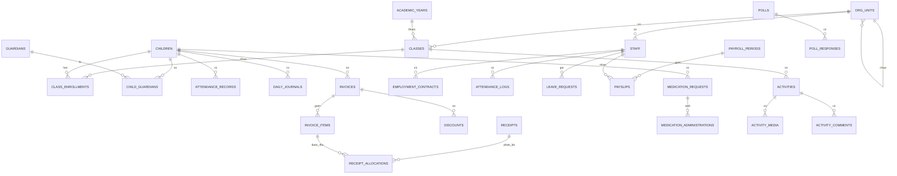

# 16. CƠ SỞ DỮ LIỆU

- Mô tả: Thực thể, trường, kiểu dữ liệu, khóa chính, khóa ngoại, quan hệ, ràng buộc, chỉ mục, trạng thái, lịch sử thay đổi, chính sách xóa dữ liệu.
- Phiên bản: 1.81
- Ngày cập nhật: 2026-10-20
- Trạng thái: Đã phê duyệt
- Người phê duyệt: Eric, ngày 2026-10-09

## 1. Quy ước chung

1. Khóa chính dùng mã định danh duy nhất toàn trường, kiểu mã định danh.
2. Mọi bảng nghiệp vụ có bốn trường chung: `id`, `created_at`, `updated_at`, `created_by`. Bảng thuộc một đơn vị có thêm `org_unit_id` tham chiếu tới `org_units.id`.
3. Không xóa cứng dữ liệu nghiệp vụ. Bảng cần ngừng sử dụng có trường `status` hoặc `deleted_at` để xóa mềm.
4. Mọi bảng có `org_unit_id` phải có chỉ mục trên cột này và phải được kiểm tra phạm vi đơn vị ở tầng truy vấn.
5. Mọi số tiền lưu kiểu số thập phân có hai chữ số phần thập phân, đơn vị đồng.
6. Mọi mốc thời gian lưu theo giờ Việt Nam kèm múi giờ; trường chỉ ghi ngày dùng kiểu ngày.
7. Mã chứng từ như số phiếu thu, số phiếu chi, mã hóa đơn sinh theo quy tắc của từng đơn vị, có ràng buộc duy nhất theo đơn vị và kỳ.
8. Đơn vị tổ chức lưu trong bảng `org_units` thành cây hai cấp (QĐ-23); `unit_type` là loại đơn vị; Trường chính có `parent_id` trống, Phân hiệu và Điểm trường có `parent_id` là Trường chính.
9. Mỗi năm học một cơ sở dữ liệu nghiệp vụ (QĐ-15). Có ba loại cơ sở dữ liệu:
   - Cơ sở dữ liệu định danh, không theo năm học: `users`, `roles`, `permissions`, `role_permissions`, `user_roles`, `sessions`, `one_time_codes`, `api_clients`, `security_events` (YCTD-35), `identity_audit_logs` (YCTD-39), `identity_settings` (YCTD-40), `password_history` (YCTD-123, tệp `0045`).
   - Cơ sở dữ liệu hệ thống của máy chủ API, không theo năm học: `academic_year_databases` (QĐ-17), `academic_years`, `academic_terms`, `school_weeks` (YCTD-30), `integration_credentials` (YCTD-95), `user_quick_links` (YCTD-102), `user_grid_settings` (YCTD-107), `administrative_units`, `administrative_unit_mappings` (YCTD-116), `feedback` (YCTD-110), `archive_fonds`, `archive_holdings`, `archive_records`, `archive_record_files` (YCTD-118), `archive_file_deletions` (YCTD-122, tệp `0016`); `export_jobs`, `upper_level_submissions`, `upper_level_submission_events` (YCTD-121, tệp `0010`); `system_announcements`, `portal_app_links` (YCTD-123, tệp `0011`); `signing_certificates`, `signing_dossiers`, `signing_events` (YCTD-130, tệp `0015`); `signing_create_errors` (YCTD-133, tệp `0017`); `document_catalog_items`, `external_units`, `external_unit_groups`, `external_unit_group_members`, `document_books`, `document_book_members`, `document_leaders`, `incoming_documents`, `incoming_document_files`, `incoming_document_relations`, `incoming_document_assignments`, `incoming_document_flags`, `incoming_document_events` (YCTD-138, tệp `0018`).
   - Cơ sở dữ liệu năm học: mọi bảng còn lại.
10. Khi mở năm học mới, dữ liệu chuyển sang giữ nguyên mã định danh (`id`) của đơn vị, trẻ, phụ huynh, nhân sự, danh mục và tài khoản quỹ, để phân quyền ở cơ sở dữ liệu định danh và báo cáo nhiều năm tham chiếu đúng.

## 2. Phân hệ P01 — Nền tảng, đơn vị và phân quyền

| Bảng | Mục đích | Trường chính |
|---|---|---|
| org_units | Đơn vị tổ chức hai cấp của trường (QĐ-23) | code (duy nhất), name, unit_type (truong_chinh, phan_hieu, diem_truong; cố định), parent_id (trỏ tới org_units.id, trống với Trường chính), address, phone, manager_user_id, status, distance_km (numeric(8,2), không âm; khoảng cách đến cơ sở chính, km; Trường chính để trống; YCTD-111), area_m2 (numeric(12,2), không âm; diện tích, m²; YCTD-111); từ YCTD-134: latitude, longitude (numeric(9,6)), province, ward, quarter, map_confirmed_at, map_confirmed_by_name (1.8 Thông tin trường tuyển sinh theo bản đồ GIS) |
| files | Tệp đính kèm lưu ở kho tệp: giấy khai sinh, giấy đồng ý hình ảnh (YCTD-45), tệp nhập dữ liệu (YCTD-46), ảnh bàn giao trẻ (YCTD-48); giấy tờ hồ sơ cuối cấp, mục đích `final_year_document`, chỉ tải qua phân hệ Tuyển sinh đầu cấp (YCTD-134); giấy tờ của hồ sơ tuyển sinh (giấy khai sinh, ảnh cư trú, minh chứng) ở 1.3, 1.4, mục đích `admission_document` (YCTD-135) | org_unit_id, purpose, file_name, content_type, size_bytes, storage_key (duy nhất) |
| academic_years | Năm học, một lịch chung toàn trường, lưu ở cơ sở dữ liệu hệ thống | name, start_date, end_date, school_days_of_week (mặc định thứ hai đến thứ sáu), status (chưa mở, đang dùng, đã đóng; chỉ một năm đang dùng, BR-93) |
| academic_terms | Học kỳ và kỳ hè của năm học (BR-91) | academic_year_id, term_type (học kỳ 1, học kỳ 2, kỳ hè), start_date, end_date |
| school_weeks | Tuần học tự đánh số (BR-91); từ YCTD-127 là bảng của "3.4. Khai báo tuần" (P01-26, BR-125) | academic_year_id, week_no, start_date, end_date, is_off (tuần nghỉ; từ YCTD-127 cũng là tuần đệm), note (từ YCTD-127 cũng là tên tuần đệm); từ YCTD-127: term_type (`first_term`, `second_term`, `summer_term` hoặc trống; trống là theo lịch năm học), is_visible (boolean, mặc định đúng) |
| user_quick_links | Lối tắt Truy cập nhanh trên trang chủ cổng quản trị của từng tài khoản, lưu ở cơ sở dữ liệu hệ thống để giữ qua các năm học (YCTD-102, tệp `database/system/migrations/0004_create_user_quick_links.ts`) | id, user_id (mã tài khoản ở dịch vụ định danh, không có khóa ngoại vì khác cơ sở dữ liệu), path (trong danh sách cho phép `PORTAL_QUICK_LINK_PATHS`), label (1 đến 100 ký tự), position (từ 0, thứ tự hiển thị), created_at; duy nhất trên user_id, path; tối đa 12 dòng mỗi tài khoản |
| user_grid_settings | Cấu hình lưới dữ liệu riêng từng tài khoản trên cổng quản trị (cột hiển thị theo thứ tự, số dòng mỗi trang), lưu ở cơ sở dữ liệu hệ thống để giữ qua các năm học (YCTD-107, tệp `database/system/migrations/0005_create_user_grid_settings.ts`) | id, user_id (mã tài khoản ở dịch vụ định danh, không có khóa ngoại vì khác cơ sở dữ liệu), grid_key (1 đến 64 ký tự, thuộc `DATA_GRID_KEYS`: `default` giữ số dòng mặc định cho mọi lưới, `accounts`, `staff`, `children`, `student-movements` (YCTD-108), `roles`, `api-clients`, `audit-logs` (YCTD-109), `my-feedback`, `feedback` (YCTD-110), `branches`, `school-sites`, `classes`, `class-assignments` (YCTD-111), `archive-records`, `archive-fonds`, `archive-holdings`, `archive-report` (YCTD-118), `system-announcements` (YCTD-123), `staff-branches`, `staff-identity`, `staff-movements-in`, `staff-movements-out`, `staff-guests-out`, `staff-guests-in` (YCTD-124), `student-statistics-ethnic` (YCTD-125), `school-splits` (YCTD-127), 17 khóa lưới của phân hệ Nhân sự – chấm công, lương từ `my-leave-requests` đến `evaluations` (YCTD-113, danh sách ở `17_DAC_TA_API.md`), 32 khóa lưới của các phân hệ Bếp – kho, mua hàng; Tương tác – truyền thông; Giảng dạy; Tuyển sinh, tuyển dụng; Báo cáo từ `stock-items` đến `export-logs` (YCTD-115, danh sách ở `17_DAC_TA_API.md`); kiểm tra ở máy chủ API), settings (jsonb đối tượng: `columns` mảng mã cột theo thứ tự, không có là theo mặc định; `page_size` 10, 20, 50, 100 hoặc 200), created_at, updated_at; duy nhất trên user_id, grid_key |
| feedback | Ý kiến phản hồi gửi từ chân trang cổng quản trị (P01-16, BR-108, BR-109, YCTD-110, tệp `database/system/migrations/0007_create_feedback.ts`), lưu ở cơ sở dữ liệu hệ thống để giữ qua các năm học; `user_id`, `org_unit_id`, `replied_by` là mã ở dịch vụ định danh và cây đơn vị, không có khóa ngoại vì khác cơ sở dữ liệu; tên người gửi, người trả lời ghi lại lúc thao tác. Khác bảng `feedbacks` (góp ý của phụ huynh, P15) | id, user_id, user_name, org_unit_id (đơn vị của vai trò đầu tiên gán theo đơn vị, trống với vai trò toàn trường), page_url, feedback_type (`suggestion`, `bug`, `request`), title (1 đến 200 ký tự), content (1 đến 5000 ký tự), contact_phone, contact_email, attachment_key (khóa ảnh ở kho tệp), attachment_name, attachment_content_type, attachment_size, status (`new`, `in_progress`, `resolved`; mặc định `new`), reply, replied_by, replied_by_name, replied_at, created_at, updated_at, updated_by |
| archive_fonds | Phông lưu trữ của trường (P09-07, YCTD-118, tệp `database/system/migrations/0009_create_archive_tables.ts`), ở cơ sở dữ liệu hệ thống để giữ qua các năm học | id, code (1 đến 50 ký tự, duy nhất), name (1 đến 200 ký tự), note, created_at, updated_at, created_by, updated_by (mã tài khoản ở dịch vụ định danh, không có khóa ngoại) |
| archive_holdings | Thông tin lưu trữ của một phông theo giai đoạn (P09-07, BR-116, YCTD-118); Báo cáo lưu trữ cộng các dòng này | id, fond_id (khóa ngoại `archive_fonds`, không cho xóa phông còn dòng), period_from_year, period_to_year (1900 đến 2200, từ năm không sau đến năm), arranged (đã chỉnh lý), expired (hết giá trị, mặc định false), retention (`permanent`, `limited`), retention_years (trống khi vĩnh viễn, 1 đến 100 khi có thời hạn; vĩnh viễn không hết giá trị), bundle_count, box_count (số nguyên không âm, mặc định 0), shelf_meters (numeric(10,2) không âm, mặc định 0), storage_location (1 đến 200 ký tự), note, created_at, updated_at, created_by, updated_by |
| archive_records | Hồ sơ tài liệu hoàn thành, chưa hoàn thành (P09-06, BR-116, YCTD-118) | id, code (số, ký hiệu, 1 đến 50 ký tự, duy nhất), title (1 đến 500 ký tự), fond_id (khóa ngoại `archive_fonds`, không bắt buộc), handler_name (người giải quyết, 1 đến 200 ký tự), opened_on, due_date (không trước opened_on), status (`pending`, `completed`; mặc định `pending`), completed_on (trống khi chưa hoàn thành, bắt buộc và không trước opened_on khi hoàn thành), retention, retention_years (như `archive_holdings`), sheet_count (0 đến 100 000), note, created_at, updated_at, created_by, updated_by |
| system_announcements | Thông báo hệ thống bật lên khi vào cổng quản trị (P01-22, BR-121, YCTD-123, tệp `database/system/migrations/0011_create_announcements_and_app_links.ts`), ở cơ sở dữ liệu hệ thống để giữ qua các năm học | id, title (1 đến 200 ký tự), content (1 đến 5000 ký tự), valid_from (ngày, bắt buộc), valid_until (ngày, trống là không hết hạn, không trước valid_from), is_active (mặc định true), created_by, created_by_name (tên lúc soạn), created_at, updated_by, updated_at; created_by, updated_by là mã tài khoản ở dịch vụ định danh, không có khóa ngoại |
| portal_app_links | Ứng dụng liên kết trên thanh đầu trang cổng quản trị (P01-22, BR-121, YCTD-123); ghi là thay cả danh sách, tối đa 20 dòng | id, name (1 đến 100 ký tự), url (bắt đầu bằng `http://` hoặc `https://`), description, position (thứ tự hiển thị từ 0), updated_by, updated_at |
| archive_record_files | Tệp đính kèm của hồ sơ tài liệu (P09-06, YCTD-118); nội dung ở kho tệp | id, record_id (khóa ngoại `archive_records`, xóa theo hồ sơ), storage_key (khóa ở kho tệp `archive-records/{record_id}/{uuid}`, duy nhất), file_name, content_type, size, created_at, created_by |
| administrative_units | Danh mục địa danh hành chính trước và sau sắp xếp năm 2025 (P02-17, BR-115, YCTD-116, tệp `database/system/migrations/0008_create_administrative_units.ts`), lưu ở cơ sở dữ liệu hệ thống, dùng chung mọi năm học; gieo sẵn Thành phố Hồ Chí Minh từ `database/system/data/hcm-administrative-units.ts` (nguồn `official`), tỉnh khác nhập từ Excel (nguồn `import`) | id, period (`old` trước sắp xếp, `new` sau sắp xếp), level (`province`, `district`, `ward`; đơn vị mới không có `district`), code (2 đến 5 chữ số, có thể trống; mã mới theo Quyết định 19/2025/QĐ-TTg), name, name_key (khóa so khớp tên, BR-115), parent_id (trỏ tới administrative_units.id, trống với tỉnh, xóa theo cha), source (`official`, `import`), created_at, updated_at, updated_by |
| administrative_unit_mappings | Đối chiếu đơn vị cũ (xã, hoặc huyện không có cấp xã như huyện Côn Đảo) sang xã mới; xã cũ chia cho nhiều xã mới có nhiều dòng (YCTD-116) | id, old_unit_id, new_unit_id (trỏ tới administrative_units.id, xóa theo đơn vị), source (`official`, `import`), created_at, created_by |
| departments | Phòng ban | org_unit_id, parent_id (phòng ban cha cùng đơn vị, không tạo vòng), name, status |
| job_titles | Chức danh | org_unit_id, name (duy nhất trong đơn vị), level (cấp bậc, chữ tự do), status |
| users | Tài khoản đăng nhập | full_name, phone (duy nhất), username (duy nhất), password_hash (để trống khi phụ huynh còn dùng mật khẩu mặc định chung, YCTD-43), status, last_login_at, failed_login_count, locked_until (hết hạn tạm khóa do sai mật khẩu, YCTD-35), must_change_password, valid_until (bắt buộc với VT-20), password_changed_at (thời điểm đặt mật khẩu gần nhất, bắt buộc, mặc định now(); tài khoản có trước YCTD-110 lấy coalesce(updated_at, created_at); BR-110) |
| roles | Vai trò | code (duy nhất), name, is_system, is_active (hiệu lực, mặc định đúng, YCTD-120) |
| role_workspace_exclusions | Phân hệ của cổng quản trị nhóm không được dùng (1.2, YCTD-120, tệp `0046`) | role_id (khóa ngoại `roles`, xóa theo nhóm), workspace_key (khóa phân hệ của `PORTAL_WORKSPACES`), created_at; khóa chính (role_id, workspace_key) |
| permissions | Quyền theo chức năng | code (duy nhất), module_code, description |
| role_permissions | Gán quyền cho vai trò | role_id, permission_id |
| user_roles | Gán vai trò cho tài khoản | user_id, role_id, org_unit_id (cho phép trống nghĩa là toàn trường; tham chiếu theo mã, không có khóa ngoại vì nằm khác cơ sở dữ liệu) |
| sessions | Phiên đăng nhập và mã làm mới | user_id, channel, refresh_token_hash, issued_at, expires_at, revoked_at, ip_address, user_agent, login_method (mật khẩu hoặc mã một lần; phiên bằng mã một lần không bị giới hạn đổi mật khẩu, YCTD-43) |
| one_time_codes | Mã một lần đăng nhập của phụ huynh; từ YCTD-123 cả mã đặt lại mật khẩu khi quên mật khẩu (BR-121) | user_id, phone, purpose (`login` đăng nhập, `password_reset` đặt lại mật khẩu từ YCTD-123; xác thực hai lớp đã bỏ theo YCTD-31), code_hash, expires_at, attempt_count, used_at, created_at; số lần gửi đếm theo số điện thoại trong bộ nhớ đệm, không lưu cột riêng (YCTD-43) |
| security_events | Nhật ký bảo mật của dịch vụ định danh: đăng nhập sai, tạm khóa, làm mới bằng mã đã thu hồi (BM-36, YCTD-35) | event_type, user_id (trống khi không tìm thấy tài khoản), login_identifier, ip_address, created_at |
| identity_audit_logs | Nhật ký thao tác của dịch vụ định danh: tạo, sửa, khóa, mở khóa tài khoản, đặt lại mật khẩu, gán và gỡ vai trò, sửa quyền của vai trò (PQ-05, YCTD-39) | actor_user_id, entity_name, entity_id, action, before_data, after_data, ip_address, created_at |
| identity_settings | Cấu hình chung toàn trường của dịch vụ định danh: số ngày không đăng nhập thì tự khóa (PQ-07, YCTD-40), giá trị băm của mật khẩu mặc định của phụ huynh, ba thông số mã một lần (YCTD-43), chính sách hết hạn mật khẩu `password_max_age_days` (mặc định 0 là không giới hạn), `password_expiry_warning_days` (mặc định 7) (BR-110, YCTD-110); cấu hình đăng nhập `captcha_failure_threshold` (mặc định 3, 1 đến 10), `password_history_count` (mặc định 5, 0 đến 24), `captcha_always` (mặc định false), `login_hotline` (chuỗi tối đa 100 ký tự, rỗng là không hiện) (BR-121, YCTD-123); khóa chưa có dòng thì dùng mặc định | key (duy nhất), value, updated_at, updated_by |
| password_history | Lịch sử mật khẩu để không cho dùng lại mật khẩu gần đây (P01-21, BR-121, YCTD-123, tệp `database/identity/migrations/0045_add_password_history_and_announcement_permission.ts`); lưu khi người dùng tự đổi hoặc tự đặt lại mật khẩu, không lưu mật khẩu tạm do quản trị cấp; giữ tối đa 24 dòng mỗi tài khoản | id, user_id (khóa ngoại `users`, xóa theo tài khoản), password_hash (băm argon2id), created_at |
| settings | Cấu hình theo đơn vị; mục chưa cấu hình lấy từ Trường chính, rồi mặc định (YCTD-40); từ YCTD-127 ba khóa của khối "Cấu hình trường" chỉ đặt ở Trường chính, không kế thừa (BR-125) | org_unit_id, key, value, value_type (từ YCTD-127 thêm `text`, 1 đến 200 ký tự), updated_at, updated_by; duy nhất theo org_unit_id kèm key; khóa mới từ YCTD-127: `school_display_name`, `administrative_unit_name` (`text`), `underweight_growth_calculation` (`boolean`, mặc định đúng) |
| audit_logs | Nhật ký thao tác | actor_user_id, actor_name (tên lúc thao tác, YCTD-40), org_unit_id, entity_name, entity_id, action, before_data, after_data, ip_address, created_at |
| data_access_logs | Nhật ký truy cập dữ liệu nhạy cảm | actor_user_id, actor_name, api_client_id (khi đối tác đọc qua API), org_unit_id, entity_name, entity_id, scope (ví dụ số định danh, giấy khai sinh), record_count, purpose, ip_address, created_at |
| approval_thresholds | Hạn mức phê duyệt | org_unit_id, document_type, threshold_amount, effective_from (ngày lưu, có hiệu lực ngay), status (đang hiệu lực hoặc hết hiệu lực; mỗi đơn vị và loại chứng từ chỉ một bản đang hiệu lực), updated_by (YCTD-42) |
| api_clients | Khóa API của đối tác (YCTD-63) | name, partner_type, scopes (reports, finance, children, staff), legal_basis, key_prefix, key_hash (SHA-256, duy nhất), allowed_ips, valid_until, status (đang dùng, đã thu hồi), created_by, revoked_by, revoked_at, last_used_at |
| academic_year_databases | Cơ sở dữ liệu theo năm học | academic_year_id, database_name, status (đang dùng hoặc chỉ đọc), opened_at, closed_at, carried_over_by; từ YCTD-127 carried_over_at (giờ của máy chủ cơ sở dữ liệu khi chuyển xong hồ sơ lên năm học; trống với năm học mở trước YCTD-127; dùng để xét Hủy chuyển hồ sơ, BR-125) |
| data_import_jobs | Lần nhập dữ liệu ban đầu và nhập mã ngành | org_unit_id, import_type (lớp, trẻ, mã ngành; từ YCTD-124 thêm `professional_ratings` nhập mức đánh giá chuẩn nghề nghiệp; từ YCTD-126 thêm `sms_phones`, `national_ids`, `student_addresses`), file_id (tệp gốc ở kho tệp), status (đã kiểm tra, còn lỗi, đã ghi), total_rows, error_rows, errors (báo cáo dòng lỗi, không chứa số định danh), error_report_file_id, created_by, created_at, committed_by, committed_at (YCTD-46) |
| notification_templates | Mẫu thông báo | code (duy nhất), channel, subject, body_template, status |
| notifications | Thông báo đã sinh | org_unit_id, template_code, title, body, target_type, target_id, created_at |
| notification_recipients | Người nhận thông báo | notification_id, user_id (trống khi gửi theo vai trò), role_code và org_unit_id (mọi tài khoản có vai trò ở đơn vị, YCTD-47), channel (trong ứng dụng hoặc tin nhắn, YCTD-45), is_read, read_at, channel_status (chờ gửi, đã gửi, thất bại, vượt giới hạn trong ngày), sent_at, attempt_count, next_attempt_at, last_error (YCTD-71) |
| notification_reads | Người đã đọc thông báo (BR-70, YCTD-64) | notification_id, user_id (duy nhất cùng notification_id), read_at |
| notification_templates | Mẫu tiêu đề và nội dung theo mã thông báo, chung toàn trường (YCTD-64) | template_code (khóa chính), title_template, body_template, updated_by, updated_at |
| rooms | Phòng học; khai báo cơ sở vật chất (P13-11, BR-103, YCTD-106) | org_unit_id, code (duy nhất trong đơn vị), name, capacity (lớn hơn 0), status, room_block (care_education, meal, support, administration, other; không bắt buộc), room_type (loại phòng thuộc khối), condition (permanent, semi_permanent, temporary, borrowed), area_m2 (không âm, hai chữ số thập phân), facility_attributes (jsonb khóa cố định: số chỗ ngủ, chiều cao thông thủy, sân chơi riêng và các thuộc tính khác); từ YCTD-132: built_this_year (boolean, mặc định false; xây dựng mới trong năm, cột "Xây dựng mới" của 1.2.1) |
| grade_levels | Bậc học | code (duy nhất, không đổi sau khi tạo), name, age_from_months, age_to_months (tháng tuổi, YCTD-42), order_no, status |
| catalog_items | Mục danh mục dùng chung, không thuộc đơn vị (P01-05, YCTD-42) | catalog_type (loại do hệ thống định nghĩa), code (duy nhất trong loại), name, order_no, status, attributes (thuộc tính riêng của loại; loại nghỉ phép có is_paid, deducts_annual_leave, insurance_paid, YCTD-59) |
| school_profiles | Hồ sơ trường của Trường chính, một dòng mỗi năm học (P01-15, BR-103, YCTD-106); mỗi thẻ một cột jsonb khóa cố định | org_unit_id (duy nhất, Trường chính), general, other_info, foreign_elements, internet, it_infrastructure, office_accounts (mảng, không có mật khẩu), updated_by. Từ YCTD-136 `general` có thêm khóa cố định `floor_area_m2` (diện tích sàn xây dựng, số), `national_standard_level` ('1', '2'), `national_standard_year`, `accreditation_year` (số nguyên 1900 đến 2100), `national_standard_date`, `accreditation_date` (ngày), `national_standard_registration` (chữ), `accreditation_level` ('1' đến '4') cho 1.7 và báo cáo EMIS đọc |
| accreditation_reviews | Rà soát thông tin kiểm định chất lượng giáo dục, một bản mỗi năm học gắn với Trường chính (P01-24, BR-125, BR-129, YCTD-127, YCTD-136; mục 1.7 của Sở) | id, org_unit_id (khóa ngoại `org_units`, duy nhất), class_count, classroom_count, subject_room_count, child_count (số nguyên không âm), land_area_m2, floor_area_m2, area_per_child_m2 (numeric(12,2) không âm), từ YCTD-136: school_name (tối đa 200 ký tự), school_code (tối đa 20 ký tự), ownership_type (`public`, `private`, `people_founded`), education_level, national_standard_year, accreditation_year (1900 đến 2100), national_standard_date, accreditation_date (ngày), national_standard_level ('1', '2'), accreditation_level ('1' đến '4'), national_standard_registration, floor_area_per_child_m2 (numeric(12,2) không âm), các cột này được để trống; note, collected_at (lần "Lấy dữ liệu" gần nhất trước khi ghi), updated_by, created_at, updated_at |
| school_split_requests | Yêu cầu tách hồ sơ sang trường khác, bản chạy nội bộ (P01-25, BR-125, YCTD-127; mục 1.8 của Sở) | id, code (duy nhất, `TT-000001` theo `document_sequences` loại `school_split`), destination_school, destination_code, reason, status (`draft`, `confirmed`, `received`; mặc định `draft`), confirmed_at, confirmed_by, received_at, received_by, received_note, created_by, created_at, updated_at |
| school_split_items | Học sinh, nhân sự của yêu cầu tách (YCTD-127) | id, request_id (khóa ngoại `school_split_requests`, xóa theo yêu cầu), child_id (khóa ngoại `children`), staff_id (khóa ngoại `staff`), created_at; đúng một trong child_id, staff_id có giá trị (`school_split_items_subject_check`) |

Ràng buộc: `org_units.parent_id` trỏ tới `org_units.id`. Chỉ một đơn vị `truong_chinh`, có `parent_id` trống; đơn vị `phan_hieu`, `diem_truong` có `parent_id` là Trường chính. Kiểm tra ở tầng ứng dụng và ở tầng dữ liệu (YCTD-38).

Tệp `database/school-year/migrations/0054_create_accreditation_reviews_and_school_splits.ts` của cơ sở dữ liệu năm học (DT-16 phần 16e, YCTD-127) tạo `accreditation_reviews` (ràng buộc kiểm tra không âm từng số), `school_split_requests` (ràng buộc kiểm tra trạng thái), `school_split_items` (ràng buộc duy nhất `school_split_items_child_unique`, `school_split_items_staff_unique`, ràng buộc kiểm tra `school_split_items_subject_check`); phần quay lui xóa ba bảng. Tệp `database/system/migrations/0013_add_school_week_fields_and_carry_over_time.ts` của cơ sở dữ liệu hệ thống thêm `school_weeks.term_type` (ràng buộc kiểm tra học kỳ), `school_weeks.is_visible` (mặc định đúng), `academic_year_databases.carried_over_at`; phần quay lui xóa ba cột. Bảng `settings` không đổi cấu trúc. Hủy chuyển hồ sơ (BR-125) xóa dòng `academic_year_databases` và cơ sở dữ liệu của năm học mới, đưa cơ sở dữ liệu năm trước về đang dùng và bỏ chỉ đọc (`makeDatabaseWritable` ở `database/src/database-administration.ts`).

Tệp `database/school-year/migrations/0063_add_accreditation_review_so_fields.ts` của cơ sở dữ liệu năm học (DT-17 phần 17e, YCTD-136) thêm 12 cột được để trống vào `accreditation_reviews` kèm ràng buộc kiểm tra độ dài tên trường (200), mã trường (20), loại hình, năm công nhận (1900 đến 2100), mức độ, cấp độ, diện tích sàn xây dựng trên học sinh không âm; bản rà soát đã ghi giữ nguyên, các cột mới trống đến lần ghi sau; phần quay lui xóa 12 cột. Tám khóa mới của `school_profiles.general` không cần migration.

Chỉ mục `users_full_name_id_index` trên `users (full_name, id)` và `user_roles_role_id_index` trên `user_roles (role_id)` (DT-15 phần 15e, YCTD-109) tạo bằng tệp `database/identity/migrations/0041_add_account_list_indexes.ts` của cơ sở dữ liệu định danh, phục vụ danh sách người dùng sắp theo họ tên, phân trang trong câu truy vấn và lọc theo nhóm quyền; không đổi bảng, không đổi dữ liệu.

Tệp `database/identity/migrations/0046_add_role_status_and_workspaces.ts` của cơ sở dữ liệu định danh (DT-16 phần 16d, YCTD-120) thêm cột `roles.is_active` và bảng `role_workspace_exclusions`, gieo nhóm VT-14 bỏ 11 phân hệ. Tệp `database/system/migrations/0012_add_sync_account_credentials.ts` của cơ sở dữ liệu hệ thống cho `integration_credentials.connector` nhận thêm `moet_sync`, `doet_sync` (tài khoản đồng bộ của Bộ, của Sở) và thêm hai cột `account_username`, `account_secret_encrypted` (mã hóa AES-256-GCM, không trả qua API).

Tệp `database/identity/migrations/0042_add_password_expiry_and_feedback_permission.ts` của cơ sở dữ liệu định danh (DT-15 phần 15g, YCTD-110) thêm cột `users.password_changed_at` (điền coalesce(updated_at, created_at) cho tài khoản đã có, rồi đặt bắt buộc, mặc định now()), thêm quyền `P01.feedback.manage` và gán cho VT-01, VT-02; phần quay lui gỡ quyền và cột. Tệp `database/system/migrations/0007_create_feedback.ts` của cơ sở dữ liệu hệ thống tạo bảng `feedback` với ràng buộc kiểm tra loại, trạng thái, độ dài tiêu đề, nội dung và hai chỉ mục ở mục 20.

Tệp `database/identity/migrations/0045_add_password_history_and_announcement_permission.ts` của cơ sở dữ liệu định danh (DT-16 phần 16c, YCTD-123) tạo bảng `password_history` và chỉ mục ở mục 20; đổi ràng buộc `one_time_codes_purpose_check` thành `purpose` thuộc (`login`, `password_reset`); thêm quyền `P01.announcement.manage` (P01, "Soạn thông báo hệ thống bật lên khi vào cổng quản trị và cấu hình ứng dụng liên kết") và gán cho VT-01, VT-02. Phần quay lui gỡ quyền, xóa mã một lần mục đích `password_reset`, trả ràng buộc về chỉ `login`, xóa bảng `password_history`. Tệp `database/system/migrations/0011_create_announcements_and_app_links.ts` của cơ sở dữ liệu hệ thống tạo `system_announcements` với ràng buộc kiểm tra độ dài tiêu đề, nội dung và đến ngày không trước từ ngày, tạo `portal_app_links` với ràng buộc kiểm tra độ dài tên và đường dẫn bắt đầu bằng `http://` hoặc `https://`; phần quay lui xóa hai bảng.

Tệp `database/system/migrations/0009_create_archive_tables.ts` của cơ sở dữ liệu hệ thống (DT-15 phần 15h2, YCTD-118) tạo bốn bảng `archive_fonds`, `archive_holdings`, `archive_records`, `archive_record_files` với ràng buộc kiểm tra ở mục này (BR-116) và bốn chỉ mục ở mục 20; phần quay lui xóa bốn bảng. Tệp `database/identity/migrations/0044_add_archive_permissions.ts` của cơ sở dữ liệu định danh thêm ba quyền `P09.archive.view`, `P09.archive.manage`, `P09.archive.export` và gán vai trò theo PQ-68; phần quay lui gỡ quyền. Số `0053` của cơ sở dữ liệu năm học giữ cho phần này không dùng.

Tệp `database/system/migrations/0016_add_archive_units_handlers_reminders.ts` (YCTD-122) thêm `archive_fonds.org_unit_id`, `archive_records.org_unit_id`, `archive_records.handler_staff_id` (mã nhân sự ở năm học đang dùng, không có khóa ngoại), `archive_records.due_reminded_at`, `archive_records.overdue_reminded_at` (thời điểm đã nhắc; đổi thời hạn, người giải quyết, trạng thái thì về trống), hai chỉ mục `archive_fonds_unit_index`, `archive_records_unit_index` và bảng `archive_file_deletions` (storage_key khóa chính, attempts, last_error, created_at, last_attempt_at: tệp chờ xóa lại ở kho tệp, BR-120). Đơn vị trống là toàn trường. Số `0010` đến `0015` giữ cho DT-16; công cụ chạy tệp thay đổi cấu trúc cho chạy lệch thứ tự từ YCTD-120 nên tệp số nhỏ gộp sau vẫn chạy.

Tệp `database/system/migrations/0008_create_administrative_units.ts` của cơ sở dữ liệu hệ thống (DT-15 phần 15h1, YCTD-116) tạo `administrative_units` với ràng buộc kiểm tra thời kỳ, cấp, nguồn, độ dài tên, mã 2 đến 5 chữ số, tỉnh không có cha và cấp khác có cha, đơn vị mới không có cấp huyện; tạo `administrative_unit_mappings` với ràng buộc duy nhất cặp đơn vị cũ, mới; gieo 4 tỉnh (3 cũ, 1 mới), 38 quận/huyện cũ, 441 xã cũ, 168 xã mới, 493 dòng đối chiếu theo Nghị quyết 1685/NQ-UBTVQH15 và danh mục của Cục Thống kê. Phần quay lui xóa hai bảng.

## 3. Phân hệ P02 — Trẻ, phụ huynh và lớp học

| Bảng | Mục đích | Trường chính |
|---|---|---|
| children | Hồ sơ trẻ | moet_student_code (mã do cơ sở dữ liệu ngành cấp, duy nhất khi có), national_id_hash (băm có khóa, duy nhất, bắt buộc), national_id_encrypted, national_id_last4 (hiển thị dạng che), org_unit_id, full_name, dob, gender, place_of_birth, address, status (nháp, chờ duyệt, đang học, tạm nghỉ, thôi học, đã tốt nghiệp), is_staff_child, related_staff_user_id và related_staff_name (tạm theo tài khoản, YCTD-44), special_needs_note, photo_consent (chờ xác nhận, đồng ý, không đồng ý), photo_consent_method (ứng dụng hoặc giấy ký tay), photo_consent_by, photo_consent_at, photo_consent_file_id, birth_certificate_file_id (trống được với trẻ nhập từ dữ liệu ban đầu, YCTD-46), enroll_date, leave_date, leave_reason, note, reject_reason, submitted_by, submitted_at, approved_by, approved_at (YCTD-45), moet_profile (đủ 82 cột của mẫu CSDL ngành, YCTD-100), two_sessions_per_day (boolean, mặc định false; học 2 buổi/ngày), boarding (boolean, mặc định false; học sinh lớp bán trú) (YCTD-108); từ YCTD-132: policy_benefits (text[], mặc định rỗng; đối tượng chính sách theo nghị định, giá trị thuộc `nd238_learning_cost`, `nd66_nursery_boarding`, `nd57_small_ethnic`, `nd105_lunch`, `nd105_allowance`, ràng buộc kiểm tra) |
| photo_consent_histories | Lịch sử đồng ý sử dụng hình ảnh | child_id, action (đồng ý hoặc rút), method, file_id, actor_user_id, created_at |
| guardians | Hồ sơ phụ huynh | full_name, phone (duy nhất khi có tài khoản), email, occupation, address, user_id, birth_year, id_number_encrypted, id_number_last4 (YCTD-100) |
| child_guardians | Quan hệ trẻ và phụ huynh | child_id, guardian_id, relationship, is_primary, can_pickup, receives_sms (boolean, mặc định false; phụ huynh có điện thoại nhận tin của học sinh, mỗi học sinh tối đa một dòng, BR-105, YCTD-108) |
| authorized_pickups | Người được ủy quyền đón trẻ | child_id, full_name, relationship, phone (bắt buộc), valid_from, valid_to (trống là không thời hạn), status (đang hiệu lực hoặc đã hủy), source (phụ huynh hoặc nhà trường), created_by, revoked_by, revoked_at (YCTD-48) |
| classes | Lớp học | org_unit_id, academic_year_id, code (duy nhất trong đơn vị), name, grade_level (tham chiếu grade_levels.code), room_id (phòng cùng đơn vị), max_size, status (đang dùng hoặc đã đóng; đã đóng là lớp giải thể từ YCTD-111); giáo viên của lớp ở `class_staff_assignments` (YCTD-44); từ YCTD-111: age_group (text: months_3_12, months_13_24, months_25_36, years_3_4, years_4_5, years_5_6; trống là theo bậc học), sort_order (integer không âm; thứ tự), two_sessions_per_day (boolean, mặc định false; học 2 buổi/ngày), mixed_age_count (smallint 2 hoặc 3; lớp mẫu giáo ghép độ tuổi), is_combined (boolean, mặc định false; lớp ghép), combined_into_class_id (uuid; lớp được ghép vào, không có khóa ngoại; ràng buộc `classes_combined_check`: chỉ có khi is_combined và khác chính lớp), boarding (boolean, mặc định false; lớp bán trú) |
| class_enrollments | Lịch sử lớp của trẻ | child_id, class_id, from_date, to_date, reason, is_current, order_number (số thứ tự cố định trong lớp, null là chưa sắp; YCTD-126) |
| class_staff_assignments | Phân công giáo viên vào lớp | class_id, staff_user_id (tạm là mã tài khoản đến khi có hồ sơ nhân sự), staff_name, assignment_role (chủ nhiệm hoặc bộ môn), subject_name, from_date, to_date, status; một lớp có thể có nhiều giáo viên chủ nhiệm (YCTD-44) |
| teaching_groups | Tổ chuyên môn | org_unit_id, name, leader_staff_id, status |
| teaching_group_members | Thành viên tổ chuyên môn | group_id, staff_id, from_date, to_date |
| health_profiles | Hồ sơ sức khỏe cơ bản | child_id (duy nhất), blood_type, has_allergies (trống là chưa khai báo, BR-06), allergies, chronic_conditions, note |
| health_measurements | Chỉ số sức khỏe theo lần đo | child_id, measured_on, height_cm, weight_kg, vision_left, vision_right, bmi, note, growth_round_id (YCTD-105) |
| lost_items | Đồ bị mất của trẻ | code (DBM-000001), org_unit_id, child_id, class_id, report_type (lost, found), description, noticed_on, photo_file_id, status (reported, found, returned, not_found, cancelled), reported_by, reported_at, found_by, found_at, found_note, closed_by, closed_at, result_note, cancelled_by, cancelled_at |
| program_completions | Kết quả hoàn thành chương trình giáo dục mầm non của trẻ, một dòng mỗi trẻ mỗi năm học (P02-13, BR-97, YCTD-104) | child_id (duy nhất), class_id, org_unit_id, result (completed, not_completed), note, recorded_by, recorded_by_name |
| program_completion_confirmations | Xác nhận danh sách hoàn thành chương trình của lớp; có dòng là đã khóa, hủy xác nhận thì xóa dòng, nhật ký thao tác giữ lý do (BR-97, YCTD-104) | class_id (duy nhất), org_unit_id, completed_count, children_count, confirmed_by, confirmed_by_name, confirmed_at |
| child_groups | Nhóm học sinh trong đơn vị, không chuyển sang năm học mới (P02-14, YCTD-104) | org_unit_id, name (duy nhất trong đơn vị), description, teacher_staff_id (giáo viên phụ trách, không bắt buộc), status (active, inactive), created_by |
| child_group_members | Trẻ của nhóm; một trẻ thuộc nhiều nhóm (YCTD-104) | group_id, child_id (khóa chính hai cột), added_by, created_at |
| final_year_records | Hồ sơ cuối cấp của trẻ năm cuối cấp (cấp Mầm non: lớp mẫu giáo 5–6 tuổi), một hồ sơ mỗi trẻ trong năm học (P02-24, P02-25, BR-132, YCTD-134; mục 1.1 Tuyển sinh đầu cấp của Sở) | id, child_id (khóa ngoại `children`, duy nhất), org_unit_id (đơn vị hiện tại của trẻ), status (`parent_pending`, `awaiting_school_edit`, `awaiting_parent_reconfirm`, `parent_confirmed`, `school_edited`, `parent_confirmed_after_edit`; mặc định `parent_pending`), review_status (`pending`, `approved`), identity_type (`has_id`, `no_id`, `temporary_id`; mặc định `has_id`), residence_type (`permanent`, `temporary`, `other`), current_residence (tối đa 300 ký tự), house_number, street, residential_group, quarter, ward, province, contact_name, contact_phone, contact_email (trống thì lấy phụ huynh liên hệ chính), latitude (numeric(9,6), −90 đến 90), longitude (numeric(9,6), −180 đến 180), routed_school, beneficiary, priority_form, registration_source (`parent`, `universal`, `none`; mặc định `none`), parent_proposal (tối đa 1000 ký tự), parent_proposed_at, confirmed_at, confirmed_by, confirmed_by_name, confirmed_by_school (trường xác nhận thay phụ huynh), school_edited_at, approved_at, approved_by, approved_by_name, admission_consent (mặc định sai), admission_consent_at, created_by, updated_by, created_at, updated_at |
| final_year_record_files | Giấy tờ của hồ sơ cuối cấp do trường hoặc phụ huynh tải lên (YCTD-134); nội dung ở bảng `files` mục đích `final_year_document` | id, record_id (khóa ngoại `final_year_records`, xóa theo), file_id (khóa ngoại `files`, duy nhất), kind (`birth_certificate`, `residence`, `evidence`), uploaded_by, uploaded_by_name, uploaded_by_parent, created_at |
| final_year_record_events | Lịch sử trạng thái và thao tác của hồ sơ cuối cấp (YCTD-134) | id, record_id (khóa ngoại `final_year_records`, xóa theo), action (`update`, `import`, `confirm`, `edited`, `approve`, `unapprove`, `parent_confirm`, `parent_propose`, `consent`, `withdraw_consent`, `attach`, `remove_file`), from_status, to_status, note, actor_user_id, actor_name, by_parent, created_at |
| final_year_class_confirmations | Xác nhận hoàn thành hồ sơ cuối cấp theo lớp, đánh dấu tay (P02-26, YCTD-134; mục 1.2 của Sở) | id, class_id (khóa ngoại `classes`, duy nhất), confirmed, confirmed_by, confirmed_by_name, confirmed_at, updated_at |
| admission_support_requests | Yêu cầu hỗ trợ tuyển sinh của phụ huynh và câu trả lời của trường (P02-28, YCTD-134; mục 5.1 của Sở) | id, org_unit_id (đơn vị của trẻ), child_id (khóa ngoại `children`), requester_user_id, requester_name, email, phone, content (tối đa 2000 ký tự), status (`pending`, `answered`), reply (tối đa 2000 ký tự), replied_by, replied_by_name, replied_at, notified_at, notified_channels (kênh đã gửi câu trả lời), created_at, updated_at |
| school_services | Dịch vụ được đăng ký tại trường (P02-27, YCTD-134; mục 2.1 Tuyển sinh đầu cấp của Sở) | id, code (duy nhất, tối đa 50 ký tự; trùng mã với `services` của Tài chính – học phí thì hiện tên dịch vụ tài chính), name (tối đa 200 ký tự), sort_order (mặc định 0), created_by, created_at, updated_at |
| admission_application_files | Giấy tờ của hồ sơ tuyển sinh do trường tải ở 1.3, 1.4 (P02-29, P02-30, YCTD-135); nội dung ở bảng `files` mục đích `admission_document` | id, application_id (khóa ngoại `admission_applications`, xóa theo), file_id (khóa ngoại `files`, duy nhất), kind (`birth_certificate`, `residence`, `evidence`), uploaded_by, uploaded_by_name, created_at |
| admission_transfer_results | Kết quả từng hồ sơ của mỗi lần chuyển sang CSDL (1.6, 5.11) và mỗi lần hủy nhập học (1.7) (P02-32, P02-33, YCTD-135) | id, kind (`transfer`, `cancel`), package_code (mã gói tin `GT-…` hoặc `HN-…`), application_id (khóa ngoại `admission_applications`, xóa theo), guid, child_id, succeeded, note, actor_user_id, actor_name, created_at |
| entry_admission_contacts | Học sinh ngoài hệ thống nhập từ Excel để nhận thông báo tuyển sinh (1.5, P02-31, YCTD-135) | id, campaign_id (khóa ngoại `admission_campaigns`), full_name, dob, gender (`male`, `female`), national_id_encrypted, national_id_last4, phone, final_year_school, notice_content (tối đa 1000 ký tự), created_by, created_at |
| entry_admission_notices | Mỗi lần gửi thông báo tuyển sinh của 1.5 (P02-31, YCTD-135) | id, campaign_id (khóa ngoại `admission_campaigns`), content (nội dung đang soạn, tối đa 1000 ký tự), sent_by, sent_by_name, sent_at |
| entry_admission_notice_recipients | Trạng thái gửi theo từng người nhận của một lần gửi (P02-31, YCTD-135) | id, notice_id (khóa ngoại `entry_admission_notices`, xóa theo), application_id hoặc contact_id (đúng một trong hai), phone, content (nội dung đã gửi), channels (kênh đã gửi), delivered, note (lý do chưa gửi được), created_at |

Tệp `database/school-year/migrations/0061_create_entry_admissions.ts` của cơ sở dữ liệu năm học (DT-17 phần 17c, YCTD-134) tạo sáu bảng trên kèm ràng buộc kiểm tra trạng thái, loại, độ dài, tọa độ và chỉ mục `final_year_records_org_unit_index`, `final_year_record_files_record_index`, `final_year_record_events_record_index`; thêm vào `org_units` bảy cột `latitude`, `longitude` (numeric(9,6) kèm ràng buộc phạm vi), `province`, `ward`, `quarter`, `map_confirmed_at`, `map_confirmed_by_name` cho 1.8; ràng buộc `files_purpose_check` nhận thêm `final_year_document`. Phần quay lui xóa bảy cột, sáu bảng, các dòng `files` mục đích `final_year_document` và trả ràng buộc mục đích tệp. Hạn điều chỉnh thông tin lưu ở `settings` của Trường chính khóa `final_year_edit_deadline` (chữ `YYYY-MM-DD`), không cần migration. Tệp `database/identity/migrations/0050_add_entry_admission_permissions.ts` của cơ sở dữ liệu định danh thêm bốn quyền P02 (PQ-76) và dòng `role_workspace_exclusions` của nhóm VT-14 cho phân hệ `entry-admissions`. Giấy tờ ở kho tệp S3 dưới tiền tố `final_year_document/`.

Tệp `database/school-year/migrations/0062_add_entry_admission_intake.ts` của cơ sở dữ liệu năm học (DT-17 phần 17d, YCTD-135) thêm vào `admission_campaigns` hai cột `program_type`, `target_academic_year_id`; ràng buộc nguồn của `admission_applications` nhận thêm `routing`, ràng buộc trạng thái nhận thêm `cancelled`; thêm vào `admission_applications` các cột diện cư trú, nơi ở hiện tại (tối đa 300 ký tự), tổ, khu phố, phường/xã, tỉnh, nơi sinh, phường/xã và trường cuối cấp, họ tên cha, mẹ, `routed`, `submitted_documents` (mảng chữ trong năm giá trị `admission_notice`, `declaration`, `birth_certificate_copy`, `primary_transcript`, `primary_completion`), `admission_decision` (`pending`, `accepted`, `declined`), `admission_decision_at`, `advanced_criteria` (tối đa 1000 ký tự), `advanced_achievements` (tối đa 2000 ký tự), `registered_at`, `school_review` và `ward_review` (`pending`, `admitted`, `not_admitted`), `school_reviewed_by_name`, `school_reviewed_at`, `notice_content` (tối đa 1000 ký tự), `record_type` (`account`, `free`; mặc định `free`), `target_org_unit_id` (khóa ngoại `org_units`), `transfer_package_code`, `transfer_guid` (duy nhất), `transferred_by_name`, `cancelled_at`, `cancelled_by_name`; tạo năm bảng `admission_application_files`, `admission_transfer_results`, `entry_admission_contacts`, `entry_admission_notices`, `entry_admission_notice_recipients` kèm chỉ mục `admission_application_files_application_index`, `admission_transfer_results_package_index`, `entry_admission_notice_recipients_application_index`; ràng buộc `files_purpose_check` nhận thêm `admission_document`. Phần quay lui xóa năm bảng và các cột mới, đưa hồ sơ đã hủy nhập học về `passed` (chưa chuyển) hoặc `converted` (đã chuyển), hồ sơ nguồn `routing` về `staff`, xóa các dòng `files` mục đích `admission_document` và trả các ràng buộc. Tệp `database/identity/migrations/0051_add_entry_intake_permissions.ts` của cơ sở dữ liệu định danh thêm ba quyền P02 (PQ-77). Giấy tờ ở kho tệp S3 dưới tiền tố `admission_document/`. Mở năm học mới chuyển đợt chưa đóng và hồ sơ chưa xong kèm các cột mới theo bước chuyển tuyển sinh của YCTD-86; từ YCTD-135 bước này chép thêm giấy tờ của hồ sơ được chuyển (dòng `admission_application_files` và dòng `files`, nội dung tệp ở kho tệp dùng chung) và bỏ trống `target_org_unit_id` khi điểm trường đó không còn ở năm mới.

Tệp `database/school-year/migrations/0064_create_kpi.ts` của cơ sở dữ liệu năm học (DT-18 phần 18d, YCTD-139) tạo 12 bảng của phân hệ KPI, thêm hai bộ quy tắc mặc định `BQT-1`, `BQT-2` mỗi bộ một phiên bản đã ban hành, và cho `files.purpose` nhận thêm `kpi_evidence`:

| Bảng | Mục đích | Cột chính |
|---|---|---|
| kpi_rule_sets | Bộ quy tắc chấm (P09-13) | id, code (duy nhất), name, description, is_default, status (`active`, `inactive`) |
| kpi_rule_set_versions | Phiên bản cấu hình của bộ quy tắc | id, rule_set_id, version_no (duy nhất theo bộ), config (jsonb: mọi tham số chấm), status (`draft`, `published`), note, published_at, published_by, published_by_name |
| kpi_profiles | Đối tượng đánh giá của nhân sự | staff_id (duy nhất), rule_set_id, subject_group (`leader`, `staff`), school_level (`MN`, `TH`, `THCS`, `THPT`), job_position, is_head, superior_staff_id, excluded |
| kpi_periods | Kỳ đánh giá và lịch kỳ | code (duy nhất), name, period_type (`month`, `quarter`, `term`, `year`, `custom`), start_date, end_date, register_from/to, self_from/to, review_from/to, advisory_from/to, status (`open`, `locked`), locked_at, locked_by_name, lock_note, legacy_id |
| kpi_period_rule_versions | Phiên bản quy tắc của từng bộ trong kỳ | khóa chính (period_id, rule_set_id), rule_set_version_id |
| kpi_catalog_items | Danh mục công việc chuẩn, chỉ báo (P09-14) | org_unit_id (trống là danh mục chung), rule_set_id, code (duy nhất theo danh mục, trừ dòng không duyệt), name, output_result, axis_code, task_type, difficulty_code, expected_evidence, deadline_hint, school_level, job_position, is_required, is_confidential, status (`active`, `inactive`, `proposed`, `rejected`), proposed_by, decided_by, decision_note, legacy_id |
| kpi_tasks | Việc của từng người trong kỳ (P09-15, P09-16) | period_id, staff_id, org_unit_id, catalog_item_id, name, axis_code, task_type, standard_score, difficulty_code, difficulty_weight, is_confidential, origin (`assigned`, `registered`, `arising`, `legacy`), in_plan, status (`pending_approval`, `assigned`, `returned_to_assigner`, `in_progress`, `self_assessed`, `rework`, `graded`, `rejected`, `cancelled`), deadline, original_deadline, assigned_by_staff_id, evaluator_staff_id và các cột ủy quyền, approval_due_at, auto_approved, return_count, return_reason, cột gia hạn, actual_finish_date, evidence_text, document_number (chữ tự do), self_quality_code, self_result_code, bonus_proposed, grading_due_at, late_days, progress_percent, quality_code, result_code, task_percent, exceeded, bonus_approved, execution_score, converted_score, bonus_score, graded_by_name, auto_graded, rework_reason, legacy_id; chỉ mục (period_id, staff_id) |
| kpi_task_files | Tệp minh chứng của việc | khóa chính (task_id, file_id), uploaded_by_name; nội dung ở `files` mục đích `kpi_evidence`, khóa kho tệp `kpi-evidence/<mã việc>/<mã tệp>` |
| kpi_evaluations | Phiếu tự đánh giá, xếp loại của người trong kỳ (P09-17, P09-18) | duy nhất (period_id, staff_id), rule_set_version_id, subject_group, is_head, status (`draft`, `submitted`, `returned`, `concluded`), general_self, general_score, plan_max (A), actual_total (B), task_score, bonus_score, total_score, suggested_rank, self_rank, self_comment, return_reason, exclusions (jsonb), superior_rank, superior_comment, superior_by_name, advisory_rank, advisory_comment, final_rank, legacy_id |
| kpi_evaluation_criteria | Tiêu chí chung của phiếu | khóa chính (evaluation_id, criterion_code), max_score, self_satisfied, superior_satisfied (trống là theo tự đánh giá), note |
| kpi_votes | Biểu quyết mức xếp loại | khóa chính (evaluation_id, voter_user_id), voter_name, vote_rank, comment |
| kpi_manager_actions | Sổ trách nhiệm duyệt, chấm của người quản lý | period_id, task_id, action (`approve`, `grade`), manager_staff_id, manager_name, due_at, done_at, on_time, automatic |

Các cột `children.two_sessions_per_day`, `children.boarding`, `child_guardians.receives_sms` và chỉ mục `child_guardians_receives_sms_unique` (DT-15 phần 15c) tạo bằng tệp `database/school-year/migrations/0050_add_student_flags_and_sms_guardian.ts` của cơ sở dữ liệu năm học; hai cột của `children` lấy giá trị ban đầu từ `moet_profile` (`two_sessions_per_day`, `boarding_class`) của học sinh đã nhập tệp CSDL ngành. Mở năm học mới chép nguyên dòng `children`, `child_guardians` nên ba cột chuyển sang năm mới. Biến động học sinh (P02-15) dựng từ `children.enroll_date`, `leave_date`, `leave_reason`, `class_enrollments` và `child_unit_transfers`, không thêm bảng (YCTD-108).

Các cột `org_units.distance_km`, `org_units.area_m2` và bảy cột mới của `classes` (DT-15 phần 15b, YCTD-111) tạo bằng tệp `database/school-year/migrations/0051_add_so_school_and_class_fields.ts` của cơ sở dữ liệu năm học, kèm ràng buộc kiểm tra số không âm, danh sách nhóm tuổi, ghép 2 hoặc 3 độ tuổi và ràng buộc `classes_combined_check`; ba cột boolean mặc định false nên lớp đã có không đổi nghĩa. `combined_into_class_id` không đặt khóa ngoại để chép sang năm học mới không phụ thuộc thứ tự chép; máy chủ kiểm tra khi ghi (BR-112). Lớp giải thể là lớp đã đóng, không thêm cột. Phân công phụ trách lớp (3.3) đọc từ `class_staff_assignments`, không thêm bảng. Mở năm học mới chép nguyên dòng `org_units`, `classes` nên các cột mới chuyển sang năm mới; lớp ghép vào một lớp không chép sang thì `combined_into_class_id` được bỏ. Không đổi cơ sở dữ liệu định danh và cơ sở dữ liệu hệ thống.

## 4. Phân hệ P03 — Giảng dạy

| Bảng | Mục đích | Trường chính |
|---|---|---|
| themes | Chủ đề giảng dạy (P03-03) | org_unit_id, name, age_group, start_date, end_date, status, created_by |
| lessons | Bài học (P03-01) | org_unit_id, theme_id, domain_id, lesson_group_id, name, age_group, objectives, materials, is_shared, status, created_by |
| lesson_plans | Giáo án theo lớp (P03-02) | lesson_id, class_id, org_unit_id, teacher_id, teacher_name, planned_date, activities, duration_minutes (5–480), materials, status (draft, submitted, leader_approved, approved, returned), submitted_at, leader_reviewed_by, leader_reviewed_at, approved_by, approved_at, review_comment |
| timetables | Thời khóa biểu theo phiên bản tuần (P03-04) | class_id, effective_from (thứ Hai), weekday (1–7), period_no, start_time, end_time (HH:MM), activity_name, teacher_id, teacher_name, status (draft, published), published_at, created_by; duy nhất theo lớp, ngày áp dụng, thứ, tiết |
| teaching_plans | Kế hoạch giảng dạy (P03-05) | class_id, org_unit_id, period_type (term, month, week), period_value, objectives, content, progress_note, status (planned, in_progress, completed); duy nhất theo lớp và kỳ |
| child_progress | Tiến độ học tập của trẻ (P03-06) | child_id, class_id, period_type (term, month), period_value, domain_id, indicator_code, level (achieved, developing, not_yet), comment, recorded_by, published_at, published_by; duy nhất theo trẻ, kỳ, chỉ số |
| lesson_domains | Lĩnh vực bài học (P03-08) | org_unit_id, name (duy nhất trong đơn vị), order_no, status, created_by |
| lesson_groups | Nhóm bài học (P03-08) | org_unit_id, domain_id, name (duy nhất trong lĩnh vực), order_no, status, created_by |
| class_activity_schedules | Lịch hoạt động lớp (P03-07) | class_id, activity_date, start_time, end_time, activity_name, note, status (draft, published, cancelled), published_at, created_by |
| lesson_plan_reviews | Lịch sử duyệt và góp ý giáo án | lesson_plan_id, reviewer_id, reviewer_name, stage (leader, manager), decision (approved, returned), comment, created_at |

## 5. Phân hệ P04 — Điểm danh và chăm sóc hằng ngày

| Bảng | Mục đích | Trường chính |
|---|---|---|
| attendance_records | Bản ghi điểm danh | child_id, class_id, org_unit_id, attendance_date, status (có mặt, nghỉ có báo, nghỉ không báo, đi muộn, về sớm, đi muộn và về sớm), note, source (giáo viên, quản lý, phụ huynh, hệ thống), recorded_by, recorded_at (thời điểm trên thiết bị), is_backfilled (gửi bù khi có mạng lại) |
| absence_records | Bản ghi nghỉ | child_id, org_unit_id, absence_date, reason, is_advised (báo trước giờ bắt đầu học), advised_at, source, reported_by |
| attendance_days | Trạng thái điểm danh của lớp theo ngày (YCTD-47) | class_id, attendance_date (duy nhất cùng class_id), status (chưa chốt hoặc đã chốt), locked_by, locked_at, unlocked_by, unlocked_at, unlock_reason |
| pickup_records | Nhật ký đón trả trẻ | child_id, class_id, org_unit_id, pickup_date, pickup_type (bàn giao chiều hoặc bảo vệ xác nhận tại cổng), person_kind (phụ huynh, người được ủy quyền, phụ huynh đã xác nhận), person_name, relationship, phone, guardian_id, authorized_pickup_id, confirmation_request_id, photo_file_id, recorded_by, recorded_at; mỗi trẻ một lượt bàn giao mỗi ngày (YCTD-48) |
| pickup_confirmation_requests | Yêu cầu phụ huynh xác nhận người đón ngoài danh sách (BR-56, YCTD-48) | child_id, pickup_date, person_name, relationship, phone, status (chờ, đã xác nhận, từ chối), requested_by, requested_at, responded_by, responded_at |
| child_unit_transfers | Lịch sử chuyển đơn vị của trẻ (YCTD-67) | child_id, from_org_unit_id, to_org_unit_id, from_class_id, to_class_id, effective_date, reason, created_by, created_at |
| daily_journals | Nhật ký của bé (YCTD-65) | child_id, class_id, journal_date (duy nhất cùng child_id), meal_note, sleep_note, hygiene_note, mood (vui vẻ, bình thường, mệt, buồn, không khỏe), activity_note, status (nháp, đã công bố), published_at, published_by, updated_by |
| journal_amendments | Lịch sử sửa nhật ký | journal_id, reason, before_data, after_data, amended_by, amended_at |

Ràng buộc duy nhất: `attendance_records` trên bộ đôi trẻ, ngày; `absence_records` trên bộ đôi trẻ, ngày; `daily_journals` trên bộ đôi trẻ, ngày.

## 6. Phân hệ P05 — Học phí, khoản thu và giảm trừ

| Bảng | Mục đích | Trường chính |
|---|---|---|
| fee_schedules | Phiên bản biểu phí dùng chung toàn trường (YCTD-49) | name, effective_from (ngày 1 của tháng, duy nhất), effective_to (ngày trước phiên bản sau, trống là đang áp dụng tới nay) |
| fee_schedule_items | Mức phí của phiên bản theo bậc học | fee_schedule_id, grade_level, fee_type (học phí chính khóa hoặc dịch vụ), service_id, amount (đồng, không âm); duy nhất theo phiên bản, bậc học, khoản phí |
| services | Danh mục dịch vụ dùng chung toàn trường | code (duy nhất), name, unit, calculation_method (theo tháng hoặc theo ngày có mặt), is_mandatory, is_system (bán trú tạo sẵn), status |
| service_registrations | Đăng ký dịch vụ theo kỳ | child_id, org_unit_id, period_year, period_month, service_id, status (đang hiệu lực, chờ duyệt đăng ký trễ, chờ duyệt hủy, đã hủy, bị từ chối), source (phụ huynh, nhà trường, hệ thống, tự giữ từ tháng trước), registered_by, registered_at, is_late, service_start_date (bắt buộc khi đăng ký trễ, Q-150), late_charge_method (cả tháng hoặc theo ngày thực tế), decided_by, decided_at, decision_note, cancel_requested_by, cancel_requested_at, cancelled_by, cancelled_at (YCTD-50) |
| registration_periods | Trạng thái chốt danh sách đăng ký của kỳ theo đơn vị (YCTD-50) | org_unit_id, period_year, period_month (duy nhất cùng đơn vị), status (đang mở hoặc đã chốt), locked_by, locked_at |
| summer_registrations | Đăng ký học hè theo tháng (P05-13, BR-92) | child_id, org_unit_id, period_year, period_month (duy nhất cùng trẻ), status (đang hiệu lực hoặc đã hủy), source, registered_by, registered_at, cancelled_by, cancelled_at |
| invoices | Hóa đơn học phí | code (cấp khi phát hành, dạng HD-000001), child_id, org_unit_id, period_year, period_month, invoice_kind (chính, bổ sung hoặc đầu kỳ; mỗi trẻ tối đa một hóa đơn đầu kỳ, YCTD-54), status (nháp hoặc đã phát hành), calculation_run_id, total_amount, basis (số ngày học, số ngày đang học, số ngày có mặt, bậc học, biểu phí), review_flags (dòng cần kiểm tra), due_date, issued_at, issued_by; số đã giảm trừ, điều chỉnh, đã thu tính từ bảng liên quan (YCTD-51) |
| invoice_items | Dòng khoản phải thu | invoice_id, item_type (học phí chính khóa hoặc dịch vụ), service_id, service_registration_id (đăng ký đã lập khoản thu), description, quantity, unit_price, amount, basis_note |
| discounts | Miễn giảm trên hóa đơn (YCTD-52) | invoice_id, child_id, org_unit_id, discount_type_id, basis, calculation_method, rate_value, base_amount, applied_amount, status (chờ duyệt, đã duyệt, bị từ chối), requires_principal, copied_from_id, created_by, decided_by, decided_at, reject_reason |
| discount_types | Danh mục loại miễn giảm dùng chung toàn trường | code (duy nhất), name, calculation_method (phần trăm hoặc số tiền), value, applies_to (học phí chính khóa và mã các dịch vụ), condition_note, status |
| invoice_adjustments | Phiếu điều chỉnh hóa đơn (YCTD-52) | code (dạng DC-000001), invoice_id, child_id, org_unit_id, reason, amount (dương tăng, âm giảm), status (chờ duyệt, đã duyệt, bị từ chối), requires_principal, created_by, decided_by, decided_at, reject_reason |
| fee_calculation_runs | Lần chạy tính học phí | org_unit_id, period_year, period_month, status (đang chạy, thành công, thất bại), started_at, finished_at, error_detail, child_count, total_amount, run_by |
| document_sequences | Số chứng từ liên tục trong năm học theo loại (YCTD-30, YCTD-51) | document_type, last_value |
| debt_resolutions | Đề xuất và quyết định xử lý công nợ quá hạn (P05-12, YCTD-82) | org_unit_id, child_id, invoice_id (tùy chọn), overdue_amount, overdue_days (lúc lập), proposal, proposed_by, proposed_at, decision, decided_by, decided_at, status (chờ quyết định, đã quyết định; mỗi trẻ tối đa một đề xuất đang chờ) |

Ràng buộc duy nhất: `invoices` loại chính trên bộ ba trẻ, kỳ năm, kỳ tháng; hóa đơn bổ sung không giới hạn số lượng (BR-85); `service_registrations` trên bộ ba trẻ, kỳ, dịch vụ.

## 7. Phân hệ P06 — Tài chính

| Bảng | Mục đích | Trường chính |
|---|---|---|
| receipts | Phiếu thu (YCTD-53) | code (dạng PT-000001, một dãy số toàn trường trong năm học), org_unit_id, child_id (trống với phiếu thu thu hồi lương, BR-90), staff_id (với phiếu thu thu hồi lương), payer_name, amount, method (tiền mặt, chuyển khoản, khác), account_id, category_id, receipt_date, content, status (đã phát hành, chờ duyệt đảo, đã đảo), request_key (duy nhất, chống gửi lặp), created_by; trường phiếu đảo thêm ở phần 5d-2; child_id được trống khi là phiếu thu thu hồi lương, khi đó có staff_id, settlement_id (YCTD-61); carried_over đúng với phiếu ghi số dư có chuyển từ năm học trước, không có giao dịch quỹ (YCTD-69) |
| receipt_allocations | Phân bổ phiếu thu vào hóa đơn (YCTD-53) | receipt_id, invoice_id, amount, created_by, created_at; tiền chưa phân bổ là số dư có của trẻ |
| receipt_reversals | Phiếu đảo phiếu thu (YCTD-54) | code (dạng DPT-000001), receipt_id, org_unit_id, child_id, amount, reason, status (chờ duyệt, đã duyệt, bị từ chối), requires_principal, created_by, decided_by, decided_at, reject_reason; mỗi phiếu thu tối đa một phiếu đảo đang chờ hoặc đã duyệt |
| online_payment_transactions | Giao dịch chuyển khoản trực tuyến (YCTD-57) | provider, provider_transaction_ref (duy nhất), virtual_account_number, amount, transfer_content, received_at, match_status (khớp, sai số tiền, không xác định hóa đơn, hóa đơn đã thu đủ), payment_request_id, invoice_id, child_id, org_unit_id, receipt_id, resolution_note, handled_by, handled_at |
| payment_requests | Yêu cầu thanh toán qua tài khoản ảo dùng một lần (YCTD-57) | invoice_id, child_id, org_unit_id, amount, transfer_content, provider, provider_reference, virtual_account_number, qr_content, status (còn hiệu lực, đã thanh toán, đã hủy), expires_at, created_by, closed_at; mỗi hóa đơn tối đa một yêu cầu còn hiệu lực |
| payments | Phiếu chi (YCTD-55) | code (cấp khi phát hành, dạng PC-000001), org_unit_id, payment_type (thường, hoàn tiền thôi học, lương), child_id (bắt buộc khi hoàn tiền), payee_name, amount, content, account_id, category_id, payment_date (ngày phát hành), status (nháp, chờ duyệt, đã phát hành, chờ duyệt đảo, đã đảo), requires_principal, request_key, created_by, submitted_at, approved_by, approved_at, reject_reason; payroll_id, settlement_id (phiếu chi lương, YCTD-61); supplier_id, voucher_ref thêm khi có P06-07 |
| payment_attachments | Chứng từ kèm phiếu chi (YCTD-55) | payment_id, file_id (tệp mục đích `payment_voucher`) |
| payment_refund_sources | Nguồn tiền của phiếu chi hoàn tiền (YCTD-55) | payment_id, receipt_id, amount; trừ vào số dư có của trẻ |
| payment_reversals | Phiếu đảo phiếu chi (YCTD-56) | code (dạng DPC-000001), payment_id, org_unit_id, amount, reason, status (chờ duyệt, đã duyệt, bị từ chối), requires_principal, created_by, decided_by, decided_at, reject_reason; mỗi phiếu chi tối đa một phiếu đảo đang chờ hoặc đã duyệt |
| cash_accounts | Quỹ tiền mặt và tài khoản ngân hàng (YCTD-53) | org_unit_id, account_type (tiền mặt hoặc ngân hàng), name (duy nhất trong đơn vị), bank_name, account_number (bắt buộc với ngân hàng), opening_balance, current_balance (quỹ tiền mặt không âm), status, receives_online_payments (toàn trường tối đa một tài khoản), online_payment_category_id (YCTD-57) |
| account_transactions | Giao dịch trên tài khoản | account_id, transaction_date, transaction_type, amount, balance_after, reference_type, reference_id, description |
| payables | Công nợ phải trả nhà cung cấp (P06-07, YCTD-82) | code (CNP-000001), org_unit_id, supplier_id (tùy chọn), payee_name, source_type (lập tay, phiếu mua hàng, phiếu mua thuốc), source_id (duy nhất cùng loại), document_ref, description, amount, document_date, due_date, status (chưa trả, đã trả, đã hủy), payment_id (duy nhất, phiếu chi đã phát hành), paid_at, cancel_reason, created_by |
| suppliers | Nhà cung cấp chung của kho và mua hàng theo đơn vị (P13-07); nhà cung cấp thực phẩm ở `food_suppliers` (P12-08) | org_unit_id, name (duy nhất trong đơn vị), tax_code, contact_name, phone, address, payment_terms, status, created_by |
| fiscal_periods | Kỳ tài chính theo tháng của đơn vị (P06-09, YCTD-82) | org_unit_id, period_year, period_month (duy nhất cùng đơn vị), status (chờ duyệt chốt, đã chốt, bị từ chối; không có dòng là đang mở), summary (số liệu kỳ khi đề nghị và khi chốt), request_note, close_requested_by, close_requested_at, closed_by, closed_at, rejected_by, rejected_at, reject_reason |
| cashflow_categories | Khoản mục và nhóm thu chi dùng chung toàn trường | code (duy nhất), name, group_name, flow_type (thu hoặc chi), status |
| debt_reminders | Lần nhắc nợ theo hóa đơn và mốc (P05-10, YCTD-82) | org_unit_id, child_id, invoice_id, milestone_days (duy nhất cùng hóa đơn; 0 là nhắc trước mốc đầu), overdue_days, outstanding_amount, sent_by, sent_at |
| bank_statement_lines | Dòng sao kê ngân hàng nhập tay để đối chiếu, không đổi số dư (P06-06, YCTD-82) | account_id (tài khoản ngân hàng), org_unit_id, transaction_date, amount (vào dương, ra âm, khác 0), description, bank_reference, status (chưa khớp, đã khớp), matched_transaction_id (duy nhất, tới account_transactions), matched_by, matched_at, created_by |
| bank_statement_profiles | Cấu hình cột của tệp sao kê theo tài khoản ngân hàng, dùng lại cho các lần nhập (G3-05, YCTD-89) | account_id (duy nhất, tới cash_accounts), org_unit_id, header_row (1 đến 50), date_column, date_format (dmy, ymd, mdy), amount_mode (signed, split), amount_column, credit_column, debit_column, description_column, reference_column, updated_by, created_at, updated_at |
| bank_statement_imports | Mỗi lần nhập tệp sao kê và kết quả (G3-05, YCTD-89) | account_id, org_unit_id, file_name, file_format (xlsx, csv), total_rows, imported_count, duplicate_count, error_count, auto_matched_count, suggested_count, errors (jsonb: row, column, message), duplicates (jsonb), created_by, created_at |
| ledger_accounts | Hệ thống tài khoản kế toán dùng chung toàn trường theo chế độ hành chính, sự nghiệp (Thông tư 24/2024/TT-BTC) và tài khoản chi tiết do kế toán thêm (YCTD-88) | id, code (duy nhất, 3–12 chữ số), name, parent_id, normal_balance (debit, credit, both), is_system, status, created_by |
| ledger_posting_rules | Quy tắc ghi sổ tự động theo loại chứng từ, có thể riêng theo khoản mục thu chi; phía trống là tài khoản tiền của quỹ (YCTD-88) | id, document_type, category_id (duy nhất cùng document_type, kể cả trống), debit_account_id, credit_account_id, updated_by |
| journal_entries | Bút toán theo đơn vị: tự động từ chứng từ, thủ công, số dư đầu năm; số BT-000001 toàn trường trong năm học (YCTD-88) | id, code, org_unit_id, entry_date, description, entry_type (auto, manual, opening), source_type, source_id, source_code (duy nhất source_type + source_id + org_unit_id), total_amount, status (posted, voided; chỉ thủ công được hủy), request_key, created_by, voided_by, voided_at, void_reason |
| journal_lines | Dòng bút toán, mỗi dòng một phía Nợ hoặc Có (YCTD-88) | id, entry_id, line_no, account_id, debit, credit, description |

Ràng buộc duy nhất: `receipts` trên bộ đôi đơn vị và mã phiếu thu; `payments` trên bộ đôi đơn vị và mã phiếu chi.

## 8. Phân hệ P07 — Nhân sự

| Bảng | Mục đích | Trường chính |
|---|---|---|
| staff | Hồ sơ nhân sự (YCTD-58) | org_unit_id (đơn vị chính), code (duy nhất), dependents_count (số người phụ thuộc, YCTD-60), full_name, dob, gender, phone, email, address, id_number_encrypted, id_number_last4, department_id, job_title_id, start_date, end_date, status (đang làm, đã nghỉ), user_id (duy nhất, tài khoản liên kết), moet_staff_code (mã định danh Bộ, duy nhất), moet_profile (đủ 75 cột của mẫu CSDL ngành, YCTD-100; từ YCTD-112 biểu mẫu hồ sơ theo Sở thêm, sửa, xóa các khóa của tệp ngành không có cột riêng, số sổ BHXH lưu `social_insurance_number_encrypted`, `social_insurance_number_last4`; không thêm cột); từ YCTD-124 bank_account_number (6 đến 20 chữ số), bank_name, tax_code (10 chữ số, 10 số-3 số hoặc 12 số), special_difficulty_commune (ở xã ĐBKK, mặc định false), id_verification_status (`unverified`, `verified`, `invalid`; mặc định `unverified`), id_verified_at, id_verified_by (mã tài khoản ở dịch vụ định danh, không có khóa ngoại), id_verified_by_name, id_verification_note (BR-122); từ YCTD-132: concurrent_disability_support (kiêm nhiệm hỗ trợ giáo dục người khuyết tật), concurrent_shared_position (kiêm nhiệm vị trí việc làm chuyên môn dùng chung) (boolean, mặc định false) |
| employment_contracts | Hợp đồng lao động (YCTD-58) | staff_id, contract_no (duy nhất), contract_type (thử việc, có thời hạn, không thời hạn), start_date, end_date (bắt buộc trừ không thời hạn), base_salary, allowances (danh sách tên và số tiền), status (còn hiệu lực, đã chấm dứt), terminated_on, terminate_reason |
| staff_work_history | Quá trình công tác (BR-37, YCTD-81) | staff_id, org_unit_id, from_date, to_date, department_id, job_title_id, note, created_by |
| staff_certificates | Chứng chỉ (YCTD-81) | staff_id, name, certificate_no, issued_by, issued_date, expire_date, note, created_by |
| professional_standards | Tiêu chuẩn của chuẩn nghề nghiệp, dùng chung toàn trường; gieo sẵn tên ngắn theo Thông tư 26/2018/TT-BGDĐT và Thông tư 25/2018/TT-BGDĐT khi tạo cơ sở dữ liệu năm học, mở năm học mới thì chép từ năm cũ (P07-05, YCTD-104) | standard_type (teacher, principal), code (TC1 đến TC5; duy nhất cùng standard_type), name, order_no |
| professional_criteria | Tiêu chí của chuẩn, đánh số liên tục trong cả chuẩn (YCTD-104) | standard_id, standard_type, code (duy nhất theo loại chuẩn), name, is_key (tiêu chí trọng yếu, BR-99), order_no, status (active, inactive) |
| professional_evaluations | Phiếu đánh giá chuẩn nghề nghiệp, một phiếu mỗi nhân sự mỗi năm học (BR-98, YCTD-104) | staff_id (duy nhất), org_unit_id, standard_type, status (self_assessing, self_submitted, finalized), self_submitted_at, overall_level (not_met, met, good, excellent), assessor_comment, opened_by, finalized_by, finalized_by_name, finalized_at |
| professional_evaluation_items | Tiêu chí của phiếu, chụp lúc mở phiếu (YCTD-104) | evaluation_id, criterion_id (duy nhất cùng evaluation_id), standard_code, standard_name, criterion_code, criterion_name, is_key, order_no, self_rating, self_evidence, assessor_rating, assessor_note |
| staff_branch_assignments | Phân hiệu, điểm trường nhân sự làm việc ngoài đơn vị chính (P07-06, BR-122, YCTD-124); chỉ để thống kê, tra cứu, không đổi phạm vi quyền | id, staff_id (khóa ngoại `staff`, xóa theo nhân sự), org_unit_id (khóa ngoại `org_units`), source (`manual` gán tay, `teaching` lấy theo lớp đang phân công), created_by, created_at; duy nhất trên staff_id, org_unit_id (`staff_branch_assignments_unique`) |
| staff_movements | Biến động nhân sự, bản chạy nội bộ (P07-08, BR-122, YCTD-124) | id, movement_type (`transfer_in` tiếp nhận chuyển đến, `transfer_out` chuyển đi, `guest_out` đi thỉnh giảng, `guest_in` đến thỉnh giảng), status (`pending`, `approved`, `rejected`; mặc định `pending`), org_unit_id (khóa ngoại `org_units`), staff_id (khóa ngoại `staff`, đặt trống khi xóa nhân sự; hồ sơ tạo khi tiếp nhận), full_name, dob, gender (`male`, `female`), other_province, other_ward, other_school, movement_date, end_date (không trước movement_date, ràng buộc `staff_movements_dates_check`), subject, decision_no, reason, note, confirmed (trường đến đã tiếp nhận, mặc định false), confirmed_on, dossier (jsonb: bản chụp hồ sơ lúc lập phiếu chuyển đi hoặc nội dung đọc từ tệp hồ sơ chuyển; số định danh, số sổ BHXH chỉ lưu mã hóa kèm bốn số cuối), decided_by, decided_by_name, decided_at, decision_note, created_by, created_at, updated_at |
| student_learning_accounts | Tài khoản học và thi của học sinh, lưu nội bộ (P02-22, BR-124, YCTD-126) | id, child_id (duy nhất), username (duy nhất), password_hash (scrypt có muối, không lưu mật khẩu rõ), issued_at, issued_by_name, reset_count; chuyển năm học cùng hồ sơ |
| student_transfers | Chuyển đi, tiếp nhận chuyển đến giữa các trường, bản chạy nội bộ (P02-23, BR-124, YCTD-126) | id, direction (`out`, `in`), status (`pending`, `approved`, `rejected`, `received`), child_id, org_unit_id, full_name, dob, school_name, province_name, ward_name, transfer_date, reason, requested_by_name, decided_by, decided_by_name, decided_at, decision_note, file_id (tệp hồ sơ chuyển đã tiếp nhận); không chuyển năm học |

Tám bảng của DT-14 phần 14c (bốn bảng ở mục 3 và bốn bảng trên) tạo bằng tệp `database/school-year/migrations/0047_create_standards_and_groups.ts` của cơ sở dữ liệu năm học. Năm quyền `P02.program-completion.manage`, `P02.program-completion.approve`, `P02.child-group.manage`, `P07.professional-standard.manage`, `P07.professional-standard.assess` (PQ-54 đến PQ-56) thêm vào `permissions`, `role_permissions` của cơ sở dữ liệu định danh bằng tệp `database/identity/migrations/0037_add_standards_and_groups_permissions.ts` (YCTD-104).

Tệp `database/school-year/migrations/0056_add_student_records_so.ts` của cơ sở dữ liệu năm học (DT-16 phần 16g, YCTD-126) thêm `class_enrollments.order_number`; sáu cột của `children` (`deleted_at`, `deleted_by`: xóa hồ sơ nháp không xóa cứng; `national_id_verified_at`, `national_id_verified_by`, `national_id_verified_by_name`, `residence_change_note`: xác thực số định danh chạy nội bộ, biến động cư trú ghi tay); tạo `student_learning_accounts`, `student_transfers` (ràng buộc kiểm tra chiều, trạng thái; chỉ mục `student_transfers_direction_date_index`, chỉ mục duy nhất `student_transfers_pending_out_unique` một đề nghị chuyển đi chờ duyệt mỗi học sinh); ràng buộc `data_import_jobs_type_check` nhận thêm `sms_phones`, `national_ids`, `student_addresses` (giữ `professional_ratings` của tệp `0055` vì hai tệp chạy được theo thứ tự bất kỳ). Hồ sơ đã xóa có giá trị băm số định danh đổi thành `deleted:<mã>:<giá trị cũ>` để lập lại hồ sơ cùng số.

Tệp `database/school-year/migrations/0055_add_staff_so_parity.ts` của cơ sở dữ liệu năm học (DT-16 phần 16f, YCTD-124) thêm chín cột của `staff` (ràng buộc kiểm tra `id_verification_status`), tạo `staff_branch_assignments`, `staff_movements` kèm chỉ mục ở mục 20, đổi ràng buộc `data_import_jobs_type_check` cho `import_type` nhận thêm `professional_ratings`. Các cột ngân hàng, mã số thuế, xã ĐBKK, xác thực là cột riêng, không để ở `moet_profile`, vì nhập lại tệp CSDL ngành thay toàn bộ `moet_profile`. Mở năm học mới chép nguyên dòng `staff` nên chín cột chuyển sang năm mới; hai bảng mới không chuyển. Phần quay lui xóa lần nhập `professional_ratings`, trả ràng buộc loại nhập, xóa hai bảng và chín cột. Phần này không thêm tệp định danh, hệ thống.

## 9. Phân hệ P08 — Chấm công và tiền lương

| Bảng | Mục đích | Trường chính |
|---|---|---|
| attendance_logs | Chấm công (YCTD-59) | staff_id, work_date, check_in, check_out (giờ HH:MM theo giờ Việt Nam), worked_minutes, late_minutes, early_leave_minutes, source (tự chấm hoặc nhập tay), note, updated_by |
| work_schedules | Lịch nghỉ và lịch công tác (YCTD-68) | staff_id, org_unit_id, schedule_date (duy nhất cùng staff_id), schedule_type (công tác hoặc nghỉ), note, status (nháp, đã công bố), published_at, published_by, created_by |
| leave_requests | Đơn xin nghỉ phép (YCTD-59) | staff_id, leave_type_id, is_paid, deducts_annual_leave, insurance_paid (chép từ loại nghỉ lúc gửi), from_date, to_date, first_day_half, last_day_half, days, reason, status (chờ duyệt, đã duyệt, bị từ chối, đã hủy), created_by, requested_at, decided_by, decided_at, reject_reason |
| leave_balances | Số ngày phép năm theo năm dương lịch (YCTD-59) | staff_id, balance_year (duy nhất cùng staff_id), entitled_days, used_days, policy_id, adjust_reason, updated_by |
| leave_policies | Quy định số ngày phép năm chung toàn trường (YCTD-59) | job_title_id, seniority_from_years, seniority_to_years, entitled_days, status |
| timesheet_periods | Kỳ công của đơn vị theo tháng (YCTD-59) | org_unit_id, period_year, period_month (duy nhất cùng đơn vị), status (đã chốt, đã mở lại), closed_by, closed_at |
| timesheet_days | Bảng công đã chốt từng ngày (YCTD-59) | period_id, staff_id, work_date, status (đi làm, nghỉ theo đơn, vắng, nghỉ lễ, nghỉ bù), worked_minutes, late_minutes, early_leave_minutes, overtime_minutes, leave_request_id, leave_days, absent_days, unpaid_days, insurance_days, note |
| timesheet_reopen_requests | Đề nghị mở lại kỳ công (Q-135, YCTD-59) | period_id, reason, status (chờ duyệt, đã duyệt, bị từ chối), requested_by, requested_at, decided_by, decided_at, reject_reason |
| payrolls | Bảng lương toàn trường theo tháng (YCTD-60) | period_year, period_month (duy nhất), status (nháp, chờ duyệt, đã duyệt), total_net, requires_principal, tax_table_id, skipped (nhân sự chưa tính lương kèm lý do), calculated_by, calculated_at, submitted_at, approved_by, approved_at, return_reason |
| payslips | Phiếu lương từng người (YCTD-60) | payroll_id, staff_id (duy nhất cùng payroll_id), org_unit_id, contract_id, prepaid_amount, adjustment_amount, taxable_income, tax_amount, net_amount |
| payslip_lines | Chi tiết phiếu lương (YCTD-60) | payslip_id, section (trả trước, điều chỉnh, thuế), line_type, code, name, amount (thu nhập dương, khấu trừ âm), basis (căn cứ), order_no |
| pay_item_types | Danh mục phụ cấp, thưởng, khấu trừ chung toàn trường (YCTD-60) | kind (phụ cấp hoặc khấu trừ), code (duy nhất), name, calculation_method (cố định mỗi tháng, mỗi ngày đi làm, phần trăm lương hợp đồng), default_amount, rate_percent, is_tax_exempt, is_mandatory_insurance, status |
| staff_pay_items | Khoản gán cho nhân sự (YCTD-60) | staff_id, pay_item_type_id (duy nhất cùng staff_id), amount, rate_percent (mức riêng, trống là mức chung) |
| tax_tables | Biểu thuế thu nhập cá nhân theo phiên bản (YCTD-60) | effective_from (duy nhất), personal_deduction, dependent_deduction, brackets (danh sách mức trần và thuế suất) |
| payroll_settlements | Bảng quyết toán khi chấm dứt hợp đồng (YCTD-61) | staff_id, contract_id (duy nhất), terminated_on, status (nháp, chờ duyệt, đã duyệt), earned_amount, prepaid_amount, tax_difference, payable_amount (dương trả thêm, âm thu hồi), lines (căn cứ từng dòng), requires_principal, calculated_by, calculated_at, approved_by, approved_at, return_reason |
| payroll_adjustments | Khoản điều chỉnh lương cho kỳ sau (BR-45, YCTD-61) | staff_id, target_year, target_month, amount (âm trừ, dương cộng), reason, status (chờ duyệt, đã duyệt, bị từ chối), requires_principal, created_by, decided_by, decided_at, reject_reason |
| holidays | Ngày nghỉ lễ chung toàn trường (YCTD-59) | holiday_date (duy nhất), name, is_paid |
| school_day_changes | Ngày học bù thứ bảy và ngày nghỉ bù, một lịch chung toàn trường (YCTD-59) | change_date (duy nhất), change_type (học bù hoặc nghỉ bù), note, created_by |

Ràng buộc duy nhất: `attendance_logs` trên bộ đôi nhân sự và ngày; `payslips` trên bộ đôi kỳ lương và nhân sự.

## 10. Phân hệ P09 — Công việc, kế hoạch và đánh giá

| Bảng | Mục đích | Trường chính |
|---|---|---|
| tasks | Công việc được giao và việc cá nhân (YCTD-81) | org_unit_id, task_type (được giao, cá nhân), title, description, assigner_user_id, assigner_name, assignee_staff_id, due_date, priority (thấp, bình thường, cao), status (chưa làm, đang làm, hoàn thành, đã hủy), progress_percent, plan_item_id, completed_at, cancel_reason |
| task_updates | Cập nhật tiến độ công việc (YCTD-81) | task_id, content, progress_percent, status, created_by, created_by_name, created_at |
| plans | Kế hoạch của đơn vị theo kỳ (YCTD-81) | org_unit_id, period_type (tháng, học kỳ, năm học), period_value, title, objectives, status (nháp, đang thực hiện, đã đóng), created_by, activated_at, closed_at |
| plan_items | Đầu việc trong kế hoạch (YCTD-81) | plan_id, content, owner_staff_id, due_date, task_id (việc được giao khi kích hoạt), order_no |
| evaluations | Phiếu đánh giá nhân sự theo kỳ (BR-47, YCTD-81) | staff_id, org_unit_id, period_type, period_value, total_score (thang 100), comment, status (nháp, đã công bố, đã thay thế), replaces_id, reevaluation_reason, evaluated_by, evaluated_by_name, published_by, published_at; mỗi nhân sự mỗi kỳ tối đa một phiếu nháp và một phiếu đã công bố |
| evaluation_criteria | Chỉ số đánh giá của đơn vị (YCTD-81) | org_unit_id, code (duy nhất cùng org_unit_id), name, weight, max_score, status |
| evaluation_scores | Điểm từng chỉ số của phiếu đánh giá (YCTD-81) | evaluation_id, criterion_id (duy nhất cùng evaluation_id), criterion_code, criterion_name, weight, max_score (chép lúc chấm), score, comment |
| staff_bonus_deductions | Thưởng và khấu trừ ghi riêng cho bảng lương một tháng (BR-44, BR-45, YCTD-81) | staff_id, pay_item_type_id, target_year, target_month, amount (dương), basis (căn cứ), status (hiệu lực, đã hủy), created_by, cancelled_by, cancelled_at, cancel_reason |
| document_catalog_items | Danh mục văn bản cấu hình được: hình thức, độ khẩn, độ mật, lĩnh vực (P09-12, YCTD-138), ở cơ sở dữ liệu hệ thống | id, kind (`form`, `urgency`, `secrecy`, `field`), code (duy nhất cùng kind), name, level (0 đến 2: thường, khẩn hoặc mật, hỏa tốc hoặc tối mật), education_level (trống là mọi cấp học), sort_order, active, created_at, updated_at |
| external_units | Đơn vị bên ngoài, đơn vị ban hành văn bản (P09-12, YCTD-138) | id, code (duy nhất), name, address, phone, email, electronic_code (mã định danh điện tử trên trục liên thông), sort_order, active, created_at, updated_at |
| external_unit_groups | Nhóm đơn vị ban hành (YCTD-138) | id, name (duy nhất), note, sort_order, created_at, updated_at |
| external_unit_group_members | Đơn vị trong nhóm (YCTD-138) | group_id (khóa ngoại, xóa theo), unit_id (khóa ngoại, xóa theo); khóa chính đôi |
| document_books | Sổ văn bản theo năm (P09-09, P09-12, YCTD-138) | id, direction (`incoming`, `outgoing` để dành cho 18b), name (duy nhất cùng direction, year), org_unit_id (đơn vị áp dụng ở năm học, trống là toàn trường, không khóa ngoại vì khác cơ sở dữ liệu), year, start_number (từ 1), start_date, end_date (không trước start_date), sort_order, created_at, updated_at |
| document_book_members | Người theo dõi, người quản trị sổ (YCTD-138) | book_id (khóa ngoại, xóa theo), user_id, user_name, role (`follower`, `admin`) |
| document_leaders | Lãnh đạo nhận văn bản trình (YCTD-138) | user_id (khóa chính), user_name, title (chức vụ in trên phiếu), sort_order, created_at |
| incoming_documents | Văn bản đến (P09-09 đến P09-11, BR-134, YCTD-138) | id, book_id, arrival_number, arrival_date (cả ba trống khi văn bản liên thông chờ vào sổ), summary, symbol, issuer_unit_id (khóa ngoại `external_units`, xóa thì để trống), issuer_name, document_date, form_id, urgency_id, secrecy_id, field_id (khóa ngoại `document_catalog_items`), deadline, authority (`normal`, `outside`), document_kind (`new`, `revoke`, `replace`), transfer_method (`hand`, `post`, `email`, `interconnect`), copy_type (`original`, `certified_copy`, `transcribed_copy`, `extract_copy`), has_paper, processing_note, status (`pending_registration`, `registered`, `processing`, `completed`), restricted, restricted_at, restricted_by, restricted_by_name, source (`manual`, `interconnect`), interconnect_status (`received`, `acknowledged`), interconnect_reference, received_at, acknowledged_at, acknowledged_by_name, reply_symbol, reply_date, reply_note, replied_at, replied_by_name, archive_record_id (khóa ngoại `archive_records`, xóa thì để trống), archived_at, archived_by_name, completed_at, completed_by, completed_by_name, completion_note, registered_at, registered_by, registered_by_name, created_by, created_by_name, created_at, updated_at |
| incoming_document_files | Tệp quét, tải lên của văn bản đến (YCTD-138) | id, document_id (khóa ngoại, xóa theo), kind (`main`, `related`), file_name, content_type, size_bytes, sha256, storage_key (kho tệp, tiền tố `incoming-documents/`), scanned, created_by, created_by_name, created_at |
| incoming_document_relations | Văn bản liên quan là văn bản đến khác (YCTD-138) | document_id, related_id (khóa ngoại, xóa theo, khác nhau); khóa chính đôi |
| incoming_document_assignments | Luồng xử lý: mỗi dòng một lần chuyển cho một người (P09-10, BR-134, YCTD-138) | id, document_id (khóa ngoại, xóa theo), parent_id (dòng của người chuyển, trống là văn thư chuyển), user_id, user_name, user_title, role (`leader`, `main`, `coordinate`, `view`), status (`pending`, `forwarded`, `done`, `returned`, `revoked`, `refused`, `closed`), deadline, note (ý kiến khi chuyển), result_note (ý kiến xử lý), assigned_by, assigned_by_name, created_at, read_at, finished_at, extension_until, extension_reason, extension_status (`requested`, `approved`, `rejected`), extension_decided_at, extension_decided_by_name |
| incoming_document_flags | Đánh dấu, theo dõi của từng người (YCTD-138) | document_id (khóa ngoại, xóa theo), user_id, starred, followed, updated_at; khóa chính đôi |
| incoming_document_events | Lịch sử tham mưu, thao tác trên văn bản (YCTD-138) | id, document_id (khóa ngoại, xóa theo), action, note, actor_id, actor_name, created_at |

Tệp `database/system/migrations/0018_create_incoming_document_tables.ts` của cơ sở dữ liệu hệ thống (DT-18 phần 18a, YCTD-138) tạo 13 bảng văn bản đến ở trên, đặt ở cơ sở dữ liệu hệ thống để giữ qua các năm học; mã người dùng là mã ở dịch vụ định danh, tên người ghi lại tại thời điểm thao tác. Ràng buộc `incoming_documents_registration_check` buộc văn bản chờ vào sổ không có sổ, số đến, ngày đến và văn bản khác có đủ ba ô; chỉ mục duy nhất từng phần `incoming_documents_book_number_unique` (sổ kèm số đến). Dữ liệu mặc định: 36 hình thức, ba độ khẩn, ba độ mật theo biểu mẫu của VNPT iOffice và tám lĩnh vực Claude tự đặt. Tệp `database/identity/migrations/0052_add_incoming_document_permissions.ts` thêm bốn quyền P09 (PQ-78) và dòng `role_workspace_exclusions` của VT-14 cho phân hệ `documents`. Tệp văn bản ở kho tệp dưới tiền tố `incoming-documents/`, khóa tạo qua hàm chung `storageKey` (`apps/api/src/common/resource-names.ts`).

## 11. Phân hệ P10 — Y tế học đường

| Bảng | Mục đích | Trường chính |
|---|---|---|
| medicines | Danh mục thuốc của tủ thuốc phòng y tế theo đơn vị (YCTD-75) | org_unit_id, code (duy nhất trong đơn vị), name, active_ingredient, unit, pharmacy_id, stock_qty (không âm, chỉ đổi qua phiếu mua và phiếu cấp), status, created_by |
| pharmacies | Nhà thuốc theo đơn vị (YCTD-75) | org_unit_id, name, phone, address, status, created_by |
| health_measurements | Chỉ số sức khỏe theo lần đo (YCTD-74); số đo của đợt cân đo lưu ngay trong bảng này, mỗi học sinh một dòng trong một đợt (BR-100, YCTD-105) | child_id, measured_on, height_cm, weight_kg, vision_left, vision_right, note, recorded_by, growth_round_id (đợt cân đo, trống là số đo lẻ) |
| growth_rounds | Đợt cân đo cân nặng, chiều cao của đơn vị (P10-13, BR-100, YCTD-105); chỉ số Z và kênh tăng trưởng không lưu, tính lại theo bảng WHO mỗi lần đọc (BR-101) | org_unit_id, name (duy nhất trong đơn vị), measured_on, note, created_by |
| medication_requests | Yêu cầu dặn thuốc (YCTD-75) | child_id, org_unit_id, class_id, requested_by, medicine_name, dosage, times (giờ HH:MM, ít nhất một), from_date, to_date, allergy_note, note, medicine_photo_ids (ít nhất một), prescription_photo_id (tùy chọn), assigned_role (nurse, homeroom), status (pending, administering, completed, rejected), received_quantity, received_note, received_by, received_at, reject_reason, rejected_by, rejected_at, completed_at |
| medication_administrations | Nhật ký cho uống thuốc (YCTD-75) | request_id, scheduled_date, scheduled_time (duy nhất cùng request_id và scheduled_date), administered_at, administered_by, dose_note, is_skipped, skip_reason (bắt buộc khi bỏ liều), parent_acknowledged_at, parent_acknowledged_by |
| health_check_campaigns | Đợt khám sức khỏe | org_unit_id, name, from_date, to_date, status (đang mở, đã đóng), created_by |
| health_check_results | Kết quả khám | campaign_id, child_id (duy nhất cùng campaign_id), height_cm, weight_kg, result_data (tên chỉ số và giá trị), conclusion, note, recorded_by, recorded_at, published_at |
| medical_events | Sự kiện y tế tại trường | child_id, org_unit_id, occurred_at, symptoms, handling, handler_name, severity (nhẹ, vừa, nặng), recorded_by, notified_guardians_at, parent_acknowledged_at, parent_acknowledged_by |
| medicine_purchase_requests | Đề nghị mua thuốc (YCTD-75) | org_unit_id, medicine_id, quantity, estimated_unit_price, estimated_amount, reason, status (pending, approved, rejected, ordered), requires_principal, created_by, approved_by, approved_at, reject_reason |
| medicine_purchase_orders | Phiếu mua thuốc (YCTD-75) | code (MT-000001), org_unit_id, request_id (duy nhất), pharmacy_id, order_date, total_amount, status (received), note, created_by |
| medicine_purchase_order_items | Thuốc đã mua (YCTD-75) | order_id, medicine_id, quantity, unit_price, amount, received_qty |
| health_check_schedules | Lịch khám | campaign_id, class_id (duy nhất cùng campaign_id), check_date, location, published_at, created_by |
| health_standards | Tiêu chuẩn sức khỏe theo Bộ Y tế, chung toàn trường | indicator_code (chiều cao, cân nặng, chỉ số khối cơ thể), gender, age_month_from, age_month_to, lower_value, upper_value, source_document, created_by |
| daily_care_logs | Nhật ký chăm sóc hằng ngày (P10-12) | child_id, care_date, recorded_at, temperature, condition_note, special_care_note, recorded_by |
| student_health_records | Thông tin sức khỏe học sinh theo học kỳ (P10-15, BR-123, YCTD-125; mục 4.6 của Sở), dùng cho thống kê 5.3 và báo cáo sức khỏe đầu năm | child_id (khóa ngoại `children`), org_unit_id (khóa ngoại `org_units`, đơn vị của lớp lúc ghi), term_type (`first_term`, `second_term`; duy nhất cùng child_id), measured_on, weight_kg numeric(5,2), height_cm numeric(4,1), growth_round_id (khóa ngoại `growth_rounds`, đợt nguồn khi lấy dữ liệu từ 4.3, không bắt buộc), physical_education (`passed`, `not_passed` hoặc trống), can_swim (đúng, sai hoặc trống), eye_conditions (mảng chữ, mỗi phần tử thuộc `myopia`, `hyperopia`, `astigmatism`, `cataract`, `macular_degeneration`, `dry_eye`, `strabismus`; mặc định rỗng), note, recorded_by, created_at, updated_at |
| health_report_requests | Yêu cầu báo cáo sức khỏe (P10-08, YCTD-74) | child_id, org_unit_id, report_type (tăng trưởng, y tế, đầy đủ), period_from, period_to, note, status (chờ gửi, đã gửi), requested_by, requested_at, report_data, response_note, sent_by, sent_at |
| medicine_issues | Phiếu cấp thuốc từ tủ thuốc (YCTD-75) | code (CTH-000001), org_unit_id, medicine_id, quantity, recipient, reason, issued_by, issued_at |

Bảng `growth_rounds` và cột `health_measurements.growth_round_id` (DT-14 phần 14a) tạo bằng tệp `database/school-year/migrations/0048_create_growth_rounds.ts` của cơ sở dữ liệu năm học. Mở năm học mới chuyển số đo sang năm mới không kèm đợt (đợt ở lại năm cũ). Ba quyền `P17.report.growth`, `P17.child-statistics.view`, `P17.staff-statistics.view` (PQ-57 đến PQ-59) thêm vào `permissions`, `role_permissions` của cơ sở dữ liệu định danh bằng tệp `database/identity/migrations/0038_add_growth_report_permission.ts` (YCTD-105).

## 12. Phân hệ P11 — Xe đưa đón (đã bỏ)

Bỏ ngày 09/10/2026: trường không có xe đưa đón (Q-62). Các bảng `bus_routes`, `bus_stops`, `vehicles`, `route_assignments`, `bus_registrations`, `bus_trips`, `bus_trip_confirmations`, `bus_incidents` đã gỡ khỏi thiết kế.

## 13. Phân hệ P12 — Bếp và dinh dưỡng

| Bảng | Mục đích | Trường chính |
|---|---|---|
| dishes | Món ăn (YCTD-76) | org_unit_id, name (duy nhất trong đơn vị), group_name (nhóm chất), recipe_note (cách chế biến), status |
| menus | Thực đơn tuần (YCTD-76); từ YCTD-125 có thông tin chung theo màn hình 4.5 của Sở (P12-10, BR-123) | org_unit_id, week_start_date (thứ hai), age_group (all hoặc mã khối học; từ YCTD-125 là `all` hoặc các mã khối áp dụng nối bằng dấu phẩy, giữ làm khóa không trùng), status (nháp, chờ duyệt, đã công bố), note, submitted_by, submitted_at, approved_by, approved_at, published_at, reject_reason, created_by; từ YCTD-125: name (tên thực đơn, tối đa 200 ký tự), month (tháng `YYYY-MM`, ràng buộc `menus_month_check`), week_no (số tuần học), from_date, to_date (cùng tuần với week_start_date, ràng buộc `menus_dates_check` đến ngày không trước từ ngày), grade_levels (mảng mã khối áp dụng, rỗng là mọi khối) |
| menu_import_jobs | Lần nhập thực đơn từ Excel (P12-10, YCTD-125); bảng riêng của phân hệ bếp, không dùng `data_import_jobs` | org_unit_id (khóa ngoại `org_units`), file_id (tệp gốc ở kho tệp, khóa ngoại `files`), status (`validated` đã kiểm tra, `failed` còn lỗi, `committed` đã ghi), total_rows, error_rows, errors (jsonb, lỗi theo dòng, cột), menus (jsonb, các thực đơn đọc được chờ ghi; rỗng khi còn lỗi), created_by, created_at, committed_at |
| menu_items | Món trong thực đơn (YCTD-76) | menu_id, weekday (1 thứ hai đến 6 thứ bảy), meal_type (sáng, trưa, xế), dish_id, note; duy nhất trên menu_id, weekday, meal_type, dish_id |
| ingredients | Nguyên liệu và tồn của bếp (YCTD-76) | org_unit_id, code (duy nhất trong đơn vị), name, unit, current_stock (không âm, tăng khi nhập phiếu đi chợ), status |
| ingredient_norms | Định lượng trên một suất (YCTD-76) | dish_id, ingredient_id (duy nhất cùng dish_id), quantity_per_serving (lớn hơn 0, theo đơn vị tính của nguyên liệu) |
| meal_plans | Số suất ăn theo ngày đã lưu (YCTD-76) | org_unit_id, meal_date, meal_type (sáng, trưa, xế), headcount, computed_from (điểm danh, hỗn hợp), status (tạm tính, chính thức), computed_by, computed_at |
| buffet_events | Tiệc buffet theo dịp (YCTD-76) | org_unit_id, buffet_date, occasion, class_id (trống khi toàn đơn vị), menu_note, status (nháp, đã duyệt, đã hủy), created_by, approved_by, approved_at |
| market_purchases | Phiếu đi chợ (YCTD-76) | code (PDC-000001, cấp khi lập), org_unit_id, purchase_date, supplier_id (food_suppliers), total_amount, note, status (nháp, đã nhập, đã hủy), payment_status (chờ thanh toán, đã thanh toán; chỉ khi đã nhập), payment_id (phiếu chi đã phát hành, duy nhất), created_by, received_by, received_at, paid_linked_by, paid_linked_at |
| market_purchase_items | Dòng phiếu đi chợ (YCTD-76) | purchase_id, ingredient_id (duy nhất cùng purchase_id), quantity, planned_quantity (định lượng của ngày lúc lập phiếu, BR-60), unit_price, amount |
| meal_reports | Báo cơm của lớp (YCTD-76) | class_id, org_unit_id, report_date (duy nhất cùng class_id), headcount (không quá sĩ số), note, reported_by, reported_at |
| food_suppliers | Nhà cung cấp thực phẩm (YCTD-76; gộp vào `suppliers` khi có danh mục dùng chung) | org_unit_id, name (duy nhất trong đơn vị), food_groups, tax_code, contact_name, phone, address, status |

Ràng buộc duy nhất: `menus` trên bộ ba đơn vị, tuần, độ tuổi; `meal_plans` trên bộ ba đơn vị, ngày, bữa. Từ YCTD-125 máy chủ kiểm tra thêm hai thực đơn cùng đơn vị, cùng tuần không trùng khối áp dụng (BR-123).

Tệp `database/school-year/migrations/0057_add_student_health_and_menu_fields.ts` của cơ sở dữ liệu năm học (DT-16 phần 16h, YCTD-125) thêm sáu cột của `menus` (thực đơn đã có lấy giá trị ban đầu: tên "Thực đơn tuần dd/mm/yyyy", tháng và từ ngày theo tuần bắt đầu, đến ngày là chủ nhật, khối áp dụng tách từ độ tuổi), hai ràng buộc `menus_month_check`, `menus_dates_check`; tạo `menu_import_jobs` với ràng buộc kiểm tra trạng thái; tạo `student_health_records` (mục 11) với ràng buộc duy nhất `student_health_records_child_term_unique`, ràng buộc kiểm tra học kỳ, kết quả giáo dục thể chất, bệnh về mắt và chỉ mục ở mục 20. Phần quay lui xóa hai bảng, hai ràng buộc và sáu cột.

Bỏ ngày 09/10/2026 (YCTD-20): bảng `meal_registrations` đã gỡ vì không có đăng ký bữa riêng; `buffet_registrations` thay bằng `buffet_events` vì buffet không đăng ký theo trẻ.

## 14. Phân hệ P13 — Kho, tài sản và mua hàng

| Bảng | Mục đích | Trường chính |
|---|---|---|
| assets | Tài sản (P13-01) | org_unit_id, code (duy nhất), name, category, unit, original_cost, purchase_date, location_type (store, room, class, staff, unit), location_id, location_name, status (in_stock, assigned, on_loan, damaged, lost, disposed), equipment_item_id (thiết bị dạy học được tính vào số hiện có, YCTD-106) |
| asset_assignments | Phiếu cấp phát và thu hồi (P13-02) | code, asset_id, assigned_to_type, assigned_to_id, assigned_to_name, received_by_name, assigned_on, handed_by, return_code, returned_on, returned_by_name, return_received_by, return_note; một phiếu đang mở mỗi tài sản |
| asset_loans | Phiếu mượn trả (P13-03) | code, asset_id, borrower_name, borrower_user_id, from_date, due_date, status (open, returned), lent_by, returned_on, return_received_by; một phiếu đang mở mỗi tài sản |
| asset_damages | Ghi nhận hỏng và mất (P13-04) | code, asset_id, org_unit_id, incident_type (damaged, lost), severity (minor, major, total), description, occurred_on, proposed_handling, status (pending, approved, rejected), reported_by, decided_by, decided_at, decision_note |
| stock_items | Mặt hàng trong kho (P13-08) | org_unit_id, code (duy nhất trong đơn vị), name, unit, min_qty, current_qty (không âm), status |
| stock_transactions | Giao dịch kho (P13-08, P13-10) | code, stock_item_id, transaction_type (opening, receipt, issue, count_adjustment, carry_over), quantity (có dấu), unit_price, balance_after, reference_type, reference_id, transaction_date, note, created_by |
| stock_counts | Biên bản kiểm kê (P13-09) | code, org_unit_id, count_date, status (matched, pending, approved, rejected), note, created_by, decided_by, decided_at, reject_reason |
| stock_count_lines | Dòng kiểm kê | count_id, stock_item_id, system_qty, actual_qty, difference, note |
| purchase_requests | Đề nghị mua hàng (P13-05) | code, org_unit_id, requester_id, requester_name, needed_by, reason, total_amount, requires_principal, status (pending, approved, rejected, ordered), approved_by, approved_at, reject_reason |
| purchase_request_items | Mặt hàng đề nghị | request_id, item_name, quantity, unit, estimated_price, note |
| purchase_orders | Phiếu mua hàng (P13-06) | code, org_unit_id, request_id (duy nhất), supplier_id, order_date, total_amount, status (ordered, received), payment_status (awaiting_payment, paid), payment_id (duy nhất), note, created_by, received_by, received_at |
| purchase_order_items | Mặt hàng đã mua | order_id, stock_item_id, item_name, quantity, unit_price, amount, received_qty |
| equipment_items | Danh mục thiết bị dạy học dùng chung toàn trường (P13-12, BR-102, YCTD-106); gieo sẵn 56 thiết bị tối thiểu ghi chú "Cần đối chiếu văn bản" | code (duy nhất; tự đánh TT-0001, NDM-0001), name, unit, equipment_group (do_dung, thiet_bi_do_choi, sach_tai_lieu), development_area, age_group (nt_3_12, nt_12_24, nt_24_36, mg_3_4, mg_4_5, mg_5_6), quantity (số lượng một nhóm, lớp hoặc một học sinh, không âm), norm_basis (class, child), target_users (tre, giao_vien, tre_giao_vien), equipment_type, is_minimum, is_seeded, order_no, status (active, inactive), note, created_by |
| equipment_holdings | Số lượng thiết bị hiện có nhập tay theo đơn vị (class_id trống) hoặc theo lớp (P13-12, YCTD-106) | equipment_item_id, org_unit_id, class_id, quantity (không âm), next_year_need (chỉ dòng của đơn vị), note, updated_by; duy nhất theo thiết bị, đơn vị, lớp |
| facility_investments | 6.1 Thực trạng và nhu cầu đầu tư phòng học, nhà công vụ của toàn trường (P13-13, BR-126, YCTD-128) | org_unit_id (Trường chính), category (classroom, teacher_housing), permanent, semi_permanent, degraded_level4, borrowed, need_classes, need_rooms (số nguyên không âm hoặc trống), need_budget_million (numeric 14,2, không âm), note, updated_by, created_at, updated_at |
| facility_standard_levels | Mức độ đạt chuẩn cơ sở vật chất theo khối phòng của 1.2 (P17-23, BR-126, YCTD-128) | org_unit_id (Trường chính), room_block (năm khối), level (not_met, level_1, level_2), note, updated_by, created_at, updated_at |
| facility_import_jobs | Lần nhập phòng, danh mục thiết bị từ Excel (P13-14, YCTD-128) | import_type (rooms, equipment_items), org_unit_id, file_id (khóa ngoại `files`), status (validated, failed, committed), total_rows, error_rows, errors (jsonb), payload (jsonb dòng đọc được chờ ghi), created_by, created_at, committed_at |

Bảng `equipment_items`, `equipment_holdings`, `school_profiles` và các cột mới `rooms.room_block`, `room_type`, `condition`, `area_m2`, `facility_attributes`, `assets.equipment_item_id` (DT-14 phần 14d) tạo bằng tệp `database/school-year/migrations/0049_create_equipment_and_facilities.ts` của cơ sở dữ liệu năm học. Mở năm học mới: phòng kèm các cột mới chuyển ở bước danh mục; bước chuyển `facilities` thay danh mục thiết bị gieo sẵn của năm mới bằng danh mục của năm cũ (giữ mã định danh), chuyển số hiện có theo đơn vị (số theo lớp cộng vào dòng của đơn vị, nhu cầu năm sau để trống) và hồ sơ trường. Bốn quyền `P13.equipment.manage`, `P17.report.facilities`, `P01.school-profile.manage`, `P17.report.emis` (PQ-60 đến PQ-63) thêm vào `permissions`, `role_permissions` của cơ sở dữ liệu định danh bằng tệp `database/identity/migrations/0039_add_facilities_emis_permissions.ts` (YCTD-106).

Tệp `database/school-year/migrations/0058_add_facilities_so_parity.ts` của cơ sở dữ liệu năm học (DT-16 phần 16i, YCTD-128) tạo `facility_investments` (duy nhất `org_unit_id` kèm `category`, ràng buộc chỉ tiêu và số không âm), `facility_standard_levels` (duy nhất `org_unit_id` kèm `room_block`, ràng buộc khối và mức), `facility_import_jobs` (ràng buộc loại nhập, trạng thái). Thông tin nhà vệ sinh lưu ở `rooms.facility_attributes` với khóa `toilet_users` (children, staff, shared), `toilet_standard` (met, not_met), `toilet_separate_gender` (đúng, sai), `toilet_seats` (số nguyên không âm), chỉ cho phòng loại `toilet`; loại phòng mới `teacher_housing` (khối other). Số liệu 6.1, mức độ đạt chuẩn không chuyển sang năm học mới.

## 15. Phân hệ P14 — Hoạt động, nội dung và truyền thông

| Bảng | Mục đích | Trường chính |
|---|---|---|
| activities | Hoạt động của lớp (P14-01, P14-02) | org_unit_id, class_id, category_id, title, content, activity_date, status (draft, pending, published, rejected, hidden), created_by, created_by_name, submitted_at, approved_by, approved_at, reject_reason, published_at, hidden_reason, hidden_by, hidden_at |
| activity_categories | Danh mục hoạt động theo đơn vị (P14-03) | org_unit_id, name (duy nhất trong đơn vị), order_no, status, created_by |
| activity_media | Ảnh của hoạt động (P14-04) | activity_id, file_id (mục đích activity_photo), caption, order_no, created_by; tối đa 30 ảnh mỗi hoạt động |
| activity_likes | Lượt thích | activity_id, user_id (khóa chính đôi), created_at |
| activity_comments | Bình luận | activity_id, user_id, content, created_at, moderation_note, moderated_by |
| news | Tin tức (P14-05) | org_unit_id, category_id, title, summary, content, cover_file_id, scope_type (school, unit, class, child), scope_id, status (draft, published, hidden), published_at, published_by, hidden_reason, hidden_by, hidden_at, created_by |
| news_categories | Danh mục tin tức theo đơn vị (P14-05) | org_unit_id, name (duy nhất trong đơn vị), order_no, status, created_by |
| library_items | Nội dung thư viện (P14-06) | org_unit_id, topic_id, album_id, title, description, age_group, file_id, scope_type, scope_id, status, published_at, hidden_reason |
| library_topics | Chủ đề thư viện theo đơn vị (P14-06) | org_unit_id, name (duy nhất trong đơn vị), order_no, status, created_by |
| coloring_pages | Hình tô màu (P14-09) | org_unit_id, title, topic, age_group, file_id (bắt buộc), scope_type, scope_id, status, published_at, hidden_reason |
| announcements | Thông báo | org_unit_id, title, content, scope_type, scope_id, importance, published_at, created_by, status |
| announcement_reads | Trạng thái đã đọc thông báo | announcement_id, user_id, is_read, read_at |
| extracurricular_activities | Hoạt động ngoại khóa (P14-10) | org_unit_id, name, description, start_date, end_date, grade_levels, quota (lớn hơn 0), fee_type (free, per_activity, monthly), fee_amount, status (draft, published, closed) |
| extracurricular_registrations | Đăng ký ngoại khóa (P14-11) | activity_id, child_id, org_unit_id, registered_by, registered_at, effective_from, effective_to, status (active, withdrawn), withdrawn_by, withdrawn_at; một đăng ký đang hiệu lực mỗi trẻ mỗi hoạt động |
| library_albums | Album thư viện (P14-12) | org_unit_id, topic_id, title, cover_file_id, status |
| content_comments | Bình luận trên hoạt động, tin tức, nội dung và album thư viện (P14-12, BR-66) | target_type (activity, news, library_item, library_album), target_id, org_unit_id, user_id, author_name, is_parent, content, created_at, hidden_reason, hidden_by, hidden_at; không xóa |
| activity_media_children | Trẻ được gắn thẻ trong ảnh (BR-65) | media_id, child_id (khóa chính đôi); ảnh hiển thị cho phụ huynh khi mọi trẻ được gắn đang đồng ý hình ảnh |
| integration_settings | Cấu hình kết nối ngoài toàn trường: Fanpage, Zalo Official Account; không chứa khóa bí mật (YCTD-90) | id, connector (facebook, zalo; duy nhất), enabled, config_data (page_id, page_name hoặc oa_id, oa_name), updated_by, updated_at |
| integration_credentials | Khóa của kết nối ngoài cần làm mới định kỳ, lưu ở cơ sở dữ liệu hệ thống vì dùng chung toàn trường và giữ qua các năm học; hiện chỉ có Zalo (YCTD-95); từ YCTD-120 còn lưu tài khoản đồng bộ của Bộ, của Sở | connector (duy nhất), access_token_encrypted, access_token_expires_at, refresh_token_encrypted (mã hóa AES-256-GCM bằng khóa dữ liệu trẻ), refreshed_at, updated_by, updated_at |; account_username, account_secret_encrypted (YCTD-120)
| zalo_followers | Số điện thoại phụ huynh đã quan tâm Official Account kèm mã người dùng Zalo, do người quản trị liên kết (G3-08) | id, phone (duy nhất), zalo_user_id (duy nhất), display_name, linked_by, linked_at |
| facebook_posts | Bài đăng Fanpage của hoạt động hoặc tin tức, mỗi nội dung một bài (P14-08) | id, source_type (activity, news), source_id, org_unit_id, title, message, photo_file_ids, excluded_photo_count, status (posted, failed), page_id, provider, external_post_id, last_error, attempt_count, posted_by, posted_at |
| notification_recipients (sửa) | Thêm kênh `zalo` và kênh thực tế đã gửi | channel (in_app, sms, zalo), delivered_via (in_app, sms, zalo) |

Ràng buộc duy nhất: `activity_likes` trên bộ đôi hoạt động và tài khoản.

## 16. Phân hệ P15 — Tương tác và ý kiến

| Bảng | Mục đích | Trường chính |
|---|---|---|
| message_threads | Luồng trao đổi, một luồng cho mỗi trẻ và tài khoản phụ huynh | org_unit_id, child_id, guardian_user_id, created_by, last_message_at |
| messages | Tin nhắn | thread_id, sender_user_id, sender_side (guardian, staff), sender_name, content, sent_at, read_at, read_by |
| feedbacks | Góp ý | org_unit_id, child_id, submitted_by_user_id, submitter_name, category, content, privacy_level (named, anonymous), status (received, in_progress, resolved), assigned_to_user_id, handled_by, handled_at, handling_note |
| polls | Bình chọn, biểu quyết, khảo sát | org_unit_id, poll_type (poll, vote, survey), title, description, class_id, audience (guardians, staff, everyone), start_at, end_at, is_anonymous, survey_template_id, status (draft, open, closed), published_at, closed_at, results_published_at, created_by |
| poll_options | Phương án của câu hỏi | poll_id, question_id, label, order_no |
| poll_questions | Câu hỏi (bình chọn và biểu quyết có một câu) | poll_id, question_text, answer_type (single_choice, multiple_choice, text, rating), order_no, is_required |
| poll_responses | Phiếu trả lời | poll_id, user_id, submitted_at |
| poll_answers | Câu trả lời chi tiết | response_id, question_id, option_id, answer_text, answer_number |
| survey_templates | Danh mục khảo sát chung toàn trường | name (duy nhất), description, questions (JSON: question_text, answer_type, is_required, options), status |
| interaction_comments | Bình luận trên đối tượng của P15 | org_unit_id, target_type (poll), target_id, user_id, author_name, author_side, content, reported_at, reported_by, hidden_at, hidden_by, hide_reason |
| comment_moderations | Bản ghi xử lý bình luận | comment_id, action (hide, restore, note), reason, handled_by, handled_at |
| interaction_likes | Lượt thích | target_type (poll, comment), target_id, user_id |

Ràng buộc duy nhất: `poll_responses` trên bộ đôi bình chọn và tài khoản, để mỗi tài khoản chỉ gửi một phiếu.

## 17. Phân hệ P16 và P18 — Tuyển sinh, tuyển dụng

| Bảng | Mục đích | Trường chính |
|---|---|---|
| admission_campaigns | Đợt tuyển sinh của một đơn vị trong năm học đang dùng (P16-01) | org_unit_id, name, description, quota, open_from, open_to, status (draft, open, closed), opened_at, closed_at, created_by; từ YCTD-135: program_type (`general`, `advanced`, `survey`; mặc định `general`), target_academic_year_id (mã năm học nhận trẻ ở cơ sở dữ liệu hệ thống) |
| admission_applications | Hồ sơ tuyển sinh nộp trực tuyến hoặc nhập tại trường (P16-02 đến P16-04) | code (TS-000001), campaign_id, org_unit_id, source (online, staff; từ YCTD-135 thêm routing là danh sách phân tuyến nhập từ Excel), child_full_name, child_dob, child_gender, child_national_id_encrypted, child_national_id_hash, child_national_id_last4, child_has_allergies, child_allergies, guardian_full_name, guardian_phone, guardian_email, guardian_relationship_item_id, address, note, status (submitted, received, passed, rejected, converted; từ YCTD-135 thêm cancelled là đã hủy nhập học), received_by, received_at, reviewed_by, reviewed_at, review_note, reject_reason, planned_class_id, created_child_id, converted_by, converted_at, submitted_ip, created_by; từ YCTD-135: residence_type, current_residence, residential_group, quarter, ward, province, place_of_birth, final_year_ward, final_year_school, father_name, mother_name, routed, submitted_documents, admission_decision, admission_decision_at, advanced_criteria, advanced_achievements, registered_at, school_review, school_reviewed_by_name, school_reviewed_at, ward_review, notice_content, record_type, target_org_unit_id, transfer_package_code, transfer_guid, transferred_by_name, cancelled_at, cancelled_by_name (Tuyển sinh đầu cấp 1.3 đến 1.7, 5.11) |
| admission_posts | Tin tuyển sinh gắn đợt, phạm vi theo đơn vị của đợt (P16-05) | campaign_id, title, content, publish_from, publish_to, status (draft, published, hidden), published_at, hidden_reason, created_by |
| recruitment_requests | Đề nghị tuyển dụng (P18-01, BR-80) | code (DNTD-000001), org_unit_id, position, quantity, requirements, reason, needed_by, status (pending, approved, rejected, closed), requester_id, requester_name, approved_by, approver_name, approved_at, reject_reason, closed_by, closed_at, close_reason |
| job_postings | Tin tuyển dụng (P18-02); đã công bố còn hạn là công khai | request_id, org_unit_id, title, description, requirements, deadline, status (draft, published, closed), published_at, published_by, closed_at, closed_by, created_by |
| candidates | Hồ sơ ứng viên (P18-03); dữ liệu cá nhân, không xóa; duy nhất theo tin và số điện thoại | posting_id, org_unit_id, full_name, dob, gender, phone, email, address, source, cv_file_id, cover_letter, consent_at, status (new, screening, interviewing, hired, rejected, withdrawn), status_reason, note, decided_by, decided_at, decision_note, staff_id, created_by (trống là nộp công khai) |
| interviews | Phỏng vấn (P18-04) | candidate_id, round, scheduled_at, location, interviewer_staff_ids, status (scheduled, completed, cancelled), result (passed, failed), score, evaluation, cancel_reason, recorded_by, recorded_at, created_by |

## 18. Phân hệ P17 — Báo cáo

| Bảng | Mục đích | Trường chính |
|---|---|---|
| report_snapshots | Số liệu tổng hợp sẵn | org_unit_id, snapshot_type, period_type, period_value, payload_data, generated_at |
| export_logs | Nhật ký xuất dữ liệu (BR-74, YCTD-83); tệp không lưu lại nên không có file_id | user_id, actor_name, report_code, filters_data, org_unit_ids, row_count, contains_personal_data, file_name, ip_address, exported_at |
| export_jobs | Tác vụ xuất nền và "Tệp đã tạo" (P17-19, BR-119, YCTD-121, tệp `database/system/migrations/0010_create_export_jobs_and_submissions.ts`), ở cơ sở dữ liệu hệ thống | id, user_id, user_name, user_snapshot (jsonb vai trò, quyền lúc tạo), report_code, title, format (`xlsx`, `pdf`), parameters (jsonb bộ lọc, cột), ip_address, status (`pending`, `running`, `done`, `failed`, `expired`), attempts, row_count, file_name, content_type, size_bytes, storage_key (kho tệp, khóa `export/{id}`, xóa khi hết hạn), error_message, created_at, started_at, finished_at, expires_at; chỉ mục (user_id, created_at), (status, created_at) |
| upper_level_submissions | Trạng thái gửi biểu mẫu lên cấp trên chạy nội bộ (P17-20, BR-119, YCTD-121), ở cơ sở dữ liệu hệ thống, mỗi biểu mẫu một dòng mỗi năm học | id, academic_year_id (khóa ngoại `academic_years`), form_code (duy nhất cùng năm học), status (`draft`, `sent`, `unlock_requested`, `resend`), no_data, data_complete (tại lần xuất tệp gửi gần nhất), snapshot (jsonb số liệu lúc xuất), file_name, content_type, size_bytes, storage_key (khóa `submission/{id}/…`), exported_at, exported_by, exported_by_name, sent_on, sent_note, sent_by, sent_by_name, marked_sent_at, unlock_reason, unlock_requested_by, unlock_requested_by_name, unlock_requested_at, created_at, updated_at, updated_by |
| upper_level_submission_events | Lịch sử thao tác gửi lên cấp trên (YCTD-121) | id, submission_id (khóa ngoại `upper_level_submissions`, xóa theo), action (`export`, `mark_sent`, `unlock_request`, `unlock`, `unlock_reject`, `resend`), note, actor_id, actor_name, created_at; chỉ mục (submission_id, created_at) |
| signing_certificates | Chứng thư số nhà trường của phân hệ Quản lý kí hồ sơ, bản chạy nội bộ (P01-28, P01-29, BR-128, YCTD-130), ở cơ sở dữ liệu hệ thống, một dòng | id (uuid), singleton (luôn đúng, duy nhất), signature_type (`remote`, `usb_token`; `hsm` bỏ từ YCTD-133), provider, login_name, holder_name, holder_title, serial_number, valid_from, valid_to (ngày), status (`draft`, `registered`, `revoked`), registered_at, registered_by, registered_by_name, sync_status (`not_synced`, `synced`), synced_on, sync_note, synced_by, synced_by_name, seal_file_name, seal_content_type, seal_storage_key (ảnh con dấu ở kho tệp), created_at, updated_at, updated_by. Không có cột mật khẩu, mã PIN, khóa bí mật |
| signing_dossiers | Hồ sơ kí theo năm học (P01-30, P01-31, BR-128, YCTD-130), ở cơ sở dữ liệu hệ thống | id (uuid), academic_year_id (khóa ngoại `academic_years`), code (mã định danh hồ sơ `KHS-` sáu chữ số, duy nhất, cấp từ dãy số `signing_dossier_code`), object_type (`school`, `class`, `staff`, `child`, `class_log`), object_id, period (tháng `YYYY-MM` của sổ đầu bài, đối tượng khác để trống), object_label, status (`created`, `signed`, `completed`, `sent`, `cancelled`), snapshot (jsonb, số liệu lập tệp), content_hash (SHA-256 của số liệu), file_name, storage_key, file_sha256, size_bytes, created_by, created_by_name, created_at, signature_method (`internal`), signed_file_name, signed_storage_key, signed_sha256, signed_size_bytes, signed_at, signed_by, signed_by_name, changed_at, change_summary, checked_at, completed_at, completed_by, completed_by_name, sent_on, sent_note, sent_by, sent_by_name, marked_sent_at, cancelled_at, cancelled_by, cancelled_by_name, cancel_reason, updated_at; từ YCTD-133: xml_file_name, xml_storage_key, xml_sha256, xml_size_bytes (tệp dữ liệu XML, trống với hồ sơ lập trước), note (ghi chú); snapshot lưu nội dung theo phần và mục (`document`) |
| signing_events | Lịch sử thao tác của chứng thư và hồ sơ kí (YCTD-130) | id, dossier_id (khóa ngoại `signing_dossiers`, xóa theo; trống là thao tác trên chứng thư), action (`certificate_save`, `certificate_register`, `certificate_revoke`, `seal_upload`, `seal_delete`, `certificate_sync`, `certificate_unsync`, `create`, `sign`, `check_changes`, `cancel`, `complete`, `uncomplete`, `mark_sent`), note, actor_id, actor_name, created_at |
| signing_create_errors | Đối tượng tạo hồ sơ kí không được, lần lỗi gần nhất (BR-130, YCTD-133), ở cơ sở dữ liệu hệ thống | id, academic_year_id (khóa ngoại `academic_years`), object_type, object_id, period, object_label, reason, created_by, created_by_name, created_at; duy nhất theo năm học, loại, đối tượng, tháng (`signing_create_errors_object_unique`); dòng xóa khi tạo được hồ sơ |
| emis_report_values | Số liệu nhập tay của các thẻ biểu báo cáo số liệu EMIS (P17-18, P17-24, P17-27, BR-127, YCTD-129), ở cơ sở dữ liệu năm học, mỗi chỉ tiêu một dòng | id (uuid), form_code (mã biểu, ví dụ `emis-facilities`), tab_key (mã thẻ), row_code (mã chỉ tiêu), values (jsonb, đối tượng số theo mã cột; ràng buộc kiểm tra là đối tượng), note, updated_by, updated_by_name, created_at, updated_at; duy nhất (form_code, tab_key, row_code). Từ YCTD-132 row_code theo mã số của Sở (Biểu 01.ĐN-MN 01 đến 217, Biểu 08.ĐN-NSNN 1 đến 71, 1.2.1 01 đến 84) |
| emis_record_submissions | Đánh dấu đã gửi từng hồ sơ ở 1.1.2 Gửi báo cáo đầu năm, bản chạy nội bộ (P17-20, BR-131, YCTD-132), ở cơ sở dữ liệu năm học | id (uuid), record_type (`school`, `staff`, `class`, `child`, `health_first_term`; ràng buộc kiểm tra), entity_id (mã đối tượng: trường, nhân sự, lớp, trẻ), batch_id (mã lần gửi), sent_at, sent_by, sent_by_name; duy nhất (record_type, entity_id) (`emis_record_submissions_entity_unique`); chỉ mục (record_type, batch_id); dòng xóa khi đặt trạng thái gửi lại |

Tệp `database/system/migrations/0015_create_signing_tables.ts` của cơ sở dữ liệu hệ thống (DT-16 phần 16k, YCTD-130) tạo ba bảng trên và dãy số `signing_dossier_code`; ràng buộc kiểm tra loại chữ ký, trạng thái, trạng thái đồng bộ, loại đối tượng, trạng thái hồ sơ, hành động; ràng buộc `signing_dossiers_period_check` buộc sổ đầu bài có tháng và đối tượng khác không có. Tệp `database/identity/migrations/0049_add_signing_permissions.ts` của cơ sở dữ liệu định danh thêm bốn quyền P01 (PQ-75) và dòng `role_workspace_exclusions` của nhóm VT-14 cho phân hệ `signing`. Tệp hồ sơ (PDF gốc, PDF đã kí) và ảnh con dấu ở kho tệp S3 dưới tiền tố `signing-dossier/`, `signing-seal/`.

Tệp `database/system/migrations/0017_adjust_signing_to_so_templates.ts` (DT-17 phần 17b, YCTD-133) đổi chứng thư kiểu `hsm` thành `remote` (ghi một dòng `signing_events` của "Hệ thống"), ràng buộc `signing_certificates_type_check` còn `remote`, `usb_token`; thêm năm cột của `signing_dossiers` và bảng `signing_create_errors`. Tệp XML lưu ở kho tệp dưới tiền tố `signing-dossier/`.

Tệp `database/school-year/migrations/0059_create_emis_report_values.ts` của cơ sở dữ liệu năm học (DT-16 phần 16j, YCTD-129) tạo `emis_report_values` (ràng buộc duy nhất `emis_report_values_row_unique` trên form_code, tab_key, row_code; ràng buộc kiểm tra `emis_report_values_values_check` `values` là đối tượng); phần quay lui xóa bảng. Số tệp migration hệ thống 0014 dành cho phần 16j không dùng; không có migration định danh.

Tệp `database/school-year/migrations/0060_add_emis_so_indicators.ts` của cơ sở dữ liệu năm học (DT-17 phần 17a, YCTD-132) thêm `children.policy_benefits`, `staff.concurrent_disability_support`, `staff.concurrent_shared_position`, `rooms.built_this_year`, tạo `emis_record_submissions`; xóa các dòng `emis_report_values` theo mã cũ không đổi được sang mã của Sở (`emis-start-of-year` thẻ `budget`, `emis-facilities` thẻ `facilities`, toàn bộ `emis-foreign-language`). Phần quay lui xóa bảng và bốn cột, không khôi phục số liệu đã xóa. Không có migration hệ thống, định danh.

## 19. Quan hệ chính giữa các bảng

## 20. Chỉ mục bắt buộc

| Bảng | Chỉ mục | Lý do |
|---|---|---|
| children | org_unit_id, status, full_name | Danh sách trẻ theo đơn vị và trạng thái |
| final_year_records | child_id (duy nhất); org_unit_id (`final_year_records_org_unit_index`) | Mỗi trẻ một hồ sơ cuối cấp; lọc theo phạm vi đơn vị (YCTD-134) |
| final_year_record_files, final_year_record_events | record_id (`final_year_record_files_record_index`, `final_year_record_events_record_index`) | Giấy tờ, lịch sử của hồ sơ cuối cấp (YCTD-134) |
| admission_application_files | application_id (`admission_application_files_application_index`) | Giấy tờ của hồ sơ tuyển sinh (YCTD-135) |
| admission_transfer_results | kind kèm package_code (`admission_transfer_results_package_index`) | Kết quả theo mã gói tin (YCTD-135) |
| entry_admission_notice_recipients | application_id (`entry_admission_notice_recipients_application_index`) | Lần gửi thông báo gần nhất của hồ sơ (YCTD-135) |
| child_guardians | child_id khi receives_sms, duy nhất (`child_guardians_receives_sms_unique`) | Mỗi học sinh tối đa một phụ huynh nhận tin (BR-105, YCTD-108) |
| class_enrollments | child_id kèm is_current | Tìm lớp hiện tại của trẻ |
| attendance_records | child_id kèm attendance_date, class_id kèm attendance_date | Tính tiền ăn và báo cáo điểm danh |
| invoices | child_id kèm period_year kèm period_month, org_unit_id kèm status | Tra công nợ và báo cáo học phí |
| receipt_allocations | receipt_id; invoice_id | Tính số dư công nợ |
| account_transactions | account_id kèm transaction_date | Sổ quỹ và sổ ngân hàng |
| attendance_logs | staff_id kèm work_date | Chốt bảng công |
| payslips | payroll_id, staff_id | Bảng lương và phiếu lương |
| activities | class_id kèm status kèm published_at | Danh sách hoạt động cho phụ huynh |
| audit_logs | entity_name kèm entity_id, actor_user_id kèm created_at | Tra nhật ký thao tác |
| users | full_name kèm id (`users_full_name_id_index`) | Danh sách người dùng sắp theo họ tên rồi mã và phân trang (YCTD-109) |
| user_roles | role_id (`user_roles_role_id_index`) | Lọc danh sách người dùng theo nhóm quyền (YCTD-109) |
| notifications | target_type kèm target_id | Tra thông báo theo đối tượng |
| class_staff_assignments | staff_user_id kèm status, class_id | Giới hạn phạm vi giáo viên theo lớp được phân công |
| data_access_logs | api_client_id kèm created_at, entity_name kèm entity_id | Tra nhật ký đọc dữ liệu nhạy cảm |
| user_quick_links | user_id kèm position | Đọc lối tắt của tài khoản theo thứ tự (YCTD-102) |
| user_grid_settings | user_id kèm grid_key, duy nhất | Một cấu hình mỗi lưới của tài khoản, đọc và ghi đè theo khóa lưới (YCTD-107) |
| feedback | user_id kèm created_at (`feedback_user_created_index`); status kèm created_at (`feedback_status_created_index`) | Danh sách ý kiến đã gửi của một tài khoản và đếm số ý kiến trong một giờ để giới hạn (BR-108); danh sách ý kiến phản hồi lọc theo trạng thái (YCTD-110) |
| password_history | user_id kèm created_at (`password_history_user_created_index`) | Đọc các mật khẩu gần nhất của tài khoản, bỏ bản cũ quá 24 (YCTD-123) |
| system_announcements | valid_from kèm valid_until (`system_announcements_period_index`) | Chọn thông báo đang hiệu lực hôm nay (YCTD-123) |
| archive_holdings | fond_id (`archive_holdings_fond_index`) | Thông tin lưu trữ theo phông, đếm dòng khi xóa phông (YCTD-118) |
| archive_records | status kèm due_date (`archive_records_status_due_index`); fond_id (`archive_records_fond_index`) | Hai danh sách hoàn thành, chưa hoàn thành theo thời hạn; hồ sơ theo phông (YCTD-118) |
| archive_record_files | record_id (`archive_record_files_record_index`) | Tệp của một hồ sơ (YCTD-118) |
| administrative_units | period, level, coalesce(parent_id), name_key duy nhất (`administrative_units_name_unique`); period, level, code duy nhất khi có mã (`administrative_units_code_unique`); parent_id (`administrative_units_parent_index`) | Mỗi tên một lần trong đơn vị cha của cùng thời kỳ; mã không trùng; tìm đơn vị con |
| administrative_unit_mappings | old_unit_id kèm new_unit_id, duy nhất; new_unit_id (`administrative_unit_mappings_new_index`) | Không trùng dòng đối chiếu; tra đơn vị cũ của xã mới |
| program_completions | class_id | Danh sách và thống kê hoàn thành chương trình theo lớp (YCTD-104) |
| child_group_members | child_id | Lọc danh sách trẻ theo nhóm, tìm nhóm của trẻ (YCTD-104) |
| professional_evaluations | org_unit_id | Phiếu chuẩn nghề nghiệp theo đơn vị (YCTD-104) |
| staff_branch_assignments | staff_id kèm org_unit_id, duy nhất | Một dòng mỗi nhân sự, phân hiệu; lọc nhân sự theo phân hiệu (YCTD-124) |
| staff_movements | movement_type kèm movement_date (`staff_movements_type_index`) | Danh sách biến động của từng thẻ theo ngày (YCTD-124) |
| student_transfers | direction kèm transfer_date (`student_transfers_direction_date_index`); child_id khi chuyển đi chờ duyệt, duy nhất (`student_transfers_pending_out_unique`) | Danh sách chuyển trường; mỗi học sinh một đề nghị chờ duyệt (YCTD-126) |
| student_learning_accounts | child_id duy nhất; username duy nhất | Một tài khoản học và thi mỗi học sinh (YCTD-126) |
| health_measurements | growth_round_id kèm child_id, duy nhất khi có đợt | Mỗi học sinh một số đo trong một đợt, đọc số đo của đợt (YCTD-105) |
| student_health_records | child_id kèm term_type, duy nhất (`student_health_records_child_term_unique`); org_unit_id kèm term_type (`student_health_records_unit_term`) | Một dòng mỗi học sinh trong một học kỳ; đọc thông tin của đơn vị theo học kỳ (YCTD-125) |
| equipment_holdings | equipment_item_id kèm org_unit_id kèm class_id (class_id trống coi như một giá trị), duy nhất | Mỗi thiết bị một dòng số hiện có của đơn vị và của từng lớp (YCTD-106) |
| school_profiles | org_unit_id, duy nhất | Một hồ sơ trường mỗi năm học (YCTD-106) |
| accreditation_reviews | org_unit_id, duy nhất | Một bản rà soát kiểm định mỗi năm học (YCTD-127) |
| facility_investments | org_unit_id kèm category, duy nhất (`facility_investments_unique`) | Một dòng mỗi chỉ tiêu 6.1 (YCTD-128) |
| facility_standard_levels | org_unit_id kèm room_block, duy nhất (`facility_standard_levels_unique`) | Một mức độ đạt chuẩn mỗi khối phòng (YCTD-128) |
| school_split_requests | code, duy nhất | Tra yêu cầu tách theo mã (YCTD-127) |
| school_split_items | request_id kèm child_id, duy nhất (`school_split_items_child_unique`); request_id kèm staff_id, duy nhất (`school_split_items_staff_unique`) | Mỗi đối tượng một lần trong yêu cầu; đọc danh sách của yêu cầu (YCTD-127) |
| emis_report_values | form_code kèm tab_key kèm row_code, duy nhất (`emis_report_values_row_unique`) | Một dòng số liệu mỗi chỉ tiêu của thẻ; ghi đè theo mã chỉ tiêu, đọc số của thẻ (YCTD-129) |
| emis_record_submissions | record_type kèm entity_id, duy nhất (`emis_record_submissions_entity_unique`); record_type kèm batch_id | Mỗi hồ sơ đánh dấu đã gửi một lần, đếm số đã gửi theo loại hồ sơ (YCTD-132) |
| signing_dossiers | academic_year_id kèm object_type kèm object_id kèm period, duy nhất khi status khác `cancelled` (`signing_dossiers_active_object_unique`, chỉ mục từng phần) | Mỗi đối tượng tối đa một hồ sơ chưa hủy trong năm học (BR-128, YCTD-130) |
| signing_dossiers | academic_year_id kèm status (`signing_dossiers_year_status_index`) | Danh sách 2.3 theo trạng thái (YCTD-130) |
| signing_events | dossier_id kèm created_at (`signing_events_dossier_index`) | Lịch sử thao tác của hồ sơ (YCTD-130) |
| incoming_documents | book_id kèm arrival_number, duy nhất khi arrival_number có giá trị (`incoming_documents_book_number_unique`); status kèm arrival_date (`incoming_documents_status_index`) | Không trùng số đến trong sổ; danh sách theo trạng thái (YCTD-138) |
| incoming_document_assignments | document_id kèm created_at; user_id kèm status | Luồng của văn bản; văn bản chờ xử lý của từng người (YCTD-138) |
| incoming_document_files, incoming_document_events | document_id (kèm created_at với lịch sử) | Tệp, lịch sử tham mưu của văn bản (YCTD-138) |

## 21. Chính sách xóa dữ liệu

| Mã | Quy tắc |
|---|---|
| XD-01 | Không xóa cứng bản ghi đã phát sinh nghiệp vụ. Dùng trạng thái ngừng sử dụng hoặc xóa mềm |
| XD-02 | Bản ghi tài chính đã phát hành tuyệt đối không xóa; sai thì đảo hoặc điều chỉnh |
| XD-03 | Hồ sơ trẻ đã từng phát sinh học phí không xóa, chỉ đổi trạng thái |
| XD-04 | Hồ sơ trẻ giữ 5 năm sau khi trẻ rời trường, cấu hình được; hết hạn thì ẩn danh dữ liệu cá nhân của trẻ và phụ huynh, giữ số liệu tài chính. Xóa sớm hơn chỉ khi có yêu cầu hợp pháp |
| XD-05 | Khi xóa mềm, mọi truy vấn nghiệp vụ mặc định loại trừ bản ghi đã xóa mềm |
| XD-06 | Nhật ký thao tác không xóa trong thời hạn lưu trữ |

## 22. Chưa xác minh được

1. Quy mô dưới 1 000 trẻ (Q-31); mỗi năm học một cơ sở dữ liệu nên không cần phân vùng bảng theo năm.
2. Đã có câu trả lời: dữ liệu tách theo năm học (Q-90, QĐ-15).
3. Đã có câu trả lời: giữ 5 năm sau khi trẻ rời trường, sau đó ẩn danh (Q-91, XD-04).
4. Đã có câu trả lời: không có yêu cầu riêng ngoài quy định dữ liệu nhạy cảm đã có (Q-92).

## 23. Giả định và câu hỏi mở

| Mã | Nội dung | Cần ai trả lời |
|---|---|---|
| GD-48 | Đã xác nhận ngày 09/10/2026: Lược đồ ở tài liệu này là bản đầy đủ cho cả ba giai đoạn, chưa phải bản chốt để tạo bảng | Eric |
| GD-49 | Đã xác nhận ngày 09/10/2026: Mọi bảng nghiệp vụ đều thuộc một đơn vị trong nhiều cấp Trường chính, Phân hiệu, Điểm trường, và không xóa cứng | Eric |
| GD-62 | Đã xác nhận ngày 09/10/2026: Đơn vị của một bản ghi nghiệp vụ là đơn vị của lớp hoặc của đối tượng liên quan ở cấp thấp nhất, không phải đơn vị cấp trên | Eric |
| Q-90 | Đã trả lời ngày 09/10/2026: mỗi năm học một cơ sở dữ liệu (QĐ-15) | Eric |
| Q-91 | Đã trả lời ngày 09/10/2026: giữ hồ sơ trẻ 5 năm sau khi trẻ rời trường, cấu hình được; sau đó ẩn danh dữ liệu cá nhân, giữ số liệu tài chính | Eric |
| Q-92 | Đã trả lời ngày 09/10/2026: không có yêu cầu riêng ngoài quy định dữ liệu nhạy cảm đã có | Eric |
| Q-93 | Đã trả lời ngày 09/10/2026: danh mục phụ cấp và chỉ số đánh giá do nhà trường tự cấu hình | Eric |
| Q-114 | Đã trả lời ngày 09/10/2026: có, lưu trong bảng riêng `approval_thresholds` | Eric |
