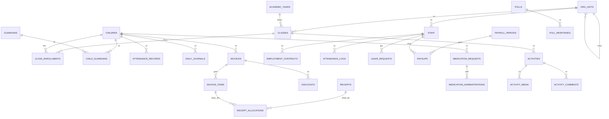

# 16. CƠ SỞ DỮ LIỆU

- Mô tả: Thực thể, trường, kiểu dữ liệu, khóa chính, khóa ngoại, quan hệ, ràng buộc, chỉ mục, trạng thái, lịch sử thay đổi, chính sách xóa dữ liệu.
- Phiên bản: 1.55
- Ngày cập nhật: 2026-10-13
- Trạng thái: Đã phê duyệt
- Người phê duyệt: Eric, ngày 2026-10-09

## 1. Quy ước chung

1. Khóa chính dùng mã định danh duy nhất toàn trường, kiểu mã định danh.
2. Mọi bảng nghiệp vụ có bốn trường chung: `id`, `created_at`, `updated_at`, `created_by`. Bảng thuộc một đơn vị có thêm `org_unit_id` tham chiếu tới `org_units.id`.
3. Không xóa cứng dữ liệu nghiệp vụ. Bảng cần ngừng sử dụng có trường `status` hoặc `deleted_at` để xóa mềm.
4. Mọi bảng có `org_unit_id` phải có chỉ mục trên cột này và phải được kiểm tra phạm vi đơn vị ở tầng truy vấn.
5. Mọi số tiền lưu kiểu số thập phân có hai chữ số phần thập phân, đơn vị đồng.
6. Mọi mốc thời gian lưu theo giờ Việt Nam kèm múi giờ; trường chỉ ghi ngày dùng kiểu ngày.
7. Mã chứng từ như số phiếu thu, số phiếu chi, mã hóa đơn sinh theo quy tắc của từng đơn vị, có ràng buộc duy nhất theo đơn vị và kỳ.
8. Đơn vị tổ chức lưu trong bảng `org_units` thành cây hai cấp (QĐ-23); `unit_type` là loại đơn vị; Trường chính có `parent_id` trống, Phân hiệu và Điểm trường có `parent_id` là Trường chính.
9. Mỗi năm học một cơ sở dữ liệu nghiệp vụ (QĐ-15). Có ba loại cơ sở dữ liệu:
   - Cơ sở dữ liệu định danh, không theo năm học: `users`, `roles`, `permissions`, `role_permissions`, `user_roles`, `sessions`, `one_time_codes`, `api_clients`, `security_events` (YCTD-35), `identity_audit_logs` (YCTD-39), `identity_settings` (YCTD-40).
   - Cơ sở dữ liệu hệ thống của máy chủ API, không theo năm học: `academic_year_databases` (QĐ-17), `academic_years`, `academic_terms`, `school_weeks` (YCTD-30), `integration_credentials` (YCTD-95).
   - Cơ sở dữ liệu năm học: mọi bảng còn lại.
10. Khi mở năm học mới, dữ liệu chuyển sang giữ nguyên mã định danh (`id`) của đơn vị, trẻ, phụ huynh, nhân sự, danh mục và tài khoản quỹ, để phân quyền ở cơ sở dữ liệu định danh và báo cáo nhiều năm tham chiếu đúng.

## 2. Phân hệ P01 — Nền tảng, đơn vị và phân quyền

| Bảng | Mục đích | Trường chính |
|---|---|---|
| org_units | Đơn vị tổ chức hai cấp của trường (QĐ-23) | code (duy nhất), name, unit_type (truong_chinh, phan_hieu, diem_truong; cố định), parent_id (trỏ tới org_units.id, trống với Trường chính), address, phone, manager_user_id, status |
| files | Tệp đính kèm lưu ở kho tệp: giấy khai sinh, giấy đồng ý hình ảnh (YCTD-45), tệp nhập dữ liệu (YCTD-46), ảnh bàn giao trẻ (YCTD-48) | org_unit_id, purpose, file_name, content_type, size_bytes, storage_key (duy nhất) |
| academic_years | Năm học, một lịch chung toàn trường, lưu ở cơ sở dữ liệu hệ thống | name, start_date, end_date, school_days_of_week (mặc định thứ hai đến thứ sáu), status (chưa mở, đang dùng, đã đóng; chỉ một năm đang dùng, BR-93) |
| academic_terms | Học kỳ và kỳ hè của năm học (BR-91) | academic_year_id, term_type (học kỳ 1, học kỳ 2, kỳ hè), start_date, end_date |
| school_weeks | Tuần học tự đánh số (BR-91) | academic_year_id, week_no, start_date, end_date, is_off (tuần nghỉ), note |
| departments | Phòng ban | org_unit_id, parent_id (phòng ban cha cùng đơn vị, không tạo vòng), name, status |
| job_titles | Chức danh | org_unit_id, name (duy nhất trong đơn vị), level (cấp bậc, chữ tự do), status |
| users | Tài khoản đăng nhập | full_name, phone (duy nhất), username (duy nhất), password_hash (để trống khi phụ huynh còn dùng mật khẩu mặc định chung, YCTD-43), status, last_login_at, failed_login_count, locked_until (hết hạn tạm khóa do sai mật khẩu, YCTD-35), must_change_password, valid_until (bắt buộc với VT-20) |
| roles | Vai trò | code (duy nhất), name, is_system |
| permissions | Quyền theo chức năng | code (duy nhất), module_code, description |
| role_permissions | Gán quyền cho vai trò | role_id, permission_id |
| user_roles | Gán vai trò cho tài khoản | user_id, role_id, org_unit_id (cho phép trống nghĩa là toàn trường; tham chiếu theo mã, không có khóa ngoại vì nằm khác cơ sở dữ liệu) |
| sessions | Phiên đăng nhập và mã làm mới | user_id, channel, refresh_token_hash, issued_at, expires_at, revoked_at, ip_address, user_agent, login_method (mật khẩu hoặc mã một lần; phiên bằng mã một lần không bị giới hạn đổi mật khẩu, YCTD-43) |
| one_time_codes | Mã một lần đăng nhập của phụ huynh | user_id, phone, purpose (đăng nhập; xác thực hai lớp đã bỏ theo YCTD-31), code_hash, expires_at, attempt_count, used_at, created_at; số lần gửi đếm theo số điện thoại trong bộ nhớ đệm, không lưu cột riêng (YCTD-43) |
| security_events | Nhật ký bảo mật của dịch vụ định danh: đăng nhập sai, tạm khóa, làm mới bằng mã đã thu hồi (BM-36, YCTD-35) | event_type, user_id (trống khi không tìm thấy tài khoản), login_identifier, ip_address, created_at |
| identity_audit_logs | Nhật ký thao tác của dịch vụ định danh: tạo, sửa, khóa, mở khóa tài khoản, đặt lại mật khẩu, gán và gỡ vai trò, sửa quyền của vai trò (PQ-05, YCTD-39) | actor_user_id, entity_name, entity_id, action, before_data, after_data, ip_address, created_at |
| identity_settings | Cấu hình chung toàn trường của dịch vụ định danh: số ngày không đăng nhập thì tự khóa (PQ-07, YCTD-40), giá trị băm của mật khẩu mặc định của phụ huynh, ba thông số mã một lần (YCTD-43) | key (duy nhất), value, updated_at, updated_by |
| settings | Cấu hình theo đơn vị; mục chưa cấu hình lấy từ Trường chính, rồi mặc định (YCTD-40) | org_unit_id, key, value, value_type, updated_at, updated_by; duy nhất theo org_unit_id kèm key |
| audit_logs | Nhật ký thao tác | actor_user_id, actor_name (tên lúc thao tác, YCTD-40), org_unit_id, entity_name, entity_id, action, before_data, after_data, ip_address, created_at |
| data_access_logs | Nhật ký truy cập dữ liệu nhạy cảm | actor_user_id, actor_name, api_client_id (khi đối tác đọc qua API), org_unit_id, entity_name, entity_id, scope (ví dụ số định danh, giấy khai sinh), record_count, purpose, ip_address, created_at |
| approval_thresholds | Hạn mức phê duyệt | org_unit_id, document_type, threshold_amount, effective_from (ngày lưu, có hiệu lực ngay), status (đang hiệu lực hoặc hết hiệu lực; mỗi đơn vị và loại chứng từ chỉ một bản đang hiệu lực), updated_by (YCTD-42) |
| api_clients | Khóa API của đối tác (YCTD-63) | name, partner_type, scopes (reports, finance, children, staff), legal_basis, key_prefix, key_hash (SHA-256, duy nhất), allowed_ips, valid_until, status (đang dùng, đã thu hồi), created_by, revoked_by, revoked_at, last_used_at |
| academic_year_databases | Cơ sở dữ liệu theo năm học | academic_year_id, database_name, status (đang dùng hoặc chỉ đọc), opened_at, closed_at, carried_over_by |
| data_import_jobs | Lần nhập dữ liệu ban đầu và nhập mã ngành | org_unit_id, import_type (lớp, trẻ, mã ngành), file_id (tệp gốc ở kho tệp), status (đã kiểm tra, còn lỗi, đã ghi), total_rows, error_rows, errors (báo cáo dòng lỗi, không chứa số định danh), error_report_file_id, created_by, created_at, committed_by, committed_at (YCTD-46) |
| notification_templates | Mẫu thông báo | code (duy nhất), channel, subject, body_template, status |
| notifications | Thông báo đã sinh | org_unit_id, template_code, title, body, target_type, target_id, created_at |
| notification_recipients | Người nhận thông báo | notification_id, user_id (trống khi gửi theo vai trò), role_code và org_unit_id (mọi tài khoản có vai trò ở đơn vị, YCTD-47), channel (trong ứng dụng hoặc tin nhắn, YCTD-45), is_read, read_at, channel_status (chờ gửi, đã gửi, thất bại, vượt giới hạn trong ngày), sent_at, attempt_count, next_attempt_at, last_error (YCTD-71) |
| notification_reads | Người đã đọc thông báo (BR-70, YCTD-64) | notification_id, user_id (duy nhất cùng notification_id), read_at |
| notification_templates | Mẫu tiêu đề và nội dung theo mã thông báo, chung toàn trường (YCTD-64) | template_code (khóa chính), title_template, body_template, updated_by, updated_at |
| rooms | Phòng học | org_unit_id, code (duy nhất trong đơn vị), name, capacity (lớn hơn 0), status |
| grade_levels | Bậc học | code (duy nhất, không đổi sau khi tạo), name, age_from_months, age_to_months (tháng tuổi, YCTD-42), order_no, status |
| catalog_items | Mục danh mục dùng chung, không thuộc đơn vị (P01-05, YCTD-42) | catalog_type (loại do hệ thống định nghĩa), code (duy nhất trong loại), name, order_no, status, attributes (thuộc tính riêng của loại; loại nghỉ phép có is_paid, deducts_annual_leave, insurance_paid, YCTD-59) |

Ràng buộc: `org_units.parent_id` trỏ tới `org_units.id`. Chỉ một đơn vị `truong_chinh`, có `parent_id` trống; đơn vị `phan_hieu`, `diem_truong` có `parent_id` là Trường chính. Kiểm tra ở tầng ứng dụng và ở tầng dữ liệu (YCTD-38).

## 3. Phân hệ P02 — Trẻ, phụ huynh và lớp học

| Bảng | Mục đích | Trường chính |
|---|---|---|
| children | Hồ sơ trẻ | moet_student_code (mã do cơ sở dữ liệu ngành cấp, duy nhất khi có), national_id_hash (băm có khóa, duy nhất, bắt buộc), national_id_encrypted, national_id_last4 (hiển thị dạng che), org_unit_id, full_name, dob, gender, place_of_birth, address, status (nháp, chờ duyệt, đang học, tạm nghỉ, thôi học, đã tốt nghiệp), is_staff_child, related_staff_user_id và related_staff_name (tạm theo tài khoản, YCTD-44), special_needs_note, photo_consent (chờ xác nhận, đồng ý, không đồng ý), photo_consent_method (ứng dụng hoặc giấy ký tay), photo_consent_by, photo_consent_at, photo_consent_file_id, birth_certificate_file_id (trống được với trẻ nhập từ dữ liệu ban đầu, YCTD-46), enroll_date, leave_date, leave_reason, note, reject_reason, submitted_by, submitted_at, approved_by, approved_at (YCTD-45), moet_profile (đủ 82 cột của mẫu CSDL ngành, YCTD-100) |
| photo_consent_histories | Lịch sử đồng ý sử dụng hình ảnh | child_id, action (đồng ý hoặc rút), method, file_id, actor_user_id, created_at |
| guardians | Hồ sơ phụ huynh | full_name, phone (duy nhất khi có tài khoản), email, occupation, address, user_id, birth_year, id_number_encrypted, id_number_last4 (YCTD-100) |
| child_guardians | Quan hệ trẻ và phụ huynh | child_id, guardian_id, relationship, is_primary, can_pickup |
| authorized_pickups | Người được ủy quyền đón trẻ | child_id, full_name, relationship, phone (bắt buộc), valid_from, valid_to (trống là không thời hạn), status (đang hiệu lực hoặc đã hủy), source (phụ huynh hoặc nhà trường), created_by, revoked_by, revoked_at (YCTD-48) |
| classes | Lớp học | org_unit_id, academic_year_id, code (duy nhất trong đơn vị), name, grade_level (tham chiếu grade_levels.code), room_id (phòng cùng đơn vị), max_size, status (đang dùng hoặc đã đóng); giáo viên của lớp ở `class_staff_assignments` (YCTD-44) |
| class_enrollments | Lịch sử lớp của trẻ | child_id, class_id, from_date, to_date, reason, is_current |
| class_staff_assignments | Phân công giáo viên vào lớp | class_id, staff_user_id (tạm là mã tài khoản đến khi có hồ sơ nhân sự), staff_name, assignment_role (chủ nhiệm hoặc bộ môn), subject_name, from_date, to_date, status; một lớp có thể có nhiều giáo viên chủ nhiệm (YCTD-44) |
| teaching_groups | Tổ chuyên môn | org_unit_id, name, leader_staff_id, status |
| teaching_group_members | Thành viên tổ chuyên môn | group_id, staff_id, from_date, to_date |
| health_profiles | Hồ sơ sức khỏe cơ bản | child_id (duy nhất), blood_type, has_allergies (trống là chưa khai báo, BR-06), allergies, chronic_conditions, note |
| health_measurements | Chỉ số sức khỏe theo lần đo | child_id, measured_on, height_cm, weight_kg, vision_left, vision_right, bmi, note |
| lost_items | Đồ bị mất của trẻ | code (DBM-000001), org_unit_id, child_id, class_id, report_type (lost, found), description, noticed_on, photo_file_id, status (reported, found, returned, not_found, cancelled), reported_by, reported_at, found_by, found_at, found_note, closed_by, closed_at, result_note, cancelled_by, cancelled_at |

## 4. Phân hệ P03 — Giảng dạy

| Bảng | Mục đích | Trường chính |
|---|---|---|
| themes | Chủ đề giảng dạy (P03-03) | org_unit_id, name, age_group, start_date, end_date, status, created_by |
| lessons | Bài học (P03-01) | org_unit_id, theme_id, domain_id, lesson_group_id, name, age_group, objectives, materials, is_shared, status, created_by |
| lesson_plans | Giáo án theo lớp (P03-02) | lesson_id, class_id, org_unit_id, teacher_id, teacher_name, planned_date, activities, duration_minutes (5–480), materials, status (draft, submitted, leader_approved, approved, returned), submitted_at, leader_reviewed_by, leader_reviewed_at, approved_by, approved_at, review_comment |
| timetables | Thời khóa biểu theo phiên bản tuần (P03-04) | class_id, effective_from (thứ Hai), weekday (1–7), period_no, start_time, end_time (HH:MM), activity_name, teacher_id, teacher_name, status (draft, published), published_at, created_by; duy nhất theo lớp, ngày áp dụng, thứ, tiết |
| teaching_plans | Kế hoạch giảng dạy (P03-05) | class_id, org_unit_id, period_type (term, month, week), period_value, objectives, content, progress_note, status (planned, in_progress, completed); duy nhất theo lớp và kỳ |
| child_progress | Tiến độ học tập của trẻ (P03-06) | child_id, class_id, period_type (term, month), period_value, domain_id, indicator_code, level (achieved, developing, not_yet), comment, recorded_by, published_at, published_by; duy nhất theo trẻ, kỳ, chỉ số |
| lesson_domains | Lĩnh vực bài học (P03-08) | org_unit_id, name (duy nhất trong đơn vị), order_no, status, created_by |
| lesson_groups | Nhóm bài học (P03-08) | org_unit_id, domain_id, name (duy nhất trong lĩnh vực), order_no, status, created_by |
| class_activity_schedules | Lịch hoạt động lớp (P03-07) | class_id, activity_date, start_time, end_time, activity_name, note, status (draft, published, cancelled), published_at, created_by |
| lesson_plan_reviews | Lịch sử duyệt và góp ý giáo án | lesson_plan_id, reviewer_id, reviewer_name, stage (leader, manager), decision (approved, returned), comment, created_at |

## 5. Phân hệ P04 — Điểm danh và chăm sóc hằng ngày

| Bảng | Mục đích | Trường chính |
|---|---|---|
| attendance_records | Bản ghi điểm danh | child_id, class_id, org_unit_id, attendance_date, status (có mặt, nghỉ có báo, nghỉ không báo, đi muộn, về sớm, đi muộn và về sớm), note, source (giáo viên, quản lý, phụ huynh, hệ thống), recorded_by, recorded_at (thời điểm trên thiết bị), is_backfilled (gửi bù khi có mạng lại) |
| absence_records | Bản ghi nghỉ | child_id, org_unit_id, absence_date, reason, is_advised (báo trước giờ bắt đầu học), advised_at, source, reported_by |
| attendance_days | Trạng thái điểm danh của lớp theo ngày (YCTD-47) | class_id, attendance_date (duy nhất cùng class_id), status (chưa chốt hoặc đã chốt), locked_by, locked_at, unlocked_by, unlocked_at, unlock_reason |
| pickup_records | Nhật ký đón trả trẻ | child_id, class_id, org_unit_id, pickup_date, pickup_type (bàn giao chiều hoặc bảo vệ xác nhận tại cổng), person_kind (phụ huynh, người được ủy quyền, phụ huynh đã xác nhận), person_name, relationship, phone, guardian_id, authorized_pickup_id, confirmation_request_id, photo_file_id, recorded_by, recorded_at; mỗi trẻ một lượt bàn giao mỗi ngày (YCTD-48) |
| pickup_confirmation_requests | Yêu cầu phụ huynh xác nhận người đón ngoài danh sách (BR-56, YCTD-48) | child_id, pickup_date, person_name, relationship, phone, status (chờ, đã xác nhận, từ chối), requested_by, requested_at, responded_by, responded_at |
| child_unit_transfers | Lịch sử chuyển đơn vị của trẻ (YCTD-67) | child_id, from_org_unit_id, to_org_unit_id, from_class_id, to_class_id, effective_date, reason, created_by, created_at |
| daily_journals | Nhật ký của bé (YCTD-65) | child_id, class_id, journal_date (duy nhất cùng child_id), meal_note, sleep_note, hygiene_note, mood (vui vẻ, bình thường, mệt, buồn, không khỏe), activity_note, status (nháp, đã công bố), published_at, published_by, updated_by |
| journal_amendments | Lịch sử sửa nhật ký | journal_id, reason, before_data, after_data, amended_by, amended_at |

Ràng buộc duy nhất: `attendance_records` trên bộ đôi trẻ, ngày; `absence_records` trên bộ đôi trẻ, ngày; `daily_journals` trên bộ đôi trẻ, ngày.

## 6. Phân hệ P05 — Học phí, khoản thu và giảm trừ

| Bảng | Mục đích | Trường chính |
|---|---|---|
| fee_schedules | Phiên bản biểu phí dùng chung toàn trường (YCTD-49) | name, effective_from (ngày 1 của tháng, duy nhất), effective_to (ngày trước phiên bản sau, trống là đang áp dụng tới nay) |
| fee_schedule_items | Mức phí của phiên bản theo bậc học | fee_schedule_id, grade_level, fee_type (học phí chính khóa hoặc dịch vụ), service_id, amount (đồng, không âm); duy nhất theo phiên bản, bậc học, khoản phí |
| services | Danh mục dịch vụ dùng chung toàn trường | code (duy nhất), name, unit, calculation_method (theo tháng hoặc theo ngày có mặt), is_mandatory, is_system (bán trú tạo sẵn), status |
| service_registrations | Đăng ký dịch vụ theo kỳ | child_id, org_unit_id, period_year, period_month, service_id, status (đang hiệu lực, chờ duyệt đăng ký trễ, chờ duyệt hủy, đã hủy, bị từ chối), source (phụ huynh, nhà trường, hệ thống, tự giữ từ tháng trước), registered_by, registered_at, is_late, service_start_date (bắt buộc khi đăng ký trễ, Q-150), late_charge_method (cả tháng hoặc theo ngày thực tế), decided_by, decided_at, decision_note, cancel_requested_by, cancel_requested_at, cancelled_by, cancelled_at (YCTD-50) |
| registration_periods | Trạng thái chốt danh sách đăng ký của kỳ theo đơn vị (YCTD-50) | org_unit_id, period_year, period_month (duy nhất cùng đơn vị), status (đang mở hoặc đã chốt), locked_by, locked_at |
| summer_registrations | Đăng ký học hè theo tháng (P05-13, BR-92) | child_id, org_unit_id, period_year, period_month (duy nhất cùng trẻ), status (đang hiệu lực hoặc đã hủy), source, registered_by, registered_at, cancelled_by, cancelled_at |
| invoices | Hóa đơn học phí | code (cấp khi phát hành, dạng HD-000001), child_id, org_unit_id, period_year, period_month, invoice_kind (chính, bổ sung hoặc đầu kỳ; mỗi trẻ tối đa một hóa đơn đầu kỳ, YCTD-54), status (nháp hoặc đã phát hành), calculation_run_id, total_amount, basis (số ngày học, số ngày đang học, số ngày có mặt, bậc học, biểu phí), review_flags (dòng cần kiểm tra), due_date, issued_at, issued_by; số đã giảm trừ, điều chỉnh, đã thu tính từ bảng liên quan (YCTD-51) |
| invoice_items | Dòng khoản phải thu | invoice_id, item_type (học phí chính khóa hoặc dịch vụ), service_id, service_registration_id (đăng ký đã lập khoản thu), description, quantity, unit_price, amount, basis_note |
| discounts | Miễn giảm trên hóa đơn (YCTD-52) | invoice_id, child_id, org_unit_id, discount_type_id, basis, calculation_method, rate_value, base_amount, applied_amount, status (chờ duyệt, đã duyệt, bị từ chối), requires_principal, copied_from_id, created_by, decided_by, decided_at, reject_reason |
| discount_types | Danh mục loại miễn giảm dùng chung toàn trường | code (duy nhất), name, calculation_method (phần trăm hoặc số tiền), value, applies_to (học phí chính khóa và mã các dịch vụ), condition_note, status |
| invoice_adjustments | Phiếu điều chỉnh hóa đơn (YCTD-52) | code (dạng DC-000001), invoice_id, child_id, org_unit_id, reason, amount (dương tăng, âm giảm), status (chờ duyệt, đã duyệt, bị từ chối), requires_principal, created_by, decided_by, decided_at, reject_reason |
| fee_calculation_runs | Lần chạy tính học phí | org_unit_id, period_year, period_month, status (đang chạy, thành công, thất bại), started_at, finished_at, error_detail, child_count, total_amount, run_by |
| document_sequences | Số chứng từ liên tục trong năm học theo loại (YCTD-30, YCTD-51) | document_type, last_value |
| debt_resolutions | Đề xuất và quyết định xử lý công nợ quá hạn (P05-12, YCTD-82) | org_unit_id, child_id, invoice_id (tùy chọn), overdue_amount, overdue_days (lúc lập), proposal, proposed_by, proposed_at, decision, decided_by, decided_at, status (chờ quyết định, đã quyết định; mỗi trẻ tối đa một đề xuất đang chờ) |

Ràng buộc duy nhất: `invoices` loại chính trên bộ ba trẻ, kỳ năm, kỳ tháng; hóa đơn bổ sung không giới hạn số lượng (BR-85); `service_registrations` trên bộ ba trẻ, kỳ, dịch vụ.

## 7. Phân hệ P06 — Tài chính

| Bảng | Mục đích | Trường chính |
|---|---|---|
| receipts | Phiếu thu (YCTD-53) | code (dạng PT-000001, một dãy số toàn trường trong năm học), org_unit_id, child_id (trống với phiếu thu thu hồi lương, BR-90), staff_id (với phiếu thu thu hồi lương), payer_name, amount, method (tiền mặt, chuyển khoản, khác), account_id, category_id, receipt_date, content, status (đã phát hành, chờ duyệt đảo, đã đảo), request_key (duy nhất, chống gửi lặp), created_by; trường phiếu đảo thêm ở phần 5d-2; child_id được trống khi là phiếu thu thu hồi lương, khi đó có staff_id, settlement_id (YCTD-61); carried_over đúng với phiếu ghi số dư có chuyển từ năm học trước, không có giao dịch quỹ (YCTD-69) |
| receipt_allocations | Phân bổ phiếu thu vào hóa đơn (YCTD-53) | receipt_id, invoice_id, amount, created_by, created_at; tiền chưa phân bổ là số dư có của trẻ |
| receipt_reversals | Phiếu đảo phiếu thu (YCTD-54) | code (dạng DPT-000001), receipt_id, org_unit_id, child_id, amount, reason, status (chờ duyệt, đã duyệt, bị từ chối), requires_principal, created_by, decided_by, decided_at, reject_reason; mỗi phiếu thu tối đa một phiếu đảo đang chờ hoặc đã duyệt |
| online_payment_transactions | Giao dịch chuyển khoản trực tuyến (YCTD-57) | provider, provider_transaction_ref (duy nhất), virtual_account_number, amount, transfer_content, received_at, match_status (khớp, sai số tiền, không xác định hóa đơn, hóa đơn đã thu đủ), payment_request_id, invoice_id, child_id, org_unit_id, receipt_id, resolution_note, handled_by, handled_at |
| payment_requests | Yêu cầu thanh toán qua tài khoản ảo dùng một lần (YCTD-57) | invoice_id, child_id, org_unit_id, amount, transfer_content, provider, provider_reference, virtual_account_number, qr_content, status (còn hiệu lực, đã thanh toán, đã hủy), expires_at, created_by, closed_at; mỗi hóa đơn tối đa một yêu cầu còn hiệu lực |
| payments | Phiếu chi (YCTD-55) | code (cấp khi phát hành, dạng PC-000001), org_unit_id, payment_type (thường, hoàn tiền thôi học, lương), child_id (bắt buộc khi hoàn tiền), payee_name, amount, content, account_id, category_id, payment_date (ngày phát hành), status (nháp, chờ duyệt, đã phát hành, chờ duyệt đảo, đã đảo), requires_principal, request_key, created_by, submitted_at, approved_by, approved_at, reject_reason; payroll_id, settlement_id (phiếu chi lương, YCTD-61); supplier_id, voucher_ref thêm khi có P06-07 |
| payment_attachments | Chứng từ kèm phiếu chi (YCTD-55) | payment_id, file_id (tệp mục đích `payment_voucher`) |
| payment_refund_sources | Nguồn tiền của phiếu chi hoàn tiền (YCTD-55) | payment_id, receipt_id, amount; trừ vào số dư có của trẻ |
| payment_reversals | Phiếu đảo phiếu chi (YCTD-56) | code (dạng DPC-000001), payment_id, org_unit_id, amount, reason, status (chờ duyệt, đã duyệt, bị từ chối), requires_principal, created_by, decided_by, decided_at, reject_reason; mỗi phiếu chi tối đa một phiếu đảo đang chờ hoặc đã duyệt |
| cash_accounts | Quỹ tiền mặt và tài khoản ngân hàng (YCTD-53) | org_unit_id, account_type (tiền mặt hoặc ngân hàng), name (duy nhất trong đơn vị), bank_name, account_number (bắt buộc với ngân hàng), opening_balance, current_balance (quỹ tiền mặt không âm), status, receives_online_payments (toàn trường tối đa một tài khoản), online_payment_category_id (YCTD-57) |
| account_transactions | Giao dịch trên tài khoản | account_id, transaction_date, transaction_type, amount, balance_after, reference_type, reference_id, description |
| payables | Công nợ phải trả nhà cung cấp (P06-07, YCTD-82) | code (CNP-000001), org_unit_id, supplier_id (tùy chọn), payee_name, source_type (lập tay, phiếu mua hàng, phiếu mua thuốc), source_id (duy nhất cùng loại), document_ref, description, amount, document_date, due_date, status (chưa trả, đã trả, đã hủy), payment_id (duy nhất, phiếu chi đã phát hành), paid_at, cancel_reason, created_by |
| suppliers | Nhà cung cấp chung của kho và mua hàng theo đơn vị (P13-07); nhà cung cấp thực phẩm ở `food_suppliers` (P12-08) | org_unit_id, name (duy nhất trong đơn vị), tax_code, contact_name, phone, address, payment_terms, status, created_by |
| fiscal_periods | Kỳ tài chính theo tháng của đơn vị (P06-09, YCTD-82) | org_unit_id, period_year, period_month (duy nhất cùng đơn vị), status (chờ duyệt chốt, đã chốt, bị từ chối; không có dòng là đang mở), summary (số liệu kỳ khi đề nghị và khi chốt), request_note, close_requested_by, close_requested_at, closed_by, closed_at, rejected_by, rejected_at, reject_reason |
| cashflow_categories | Khoản mục và nhóm thu chi dùng chung toàn trường | code (duy nhất), name, group_name, flow_type (thu hoặc chi), status |
| debt_reminders | Lần nhắc nợ theo hóa đơn và mốc (P05-10, YCTD-82) | org_unit_id, child_id, invoice_id, milestone_days (duy nhất cùng hóa đơn; 0 là nhắc trước mốc đầu), overdue_days, outstanding_amount, sent_by, sent_at |
| bank_statement_lines | Dòng sao kê ngân hàng nhập tay để đối chiếu, không đổi số dư (P06-06, YCTD-82) | account_id (tài khoản ngân hàng), org_unit_id, transaction_date, amount (vào dương, ra âm, khác 0), description, bank_reference, status (chưa khớp, đã khớp), matched_transaction_id (duy nhất, tới account_transactions), matched_by, matched_at, created_by |
| bank_statement_profiles | Cấu hình cột của tệp sao kê theo tài khoản ngân hàng, dùng lại cho các lần nhập (G3-05, YCTD-89) | account_id (duy nhất, tới cash_accounts), org_unit_id, header_row (1 đến 50), date_column, date_format (dmy, ymd, mdy), amount_mode (signed, split), amount_column, credit_column, debit_column, description_column, reference_column, updated_by, created_at, updated_at |
| bank_statement_imports | Mỗi lần nhập tệp sao kê và kết quả (G3-05, YCTD-89) | account_id, org_unit_id, file_name, file_format (xlsx, csv), total_rows, imported_count, duplicate_count, error_count, auto_matched_count, suggested_count, errors (jsonb: row, column, message), duplicates (jsonb), created_by, created_at |
| ledger_accounts | Hệ thống tài khoản kế toán dùng chung toàn trường theo chế độ hành chính, sự nghiệp (Thông tư 24/2024/TT-BTC) và tài khoản chi tiết do kế toán thêm (YCTD-88) | id, code (duy nhất, 3–12 chữ số), name, parent_id, normal_balance (debit, credit, both), is_system, status, created_by |
| ledger_posting_rules | Quy tắc ghi sổ tự động theo loại chứng từ, có thể riêng theo khoản mục thu chi; phía trống là tài khoản tiền của quỹ (YCTD-88) | id, document_type, category_id (duy nhất cùng document_type, kể cả trống), debit_account_id, credit_account_id, updated_by |
| journal_entries | Bút toán theo đơn vị: tự động từ chứng từ, thủ công, số dư đầu năm; số BT-000001 toàn trường trong năm học (YCTD-88) | id, code, org_unit_id, entry_date, description, entry_type (auto, manual, opening), source_type, source_id, source_code (duy nhất source_type + source_id + org_unit_id), total_amount, status (posted, voided; chỉ thủ công được hủy), request_key, created_by, voided_by, voided_at, void_reason |
| journal_lines | Dòng bút toán, mỗi dòng một phía Nợ hoặc Có (YCTD-88) | id, entry_id, line_no, account_id, debit, credit, description |

Ràng buộc duy nhất: `receipts` trên bộ đôi đơn vị và mã phiếu thu; `payments` trên bộ đôi đơn vị và mã phiếu chi.

## 8. Phân hệ P07 — Nhân sự

| Bảng | Mục đích | Trường chính |
|---|---|---|
| staff | Hồ sơ nhân sự (YCTD-58) | org_unit_id (đơn vị chính), code (duy nhất), dependents_count (số người phụ thuộc, YCTD-60), full_name, dob, gender, phone, email, address, id_number_encrypted, id_number_last4, department_id, job_title_id, start_date, end_date, status (đang làm, đã nghỉ), user_id (duy nhất, tài khoản liên kết), moet_staff_code (mã định danh Bộ, duy nhất), moet_profile (đủ 75 cột của mẫu CSDL ngành, YCTD-100) |
| employment_contracts | Hợp đồng lao động (YCTD-58) | staff_id, contract_no (duy nhất), contract_type (thử việc, có thời hạn, không thời hạn), start_date, end_date (bắt buộc trừ không thời hạn), base_salary, allowances (danh sách tên và số tiền), status (còn hiệu lực, đã chấm dứt), terminated_on, terminate_reason |
| staff_work_history | Quá trình công tác (BR-37, YCTD-81) | staff_id, org_unit_id, from_date, to_date, department_id, job_title_id, note, created_by |
| staff_certificates | Chứng chỉ (YCTD-81) | staff_id, name, certificate_no, issued_by, issued_date, expire_date, note, created_by |

## 9. Phân hệ P08 — Chấm công và tiền lương

| Bảng | Mục đích | Trường chính |
|---|---|---|
| attendance_logs | Chấm công (YCTD-59) | staff_id, work_date, check_in, check_out (giờ HH:MM theo giờ Việt Nam), worked_minutes, late_minutes, early_leave_minutes, source (tự chấm hoặc nhập tay), note, updated_by |
| work_schedules | Lịch nghỉ và lịch công tác (YCTD-68) | staff_id, org_unit_id, schedule_date (duy nhất cùng staff_id), schedule_type (công tác hoặc nghỉ), note, status (nháp, đã công bố), published_at, published_by, created_by |
| leave_requests | Đơn xin nghỉ phép (YCTD-59) | staff_id, leave_type_id, is_paid, deducts_annual_leave, insurance_paid (chép từ loại nghỉ lúc gửi), from_date, to_date, first_day_half, last_day_half, days, reason, status (chờ duyệt, đã duyệt, bị từ chối, đã hủy), created_by, requested_at, decided_by, decided_at, reject_reason |
| leave_balances | Số ngày phép năm theo năm dương lịch (YCTD-59) | staff_id, balance_year (duy nhất cùng staff_id), entitled_days, used_days, policy_id, adjust_reason, updated_by |
| leave_policies | Quy định số ngày phép năm chung toàn trường (YCTD-59) | job_title_id, seniority_from_years, seniority_to_years, entitled_days, status |
| timesheet_periods | Kỳ công của đơn vị theo tháng (YCTD-59) | org_unit_id, period_year, period_month (duy nhất cùng đơn vị), status (đã chốt, đã mở lại), closed_by, closed_at |
| timesheet_days | Bảng công đã chốt từng ngày (YCTD-59) | period_id, staff_id, work_date, status (đi làm, nghỉ theo đơn, vắng, nghỉ lễ, nghỉ bù), worked_minutes, late_minutes, early_leave_minutes, overtime_minutes, leave_request_id, leave_days, absent_days, unpaid_days, insurance_days, note |
| timesheet_reopen_requests | Đề nghị mở lại kỳ công (Q-135, YCTD-59) | period_id, reason, status (chờ duyệt, đã duyệt, bị từ chối), requested_by, requested_at, decided_by, decided_at, reject_reason |
| payrolls | Bảng lương toàn trường theo tháng (YCTD-60) | period_year, period_month (duy nhất), status (nháp, chờ duyệt, đã duyệt), total_net, requires_principal, tax_table_id, skipped (nhân sự chưa tính lương kèm lý do), calculated_by, calculated_at, submitted_at, approved_by, approved_at, return_reason |
| payslips | Phiếu lương từng người (YCTD-60) | payroll_id, staff_id (duy nhất cùng payroll_id), org_unit_id, contract_id, prepaid_amount, adjustment_amount, taxable_income, tax_amount, net_amount |
| payslip_lines | Chi tiết phiếu lương (YCTD-60) | payslip_id, section (trả trước, điều chỉnh, thuế), line_type, code, name, amount (thu nhập dương, khấu trừ âm), basis (căn cứ), order_no |
| pay_item_types | Danh mục phụ cấp, thưởng, khấu trừ chung toàn trường (YCTD-60) | kind (phụ cấp hoặc khấu trừ), code (duy nhất), name, calculation_method (cố định mỗi tháng, mỗi ngày đi làm, phần trăm lương hợp đồng), default_amount, rate_percent, is_tax_exempt, is_mandatory_insurance, status |
| staff_pay_items | Khoản gán cho nhân sự (YCTD-60) | staff_id, pay_item_type_id (duy nhất cùng staff_id), amount, rate_percent (mức riêng, trống là mức chung) |
| tax_tables | Biểu thuế thu nhập cá nhân theo phiên bản (YCTD-60) | effective_from (duy nhất), personal_deduction, dependent_deduction, brackets (danh sách mức trần và thuế suất) |
| payroll_settlements | Bảng quyết toán khi chấm dứt hợp đồng (YCTD-61) | staff_id, contract_id (duy nhất), terminated_on, status (nháp, chờ duyệt, đã duyệt), earned_amount, prepaid_amount, tax_difference, payable_amount (dương trả thêm, âm thu hồi), lines (căn cứ từng dòng), requires_principal, calculated_by, calculated_at, approved_by, approved_at, return_reason |
| payroll_adjustments | Khoản điều chỉnh lương cho kỳ sau (BR-45, YCTD-61) | staff_id, target_year, target_month, amount (âm trừ, dương cộng), reason, status (chờ duyệt, đã duyệt, bị từ chối), requires_principal, created_by, decided_by, decided_at, reject_reason |
| holidays | Ngày nghỉ lễ chung toàn trường (YCTD-59) | holiday_date (duy nhất), name, is_paid |
| school_day_changes | Ngày học bù thứ bảy và ngày nghỉ bù, một lịch chung toàn trường (YCTD-59) | change_date (duy nhất), change_type (học bù hoặc nghỉ bù), note, created_by |

Ràng buộc duy nhất: `attendance_logs` trên bộ đôi nhân sự và ngày; `payslips` trên bộ đôi kỳ lương và nhân sự.

## 10. Phân hệ P09 — Công việc, kế hoạch và đánh giá

| Bảng | Mục đích | Trường chính |
|---|---|---|
| tasks | Công việc được giao và việc cá nhân (YCTD-81) | org_unit_id, task_type (được giao, cá nhân), title, description, assigner_user_id, assigner_name, assignee_staff_id, due_date, priority (thấp, bình thường, cao), status (chưa làm, đang làm, hoàn thành, đã hủy), progress_percent, plan_item_id, completed_at, cancel_reason |
| task_updates | Cập nhật tiến độ công việc (YCTD-81) | task_id, content, progress_percent, status, created_by, created_by_name, created_at |
| plans | Kế hoạch của đơn vị theo kỳ (YCTD-81) | org_unit_id, period_type (tháng, học kỳ, năm học), period_value, title, objectives, status (nháp, đang thực hiện, đã đóng), created_by, activated_at, closed_at |
| plan_items | Đầu việc trong kế hoạch (YCTD-81) | plan_id, content, owner_staff_id, due_date, task_id (việc được giao khi kích hoạt), order_no |
| evaluations | Phiếu đánh giá nhân sự theo kỳ (BR-47, YCTD-81) | staff_id, org_unit_id, period_type, period_value, total_score (thang 100), comment, status (nháp, đã công bố, đã thay thế), replaces_id, reevaluation_reason, evaluated_by, evaluated_by_name, published_by, published_at; mỗi nhân sự mỗi kỳ tối đa một phiếu nháp và một phiếu đã công bố |
| evaluation_criteria | Chỉ số đánh giá của đơn vị (YCTD-81) | org_unit_id, code (duy nhất cùng org_unit_id), name, weight, max_score, status |
| evaluation_scores | Điểm từng chỉ số của phiếu đánh giá (YCTD-81) | evaluation_id, criterion_id (duy nhất cùng evaluation_id), criterion_code, criterion_name, weight, max_score (chép lúc chấm), score, comment |
| staff_bonus_deductions | Thưởng và khấu trừ ghi riêng cho bảng lương một tháng (BR-44, BR-45, YCTD-81) | staff_id, pay_item_type_id, target_year, target_month, amount (dương), basis (căn cứ), status (hiệu lực, đã hủy), created_by, cancelled_by, cancelled_at, cancel_reason |

## 11. Phân hệ P10 — Y tế học đường

| Bảng | Mục đích | Trường chính |
|---|---|---|
| medicines | Danh mục thuốc của tủ thuốc phòng y tế theo đơn vị (YCTD-75) | org_unit_id, code (duy nhất trong đơn vị), name, active_ingredient, unit, pharmacy_id, stock_qty (không âm, chỉ đổi qua phiếu mua và phiếu cấp), status, created_by |
| pharmacies | Nhà thuốc theo đơn vị (YCTD-75) | org_unit_id, name, phone, address, status, created_by |
| health_measurements | Chỉ số sức khỏe theo lần đo (YCTD-74) | child_id, measured_on, height_cm, weight_kg, vision_left, vision_right, note, recorded_by |
| medication_requests | Yêu cầu dặn thuốc (YCTD-75) | child_id, org_unit_id, class_id, requested_by, medicine_name, dosage, times (giờ HH:MM, ít nhất một), from_date, to_date, allergy_note, note, medicine_photo_ids (ít nhất một), prescription_photo_id (tùy chọn), assigned_role (nurse, homeroom), status (pending, administering, completed, rejected), received_quantity, received_note, received_by, received_at, reject_reason, rejected_by, rejected_at, completed_at |
| medication_administrations | Nhật ký cho uống thuốc (YCTD-75) | request_id, scheduled_date, scheduled_time (duy nhất cùng request_id và scheduled_date), administered_at, administered_by, dose_note, is_skipped, skip_reason (bắt buộc khi bỏ liều), parent_acknowledged_at, parent_acknowledged_by |
| health_check_campaigns | Đợt khám sức khỏe | org_unit_id, name, from_date, to_date, status (đang mở, đã đóng), created_by |
| health_check_results | Kết quả khám | campaign_id, child_id (duy nhất cùng campaign_id), height_cm, weight_kg, result_data (tên chỉ số và giá trị), conclusion, note, recorded_by, recorded_at, published_at |
| medical_events | Sự kiện y tế tại trường | child_id, org_unit_id, occurred_at, symptoms, handling, handler_name, severity (nhẹ, vừa, nặng), recorded_by, notified_guardians_at, parent_acknowledged_at, parent_acknowledged_by |
| medicine_purchase_requests | Đề nghị mua thuốc (YCTD-75) | org_unit_id, medicine_id, quantity, estimated_unit_price, estimated_amount, reason, status (pending, approved, rejected, ordered), requires_principal, created_by, approved_by, approved_at, reject_reason |
| medicine_purchase_orders | Phiếu mua thuốc (YCTD-75) | code (MT-000001), org_unit_id, request_id (duy nhất), pharmacy_id, order_date, total_amount, status (received), note, created_by |
| medicine_purchase_order_items | Thuốc đã mua (YCTD-75) | order_id, medicine_id, quantity, unit_price, amount, received_qty |
| health_check_schedules | Lịch khám | campaign_id, class_id (duy nhất cùng campaign_id), check_date, location, published_at, created_by |
| health_standards | Tiêu chuẩn sức khỏe theo Bộ Y tế, chung toàn trường | indicator_code (chiều cao, cân nặng, chỉ số khối cơ thể), gender, age_month_from, age_month_to, lower_value, upper_value, source_document, created_by |
| daily_care_logs | Nhật ký chăm sóc hằng ngày (P10-12) | child_id, care_date, recorded_at, temperature, condition_note, special_care_note, recorded_by |
| health_report_requests | Yêu cầu báo cáo sức khỏe (P10-08, YCTD-74) | child_id, org_unit_id, report_type (tăng trưởng, y tế, đầy đủ), period_from, period_to, note, status (chờ gửi, đã gửi), requested_by, requested_at, report_data, response_note, sent_by, sent_at |
| medicine_issues | Phiếu cấp thuốc từ tủ thuốc (YCTD-75) | code (CTH-000001), org_unit_id, medicine_id, quantity, recipient, reason, issued_by, issued_at |

## 12. Phân hệ P11 — Xe đưa đón (đã bỏ)

Bỏ ngày 09/10/2026: trường không có xe đưa đón (Q-62). Các bảng `bus_routes`, `bus_stops`, `vehicles`, `route_assignments`, `bus_registrations`, `bus_trips`, `bus_trip_confirmations`, `bus_incidents` đã gỡ khỏi thiết kế.

## 13. Phân hệ P12 — Bếp và dinh dưỡng

| Bảng | Mục đích | Trường chính |
|---|---|---|
| dishes | Món ăn (YCTD-76) | org_unit_id, name (duy nhất trong đơn vị), group_name (nhóm chất), recipe_note (cách chế biến), status |
| menus | Thực đơn tuần (YCTD-76) | org_unit_id, week_start_date (thứ hai), age_group (all hoặc mã khối học), status (nháp, chờ duyệt, đã công bố), note, submitted_by, submitted_at, approved_by, approved_at, published_at, reject_reason, created_by |
| menu_items | Món trong thực đơn (YCTD-76) | menu_id, weekday (1 thứ hai đến 6 thứ bảy), meal_type (sáng, trưa, xế), dish_id, note; duy nhất trên menu_id, weekday, meal_type, dish_id |
| ingredients | Nguyên liệu và tồn của bếp (YCTD-76) | org_unit_id, code (duy nhất trong đơn vị), name, unit, current_stock (không âm, tăng khi nhập phiếu đi chợ), status |
| ingredient_norms | Định lượng trên một suất (YCTD-76) | dish_id, ingredient_id (duy nhất cùng dish_id), quantity_per_serving (lớn hơn 0, theo đơn vị tính của nguyên liệu) |
| meal_plans | Số suất ăn theo ngày đã lưu (YCTD-76) | org_unit_id, meal_date, meal_type (sáng, trưa, xế), headcount, computed_from (điểm danh, hỗn hợp), status (tạm tính, chính thức), computed_by, computed_at |
| buffet_events | Tiệc buffet theo dịp (YCTD-76) | org_unit_id, buffet_date, occasion, class_id (trống khi toàn đơn vị), menu_note, status (nháp, đã duyệt, đã hủy), created_by, approved_by, approved_at |
| market_purchases | Phiếu đi chợ (YCTD-76) | code (PDC-000001, cấp khi lập), org_unit_id, purchase_date, supplier_id (food_suppliers), total_amount, note, status (nháp, đã nhập, đã hủy), payment_status (chờ thanh toán, đã thanh toán; chỉ khi đã nhập), payment_id (phiếu chi đã phát hành, duy nhất), created_by, received_by, received_at, paid_linked_by, paid_linked_at |
| market_purchase_items | Dòng phiếu đi chợ (YCTD-76) | purchase_id, ingredient_id (duy nhất cùng purchase_id), quantity, planned_quantity (định lượng của ngày lúc lập phiếu, BR-60), unit_price, amount |
| meal_reports | Báo cơm của lớp (YCTD-76) | class_id, org_unit_id, report_date (duy nhất cùng class_id), headcount (không quá sĩ số), note, reported_by, reported_at |
| food_suppliers | Nhà cung cấp thực phẩm (YCTD-76; gộp vào `suppliers` khi có danh mục dùng chung) | org_unit_id, name (duy nhất trong đơn vị), food_groups, tax_code, contact_name, phone, address, status |

Ràng buộc duy nhất: `menus` trên bộ ba đơn vị, tuần, độ tuổi; `meal_plans` trên bộ ba đơn vị, ngày, bữa.

Bỏ ngày 09/10/2026 (YCTD-20): bảng `meal_registrations` đã gỡ vì không có đăng ký bữa riêng; `buffet_registrations` thay bằng `buffet_events` vì buffet không đăng ký theo trẻ.

## 14. Phân hệ P13 — Kho, tài sản và mua hàng

| Bảng | Mục đích | Trường chính |
|---|---|---|
| assets | Tài sản (P13-01) | org_unit_id, code (duy nhất), name, category, unit, original_cost, purchase_date, location_type (store, room, class, staff, unit), location_id, location_name, status (in_stock, assigned, on_loan, damaged, lost, disposed) |
| asset_assignments | Phiếu cấp phát và thu hồi (P13-02) | code, asset_id, assigned_to_type, assigned_to_id, assigned_to_name, received_by_name, assigned_on, handed_by, return_code, returned_on, returned_by_name, return_received_by, return_note; một phiếu đang mở mỗi tài sản |
| asset_loans | Phiếu mượn trả (P13-03) | code, asset_id, borrower_name, borrower_user_id, from_date, due_date, status (open, returned), lent_by, returned_on, return_received_by; một phiếu đang mở mỗi tài sản |
| asset_damages | Ghi nhận hỏng và mất (P13-04) | code, asset_id, org_unit_id, incident_type (damaged, lost), severity (minor, major, total), description, occurred_on, proposed_handling, status (pending, approved, rejected), reported_by, decided_by, decided_at, decision_note |
| stock_items | Mặt hàng trong kho (P13-08) | org_unit_id, code (duy nhất trong đơn vị), name, unit, min_qty, current_qty (không âm), status |
| stock_transactions | Giao dịch kho (P13-08, P13-10) | code, stock_item_id, transaction_type (opening, receipt, issue, count_adjustment, carry_over), quantity (có dấu), unit_price, balance_after, reference_type, reference_id, transaction_date, note, created_by |
| stock_counts | Biên bản kiểm kê (P13-09) | code, org_unit_id, count_date, status (matched, pending, approved, rejected), note, created_by, decided_by, decided_at, reject_reason |
| stock_count_lines | Dòng kiểm kê | count_id, stock_item_id, system_qty, actual_qty, difference, note |
| purchase_requests | Đề nghị mua hàng (P13-05) | code, org_unit_id, requester_id, requester_name, needed_by, reason, total_amount, requires_principal, status (pending, approved, rejected, ordered), approved_by, approved_at, reject_reason |
| purchase_request_items | Mặt hàng đề nghị | request_id, item_name, quantity, unit, estimated_price, note |
| purchase_orders | Phiếu mua hàng (P13-06) | code, org_unit_id, request_id (duy nhất), supplier_id, order_date, total_amount, status (ordered, received), payment_status (awaiting_payment, paid), payment_id (duy nhất), note, created_by, received_by, received_at |
| purchase_order_items | Mặt hàng đã mua | order_id, stock_item_id, item_name, quantity, unit_price, amount, received_qty |

## 15. Phân hệ P14 — Hoạt động, nội dung và truyền thông

| Bảng | Mục đích | Trường chính |
|---|---|---|
| activities | Hoạt động của lớp (P14-01, P14-02) | org_unit_id, class_id, category_id, title, content, activity_date, status (draft, pending, published, rejected, hidden), created_by, created_by_name, submitted_at, approved_by, approved_at, reject_reason, published_at, hidden_reason, hidden_by, hidden_at |
| activity_categories | Danh mục hoạt động theo đơn vị (P14-03) | org_unit_id, name (duy nhất trong đơn vị), order_no, status, created_by |
| activity_media | Ảnh của hoạt động (P14-04) | activity_id, file_id (mục đích activity_photo), caption, order_no, created_by; tối đa 30 ảnh mỗi hoạt động |
| activity_likes | Lượt thích | activity_id, user_id (khóa chính đôi), created_at |
| activity_comments | Bình luận | activity_id, user_id, content, created_at, moderation_note, moderated_by |
| news | Tin tức (P14-05) | org_unit_id, category_id, title, summary, content, cover_file_id, scope_type (school, unit, class, child), scope_id, status (draft, published, hidden), published_at, published_by, hidden_reason, hidden_by, hidden_at, created_by |
| news_categories | Danh mục tin tức theo đơn vị (P14-05) | org_unit_id, name (duy nhất trong đơn vị), order_no, status, created_by |
| library_items | Nội dung thư viện (P14-06) | org_unit_id, topic_id, album_id, title, description, age_group, file_id, scope_type, scope_id, status, published_at, hidden_reason |
| library_topics | Chủ đề thư viện theo đơn vị (P14-06) | org_unit_id, name (duy nhất trong đơn vị), order_no, status, created_by |
| coloring_pages | Hình tô màu (P14-09) | org_unit_id, title, topic, age_group, file_id (bắt buộc), scope_type, scope_id, status, published_at, hidden_reason |
| announcements | Thông báo | org_unit_id, title, content, scope_type, scope_id, importance, published_at, created_by, status |
| announcement_reads | Trạng thái đã đọc thông báo | announcement_id, user_id, is_read, read_at |
| extracurricular_activities | Hoạt động ngoại khóa (P14-10) | org_unit_id, name, description, start_date, end_date, grade_levels, quota (lớn hơn 0), fee_type (free, per_activity, monthly), fee_amount, status (draft, published, closed) |
| extracurricular_registrations | Đăng ký ngoại khóa (P14-11) | activity_id, child_id, org_unit_id, registered_by, registered_at, effective_from, effective_to, status (active, withdrawn), withdrawn_by, withdrawn_at; một đăng ký đang hiệu lực mỗi trẻ mỗi hoạt động |
| library_albums | Album thư viện (P14-12) | org_unit_id, topic_id, title, cover_file_id, status |
| content_comments | Bình luận trên hoạt động, tin tức, nội dung và album thư viện (P14-12, BR-66) | target_type (activity, news, library_item, library_album), target_id, org_unit_id, user_id, author_name, is_parent, content, created_at, hidden_reason, hidden_by, hidden_at; không xóa |
| activity_media_children | Trẻ được gắn thẻ trong ảnh (BR-65) | media_id, child_id (khóa chính đôi); ảnh hiển thị cho phụ huynh khi mọi trẻ được gắn đang đồng ý hình ảnh |
| integration_settings | Cấu hình kết nối ngoài toàn trường: Fanpage, Zalo Official Account; không chứa khóa bí mật (YCTD-90) | id, connector (facebook, zalo; duy nhất), enabled, config_data (page_id, page_name hoặc oa_id, oa_name), updated_by, updated_at |
| integration_credentials | Khóa của kết nối ngoài cần làm mới định kỳ, lưu ở cơ sở dữ liệu hệ thống vì dùng chung toàn trường và giữ qua các năm học; hiện chỉ có Zalo (YCTD-95) | connector (duy nhất), access_token_encrypted, access_token_expires_at, refresh_token_encrypted (mã hóa AES-256-GCM bằng khóa dữ liệu trẻ), refreshed_at, updated_by, updated_at |
| zalo_followers | Số điện thoại phụ huynh đã quan tâm Official Account kèm mã người dùng Zalo, do người quản trị liên kết (G3-08) | id, phone (duy nhất), zalo_user_id (duy nhất), display_name, linked_by, linked_at |
| facebook_posts | Bài đăng Fanpage của hoạt động hoặc tin tức, mỗi nội dung một bài (P14-08) | id, source_type (activity, news), source_id, org_unit_id, title, message, photo_file_ids, excluded_photo_count, status (posted, failed), page_id, provider, external_post_id, last_error, attempt_count, posted_by, posted_at |
| notification_recipients (sửa) | Thêm kênh `zalo` và kênh thực tế đã gửi | channel (in_app, sms, zalo), delivered_via (in_app, sms, zalo) |

Ràng buộc duy nhất: `activity_likes` trên bộ đôi hoạt động và tài khoản.

## 16. Phân hệ P15 — Tương tác và ý kiến

| Bảng | Mục đích | Trường chính |
|---|---|---|
| message_threads | Luồng trao đổi, một luồng cho mỗi trẻ và tài khoản phụ huynh | org_unit_id, child_id, guardian_user_id, created_by, last_message_at |
| messages | Tin nhắn | thread_id, sender_user_id, sender_side (guardian, staff), sender_name, content, sent_at, read_at, read_by |
| feedbacks | Góp ý | org_unit_id, child_id, submitted_by_user_id, submitter_name, category, content, privacy_level (named, anonymous), status (received, in_progress, resolved), assigned_to_user_id, handled_by, handled_at, handling_note |
| polls | Bình chọn, biểu quyết, khảo sát | org_unit_id, poll_type (poll, vote, survey), title, description, class_id, audience (guardians, staff, everyone), start_at, end_at, is_anonymous, survey_template_id, status (draft, open, closed), published_at, closed_at, results_published_at, created_by |
| poll_options | Phương án của câu hỏi | poll_id, question_id, label, order_no |
| poll_questions | Câu hỏi (bình chọn và biểu quyết có một câu) | poll_id, question_text, answer_type (single_choice, multiple_choice, text, rating), order_no, is_required |
| poll_responses | Phiếu trả lời | poll_id, user_id, submitted_at |
| poll_answers | Câu trả lời chi tiết | response_id, question_id, option_id, answer_text, answer_number |
| survey_templates | Danh mục khảo sát chung toàn trường | name (duy nhất), description, questions (JSON: question_text, answer_type, is_required, options), status |
| interaction_comments | Bình luận trên đối tượng của P15 | org_unit_id, target_type (poll), target_id, user_id, author_name, author_side, content, reported_at, reported_by, hidden_at, hidden_by, hide_reason |
| comment_moderations | Bản ghi xử lý bình luận | comment_id, action (hide, restore, note), reason, handled_by, handled_at |
| interaction_likes | Lượt thích | target_type (poll, comment), target_id, user_id |

Ràng buộc duy nhất: `poll_responses` trên bộ đôi bình chọn và tài khoản, để mỗi tài khoản chỉ gửi một phiếu.

## 17. Phân hệ P16 và P18 — Tuyển sinh, tuyển dụng

| Bảng | Mục đích | Trường chính |
|---|---|---|
| admission_campaigns | Đợt tuyển sinh của một đơn vị trong năm học đang dùng (P16-01) | org_unit_id, name, description, quota, open_from, open_to, status (draft, open, closed), opened_at, closed_at, created_by |
| admission_applications | Hồ sơ tuyển sinh nộp trực tuyến hoặc nhập tại trường (P16-02 đến P16-04) | code (TS-000001), campaign_id, org_unit_id, source (online, staff), child_full_name, child_dob, child_gender, child_national_id_encrypted, child_national_id_hash, child_national_id_last4, child_has_allergies, child_allergies, guardian_full_name, guardian_phone, guardian_email, guardian_relationship_item_id, address, note, status (submitted, received, passed, rejected, converted), received_by, received_at, reviewed_by, reviewed_at, review_note, reject_reason, planned_class_id, created_child_id, converted_by, converted_at, submitted_ip, created_by |
| admission_posts | Tin tuyển sinh gắn đợt, phạm vi theo đơn vị của đợt (P16-05) | campaign_id, title, content, publish_from, publish_to, status (draft, published, hidden), published_at, hidden_reason, created_by |
| recruitment_requests | Đề nghị tuyển dụng (P18-01, BR-80) | code (DNTD-000001), org_unit_id, position, quantity, requirements, reason, needed_by, status (pending, approved, rejected, closed), requester_id, requester_name, approved_by, approver_name, approved_at, reject_reason, closed_by, closed_at, close_reason |
| job_postings | Tin tuyển dụng (P18-02); đã công bố còn hạn là công khai | request_id, org_unit_id, title, description, requirements, deadline, status (draft, published, closed), published_at, published_by, closed_at, closed_by, created_by |
| candidates | Hồ sơ ứng viên (P18-03); dữ liệu cá nhân, không xóa; duy nhất theo tin và số điện thoại | posting_id, org_unit_id, full_name, dob, gender, phone, email, address, source, cv_file_id, cover_letter, consent_at, status (new, screening, interviewing, hired, rejected, withdrawn), status_reason, note, decided_by, decided_at, decision_note, staff_id, created_by (trống là nộp công khai) |
| interviews | Phỏng vấn (P18-04) | candidate_id, round, scheduled_at, location, interviewer_staff_ids, status (scheduled, completed, cancelled), result (passed, failed), score, evaluation, cancel_reason, recorded_by, recorded_at, created_by |

## 18. Phân hệ P17 — Báo cáo

| Bảng | Mục đích | Trường chính |
|---|---|---|
| report_snapshots | Số liệu tổng hợp sẵn | org_unit_id, snapshot_type, period_type, period_value, payload_data, generated_at |
| export_logs | Nhật ký xuất dữ liệu (BR-74, YCTD-83); tệp không lưu lại nên không có file_id | user_id, actor_name, report_code, filters_data, org_unit_ids, row_count, contains_personal_data, file_name, ip_address, exported_at |

## 19. Quan hệ chính giữa các bảng

## 20. Chỉ mục bắt buộc

| Bảng | Chỉ mục | Lý do |
|---|---|---|
| children | org_unit_id, status, full_name | Danh sách trẻ theo đơn vị và trạng thái |
| class_enrollments | child_id kèm is_current | Tìm lớp hiện tại của trẻ |
| attendance_records | child_id kèm attendance_date, class_id kèm attendance_date | Tính tiền ăn và báo cáo điểm danh |
| invoices | child_id kèm period_year kèm period_month, org_unit_id kèm status | Tra công nợ và báo cáo học phí |
| receipt_allocations | receipt_id; invoice_id | Tính số dư công nợ |
| account_transactions | account_id kèm transaction_date | Sổ quỹ và sổ ngân hàng |
| attendance_logs | staff_id kèm work_date | Chốt bảng công |
| payslips | payroll_id, staff_id | Bảng lương và phiếu lương |
| activities | class_id kèm status kèm published_at | Danh sách hoạt động cho phụ huynh |
| audit_logs | entity_name kèm entity_id, actor_user_id kèm created_at | Tra nhật ký thao tác |
| notifications | target_type kèm target_id | Tra thông báo theo đối tượng |
| class_staff_assignments | staff_user_id kèm status, class_id | Giới hạn phạm vi giáo viên theo lớp được phân công |
| data_access_logs | api_client_id kèm created_at, entity_name kèm entity_id | Tra nhật ký đọc dữ liệu nhạy cảm |

## 21. Chính sách xóa dữ liệu

| Mã | Quy tắc |
|---|---|
| XD-01 | Không xóa cứng bản ghi đã phát sinh nghiệp vụ. Dùng trạng thái ngừng sử dụng hoặc xóa mềm |
| XD-02 | Bản ghi tài chính đã phát hành tuyệt đối không xóa; sai thì đảo hoặc điều chỉnh |
| XD-03 | Hồ sơ trẻ đã từng phát sinh học phí không xóa, chỉ đổi trạng thái |
| XD-04 | Hồ sơ trẻ giữ 5 năm sau khi trẻ rời trường, cấu hình được; hết hạn thì ẩn danh dữ liệu cá nhân của trẻ và phụ huynh, giữ số liệu tài chính. Xóa sớm hơn chỉ khi có yêu cầu hợp pháp |
| XD-05 | Khi xóa mềm, mọi truy vấn nghiệp vụ mặc định loại trừ bản ghi đã xóa mềm |
| XD-06 | Nhật ký thao tác không xóa trong thời hạn lưu trữ |

## 22. Chưa xác minh được

1. Quy mô dưới 1 000 trẻ (Q-31); mỗi năm học một cơ sở dữ liệu nên không cần phân vùng bảng theo năm.
2. Đã có câu trả lời: dữ liệu tách theo năm học (Q-90, QĐ-15).
3. Đã có câu trả lời: giữ 5 năm sau khi trẻ rời trường, sau đó ẩn danh (Q-91, XD-04).
4. Đã có câu trả lời: không có yêu cầu riêng ngoài quy định dữ liệu nhạy cảm đã có (Q-92).

## 23. Giả định và câu hỏi mở

| Mã | Nội dung | Cần ai trả lời |
|---|---|---|
| GD-48 | Đã xác nhận ngày 09/10/2026: Lược đồ ở tài liệu này là bản đầy đủ cho cả ba giai đoạn, chưa phải bản chốt để tạo bảng | Eric |
| GD-49 | Đã xác nhận ngày 09/10/2026: Mọi bảng nghiệp vụ đều thuộc một đơn vị trong nhiều cấp Trường chính, Phân hiệu, Điểm trường, và không xóa cứng | Eric |
| GD-62 | Đã xác nhận ngày 09/10/2026: Đơn vị của một bản ghi nghiệp vụ là đơn vị của lớp hoặc của đối tượng liên quan ở cấp thấp nhất, không phải đơn vị cấp trên | Eric |
| Q-90 | Đã trả lời ngày 09/10/2026: mỗi năm học một cơ sở dữ liệu (QĐ-15) | Eric |
| Q-91 | Đã trả lời ngày 09/10/2026: giữ hồ sơ trẻ 5 năm sau khi trẻ rời trường, cấu hình được; sau đó ẩn danh dữ liệu cá nhân, giữ số liệu tài chính | Eric |
| Q-92 | Đã trả lời ngày 09/10/2026: không có yêu cầu riêng ngoài quy định dữ liệu nhạy cảm đã có | Eric |
| Q-93 | Đã trả lời ngày 09/10/2026: danh mục phụ cấp và chỉ số đánh giá do nhà trường tự cấu hình | Eric |
| Q-114 | Đã trả lời ngày 09/10/2026: có, lưu trong bảng riêng `approval_thresholds` | Eric |
