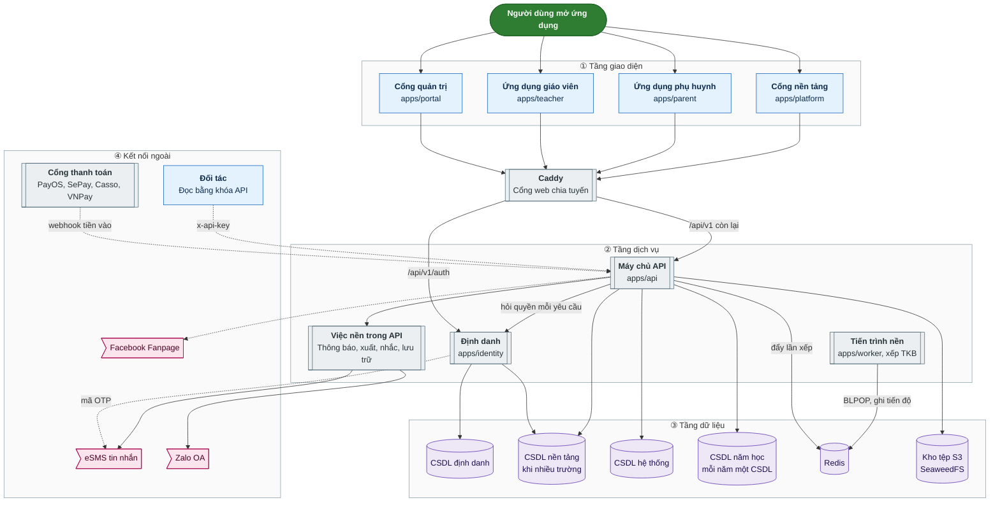
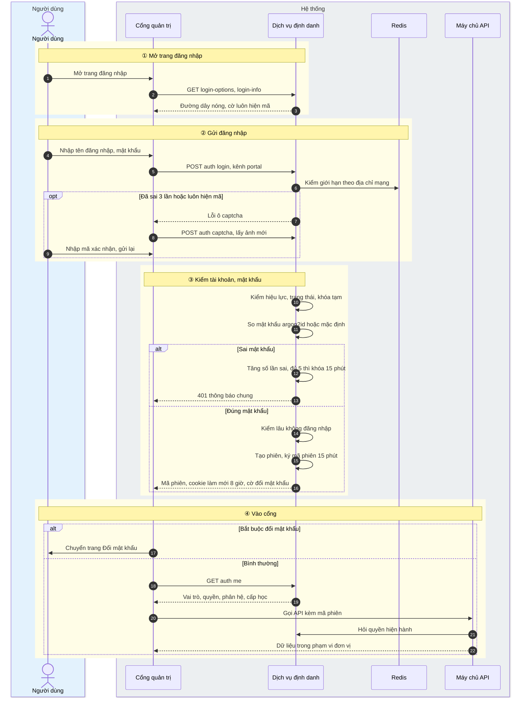
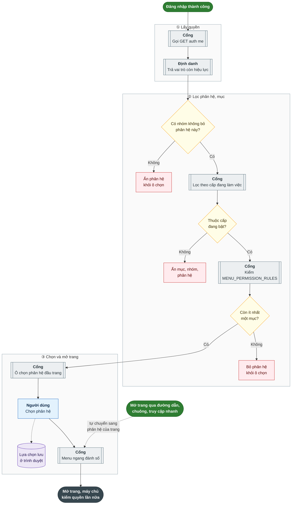
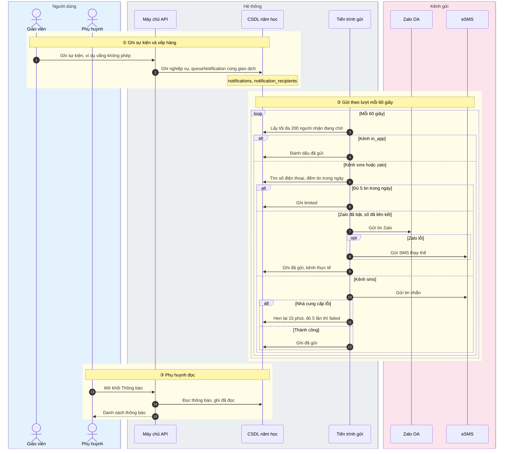
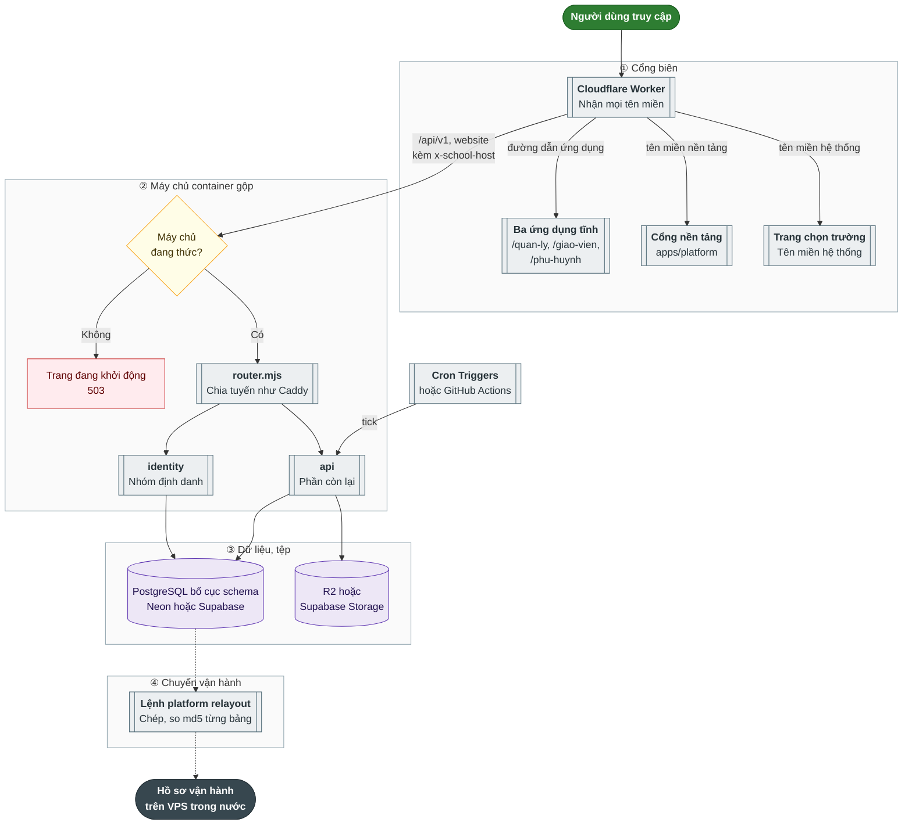
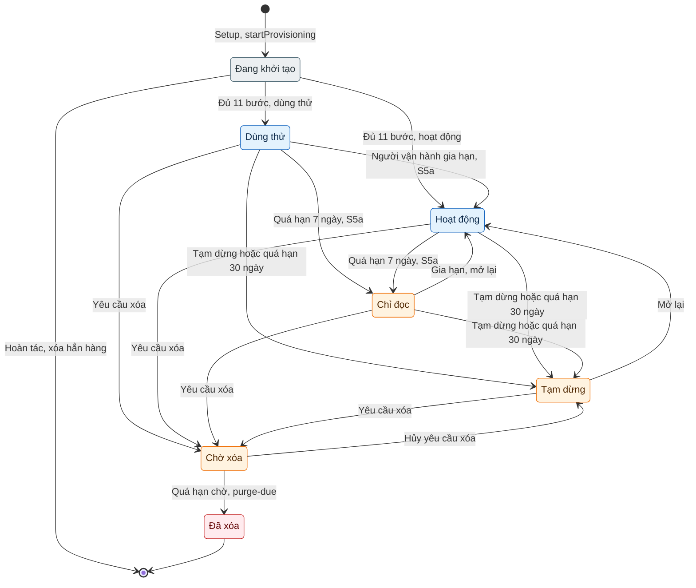

# 34.1. TỔNG QUAN, KIẾN TRÚC VÀ NỀN TẢNG CHUNG

- Mô tả: Mục tiêu, đối tượng dùng, cấp học, kiến trúc, đăng nhập và phân quyền, chọn phân hệ, thông báo, DT-SaaS đa thuê bao, kế hoạch DT-23, DT-26, DT-27 và DT-28
- Phiên bản: 1.0
- Ngày cập nhật: 2026-10-26
- Trạng thái: Chờ phê duyệt
- Thuộc: [Tài liệu 34, tổng hợp chức năng hệ thống](00_MUC_LUC.md)
- Nguồn: mã và tài liệu trên nhánh `main` ngày 2026-10-25 (sau PR 165, 166, 167, 169, 170). Khi tài liệu và mã lệch nhau, mô tả theo mã; chỗ lệch ghi ở [phụ lục](07_MA_TRAN_VAI_TRO_VA_PHU_LUC.md)

## 1. Tổng quan

### 1.1 Mục tiêu hệ thống và đối tượng dùng

School Management (mã dự án SM) là hệ thống quản lý trường học dùng chung cho mọi đơn vị của một trường: Trường chính ở cấp 1, Phân hiệu và Điểm trường ở cấp 2 (QĐ-23). Ban đầu hệ thống làm cho trường mầm non (tài liệu 04, GD-04); từ DT-19 (YCTD-151 đến YCTD-156) mở rộng sang Tiểu học, THCS, THPT và trường liên cấp; từ DT-SaaS (S1a, S1b, S2) một bản triển khai chạy được nhiều trường, mỗi trường một bộ cơ sở dữ liệu riêng.

Mục tiêu sản phẩm (tài liệu 04 mục 3, giữ nguyên ý):

1. Gom dữ liệu học sinh, phụ huynh, lớp, nhân sự, tài chính của mọi đơn vị vào một hệ thống.
2. Tự động tính học phí, giảm trừ, công nợ từ dữ liệu đăng ký dịch vụ và điểm danh thực tế.
3. Cho phụ huynh tự tra cứu: điểm danh, thời khóa biểu, nhật ký, thực đơn, học phí, thông báo, điểm số, học bạ.
4. Cho giáo viên công cụ ghi nhận công việc tại lớp và trao đổi với phụ huynh ở một nơi.
5. Cho Ban Giám hiệu bảng điều khiển tập trung theo đơn vị và toàn trường.
6. Đồng bộ chức năng và giao diện theo Hệ thống thông tin quản lý giáo dục cấp Trường của Sở GD&ĐT TP.HCM (tài liệu 31, 32): menu ngang đánh số, phân hệ, biểu EMIS, kí hồ sơ, tuyển sinh đầu cấp.
7. Điều hành nhà trường theo mô hình VNPT iOffice (văn bản đến, văn bản đi, giao việc, lịch, hồ sơ công việc) và các phân hệ riêng (KPI, website, hồ sơ chuyên môn, thi đua, bảo đảm chất lượng, thư viện, kho học liệu).

Yêu cầu cấp cao xuyên suốt (tài liệu 04 mục 7): phân quyền do máy chủ quyết định (YCC-03), dữ liệu tài chính không xóa chỉ đảo (YCC-04), mọi thao tác thay đổi ghi nhật ký (YCC-05), thông báo nhiều kênh (YCC-07), giao diện tách khỏi máy chủ (YCC-09), dịch vụ định danh độc lập tự viết (YCC-10), phê duyệt theo hạn mức (YCC-11).

Đối tượng dùng:

| Nhóm | Vai trò trong mã (seed định danh) | Kênh chính | Nhu cầu chính |
|---|---|---|---|
| Cơ quan quản lý (Sở GD&ĐT, Phòng) | VT-19 Cán bộ quản lý cấp trên; tài khoản đồng bộ của Bộ, của Sở (1.6); S6 cấp trên là kế hoạch | Cổng quản trị (chỉ xem báo cáo tổng hợp) | Số liệu tổng hợp, biểu EMIS, hồ sơ gửi lên cấp trên |
| Ban Giám hiệu | VT-02 Hiệu trưởng, VT-15 Phó Hiệu trưởng | Cổng quản trị | Toàn cảnh, phê duyệt theo hạn mức, cấu hình trường, phân quyền |
| Quản lý đơn vị | VT-03 Quản lý đơn vị | Cổng quản trị | Vận hành một hoặc nhiều đơn vị được gán |
| Khối tài chính | VT-04 Kế toán, VT-05 Kế toán trưởng, VT-16 Thủ quỹ, VT-20 Kiểm toán viên | Cổng quản trị | Học phí, công nợ, thu chi, sổ kế toán, chốt kỳ |
| Khối nhân sự, văn thư | VT-06 Nhân sự (trong mã có thêm quyền văn thư: đăng ký văn bản đến, ban hành văn bản đi) | Cổng quản trị | Hồ sơ nhân sự, chấm công, lương, tuyển dụng, văn bản |
| Khối giảng dạy | VT-07 Giáo viên chủ nhiệm, VT-08 Giáo viên bộ môn, VT-17 Tổ trưởng chuyên môn | Ứng dụng giáo viên, cổng quản trị | Điểm danh, nhật ký, giáo án, sổ điểm, sổ đầu bài, trao đổi phụ huynh |
| Khối vận hành | VT-09 Nhân viên y tế, VT-10 Nhân viên bếp, VT-11 Nhân viên kho và mua hàng, VT-12 Nhân viên tuyển sinh, VT-18 Bảo vệ | Cổng quản trị, ứng dụng giáo viên | Y tế, dặn thuốc, thực đơn, an toàn thực phẩm, kho, tuyển sinh, xác nhận đón tại cổng |
| Quản trị kỹ thuật của trường | VT-01 Quản trị nền tảng (tên trong mã; thực chất là quản trị kỹ thuật của một trường, không xem dữ liệu nghiệp vụ, PQ-10) | Cổng quản trị | Tài khoản, thông báo hệ thống, ý kiến phản hồi |
| Phụ huynh | VT-14 Phụ huynh | Ứng dụng phụ huynh | Theo dõi con, báo vắng, dặn thuốc, học phí, thanh toán, trao đổi |
| Học sinh | Không có vai trò đăng nhập riêng; có "Tài khoản học và thi" (4.1.10) quản lý trong hồ sơ học sinh | Không có ứng dụng riêng | Dữ liệu học sinh do nhà trường và phụ huynh quản lý |
| Vận hành nền tảng DT-SaaS | Tài khoản `platform_operators` ở cơ sở dữ liệu `platform`, không thuộc trường nào | Cổng vận hành nền tảng (`apps/platform`) | Khởi tạo, tạm dừng, mở lại, xóa trường |

Vai trò VT-13 (Tài xế, người đưa đón) đã bỏ ngày 09/10/2026 cùng phân hệ P11 Xe đưa đón (Q-62). Mã không seed VT-13.

### 1.2 Các cấp học MN, TH, THCS, THPT

Nguồn: `packages/shared/src/school-levels.ts`, `packages/shared/src/level-features.ts`, `packages/shared/src/portal-menu.ts`, `apps/api/src/school-levels/school-levels.ts`, `apps/api/src/common/school-levels.ts`, `apps/portal/src/school-levels/`, định danh 0064, 0065; tài liệu 32 mục 10 (DT-19).

**Bốn mã cấp cố định** (`SCHOOL_LEVEL_CODES`): `MN` Mầm non, `TH` Tiểu học, `THCS` Trung học cơ sở, `THPT` Trung học phổ thông. Thêm cấp phải sửa mã, không thêm dữ liệu. Chỗ nào đọc cấp mà không thấy giá trị thì coi là `MN` (`DEFAULT_SCHOOL_LEVEL`), để trường mầm non hiện có không đổi hành vi.

**Bật cấp học của trường** (màn hình 1.4 Cấu hình trường, khối "Cấp học"):

- Bảng `school_levels` ở cơ sở dữ liệu hệ thống giữ cả bốn cấp với cột bật hay tắt (`is_enabled`), thứ tự (`order_no`, 1 đến 99, không trùng), tên hiển thị (`display_name`), thuật ngữ gọi người học (`learner_term`, ví dụ "Trẻ" hay "Học sinh"), nhãn ô ngữ cảnh (`context_label`, ví dụ "Cấp MN"), người sửa, ngày sửa.
- `GET /school-levels`: mọi người đã đăng nhập đọc được. `PUT /school-levels`: cần quyền `P01.school-level.manage` (mặc định chỉ VT-02 Hiệu trưởng). Gửi đủ bốn cấp, mỗi cấp một lần.
- Cấp không bao giờ bị xóa: tắt cấp chỉ ẩn, lớp và học sinh của cấp giữ nguyên (BR-154). Trước khi tắt, máy chủ đếm số lớp của năm học đang dùng thuộc cấp đó để cảnh báo.
- Đọc cấp qua một lớp dùng chung `SchoolLevelResolver` (đệm 30 giây, khóa qua `cacheKey`). Bảng trống thì coi trường chỉ có Mầm non.
- Cấp là thuộc tính của khối và lớp (`grade_levels.school_level`, `classes.school_level`, suy từ khối), của đơn vị (`org_unit_levels`), của học kỳ, tuần (`academic_terms`, `school_weeks` có `school_level` tùy chọn) và ngày học trong tuần theo cấp (`academic_year_level_settings`). Một năm học vẫn là một cơ sở dữ liệu cho cả trường.

**Phạm vi cấp của người dùng** (định danh 0064, bảng `user_school_levels`): mảng trống là mọi cấp. Có phạm vi thì người dùng chỉ xem cấp vừa bật vừa thuộc phạm vi (`visibleSchoolLevels`). Phạm vi chỉ thu hẹp quyền đã có, không cấp thêm quyền, không tạo vai trò theo cấp. Người quản lý tài khoản đặt ở `GET/PUT /users/:id/school-levels` (khối "Cấp học" trong hộp thoại tài khoản, `UserSchoolLevelsBlock.tsx`).

**Chọn cấp đang làm việc** (DT-19 phần 19c, YCTD-153; định danh 0065 bảng `user_preferences`):

- Thanh đầu trang có bộ chọn cấp (`SchoolLevelSwitcher`) chỉ hiện khi người dùng xem được từ hai cấp trở lên. Mặc định "Tất cả".
- Lựa chọn lưu theo tài khoản ở dịch vụ định danh: `PUT /auth/me/working-school-level` với `{ school_level: "TH" }` hoặc `null` là "Tất cả". Cấp ngoài phạm vi bị từ chối. Cấp đã tắt ở trường thì cổng tự coi là "Tất cả".
- Giá trị cấp gửi lên API qua tham số dùng chung `?school_level=`; máy chủ kiểm tra người dùng được xem cấp đó.
- Đổi cấp thì menu, nhãn thuật ngữ ("Trẻ" hay "Học sinh"), ô ngữ cảnh "Cấp ... · năm học · học kỳ" đổi theo ngay.

**Lọc menu theo cấp** (`portalWorkspacesForLevels` trong `portal-menu.ts`):

- Phân hệ và mục menu có thuộc tính `levels` tùy chọn. Không ghi là của mọi cấp; có ghi thì chỉ hiện khi trường bật và người dùng đang làm việc ở một trong các cấp đó.
- Hàm bỏ mục, nhóm, phân hệ không thuộc cấp; nhóm hay phân hệ không còn mục nào cũng bỏ.
- Phân hệ có `levelTitle` đặt lại tên theo cấp: một cấp thì "Quản lý giáo dục Mầm non" (giữ như Sở), nhiều cấp thì "Quản lý giáo dục".
- Trường chỉ bật Mầm non giữ y hệt cây menu trước DT-19 (tên, số thứ bậc, thứ tự).
- `portalMenuPathsOutsideLevels` trả đường dẫn thuộc cấp chưa bật để ẩn lối tắt "Truy cập nhanh" và ẩn mục trong cây quyền 1.3.
- Mục chỉ Mầm non: 4.3 Cân nặng, chiều cao; 4.4 Hoàn thành chương trình; 1.1 Hồ sơ học sinh cuối cấp mầm non (Tuyển sinh đầu cấp); 1.1 Báo cáo EMIS đầu năm, 2.1 Báo cáo EMIS cuối năm, 2.4 Báo cáo giáo dục mầm non cuối năm (Báo cáo số liệu). Mục chỉ Tiểu học: 4.8 Bán trú, 7.5 Đánh giá học sinh, 7.15 Báo cáo EMIS Tiểu học. Mục TH, THCS, THPT: nhóm 7 Dạy học, 4.9 Nề nếp, 7.6 Sổ đầu bài, 7.7 Chuyên cần theo tiết, 7.8 Học bạ. Mục THCS, THPT: 7.13 Tổ bộ môn, 7.14 Sổ điểm, 7.16 Sơ đồ chỗ ngồi, 7.17 Xét tốt nghiệp, 7.18 Báo cáo EMIS THCS, THPT, nhóm 8 Kiểm tra, đánh giá. Chỉ THPT: 7.12 Tổ hợp môn.

**Chức năng ứng dụng giáo viên, phụ huynh theo cấp** (`LEVEL_FEATURES`): điểm danh theo ngày, nhật ký, chăm sóc hằng ngày, báo cơm, cân đo, hồ sơ cuối cấp chỉ ở lớp, con Mầm non; bán trú theo danh sách ăn và đánh giá theo Thông tư 27/2020 chỉ ở Tiểu học; thời khóa biểu, sổ đầu bài, điểm danh theo tiết, sách thư viện, học bạ ở TH, THCS, THPT; sổ điểm theo Thông tư 22/2021 ở THCS, THPT. Đưa đón, dặn thuốc, thực đơn, học phí, tin nhắn, hoạt động dùng cho mọi cấp.

### 1.3 Kiến trúc tóm tắt

Pnpm monorepo, TypeScript. Máy chủ NestJS, giao diện React kèm Vite, cơ sở dữ liệu PostgreSQL truy cập bằng Kysely, Redis, kho tệp chuẩn S3, kiểm thử Playwright.

**Các ứng dụng**

| Ứng dụng | Thư mục | Vai trò | Cổng dev mặc định | Cổng e2e (tài liệu 32 mục 14.1) |
|---|---|---|---|---|
| Máy chủ API nghiệp vụ | `apps/api` | Mọi quy tắc nghiệp vụ, kiểm tra quyền mỗi yêu cầu, tiến trình nền theo chu kỳ trong tiến trình | 3000 (`API_PORT`) | 3200 |
| Dịch vụ định danh | `apps/identity` | Đăng nhập, phiên, tài khoản, vai trò, quyền, phạm vi đơn vị và cấp, khóa API đối tác, đăng nhập thay; ở chế độ nhiều trường thêm cổng vận hành nền tảng `/auth/platform` | 3001 (`IDENTITY_PORT`) | 3201 |
| Tiến trình chạy nền | `apps/worker` | Chỉ một việc: máy xếp thời khóa biểu lấy việc từ hàng đợi Redis | Không mở cổng | Không |
| Cổng quản trị | `apps/portal` | Giao diện web cho cán bộ quản lý, 21 phân hệ, 284 tuyến trong `router.tsx` | 5173 | 5373 |
| Ứng dụng giáo viên | `apps/teacher` | Web chạy trên điện thoại | 5174 | 5375 |
| Ứng dụng phụ huynh | `apps/parent` | Web chạy trên điện thoại | 5175 | 5376 |
| Cổng vận hành nền tảng | `apps/platform` | Quản lý trường của DT-SaaS (Tổng quan, Trường) | 5177 | Theo cấu hình e2e nhiều trường |

Gói dùng chung: `packages/shared` (cây menu, mã quyền, điều kiện quyền theo menu, cấp học), `packages/server` (mã phiên, ngữ cảnh trường, tên khóa, máy xếp thời khóa biểu, eSMS), `packages/ui` (thành phần giao diện), `packages/config`. Thư mục `database/` chứa migration và lệnh quản trị cơ sở dữ liệu.

Triển khai một máy (`deploy/docker-compose.production.yml`): `postgres`, `redis`, `seaweedfs` (S3), `migrate`, `identity`, `api`, `worker`, `demo-reset`, `web` (Caddy). Giao diện gọi `/api/v1` cùng tên miền, Caddy chuyển nhóm `/api/v1/auth` sang `identity`, phần còn lại sang `api`. Hồ sơ "Vận hành" nhiều trường trên VPS trong nước ở `deploy/profiles/production/` (S7a).

**Các cơ sở dữ liệu**

| Cơ sở dữ liệu | Thư mục migration | Số bảng (theo `schema.ts`) | Nội dung chính |
|---|---|---|---|
| Định danh (`identity`) | `database/identity` (73 tệp, đến 0093) | 16 | `users`, `roles`, `permissions`, `role_permissions`, `role_workspace_exclusions`, `user_roles` (vai trò gán theo đơn vị), `sessions`, `one_time_codes`, `password_history`, `impersonations`, `security_events`, `identity_audit_logs`, `identity_settings`, `api_clients`, `user_school_levels`, `user_preferences` |
| Hệ thống (`system`) | `database/system` (29 tệp, đến 0050) | 80 | Danh mục năm học và cơ sở dữ liệu năm học (`academic_years`, `academic_terms`, `school_weeks`, `academic_year_databases`, `academic_year_level_settings`), `school_levels`, `period_slots`, biểu EMIS (`report_forms`), văn thư lưu trữ, tác vụ xuất (`export_jobs`), `system_announcements`, `portal_app_links`, `user_quick_links`, `user_grid_settings`, `feedback`, kí hồ sơ, văn bản đến và đi, lịch đơn vị, phòng họp, hồ sơ công việc, website, `integration_credentials`, kho học liệu, danh mục bồi dưỡng, `demo_environment`, `impersonation_actions`, `terms_acceptances`. Dữ liệu dùng qua mọi năm học |
| Năm học (`school-year`), mỗi năm học một cơ sở dữ liệu | `database/school-year` (92 tệp, đến 0103) | 377 | Toàn bộ dữ liệu nghiệp vụ theo năm: `org_units`, lớp, học sinh, phụ huynh, điểm danh, học phí, thu chi, sổ kế toán, nhân sự, chấm công, lương, y tế, bếp, kho, hoạt động, tương tác, `notifications`, `notification_recipients`, `notification_templates`, `audit_logs`, `data_access_logs`, KPI, thi đua, bảo đảm chất lượng, thư viện, sổ điểm, học bạ, thời khóa biểu, đề kiểm tra... Năm học đã đóng chuyển chỉ đọc (`default_transaction_read_only`) |
| Nền tảng (`platform`, chỉ khi bật nhiều trường) | `database/platform` (8 tệp: 0001 đến 0004, 0010, 0020 đến 0022) | 15 | `schools`, `school_domains`, `school_databases`, `school_keys`, `school_clusters`, `platform_settings`, `platform_operators`, `platform_audit_log`, `scheduler_state`, `provisioning_jobs`, `school_lifecycle_events`, `school_admin_invitations`, `school_migrations`, `school_consents`, `school_hosting` |

Tổng số mã quyền seed ở định danh: 269 (gồm 54 quyền gốc `Pxx.view`, `Pxx.edit`, `Pxx.approve` của ma trận 0003 và quyền chi tiết thêm ở các migration sau).

**Redis**: đáp án mã xác nhận ảnh (5 phút), giới hạn tần suất đăng nhập, bộ đệm, hàng đợi và tiến độ máy xếp thời khóa biểu. Khóa đi qua `cacheKey` (`packages/server/src/resource-names.ts`), ở chế độ nhiều trường có tiền tố `t:<mã trường>:`. Không có `REDIS_URL` thì máy xếp chạy ngay trong tiến trình API.

**Lưu tệp**: `FileStorage` (`apps/api/src/files/file-storage.ts`) dùng giao diện S3 (`S3Client`, điểm cuối cấu hình được): SeaweedFS khi triển khai trên máy, R2 hoặc Supabase Storage ở hồ sơ thử nghiệm (S9, kế hoạch). Khóa tệp đi qua `storageKey`, nhiều trường thì thêm tiền tố `tenants/<mã>/`. Kiểm thử dùng kho trong bộ nhớ.

**Tác vụ nền** (đọc trong mã; chế độ một trường dùng bộ đếm giờ trong tiến trình API, chế độ nhiều trường đăng ký vào `JobScheduler` và chạy theo từng trường đang phục vụ):

| Tên việc | Nơi chạy | Chu kỳ mặc định | Làm gì |
|---|---|---|---|
| `notification-dispatch` | `apps/api/src/notifications/notification-dispatcher.ts` | 60 giây (`NOTIFICATION_DISPATCH_INTERVAL_SECONDS`) | Nhắc giáo viên chủ nhiệm và quản lý đơn vị khi lớp còn trẻ chưa có nhật ký sau giờ `journal_reminder_time` (CB-05); gửi thông báo đang chờ: trong ứng dụng, SMS, Zalo; thử lại, giới hạn ngày (CB-07) |
| `export-jobs` | `apps/api/src/exports/export-jobs.ts` | 15 giây | Chạy tác vụ xuất nền khi số dòng vượt giới hạn xuất ngay (16a), lưu tệp vào mục 3.5 Tệp đã tạo |
| `archives` | `apps/api/src/archives/archives.ts` | 60 giây | Nhắc hồ sơ lưu trữ sắp đến hạn, quá hạn; thử lại xóa tệp lưu trữ |
| `directives` | `apps/api/src/work/directives.ts` | 60 giây | Nhắc việc giao (đến hạn, quá hạn) của Quản lý công việc |
| `timetable-sync` | `apps/api/src/timetables/timetable-generator.ts` | 60 giây | Đọc kết quả lần xếp thời khóa biểu chưa xong từ Redis, lưu phương án vào cơ sở dữ liệu năm học |
| `emis-forms` | `apps/api/src/primary-reports/primary-emis.ts` | Một lần mỗi tiến trình mỗi trường (3600 giây) | Đăng ký biểu báo cáo trong `report_forms` vào luồng gửi lên cấp trên |
| Máy xếp thời khóa biểu | `apps/worker/src/timetable-generation.ts` | Chờ hàng đợi (`BLPOP`) | Lấy lần xếp, chạy máy giải có giới hạn thời gian, ghi tiến độ khoảng 4 lần mỗi giây và kết quả vào Redis, hỗ trợ hủy (CB-11) |
| `demo-reset` | Dịch vụ riêng trong Compose (`apps/api/src/demo/demo-command.ts`) | Theo `reset_interval_hours` | Đặt lại bản trình diễn (18h) |

Ở chế độ nhiều trường có điểm cuối `POST /api/v1/internal/jobs/tick` (cần `INTERNAL_JOB_TOKEN`) để bộ lập lịch bên ngoài gọi; việc đến hạn được chiếm bằng một câu lệnh nguyên tử trên `scheduler_state` nên không chạy trùng, bỏ lỡ thì bù ngay. Lệnh `platform purge-due` và `platform migrate-schools` hiện chạy bằng dòng lệnh, chưa đăng ký vào bộ lập lịch.

**Kết nối ngoài**

| Kết nối | Mã | Ghi chú |
|---|---|---|
| Tin nhắn SMS | `EsmsSmsGateway` (API), `EsmsSmsSender` (định danh), `packages/server/src/esms-client.ts` | Nhà cung cấp eSMS.vn chọn bằng `SMS_PROVIDER=esms`; không cấu hình thì chỉ ghi nhật ký máy chủ; từ S3, API đọc khóa eSMS theo trường (`TenantSmsGateway`), dịch vụ định danh vẫn dùng cấu hình máy chủ |
| Zalo Official Account | `apps/api/src/integrations/zalo-sender.ts`, `zalo-token-store.ts` | Bật ở 3.2 Kết nối ngoài; khóa làm mới lưu mã hóa ở `integration_credentials`; người quản trị liên kết số điện thoại với mã người dùng Zalo |
| Facebook Fanpage | `facebook-publisher.ts`, `facebook-posts.ts` | Đăng hoạt động, tin tức lên Fanpage (P14.facebook.manage) |
| Thanh toán trực tuyến | `apps/api/src/finance/payment-providers.ts` | PayOS, SePay, Casso, VNPay; webhook công khai `/api/v1/payment-webhooks/*`; khóa lấy theo trường từ `integration_secrets` (S3), chế độ một trường còn dùng biến môi trường làm nguồn dự phòng; chưa thử với tài khoản thật |
| Tài khoản đồng bộ của Bộ, của Sở | 1.6 (`SyncAccountsPage`) | Bản chạy nội bộ: chỉ lưu tài khoản đã mã hóa, chưa có giao diện lập trình của Bộ để đồng bộ |
| API chỉ đọc cho đối tác | `apps/api/src/partner/partner.ts`, `apps/identity/src/accounts/api-clients.ts` | `GET /partner/reports/summary`, `/partner/finance`, `/partner/children`, `/partner/staff`; khóa ở tiêu đề `x-api-key`; định danh kiểm khóa còn hiệu lực, địa chỉ mạng, phạm vi; tối đa 60 yêu cầu mỗi phút mỗi khóa; đọc dữ liệu cá nhân luôn ghi nhật ký truy cập kèm căn cứ pháp lý. Khóa do Hiệu trưởng cấp ở 3.1 Khóa API cho đối tác (`P01.api-client.manage`), chỉ hiện một lần, lưu dạng băm |

**Nhật ký**: nhật ký thao tác `audit_logs` (năm học, giá trị trước và sau, tên người thao tác tại thời điểm, ghi kèm người đăng nhập thay nếu có), `data_access_logs` (truy cập dữ liệu nhạy cảm, BR-73), `identity_audit_logs` (tài khoản và quyền, chỉ VT-01, VT-02 xem), `security_events` (đăng nhập sai, khóa, dùng lại mã làm mới), `impersonation_actions`, `platform_audit_log`. Màn hình 3.3 Nhật ký thao tác (`P01.view`) tra nhật ký thao tác và nhật ký truy cập trong phạm vi đơn vị.

**Sơ đồ kiến trúc**

### 1.4 Thống kê nhanh

| Chỉ số | Giá trị | Cách đếm |
|---|---|---|
| Phân hệ của cổng quản trị | 21 | `PORTAL_WORKSPACES` trong `portal-menu.ts` |
| Mục menu lá | 278 | Đếm `leaf(` theo phân hệ: Quản lý giáo dục 76, Văn bản và điều hành 32, Quản trị hệ thống 20, Hồ sơ chuyên môn 20, Tuyển sinh đầu cấp 15, Tài chính 15, KPI 13, Nhân sự 12, Thi đua 11, Kho học liệu 10, Website 9, Cơ sở vật chất 8, Báo cáo số liệu 8, Bếp kho 7, Thư viện 7, Bảo đảm chất lượng 5, Kí hồ sơ 4, Tương tác 2, Tuyển sinh tuyển dụng 2, Giảng dạy 1, Báo cáo 1 |
| Mục menu có điều kiện quyền | 266 | `MENU_PERMISSION_RULES`; 12 mục không điều kiện (ai đăng nhập cũng thấy): 3.2 Đánh giá chuẩn nghề nghiệp, 2.1 Năm học, 2.2 Cây đơn vị, Chấm công, Đơn nghỉ phép, Quy định phép năm, Ngày lễ và lịch bù, Phiếu lương của tôi, Công việc và kế hoạch, Đánh giá nhân sự, Báo cáo và bảng điều khiển, Việc của tôi |
| Tuyến của cổng quản trị | 284 | Số `path: '` trong `apps/portal/src/router.tsx` |
| Thư mục mô đun máy chủ API | 89 | Thư mục con của `apps/api/src` (một `application.module.ts` đăng ký chung) |
| Bộ điều khiển và điểm cuối API | 233 bộ điều khiển trong 201 tệp, khoảng 1.790 điểm cuối | Đếm `@Controller(` và `@Get/@Post/@Put/@Patch/@Delete` ngoài tệp kiểm thử |
| Điểm cuối dịch vụ định danh | 68 | Như trên, `apps/identity/src` |
| Vai trò seed | 19 | VT-01 đến VT-20, không có VT-13 |
| Mã quyền seed | 269 | Chạy lại toàn bộ migration định danh, đếm câu `insert into permissions` |
| Spec e2e | 116 | `tests/e2e/*.spec.ts` (từ `01-login` đến `140-trial-profile`, gồm `133-tenancy-school-settings`, `134-school-plans`); thêm thư mục `tests/tenancy/` kiểm tĩnh cách ly, `tests/trial/` kiểm cổng biên và bộ định tuyến của hồ sơ thử nghiệm |
| Màn hình ứng dụng giáo viên | 24 màn hình, 3 thành phần | `apps/teacher/src/screens`: Lớp của tôi (trang chủ), Đăng nhập, Đổi mật khẩu, Điểm danh, Đón trả, Xác nhận đón tại cổng, Nhật ký, Chăm sóc và y tế, Trao đổi và đồ bị mất, Hoạt động và hình ảnh, Báo cơm, Bán trú, Đánh giá học sinh, Sổ điểm, Dặn thuốc, Giảng dạy, Sổ đầu bài, Lịch dạy, Sách đang mượn, Bồi dưỡng, Kiểm kê thiết bị, Nghỉ phép, Phiếu lương, Công việc; thành phần: thẻ chấm công, danh sách lịch công tác, thông báo |
| Màn hình ứng dụng phụ huynh | 5 màn hình, 20 khối chức năng theo con | `apps/parent/src/screens`: Đăng nhập, Kích hoạt (đặt mật khẩu mới), Trang chủ, Tuyển sinh, Tuyển dụng; khối: Thông báo, Khảo sát, Nhật ký, Dặn thuốc, Đồng ý hình ảnh, Sức khỏe, Học tập, Trao đổi, Hoạt động, Thực đơn, Người đón, Dịch vụ, Học phí (kèm mã QR), Hồ sơ cuối cấp, Bán trú, Thời khóa biểu, Đánh giá, Thư viện, Sổ điểm, Chuyên cần theo tiết, Học bạ |
| Bảng dữ liệu | 488 | Định danh 16, hệ thống 80, năm học 377, nền tảng 15 |

## 2. Đăng nhập, phiên, phân quyền, chọn phân hệ

### Đăng nhập và phiên (dịch vụ định danh)

Nguồn: `apps/identity/src/authentication/*`, `apps/identity/src/settings/identity-settings.service.ts`, `packages/server/src/access-token.ts`.

**Kênh** (`SessionChannel`): `portal`, `teacher`, `parent`. Mỗi lần đăng nhập gửi kèm kênh; phiên gắn với kênh, mã làm mới dùng sai kênh bị từ chối.

| Cách đăng nhập | Điểm cuối | Áp dụng | Quy tắc |
|---|---|---|---|
| Mật khẩu | `POST /auth/login` (`login`, `password`, `channel`, mã xác nhận nếu cần) | Mọi tài khoản, mọi kênh | Tên đăng nhập là số điện thoại hoặc tên đăng nhập. Sai thì báo chung "Số điện thoại, tên đăng nhập hoặc mật khẩu không đúng", không lộ tài khoản có hay không; không tìm thấy tài khoản vẫn băm mật khẩu giả để thời gian phản hồi như nhau |
| Mã một lần (OTP) | `POST /auth/otp/request` (`phone`), `POST /auth/otp/login` (`phone`, `code`) | Chỉ tài khoản có duy nhất vai trò Phụ huynh (VT-14), kênh `parent` | Mã 6 chữ số gửi qua SMS; hạn 5 phút, nhập sai tối đa 5 lần thì mã hết hiệu lực, gửi tối đa 5 lần mỗi giờ mỗi số (cấu hình được, `identity_settings`); phản hồi như nhau dù số có hay không (BM-61); mã mới làm mã cũ hết hiệu lực; đăng nhập bằng mã cấp phiên đầy đủ kể cả khi chưa đổi mật khẩu mặc định (Q-147) |
| Đăng nhập thay | `POST /auth/impersonation`, `POST /auth/impersonation/exit` | Cổng quản trị, quyền `P01.account.impersonate` (mặc định VT-02) | Xem mục Đăng nhập thay |
| Vận hành nền tảng | `POST /auth/platform/login` | Chỉ ở tên miền cổng nền tảng khi bật nhiều trường | Tài khoản ở `platform_operators`, khóa 15 phút sau 5 lần sai, mã phiên có đối tượng riêng, hạn 8 giờ |

**Mã phiên và mã làm mới** (XT-02, QĐ-22):

- Mã phiên JWT ký Ed25519 (`EdDSA`), hạn 15 phút, mang `sub` (tài khoản), `sid` (phiên), `channel`, `password_change_required`, và `tid` (mã trường) ở chế độ nhiều trường.
- Mã làm mới đặt trong cookie httpOnly theo kênh (BM-71), không trả trong nội dung. Hạn tính từ lúc đăng nhập: 8 giờ ở cổng quản trị, 30 ngày ở ứng dụng giáo viên và phụ huynh. Chỉ lưu giá trị băm.
- `POST /auth/refresh`: mỗi lần làm mới cấp mã làm mới mới; dùng lại mã cũ thì thu hồi cả phiên và ghi `refresh_token_reused`.
- `POST /auth/logout` thu hồi phiên (đang đăng nhập thay thì kết thúc luôn cả phiên gốc).
- `GET /auth/me` trả tài khoản, danh sách gán vai trò (`assignments`: mã vai trò, đơn vị, quyền), phân hệ được dùng (`workspaces`), phiên đăng nhập thay, phạm vi cấp (`school_levels`), cấp đang làm việc. Mỗi lần gọi đều kiểm tra lại phiên và tài khoản để thu hồi có hiệu lực ngay (PQ-04, QĐ-20).
- Máy chủ API (`AuthenticationGuard`) kiểm chữ ký mã phiên, kiểm `tid` khớp trường của tên miền (nhiều trường), chặn khi `password_change_required`, rồi gọi định danh lấy quyền hiện hành ở mọi yêu cầu. Điểm cuối khai `@RequirePermission(...)`: có một trong các quyền là đủ (BM-10). Phạm vi đơn vị và bản ghi kiểm tiếp ở tầng nghiệp vụ.

**Kích hoạt và bắt buộc đổi mật khẩu**:

- Tài khoản nhân sự mới: hệ thống sinh mật khẩu tạm, bắt buộc đổi ở lần đăng nhập đầu (PQ-13, PQ-14). Đặt lại mật khẩu, cấp mật khẩu hàng loạt cũng sinh mật khẩu tạm, chỉ hiện một lần, thu hồi mọi phiên.
- Tài khoản chỉ có vai trò Phụ huynh dùng mật khẩu mặc định chung của trường (PQ-06, YCTD-43; giá trị băm ở `identity_settings`). Đăng nhập bằng mật khẩu mặc định thì phiên chỉ dùng được điểm cuối đổi mật khẩu; ứng dụng phụ huynh mở màn hình Kích hoạt (MH-48) để đặt mật khẩu mới.
- `POST /auth/change-password`: kiểm mật khẩu hiện tại, chính sách (tối thiểu 8 ký tự, có cả chữ và số, BM-03), khác mật khẩu hiện tại, không trùng 5 mật khẩu gần nhất (`password_history_count`, giữ tối đa 24 bản ghi). Đổi xong thu hồi mọi phiên khác.
- Hạn mật khẩu (YCTD-110): `password_max_age_days` (mặc định 0 là không giới hạn), `password_expiry_warning_days` (mặc định 7). Chỉ áp cho tài khoản nhân sự có mật khẩu riêng, không áp cho phụ huynh. Hết hạn thì bắt buộc đổi; sắp hết hạn thì cổng hiện cảnh báo đầu trang và hộp thông báo khi vào. Chỉnh ở khối "Chính sách mật khẩu" của 1.4 Danh sách người dùng.
- Quên mật khẩu tự phục vụ của cổng quản trị (`POST /auth/password-reset/request`, `/confirm`): luôn cần mã xác nhận ảnh; chỉ tài khoản nhân sự đang hoạt động có số điện thoại nhận mã 6 chữ số qua SMS; đặt lại xong mở khóa tạm, bỏ yêu cầu đổi, thu hồi mọi phiên.
- Trường mới của DT-SaaS: quản trị viên đầu tiên kích hoạt bằng đường liên kết một lần (`GET/POST /auth/activate`, hạn 72 giờ), tự đặt mật khẩu; trang `/activate` ở cổng quản trị.

**Khóa tài khoản**:

- Sai mật khẩu 5 lần liên tiếp thì tạm khóa 15 phút rồi tự mở (BM-04, XT-05).
- Không đăng nhập quá số ngày cấu hình (`account_inactivity_lock_days`, mặc định 90, từ 7 đến 3650) thì chuyển `locked`, phải được mở khóa lại (PQ-07, BM-09). Việc này kiểm khi đăng nhập, không có tác vụ nền.
- Tài khoản có `valid_until` đã qua (bắt buộc với VT-20 Kiểm toán viên, BM-68) bị khóa khi đăng nhập.
- Trạng thái khác `active` thì báo "Tài khoản đã bị khóa, vui lòng liên hệ nhà trường".
- Mã xác nhận ảnh ở cổng quản trị: hiện khi bật "luôn hiện mã xác nhận" hoặc tài khoản đã sai 3 lần (`captcha_failure_threshold`) trong 15 phút; đáp án giữ ở Redis 5 phút, dùng một lần. Ứng dụng giáo viên, phụ huynh không có ô này.
- Giới hạn số yêu cầu đăng nhập mỗi phút theo địa chỉ mạng (BM-26, `LOGIN_REQUESTS_PER_MINUTE`); nhiều trường thì khóa giới hạn gồm mã trường.
- Mọi sự kiện ghi `security_events`: `login_failed`, `login_failed_default_password`, `login_password_expired`, `login_rejected_expired`, `login_rejected_locked`, `login_rejected_temporarily_locked`, `login_rejected_inactive`, `account_temporarily_locked`, `refresh_token_reused`.

**Đăng nhập thay** (DT-18 phần 18h, YCTD-145; màn hình 4.1 Đăng nhập thay):

- Chỉ ở cổng quản trị, bắt buộc ghi lý do, không lồng nhau, tối đa 60 phút, không gia hạn. Phiên gốc giữ nguyên để quay lại khi thoát.
- Không vào tài khoản có quyền cao hơn: thứ bậc VT-01 (100), VT-02 (90), VT-15 (70), VT-19 và VT-20 (60), còn lại 50; tài khoản đích không được có quyền quản trị mà người đăng nhập thay không có; không vào VT-01, chính mình, tài khoản chỉ là phụ huynh, tài khoản không hoạt động; quyền theo đơn vị thì mọi vai trò của tài khoản đích phải ở các đơn vị đó.
- Trong phiên đăng nhập thay không đổi, không đặt lại mật khẩu, không sửa chính sách mật khẩu, không thao tác chứng thư số và kí số.
- Thanh cảnh báo đăng nhập thay hiện ở mọi trang; nhật ký `GET /auth/impersonations`, thao tác ghi `impersonation_actions`; nhật ký thao tác ghi tên người đăng nhập thay kèm theo.

### Vai trò, nhóm người dùng và quyền

**Vai trò seed** (định danh 0003, `is_system = true`): VT-01 Quản trị nền tảng, VT-02 Hiệu trưởng, VT-03 Quản lý đơn vị, VT-04 Kế toán, VT-05 Kế toán trưởng, VT-06 Nhân sự, VT-07 Giáo viên chủ nhiệm, VT-08 Giáo viên bộ môn, VT-09 Nhân viên y tế, VT-10 Nhân viên bếp, VT-11 Nhân viên kho và mua hàng, VT-12 Nhân viên tuyển sinh, VT-14 Phụ huynh, VT-15 Phó Hiệu trưởng, VT-16 Thủ quỹ, VT-17 Tổ trưởng chuyên môn, VT-18 Bảo vệ, VT-19 Cán bộ quản lý cấp trên, VT-20 Kiểm toán viên. Ban Giám hiệu là VT-02 cùng VT-15.

**Quyền**: mã dạng `Pxx.<đối tượng>.<thao tác>` theo 19 nhóm chức năng cũ P01 đến P19 (P11 bỏ), ví dụ `P02.child.manage`, `P05.fee-document.approve`, `P09.kpi.configure`. Ma trận gốc 0003 cấp `Pxx.view`, `Pxx.edit`, `Pxx.approve` theo ký hiệu Q, S, D, X của tài liệu 08 mục 3; các migration sau thêm quyền chi tiết và cấp cho vai trò mặc định. Số quyền mặc định mỗi vai trò: VT-02 173, VT-15 137, VT-03 110, VT-04 69, VT-06 62, VT-07 55, VT-05 53, VT-09 39, VT-12 39, VT-08 34, VT-10 33, VT-11 33, VT-17 33, VT-16 23, VT-14 12, VT-18 7, VT-20 7, VT-01 3, VT-19 3.

**Phạm vi đơn vị**:

- Mỗi lần gán vai trò (`user_roles`) gắn một đơn vị. Vai trò toàn trường không gắn đơn vị: `WHOLE_SCHOOL_ROLE_CODES` gồm VT-01, VT-02, VT-19, VT-20. Vai trò khác bắt buộc có đơn vị đang hoạt động (PQ-03). VT-20 bắt buộc ngày hết hiệu lực.
- Gán ở Trường chính thì gồm mọi Phân hiệu, Điểm trường trực thuộc. Truy vấn nghiệp vụ tự giới hạn trong đơn vị được gán (`OrganizationScopes`).
- Lớp bản ghi: giáo viên chỉ tới lớp được phân công; phụ huynh chỉ tới con có quan hệ; bảo vệ chỉ tới danh sách đón trả của đơn vị.
- Quản lý tài khoản: `P01.account.manage` (VT-01, VT-02) quản lý mọi tài khoản; `P01.account.manage-in-unit` (VT-03) chỉ quản lý tài khoản có mọi vai trò nằm trong đơn vị của mình, không phải VT-01, VT-02. Gán vai trò sau khi tạo, phân nhóm hàng loạt chỉ VT-01, VT-02 làm (CTC-P01-042). Đổi quyền thu hồi phiên (BM-56).

**Màn hình Quản trị hệ thống, nhóm 1. Người dùng và phân quyền**

| Mục | Đường dẫn | Chức năng, thao tác và nút chính | Mã màn hình |
|---|---|---|---|
| 1.1 Nhóm người dùng | `/roles` | Lưới nhóm (mã, tên, hiệu lực, số tài khoản đang gán); Thêm nhóm (biểu mẫu nhãn bên trái, nút Ghi), Sửa tên và hiệu lực, Xóa qua hộp xác nhận; Xuất Excel theo từ khóa và cột đang hiện. Không xóa nhóm hệ thống hoặc nhóm đang có người dùng; không ngừng hiệu lực nhóm hệ thống. Nhóm hết hiệu lực không cấp quyền, phân hệ | MH-30 (phần vai trò) |
| 1.2 Phân quyền nhóm theo phần mềm | `/role-workspaces` | Chọn nhóm, tích các phân hệ của cổng nhóm được dùng, Ghi (`PUT /roles/:id/workspaces`). Lưu phần bị bỏ (`role_workspace_exclusions`) để phân hệ thêm sau mặc định hiện với mọi nhóm. VT-14 seed bỏ 11 phân hệ cũ | Theo Sở 1.2 |
| 1.3 Phân quyền nhóm theo menu | `/role-permissions` | Ma trận quyền theo cây menu đánh số; mỗi mục liệt kê mã quyền quyết định mục hiện (`MENU_PERMISSION_RULES`); tích mục là chọn hết quyền của mục, vẫn bỏ chọn từng quyền; ô lưng chừng khi chọn một phần; quyền không gắn mục nào ở "Quyền khác"; mục thuộc cấp chưa bật ẩn khỏi cây; Ghi thay toàn bộ quyền (`PUT /roles/:id/permissions`). Chỉ VT-01, VT-02 sửa | Theo Sở 1.3 |
| 1.4 Danh sách người dùng | `/accounts` | Lưới tài khoản với bộ lọc tên đăng nhập, tên nhân sự, loại tài khoản (cán bộ hay phụ huynh), nhóm, trạng thái, ngày hết hạn mật khẩu; Thêm, Sửa, Khóa, Mở khóa, Đặt lại mật khẩu, Gán vai trò và đơn vị, gỡ vai trò; Cấp mật khẩu hàng loạt, Phân nhóm quyền hàng loạt; "Lấy danh sách CBQL/GV" tạo tài khoản cho nhân sự chưa có; Nghỉ việc (`terminate-employment`); khối Cấp học của tài khoản; khối Chính sách mật khẩu; đăng nhập thay từ dòng tài khoản | MH-30 (phần tài khoản) |

Ngoài ra nhóm 3 có 3.1 Khóa API cho đối tác (MH-42), 3.3 Nhật ký thao tác, 3.4 Ý kiến phản hồi, 3.6 Thông báo hệ thống, 3.7 Ứng dụng liên kết; nhóm 4 có 4.1 Đăng nhập thay, 4.2 Xuất toàn bộ dữ liệu (`P01.data.export-all`), 4.3 Bản trình diễn. Mô tả chi tiết các màn hình này thuộc phần phân hệ Quản trị hệ thống.

### Vỏ cổng quản trị và chọn phân hệ

Nguồn: `apps/portal/src/pages/AppShell.tsx`, `workspaces.tsx`, `menu-permissions.ts`, `MainMenu.tsx`, `QuickAccess.tsx`, `AcademicYearSwitcher.tsx`, `UserMenu.tsx`, `HomePage.tsx`, `apps/portal/src/portal-shell/*`, `apps/api/src/portal-shell/portal-shell.ts`.

**Trang đăng nhập cổng quản trị** (`LoginPage.tsx`): hiện tên, mã trường và năm học đang dùng (`GET /public/login-info`, không cần đăng nhập; sau đăng nhập thanh đầu trang đọc `GET /portal-context`), đường dây nóng (`login_hotline`), ô mã xác nhận ảnh khi cần, liên kết Quên mật khẩu.

**Thanh đầu trang** (màu xanh, theo Sở, DT-15 phần 15a, DT-16 phần 16c):

| Thành phần | Chức năng |
|---|---|
| Tên trường (màu vàng) | Bấm về trang chủ |
| Ô chọn phân hệ (`WorkspaceSwitcher`) | Chọn bộ menu ngang đang hiện; chỉ liệt kê phân hệ người dùng được dùng và còn ít nhất một mục được thấy; lựa chọn nhớ ở trình duyệt; mở trang thuộc phân hệ khác (đường dẫn, chuông, truy cập nhanh) thì menu tự chuyển sang phân hệ của trang |
| Bộ chọn cấp học (`SchoolLevelSwitcher`) | Chỉ hiện khi xem được từ hai cấp trở lên; "Tất cả" hoặc một cấp |
| Ô ngữ cảnh năm học (`AcademicYearSwitcher`) | "Cấp ... · năm học · học kỳ"; danh sách năm học; chỉ chọn được năm học đang dùng (BR-93), năm cũ hiện để tham khảo; học kỳ tính theo ngày hôm nay, chỉ để hiển thị |
| Việc của tôi | Liên kết kèm số việc đang chờ ở mọi phân hệ |
| Chuông thông báo | Thông báo trong ứng dụng, số chưa đọc, đánh dấu đã đọc |
| Lưới ứng dụng liên kết (`AppLauncher`) | Danh sách do quản trị cấu hình ở 3.7; mở thẻ mới, không gửi kèm thông tin trang; chưa có ứng dụng thì ẩn nút |
| Menu người dùng | Thông báo, Đổi mật khẩu, Cấu hình hiển thị lưới, Danh sách ý kiến đã gửi, Hồ sơ nhân sự cá nhân, Hướng dẫn, Thoát |

Dưới thanh đầu trang là menu ngang đánh số của phân hệ đang chọn (`MainMenu`); màn hình hẹp dùng nút "☰" mở cây menu gập. Chân trang có nút **Gửi phản hồi** mở `FeedbackDialog` (gửi kèm đường dẫn trang; xử lý ở 3.4 Ý kiến phản hồi, `P01.feedback.manage`). Mật khẩu sắp hết hạn thì hiện cảnh báo đầu trang. Thanh đăng nhập thay và dải bản trình diễn hiện ở mọi trang khi có.

**Hộp thông báo bật lên khi vào** (`StartupNotices`, một lần mỗi lần đăng nhập): thông báo hệ thống đang hiệu lực (soạn ở 3.6, có từ ngày, đến ngày), mật khẩu sắp hết hạn, nhắc cập nhật mã định danh điện tử của tổ chức theo Nghị định 69/2024/NĐ-CP cho người cập nhật được hồ sơ trường. Không có gì thì không hiện. Thông báo và liên kết lưu ở cơ sở dữ liệu hệ thống, giữ qua các năm học; người có `P01.announcement.manage` (VT-01, VT-02) soạn.

**Trang chủ** (`HomePage.tsx`): lời chào, **Truy cập nhanh** (YCTD-102: mỗi tài khoản ghim tối đa 12 trang mình được mở, sắp xếp bằng kéo thả hoặc nút lên, xuống, lưu ở máy chủ `user_quick_links` nên dùng trên mọi máy, qua các năm học; lối tắt tới trang không còn quyền hoặc thuộc cấp chưa bật thì ẩn), bảng điều khiển MH-01 theo quyền, sinh nhật học sinh trong tháng, cảnh báo hợp đồng lao động sắp hết hạn (BR-38), danh sách vai trò của tài khoản.

**Cách cổng dựng menu** (`usePortalMenu`): lấy `PORTAL_WORKSPACES`, lọc theo cấp đang làm việc (`portalWorkspacesForLevels`), lọc theo phân hệ được dùng (`workspaces` của `/auth/me`), lọc từng mục theo `isMenuPathVisible` với quyền của tài khoản; nhóm không còn mục thì ẩn, phân hệ không còn mục thì bỏ khỏi ô chọn. Máy chủ vẫn kiểm tra quyền ở mọi yêu cầu (AI-12).

### Sơ đồ

**Đăng nhập cổng quản trị bằng mật khẩu**

**Chọn phân hệ và dựng menu**

## 3. Thông báo

Nguồn: `apps/api/src/common/notification-queue.ts`, `apps/api/src/notifications/notifications.ts`, `notification-dispatcher.ts`, `sms-gateway.ts`, `apps/api/src/integrations/zalo-sender.ts`, `apps/identity/src/messaging/*`, bảng `notifications`, `notification_recipients`, `notification_reads`, `notification_templates` (năm học), `zalo_followers`, `child_guardians.receives_sms`.

### Kênh

| Kênh trong mã | Giá trị `channel` | Cách gửi | Ghi chú |
|---|---|---|---|
| Trong ứng dụng | `in_app` | Tiến trình gửi chuyển trạng thái `sent` ngay; người nhận đọc ở chuông thông báo (cổng), khối Thông báo (ứng dụng giáo viên, phụ huynh) | Mỗi người đọc ghi riêng để biết ai đã đọc (BR-70) |
| Tin nhắn SMS | `sms` | eSMS.vn qua `EsmsSmsGateway`; không cấu hình thì ghi nhật ký máy chủ | Gửi tới số điện thoại phụ huynh của tài khoản nhận (`guardians.phone`) |
| Zalo | `zalo` | Zalo Official Account khi nhà trường bật và số điện thoại đã liên kết (`zalo_followers`); không được thì gửi SMS; Zalo lỗi thì gửi ngay SMS | `delivered_via` ghi kênh thực tế |
| Mã đăng nhập, đặt lại mật khẩu | Không qua hàng đợi | Dịch vụ định danh gửi thẳng qua `SmsSender` (eSMS) | Không tính vào giới hạn 5 tin mỗi ngày |
| Thư điện tử | Không có | Không có trong mã | Tài liệu 12 mục 8 có vẽ, chưa làm |
| Thông báo đẩy | Không có | Không có trong mã | Ứng dụng là web, không có vỏ di động; kế hoạch thêm kênh đẩy (Web Push, FCM, APNs) ở DT-26, xem mục 6 |
| Facebook | Không phải kênh thông báo | Chỉ đăng hoạt động, tin tức lên Fanpage | |

### Quy tắc gửi

- Sự kiện nghiệp vụ gọi `queueNotification` trong cùng giao dịch: ghi một dòng `notifications` (đơn vị, `template_code`, tiêu đề, nội dung, đối tượng đích) và các dòng `notification_recipients`. Người nhận là một tài khoản (`userId`) hoặc mọi tài khoản có vai trò ở đơn vị (`roleCode`, `orgUnitId`; gán ở Trường chính hoặc toàn trường cũng nhận). Người nhận trùng bị gộp.
- Tiến trình `notification-dispatch` mỗi 60 giây lấy tối đa 200 người nhận đang chờ (khóa `for update skip locked`).
- SMS, Zalo lỗi thì thử lại sau 15 phút, tối đa 5 lần rồi ghi `failed` kèm lỗi. Người nhận không có số điện thoại thì `failed` ngay.
- Mỗi người nhận tối đa 5 tin SMS hoặc Zalo mỗi ngày; tin vượt ghi `limited` (KT-09).
- Nhận tin SMS về con: chọn phụ huynh có đánh dấu "nhận tin" (`child_guardians.receives_sms`, màn hình 4.1.5 Điện thoại nhận tin của phụ huynh); chưa đánh dấu ai thì gửi mọi phụ huynh có tài khoản (`pickSmsRecipients`).
- Nhắc ghi nhật ký (CB-05): đến giờ `journal_reminder_time` của đơn vị, ngày học, lớp còn trẻ chưa có nhật ký đã công bố thì giáo viên chủ nhiệm và VT-03 của đơn vị nhận nhắc trong ứng dụng, mỗi lớp một lần mỗi ngày.
- Mẫu thông báo (`notification_templates`, `GET/PUT/DELETE /notification-templates/:code`): mẫu chung toàn trường thay tiêu đề, nội dung khi hiển thị, dùng biến `{tieu_de}`, `{noi_dung}`, `{don_vi}`; người sửa phải được gán ở Trường chính.
- Điểm cuối: `GET /notifications` (lọc chưa đọc), `POST /notifications/read-all`, `POST /notifications/:id/read`, `GET /notifications/:id/receipts` (ai đã đọc, ai chưa).
- Tin tức theo cấp học: danh sách cấp nhận trống là mọi cấp; có cấp thì phụ huynh chỉ thấy, chỉ nhận khi có con học ở cấp đó (`matchesAudienceLevels`).

### Sự kiện sinh thông báo (mã mẫu thật trong mã)

Có khoảng 130 mã mẫu. Nhóm chính:

| Nhóm | Mã mẫu | Người nhận, kênh |
|---|---|---|
| Hồ sơ học sinh, tài khoản phụ huynh | `child_submitted`, `child_approved`, `child_rejected`, `child_withdrawn`, `child_transferred_in`, `child_handed_over`, `guardian_account_created` | Cán bộ duyệt trong ứng dụng; tạo tài khoản phụ huynh gửi SMS cho phụ huynh |
| Điểm danh | `absence_reported` (phụ huynh báo vắng), `child_absent_unnotified` (vắng không phép, SMS cho phụ huynh nhận tin), `attendance_locked`, `attendance_amended` | Giáo viên, quản lý; phụ huynh |
| Đón trả | `pickup_confirmation_requested`, `pickup_confirmation_answered` | Phụ huynh xác nhận người đón lạ; giáo viên |
| Học phí, công nợ | `invoice_issued` (có thể kèm SMS), `supplementary_invoice_issued`, `invoice_settled`, `receipt_issued` (kèm SMS), `debt_reminder` (nhắc nợ thủ công, kèm Zalo nếu bật), `discount_pending`, `invoice_adjustment_pending`, `late_registration_pending`, `late_registration_decided`, `late_cancellation_pending`, `registrations_locked`, `debt_resolution_pending`, `debt_resolution_decided`, `online_payment_unmatched` | Phụ huynh; Ban Giám hiệu, kế toán duyệt |
| Thu chi, kỳ tài chính | `payment_pending`, `payment_issued`, `payment_rejected`, `payment_reversal_pending`, `payment_reversed`, `payment_reversal_rejected`, `receipt_reversal_pending`, `receipt_reversed`, `receipt_reversal_rejected`, `fiscal_period_close_pending`, `fiscal_period_closed`, `fiscal_period_rejected` | Người duyệt, người lập |
| Dặn thuốc, y tế | `medication_requested`, `medical_event` (kèm SMS cho phụ huynh), `health_check_scheduled`, `health_check_result`, `health_report_requested`, `health_report_sent`, `medicine_purchase_requested`, `medicine_purchase_approved`, `medicine_purchase_rejected` | Nhân viên y tế, giáo viên; phụ huynh |
| Nhật ký, học tập | `journal_published`, `journal_reminder`, `child_progress_published`, `lesson_plan_submitted`, `lesson_plan_reviewed`, `timetable_published` | Phụ huynh; giáo viên, tổ trưởng |
| Hoạt động, tương tác | `activity_submitted`, `activity_published`, `activity_schedule_published`, `activity_schedule_cancelled`, `news_published`, `content_comment_created`, `comment_reported`, `message_received`, `feedback_received`, `feedback_reply`, `poll_opened`, `poll_results`, `lost_item_reported`, `lost_item_found`, `photo_consent_withdrawn` | Phụ huynh; giáo viên, quản lý |
| Bếp, kho | `menu_submitted`, `menu_published`, `menu_rejected`, `buffet_approved`, `meal_report`, `market_purchase_payment_request`, `purchase_request_pending`, `purchase_request_approved`, `purchase_request_rejected`, `purchase_order_received`, `stock_count_pending`, `stock_count_approved`, `stock_count_rejected`, `asset_damage_pending`, `asset_damage_approved`, `asset_damage_rejected` | Người duyệt, người lập; phụ huynh (thực đơn) |
| Nhân sự, lương | `leave_request_submitted`, `leave_request_approved`, `leave_request_rejected`, `timesheet_closed`, `timesheet_reopen_requested`, `timesheet_reopened`, `timesheet_reopen_rejected`, `payroll_submitted`, `payroll_returned`, `payslip_published`, `payroll_settlement_submitted`, `payroll_settlement_approved`, `payroll_settlement_returned`, `payroll_adjustment_submitted`, `payroll_adjustment_approved`, `payroll_adjustment_rejected`, `work_schedule_published`, `work_schedule_removed`, `contract_terminated`, `evaluation_published`, `professional_evaluation_opened`, `professional_evaluation_finalized` | Cán bộ, người duyệt |
| Tuyển sinh, tuyển dụng | `admission_application_submitted`, `admission_application_received`, `admission_application_passed`, `entry_admission_notice` (kênh Zalo, tự rơi về SMS), `admission_support_reply`, `final_year_record_edited`, `recruitment_request_pending`, `recruitment_request_approved`, `recruitment_request_rejected`, `candidate_applied`, `candidate_hired`, `interview_scheduled` | Phụ huynh, ứng viên; cán bộ |
| Văn bản, công việc | `incoming_document`, `outgoing_document`, `task_assigned`, `task_changed`, `task_cancelled`, `task_done`, `task_directive_assigned`, `task_directive_pending`, `task_directive_due`, `task_directive_reminder`, `task_directive_approved`, `work_file`, `archive_record_due_soon`, `archive_record_overdue`, `kpi`, `professional_record`, `education_plan`, `emulation` | Cán bộ |
| Khác | `library_overdue`, `library_reservation_ready`, `feedback_assigned`, `feedback_resolved` | Bạn đọc, cán bộ |

### Điện thoại nhận tin và thông báo hệ thống

- 4.1.5 Điện thoại nhận tin của phụ huynh (`/sms-phones`): chọn phụ huynh nào của học sinh nhận tin SMS; quyền người lập hoặc duyệt hồ sơ học sinh.
- Thông báo hệ thống (3.6, `/system-announcements`): khác với thông báo nghiệp vụ; là bài thông báo bật lên khi vào cổng quản trị, có hiệu lực theo khoảng ngày, lưu ở cơ sở dữ liệu hệ thống; `GET /system-announcements/active` trả bài đang hiệu lực.

### Sơ đồ "Thông báo cho phụ huynh"

## 4. DT-SaaS: đa thuê bao nhiều trường

Nguồn: tài liệu 32 mục 14; `database/platform/`, `database/src/school-lifecycle.ts`, `school-database-layout.ts`, `platform-command.ts`, `adopt-existing.ts`, `domain-provider.ts`, `database-host-adapter.ts`, `school-relayout.ts`; `deploy/profiles/trial/`; `packages/server/src/tenancy.ts`, `tenant-middleware.ts`, `tenant-context.ts`, `resource-names.ts`; `apps/identity/src/platform/*`; `apps/api/src/tenancy-route-policy.ts`, `common/job-scheduler.ts`, `common/school-picker.ts`; `apps/platform/src/*`; e2e `130-tenancy-isolation`, `131-tenancy-background`, `132-school-lifecycle`, `140-trial-profile`; `tests/tenancy/`, `tests/trial/`.

### Mục tiêu và nguyên tắc

Một nền tảng chạy nhiều trường, mỗi trường một đường dẫn riêng, dữ liệu tách hẳn (mỗi trường một bộ cơ sở dữ liệu định danh, hệ thống, năm học; một vai trò PostgreSQL; một tiền tố khóa Redis và tệp; không thêm `tenant_id` vào bảng nghiệp vụ). Bật bằng `PLATFORM_DATABASE_URL`; không có thì chạy **chế độ một trường** như trước. Thiếu ngữ cảnh trường ở chế độ nhiều trường là lỗi (`TENANT_CONTEXT_MISSING`), không rơi về trường mặc định. Căn cứ pháp lý nêu ở tài liệu 32: Nghị định 13/2023/NĐ-CP (bảo vệ dữ liệu cá nhân), Luật 91/2025/QH15, Nghị định 356/2025/NĐ-CP, Nghị định 53/2022/NĐ-CP (lưu trữ trong nước), Luật An ninh mạng 2018, Nghị định 85/2016/NĐ-CP, Thông tư 12/2022/TT-BTTTT, Nghị định 123/2020/NĐ-CP và Thông tư 78/2021/TT-BTC (hóa đơn điện tử, cho S5b).

### Phần ĐÃ CÓ trên nhánh chính (kiểm trong mã)

| Phần | YCTD, PR | Đã có trong mã |
|---|---|---|
| S1a Nền đa thuê bao, phần lõi | YCTD-191, PR 164, 0.129.0 | Cơ sở dữ liệu `platform` (nền tảng 0001 đến 0004): `schools`, `school_domains`, `school_databases`, `school_keys`, `school_clusters`, `platform_settings`, `platform_operators`, `platform_audit_log`. Nhận diện trường theo tên miền (`TENANT_HOST_SOURCE` = `host`, `x-forwarded-host`, `header:<tên>` kèm `EDGE_SHARED_SECRET`); lớp trung gian trả 404 chung với tên miền lạ, trường `provisioning` hoặc `deleted`; trả 503 "Trường tạm dừng sử dụng" với `suspended`, `pending_deletion`. Ngữ cảnh trường trong `AsyncLocalStorage`; `Databases` (API) và `Infrastructure` (định danh) theo ngữ cảnh; nhóm kết nối có giới hạn (`TENANT_POOL_MAX`, `TENANT_POOL_SCHOOLS`). Bố cục `database` hoặc `schema` (`TENANT_DB_LAYOUT`, `SchoolDatabaseLayout`). Mã phiên mang `tid`, mã phiên khác trường bị 401; cookie gắn mã trường. `cacheKey` thành `t:<mã>:...`, `storageKey` thành `tenants/<mã>/...`; trường số 1 tiền tố trống. Khóa dữ liệu trẻ riêng từng trường bọc bằng `PLATFORM_MASTER_KEY` (AES-256-GCM). Lệnh `platform adopt-existing` nhận bản đang chạy làm trường số 1 không chép dữ liệu. Đăng nhập vận hành nền tảng `/auth/platform/login`, `/auth/platform/me`. Khung `apps/platform` (menu theo dữ liệu `platform-menu.ts`). Chính sách tuyến công khai `tenancy-route-policy.ts` (API và định danh) kèm kiểm thử ma trận cách ly mọi tuyến; kiểm tĩnh cấm truy cập trực tiếp cơ sở dữ liệu, Redis, S3 ngoài lớp hạ tầng (`tests/tenancy/static-guard.test.mjs`). E2e spec 130 |
| S1b Việc nền và công khai | YCTD-192, PR 166, 0.130.0 | `JobScheduler` theo trường, bảng `scheduler_state` (nền tảng 0010), hai chế độ: trong tiến trình hoặc ngoài (`POST /api/v1/internal/jobs/tick`, `INTERNAL_JOB_TOKEN`), bù lượt bỏ lỡ. Sáu việc nền đăng ký theo trường (mục 1.3). Hàng đợi máy xếp thời khóa biểu theo trường (phần tử `<tiền tố>|<mã lần xếp>`) kèm hạn mức. Kiểm tên miền cho Caddy cấp chứng chỉ theo danh mục tên miền nền tảng (`/api/v1/public/website/domain-check`). Trang chọn trường: `GET /api/v1/public/schools/picker`, `/resolve` (nhập mã trường rồi chuyển sang tên miền của trường, không đăng nhập chéo). Giới hạn tần suất công khai theo trường; bộ đệm ngữ cảnh trường (`TenantRegistry.contextOf`). E2e spec 131. Chưa làm: số đo theo trường, bản trình diễn theo trường |
| S2 Khởi tạo và vòng đời trường | YCTD-193, PR 165, 0.131.0 | Nền tảng 0020 đến 0022: cột vòng đời của `schools`, `provisioning_jobs`, `school_lifecycle_events`, `school_admin_invitations`, `school_migrations`, cột kiểm tra tên miền, `school_consents`, `school_hosting`; hệ thống 0050 `terms_acceptances`. Thư viện `school-lifecycle.ts` (BR-206 đến BR-208, BM-77, BM-78): bước setup, khởi tạo mười một bước chạy tiếp được hoặc hoàn tác, tạm dừng, mở lại, yêu cầu xóa, hủy yêu cầu xóa, xóa vĩnh viễn sau thời gian chờ (mặc định 30 ngày, `SCHOOL_DELETION_GRACE_DAYS`), cổng hồ sơ đồng ý, lời mời kích hoạt một lần (72 giờ), migrate cuốn chiếu. Bộ nối `DomainProvider`: `dns-check` (tra CNAME về `PLATFORM_INGRESS_HOST` và TXT `_school-verify.<tên miền>`); `cloudflare-saas`, `vercel-domains` làm ở S9. Điểm cuối `/auth/platform/schools` và `/auth/activate`; trang Trường ở `apps/platform`, trang `/activate` ở cổng quản trị. Lệnh dòng lệnh `platform` và lệnh `school-lifecycle-command` của API (xuất ZIP một trường, xóa tệp khi purge). E2e spec 132 |
| S7a Hạ tầng VPS, phần dựng sẵn | YCTD-198, PR 163, 0.128.0 | `deploy/profiles/production/`: Compose một đến vài máy (T1, T2, T3), PgBouncer, Caddy bắt mọi tên miền, giám sát (Prometheus, Loki, Grafana, Alertmanager), môi trường thử. Chưa kiểm tay trên staging |
| S8a Hồ sơ pháp lý | YCTD-200, PR 162 | Chỉ tài liệu: `tai_lieu/33_HO_SO_PHAP_LY/` PL-00 đến PL-15 (hợp đồng, thỏa thuận xử lý dữ liệu, văn bản đồng ý, điều khoản, chính sách bảo vệ dữ liệu, đánh giá tác động, chấp nhận rủi ro...), bản nháp chờ luật sư rà. Không có mã |
| S9 Triển khai thử nghiệm miễn phí | YCTD-203, PR 167, 0.132.0 | Hồ sơ `deploy/profiles/trial/` dùng chung mã với hồ sơ vận hành, khác ở biến cấu hình (chi tiết ở mục "Hồ sơ triển khai thử nghiệm" dưới đây). Nền tảng 0100 (`school_databases.login_name`). Bộ nối nơi đặt PostgreSQL `DB_HOST_ADAPTER` (`plain`, `neon`, `supabase`); bộ nối tên miền `cloudflare-saas`, `vercel-domains`; chính sách dữ liệu `PLATFORM_DATA_POLICY` (BR-209); lệnh `platform relayout` (BR-210); kho khóa trong bộ nhớ của dịch vụ định danh (`REDIS_URL=memory://`); `APP_BASE_PATH` cho ba ứng dụng web. E2e spec 140, kiểm thử `tests/trial/`. Chưa dựng thật trên nhà cung cấp; chưa làm `INTEGRATIONS_MODE` (S3 thay bằng bộ nối đọc theo trường) và tự xóa trường dữ liệu giả sau 30 ngày |
| S3 Cấu hình riêng từng trường | YCTD-195, PR 169, 0.133.0 | Khóa kết nối ngoài riêng từng trường (BR-211): bảng `integration_secrets` (hệ thống 0051) mã hóa AES-256-GCM bằng khóa của trường, cho chín kết nối `payos`, `sepay`, `casso`, `vnpay`, `vietqr` (VietQR tĩnh, đối soát qua sao kê), `esms`, `zalo`, `facebook`, `storage`. Không bao giờ trả lại giá trị đã lưu, chỉ bốn ký tự cuối của giá trị bí mật; ô để trống khi lưu là giữ giá trị cũ; nhật ký chỉ ghi tên kết nối và tên trường đã đổi. Bộ nối đọc theo trường (`TenantSmsGateway`, `TenantFacebookPublisher`, `TenantZaloSender`, `TenantPaymentGatewayRegistry`, `TenantFileStorage`), thứ tự nguồn: cấu hình trường, bộ giả lập, biến môi trường (chỉ chế độ một trường), tắt; chế độ nhiều trường không dùng khóa của cả bản triển khai hay của trường khác. Thương hiệu (BR-213): `school_branding` (hệ thống 0052) gồm tên hiển thị, màu chủ đạo `#RRGGBB`, biểu trưng lấy từ website trường; trang đăng nhập đọc công khai `GET /api/v1/public/branding` và `/public/branding/logo`, không trả dữ liệu cá nhân. Đổi khóa (BR-212): `school_key_rotations` (nền tảng 0030); lệnh `platform rotate-child-key --code <mã>` mã hóa lại từng lô mọi cột `*_encrypted` và tính lại `*_hash` ở cơ sở dữ liệu hệ thống và mọi năm học, chỉ khi trường tạm dừng, làm tiếp được; `platform rewrap-master-key` bọc lại khóa mọi trường bằng khóa gốc mới trong một giao dịch. Điểm cuối `/school-settings/integrations` (`GET`, `PUT :connector`, `DELETE :connector`, `POST :connector/test`) và `/school-settings/branding` (`GET`, `PUT`), quyền `P01.integration.manage` (VT-02). Màn hình MH-321, MH-322 trong trang Quản trị hệ thống 3.2 Kết nối ngoài. E2e spec 133. Chưa làm: kiểm tra kết nối thật cho cổng thanh toán, tải biểu trưng riêng, tên sản phẩm theo cấu hình nền tảng, chuyển `.env` của bản đang chạy thành cấu hình trường số 1 |
| S5a Gói dịch vụ và giới hạn | YCTD-194, PR 170, 0.134.0 | Gói dịch vụ (nền tảng 0040): bảng `plans` (mã, tên, danh sách phân hệ, trống là mọi phân hệ; giới hạn số học sinh đang học, dung lượng tệp, số cấp học; số ngày dùng thử; chỗ tính phí cho S5b: `pricing_mode` theo học sinh, theo trường hoặc theo phân hệ, mặc định theo học sinh, đơn giá, mức tối thiểu, chu kỳ), `school_plans` (gán gói có ngày hiệu lực, giữ lịch sử), cột `trial_ends_on`, `paid_until`, `status_changed_at` của `schools`, cấu hình `plan_lifecycle`, gói mặc định `full`. Phân hệ của gói là phân hệ của menu cổng; `system` luôn bật; trường chưa gán gói không bị giới hạn (BR-214). Máy chủ trả 403 `MODULE_NOT_IN_PLAN` khi tuyến chỉ thuộc phân hệ ngoài gói; cổng ẩn phân hệ ngoài gói (MH-324). Vượt giới hạn chỉ chặn thêm (duyệt hồ sơ trẻ, nhập trẻ, nhập từ CSDL của Bộ, bật cấp học, tải tệp) với 422 `PLAN_LIMIT_EXCEEDED`, không chặn xem, sửa, xuất (BR-215). Trạng thái theo hạn (BR-216): nhắc trước 15, 7, 1 ngày; quá hạn 7 ngày chuyển `read_only`; quá hạn 30 ngày chuyển `suspended`; mốc cấu hình được; không bao giờ xóa dữ liệu. Ở `read_only` mọi yêu cầu ghi tới API và định danh trả 403 `SCHOOL_READ_ONLY`, trừ đăng nhập, đăng xuất, làm mới phiên, xuất dữ liệu, xem gói, nhóm `/billing`; cổng hiện dải "Chế độ chỉ đọc" và dải nhắc hạn từ 15 ngày. Hàm `applyPlanLifecycle` chạy bằng lệnh `platform plan-lifecycle` hoặc nút ở cổng nền tảng, chưa nối bộ lập lịch. Điểm cuối `GET /api/v1/school-plan`; nhóm `/auth/platform/plans`, `plan-modules`, `plan-schools`, `plan-lifecycle`. Trang Gói dịch vụ ở cổng nền tảng (MH-323). E2e spec 134. Phần thu tiền để S5b |
| S7b Vận hành nhiều trường | YCTD-199, PR 171, 0.135.0 | Bảng `backup_runs` (nền tảng 0070); sao lưu logic theo từng trường ở cả hai bố cục (tệp `.sbak` mã hóa AES-256-GCM), khôi phục vào chính trường hoặc thành trường mới, diễn tập khôi phục tự động hằng tháng, chuyển trường sang cụm khác (`platform backup-school`, `verify-backup`, `restore-school`, `restore-drill`, `move-school`); khôi phục theo thời điểm cả cụm bằng WAL-G ở hồ sơ VPS; lịch sử sao lưu ở chi tiết trường của cổng nền tảng; e2e spec 137 |
| S8b Bảo mật mã | YCTD-201, PR 173, 0.136.0 | Xác thực hai lớp TOTP bắt buộc cho tài khoản vận hành nền tảng (nền tảng 0080, 0081), tuỳ chọn theo trường cho người dùng trường (định danh 0101, 0102); chính sách mật khẩu và khóa tạm theo trường; tiêu đề bảo mật, cookie `__Secure-`; xoay khóa ký hai pha; quét bí mật và thành phần phụ thuộc ở CI; e2e spec 138 |
| S5b Thu phí tự động | YCTD-196, PR 174, 0.137.0 | Quy tắc tính phí cấu hình được (mặc định theo học sinh, kết hợp theo trường, theo phân hệ), chốt số liệu kỳ và hóa đơn bằng việc nền theo trường, thu qua mã QR và cổng thanh toán của nền tảng, đối soát, gia hạn và mở lại trường, nhắc gia hạn, điều chỉnh tay có lý do, hóa đơn điện tử qua bộ nối; trang Thu phí ở cổng nền tảng, Hóa đơn dịch vụ ở cổng quản trị |
| S4 Bảng điều khiển nền tảng | YCTD-197, PR 172, 0.138.0 | Số liệu theo trường thu mỗi giờ (nền tảng 0060), lỗi 5xx theo trường, cảnh báo; thông báo bảo trì; đăng nhập hỗ trợ có đồng ý của trường (hệ thống 0053, phiên chỉ đọc hoặc toàn quyền, đường liên kết một lần, ghi nhật ký hai phía); trang Bảng điều khiển, Bảo trì ở cổng nền tảng, Cho phép hỗ trợ ở cổng quản trị; e2e spec 136 |
| S6 Đơn vị cấp trên | YCTD-202, PR 175, 0.139.0 | Nền tảng 0090: cây `admin_units` (Bộ, Sở, Phòng Văn hóa – Xã hội; thêm, gộp, tách, nạp bộ nút mặc định TP.HCM), `schools.admin_unit_id`, tài khoản cấp trên `parent_org_users` (xác thực hai lớp bắt buộc, phạm vi cây con, đăng nhập ở cổng nền tảng trang `/cap-tren`); đồng ý của trường theo cấp và sáu nhóm số liệu (cổng quản trị, mục 4.6 Chia sẻ số liệu cấp trên); bản chụp tổng hợp mỗi 6 giờ, chỉ số đếm; tổng theo nút, so sánh trường đã đồng ý, xuất Excel, PDF, ẩn nhóm nhỏ; xem chi tiết qua phiên hỗ trợ chỉ đọc khi trường duyệt; e2e spec 139 |

### Phần ĐANG LÀM hoặc KẾ HOẠCH (chưa có trong mã)

| Phần | Đợt | Nội dung kế hoạch (tài liệu 32 mục 14.3) | Dấu hiệu trong mã |
|---|---|---|---|
| (không còn) | | Mọi phần của DT-SaaS đã có trong mã sau S6; mở rộng sau bằng YCTD riêng: thi đua khối, cụm và cấp Phòng, Sở; đánh giá ngoài; nối hệ thống của Bộ, Sở | |

### Chức năng quản trị nền tảng hiện có

**Tài khoản vận hành nền tảng**: bảng `platform_operators` (đăng nhập, họ tên, mật khẩu, trạng thái `active` hoặc `locked`, số lần sai, khóa tạm, bắt buộc đổi mật khẩu). Chưa có cột vai trò: mọi tài khoản vận hành có cùng quyền. Tạo bằng lệnh `create-platform-operator`. Chỉ đăng nhập ở tên miền cổng nền tảng (`PLATFORM_CONSOLE_HOST`); mã phiên đối tượng `school-management-platform`, hạn 8 giờ, giữ trong bộ nhớ trang (tải lại trang phải đăng nhập lại). Không nhầm với VT-01 "Quản trị nền tảng" là vai trò trong từng trường (lệnh `create-platform-administrator`).

**Cổng vận hành nền tảng** (`apps/platform`, menu Tổng quan, Trường, Gói dịch vụ):

| Màn hình | Chức năng, nút |
|---|---|
| Tổng quan | Thông tin tài khoản vận hành; khung cho S4 |
| Gói dịch vụ (S5a, MH-323) | Bảng gói (mã, tên, phân hệ, giới hạn học sinh, dung lượng, cấp học, cách tính phí, đơn giá, trạng thái `active` hoặc `archived`) kèm biểu mẫu Thêm, Sửa (chọn phân hệ, cách tính phí). Bảng trường (mã, trạng thái, gói hiện hành, hạn dùng thử, hạn đã trả phí) kèm gán gói, đặt hạn, đổi trạng thái giữa Dùng thử, Hoạt động, Chỉ đọc, Tạm ngưng. Nút Chạy chuyển trạng thái hiện số trường đổi trạng thái và số lượt nhắc hạn |
| Trường, danh sách | Lưới cột Mã, Tên trường, Trạng thái, Loại dữ liệu, Tên miền; nút Khởi tạo trường |
| Khởi tạo trường (5 bước) | 1. Thông tin trường: tên, mã (mẫu `[a-z0-9][a-z0-9-]{1,30}[a-z0-9]`, không trùng mã dành riêng như `www`, `api`, `platform`, `admin`; không đổi sau khi tạo), cấp học (MN, TH, THCS, THPT), năm học đầu, trạng thái ban đầu Dùng thử hoặc Hoạt động. 2. Tên miền: mặc định `<mã>.<tên miền hệ thống>` hoặc tên miền riêng cấu hình tay. 3. Loại dữ liệu: Dữ liệu giả, Dữ liệu thật có đồng ý, Vận hành chính thức; chọn dữ liệu thật thì nhập đủ bốn hồ sơ còn hiệu lực (PL-01 thỏa thuận xử lý dữ liệu, PL-02 văn bản đồng ý, PL-03 đánh giá tác động, PL-06 chấp nhận rủi ro) và ít nhất một vùng máy chủ. 4. Quản trị viên đầu tiên. 5. Điều khoản và xác nhận. Kết quả hiện đường liên kết kích hoạt một lần |
| Chi tiết trường | Trạng thái, loại dữ liệu, cấp học, năm học đầu, hạn xóa vĩnh viễn; ô Lý do; nút Tạm dừng, Mở lại, Yêu cầu xóa, Hủy yêu cầu xóa, Cấp lại đường kích hoạt; với việc khởi tạo lỗi: Chạy tiếp khởi tạo, Hoàn tác khởi tạo; khối Tên miền (tên miền, loại Hệ thống hay Riêng, trạng thái, cấu hình DNS, nút Kiểm tra, thêm tên miền riêng); khối Hồ sơ đồng ý và vùng máy chủ (thêm hồ sơ, thêm vùng, đổi loại dữ liệu qua cùng cổng hồ sơ) |

Không có nút xóa vĩnh viễn ở cổng: xóa vĩnh viễn chạy bằng lệnh `platform purge-due` sau thời gian chờ (cơ sở dữ liệu, vai trò, khóa, tên miền, lời mời), rồi lệnh `school-lifecycle-command purge-due` của API xóa tệp theo tiền tố trường; khóa Redis tự hết hạn (tối đa 2 giờ). Trường số 1 (nhận từ bản đang chạy) không xóa được bằng lệnh này. Hàng của trường giữ ở `deleted` kèm bản ghi chứng minh đã xóa.

**Điểm cuối định danh** `/auth/platform/schools`: `GET` (danh sách), `GET settings`, `GET :code`, `POST` (setup), `POST jobs/:id/resume`, `POST jobs/:id/rollback`, `POST :code/suspend`, `:code/resume`, `:code/request-deletion`, `:code/cancel-deletion`, `:code/invitation`, `:code/consents`, `:code/hosting`, `:code/data-class`, `:code/domains`, `:code/domains/:host/verify`.

**Lệnh dòng lệnh `platform`**: `generate-master-key`, `migrate`, `adopt-existing`, `provision --file`, `provision-resume --job`, `provision-rollback --job`, `suspend`, `resume`, `request-deletion`, `cancel-deletion` (kèm `--reason`), `purge-due`, `reissue-invitation`, `verify-domain --host`, `migrate-schools [--canary] [--continue]`, `relayout --school <mã> --to database|schema` (S9), `rotate-child-key --code <mã>`, `rewrap-master-key` (S3), `plan-lifecycle` (S5a).

Ở bước 3 của Khởi tạo trường, khi `PLATFORM_DATA_POLICY` khác `any`, cổng hiện ghi chú: `synthetic-only` chỉ nhận dữ liệu giả; `consent-required` nhận dữ liệu thật khi đủ hồ sơ đồng ý, không nhận loại vận hành chính thức. Khối Tên miền hiện hướng dẫn xác nhận theo bộ nối: `dns-check` ghi bản ghi TXT, bộ nối khác ghi mã xác nhận của nhà cung cấp.

### Hồ sơ triển khai thử nghiệm (S9)

Nguồn: YCTD-203, tài liệu 12 mục 12D và QĐ-28, `deploy/profiles/trial/README.md`. Dùng để Eric cho trường dùng thử sớm trên gói miễn phí, không thuê VPS; chuyển sang hồ sơ vận hành bằng lệnh, không sửa mã.

| Thành phần | Cách làm |
|---|---|
| Cổng biên | Cloudflare Worker (`cloudflare/src/worker.mjs`) nhận mọi tên miền: `/quan-ly`, `/giao-vien`, `/phu-huynh` là ba ứng dụng tĩnh dựng với `APP_BASE_PATH`; tên miền cổng nền tảng phục vụ `apps/platform`; tên miền hệ thống phục vụ trang chọn trường; `/api/v1` và website chuyển về máy chủ kèm tiêu đề `x-school-host` và bí mật `x-edge-auth` (`TENANT_HOST_SOURCE=header:x-school-host`). Máy chủ đang ngủ thì trả trang "Hệ thống đang khởi động" (503, `ERR_SERVICE_WAKING`, MH-320). Chèn biểu ngữ thử nghiệm theo `DATA_POLICY`. `scheduled()` (Cron Triggers) gọi `tick` của bộ lập lịch S1b |
| Máy chủ | Một container gộp (`container/Dockerfile.all-in-one`): `router.mjs` chia tuyến cùng bảng tuyến với Caddy (nhóm định danh sang `identity`, còn lại sang `api`); chạy migrate nền tảng khi khởi động (`MIGRATE_ON_START`, `MIGRATE_SCHOOLS_ON_START`); không có `worker`, không Redis (`REDIS_URL=memory://`, giới hạn đăng nhập và mã xác nhận mất khi khởi động lại); mẫu `render.yaml.example`, `koyeb.sh.example` |
| Cơ sở dữ liệu | Bố cục `schema` qua bộ gom kết nối chế độ giao dịch của Neon hoặc Supabase; `DB_HOST_ADAPTER` quyết định máy chủ, cổng, hậu tố tên đăng nhập (Supabase `<vai trò>.<mã dự án>`, ghi ở `login_name`). Chạy được vì `search_path`, múi giờ đặt ở mức vai trò và migrate khóa bằng `pg_advisory_xact_lock` |
| Tệp | R2 hoặc Supabase Storage qua biến `S3_*` |
| Tên miền riêng | `DOMAIN_PROVIDER=cloudflare-saas` (Cloudflare for SaaS: tạo, hỏi trạng thái tên miền và chứng chỉ, gỡ) hoặc `vercel-domains` (thêm, xác nhận, gỡ tên miền dự án Vercel); xóa vĩnh viễn trường gỡ tên miền khỏi nhà cung cấp |
| Ba tổ hợp | `to-hop-1`, `to-hop-2`, `to-hop-3` (README các bước, tệp biến mẫu, mẫu dòng vùng máy chủ `school_hosting`); tổ hợp 3 có Vercel 3a, 3b và lịch GitHub Actions gọi `tick`. Tổ hợp 3b không có trang đang khởi động và không chèn biểu ngữ. Koyeb gói miễn phí không có vùng Singapore. Mọi tệp mẫu chỉ có giá trị giả |
| Chính sách dữ liệu | `PLATFORM_DATA_POLICY` = `any` (mặc định), `consent-required`, `synthetic-only`; áp ở bước setup và khi đổi loại dữ liệu (BR-209). Dữ liệu thật ở máy chủ ngoài Việt Nam chỉ khi có văn bản đồng ý và hồ sơ ở `tai_lieu/33_HO_SO_PHAP_LY/` |
| Chuyển sang vận hành | `platform relayout --school <mã>` kèm `--to database` hoặc `--to schema`, với biến `TARGET_PLATFORM_*`: trường nguồn phải tạm dừng hoặc chỉ đọc; ghi trường ở đích, bọc lại khóa dữ liệu trẻ bằng khóa gốc của đích, chép tên miền, hồ sơ đồng ý, vùng máy chủ; tạo cơ sở dữ liệu theo bố cục đích, migrate, chép từng bảng trong một giao dịch, đặt lại bộ đếm; so số dòng và tổng kiểm md5 từng bảng, lệch thì dừng (BR-210) |

Mặc định (`DB_HOST_ADAPTER=plain`, `PLATFORM_DATA_POLICY=any`, `APP_BASE_PATH=/`) giữ nguyên chế độ một trường và hồ sơ vận hành.

**Khởi tạo mười một bước** (`PROVISION_STEPS`): `database:identity`, `migrate:identity`, `database:system`, `migrate:system`, `database:year`, `migrate:year`, `seed:system`, `seed:year`, `admin`, `domain`, `activate`. Mỗi bước kiểm việc đã làm nên chạy lại được; lỗi thì chạy tiếp hoặc hoàn tác xóa sạch. Trạng thái việc: `pending`, `running`, `failed`, `done`, `rolled_back`.

**Migrate cuốn chiếu** (`migrateSchools`): chạy lần lượt từng trường không ở `provisioning`, `deleted`; trường canary chạy trước; ghi từng cơ sở dữ liệu vào `school_migrations` (`done`, `failed`, `skipped`); bỏ qua năm học chỉ đọc; lỗi thì dừng trừ khi `--continue`.

### Sơ đồ "Vòng đời trường trong DT-SaaS"

Theo `schools_status_check` và các hàm `startProvisioning`, `runProvisioningJob`, `rollbackProvisioningJob`, `suspendSchool`, `resumeSchool`, `requestDeletion`, `cancelDeletion`, `purgeSchool`, và từ S5a `applyPlanLifecycle` (chuyển theo hạn gói) cùng thao tác đổi trạng thái của người vận hành ở trang Gói dịch vụ.

Ghi chú: lệnh `platform relayout` (S9) không đổi trạng thái; nó chỉ nhận trường nguồn đang `suspended` hoặc `read_only`. `provisioning`, `deleted` trả 404 chung; `suspended`, `pending_deletion` trả 503 và bộ lập lịch bỏ qua trường; `trial`, `active` được phục vụ đủ; `read_only` chỉ đọc (ghi trả 403 `SCHOOL_READ_ONLY`). Người vận hành còn đổi trực tiếp giữa `trial`, `active`, `read_only`, `suspended` ở trang Gói dịch vụ.

## 5. DT-23: kế hoạch (chưa có trong mã)

Nguồn: tài liệu 32 mục 15, YCTD-210. Mục này chỉ ghi để người đọc biết phần sắp làm; chưa có bảng, tuyến hay màn hình nào trong mã. Khi từng phần gộp, chuyển phần đó sang các mục mô tả theo mã.

| Phần | Đợt | Nội dung kế hoạch (tài liệu 32 mục 15.3) | Dấu hiệu trong mã |
|---|---|---|---|
| 23a Thi trực tuyến cho học sinh | 1 | Kênh đăng nhập `student`, giao đề, làm bài có đếm ngược theo đồng hồ máy chủ, chấm tự động câu trắc nghiệm, chuyển điểm vào sổ điểm theo luồng 22g2, ghi sự kiện rời trang | `SessionChannel` chỉ có `portal`, `teacher`, `parent`; `student_learning_accounts` chưa có đăng nhập |
| 23b Công cụ lớp học | 1 | Đã có trong mã (YCTD-212, tài liệu 0.140.0): xem mục 7 bên dưới | `apps/teacher/src/tools`, `apps/teacher/public/sw.js`, `apps/api/src/classroom-tools` |
| 23d Trợ lý AI | 1 | Soạn câu hỏi và kế hoạch bài dạy nháp, tắt mặc định theo trường, chỉ gửi nội dung chương trình, hạn mức theo gói | `IntegrationSecretConnector` chưa có `ai`; chưa có nơi nào gọi dịch vụ AI |
| 23c Trò chơi kiến thức và thẻ đáp án giấy | 2 | Ô chữ, vòng quay, hỏi đáp theo vòng sinh từ ngân hàng câu hỏi; thẻ đáp án giấy đọc bằng camera | Chưa có |

## 6. DT-26: kế hoạch (chưa có trong mã)

Nguồn: tài liệu 32 mục 18, YCTD-230 (Eric yêu cầu ngày 2026-10-26 theo thứ tự PWA, máy tính bảng, ứng dụng cài đặt). Mục này chỉ ghi để người đọc biết phần sắp làm; chưa có bảng, tuyến hay màn hình nào trong mã. Khi từng phần gộp, chuyển phần đó sang các mục mô tả theo mã.

| Phần | Đợt | Nội dung kế hoạch (tài liệu 32 mục 18.3) | Dấu hiệu trong mã |
|---|---|---|---|
| 26a Vỏ PWA dùng chung | 1 | Gói `packages/pwa`, manifest, biểu tượng, màn hình chờ theo thương hiệu từng trường, cài lên màn hình chính, hướng dẫn cài cho iOS, gom service worker của 23b | Ứng dụng giáo viên, phụ huynh chưa có manifest, service worker trên nhánh chính |
| 26b Thông báo đẩy Web Push | 1 | Kênh `push` của hàng đợi thông báo chung, đăng ký theo người dùng và thiết bị, tắt theo loại, khóa VAPID của nền tảng | `NotificationChannel` chỉ có `in_app`, `sms`, `zalo` |
| 26c Khung kiểm thử theo khổ thiết bị | 1 | Dự án Playwright khổ điện thoại, máy tính bảng dọc và ngang, việc CI riêng, kiểm vùng chạm 44 px | Playwright chỉ có dự án `chromium` khổ máy tính |
| 26d Máy tính bảng: giáo viên, phụ huynh | 2 | Chế độ lớp học (điểm danh, sổ đầu bài, công cụ lớp học) chia hai khung, chế độ trình chiếu; phụ huynh hai cột | Bố cục một cột `max-w-md`, `max-w-lg` |
| 26e Máy tính bảng: cổng quản trị, cổng nền tảng | 2 | Thanh điều hướng thu gọn, bảng cuộn ngang hoặc dạng thẻ, biểu mẫu hai cột | `DataGrid`, `FormLayout` của `packages/ui` thiết kế cho máy tính |
| 26f Ứng dụng cài đặt | 3 | Capacitor đóng gói mã web của hai ứng dụng, chọn trường từ danh mục DT-24, chọn vai trò, mã làm mới trong Keychain, Keystore có sinh trắc học, liên kết sâu | Chưa có `apps/mobile` |
| 26g Thông báo đẩy native | 3 | Bộ nối `fcm`, `apns` dùng chung bộ phát của 26b | Chưa có |
| 26h Ký, dựng bản, phát hành | 3 | CI dựng và ký bản Android, iOS, quy trình phát hành, hồ sơ cửa hàng, chính sách quyền riêng tư; việc của Eric (tài khoản Apple, Google Play, pháp nhân, tên ứng dụng) | Chưa có |

## 7. DT-23 phần 23b: công cụ lớp học trên ứng dụng giáo viên (YCTD-212)

| Chức năng | Mô tả theo mã | Bảng, tuyến, màn hình |
|---|---|---|
| Gọi tên ngẫu nhiên | Bốc từ danh sách lớp thật, tuỳ chọn không lặp, loại học sinh vắng hôm nay, ghi và xóa lượt gọi | `classroom_call_logs`; `/classroom-tools/calls`; MH-337 |
| Chia nhóm ngẫu nhiên | Theo số nhóm hoặc số người mỗi nhóm, chia lại, giữ bản chia gần nhất | `classroom_groupings`; `/classroom-tools/classes/{id}/grouping`; MH-337 |
| Đếm ngược, bấm giờ | Nhiều đồng hồ theo thời điểm tuyệt đối, tiếng báo hết giờ, giữ màn hình sáng; chỉ trên máy | MH-337 |
| Bảng điểm nhanh | Cộng, trừ điểm theo nhóm hoặc học sinh; giáo viên chọn tiêu chí và xác nhận mới ghi `conduct_entries`; bỏ buổi | `classroom_score_events`; `/classroom-tools/scores`, `/confirm`; MH-337 |
| Ngoại tuyến | Service worker, manifest, bản chụp danh sách lớp gọn có hạn (mặc định 24 giờ, xóa khi đăng xuất), hàng đợi đồng bộ, công tắc tắt theo trường | `classroom_offline_enabled`, `classroom_roster_ttl_hours` ở `settings`; MH-338 |

## 8. DT-27: kế hoạch (chưa có trong mã)

Nguồn: tài liệu 32 mục 19, YCTD-250. Mục này chỉ ghi để người đọc biết phần sắp làm; chưa có bảng, tuyến hay màn hình nào trong mã. Khi từng phần gộp, chuyển phần đó sang các mục mô tả theo mã.

| Phần | Đợt | Nội dung kế hoạch (tài liệu 32 mục 19.4) | Dấu hiệu trong mã |
|---|---|---|---|
| 27a Lớp video trực tiếp | 1 | Phòng 1-1 và nhóm nhỏ, bảng trắng, chia sẻ màn hình, ghi hình có thời hạn, LiveKit tự host, giới hạn phút theo gói | Chưa có WebRTC hay máy chủ video |
| 27b Chương trình gia sư, lịch, điểm danh | 1 | Chương trình theo loại nội dung `curriculum` hoặc `enrichment`, kiểm 2 tiết/tuần/môn, chặn Tiểu học, đơn của cha mẹ, điểm danh từ nhật ký phòng | `timetable_lessons`, `period_attendance` có sẵn để dùng lại |
| 27c Thu phí và chi trả trong trường | 2 | Dạy thêm trong trường không thu tiền; `enrichment` có thu vào hóa đơn của trường; thù lao qua bảng lương | `fee_schedules`, `invoices`, `payrolls` có sẵn để dùng lại |
| 27d Khoá học ghi sẵn | 2 | Khoá, chương, bài từ kho học liệu 22h1 và đề 22g1, tiến độ | Chưa có |
| 27e Hỏi đáp bài tập | 2 | Câu hỏi của học sinh, trả lời của giáo viên, gợi ý AI nháp (23d) chỉ giáo viên thấy | Chưa có |
| 27f Nền chợ gia sư | 3 | Cơ sở dữ liệu `marketplace`, ứng dụng `apps/market`, tài khoản phụ huynh không thuộc trường, hồ sơ con, liên kết tùy chọn với trường | Chưa có chỗ chứa người dùng không thuộc trường |
| 27g Hồ sơ và xác minh gia sư | 4 | Xác minh danh tính (OIDC, VNeID), bằng cấp, lý lịch tư pháp, đăng ký kinh doanh, trang công khai theo Mẫu 02, tìm kiếm, đánh giá | Chưa có |
| 27h Đặt buổi, thanh toán, tranh chấp | 4 | Thanh toán qua tổ chức có giấy phép hoặc trả thẳng gia sư, hoa hồng, giải ngân, hoàn tiền, tranh chấp, khấu trừ thuế cấu hình | Chưa có |
| 27i An toàn trẻ em ở chợ | 4 | Tin nhắn luôn có phụ huynh, lọc liên lạc ngoài, báo cáo vi phạm, kiểm duyệt | Chưa có |

## 9. DT-28: kế hoạch hệ thống quản lý học tập (chưa có trong mã)

Nguồn: tài liệu 32 mục 20, YCTD-270. Mục này chỉ ghi để người đọc biết phần sắp làm; chưa có bảng, tuyến hay màn hình nào trong mã. Khi từng phần gộp, chuyển phần đó sang các mục mô tả theo mã. Khoá học ghi sẵn (27d) và hỏi đáp (27e) của DT-27 xây trên lõi này.

| Phần | Đợt | Nội dung kế hoạch (tài liệu 32 mục 20.6) | Dấu hiệu trong mã |
|---|---|---|---|
| 28a Mô hình nhóm dùng chung | 1 | Bộ nhóm theo lớp, môn, mục đích; chia tay, ngẫu nhiên, theo năng lực, cân bằng giới; nhóm trưởng; lịch sử; công cụ lớp học 23b dùng bộ nhóm | `child_groups`, `child_group_members` (DT-14c), `classroom_groupings` (23b) có sẵn để mở rộng, dời dữ liệu |
| 28b Lõi LMS | 1 | Lớp học trực tuyến tự sinh từ phân công, khoá tự chọn, khoá học mẫu của tổ qua luồng duyệt 22h1, chương, hoạt động, điều kiện mở, kết quả hoạt động, quyết định hình thức theo Thông tư 09/2021, kế hoạch theo tuần, nhật ký học tập | `timetable_lessons`, `class_staff_assignments`, `subject_teams`, `learning_resources` có sẵn |
| 28c Bài tập trực tuyến | 2 | Trắc nghiệm từ 22g1 chấm bằng hàm 22g2, tự luận, ảnh, ghi âm, phân hóa, bài nhóm, thang tiêu chí, trả bài, gợi ý nhận xét AI nháp | `questions`, `grading-rules.ts`, `rubrics` có sẵn |
| 28d Tiến độ, bảng điểm, báo cáo | 2 | Tiến độ học sinh và lớp, bảng điểm hoạt động, điểm thường xuyên qua `ScoresService`, báo cáo cho chủ nhiệm, tổ, Hiệu trưởng, phụ huynh, báo cáo học kỳ và hồ sơ dạy học trực tuyến | `score_entries`, `regular_comments` có sẵn |
| 28e Thông báo, diễn đàn, hỏi đáp, học nhóm | 2 | Một bộ máy thảo luận cho lớp và nhóm, giáo viên luôn thấy, không tin nhắn riêng giữa học sinh, giờ mở, lọc, báo cáo; lịch học tập | Chưa có |
| 28f Bài về nhà và phụ huynh | 3 | Giao từ sổ đầu bài, giới hạn khối lượng, phụ huynh xem và nộp thay, nhắc | `class_logs`, hàng đợi `notifications` có sẵn |
| 28g Giờ học trực tuyến, phòng nhóm, phòng chia nhỏ | 3 | Dùng phòng video của 27a | Chưa có (chờ 27a) |
| 28h SCORM và gói khoá học | 3 | Phát SCORM 1.2, 2004 trong khung cô lập; nhập xuất khoá học giữa các trường (mở rộng gói 22h2) | Gói `school-management.resource-package/1` của 22h2 có sẵn |
| 28i Huy hiệu, chứng nhận | 4 | Tuỳ chọn, tắt mặc định, không bảng xếp hạng | Chưa có |
| 28j Học khi mạng yếu | 4 | Bản nháp và tệp chờ gửi của học sinh lưu trên máy (vỏ PWA 26a) | Chưa có (chờ 26a) |
