# 34.3. QUẢN LÝ GIÁO DỤC: DẠY HỌC (NHÓM 7) VÀ KIỂM TRA, ĐÁNH GIÁ (NHÓM 8)

- Mô tả: Phân hệ 2.1 nhóm 7 Dạy học (Tiểu học, THCS, THPT) và nhóm 8 Kiểm tra, đánh giá (THCS, THPT)
- Phiên bản: 1.0
- Ngày cập nhật: 2026-10-25
- Trạng thái: Chờ phê duyệt
- Thuộc: [Tài liệu 34, tổng hợp chức năng hệ thống](00_MUC_LUC.md)
- Nguồn: mã và tài liệu trên nhánh `main` ngày 2026-10-25 (sau PR 165, 166, 167, 169, 170). Khi tài liệu và mã lệch nhau, mô tả theo mã; chỗ lệch ghi ở [phụ lục](07_MA_TRAN_VAI_TRO_VA_PHU_LUC.md)

Mỗi phân hệ mô tả theo cùng khuôn: mục đích, cấp học, vai trò và mã quyền, căn cứ pháp lý, chức năng và màn hình, quy tắc nghiệp vụ, dữ liệu và tệp xuất, liên kết, kiểm thử e2e. Số mục menu, đường dẫn theo `packages/shared/src/portal-menu.ts`. Sơ đồ quy trình ở cuối tệp.

## 2.1.B. Quản lý giáo dục, nhóm 7 Dạy học

- Mục đích: quản lý toàn bộ hoạt động dạy học của cấp phổ thông theo Chương trình giáo dục phổ thông 2018: danh mục môn học và số tiết theo khối, phân công giảng dạy theo môn, khung giờ tiết, thời khoá biểu (nhập tay, nhập Excel, máy xếp tự động chạy nền), dạy thay, đổi tiết, sổ đầu bài và điểm danh theo tiết, đánh giá học sinh Tiểu học theo Thông tư 27/2020, sổ điểm THCS, THPT theo Thông tư 22/2021, học bạ số, khen thưởng, lên lớp, xét tốt nghiệp, hồ sơ thi, sơ đồ chỗ ngồi, báo cáo, thống kê và biểu EMIS theo cấp.
- Cấp học áp dụng: cả nhóm 7 gắn `levels: ['TH', 'THCS', 'THPT']` (hàm `secondary(group(...), ['TH','THCS','THPT'])` trong `packages/shared/src/portal-menu.ts`); trường chỉ có Mầm non không thấy nhóm này. Cấp của từng mục:

| Mục | Cấp (thuộc tính `levels`) | Ghi chú theo mã |
|---|---|---|
| 7.1 Môn học và hoạt động giáo dục | TH, THCS, THPT (theo nhóm) | Môn gắn `school_level`; bộ mẫu có cho TH, THCS, THPT |
| 7.2 Phân công giảng dạy theo môn | TH, THCS, THPT (theo nhóm) | Có ô chọn cấp khi trường bật nhiều cấp |
| 7.3 Khung giờ tiết học | TH, THCS, THPT (theo nhóm) | Khung theo năm học và cấp |
| 7.4 Thời khoá biểu | TH, THCS, THPT (theo nhóm) | THCS, THPT thêm tiết học nhóm |
| 7.5 Đánh giá học sinh | `primary` = TH | Thông tư 27/2020 |
| 7.6 Sổ đầu bài | TH, THCS, THPT | THCS, THPT có xếp loại tiết theo cấp |
| 7.7 Chuyên cần theo tiết | TH, THCS, THPT | |
| 7.8 Học bạ, khen thưởng, lên lớp | TH, THCS, THPT | TH đọc kết quả TT27, THCS, THPT đọc sổ điểm TT22 |
| 7.9 Xếp thời khoá biểu tự động | TH, THCS, THPT (theo nhóm) | Môn lựa chọn THPT (nhóm) không xếp tự động |
| 7.10 Dạy thay, đổi tiết | TH, THCS, THPT (theo nhóm) | Chỉ tiết cả lớp |
| 7.11 Báo cáo tiết dạy, dùng phòng, mã QR | TH, THCS, THPT (theo nhóm) | |
| 7.12 Tổ hợp môn | THPT | |
| 7.13 Tổ bộ môn | THCS, THPT (mặc định của `secondary`) | |
| 7.14 Sổ điểm | THCS, THPT | Thông tư 22/2021 |
| 7.15 Báo cáo, thống kê, EMIS Tiểu học | TH | |
| 7.16 Sơ đồ chỗ ngồi | THCS, THPT | |
| 7.17 Xét tốt nghiệp, hồ sơ thi | THCS, THPT | |
| 7.18 Báo cáo, thống kê, EMIS THCS, THPT | THCS, THPT | |

  Thứ tự trong mã: 7.17 đứng trước 7.15, 7.16, 7.18 (số mục giữ theo thứ tự phần làm, không theo vị trí). Máy chủ chặn chức năng của cấp ở lớp không thuộc cấp đó (ví dụ "Sổ điểm chỉ có ở lớp THCS, THPT", "Sơ đồ chỗ ngồi dùng cho lớp THCS, THPT").

- Đối tượng, vai trò dùng: VT-02 Hiệu trưởng, VT-15 Phó Hiệu trưởng (Ban Giám hiệu: cấu hình, ban hành, khoá, mở khoá, duyệt, kí), VT-03 Quản lý đơn vị (xem đánh giá, thống kê), VT-07 Giáo viên chủ nhiệm (nhập đánh giá, xếp loại, đề nghị khen thưởng, xếp chỗ ngồi lớp mình), VT-08 Giáo viên bộ môn (nhập môn được phân công, ghi sổ đầu bài tiết mình dạy), VT-14 Phụ huynh (xem thời khoá biểu, kết quả đã khoá, học bạ đã kí, điểm danh theo tiết của con qua ứng dụng phụ huynh). Quyền chính (mã thật trong `PERMISSION_CODES`, `packages/shared/src/index.ts`; quyền hiện menu ở `menu-permissions.ts`):
  - Danh mục môn, tổ hợp, tổ bộ môn, số tiết theo khối: xem là mọi người đã đăng nhập; sửa `P01.catalog.manage`. Xem danh sách học sinh của tổ hợp `P02.view`.
  - Phân công giảng dạy: xem theo phạm vi `P02.view`, `P02.edit`, `P02.class.manage`; phân công, kết thúc `P02.class.manage` (điểm cuối `/classes/{id}/staff-assignments`). Môn tự chọn, tổ hợp của học sinh: sửa `P02.child.manage`; duyệt đổi tổ hợp `P02.class.manage`.
  - Thời khoá biểu, khung giờ, máy xếp, dạy thay, mã QR: `P02.timetable.manage` (identity migration 0069, cấp cho VT-02, VT-15); xem bản đã ban hành, tiết thực tế, báo cáo: `P02.view`, `P02.edit`, `P02.class.manage`.
  - Sổ đầu bài: ghi, ký tiết là giáo viên của tiết theo thời khoá biểu (không cần quyền riêng); ký sổ tuần `P02.class-log.review`; sửa quy tắc xếp loại tiết `P02.class-log.settings`.
  - Đánh giá TT27 và sổ điểm TT22: nhập `P02.assessment.enter` (VT-07, VT-08, identity migration 0070), xem `P02.assessment.view` (VT-02, VT-15, VT-03), cấu hình, khoá, mở khoá, nhập thay `P02.assessment.manage` (VT-02, VT-15).
  - Học bạ, khen thưởng, xét tốt nghiệp: duyệt, kí, mở lại, quản lý kỳ xét `P02.student-record.approve` (VT-02, VT-15, migration 0072); in đủ số định danh cần `P02.national-id.view`.
  - Sơ đồ chỗ ngồi: `P02.seating.manage` (mọi lớp); giáo viên chủ nhiệm xếp lớp mình không cần quyền.
  - Báo cáo, thống kê Tiểu học, THCS, THPT: `P17.child-statistics.view`; biểu EMIS `P17.report.emis`; sửa khung biểu `P17.report-form.manage`; mở khoá biểu đã gửi `P01.school-profile.manage`.
- Căn cứ pháp lý (theo chú thích trong mã và tài liệu 32 mục 11, 12): Chương trình giáo dục phổ thông 2018 (Thông tư 32/2018/TT-BGDĐT, bộ môn mẫu và số tiết); Thông tư 27/2020/TT-BGDĐT (đánh giá học sinh tiểu học: Điều 9 kết quả cuối năm, Điều 11 hoàn thành chương trình, Điều 13 học bạ, Điều 15 khen thưởng); Thông tư 22/2021/TT-BGDĐT (đánh giá học sinh THCS, THPT: Điều 7 đánh giá thường xuyên, Điều 8, 9 kết quả học tập, Điều 10 rèn luyện, lên lớp); Điều lệ trường tiểu học, Điều lệ trường trung học (tài liệu 32 nêu tên, mã không trích điều khoản); quy chế thi tốt nghiệp THPT hiện hành và quy chế xét công nhận tốt nghiệp THCS (mã ghi "theo quy chế hiện hành, cần đối chiếu văn bản gốc", không ghi số hiệu). Mã và tài liệu không căn cứ CV 5512, CV 4040, TT 26/2020, TT 28/2020, TT 32/2020 bằng số hiệu.

### Chức năng và màn hình

| Mục menu (số, tên) | Đường dẫn | Chức năng, thao tác và nút chính | Mã màn hình |
|---|---|---|---|
| 7.1 Môn học và hoạt động giáo dục | `/subjects` | Chọn cấp; bảng môn (mã, tên, loại, cách đánh giá, nhóm môn lựa chọn, trạng thái); "Thêm môn", "Nạp môn mẫu", "Ngừng dùng"/"Dùng lại"; bảng "Số tiết mỗi tuần theo khối" theo chương trình, ô môn tự chọn, "Ghi số tiết", dòng tổng tiết bắt buộc | MH-261 |
| 7.2 Phân công giảng dạy theo môn | `/teaching-assignments` | Chọn cấp, lớp; bảng môn của lớp (tiết/tuần theo chương trình, giáo viên dạy hoặc "Chưa phân công", chọn giáo viên bộ môn, số tiết); nút "Phân công", "Kết thúc"; bảng "Tổng tiết mỗi tuần của giáo viên" | MH-262 |
| 7.3 Khung giờ tiết học | `/period-slots` | Chọn cấp; bảng "Các tiết trong ngày" (Tiết, Buổi, Bắt đầu, Kết thúc, Bỏ); "Thêm tiết", "Điền khung mẫu Tiểu học", "Ghi khung giờ" | MH-263 |
| 7.4 Thời khoá biểu | `/timetables` | Danh sách bản (tên, áp dụng từ, trạng thái Nháp/Đã ban hành/Đang áp dụng, nguồn Nhập tay/Nhập Excel/Máy xếp); "Tạo bản nháp" (bản trống hoặc chép từ bản); lưới sửa theo lớp, "Kiểm tra ngay", "Ghi thời khoá biểu của lớp"; khối "Tiết học nhóm" (THCS, THPT); "Tải mẫu Excel", "Nhập Excel"; "Kiểm tra xung đột" (Phải sửa, Cảnh báo); "Ban hành"; "Xoá bản nháp"; xem theo Lớp, Giáo viên, Phòng | MH-264, MH-281 |
| 7.5 Đánh giá học sinh | `/student-assessments` | Chọn lớp TH, kỳ; thẻ Nhập kết quả (môn hoặc "Phẩm chất, năng lực", mức đạt, điểm KTĐK, nhận xét gợi ý), Nhận xét thường xuyên ("Ghi nhận xét"), Tổng hợp cuối kỳ, Cuối năm ("Xác nhận kết quả cuối năm"), Khoá số liệu ("Khoá số liệu mọi lớp", "Mở khoá"), Cấu hình | Không có dòng MH (mô tả ở đoạn YCTD-161 của tài liệu 14) |
| 7.6 Sổ đầu bài | `/class-logs` | Chọn lớp, ngày trong tuần; bảng tiết trong tuần (Ngày, Tiết, Môn, Giáo viên, Tên bài, Vắng, muộn, Đã ghi/Chưa ghi); chi tiết tiết (nội dung, nhận xét, xếp loại, điểm danh); "Ký sổ tuần" kèm nhận xét Ban Giám hiệu; "Xuất Excel", "Xuất PDF"; khối "Quy tắc xếp loại tiết" theo cấp | MH-265 |
| 7.7 Chuyên cần theo tiết | `/period-attendance` | Lớp, Từ ngày, Đến ngày; bảng theo học sinh: Có mặt, Đi muộn, Vắng có phép, Vắng không phép, Ngày có vắng, Ngày báo vắng, Vắng không báo (ngày), Báo vắng nhưng có mặt (ngày) | MH-266 |
| 7.8 Học bạ, khen thưởng, lên lớp | `/learning-records` | Chọn lớp; thẻ Khen thưởng (đề nghị, "Duyệt", "Không duyệt", giấy khen có mã tra cứu), Hoàn thành chương trình ("Ghi kết quả hoàn thành chương trình", rèn luyện hè, kiểm tra lại), Học bạ ("Lập học bạ", nhận xét giáo viên chủ nhiệm, "Xác nhận và kí", "Mở lại", tải PDF), Danh hiệu (nạp mặc định) | MH-288 (THCS, THPT); phần TH mô tả ở đoạn YCTD-163 |
| 7.9 Xếp thời khoá biểu tự động | `/timetable-generator` | Khối "Xếp tự động" (kiểm tra trước, số phương án, "Xếp thời khoá biểu", tiến độ, "Huỷ lần xếp"); "Ràng buộc và mức quan trọng" ("Lưu ràng buộc"); "Quy tắc xếp của môn" (tiết đôi, tránh tiết cuối buổi, tối đa tiết/ngày, phòng riêng, "Lưu quy tắc của môn"); "Tiết giáo viên báo bận" ("Lưu tiết bận"); danh sách lần xếp, phương án (điểm phạt, vi phạm bắt buộc), "Xem", tạo bản nháp từ phương án | MH-267 |
| 7.10 Dạy thay, đổi tiết | `/timetable-changes` | Biểu mẫu "Ghi dạy thay, đổi tiết" (Loại, Ngày, Lớp, Tiết, Giáo viên dạy thay hoặc Đổi với ngày, tiết, Lý do, "Ghi thay đổi"); danh sách thay đổi từ hôm nay đến 14 ngày tới, "Xoá"; lưới Theo thời khoá biểu và Thực tế | MH-268 |
| 7.11 Báo cáo tiết dạy, dùng phòng, mã QR | `/timetable-reports` | Thẻ tiết dạy theo giáo viên (Từ ngày, Đến ngày; theo thời khoá biểu, dạy thay, được dạy thay, đổi tiết, thực dạy); thẻ dùng phòng (tiết/tuần, tỉ lệ dùng, lớp dùng); thẻ mã QR (tra cứu theo Lớp hoặc Giáo viên, "In mã QR", "Thu hồi") | MH-269; trang công khai MH-270 |
| 7.12 Tổ hợp môn | `/subject-combinations` | Bảng tổ hợp (mã, tên, môn lựa chọn, số học sinh, trạng thái); "Thêm tổ hợp", "Ngừng dùng"/"Dùng lại"; xem danh sách học sinh đăng ký | MH-271; hồ sơ học sinh MH-273 |
| 7.13 Tổ bộ môn | `/subject-teams` | Bảng tổ (mã, tên, cấp, môn, thành viên, trạng thái); "Thêm tổ"; thành viên: "Thêm thành viên", "Đặt làm tổ trưởng", "Bỏ khỏi tổ"; tổng tiết của thành viên | MH-272 |
| 7.14 Sổ điểm | `/scores` | Chọn lớp THCS, THPT, học kỳ; nhập điểm theo môn (TX, Giữa kỳ, Cuối kỳ, Trung bình, Kết quả Đạt/Chưa đạt), "Ghi điểm"; tổng hợp kỳ hoặc cả năm, "Lấy gợi ý học tập", "Ghi xếp loại" (Học tập, Rèn luyện, Nhận xét); "Khoá điểm mọi lớp", "Mở khoá" kèm lý do; cấu hình (hệ số, số tuần học, ngưỡng, "Ghi cấu hình") | MH-274; ứng dụng MH-275, MH-276 |
| 7.15 Báo cáo, thống kê, EMIS Tiểu học | `/primary-reports` | Thẻ Sĩ số, Kết quả đánh giá (gộp lớp, khối, toàn trường), Cuối năm, Chuyên cần, bán trú; mỗi thẻ "Xuất Excel", "Xuất PDF"; thẻ EMIS (chọn biểu, "Lưu số nhập tay", "Sửa khung biểu", "Thêm dòng", "Lưu khung biểu") | Không có dòng MH (đoạn YCTD-165) |
| 7.16 Sơ đồ chỗ ngồi | `/seating-charts` | Chọn lớp, bản sơ đồ; lưới kéo thả; "Lập sơ đồ mới" (Ngày áp dụng, Áp dụng cho cả lớp hoặc một môn, cách xếp: để trống, theo danh sách tên, xoay vòng theo dãy, theo bàn); "Lưu sơ đồ", "In sơ đồ", "Xoá bản này" | MH-300 |
| 7.17 Xét tốt nghiệp, hồ sơ thi | `/graduation` | Chọn cấp, kỳ, "Tạo kỳ"; "Lập danh sách thí sinh", "Đánh số báo danh", "Ghi hồ sơ dự thi" (bài thi, miễn thi, ưu tiên, khuyến khích, điểm các năm), phòng thi ("Thêm phòng", "Xếp thí sinh vào phòng"), điểm các bài thi, "Xét kết quả", "Lập biên bản", "Công nhận tốt nghiệp", tệp xuất, "Lập hồ sơ chuyển cấp"; "Ghi cấu hình" | MH-301 |
| 7.18 Báo cáo, thống kê, EMIS THCS, THPT | `/secondary-reports` | Chọn cấp; thẻ Sĩ số (kèm học sinh theo tổ hợp ở THPT), Kết quả cuối năm, Phổ điểm (kỳ, môn), Giáo viên và tổ bộ môn; xuất Excel, PDF; thẻ EMIS dùng chung khung với 7.15 | MH-312 |

Ngoài cổng quản trị: trang công khai `/tra-cuu-thoi-khoa-bieu?ma=...` (không cần đăng nhập, MH-270), trang `/tra-cuu-khen-thuong` (kiểm tra mã giấy khen học sinh), trang "Thời khóa biểu" của website trường (đọc bản đang áp dụng khi bật `show_timetable`). Ứng dụng giáo viên: lịch dạy của tôi, sổ đầu bài và điểm danh theo tiết, nhập đánh giá TT27, sổ điểm (màn hình `MyTimetableScreen`, `ClassLogScreen`, `AssessmentScreen`, `ScoreScreen`). Ứng dụng phụ huynh: thời khoá biểu của con, kết quả đánh giá, điểm, học bạ đã kí, điểm danh theo tiết (`HomeScreen`, `ScorePanel`, `LearningRecordPanel`, `PeriodAttendancePanel`).

**7.1 Môn học và hoạt động giáo dục.** Môn có mã (tối đa 30 ký tự, duy nhất trong trường, có tiền tố cấp ở bộ mẫu như `TH-TOAN`, `THCS-NV`), tên, cấp, loại (`subject` Môn học, `activity` Hoạt động giáo dục), cách đánh giá (`comment` Nhận xét, `comment_and_score` Nhận xét và điểm kiểm tra định kỳ, `score` Điểm số), nhóm môn lựa chọn của THPT (`social_science` Khoa học xã hội, `natural_science` Khoa học tự nhiên, `technology_arts` Công nghệ và nghệ thuật), thứ tự, trạng thái. "Nạp môn mẫu" (`POST /subjects/templates`): thêm môn chưa có mã, tạo chương trình mặc định của cấp nếu chưa có, điền số tiết theo khối mẫu đang có (dòng đã có giữ nguyên). Số tiết mỗi tuần của chương trình (`PUT /curricula/{id}/subjects`) thay cả bảng một lần, mỗi dòng: môn, khối, số tiết, cờ tự chọn. Hồ sơ học sinh có mục môn tự chọn (`/children/{id}/elective-subjects`), chỉ chọn môn tự chọn của khối lớp đang học.

**7.2 Phân công giảng dạy theo môn.** Đọc bảng môn của lớp theo chương trình của lớp (trống là chương trình mặc định của cấp) và khối, ghép giáo viên đang dạy từng môn. Phân công ghi vào `class_staff_assignments` (môn trong danh mục, số tiết được phân, trống là theo chương trình). Bảng tổng tiết của giáo viên cộng số tiết các môn được phân ở mọi lớp của cấp trong phạm vi đơn vị người xem.

**7.4 Thời khoá biểu.** Mỗi bản thuộc một cấp, có tên, ngày áp dụng, ghi chú, nguồn (`manual`, `import`, `generator`), trạng thái `draft` hoặc `published`. Tạo bản trống hoặc chép tiết từ bản khác cùng cấp. Lưới sửa của một lớp: mỗi ô chọn môn, phòng; giáo viên luôn lấy theo phân công môn ở lớp. "Kiểm tra ngay" (`POST /timetable-versions/{id}/classes/{classId}/check`) tính xung đột của cả bản như thể các ô đang sửa đã ghi, không ghi gì. Nhập Excel: tải mẫu kèm danh mục lớp, môn, phòng; cột Thứ ghi 2 đến 7 hoặc CN; cột Nhóm (để trống là cả lớp); mọi dòng hợp lệ mới ghi, lớp có trong tệp thay toàn bộ tiết của lớp đó. Ban hành chặn khi bản chưa có tiết hoặc còn xung đột cứng (trả tối đa 50 xung đột). Bản đang áp dụng của cấp vào một ngày là bản đã ban hành có ngày áp dụng gần nhất không sau ngày đó; danh sách đánh dấu "Đang áp dụng".

**7.5 Đánh giá học sinh (TT27).** Thẻ Cấu hình (chỉ người có `P02.assessment.manage`): "Nạp cấu hình mặc định" theo Thông tư (mức đạt hai thang, 5 phẩm chất, 3 năng lực chung, 7 năng lực đặc thù, 4 kỳ GK1, CK1, GK2, CN, bài kiểm tra định kỳ, câu nhận xét mẫu); sửa thang mức (thay cả thang, mức đã dùng không bỏ được), phẩm chất, năng lực, hạn nhập của kỳ, môn và khối có bài kiểm tra của kỳ, thư viện câu nhận xét. Thẻ Nhập kết quả: chọn kỳ và nội dung (một môn hoặc "Phẩm chất, năng lực"); bảng học sinh với mức đạt, điểm KTĐK khi kỳ có bài kiểm tra môn đó ở khối, nhận xét (gợi ý từ thư viện); ô khoá khi người dùng chỉ xem, quá hạn hoặc kỳ đã khoá; "Lưu kết quả", "Lưu phẩm chất, năng lực". Thẻ Nhận xét thường xuyên: học sinh, môn, nội dung, ngày; danh sách theo tháng; người viết xoá nhận xét của mình, người quản lý xoá mọi nhận xét. Thẻ Tổng hợp cuối kỳ: số học sinh theo mức của từng môn, phẩm chất, năng lực, số chưa nhập, điểm KTĐK theo khoảng 9-10, 7-8, 5-6, dưới 5. Thẻ Cuối năm: cột Gợi ý (theo Điều 9), Kết quả, "Xác nhận kết quả cuối năm" (giáo viên chủ nhiệm). Thẻ Khoá số liệu: danh sách lớp của cấp và trạng thái khoá theo kỳ; "Khoá số liệu mọi lớp" hoặc chọn lớp; "Mở khoá" phải nhập lý do.

**7.6 Sổ đầu bài.** Tuần của lớp hiện mọi tiết theo thời khoá biểu đang áp dụng từng ngày, sau dạy thay, đổi tiết (tiết đã ghi mà bản đổi vẫn hiện). Mở một tiết: thông tin theo thời khoá biểu, tên bài, nội dung, nhận xét, xếp loại tiết (A đến D, nhãn theo cấp), danh sách học sinh với điểm danh (`present` Có mặt, `late` Đi muộn, `absent_excused` Vắng có phép, `absent_unexcused` Vắng không phép), mặc định Có mặt hoặc Vắng có phép nếu phụ huynh đã báo vắng ngày đó; tiết nhóm THCS, THPT chỉ liệt kê học sinh có môn trong tổ hợp đang hiệu lực; kèm sơ đồ chỗ ngồi đang áp dụng. Trạng thái tiết `draft` (lưu nháp) hoặc `signed` (giáo viên ký, khoá với giáo viên). Ban Giám hiệu "Ký sổ tuần" (ký được cả khi còn tiết chưa ghi, chưa ký; trả số tiết đó). Khối "Quy tắc xếp loại tiết" theo cấp: chế độ `off` Không xếp loại, `optional` Tuỳ giáo viên, `required` Bắt buộc khi ký tiết; ô "Tiết xếp loại C, D phải có nhận xét"; ô "Tính điểm thi đua lớp theo xếp loại tiết" (điểm cho A, B, C, D). Xuất sổ tuần ra Excel hoặc PDF (ghi nhật ký xuất).

**7.8 Học bạ, khen thưởng, lên lớp.** Thẻ Danh hiệu: nạp danh hiệu mặc định theo cấp (TH: HS-XS Học sinh Xuất sắc, HS-TB Học sinh Tiêu biểu hoàn thành tốt trong học tập và rèn luyện, KT-DX Khen thưởng đột xuất; THCS, THPT: HS-XS, HS-G Học sinh Giỏi, KT-DX), thêm, sửa danh hiệu. Thẻ Khen thưởng: học sinh, kết quả cuối năm, danh hiệu gợi ý cao nhất đủ điều kiện, ô thành tích, "Đề nghị"; Ban Giám hiệu "Duyệt" hoặc "Không duyệt" (bắt buộc ghi lý do); khen thưởng đã duyệt có giấy khen PDF kèm mã tra cứu 12 chữ và số. Trạng thái đề nghị: `proposed`, `approved`, `rejected`. Thẻ Hoàn thành chương trình: kết quả cuối năm, gợi ý kết quả, hình thức `summer_training` Rèn luyện trong hè hoặc `retest` Kiểm tra lại, kết quả đánh giá bổ sung (Đạt, Chưa đạt), khối năm sau. Thẻ Học bạ: "Lập học bạ" (lập hoặc lập lại học bạ nháp cho mọi học sinh từ kết quả đã khoá, học bạ đã kí giữ nguyên), nhận xét của giáo viên chủ nhiệm, tải PDF xem trước, "Xác nhận và kí" (luồng kí nội bộ, in đủ số định danh), "Mở lại" kèm lý do. Trạng thái học bạ `draft` hoặc `signed`.

**7.9 Xếp thời khoá biểu tự động.** Xem mục "Máy xếp thời khoá biểu" ở phần Quy tắc nghiệp vụ. Màn hình: kiểm tra trước (`GET /timetable-generator/precheck`: số lớp, giáo viên, tiết cần xếp, số ô của khung, vấn đề làm không xếp được); sửa mức quan trọng 5 ràng buộc mềm, giới hạn thời gian, số phương án; quy tắc môn; tiết bận của giáo viên; bấm "Xếp thời khoá biểu" tạo lần xếp; theo dõi phần trăm, phương án đang chạy, điểm tốt nhất, số vi phạm bắt buộc; "Huỷ lần xếp"; mỗi phương án xem trên lưới kèm điểm phạt từng ràng buộc và danh sách vi phạm; nhập "Tên bản nháp", "Áp dụng từ" rồi áp dụng phương án thành bản nháp mới ở 7.4.

**7.10 Dạy thay, đổi tiết.** Loại `substitute` (dạy thay: chọn ngày, lớp, tiết, giáo viên dạy thay) hoặc `swap` (đổi tiết: tiết gốc đổi chỗ với một tiết khác của cùng lớp, cùng ngày hoặc khác ngày). Lưới "Theo thời khoá biểu" và "Thực tế" của ngày. "Xoá" thay đổi (đổi tiết xoá cả cặp).

**7.11 Báo cáo tiết dạy, dùng phòng, mã QR.** Báo cáo tiết dạy theo giáo viên trong khoảng tối đa 92 ngày, bỏ ngày nghỉ lễ của danh mục ngày nghỉ. Báo cáo dùng phòng của bản đang áp dụng vào một ngày: số tiết mỗi tuần, tỉ lệ dùng so với số ô của khung, số tiết theo thứ. Mã tra cứu: chuỗi ngẫu nhiên 12 ký tự cho một lớp hoặc một giáo viên, in thành mã QR trỏ tới trang công khai của cổng (địa chỉ ghép từ tên miền đang mở); trang chỉ hiện thời khoá biểu đang áp dụng và dạy thay, đổi tiết 7 ngày tới; "Thu hồi" làm đường dẫn hết hiệu lực.

**7.12 Tổ hợp môn, 7.13 Tổ bộ môn.** Tổ hợp chỉ ở THPT, gồm đúng 4 môn lựa chọn đang dùng của THPT thuộc ít nhất 2 nhóm môn (`COMBINATION_RULE`); tổ hợp đã có học sinh đăng ký không đổi được danh sách môn. Học sinh THPT đăng ký ở hồ sơ học sinh: lần đầu có hiệu lực ngay; đổi tổ hợp đã duyệt thì chờ Ban Giám hiệu duyệt (`POST .../subject-combination/approve` hoặc `reject`, từ chối trả về tổ hợp cũ); duyệt xong môn tự chọn của học sinh đặt theo môn của tổ hợp. Tổ bộ môn THCS, THPT: mã, tên, cấp, môn của tổ (cùng cấp); thành viên là người có vai trò giáo viên bộ môn ở đơn vị chọn (kiểm qua dịch vụ định danh), vai trò `head` hoặc `member`, mỗi tổ một tổ trưởng (tổ trưởng mới thay tổ trưởng cũ); `GET /subject-teams/{id}/loads` so số tiết được phân với định mức của tổ.

**7.14 Sổ điểm (TT22).** Bảng nhập một môn: mỗi học sinh tối đa 10 điểm đánh giá thường xuyên, điểm giữa kỳ, cuối kỳ (môn tính điểm), hoặc kết quả Đạt/Chưa đạt (môn nhận xét); cột Trung bình tính khi đọc; số lần TX tối thiểu của môn hiện ở đầu bảng; ô khoá khi quá hạn, đã khoá hoặc không được phân công. Tổng hợp theo học kỳ I, II hoặc cả năm: điểm trung bình từng môn, gợi ý xếp loại học tập, xếp loại học tập, rèn luyện, nhận xét do giáo viên chủ nhiệm ghi ("Lấy gợi ý học tập" điền gợi ý vào ô). Cấu hình theo cấp: hệ số TX, giữa kỳ, cuối kỳ; số lần TX theo số tiết cả năm; số tuần học (30 đến 40); mã môn chủ chốt; ngưỡng ba mức Tốt, Khá, Đạt (số môn tối thiểu, điểm trung bình môn từ, Toán hoặc Ngữ văn từ, không môn nào dưới); hệ số hai học kỳ. Khoá điểm theo học kỳ và lớp, mở khoá lý do 3 đến 500 ký tự.

**7.16 Sơ đồ chỗ ngồi.** Bản sơ đồ của lớp có ngày áp dụng, tuỳ chọn môn, số dãy, số bàn, số chỗ mỗi bàn. Cách lập: tự xếp (kéo thả), theo danh sách tên (lấp đầy từng bàn từ bàn đầu), xoay vòng theo dãy (dãy 1 sang dãy 2, dãy cuối về dãy 1) hoặc theo bàn từ một bản cũ. In ra PDF hoặc Excel (mỗi bàn một dòng, mỗi dãy một cột).

**7.17 Xét tốt nghiệp, hồ sơ thi.** Kỳ xét (`graduation_sessions`) mỗi năm học một kỳ mỗi cấp, trạng thái `open` hoặc `finalized`. Thao tác theo thứ tự: Ghi cấu hình; Tạo kỳ; Lập danh sách thí sinh (học sinh đang học khối 9 hoặc khối 12; lập lại cập nhật điều kiện, giữ điểm sửa tay); Ghi hồ sơ dự thi (THPT: bài thi bắt buộc, tự chọn, miễn thi, điểm ưu tiên, khuyến khích, điểm trung bình lớp 10, 11, 12); Đánh số báo danh (theo thứ tự lớp, họ tên, giữ số đã cấp); Thêm phòng (mã, tên, sức chứa, giám thị), Xếp thí sinh vào phòng (theo số báo danh và sức chứa); nhập điểm các bài thi (tối đa 20 bài); Xét kết quả (đề xuất); Lập biên bản (`council` họp hội đồng, `exam_room` phòng thi, `scoring` chấm thi, nhập điểm; tải PDF); Công nhận tốt nghiệp; xuất tệp danh sách thí sinh hoặc kết quả theo bố cục chung, đánh dấu "đã gửi"; giấy chứng nhận tốt nghiệp tạm thời PDF; Lập hồ sơ chuyển cấp (THCS lên THPT), đánh dấu đã gửi.

**7.15, 7.18 Báo cáo, thống kê, EMIS.** 7.15 (TH): sĩ số theo khối (lớp, học sinh, nữ, dân tộc thiểu số, khuyết tật, học 2 buổi/ngày, bán trú); kết quả đánh giá định kỳ theo kỳ, gộp lớp, khối, toàn trường; kết quả cuối năm, hoàn thành chương trình, khen thưởng; chuyên cần theo tiết và bán trú theo lớp trong khoảng ngày. 7.18 (THCS, THPT): sĩ số (thêm nội trú, bán trú, học sinh theo tổ hợp ở THPT); kết quả cuối năm (xếp loại học tập, rèn luyện, Xuất sắc, Giỏi, lên lớp, rèn luyện hè, kiểm tra lại, ở lại lớp, tốt nghiệp); phổ điểm trung bình môn theo kỳ (dưới 5, từ 5, từ 8); tổng hợp theo giáo viên và tổ bộ môn. Thẻ EMIS: khung biểu cấu hình được (`report_forms`, `report_form_rows` ở CSDL hệ thống), dòng đề mục, công thức hoặc nhập tay; dòng công thức tính khi xem; số nhập tay lưu ở `emis_report_values`; xuất Excel, PDF; gửi lên cấp trên qua luồng có sẵn của 16a, biểu đã gửi khoá ô nhập tay.

### Quy tắc nghiệp vụ

Môn học, phân công, tổ hợp
- BR-166: mã môn duy nhất trong trường; mã và cấp không đổi sau khi tạo; số tiết mỗi tuần là bội của 0,5 từ 0,5 đến 40; khối phải cùng cấp với chương trình và thuộc khối áp dụng của chương trình nếu chương trình giới hạn khối; môn đang dùng vẫn ngừng được (ẩn khỏi lựa chọn mới, dữ liệu cũ giữ). Mã lỗi nghiệp vụ `YCTD-158`.
- Phân công theo môn: lớp TH chọn môn trong danh mục; chỉ giáo viên bộ môn (VT-08) được phân công theo môn; môn phải đang dùng, cùng cấp với lớp; muốn đổi giáo viên phải kết thúc phân công cũ trước. Giáo viên của tiết trong thời khoá biểu luôn lấy theo phân công này (đổi giáo viên ở 7.2).
- BR-179: môn khối 6 đến 12 dùng chung danh mục, thêm cách đánh giá điểm số và nhóm môn lựa chọn. Tổ hợp THPT: đúng 4 môn lựa chọn, ít nhất 2 nhóm; đã có học sinh đăng ký thì không đổi môn; chỉ học sinh lớp THPT đăng ký; tổ hợp phải đang dùng.

Thời khoá biểu (BR-170, BR-185)
- Khung giờ: tiết 1 đến 15 không trùng, buổi `morning` hoặc `afternoon`, giờ HH:MM, giờ kết thúc sau giờ bắt đầu, tiết sau không bắt đầu trước khi tiết trước kết thúc. Lưu ở CSDL hệ thống theo năm học và cấp.
- Tiết: thứ 1 (thứ Hai) đến 7 (Chủ nhật); nhóm 0 là cả lớp, 1 đến 9 là nhóm học; một lớp, một nhóm, một tiết chỉ một môn; phòng phải thuộc đơn vị của lớp.
- Bản đã ban hành chỉ đọc; sửa thì tạo bản nháp mới chép từ bản đó. Chỉ xoá được bản nháp.
- Xung đột cứng (chặn ban hành): giáo viên dạy hai lớp cùng tiết; phòng dùng cho hai lớp cùng tiết; tiết ngoài khung giờ của cấp; ngày ngoài ngày học trong tuần của cấp; môn không có trong chương trình của khối lớp; tiết cả lớp cùng ô với tiết nhóm. Giáo viên, phòng trùng tính trên mọi nhóm.
- Xung đột mềm (cảnh báo): số tiết của môn trong tuần khác chương trình (số lẻ 0,5 làm tròn lên); tiết chưa có giáo viên; giáo viên không phải người được phân công; giáo viên dạy vào tiết đã báo bận (máy xếp coi là cứng); môn có quy tắc tiết đôi mà không có hai tiết liền; môn có phòng bộ môn mà ô không dùng phòng đó. Môn học lựa chọn THPT (có nhóm môn) không so số tiết cả lớp với chương trình.
- Thời khoá biểu của con (phụ huynh) chỉ hiện tiết cả lớp và tiết nhóm có môn trong tổ hợp đang hiệu lực (tổ hợp đã duyệt, hoặc tổ hợp cũ khi đổi còn chờ duyệt).
- "Công bố" là ban hành: không gửi thông báo đẩy; bản đang áp dụng hiện ngay ở lịch dạy của giáo viên (`GET /timetables/mine`), thời khoá biểu của con (`GET /children/{id}/timetable`), website trường, trang tra cứu theo mã QR.

Máy xếp thời khoá biểu (BR-178, BR-204; `packages/server/src/timetable-solver.ts`, `apps/worker/src/timetable-generation.ts`)
- Đề bài do máy chủ API dựng: lớp đang hoạt động của cấp; môn và số tiết theo chương trình của khối (số lẻ làm tròn lên); giáo viên theo phân công môn ở lớp; khung giờ tiết, ngày học trong tuần; quy tắc môn (tiết đôi, tránh tiết cuối buổi, tối đa tiết/ngày 1 đến 10, phòng riêng chỉ áp cho lớp cùng đơn vị với phòng); tiết giáo viên báo bận. Môn lựa chọn THPT học theo nhóm không đưa vào đề bài (nhập tay hoặc Excel). Đề bài trống thì báo "khai báo ở 7.1, 7.2 trước khi xếp".
- Ràng buộc cứng (luôn giữ, mỗi vi phạm 1000 điểm phạt): giáo viên trùng tiết (`teacher_clash`), phòng trùng tiết (`room_clash`), giáo viên dạy vào tiết báo bận (`teacher_unavailable`), tiết không xếp được vì lớp hết ô (`unplaced`). Mỗi lớp một tiết một môn là cách biểu diễn nên không vi phạm được.
- Ràng buộc mềm, mức quan trọng 0 (tắt) đến 10, điểm phạt nhân với mức; mặc định: tiết đôi 5, tránh tiết cuối buổi 3, rải đều trong tuần 6, giáo viên ít tiết trống 4, lớp không có tiết trống giữa buổi 8. Mức 0 vẫn đếm để xem nhưng không cộng vào điểm.
- Thuật toán: xếp tham lam (tiết của giáo viên dạy nhiều và môn tiết đôi trước, mỗi tiết vào ô trống của lớp làm tăng chi phí ít nhất), rồi tìm kiếm cục bộ kiểu luyện kim (chuyển một tiết sang ô khác của lớp hoặc đổi chỗ hai tiết), ưu tiên tiết đang dính vi phạm cứng; mỗi phương án một hạt giống ngẫu nhiên (mulberry32), phương án trùng bị bỏ; dừng sớm khi đạt điểm 0. Đề bài không thể xếp đủ (lớp, giáo viên, phòng cần nhiều tiết hơn số ô) báo ngay ở `issues`, máy vẫn xếp phần xếp được.
- Giới hạn: thời gian 5 đến 600 giây, 1 đến 5 phương án; mỗi cấp mỗi lúc một lần xếp chưa xong; chế độ nhiều trường giới hạn số lần đang chạy mỗi trường (`TIMETABLE_MAX_ACTIVE_RUNS`, mặc định 2).
- Chạy nền: API ghi đề bài vào Redis, đẩy `<tiền tố trường>|<mã lần xếp>` vào hàng đợi chung; tiến trình `worker` lấy việc (`BLPOP`), mỗi lúc một lần, không đọc CSDL, ghi tiến độ khoảng 4 lần mỗi giây và kết quả vào Redis (giữ 24 giờ). Huỷ: API đặt khóa huỷ, máy dừng ở lần báo tiến độ kế tiếp và giữ phương án đã xong. API đọc tiến độ khi người dùng xem và theo nhịp định kỳ (cùng nhịp tiến trình gửi thông báo, mặc định 60 giây), lưu phương án một lần; lần xếp chưa được nhận sau 10 phút, hoặc đang chạy quá giới hạn mà 5 phút không báo tiến độ thì ghi lỗi. Trạng thái lần xếp: `queued`, `running`, `completed`, `failed`, `cancelled`.
- Kết quả chỉ là bản nháp: áp dụng phương án tạo bản `timetable_versions` mới nguồn `generator`, ghi chú "Phương án N của máy xếp"; giáo viên lấy theo phân công; sau đó sửa tay, kiểm tra, ban hành như bản nhập tay. Chế độ kiểm thử không có Redis thì máy xếp chạy ngay trong tiến trình API cùng giao thức.

Dạy thay, đổi tiết (BR-185 phần cuối, PQ-96)
- Ghi theo ngày ở `timetable_changes`, không sửa bản đã ban hành; tiết thực tế của ngày là tiết của bản đang áp dụng thay bằng thay đổi của ngày; sổ đầu bài đọc tiết thực tế này.
- Chỉ áp dụng cho tiết cả lớp; lớp phải có tiết đó theo thời khoá biểu; một tiết đã có thay đổi thì xoá thay đổi cũ trước.
- Dạy thay: môn giữ nguyên; giáo viên dạy thay là giáo viên đang được phân công ở lớp bất kỳ, khác giáo viên của tiết, không đang có tiết khác cùng lúc.
- Đổi tiết: tiết đổi phải khác tiết gốc; giáo viên của mỗi tiết phải rảnh ở chỗ mới; hai bản ghi cùng `pair_id`.
- Lý do tối đa 500 ký tự.

Sổ đầu bài, chuyên cần theo tiết (BR-174, BR-192)
- Tiết lấy theo thời khoá biểu đang áp dụng vào ngày dạy (sau dạy thay, đổi tiết); chỉ giáo viên dạy tiết đó theo thời khoá biểu ghi, sửa, ký; không ghi trước ngày dạy; ghi lại cùng lớp, ngày, tiết là sửa bản đã ghi.
- Tiết đã ký không sửa; Ban Giám hiệu ký tuần một lần, tuần đã ký khoá mọi tiết trong tuần ("Ban giám hiệu đã ký sổ tuần này, không sửa được").
- Xếp loại tiết theo quy tắc của cấp (`lessonRatingIssue`): cấp `off` không nhận xếp loại; `required` thì ký tiết phải có xếp loại (lưu nháp vẫn được); bật nhận xét tiết thấp thì tiết C, D phải có nhận xét. Cấp chưa có dòng quy tắc dùng mặc định của 20d.
- Tổng hợp chuyên cần đối chiếu báo vắng theo ngày (`absence_records`) và điểm danh theo ngày: ngày có vắng, ngày phụ huynh báo vắng, vắng không báo (vắng trong tiết mà không có báo vắng), báo vắng nhưng có mặt ở tiết nào đó. Phụ huynh xem điểm danh theo tiết của con theo tháng.
- Điểm tiết cộng vào thi đua lớp (BR-194) khi cấp bật `conduct_points`.

Đánh giá học sinh Tiểu học theo TT27 (BR-171, BR-172, BR-173)
- Thang mức: môn học, hoạt động: `T` Hoàn thành tốt (hạng 1), `H` Hoàn thành (2), `C` Chưa hoàn thành (3); phẩm chất, năng lực: `T` Tốt (1), `Đ` Đạt (2), `C` Cần cố gắng (3). Hạng 1 cao nhất, hạng lớn nhất là mức chưa đạt. Trường sửa được thang; mức đã dùng ở kết quả không bỏ được.
- Phẩm chất chủ yếu: Yêu nước, Nhân ái, Chăm chỉ, Trung thực, Trách nhiệm. Năng lực chung: Tự chủ và tự học; Giao tiếp và hợp tác; Giải quyết vấn đề và sáng tạo. Năng lực đặc thù: Ngôn ngữ, Tính toán, Khoa học, Công nghệ, Tin học, Thẩm mĩ, Thể chất.
- Kỳ định kỳ: GK1 Giữa học kỳ I, CK1 Cuối học kỳ I, GK2 Giữa học kỳ II, CN Cuối năm học (kỳ cuối năm). Bài kiểm tra định kỳ: kỳ cuối học kỳ I, cuối năm cho mọi môn có điểm (`comment_and_score`) của chương trình mặc định; kỳ giữa học kỳ mặc định cho Tiếng Việt, Toán khối 4, 5.
- Điểm bài kiểm tra là số nguyên 1 đến 10, chỉ nhập ở môn, khối có bài kiểm tra của kỳ; mức phải có ở thang của cấp.
- Quyền nhập: giáo viên bộ môn được phân công môn của lớp nhập môn đó; giáo viên chủ nhiệm nhập môn chưa có giáo viên bộ môn, phẩm chất, năng lực, xác nhận kết quả cuối năm; người có `P02.assessment.manage` nhập thay mọi lớp trong phạm vi; giáo viên cần `P02.assessment.enter`.
- Hạn nhập: ngày ghi ở kỳ; trống là ngày kết thúc học kỳ của kỳ theo lịch riêng của cấp (nếu có) hoặc lịch chung. Quá hạn chỉ người quản lý sửa. Kỳ đã khoá ở lớp thì không ai sửa đến khi mở khoá kèm lý do. Không ghi nhận xét thường xuyên cho ngày chưa đến.
- Gợi ý kết quả cuối năm (`suggestYearResult`, Điều 9 khoản 2): thiếu bất kỳ mức hoặc điểm nào thì không gợi ý. Hoàn thành xuất sắc khi mọi môn, hoạt động và mọi phẩm chất, năng lực ở hạng 1 và điểm thấp nhất của các bài kiểm tra cuối năm từ 9; Hoàn thành tốt khi như trên và điểm thấp nhất từ 7; Hoàn thành khi không môn nào ở hạng cuối (Chưa hoàn thành), không phẩm chất, năng lực nào ở hạng cuối (Cần cố gắng) và điểm thấp nhất từ 5; còn lại Chưa hoàn thành. Ngưỡng 9, 7, 5 là cấu hình `score_thresholds`. Giáo viên chủ nhiệm xác nhận (chỉ khi kỳ cuối năm chưa khoá), kết quả lưu ở `year_results`.
- Phụ huynh chỉ xem kết quả các kỳ đã khoá của lớp đang học, kết quả cuối năm khi kỳ cuối năm đã khoá, nhận xét thường xuyên.
- Chuyển năm học: chuyển cấu hình (mức, phẩm chất, năng lực, kỳ, bài kiểm tra, câu nhận xét), hạn nhập bỏ trống; kết quả, nhận xét, khoá ở lại năm cũ.

Sổ điểm THCS, THPT theo TT22 (BR-180)
- Điểm từ 0 đến 10, một chữ số thập phân (làm tròn nửa lên). Loại điểm: `regular` ĐĐGtx, `mid` ĐĐGgk, `final` ĐĐGck; nguồn `manual`, `import`, `exam` (chuyển từ chấm bài 22g2).
- Số lần ĐĐGtx tối thiểu theo số tiết cả năm (số tiết mỗi tuần × 35 tuần): đến 35 tiết 2 lần; đến 70 tiết 3 lần; trên 70 tiết 4 lần. Tối đa 10 điểm TX mỗi học kỳ.
- ĐTBmhk = (tổng ĐĐGtx × 1 + ĐĐGgk × 2 + ĐĐGck × 3) chia (số ĐĐGtx × 1 + 2 + 3), làm tròn một chữ số; thiếu điểm giữa kỳ, cuối kỳ hoặc chưa có điểm TX nào thì chưa tính. ĐTBmcn = (ĐTBmhkI × 1 + ĐTBmhkII × 2) chia 3; thiếu một học kỳ thì chưa tính. Hệ số đổi được trong cấu hình (1 đến 9).
- Môn đánh giá bằng nhận xét ghi Đạt hoặc Chưa đạt theo học kỳ; kết quả cả năm của môn nhận xét lấy kết quả học kỳ II khi đã có cả hai học kỳ.
- Gợi ý xếp loại học tập (`suggestLearningRating`): cần đủ ĐTB mọi môn tính điểm và kết quả mọi môn nhận xét (môn tự chọn không tính); môn nhận xét có Chưa đạt thì Chưa đạt; xét lần lượt Tốt, Khá, Đạt, mức đầu tiên đủ ba điều kiện được chọn: (a) ít nhất `min_subjects` môn tính điểm có ĐTB từ `min_average`; (b) có ít nhất một môn chủ chốt (Toán hoặc Ngữ văn) từ `key_min_average`; (c) không môn tính điểm nào dưới `floor_average`. Mặc định: Tốt 6 môn từ 8,0, môn chủ chốt từ 8,0, không môn dưới 6,5; Khá 6 môn từ 6,5, chủ chốt từ 6,5, không dưới 5,0; Đạt 6 môn từ 5,0, chủ chốt từ 5,0, không dưới 3,5; không đạt mức nào là Chưa đạt. Xem mục "Lệch tài liệu và mã" về chỗ khác Thông tư.
- Xếp loại rèn luyện (Tốt, Khá, Đạt, Chưa đạt) do giáo viên chủ nhiệm chọn, không có gợi ý của máy. Xếp loại học tập, rèn luyện ghi theo học kỳ I, II và cả năm (`term_ratings`), kèm gợi ý của máy lúc ghi (`learning_suggested`). Chỉ giáo viên chủ nhiệm hoặc người quản lý ghi.
- Quyền nhập, hạn, khoá như 20c: hạn là ngày kết thúc học kỳ theo lịch của cấp; quá hạn hoặc đã khoá chỉ người quản lý (sau khi mở khoá có lý do); xếp loại cả năm theo khoá của học kỳ II. Phụ huynh xem điểm các học kỳ đã khoá, xếp loại cả năm khi học kỳ II đã khoá.
- Một cửa ghi điểm từ chấm bài (`recordExamScores`): chỉ môn tính điểm ở khối của lớp; giáo viên được phân công môn của lớp hoặc người quản lý xác nhận; cùng kiểm tra khoá, hạn như nhập tay.

Học bạ, khen thưởng, lên lớp (BR-175, BR-176, BR-177, BR-187)
- Điều kiện: TH chỉ làm khi kỳ cuối năm của lớp đã khoá và học sinh có kết quả cuối năm đã xác nhận; THCS, THPT chỉ khi học kỳ II của lớp đã khoá điểm và có xếp loại học tập, rèn luyện cả năm đã xác nhận.
- Người làm: giáo viên chủ nhiệm (có `P02.assessment.enter`) đề nghị khen thưởng, ghi kết quả rèn luyện hè, kiểm tra lại, lập học bạ, ghi nhận xét; Ban Giám hiệu (`P02.student-record.approve`) làm thay, duyệt khen thưởng, xác nhận, kí, mở lại học bạ.
- Khen thưởng TH (Điều 15 TT27): căn cứ "xuất sắc" chỉ cho học sinh Hoàn thành xuất sắc; căn cứ "tiêu biểu" cho Hoàn thành tốt trở lên và bắt buộc ghi thành tích nổi bật hoặc tiến bộ vượt bậc; khen thưởng đột xuất không cần kết quả cuối năm nhưng bắt buộc ghi thành tích; không trùng danh hiệu; không duyệt phải ghi lý do.
- Khen thưởng THCS, THPT (`secondaryAwardBases`): học sinh Giỏi khi học tập và rèn luyện cả năm đều Tốt; học sinh Xuất sắc khi thêm ít nhất 6 môn tính điểm có ĐTB cả năm từ 9,0 (`SECONDARY_AWARD_RULE`).
- Hoàn thành chương trình, lên lớp (`completionOutcome`): đạt (TH kết quả từ Hoàn thành; THCS, THPT học tập và rèn luyện cả năm từ Đạt, `secondaryPassed`) hoặc đánh giá bổ sung đạt thì `promoted` Lên lớp, ở khối cuối cấp là `level_completed` Hoàn thành chương trình cấp học; chưa đạt mà đánh giá bổ sung Chưa đạt thì `retained` Ở lại lớp; chưa có kết quả bổ sung thì `pending_support` Đang rèn luyện hoặc kiểm tra lại. Học sinh đã đạt không ghi hình thức rèn luyện; có kết quả bổ sung thì phải chọn hình thức (rèn luyện trong hè hoặc kiểm tra lại). Khối năm sau: lên lớp là khối kế tiếp, ở lại hoặc đang chờ giữ khối cũ.
- Học bạ: nội dung chốt tại lúc lập (`learning_records.content`); TH gồm thông tin học sinh, kết quả môn học, hoạt động (mức, điểm KTĐK cuối năm, nhận xét), phẩm chất, năng lực, kết quả giáo dục, khen thưởng, hoàn thành chương trình, nhận xét giáo viên chủ nhiệm, xác nhận của Hiệu trưởng; THCS, THPT thêm bảng ĐTB môn học kỳ I, II, cả năm (môn nhận xét ghi Đạt, Chưa đạt), xếp loại học tập, rèn luyện theo học kỳ và cả năm. Kí nội bộ (luồng 16k): người kí cần `P02.student-record.approve` và `P02.national-id.view` trong phạm vi; tệp đã kí in đủ số định danh, chỉ người có quyền xem số định danh hoặc phụ huynh của học sinh tải; bản chưa kí in che số định danh theo quyền người xem; mở lại phải có lý do; phụ huynh chỉ xem học bạ đã kí.
- Chuyển năm: danh hiệu chuyển sang; học bạ mọi năm chép sang (không trỏ lớp); học sinh hoàn thành chương trình cấp học ở khối cuối cấp chuyển trạng thái `graduated` ở năm mới và thôi xếp lớp.

Xét tốt nghiệp, hồ sơ thi (BR-195)
- Thí sinh: học sinh đang học khối cuối cấp (K9, K12). Đủ điều kiện khi xếp loại học tập và rèn luyện cả năm (sổ điểm) đều từ Đạt; chưa có xếp loại thì ghi "Chưa có xếp loại học tập, rèn luyện cả năm".
- THCS: thí sinh đủ điều kiện được đề xuất "Được công nhận tốt nghiệp".
- THPT: điểm trung bình các năm = (ĐTB lớp 10 × 1 + lớp 11 × 2 + lớp 12 × 3) chia 6 (lớp 12 đọc ĐTB các môn tính điểm không kể môn tự chọn từ sổ điểm; lớp 10, 11 đọc từ học bạ đã chép, sửa tay được). Điểm xét tốt nghiệp = ((trung bình các bài thi + điểm khuyến khích) × 7 + điểm trung bình các năm × 3) chia 10 + điểm ưu tiên, tối đa 10, làm tròn hai chữ số. Không đạt khi có bài thi từ điểm liệt 1,0 trở xuống; đạt khi điểm xét từ 5,0. Thiếu điểm bài thi hoặc điểm các năm thì chưa xét. Bài thi mặc định: bắt buộc Toán, Ngữ văn; tự chọn 2 bài trong Ngoại ngữ 1, Lịch sử, Địa lý, Giáo dục kinh tế và pháp luật, Vật lý, Hoá học, Sinh học, Công nghệ, Tin học; bài miễn thi không tính. Tối đa ưu tiên 2, khuyến khích 4. Mọi tham số là cấu hình theo cấp (`graduation_configs`), mặc định "đối chiếu quy chế hiện hành, đổi theo năm".
- Công nhận: cần ít nhất một biên bản họp hội đồng (`council`) và mọi thí sinh đã có đề xuất; công nhận chuyển quyết định `proposed` sang `confirmed`, đánh số giấy chứng nhận (tiền tố `TN-THCS`, `TN-THPT`) cho người tốt nghiệp, kỳ chuyển `finalized` và khoá. Kết quả đã công nhận giữ nguyên khi xét lại.
- Hồ sơ chuyển cấp chỉ lập cho học sinh THCS đã được công nhận tốt nghiệp có học bạ năm học đã kí; trạng thái `prepared`, `sent`. Tệp xuất trạng thái `exported`, `sent` (người dùng tự đánh dấu, chưa nối hệ thống của Sở, Bộ).
- Toàn bộ thao tác quản lý cần `P02.student-record.approve` phạm vi toàn trường ("Chỉ Ban Giám hiệu làm việc này").

Sơ đồ chỗ ngồi (BR-193)
- Chỉ lớp THCS, THPT; mỗi học sinh đang học một chỗ, mỗi chỗ một học sinh, chỗ trong lưới; một lớp (và một môn nếu có) một bản mỗi ngày áp dụng; xếp theo tên phải đủ chỗ; xoay vòng phải từ bản cùng lớp, giữ số dãy, bàn, chỗ của bản cũ.
- Bản đang dùng là bản có ngày áp dụng gần nhất không sau ngày xem; ở tiết của môn có bản riêng thì dùng bản của môn.

Báo cáo, EMIS (BR-181, BR-182, BR-183, BR-198, BR-199)
- Chỉ lớp đang học của cấp và học sinh đang học các lớp đó trong phạm vi đơn vị người xem (chọn một đơn vị thì kiểm quyền đơn vị đó). Xếp loại lấy kết quả cả năm đã xác nhận; danh hiệu chỉ tính khen thưởng đã duyệt; tốt nghiệp chỉ tính kết quả đã công nhận; phổ điểm chỉ tính môn tính điểm có đủ điểm.
- Khung biểu EMIS: dòng đề mục, công thức hoặc nhập tay; công thức kiểm cú pháp theo bộ điều kiện của cấp khi lưu; mã dòng không trùng; số nhập tay là số nguyên không âm; tối đa 500 dòng; đường `/primary-reports/emis` chỉ mở biểu Tiểu học, `/secondary-reports/emis` chỉ mở biểu THCS, THPT; biểu đã gửi khoá ô nhập tay đến khi mở khoá.

### Dữ liệu, báo cáo và tệp xuất

| Nhóm | Bảng (CSDL) |
|---|---|
| Môn học, chương trình | `subjects`, `curricula`, `curriculum_subjects`, `child_elective_subjects`, `class_staff_assignments` (cột `subject_id`, `periods_per_week`) (năm học) |
| Tổ hợp, tổ bộ môn | `subject_combinations`, `subject_combination_subjects`, bảng đăng ký tổ hợp của học sinh, `subject_teams`, `subject_team_subjects`, `subject_team_members` (năm học) |
| Thời khoá biểu | `period_slots` (hệ thống, theo `academic_year_id`, cấp); `timetable_versions`, `timetable_lessons` (năm học) |
| Máy xếp | `timetable_generator_settings`, `timetable_subject_rules`, `timetable_teacher_busy`, `timetable_generation_runs`, `timetable_generation_variants` (năm học); đề bài, tiến độ, kết quả ở Redis khóa `timetable-generation:runs:<mã>:job/state/result/cancel` theo tiền tố trường, hàng đợi `timetable-generation:queue` |
| Dạy thay, mã QR | `timetable_changes`, `timetable_lookup_codes` (năm học) |
| Sổ đầu bài | `class_logs`, `period_attendance`, `class_log_reviews`, `class_log_settings` (năm học) |
| Đánh giá TT27 | `assessment_levels`, `competency_items`, `assessment_periods`, `assessment_tests`, `comment_templates`, `subject_results`, `competency_results`, `regular_comments`, `assessment_locks`, `year_results` (năm học) |
| Sổ điểm TT22 | `score_configs`, `score_entries`, `subject_term_results`, `term_ratings`, `score_locks` (năm học) |
| Học bạ, khen thưởng | `student_award_titles`, `student_awards`, `completion_results`, `learning_records` (năm học); tệp đã kí qua `storageKey` |
| Tốt nghiệp | `graduation_configs`, `graduation_sessions`, `graduation_rooms`, `graduation_candidates`, `graduation_scores`, `graduation_decisions`, `graduation_minutes`, `graduation_submissions`, `transfer_dossiers` (năm học) |
| Sơ đồ chỗ ngồi | `seating_charts`, `seating_assignments` (năm học) |
| EMIS | `report_forms`, `report_form_rows` (hệ thống); `emis_report_values` (năm học) |
| Quyền | `permissions`, `role_permissions` (định danh, migration 0069, 0070, 0072) |

Tệp xuất, tác vụ nền:
- Thời khoá biểu: tệp mẫu nhập Excel; nhập Excel; mã QR in từ cổng.
- Sổ đầu bài tuần: Excel, PDF (ghi nhật ký xuất).
- Học bạ PDF (bản xem trước, bản đã kí kèm khối xác nhận kí nội bộ); giấy khen học sinh PDF có mã tra cứu.
- Tốt nghiệp: giấy chứng nhận tốt nghiệp tạm thời PDF, biên bản PDF, tệp danh sách thí sinh, tệp kết quả (bố cục chung, ghi lần xuất).
- Sơ đồ chỗ ngồi: PDF, Excel.
- Báo cáo 7.15, 7.18 và biểu EMIS: Excel, PDF (ghi nhật ký xuất).
- Sổ điểm, đánh giá TT27: không có xuất, nhập Excel trên API (nguồn `import` của `score_entries` khai báo nhưng chưa có điểm cuối nhập).
- Tác vụ nền: máy xếp thời khoá biểu ở `apps/worker`; tiến trình định kỳ của API đồng bộ lần xếp chưa xong (`timetable-generator` tick theo từng trường).

### Liên kết với phân hệ khác

- Danh mục (khối, chương trình `curricula`, lịch năm học, học kỳ, ngày học theo cấp của DT-19) là đầu vào của môn, khung giờ, hạn nhập.
- Lớp và phân công phụ trách lớp (`/classes/{id}/staff-assignments`, nhóm Lớp học) cung cấp giáo viên chủ nhiệm, giáo viên bộ môn; vai trò giáo viên kiểm qua dịch vụ định danh.
- Hồ sơ học sinh: môn tự chọn, tổ hợp môn (MH-273), số định danh (in học bạ), báo vắng theo ngày (`absence_records`, điểm danh 4.7).
- 4.9 Nề nếp, thi đua lớp (`conduct`): điểm theo xếp loại tiết của sổ đầu bài; đội sao đỏ THCS, THPT.
- Quản lý kí hồ sơ (16k, `DossierSigner`): kí học bạ nội bộ.
- Báo cáo số liệu, EMIS (16a): luồng gửi biểu lên cấp trên, mở khoá biểu.
- Thi đua, khen thưởng (22d): mẫu giấy khen.
- Ngày nghỉ (P08 danh mục ngày nghỉ): báo cáo tiết dạy bỏ ngày nghỉ.
- Website trường: trang "Thời khóa biểu" đọc bản đang áp dụng.
- Nhóm 8 Kiểm tra, đánh giá: chuyển điểm bài kiểm tra vào sổ điểm 7.14; kế hoạch kiểm tra nhắc trùng tiết với thời khoá biểu.
- Kho học liệu (22h): câu hỏi, đề, ma trận của nhóm 8 hiện trong kho bằng tham chiếu.
- Chuyển năm học: cấu hình đánh giá, danh hiệu, học bạ, trạng thái hoàn thành chương trình chuyển sang năm mới.

### Kiểm thử e2e

`87-primary-subjects.spec.ts`, `89-timetables.spec.ts`, `90-student-assessments.spec.ts`, `91-class-logs.spec.ts`, `92-learning-records.spec.ts`, `93-timetable-generator.spec.ts`, `94-primary-reports.spec.ts`, `95-secondary-foundation.spec.ts`, `97-secondary-timetables.spec.ts`, `98-secondary-scores.spec.ts`, `99-secondary-class-records.spec.ts`, `100-secondary-records.spec.ts`, `102-secondary-graduation.spec.ts`, `103-secondary-reports.spec.ts`. Kiểm thử đơn vị máy xếp: `packages/server/src/timetable-solver.test.ts` (kịch bản CT-22c2-1 đến CT-22c2-6), `apps/api/src/timetables/timetable-generator.test.ts`.

## 2.1.C. Quản lý giáo dục, nhóm 8 Kiểm tra, đánh giá

- Mục đích: tổ chức kiểm tra tập trung theo quy trình ra đề và chấm bài: ngân hàng câu hỏi theo chủ đề, mức nhận thức, dạng câu; ma trận đề và bảng đặc tả; kế hoạch kiểm tra theo học kỳ, khối, môn; giao ra đề, bốc câu theo ma trận, trộn nhiều mã đề, thẩm định, khoá đề, xuất đề và đáp án; chấm phiếu trắc nghiệm và tự luận, khoá điểm, chuyển điểm vào sổ điểm; báo cáo chất lượng câu hỏi (độ khó, độ phân biệt) và kết quả theo lớp.
- Cấp học áp dụng: nhóm 8 dùng `secondary(group(...))` không truyền cấp nên `levels: ['THCS', 'THPT']` (chỉ hiện khi trường bật và người dùng làm việc ở THCS hoặc THPT). Mục 8.1 đến 8.6 không có `levels` riêng. Phía API: phần đề (8.1 đến 8.4) nhận cấp TH, THCS, THPT ("Cấp học là TH, THCS hoặc THPT"); phần chấm và báo cáo (8.5, 8.6) chỉ THCS, THPT ("Chấm bài kiểm tra có ở THCS, THPT").
- Đối tượng, vai trò dùng: VT-07, VT-08, VT-17 soạn câu hỏi, ra đề được giao (`P02.question.author`); VT-02, VT-15, VT-17 thẩm định câu, lập ma trận, kế hoạch, thẩm định đề (`P02.exam.review`); VT-02, VT-15 duyệt kế hoạch, giao đề, khoá, mở khoá đề, xem mọi đề, khoá điểm (`P02.exam.manage`); VT-02, VT-07, VT-08, VT-15, VT-17 tạo bài kiểm tra cho lớp mình dạy, chấm (`P02.exam.grade`, migration 0081). Quyền theo thao tác:
  - Xem ngân hàng, ma trận, kế hoạch, đề: `P02.question.author`, `P02.exam.review`, `P02.exam.manage` (decorator mức controller).
  - Thêm chủ đề, duyệt, trả lại, ngừng dùng câu hỏi; tạo, sửa ma trận; lập, sửa, gửi kế hoạch: `P02.exam.review` hoặc `P02.exam.manage`.
  - Duyệt hoặc trả lại kế hoạch; giao đề (tạo đề); danh sách người ra đề; khoá, mở khoá đề: `P02.exam.manage`.
  - Thẩm định đề: người được giao thẩm định hoặc người quản lý ("Chỉ người được giao thẩm định hoặc người quản lý thẩm định đề").
  - Chấm: xem đề đã khoá, bài kiểm tra: `P02.exam.grade`, `P02.exam.review`, `P02.exam.manage`; tạo bài kiểm tra, nhập bài, nhập tệp quét, chuyển điểm: `P02.exam.grade` hoặc `P02.exam.manage`; khoá, mở khoá điểm: `P02.exam.manage`; chuyển điểm còn qua kiểm tra quyền của sổ điểm (giáo viên dạy môn của lớp hoặc `P02.assessment.manage`).
- Căn cứ pháp lý: Thông tư 22/2021/TT-BGDĐT (điểm chuyển vào sổ điểm theo ĐĐGtx, ĐĐGgk, ĐĐGck); Chương trình giáo dục phổ thông 2018 (yêu cầu cần đạt ghi ở bảng đặc tả). Mức nhận thức bốn mức và tỉ lệ mặc định 40, 30, 20, 10 là lựa chọn thiết kế ghi trong mã ("mẫu theo môn, theo năm có thể đổi"), mã không trích số hiệu công văn hướng dẫn ra đề nào (không có CV 5512, CV 4040 trong mã).

### Chức năng và màn hình

| Mục menu (số, tên) | Đường dẫn | Chức năng, thao tác và nút chính | Mã màn hình |
|---|---|---|---|
| 8.1 Ngân hàng câu hỏi | `/question-bank` | Chọn cấp (nếu nhiều), môn, khối, lọc chủ đề, mức, dạng, trạng thái, "Tìm"; khối Chủ đề ("Thêm chủ đề"); "Soạn câu mới"/"Sửa câu hỏi" (chủ đề, mức nhận thức, dạng, điểm, nội dung, lựa chọn, đáp án, hướng dẫn chấm, "Lưu câu hỏi"); "Gửi thẩm định", "Duyệt", "Trả lại", "Ngừng dùng"; "Tải mẫu Excel", "Nhập Excel"; "Thống kê câu dùng được" theo chủ đề và mức | MH-277 |
| 8.2 Ma trận đề | `/exam-matrices` | Bảng ma trận (tên, khối, số câu, điểm, Kiểm tra, "Mở"); "Ma trận mới"/"Sửa ma trận": môn, khối, tên, tổng điểm, tỉ lệ bốn mức, dòng (chủ đề, mức, dạng, số câu, điểm mỗi câu, yêu cầu cần đạt), "Thêm dòng", "Bỏ", "Lưu ma trận"; thông báo "Ma trận hợp lệ." hoặc lỗi | MH-278 |
| 8.3 Kế hoạch kiểm tra | `/assessment-plans` | Bảng kế hoạch (học kỳ, khối, môn, loại, hình thức, thời gian, ngày kèm nhắc thời khoá biểu, trạng thái, số đề); "Thêm kế hoạch"; "Gửi duyệt", "Duyệt", "Trả lại" | MH-279 |
| 8.4 Đề kiểm tra | `/exams` | Bảng đề (đề, môn, khối, người ra đề, thẩm định, hạn nộp, quá hạn, trạng thái, "Mở"); "Giao đề" (tên đề, kế hoạch, ma trận, người ra đề, người thẩm định, hạn nộp, số mã đề); khung đề: "Bốc câu theo ma trận", "Thêm câu đã duyệt", bỏ câu, "Trộn mã đề", "Gửi thẩm định", "Duyệt đề", "Trả lại", "Khoá đề", "Mở khoá"; "Tải đề Word", "Tải đề PDF", "Tải đáp án Word", "Tải đáp án PDF" theo mã đề | MH-280 |
| 8.5 Chấm bài kiểm tra | `/exam-grading` | Bảng "Bài kiểm tra của lớp" (đề, lớp, học kỳ, loại điểm, đã chấm, trung bình, trạng thái, "Mở"); "Tạo bài kiểm tra của lớp" (đề đã khoá, lớp, học kỳ, loại điểm, lần, cách chấm đúng sai, "Chấm tự luận hai người", "Ngưỡng lệch", học sinh vắng ghi 0 hoặc không ghi điểm); khung bài: "Tải phiếu trả lời", "Tải mẫu tệp quét", "Nhập tệp quét", "Nhập bài"/"Sửa bài" (mã đề, đáp án từng câu, điểm tự luận, vắng, "Lưu bài"), "Khoá điểm", "Mở khoá", "Chuyển vào sổ điểm" | MH-289 |
| 8.6 Báo cáo kết quả kiểm tra | `/exam-reports` | Chọn đề, lớp (hoặc mọi lớp); số bài, trung bình, cao nhất, thấp nhất, tỉ lệ từ 5 điểm; bảng Theo câu (câu mã đầu, nội dung, dạng, mức, chủ đề, điểm tối đa, độ khó, độ phân biệt, nên xem lại), Theo chủ đề, Theo mức nhận thức (tỉ lệ điểm đạt), Theo lớp (giáo viên), Phân bố điểm; "Xuất Excel", "Xuất PDF" | MH-290 |

**8.1 Ngân hàng câu hỏi.** Câu hỏi thuộc cấp, môn, khối, chủ đề (`question_topics`), mức nhận thức (`recognition` Nhận biết, `comprehension` Thông hiểu, `application` Vận dụng, `high_application` Vận dụng cao), dạng (`multiple_choice` Nhiều lựa chọn: 2 đến 6 lựa chọn A, B, ..., đáp án là các khoá đúng, ít nhất một; `true_false` Đúng sai: 2 đến 6 ý a, b, ..., đáp án Đ hoặc S từng ý; `short_answer` Trả lời ngắn: một hoặc vài đáp số chấp nhận; `essay` Tự luận: không đáp án, có hướng dẫn chấm), điểm. Trạng thái `draft` Nháp, `review` Chờ thẩm định, `approved` Dùng được, `retired` Ngừng dùng. Danh sách hiện câu dùng được và câu của mình; người thẩm định thấy mọi câu. Nhập Excel: mọi dòng hợp lệ mới ghi, câu nhập vào là nháp của người nhập.

**8.2 Ma trận đề.** Mỗi dòng là chủ đề × mức × dạng, số câu, điểm mỗi câu, yêu cầu cần đạt (bảng đặc tả). Tổng hợp số câu, điểm theo mức, theo dạng, tỉ lệ điểm theo mức. Hợp lệ khi tổng điểm bằng tổng điểm của đề và tỉ lệ từng mức lệch tỉ lệ mẫu của ma trận không quá sai số (mặc định 5 điểm phần trăm; mẫu ba mức thì đặt vận dụng cao 0).

**8.3 Kế hoạch kiểm tra.** Theo cấp, học kỳ (HK1, HK2), khối, môn; loại `regular` thường xuyên, `midterm` giữa kỳ, `final` cuối kỳ; hình thức `written` tự luận, `multiple_choice` trắc nghiệm, `mixed` kết hợp, `practical` thực hành, `oral` vấn đáp; thời gian (phút); ngày kiểm tra tập trung. Trạng thái `draft`, `submitted`, `approved`, `rejected`. Kèm số đề đã giao, số đề đã khoá và nhắc số tiết các lớp khối đó có trong ngày kiểm tra theo thời khoá biểu đang áp dụng.

**8.4 Đề kiểm tra.** Người quản lý giao đề: tên, kế hoạch (phải đã duyệt), ma trận, người ra đề, người thẩm định, hạn nộp (quá hạn khi còn nháp sau hạn), số mã đề, số ngày tránh câu đã dùng (`avoid_recent_days`), thời gian làm bài. Người ra đề bốc câu theo ma trận (thay toàn bộ câu của đề) hoặc thêm tay câu đã duyệt đúng môn, khối (thường là tự luận), trộn mã đề, gửi thẩm định. Mỗi câu trong đề lưu bản chụp nội dung (`exam_questions.snapshot`). Trạng thái đề `draft`, `submitted`, `approved`, `locked`. Xuất đề của một mã hoặc đáp án các mã ra Word, PDF; mỗi lần tải ghi nhật ký.

**8.5 Chấm bài kiểm tra.** Bài kiểm tra của lớp (`exam_sessions`) gắn một đề đã khoá, lớp, môn, học kỳ (`first_term`, `second_term`), loại điểm (`regular`, `mid`, `final`) và lần (`score_seq`), cách chấm đúng sai (`tiered` bậc thang hoặc `proportional` tỉ lệ), chấm hai người, ngưỡng lệch, xử lý vắng (`skip` bỏ qua hoặc `zero` ghi 0). Trạng thái `grading` Đang chấm, `locked` Đã khoá, `transferred` Đã chuyển sổ điểm. Phiếu trả lời in theo mã đề thứ nhất (phần nhiều lựa chọn tô một ô, đúng sai tô Đúng hoặc Sai từng ý, trả lời ngắn ghi đáp số, tự luận làm giấy riêng). Bài làm (`exam_sheets`): mã đề, đáp án, điểm tự luận theo câu (người thứ nhất, thứ hai), điểm trắc nghiệm, điểm tự luận, tổng, cờ cần xem lại, nguồn `manual` hoặc `import`. Chi tiết bài kiểm tra không lộ nội dung câu, chỉ số câu theo mã đề và các điều còn chặn khoá điểm.

**8.6 Báo cáo kết quả.** Chỉ tính bài kiểm tra đã khoá của đề (bỏ bài vắng); tuỳ chọn một lớp.

### Quy tắc nghiệp vụ

Phần đề (BR-184, mã lỗi `YCTD-168`)
- Câu hỏi: người soạn sửa câu nháp của mình; người thẩm định sửa câu chưa ngừng dùng; sửa câu đã duyệt thì về nháp; câu ngừng dùng không sửa. Gửi thẩm định từ nháp; thẩm định duyệt (dùng được) hoặc trả lại về nháp kèm ghi chú; ngừng dùng từ nháp, chờ thẩm định hoặc dùng được.
- Câu dùng được ai soạn đề cũng thấy; câu nháp chỉ người soạn và người thẩm định thấy.
- Môn và khối của câu, ma trận, kế hoạch, đề phải đúng cấp.
- Bốc câu (`pickQuestions`): mỗi dòng ma trận lấy ngẫu nhiên đủ số câu dùng được đúng môn, khối, chủ đề, mức, dạng; không lấy câu đã dùng từ mốc ngày (hôm nay trừ `avoid_recent_days`); không lấy một câu hai lần; thiếu câu thì báo từng dòng thiếu, không đổi đề. Đề chưa chọn ma trận thì không bốc được.
- Trộn đề: mã đề 101, 102, ...; mã đầu giữ thứ tự soạn; các mã sau trộn thứ tự câu trong từng phần (phần theo dạng câu, giữ thứ tự phần) và thứ tự lựa chọn của câu nhiều lựa chọn; câu đúng sai giữ thứ tự ý; đáp án tính lại theo mã. Đề chưa có câu không trộn được; đề chưa trộn mã không gửi thẩm định, không xuất được.
- Luồng đề: chỉ sửa khi `draft`; gửi thẩm định → `submitted`; người thẩm định được giao hoặc người quản lý duyệt → `approved` hoặc trả lại → `draft` kèm ghi chú; người quản lý khoá đề đã duyệt → `locked` (ghi lịch sử dùng câu `question_usages`); mở khoá phải ghi lý do → `approved`.
- Đề chỉ người ra đề, người thẩm định được giao và người có `P02.exam.manage` thấy, tải.
- Kế hoạch: sửa được khi `draft` hoặc `rejected` (sửa xong về `draft`); gửi duyệt → `submitted`; người quản lý duyệt → `approved` hoặc trả lại → `rejected`. Giao đề theo kế hoạch chỉ khi kế hoạch đã duyệt. Trùng tiết với thời khoá biểu chỉ là nhắc việc.

Phần chấm (BR-188, mã lỗi của 22g2, YCTD-173)
- Chỉ dùng đề đã khoá, đã trộn mã, đúng cấp, khối của lớp; cấp THCS, THPT; mỗi đề một lần cho mỗi lớp ("Lớp đã có bài kiểm tra của đề này"). Người tạo là giáo viên được phân công môn của đề ở lớp hoặc chủ nhiệm; người quản lý tạo cho mọi lớp.
- Chấm câu (`gradeSheet`): nhiều lựa chọn đủ điểm khi chọn đúng tập đáp án đúng, sai hoặc thiếu là 0. Đúng sai: bậc thang cho câu 4 ý (1 ý đúng 0,1; 2 ý 0,25; 3 ý 0,5; 4 ý đủ điểm, nhân với điểm của câu) hoặc tỉ lệ (số ý đúng chia số ý); câu khác 4 ý luôn tính tỉ lệ; đọc được Đ, S, D, T, F. Trả lời ngắn đúng khi trùng một đáp số chấp nhận sau khi bỏ khoảng trắng, không phân biệt hoa thường, dấu phẩy và dấu chấm thập phân như nhau. Tự luận: điểm giáo viên nhập, không quá điểm câu; chấm hai người lấy trung bình, lệch quá ngưỡng thì đánh dấu cần xem lại; còn câu tự luận chưa đủ điểm thì tổng để trống.
- Điểm bài làm tròn một chữ số thập phân, nửa lên (như sổ điểm).
- Nhập tệp quét theo mẫu Excel (mỗi dòng một học sinh: mã đề, đáp án từng câu, ô tự luận ghi điểm; nhiều lựa chọn ghi B hoặc A,B; đúng sai ghi Đ,S,Đ,Đ hoặc ĐSĐĐ): mọi dòng hợp lệ mới ghi; bài đã có điểm tự luận người thứ hai giữ nguyên. Nhận dạng ảnh phiếu (OMR) chưa làm: phần mềm đọc phiếu bên ngoài xuất tệp theo mẫu rồi nhập vào.
- Khoá điểm: người quản lý khoá khi mọi học sinh đã có bài hoặc ghi vắng, không còn bài thiếu điểm tự luận hay cần xem lại; khoá ghi số bài, độ khó, độ phân biệt từng câu vào lịch sử dùng câu (gộp mọi bài đã khoá của đề). Bài đã khoá không sửa bài làm. Mở khoá phải ghi lý do; đã chuyển điểm thì không mở khoá được.
- Chuyển điểm: chỉ bài đã khoá; ghi qua một cửa của sổ điểm (`recordExamScores`) đúng lớp, môn, học kỳ, loại điểm, lần, nguồn `exam`; học sinh vắng bỏ qua hoặc ghi 0 theo cấu hình; bài chưa có tổng không chuyển; sổ điểm kiểm tra quyền (giáo viên được phân công môn của lớp hoặc người quản lý), môn tính điểm, khoá, hạn nhập; xong thì bài chuyển `transferred`.
- Chỉ số câu: độ khó là tỉ lệ điểm đạt trung bình (0 đến 1); độ phân biệt là hiệu tỉ lệ điểm đạt của nhóm 27% bài cao nhất và 27% thấp nhất; câu nên xem lại khi độ khó dưới 0,2 hoặc trên 0,95, hoặc độ phân biệt dưới 0,2 (tính khi có từ 10 bài). Phân bố điểm theo khoảng 0 đến dưới 1, ..., 9 đến 10.

### Dữ liệu, báo cáo và tệp xuất

| Nhóm | Bảng (CSDL năm học) |
|---|---|
| Ngân hàng | `question_topics`, `questions`, `question_usages` (lịch sử dùng câu, độ khó, độ phân biệt) |
| Ma trận, kế hoạch, đề | `exam_matrices`, `assessment_plans`, `exams`, `exam_questions` (bản chụp câu), `exam_variants` (mã đề, thứ tự câu, lựa chọn) |
| Chấm | `exam_sessions`, `exam_sheets`; điểm chuyển vào `score_entries` (nguồn `exam`) |
| Quyền | identity migration 0076 (`P02.question.author`, `P02.exam.review`, `P02.exam.manage`), 0081 (`P02.exam.grade`) |

Tệp: mẫu Excel nhập câu hỏi; đề theo mã và đáp án các mã ra Word, PDF (ghi nhật ký tải); phiếu trả lời PDF của lớp; mẫu Excel tệp quét kèm danh sách học sinh; báo cáo kết quả theo đề ra Excel, PDF. Không có tác vụ nền: bốc câu, trộn đề, chấm phiếu chạy đồng bộ trong API.

### Liên kết với phân hệ khác

- Môn học, khối (7.1, DT-19); phân công giảng dạy (7.2) xác định người ra đề có thể giao (nhân sự đang được phân công ở lớp bất kỳ) và người tạo bài kiểm tra của lớp.
- Thời khoá biểu (7.4): nhắc trùng tiết ở kế hoạch kiểm tra.
- Sổ điểm (7.14): đích chuyển điểm duy nhất; học bạ (7.8), xét tốt nghiệp (7.17) đọc điểm đã khoá từ sổ điểm.
- Kho học liệu (22h, mục 8 "Câu hỏi, đề trong kho" của phân hệ Kho học liệu): hiện câu hỏi, đề, ma trận bằng tham chiếu, rubric nối câu tự luận, thống kê dùng câu lấy từ `question_usages` (BR-197).

### Kiểm thử e2e

`96-exam-bank.spec.ts` (phần đề), `101-exam-grading.spec.ts` (chấm, khoá, chuyển điểm, báo cáo). Kiểm thử đơn vị: `apps/api/src/exams/exam-rules.test.ts`, `apps/api/src/exams/exams.test.ts`, `apps/api/src/exam-grading/exam-grading.test.ts`.

## Sơ đồ quy trình

### 1. Xếp thời khoá biểu

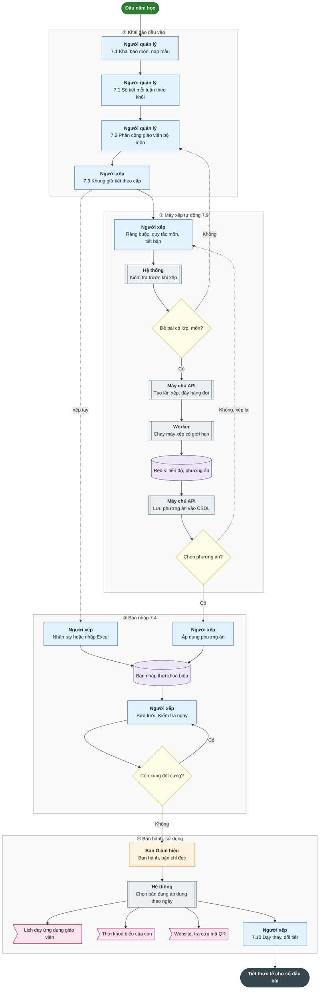

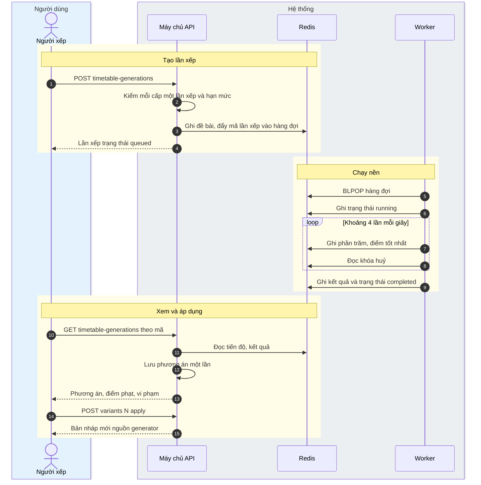

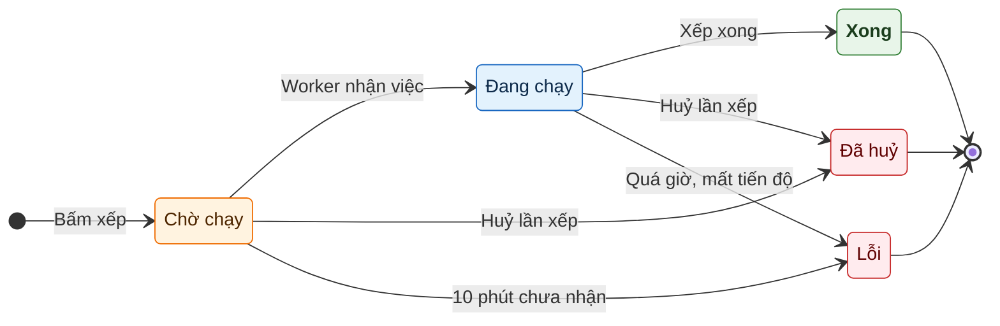

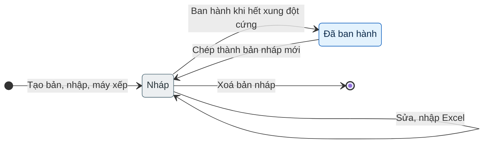

### 2. Sổ đầu bài và chuyên cần theo tiết

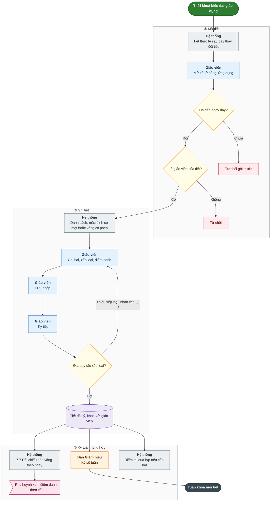

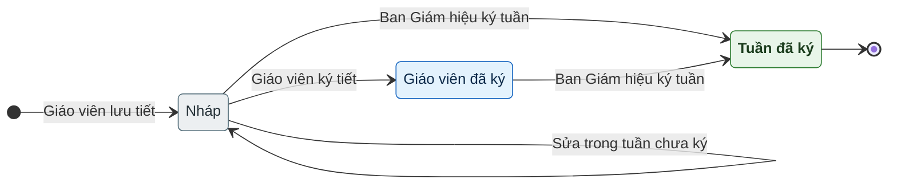

### 3. Đánh giá theo TT27 (Tiểu học)

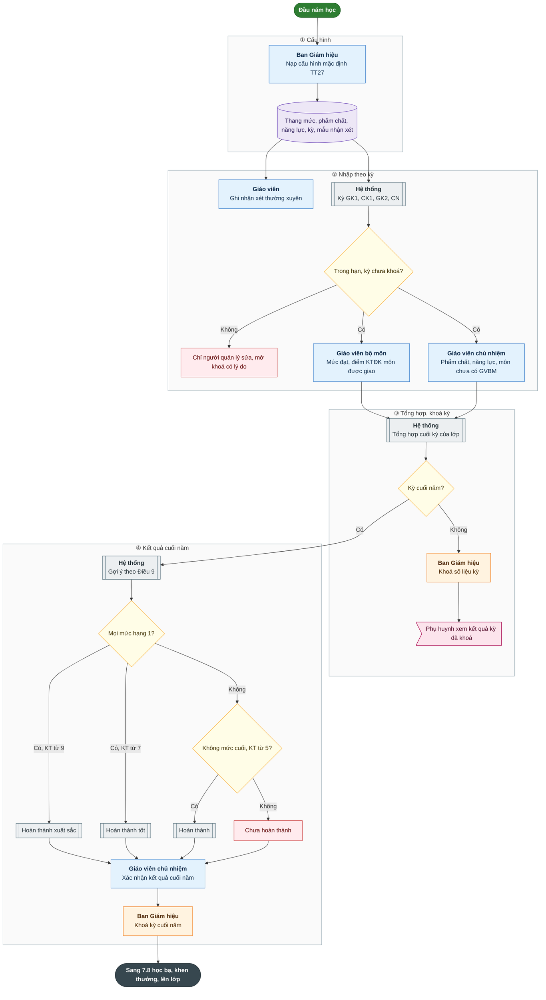

### 4. Nhập điểm và đánh giá theo TT22 (THCS, THPT)

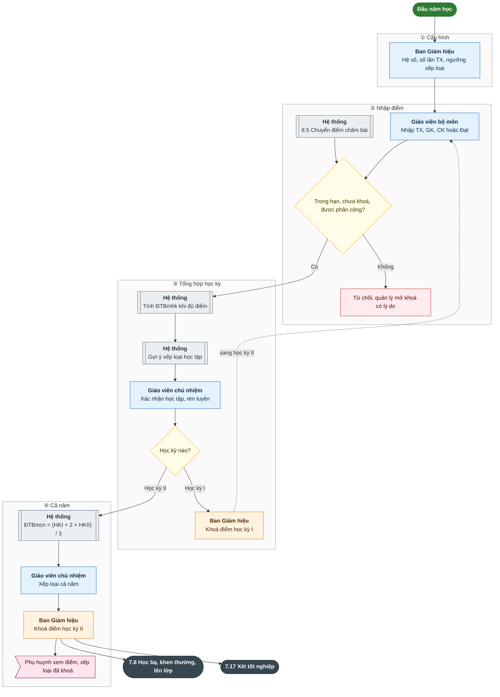

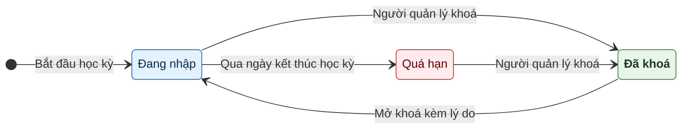

### 5. Học bạ số, xét lên lớp, xét tốt nghiệp

Cách đọc: sơ đồ thứ nhất là học bạ, khen thưởng, lên lớp (7.8); sơ đồ thứ hai là xét tốt nghiệp (7.17) cho khối 9, khối 12.

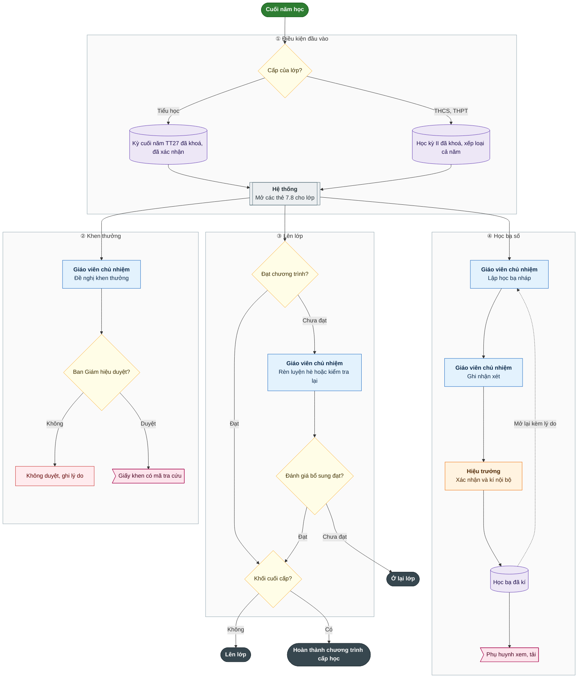

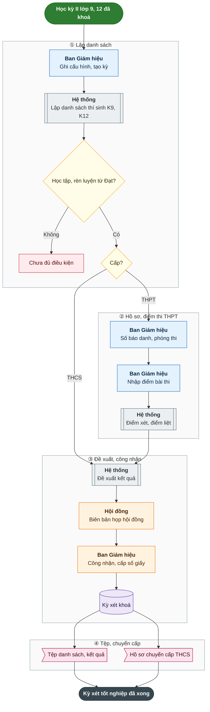

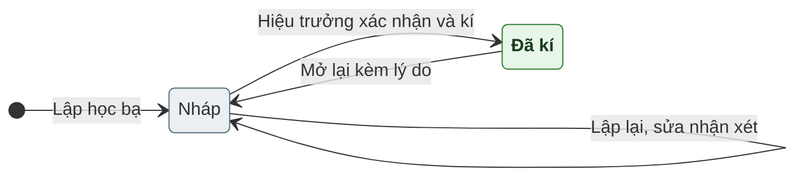

### 6. Kiểm tra, đánh giá: ra đề, chấm, chuyển điểm

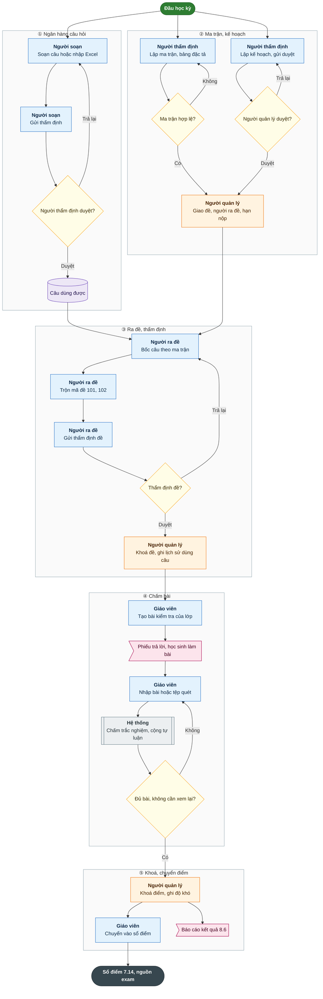

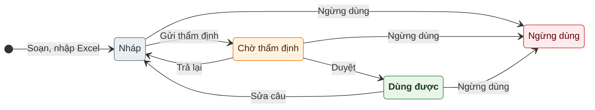

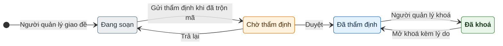

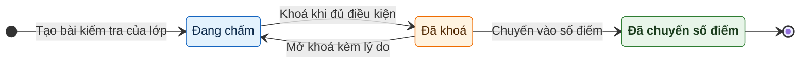

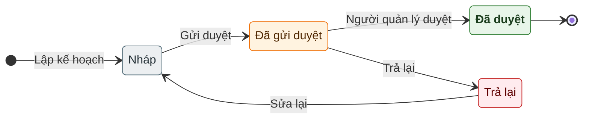
