# 34.5. TÀI CHÍNH, NHÂN SỰ, HẬU CẦN, TƯƠNG TÁC, GIẢNG DẠY, TUYỂN SINH, BÁO CÁO

- Mô tả: Phân hệ 2.8 đến 2.14
- Phiên bản: 1.0
- Ngày cập nhật: 2026-10-25
- Trạng thái: Chờ phê duyệt
- Thuộc: [Tài liệu 34, tổng hợp chức năng hệ thống](00_MUC_LUC.md)
- Nguồn: mã và tài liệu trên nhánh `main` ngày 2026-10-25 (sau PR 165, 166, 167, 169, 170). Khi tài liệu và mã lệch nhau, mô tả theo mã; chỗ lệch ghi ở [phụ lục](07_MA_TRAN_VAI_TRO_VA_PHU_LUC.md)

Mỗi phân hệ mô tả theo cùng khuôn: mục đích, cấp học, vai trò và mã quyền, căn cứ pháp lý, chức năng và màn hình, quy tắc nghiệp vụ, dữ liệu và tệp xuất, liên kết, kiểm thử e2e. Số mục menu, đường dẫn theo `packages/shared/src/portal-menu.ts`. Sơ đồ quy trình ở cuối tệp.

## 2.8. Tài chính – học phí (`finance`)

- Mục đích: quản lý toàn bộ vòng thu học phí và dịch vụ (biểu phí, đăng ký dịch vụ, tính học phí tháng, miễn giảm, phát hành hóa đơn, thu tiền, công nợ, nhắc nợ), thu chi của trường (phiếu thu, phiếu chi, quỹ tiền mặt, tài khoản ngân hàng, đối chiếu sao kê, nợ nhà cung cấp) và kế toán kép (sổ nhật ký chung, sổ cái, cân đối số phát sinh, chốt kỳ tài chính). Có thanh toán trực tuyến bằng mã QR cho phụ huynh.
- Cấp học áp dụng: phân hệ và mọi mục menu không ghi `levels` nên hiện với mọi cấp (MN, TH, THCS, THPT). Logic theo cấp trong mã: biểu phí thuộc một cấp (`fee_schedules.school_level`, BR-162), tính phí tra giá theo khối của học sinh trong phiên bản hiệu lực của cấp; tiền ăn Mầm non tính theo điểm danh đã chốt, tiền ăn lớp ngoài Mầm non tính theo ngày lớp đã chốt suất bán trú mà học sinh không cắt suất (YCTD-159); cờ "nghỉ nhiều" chỉ đánh cho Mầm non.
- Đối tượng, vai trò dùng: VT-04 Kế toán (lập biểu phí, đăng ký thay, tính và phát hành học phí, lập miễn giảm, phiếu thu, phiếu chi, ghi sổ), VT-05 Kế toán trưởng (phiếu điều chỉnh, phiếu đảo, đối chiếu ngân hàng, nợ nhà cung cấp, đề nghị chốt kỳ, biểu thuế), VT-16 Thủ quỹ (phiếu thu, phiếu chi chỉ tiền mặt, Q-152), VT-15 Phó Hiệu trưởng và VT-02 Hiệu trưởng (duyệt theo hạn mức, duyệt đăng ký trễ, quyết định xử lý nợ quá hạn; Hiệu trưởng duyệt chốt kỳ), VT-03 Quản lý đơn vị (xem công nợ, nhắc nợ, đề xuất xử lý nợ), VT-20 Kiểm toán viên (xem sổ kế toán), VT-14 Phụ huynh (đăng ký dịch vụ, xem hóa đơn, quét mã QR thanh toán trên ứng dụng phụ huynh). Quyền chính (gán vai trò theo các tệp `database/identity/migrations/0015` đến `0035`):
  - Xem: `P05.view`, `P06.view`, `P05.debt.view` (VT-02, VT-15, VT-03, VT-04, VT-05, VT-16), `P06.ledger.view` (VT-02, VT-15, VT-04, VT-05, VT-20).
  - Danh mục: `P05.fee-catalog.manage` (VT-04), `P05.discount-type.manage` (VT-04, VT-02), `P06.cashflow-category.manage` (VT-04, VT-05), `P06.cash-account.manage` (VT-04, VT-05).
  - Đăng ký và học phí: `P05.registration.manage` (VT-04), `P05.late-registration.approve` (VT-02, VT-15), `P05.fee-calculation.manage` (VT-04), `P05.discount.manage` (VT-04), `P05.invoice-adjustment.create` (VT-04, VT-05), `P05.fee-document.approve` (VT-02, VT-15), `P05.opening-debt.import` (VT-04).
  - Công nợ: `P05.debt-reminder.manage` (VT-04, VT-03), `P05.overdue-debt.propose` (VT-03, VT-04), `P05.overdue-debt.decide` (VT-15, VT-02).
  - Thu chi: `P06.receipt.manage` (VT-04, VT-16), `P06.receipt-reversal.create` (VT-04, VT-05), `P06.receipt-reversal.approve` (VT-02, VT-15), `P06.payment.manage` (VT-04, VT-05, VT-16), `P06.payment.approve` (VT-02, VT-15), `P06.payment-reversal.create` (VT-04, VT-05), `P06.bank-transaction.manage`, `P06.bank-statement.import`, `P06.payable.manage` (VT-04, VT-05).
  - Kế toán: `P06.ledger.manage` (VT-05, VT-04), `P06.period-close.request` (VT-05), `P06.period-close.approve` (VT-02).
  - Báo cáo liên quan: `P17.report.tuition`, `P17.report.debt`, `P17.report.cash-flow` (xem phân hệ Báo cáo).
- Căn cứ pháp lý: Thông tư 24/2024/TT-BTC (chế độ kế toán hành chính, sự nghiệp) làm hệ thống tài khoản của sổ kế toán kép (`ledger_accounts`, Q-140, YCTD-88; tài liệu 04 ghi "theo hiểu biết của nhóm thiết kế, kế toán trưởng kiểm tra lại số hiệu"). Tài liệu và mã không dẫn Nghị định 81/2021 hay văn bản học phí nào khác: mức học phí, miễn giảm do nhà trường cấu hình (BR-19, BR-20). Thanh toán QR dùng chuẩn VietQR qua cổng PayOS, SePay, Casso, VNPay theo tài liệu công khai của nhà cung cấp (YCTD-89, YCTD-92), không phải văn bản pháp luật.

### Chức năng và màn hình

| Mục menu (số, tên) | Đường dẫn | Chức năng, thao tác và nút chính | Mã màn hình |
|---|---|---|---|
| 1.1. Biểu phí và dịch vụ | `/fees` | Danh mục dịch vụ (mã, tên, đơn vị tính, cách tính theo tháng hoặc theo ngày có mặt, bắt buộc); loại miễn giảm (mã, tên, cách tính phần trăm hoặc số tiền, mức giảm, khoản áp dụng, điều kiện); biểu phí theo phiên bản và cấp học. Nút Thêm mới, Ghi, Hủy, Sửa, Xóa (phiên bản chưa hiệu lực), Tạo phiên bản biểu phí | MH-04 |
| 1.2. Đăng ký dịch vụ | `/registrations` | Chọn kỳ (tháng), đơn vị; bảng học sinh nhân dịch vụ, Đăng ký, Hủy; Đăng ký học hè theo tháng hè; Chốt danh sách đăng ký; lưới "Chờ Ban Giám hiệu duyệt" có Duyệt, Lý do từ chối, Từ chối, Cách thu (cả tháng hoặc theo ngày thực tế) | MH-05, MH-46 |
| 1.3. Học phí | `/invoices` | Chọn kỳ, đơn vị; Tính học phí; lưới "Bảng tính học phí" (học sinh, số hóa đơn, loại, ngày học, tổng, phải nộp, cần xem lại); Phát hành hóa đơn (nhập ngày đến hạn); Lập hóa đơn bổ sung; Chi tiết hóa đơn dưới dòng có Lập miễn giảm, Chép miễn giảm kỳ trước, Lập phiếu điều chỉnh | MH-06, MH-07 |
| 1.4. Duyệt miễn giảm và điều chỉnh | `/fee-approvals` | Hai lưới "Miễn giảm chờ duyệt", "Phiếu điều chỉnh chờ duyệt" (học sinh, hóa đơn, kỳ, loại, căn cứ hoặc lý do, số tiền, cấp duyệt, cờ "Cần Hiệu trưởng duyệt"); Duyệt, Lý do từ chối, Từ chối | MH-07 |
| 1.5. Công nợ | `/debts` | Lưới "Danh sách công nợ" (học sinh, lớp, phải thu, đã thu, còn lại, số dư có, quá hạn), lọc "Chỉ học sinh có công nợ quá hạn"; chi tiết dưới dòng: hóa đơn, lịch sử phiếu thu, biểu mẫu lập phiếu thu, nút Dùng số dư có | MH-08, MH-09 |
| 1.6. Nhắc nợ và xử lý quá hạn | `/debt-collection` | Lưới "Danh sách nhắc nợ" (học sinh, lớp, hóa đơn, hạn, quá hạn, mốc, đã nhắc), lọc "Chỉ hóa đơn cần nhắc ở mốc hiện tại", chọn dòng và Gửi nhắc nợ; "Đề xuất xử lý công nợ quá hạn": Đề xuất xử lý, Gửi đề xuất, Ghi quyết định | MH-08 |
| 2.1. Phiếu thu | `/receipts` | Lưới "Danh sách phiếu thu" (số phiếu, ngày thu, học sinh, người nộp, phương thức, tài khoản nhận, số tiền, đã phân bổ, trạng thái), Từ ngày, Đến ngày; Lập phiếu đảo, Gửi duyệt phiếu đảo; lưới "Phiếu đảo chờ duyệt" có Duyệt, Từ chối; khối "Giao dịch chuyển khoản chờ xử lý" có Ghi đã xử lý | MH-09, MH-41 |
| 2.2. Phiếu chi | `/payments` | Lưới "Danh sách phiếu chi"; Thêm mới mở "Lập phiếu chi" (loại phiếu chi thường, hoàn tiền, lương; nguồn chi; khoản mục chi; người nhận; học sinh được hoàn tiền; nội dung; số tiền; chứng từ kèm theo ảnh hoặc PDF); Ghi, Ghi và trình duyệt, Trình duyệt, Xóa (nháp); "Phiếu chi chờ duyệt" và "Phiếu đảo phiếu chi chờ duyệt" có Duyệt, Từ chối; Lập phiếu đảo | MH-10 |
| 2.3. Quỹ và ngân hàng | `/cash-accounts` | Lưới "Quỹ và tài khoản của đơn vị" (tên, loại tiền mặt hoặc ngân hàng, ngân hàng, số tài khoản, số dư đầu, số dư hiện tại), Thêm mới, Sửa; khối "Tài khoản nhận thanh toán trực tuyến": chọn tài khoản, khoản mục của phiếu thu tự lập, Lưu tài khoản nhận; chọn cổng thanh toán, mã BIN ngân hàng, Lưu cổng thanh toán | MH-11 |
| 2.4. Sổ quỹ | `/cash-book` | Chọn quỹ hoặc tài khoản, từ ngày, đến ngày; bảng "Sổ quỹ theo ngày": số dư đầu kỳ, từng phiếu, tổng thu, tổng chi, số dư cuối kỳ | MH-11 |
| 2.5. Đối chiếu ngân hàng | `/bank-reconciliation` | Chọn tài khoản ngân hàng, khoảng ngày; Ghi dòng sao kê (ngày, số tiền âm là tiền ra, diễn giải, số tham chiếu); Khớp, Bỏ khớp, Khớp tự động, Xóa (dòng chưa khớp); đề xuất Lập phiếu thu, Bỏ đề xuất; kết quả đối chiếu (phát sinh theo sổ, theo sao kê, chênh lệch); "Nhập tệp sao kê": cấu hình cột (dòng tiêu đề, cột ngày, cách ghi ngày, cột số tiền hoặc tiền vào, tiền ra, diễn giải, số tham chiếu), Lưu cấu hình cột, Nhập sao kê (Excel hoặc CSV) | MH-11, MH-70 |
| 2.6. Nợ nhà cung cấp | `/payables` | "Tổng hợp phải trả" theo nhà cung cấp; lưới "Bảng phải trả" (mã, người nhận, chứng từ, hạn, số tiền, trạng thái); "Chứng từ mua chưa ghi" (phiếu mua hàng, phiếu mua thuốc, phiếu đi chợ); "Lập tay theo chứng từ của nhà cung cấp"; Ghi đã trả bằng phiếu chi đã phát hành; Hủy | MH-61 |
| 2.7. Khoản mục thu chi | `/cashflow-categories` | Lưới "Khoản mục và nhóm thu chi" (mã, tên, loại thu hoặc chi, nhóm, trạng thái), Thêm mới, Sửa, Ghi | MH-39 |
| 3.1. Sổ kế toán | `/ledger` | Năm thẻ: Nhật ký chung (Ghi sổ chứng từ, bút toán thủ công nhiều dòng Nợ/Có, Hủy bút toán kèm lý do), Sổ cái, Cân đối số phát sinh, Hệ thống tài khoản kế toán (Thêm tài khoản chi tiết), Quy tắc ghi sổ (Sửa quy tắc, Bỏ quy tắc); lọc đơn vị, từ ngày, đến ngày; Xuất Excel | MH-67, MH-68, MH-69 |
| 3.2. Chốt kỳ tài chính | `/fiscal-periods` | Lưới "Kỳ tài chính" (kỳ, thu, chi, hóa đơn, trạng thái, ghi chú); xem trước số liệu kỳ; Ghi chú đề nghị và đề nghị chốt; Hiệu trưởng Duyệt hoặc Từ chối kèm lý do | MH-62 |

Thanh toán trực tuyến bằng mã QR không có mục menu riêng: cấu hình ở 2.3, giao dịch chờ xử lý ở 2.1, phụ huynh quét mã ở màn hình học phí của ứng dụng phụ huynh (`apps/parent/src/screens/PaymentQr.tsx`, API `GET invoices/:id/payment-qr`).

Mô tả chi tiết các màn hình quan trọng:

- Biểu phí và dịch vụ (`apps/portal/src/fees/FeesPage.tsx`, `FeeSchedulesSection.tsx`): dịch vụ hệ thống "Bán trú" (mã `BAN_TRU`, tính theo ngày có mặt, bắt buộc) tạo sẵn ở migration 0010, không ngừng dùng, không đổi cách tính được (BR-83). Biểu phí là bảng khối nhân khoản phí (học phí chính khóa theo tháng và giá từng dịch vụ), có tên, cấp học, "Hiệu lực từ tháng" (ngày 1 của tháng). Phiên bản đã tới ngày hiệu lực không sửa được (BR-18); chỉ xóa được phiên bản mới nhất chưa hiệu lực; phiên bản mới của một cấp phải sau phiên bản mới nhất của cấp đó (BR-162). Mọi người đăng nhập xem được biểu phí; tạo, sửa, xóa cần `P05.fee-catalog.manage`.
- Đăng ký dịch vụ (`RegistrationsPage.tsx`): kỳ đăng ký là một tháng thuộc năm học đang mở; tháng hè đánh dấu riêng. Đầu kỳ hệ thống tạo dòng: dịch vụ bắt buộc cho mọi học sinh đang học, dịch vụ không bắt buộc giữ từ tháng gần nhất có đăng ký (trừ tháng hè). Sau ngày chốt của đơn vị (mặc định ngày 25 tháng trước) hoặc khi kế toán đã bấm "Chốt danh sách đăng ký", đăng ký thêm là đăng ký trễ, phải nhập "Ngày bắt đầu học (đăng ký trễ)" và chờ Ban Giám hiệu duyệt; hủy sau ngày chốt cũng chờ duyệt. Người duyệt chọn cách thu "cả tháng" (`full_month`) hoặc "theo ngày thực tế" (`actual_days`). Trạng thái dòng: `active`, `pending_late`, `pending_cancel`, `cancelled`, `rejected`. Học hè: đăng ký theo từng tháng hè, hủy trước ngày chốt của tháng đó.
- Học phí (`InvoicesPage.tsx`, `InvoiceDetailPanel.tsx`): "Tính học phí" chạy ngay trong yêu cầu (không qua hàng đợi), ghi một lần chạy ở `fee_calculation_runs` (running, succeeded, failed); chạy lại thay hóa đơn nháp, không sinh trùng (AC-102). Cờ "Cần xem lại": `large_change` (chênh trên 30% so với hóa đơn chính kỳ trước), `absent_many` (Mầm non vắng từ 5 ngày), `no_registration`. "Phát hành hóa đơn" phát hành mọi hóa đơn nháp của đơn vị trong kỳ, cấp số `HD-000001` liên tục trong năm học, ghi ngày đến hạn (không nhỏ hơn hôm nay), gửi thông báo trong ứng dụng và tin nhắn cho phụ huynh. "Lập hóa đơn bổ sung" cho khoản phát sinh sau khi hóa đơn chính đã phát hành (BR-85). Sửa hóa đơn trực tiếp luôn bị từ chối (BR-25). Trạng thái lưu: `draft`, `issued`; trạng thái thu tính khi đọc: chưa thu (`unpaid`), quá hạn (`overdue`), đã thu đủ (`paid`).
- Duyệt miễn giảm và điều chỉnh (`FeeApprovalsPage.tsx` dùng `ApprovalQueueGrid`): Phó Hiệu trưởng chỉ thấy khoản dưới hạn mức; khoản có cờ "Cần Hiệu trưởng duyệt" chỉ Hiệu trưởng duyệt. Từ chối bắt buộc lý do.
- Công nợ và phiếu thu (`DebtsPage.tsx`, `ReceiptForm.tsx`): phiếu thu lập trong chi tiết công nợ của học sinh: ngày thu, người nộp, nội dung, số tiền thu, phương thức (tiền mặt, chuyển khoản, khác), tài khoản nhận, khoản mục thu, chọn hóa đơn; nút "Phát hành phiếu thu". Phiếu thu phát hành ngay, không có bản nháp; số `PT-000001`. "Dùng số dư có" phân bổ số dư có (tiền thu thừa) vào hóa đơn kỳ sau, lấy từ phiếu thu cũ nhất trước.
- Phiếu chi (`PaymentsPage.tsx`): phiếu lưu nháp, phải đính chứng từ mới trình duyệt; duyệt thì phát hành (số `PC-000001`) và trừ nguồn chi; từ chối thì về nháp kèm lý do. Phiếu đã phát hành chỉ đảo bằng phiếu đảo (`DPC-...`).
- Đối chiếu ngân hàng (`BankReconciliationPage.tsx`, `StatementImportSection.tsx`): dòng sao kê không đổi số dư; khớp một dòng với một giao dịch cùng tài khoản, cùng số tiền; khớp tự động lệch ngày tối đa theo cấu hình (mặc định 3 ngày), ưu tiên mã chứng từ trong diễn giải. Dòng tiền vào có mã hóa đơn còn nợ thì chỉ đề xuất; kế toán bấm "Lập phiếu thu" mới lập phiếu chuyển khoản và khớp ngay. Dòng trùng (cùng tài khoản, ngày, số tiền, số tham chiếu) bỏ qua khi nhập tệp.
- Sổ kế toán (`apps/portal/src/ledger/LedgerPage.tsx`): bút toán thủ công nhập ngày ghi sổ, diễn giải, các dòng tài khoản Nợ hoặc Có; nút Ghi sổ bút toán; bút toán ghi vào sổ ngay, không qua duyệt; số `BT-...`. "Ghi sổ chứng từ" chạy lệnh ghi sổ tự động (chạy lại được nhiều lần, mỗi chứng từ một bút toán mỗi đơn vị).
- Chốt kỳ tài chính (`FiscalPeriodsPage.tsx`): mỗi tháng của năm học kèm trạng thái kỳ của đơn vị: chưa đề nghị, chờ duyệt (`pending`), đã chốt (`closed`), bị từ chối (`rejected`, đề nghị lại được). Chưa có chức năng mở lại kỳ đã chốt.

### Quy tắc nghiệp vụ

- BR-17, BR-162: học phí tính theo tháng dương lịch, theo biểu phí hiệu lực vào ngày đầu kỳ của cấp và khối của học sinh; thiếu biểu phí của khối hoặc dịch vụ thì chặn và liệt kê (AC-100).
- BR-18: biểu phí đã tới ngày hiệu lực không sửa, tạo phiên bản mới; hóa đơn đã phát hành không tính lại.
- BR-19, BR-23: học phí chính khóa = học phí tháng nhân số ngày học trong thời gian đang học chia số ngày học của tháng theo lịch năm học (BR-91), làm tròn đến đồng; dịch vụ theo tháng thu đủ; đăng ký trễ thu theo ngày thực tế tính từ ngày bắt đầu học; phí ngoại khóa theo tháng thu đủ mỗi kỳ, theo hoạt động thu một lần.
- BR-58, BR-14: tiền ăn = đơn giá suất nhân số ngày có mặt, đi muộn, về sớm theo điểm danh đã chốt (Mầm non); lớp ngoài Mầm non là số ngày lớp đã chốt suất bán trú mà học sinh không cắt suất (BR-167, BR-168).
- Q-151: còn ngày học chưa chốt điểm danh (Mầm non) hoặc chưa chốt suất bán trú (lớp ngoài Mầm non có học sinh đăng ký bán trú) thì chặn tính học phí, liệt kê lớp và ngày.
- BR-92: tháng hè chỉ tính cho học sinh đã đăng ký học hè tháng đó.
- BR-83: bán trú bắt buộc, không hủy, không ngừng dùng, không đổi cách tính.
- BR-26: đăng ký, hủy sau ngày chốt hoặc sau khi chốt danh sách là trễ, chờ Ban Giám hiệu duyệt; phải chốt danh sách trước khi tính học phí. Đang chờ duyệt hủy thì vẫn thu.
- BR-33, AC-182: đơn vị bật cấu hình `block_service_registration_when_overdue` thì phụ huynh còn hóa đơn quá hạn không đăng ký thêm được; học sinh vẫn được điểm danh.
- BR-85: mỗi học sinh mỗi kỳ một hóa đơn chính; khoản phát sinh sau phát hành vào hóa đơn bổ sung cùng kỳ; hóa đơn chính chưa phát hành thì khoản vào hóa đơn chính.
- BR-20, BR-21, BR-22: miễn giảm theo phần trăm (làm tròn đến đồng) hoặc số tiền cố định, lưu căn cứ; mỗi khoản không vượt tổng các khoản thuộc phạm vi áp dụng; tổng miễn giảm không vượt tổng hóa đơn; khoản giảm không vượt số còn phải nộp (hóa đơn đã thu thì đảo phiếu thu trước). Chạy lại tính học phí thì miễn giảm chờ duyệt tính lại, miễn giảm đã duyệt giữ số tiền.
- BR-25: hóa đơn không sửa trực tiếp; đã phát hành thì lập phiếu điều chỉnh (số âm là giảm) liên kết hóa đơn gốc.
- BR-77, Q-112 (hạn mức phê duyệt): bảng `approval_thresholds` theo đơn vị và loại chứng từ (`payment`, `receipt_reversal`, `payment_reversal`, `purchase_request`, `invoice_adjustment`, `tuition_discount`, `payroll`, `financial_period_closing`), cấu hình ở trang Hạn mức phê duyệt (`/approval-thresholds`, phân hệ Quản trị hệ thống). Số tiền nhỏ hơn hạn mức thì Phó Hiệu trưởng (trong phạm vi đơn vị) hoặc Hiệu trưởng duyệt; bằng hoặc lớn hơn hạn mức, hoặc đơn vị chưa đặt hạn mức thì chỉ Hiệu trưởng. Cờ `requires_principal` tính lúc lập hoặc trình. Phó Hiệu trưởng chỉ thấy chứng từ dưới hạn mức trong hàng chờ.
- BR-24: phiếu chi hoàn tiền luôn do Hiệu trưởng duyệt; số hoàn không vượt số dư có của học sinh.
- BR-78: người duyệt phiếu chi không được là người lập (kiểm ở `payments.service.ts`); người đề nghị chốt kỳ không tự duyệt.
- BR-28: phiếu chi phải đính chứng từ trước khi trình duyệt.
- BR-29: phiếu đã phát hành không xóa; sửa sai bằng phiếu đảo; phiếu thu đã dùng làm nguồn cho phiếu chi hoàn tiền không đảo được; phiếu thu đang chờ duyệt đảo vẫn giữ công nợ (AC-212).
- BR-30: số chứng từ dạng `TIỀN_TỐ-000001`, liên tục toàn trường trong năm học theo loại (`document_sequences`).
- BR-31, Q-47: một phiếu thu cho hóa đơn của một học sinh; chỉ thu hóa đơn đã phát hành; mỗi hóa đơn được chọn phải trả đủ số còn phải nộp, không thu một phần; phần thừa thành số dư có. Gửi lại cùng mã yêu cầu thì trả phiếu đã lập (chống lập trùng).
- BR-32: còn phải nộp = tổng hóa đơn − miễn giảm đã duyệt + điều chỉnh đã duyệt − đã phân bổ từ phiếu thu chưa bị đảo.
- BR-34: số dư quỹ tiền mặt không âm; số dư chỉ đổi qua phiếu; dòng sao kê không đổi số dư.
- Q-152: người chỉ có quyền lập phiếu qua vai trò Thủ quỹ (VT-16) chỉ lập phiếu thu, phiếu chi tiền mặt.
- BR-33, YCTD-82 (nhắc nợ): mốc nhắc cấu hình `debt_reminder_days` (mặc định 3, 7, 15 ngày quá hạn); mỗi hóa đơn nhắc một lần mỗi mốc; gửi trong ứng dụng, thêm Zalo hoặc tin nhắn khi trường bật Zalo Official Account. Mỗi học sinh chỉ một đề xuất xử lý đang chờ; đề xuất và quyết định không đổi số tiền công nợ.
- BR-95 (chốt kỳ): kỳ là tháng của từng đơn vị; chỉ đề nghị khi tháng đã hết và không còn chứng từ chờ duyệt của kỳ; Hiệu trưởng duyệt (không theo hạn mức). Kỳ đã chốt chặn lập phiếu thu, phiếu chi có ngày thuộc kỳ, đảo phiếu, tính lại, phát hành, miễn giảm, điều chỉnh hóa đơn của kỳ, ghi và hủy bút toán thủ công (`finance/fiscal-period-lock.ts`). Bút toán tự động của chứng từ thuộc kỳ vẫn ghi.
- BR-96 (sổ kép): bút toán phải cân Nợ = Có, mỗi dòng một phía, số dương; bút toán thủ công có ngày thuộc năm học đang mở, không sau hôm nay, ít nhất hai dòng; không sửa, sai thì hủy kèm lý do; bút toán tự động và số dư đầu năm không hủy được. Tài khoản theo chế độ không sửa, chỉ thêm tài khoản chi tiết có số hiệu bắt đầu bằng số hiệu tài khoản cha.
- Ghi sổ tự động (`ledger/ledger-posting.ts`): phiếu thu Nợ tiền / Có 131 (hoặc 334 khi thu hồi lương); phiếu chi Nợ 642, 131 (hoàn tiền) hoặc 334 (lương) / Có tiền; phiếu đảo ghi bút toán ngược; hóa đơn phát hành Nợ 131 / Có 531; công nợ đầu kỳ nhập tay Nợ 131 / Có 421; miễn giảm Nợ 531 / Có 131; điều chỉnh Nợ 131 / Có 531; bảng lương Nợ 642 / Có 334, khấu trừ Nợ 334 / Có 332, thuế Nợ 334 / Có 3335; quyết toán Nợ 642 / Có 334. Quy tắc theo khoản mục ưu tiên hơn quy tắc chung. Lệnh ghi sổ chạy khi bấm nút, trước mỗi lần xem sổ, báo cáo và trước khi chuyển năm học.
- Thanh toán QR (P06-11, YCTD-57, YCTD-89, YCTD-92): mã QR cho số còn phải nộp của hóa đơn; số tiền đổi thì hủy mã cũ, xin mã mới. Nội dung chuyển khoản là mã hóa đơn bỏ dấu gạch. Giao dịch tiền vào khớp thì tự lập phiếu thu vào tài khoản nhận của Trường chính với khoản mục đã cấu hình; không khớp (`wrong_amount`, `unknown_invoice`, `already_paid`) vào danh sách chờ kế toán "Ghi đã xử lý". Thông báo của cổng sai chữ ký trả 401, không ghi; cổng chưa bật trả 404. Khóa của cổng là cấu hình riêng của trường ở Quản trị hệ thống 3.2 (`integration_secrets`, DT-SaaS phần S3, BR-211); chế độ một trường còn dùng biến môi trường máy chủ làm nguồn dự phòng. Bản trình diễn chỉ dùng cổng giả lập.
- BR-89, BR-94 (mở năm học mới, `finance/finance-transition.ts`): chặn khi học sinh đã thôi học hoặc ra trường còn nợ, khi còn chứng từ chờ duyệt; chuyển số dư quỹ thành số dư đầu; nợ của học sinh chuyển thành hóa đơn công nợ đầu kỳ, số dư có thành phiếu thu ghi số dư có chuyển sang.
- BR-35: mọi thao tác ghi số liệu tài chính ghi nhật ký thao tác (giá trị trước, sau).

### Dữ liệu, báo cáo và tệp xuất

- CSDL năm học (`database/school-year/migrations`): `services`, `fee_schedules`, `fee_schedule_items`, `discount_types`, `cashflow_categories` (0010); `service_registrations`, `registration_periods`, `summer_registrations` (0011); `fee_calculation_runs`, `invoices`, `invoice_items`, `document_sequences` (0012); `discounts`, `invoice_adjustments` (0013); `cash_accounts`, `receipts`, `receipt_allocations`, `account_transactions` (0014); `receipt_reversals` (0015); `payments`, `payment_attachments`, `payment_refund_sources` (0016); `payment_reversals` (0017); `payment_requests`, `online_payment_transactions` (0018); `debt_reminders`, `debt_resolutions`, `bank_statement_lines`, `payables`, `fiscal_periods` (0038); `ledger_accounts`, `ledger_posting_rules`, `journal_entries`, `journal_lines` (0042); `bank_statement_profiles`, `bank_statement_imports` (0043); `approval_thresholds` (0004); `settings`.
- Xuất Excel: sổ kế toán (nhật ký chung, sổ cái, cân đối số phát sinh) qua báo cáo `ledger-journal`, `ledger-general-ledger`, `ledger-trial-balance` của dịch vụ xuất (`reports/report-export.ts`), có nhật ký xuất.
- Báo cáo học phí, công nợ, thu chi ở phân hệ Báo cáo.
- Tác vụ nền: gửi thông báo, tin nhắn khi phát hành hóa đơn, nhắc nợ (bộ gửi thông báo của `notifications/notification-dispatcher.ts`, thử lại tối đa 5 lần).

### Liên kết với phân hệ khác

- Quản lý giáo dục: điểm danh đã chốt (Mầm non) và bán trú lớp ngoài Mầm non (`/boarding`, mục 4.8, `boarding/boarding-roster.ts`) cấp số ngày ăn cho tiền ăn; lịch năm học cấp số ngày học.
- Hồ sơ học sinh: trạng thái đang học, thôi học, lớp hiện tại; phụ huynh nhận thông báo.
- Hoạt động ngoại khóa (phân hệ Tương tác – truyền thông) đưa phí vào hóa đơn (`activities/extracurricular-fees.ts`).
- Nhân sự – lương: phiếu chi lương, phiếu chi quyết toán, phiếu thu thu hồi lương, bút toán bảng lương.
- Bếp – kho: phiếu mua hàng, phiếu đi chợ, phiếu mua thuốc thành nợ phải trả, gắn phiếu chi.
- Quản trị hệ thống: hạn mức phê duyệt, kết nối ngoài (Zalo), cấu hình đơn vị (ngày chốt, mốc nhắc nợ, chặn đăng ký khi nợ).
- Ứng dụng phụ huynh: đăng ký dịch vụ (`ServicesPanel.tsx`), xem hóa đơn, mã QR (`PaymentQr.tsx`).

### Kiểm thử e2e

`13-fees.spec.ts`, `14-registrations.spec.ts`, `15-invoices.spec.ts`, `16-receipts.spec.ts`, `17-payments.spec.ts`, `18-online-payments.spec.ts`, `38-finance-g2.spec.ts`, `42-ledger.spec.ts`, `43-statement-import.spec.ts`, `88-boarding-conduct.spec.ts` (bán trú lớp ngoài Mầm non), `84-level-reports.spec.ts` (biểu phí chọn cấp).

## 2.9. Nhân sự – chấm công, lương (`personnel`)

- Mục đích: chấm công hằng ngày, đơn nghỉ phép và phép năm, lịch nghỉ lễ và lịch bù, lịch công tác, chốt bảng công; tính bảng lương toàn trường hằng tháng (trả trước tháng M, điều chỉnh theo công tháng M−1), thuế thu nhập cá nhân, quyết toán khi chấm dứt hợp đồng, thưởng và khấu trừ; giao việc, kế hoạch và đánh giá nhân sự.
- Cấp học áp dụng: mọi cấp (không ghi `levels`). Lịch nghỉ lễ, học bù là lịch chung toàn trường; ngày học bù đọc lịch theo cấp khi có (YCTD-152).
- Đối tượng, vai trò dùng: VT-06 Nhân sự (nhập giờ chấm công, chốt bảng công, đề nghị mở lại, quy định phép năm, ngày lễ, lịch công tác, gán khoản lương riêng, lập đơn nghỉ hộ, giao việc, đánh giá), VT-03 Quản lý đơn vị (lịch công tác, giao việc, kế hoạch, đánh giá), VT-04 Kế toán (danh mục lương, tính bảng lương, thưởng và khấu trừ, quyết toán, phiếu chi lương), VT-05 Kế toán trưởng (biểu thuế, thưởng và khấu trừ), VT-15 Phó Hiệu trưởng và VT-02 Hiệu trưởng (duyệt đơn nghỉ, mở lại bảng công, lịch học bù, nghỉ bù, duyệt bảng lương, quyết toán, điều chỉnh lương), VT-20 Kiểm toán viên (xem bảng lương), mọi nhân sự có tài khoản (vào ca, ra ca, gửi đơn nghỉ, phiếu lương của tôi, việc của tôi). Quyền chính:
  - Chấm công và nghỉ: `P08.attendance.manage` (VT-06), `P08.attendance.view` (VT-02, VT-15, VT-03, VT-04, VT-05, VT-06), `P08.holiday.manage` (VT-06), `P08.school-day-change.manage` (VT-02, VT-15), `P08.leave-policy.manage` (VT-06), `P08.leave.approve` (VT-02, VT-15), `P08.timesheet-reopen.approve` (VT-02, VT-15), `P08.work-schedule.manage` (VT-06, VT-03).
  - Lương: `P08.pay-item-type.manage` (VT-04), `P08.staff-pay-item.manage` (VT-06), `P08.tax-table.manage` (VT-05), `P08.payroll.manage` (VT-04), `P08.payroll.view` (VT-02, VT-15, VT-04, VT-05, VT-06, VT-20), `P08.payroll.approve` (VT-02, VT-15), `P08.bonus-deduction.manage` (VT-04, VT-05); `P07.contract.view` để xem khoản gán.
  - Công việc: `P09.task.assign` (VT-03, VT-06), `P09.plan.manage` (VT-03), `P09.evaluation.manage` (VT-03, VT-06).
  - Mục 1.1, 1.2, 1.3, 1.4, 2.5, 3.1, 3.2 không có điều kiện menu nên luôn hiện; máy chủ kiểm quyền và phạm vi ở từng yêu cầu.
- Căn cứ pháp lý: mã và tài liệu không dẫn số hiệu Luật Thuế thu nhập cá nhân, Bộ luật Lao động hay Nghị định 145/2020. Thuế thu nhập cá nhân tính theo biểu lũy tiến từng phần do kế toán trưởng khai theo phiên bản (`tax_tables`), bảo hiểm bắt buộc là khoản khấu trừ đánh dấu trong danh mục; phạm vi chỉ tính ở mức kê khai, không nộp thay qua cổng cơ quan thuế (tài liệu 05 mục phạm vi).

### Chức năng và màn hình

| Mục menu (số, tên) | Đường dẫn | Chức năng, thao tác và nút chính | Mã màn hình |
|---|---|---|---|
| 1.1. Chấm công | `/staff-attendance` | "Chấm công của tôi": Vào ca, Ra ca, lịch tháng; "Nhập giờ chấm công" (nhân sự, ngày, giờ vào, giờ ra, ghi chú), Ghi; "Bảng chấm công" tháng (ma trận ngày nhân nhân sự); "Kỳ công": Chốt bảng công, Đề nghị mở lại (lý do), Duyệt mở lại, Từ chối mở lại; "Tổng hợp bảng công đã chốt" | MH-13, MH-44 |
| 1.2. Đơn nghỉ phép | `/leave-requests` | Lưới "Đơn nghỉ của tôi" (Hủy đơn chờ duyệt); lưới "Đơn nghỉ của đơn vị" lọc "Trạng thái đơn" (mặc định chờ duyệt), Duyệt, Lý do từ chối, Từ chối, Hủy đơn; Thêm mới: "Gửi đơn nghỉ của tôi" hoặc "Lập đơn nghỉ hộ" (loại nghỉ, từ ngày, đến ngày, buổi, lý do), Ghi | MH-14 |
| 1.3. Quy định phép năm | `/leave-policies` | Lưới "Quy định theo chức danh" (chức danh, thâm niên từ, đến dưới, số ngày phép, trạng thái), Thêm mới, Ngừng dùng, Dùng lại; lưới "Số ngày phép năm" (nhân sự, năm, được cấp, đã nghỉ, còn lại), Chỉnh số ngày kèm lý do | MH-52 |
| 1.4. Ngày lễ và lịch bù | `/school-days` | Lưới "Ngày nghỉ lễ" (tên, ngày, hưởng lương), đổi có lương hoặc không lương, Xóa; lưới "Lịch học bù và nghỉ bù" (ngày, thứ, loại lịch, ghi chú), Thêm mới, Xóa khỏi lịch | MH-37 |
| 1.5. Lịch công tác | `/work-schedules` | Chọn đơn vị, tháng; lưới "Danh sách lịch công tác" (nhân sự, ngày, loại công tác hoặc nghỉ, trạng thái nháp hoặc đã công bố), Thêm mới, Xóa, Công bố lịch tháng | MH-56 |
| 2.1. Bảng lương | `/payrolls` | "Các bảng lương" theo tháng; Tính bảng lương, Trình duyệt, Duyệt bảng lương, Trả lại (lý do); "Nhân sự chưa tính lương"; lưới "Danh sách phiếu lương" (nhân sự, mã, đơn vị, Chi tiết căn cứ); "Lập phiếu chi lương" (quỹ hoặc tài khoản của Trường chính, khoản mục) | MH-15 |
| 2.2. Quyết toán và điều chỉnh lương | `/payroll-settlements` | Lưới "Hợp đồng đã chấm dứt" (nhân sự, hợp đồng, ngày nghỉ, trạng thái): Lập bảng quyết toán, Tính lại, Chi tiết, Trình duyệt quyết toán, Duyệt quyết toán, Trả lại, Lập phiếu chi quyết toán, Lập phiếu thu thu hồi; lưới "Khoản điều chỉnh lương" (nhân sự, vào lương tháng, số tiền âm là trừ, lý do), Thêm mới, Duyệt, Từ chối | MH-54 |
| 2.3. Danh mục lương và biểu thuế | `/pay-items` | Lưới "Khoản phụ cấp và khấu trừ" (mã, tên, loại, cách tính cố định tháng, theo ngày công, phần trăm lương; mức chung; miễn thuế; bảo hiểm bắt buộc), Thêm mới, Ngừng dùng, Dùng lại; "Biểu thuế thu nhập cá nhân" theo phiên bản (hiệu lực từ tháng, giảm trừ bản thân, giảm trừ mỗi người phụ thuộc, các bậc), Thêm biểu thuế | MH-53 |
| 2.4. Thưởng và khấu trừ | `/bonus-deductions` | Lưới "Khoản thưởng và khấu trừ" (nhân sự, tháng bảng lương, khoản, loại, số tiền, căn cứ, trạng thái), Thêm mới "Ghi thưởng hoặc khấu trừ", Hủy | MH-60 |
| 2.5. Phiếu lương của tôi | `/my-payslips` | Phiếu lương đã duyệt của chính mình, từng dòng kèm căn cứ (`PayslipView.tsx`) | MH-44, MG-11 |
| 3.1. Công việc và kế hoạch | `/work` | "Danh sách việc của tôi" (Cập nhật phần trăm, ghi chú tiến độ), Thêm việc cá nhân; "Giao việc" (người nhận, nội dung, hạn, ưu tiên); "Việc đã giao trong đơn vị"; "Bảng tiến độ" theo người nhận; "Danh sách kế hoạch" (kỳ tháng, học kỳ, năm): Lập kế hoạch, Thêm đầu việc, Kích hoạt, Đóng kế hoạch | MH-58 |
| 3.2. Đánh giá nhân sự | `/evaluations` | Lưới "Chỉ số đánh giá" (mã, tên, trọng số, điểm tối đa), Thêm mới, Ngừng dùng, Dùng lại; lưới "Phiếu đánh giá của đơn vị" (nhân sự, kỳ, tổng điểm, trạng thái phiếu), Lập phiếu đánh giá (điểm theo chỉ số, nhận xét, lý do đánh giá lại), Công bố; "Kết quả đánh giá của tôi" | MH-59 |

Mô tả chi tiết:

- Chấm công (`apps/portal/src/staff-attendance/StaffAttendancePage.tsx`): nhân sự có hồ sơ liên kết tài khoản bấm Vào ca, Ra ca cho hôm nay, giờ lấy theo máy chủ; vào ca một lần mỗi ngày, ra ca bấm lại lấy giờ mới nhất. Số phút làm = giờ ra − giờ vào − nghỉ trưa; đi muộn, về sớm so với giờ làm việc của đơn vị (thiếu cấu hình giờ thì báo lỗi). Phòng nhân sự nhập hoặc sửa giờ ngày đã qua hoặc hôm nay, có nhật ký. Chốt bảng công từ mùng 1 tháng sau khi không còn đơn nghỉ chờ duyệt; mỗi ngày làm việc ghi `present`, `leave`, `absent`, `holiday`, `day_off`. Kỳ công `closed` chặn sửa chấm công, đơn nghỉ, lịch công tác của tháng; mở lại (`reopened`) khi Ban Giám hiệu duyệt đề nghị kèm lý do.
- Đơn nghỉ phép (`LeaveRequestsPage.tsx`): một ngày chọn buổi sáng hoặc chiều; nhiều ngày thì ngày đầu chỉ nghỉ chiều, ngày cuối chỉ nghỉ sáng; nửa ngày tính 0,5. Loại nghỉ lấy ở danh mục dùng chung, mỗi loại có thuộc tính trường trả lương, trừ phép năm, bảo hiểm xã hội chi trả. Trạng thái `pending`, `approved`, `rejected`, `cancelled`.
- Bảng lương (`apps/portal/src/payroll/PayrollPage.tsx`): một bảng toàn trường mỗi tháng; trạng thái `draft`, `pending`, `approved`; trả lại thì về nháp kèm lý do. Duyệt xong phiếu lương hiện cho từng nhân sự và không sửa được; "Lập phiếu chi lương" tạo phiếu chi nháp loại lương, sau đó đính chứng từ và trình duyệt như phiếu chi thường.
- Quyết toán (`SettlementsPage.tsx`): lập cho hợp đồng đã chấm dứt; lương tháng nghỉ việc tính theo công từ ngày 1 đến ngày chấm dứt, so với phần đã trả trước: dương thì phiếu chi trả thêm, âm thì phiếu thu thu hồi (không gắn học sinh, số tiền không vượt khoản còn phải thu hồi).

### Quy tắc nghiệp vụ

- BR-39: chấm công theo ngày; nhân sự đã nghỉ việc hoặc chưa vào làm không chấm công; giờ ra phải lớn hơn giờ vào.
- BR-40: đơn nghỉ phải được Hiệu trưởng hoặc Phó Hiệu trưởng trong phạm vi đơn vị duyệt; không tự duyệt đơn của mình; không trùng ngày với đơn chờ hoặc đã duyệt (QT-06 E5); khoảng nghỉ phải có ngày làm việc; nhân sự đã nghỉ việc không gửi đơn.
- BR-41: phép năm theo năm dương lịch; quy định chung theo chức danh và thâm niên (năm tròn từ ngày vào làm đến 1 tháng 1); chưa có quy định khớp thì báo cần cấu hình; phòng nhân sự chỉnh số ngày được cấp kèm lý do.
- BR-84: thứ bảy mặc định nghỉ; học bù chỉ chọn thứ bảy trong học kỳ của năm học đang mở; nghỉ bù chỉ chọn thứ hai đến thứ sáu; không trùng ngày lễ; chỉ lập, sửa, xóa ngày từ ngày mai trở đi. Ngày nghỉ lễ do VT-06 gán ở Trường chính quản lý.
- P08-02, YCTD-68: lịch công tác lập nháp cho nhân sự đang làm, kỳ công chưa chốt; công bố theo tháng thì mỗi nhân sự nhận thông báo; ngày công tác đã công bố mà chưa chấm công được tính đủ giờ chuẩn; lịch nghỉ chỉ để thông báo.
- BR-43, Q-154, Q-155: lương tháng M trả trước đầu tháng M (lương hợp đồng, phụ cấp cố định, thưởng, trừ khấu trừ cố định) cho hợp đồng còn hiệu lực ngày 1 tháng M và nhân sự vào làm trước tháng M; cộng trừ điều chỉnh theo bảng công đã chốt tháng M−1: trừ ngày không hưởng lương = lương hợp đồng nhân số ngày không hưởng lương chia ngày công chuẩn (số ngày làm việc của tháng M−1 theo lịch). Chặn tính khi còn đơn vị chưa chốt công tháng M−1; chỉ tính từ ngày 1 của tháng đó.
- BR-82: giờ làm thêm là phần vượt giờ chuẩn trong ngày, tối đa 1 giờ mỗi ngày; tiền = số giờ nhân lương giờ nhân hệ số `overtime_rate_percent` của đơn vị; thiếu cấu hình thì chặn.
- BR-44: thuế lũy tiến từng phần theo biểu hiệu lực của tháng (thiếu biểu thì chặn); thu nhập tính thuế trừ giảm trừ bản thân, người phụ thuộc, bảo hiểm bắt buộc; thưởng là thu nhập chịu thuế trừ khi khoản miễn thuế; số tiền làm tròn đến đồng.
- BR-45: bảng lương đã trình hoặc đã duyệt không sửa; sai thì lập khoản điều chỉnh cho tháng chưa trình duyệt, Ban Giám hiệu duyệt (người duyệt không là người lập); thưởng, khấu trừ của tháng đã trình hoặc đã duyệt không ghi, không hủy được.
- BR-77 (lương): Hiệu trưởng duyệt mọi bảng lương; Phó Hiệu trưởng gán ở Trường chính duyệt bảng dưới hạn mức `payroll` của Trường chính; chưa đặt hạn mức thì Hiệu trưởng. Đã có phiếu chi lương thì không lập phiếu thứ hai.
- BR-90: quyết toán chỉ cho hợp đồng đã chấm dứt; còn đơn nghỉ chờ duyệt trong tháng nghỉ việc thì chặn; bảng quyết toán đã trình không tính lại; nhân sự đã chấm dứt không tính ở bảng lương tháng mà ở bảng quyết toán.
- BR-46: nhân sự chỉ xem phiếu lương đã duyệt, chấm công, đơn nghỉ, kết quả đánh giá của chính mình, trừ người có quyền xem.
- BR-47, YCTD-81: điểm tổng thang 100 = tổng (điểm / điểm tối đa nhân trọng số) chia tổng trọng số nhân 100, làm tròn 2 chữ số; chấm đủ mọi chỉ số đang dùng của đơn vị chính; phiếu đã công bố không sửa, lập phiếu đánh giá lại có lý do, công bố phiếu mới thì phiếu cũ thành `superseded`.
- P09-01 đến P09-04: người nhận việc phải đang làm và có tài khoản; việc đã xong hoặc đã hủy không sửa; đủ 100% là hoàn thành, người giao nhận thông báo; kế hoạch nháp sửa được, kích hoạt thì mỗi đầu việc thành việc giao cho người phụ trách; tiến độ kế hoạch là trung bình phần trăm các đầu việc chưa hủy; kế hoạch đã đóng không thêm đầu việc.

### Dữ liệu, báo cáo và tệp xuất

- CSDL năm học: `holidays`, `school_day_changes`, `attendance_logs` (0020); `leave_policies`, `leave_balances`, `leave_requests`, `timesheet_periods`, `timesheet_days`, `timesheet_reopen_requests` (0021); `pay_item_types`, `staff_pay_items`, `tax_tables`, `payrolls`, `payslips`, `payslip_lines` (0022); `payroll_settlements`, `payroll_adjustments` (0023); `work_schedules` (0027); `plans`, `tasks`, `task_updates`, `plan_items`, `evaluation_criteria`, `evaluations`, `evaluation_scores`, `staff_bonus_deductions` (0037).
- Báo cáo chấm công ở phân hệ Báo cáo (`P17.report.staff-attendance`), xuất Excel.
- Chuyển năm học: lịch nghỉ lễ, học bù, chấm công, phép năm, đơn nghỉ, lịch công tác, bảng công được chuyển giữ mã (`staff-attendance-transition.ts`).

### Liên kết với phân hệ khác

- Hồ sơ nhân sự (phân hệ Quản lý giáo dục, mục cán bộ): hợp đồng, lương hợp đồng, chức danh, ngày vào làm; khoản lương riêng và số người phụ thuộc gán ở chi tiết nhân sự (`StaffPayItemsSection.tsx`).
- Tài chính: phiếu chi lương, phiếu chi quyết toán, phiếu thu thu hồi lương, bút toán bảng lương.
- Quản trị hệ thống: hạn mức `payroll`, cấu hình giờ làm việc, hệ số làm thêm giờ, danh mục loại nghỉ.
- Việc của tôi (`/my-work`), trung tâm thông báo; ứng dụng giáo viên (MG-10 chấm công, đơn nghỉ; MG-11 phiếu lương; MG-12 công việc).
- Lịch đơn vị, phòng họp (`unit-schedules`) thuộc phân hệ Quản lý văn bản và điều hành, không nằm trong menu này.

### Kiểm thử e2e

`20-staff-attendance.spec.ts`, `21-leave.spec.ts`, `22-payroll.spec.ts`, `23-settlement.spec.ts`, `29-work-schedules.spec.ts`, `37-work.spec.ts`.

## 2.10. Bếp – kho, mua hàng (`logistics`)

- Mục đích: quản lý tài sản (cấp phát, mượn trả, hỏng mất), kho (mặt hàng, nhập xuất tồn, tồn ban đầu, kiểm kê), đề nghị mua hàng và phiếu mua hàng, nhà cung cấp; bán trú và an toàn thực phẩm (kiểm thực ba bước, lưu và hủy mẫu, lô hàng nhập, hồ sơ an toàn thực phẩm của nhà cung cấp, truy xuất nguồn gốc).
- Cấp học áp dụng: mọi cấp (không ghi `levels`). Số suất của ngày cho kiểm thực, lưu mẫu lấy theo số suất của bếp: Mầm non theo điểm danh, báo cơm; lớp ngoài Mầm non theo danh sách ăn bán trú (BR-167).
- Đối tượng, vai trò dùng: VT-11 Nhân viên kho và mua hàng (tài sản, kho, phiếu mua hàng, nhà cung cấp), VT-04 Kế toán (phiếu mua hàng, gắn phiếu chi), VT-05 Kế toán trưởng (duyệt biên bản kiểm kê), VT-02, VT-15 (duyệt đề nghị mua hàng theo hạn mức, duyệt hỏng mất), mọi nhân sự (lập đề nghị mua hàng), VT-10 Nhân viên bếp (lô hàng, hồ sơ nhà cung cấp, kiểm thực, lưu mẫu), VT-09 Nhân viên y tế, VT-03 Quản lý đơn vị, VT-02, VT-15 (người kiểm thực). Quyền chính:
  - Kho, tài sản, mua hàng: `P13.asset.manage` (VT-11), `P13.purchase-request.create` (gần như mọi vai trò nhân sự), `P13.purchase-request.approve` (VT-02, VT-15; dùng cả cho duyệt hỏng mất tài sản), `P13.purchase-order.manage` (VT-11, VT-04), `P13.stocktake.approve` (VT-05), `P06.payment.manage` (gắn phiếu chi).
  - An toàn thực phẩm: `P12.food-safety.inspect` (VT-02, VT-15, VT-03, VT-09, VT-10), `P12.kitchen.manage` (VT-10), `P12.menu.approve` (VT-03), `P17.report.kitchen` (VT-10, VT-04).
- Căn cứ pháp lý: Quyết định 1246/QĐ-BYT ngày 31/3/2017 của Bộ Y tế hướng dẫn chế độ kiểm thực ba bước và lưu mẫu thức ăn (mẫu số 1 đến 5; BR-143, BR-144; `kitchen/food-inspections.ts`, `food-samples.ts`, `food-safety-trace.ts`). Mã và tài liệu không dẫn Nghị định 15/2018 hay Thông tư 13/2016.

### Chức năng và màn hình

| Mục menu (số, tên) | Đường dẫn | Chức năng, thao tác và nút chính | Mã màn hình |
|---|---|---|---|
| 1. Kho và tài sản | `/inventory` | Năm thẻ hiện theo quyền: Mặt hàng và tồn kho (lưới "Tồn kho", lọc "Chỉ mặt hàng dưới tồn tối thiểu", Thêm mặt hàng, Ghi phiếu kho nhập hoặc xuất, tồn kho ban đầu, "Sổ kho" lọc theo loại phiếu); Phiếu mua hàng (Lập phiếu mua hàng từ đề nghị đã duyệt, Nhận hàng, trạng thái nhận hàng và thanh toán, gắn phiếu chi); Tài sản ("Danh mục tài sản", Thêm tài sản, Cấp phát, Cho mượn, Thu hồi hoặc nhận trả, Ghi nhận hỏng, gắn thiết bị dạy học; "Hỏng và mất chờ duyệt" có Duyệt xử lý, Từ chối); Kiểm kê (Lập biên bản kiểm kê, Xem chi tiết, Duyệt điều chỉnh tồn, Từ chối); Nhà cung cấp (Thêm nhà cung cấp: tên, mã số thuế, người liên hệ, điện thoại, điều khoản) | MH-20, MH-21, MH-22 |
| 2. Đề nghị mua hàng | `/purchase-requests` | Lưới "Đề nghị của tôi" (mã, nội dung, giá trị, trạng thái); lưới "Đề nghị chờ duyệt" (Duyệt, Lý do từ chối, Từ chối); Thêm mới "Lập đề nghị mua hàng" (đơn vị, lý do, thời hạn cần, các mặt hàng: tên, đơn vị tính, số lượng, đơn giá dự kiến), Ghi | MH-21 |
| 3.1. Kiểm thực ba bước | `/food-safety/inspections` | Chọn ngày; ba thẻ Bước 1, 2, 3 kèm trạng thái (chưa lập, nháp, đã xác nhận); phiếu có giờ kiểm tra, địa điểm, người kiểm tra, chức vụ, dòng gợi ý sẵn (lô chờ kiểm tra ở bước 1; món của thực đơn đã công bố và số suất ở bước 2, 3); Thêm lô chờ kiểm tra, Bỏ dòng, Ghi phiếu, Xác nhận phiếu; danh sách "Phiếu kiểm thực 30 ngày gần đây"; "In sổ kiểm thực" theo khoảng ngày, định dạng PDF hoặc Excel | MH-236 |
| 3.2. Lưu và hủy mẫu thức ăn | `/food-safety/samples` | Món của ngày theo thực đơn và số suất kèm mẫu đã lưu; Lưu mẫu (tên mẫu, bữa, dạng đặc hoặc lỏng, khối lượng g/ml, dụng cụ chứa, nhiệt độ bảo quản, thời điểm lấy); lưới "Mẫu thức ăn lưu" (đang lưu, đến hạn hủy, đã hủy, giữ mẫu); chọn mẫu và Hủy mẫu đã chọn (chất lượng mẫu khi hủy); Giữ mẫu (lý do), Bỏ giữ; In nhãn mẫu, In sổ lưu mẫu, Sổ lưu mẫu Excel | MH-237 |
| 3.3. Lô hàng nhập | `/food-safety/lots` | Lọc nhập từ ngày, đến ngày, trạng thái, sắp hết hạn, đã hết hạn; lưới lô (mã lô, nguyên liệu, nhà cung cấp, phiếu đi chợ, ngày nhập, giờ nhập, số lô, ngày sản xuất, hạn dùng, khối lượng, nhóm thực phẩm tươi hoặc khô, điều kiện bảo quản, chứng từ, trạng thái); Thêm lô (nhập tay), Ghi lô, Đóng (Đã dùng hết hoặc Hủy lô kèm lý do và cách hủy) | MH-238 |
| 3.4. Hồ sơ an toàn thực phẩm của nhà cung cấp | `/food-safety/supplier-records` | "Tổng hợp hồ sơ theo nhà cung cấp" (có hoặc chưa có giấy ATTP còn hiệu lực, số giấy sắp hết hạn, hết hạn); lưới "Giấy tờ an toàn thực phẩm của nhà cung cấp" (loại giấy, số, nơi cấp, ngày cấp, ngày hết hạn, phạm vi, mặt hàng, tệp, hiệu lực, còn bao nhiêu ngày); Thêm giấy tờ, Sửa, Thu hồi, Ghi giấy tờ | MH-239 |
| 3.5. Truy xuất nguồn gốc | `/food-safety/trace` | Chọn ngày ăn, món; Truy xuất: lô hàng, nhà cung cấp, giấy tờ còn hiệu lực ngày đó, kết quả ba bước, mẫu lưu; dấu "Đã ghi ở bước 2" hoặc "Suy ra theo nguyên liệu, cần đối chiếu"; "Không tìm thấy lô", "Chưa có giấy tờ", "Chưa lưu mẫu"; Giữ mẫu ngay từ kết quả | MH-240 |

Mô tả chi tiết:

- Tài sản (`apps/portal/src/inventory/InventoryPage.tsx`, `api/inventory/assets.ts`): trạng thái tài sản `in_stock`, `assigned`, `on_loan`, `damaged`, `lost`, `disposed`; vị trí kho, phòng, lớp, nhân sự, đơn vị. Mỗi lần cấp phát (`CPTS`), thu hồi (`THTS`), mượn (`MTTS`), hỏng mất (`HMTS`) sinh phiếu có mã và người xác nhận. Hỏng có mức nhẹ, nặng, toàn bộ; ghi nhận chờ Ban Giám hiệu của đơn vị duyệt; duyệt thì tài sản thành hỏng hoặc mất, phiếu cấp phát, mượn đang mở được đóng.
- Kho (`stock.ts`): giao dịch `opening`, `receipt`, `issue`, `count_adjustment`, `carry_over`. Biên bản kiểm kê (`KKK-...`) lấy số hệ thống lúc lập; không chênh lệch thì `matched`, có chênh lệch thì `pending` chờ kế toán trưởng duyệt (`approved` ghi phiếu điều chỉnh, `rejected` giữ tồn).
- Mua hàng (`purchasing.ts`): đề nghị (`DNMH-...`) trình duyệt ngay theo hạn mức `purchase_request`; trạng thái `pending`, `approved`, `rejected`, `ordered`. Phiếu mua hàng (`PMH-...`) chỉ lập từ đề nghị đã duyệt; `ordered` → `received` (nhận đủ một lần, mặt hàng có mã kho thì ghi phiếu nhập theo đơn giá mua); thanh toán `awaiting_payment` → `paid` khi kế toán gắn phiếu chi đã phát hành cùng đơn vị, đúng số tiền; nợ nhà cung cấp tương ứng cũng thành đã trả.
- Kiểm thực ba bước (`FoodInspectionsPage.tsx`, `food-inspections.ts`): bước 1 (mẫu số 1) kiểm từng lô nhập trong ngày; bước 2 (mẫu số 2) kiểm từng món khi chế biến kèm lô đã dùng (gợi ý lô đạt bước 1 nhập gần nhất trước); bước 3 (mẫu số 3) kiểm món trước khi ăn. Kết quả cảm quan, xét nghiệm nhanh, ba kết quả vệ sinh ở bước 2 (đạt, không đạt), biện pháp xử lý. Trạng thái phiếu `draft`, `confirmed`.

### Quy tắc nghiệp vụ

- BR-61: chỉ tài sản đang trong kho mới cấp phát, cho mượn; tài sản đang có ghi nhận hỏng mất chờ duyệt không ghi thêm; thanh lý khi tài sản trong kho, đã hỏng hoặc đã mất, phải thu hồi hoặc nhận trả trước; người duyệt không là người ghi nhận.
- BR-62: tồn = tồn ban đầu + nhập − xuất + điều chỉnh kiểm kê đã duyệt + chuyển năm; một dòng xuất vượt tồn thì cả phiếu bị từ chối; tồn ban đầu chỉ cho mặt hàng chưa có giao dịch và khóa ngay; người duyệt biên bản không là người lập.
- BR-63, BR-77: đề nghị dưới hạn mức `purchase_request` của đơn vị thì Phó Hiệu trưởng của đơn vị hoặc Hiệu trưởng duyệt; từ hạn mức trở lên hoặc chưa đặt thì Hiệu trưởng; người lập không tự duyệt; mỗi đề nghị đã duyệt lập một phiếu mua hàng.
- BR-28: hệ thống không tự tạo phiếu chi; số tiền phiếu chi phải bằng giá trị phiếu mua hàng hoặc tổng phiếu đi chợ.
- BR-143 (lưu mẫu): tối thiểu 100 g thức ăn đặc, 150 ml thức ăn lỏng; nhiệt độ 2 °C đến 8 °C; hủy không sớm hơn 24 giờ sau lúc lấy; mẫu giữ (phản ánh, nghi ngộ độc, cơ quan quản lý yêu cầu) không hủy đến khi bỏ giữ; bữa từ 30 suất phải lưu mẫu mọi món (nhắc, không chặn bữa ít hơn); người lưu, người hủy là người đăng nhập. Trạng thái mẫu `stored`, `held`, `destroyed`.
- BR-144 (kiểm thực): mỗi đơn vị mỗi ngày mỗi bước một phiếu; xác nhận khi mọi dòng có kết quả cảm quan, dòng bước 2 đủ ba kết quả vệ sinh, dòng không đạt có biện pháp xử lý, lô không đạt bước 1 có cách xử lý (trả lại, hủy, khác); phiếu đã xác nhận không sửa; xác nhận bước 1 thì lô đạt thành `accepted` ("Đạt, đã nhận"), lô không đạt thành `rejected`; mỗi lô chỉ kiểm ở một phiếu bước 1; lô của món ở bước 2 phải đã đạt bước 1, nhập không sau ngày chế biến, chưa hết hạn; bước 3 không ghi lô.
- BR-145: giấy tờ có ngày hết hạn không trước ngày cấp; hiệu lực tại ngày xem: còn hiệu lực, sắp hết hạn (0 đến 30 ngày), hết hạn, đã thu hồi (`revoked`); giấy sắp hết hạn, hết hạn của nhà cung cấp đang dùng hiện ở Việc của tôi của bếp; phiếu đi chợ của nhà cung cấp chưa có giấy chứng nhận cơ sở đủ điều kiện còn hiệu lực thì cảnh báo, không chặn. Tệp quét PDF hoặc ảnh tối đa 10 MB.
- BR-146 (lô): xác nhận nhập phiếu đi chợ tạo một lô mỗi dòng (ngày nhập là ngày phiếu, khối lượng theo phiếu, không sửa ở lô), số `LH-...`; ngày sản xuất không sau ngày nhập; hạn dùng không trước ngày sản xuất, không trước ngày nhập; lô đã kiểm chỉ sửa số chứng từ, tệp, ghi chú; chỉ đóng lô đã đạt (`used_up`, hoặc `disposed` kèm lý do); lô đạt còn trong bếp hết hạn trong 3 ngày được cảnh báo. Trạng thái lô `pending`, `accepted`, `rejected`, `used_up`, `disposed`.
- Truy xuất (`food-safety-trace.ts`): lô của món lấy từ bước 2 đã ghi; ngày chưa có bước 2 thì suy ra theo nguyên liệu của món và lô đã đạt nhập trước ngày, gắn nhãn cần đối chiếu.

### Dữ liệu, báo cáo và tệp xuất

- CSDL năm học: `suppliers`, `assets`, `asset_assignments`, `asset_loans`, `asset_damages`, `stock_items`, `stock_transactions`, `stock_counts`, `stock_count_lines`, `purchase_requests`, `purchase_request_items`, `purchase_orders`, `purchase_order_items` (0033); `food_safety_files`, `food_supplier_certificates`, `food_lots`, `food_inspections`, `food_inspection_lines`, `food_inspection_line_lots`, `food_samples` (0068); dữ liệu bếp dùng chung: `ingredients`, `dishes`, `ingredient_norms`, `menus`, `menu_items`, `meal_reports`, `meal_plans`, `buffet_events`, `food_suppliers`, `market_purchases`, `market_purchase_items` (0032).
- Sổ in theo Quyết định 1246/QĐ-BYT (`POST food-safety/books`): sổ kiểm thực ba bước (mẫu số 1 hai bảng, mẫu số 2, mẫu số 3; thêm cột ngày và người kiểm tra) PDF khổ ngang hoặc Excel; sổ theo dõi lưu và hủy mẫu (mẫu số 5) PDF hoặc Excel; nhãn mẫu thức ăn lưu (mẫu số 4, hai nhãn mỗi hàng). Mỗi lần in ghi nhật ký xuất (không có dữ liệu cá nhân học sinh).

### Liên kết với phân hệ khác

- Thực đơn bữa ăn (`/kitchen`, mục 4.5 của Quản lý giáo dục): thực đơn đã công bố cung cấp món cho bước 2, 3 và lưu mẫu; phiếu đi chợ xác nhận nhập tạo lô; nhà cung cấp thực phẩm dùng chung.
- Tài chính: phiếu chi gắn phiếu mua hàng, phiếu đi chợ; nợ nhà cung cấp lấy từ phiếu mua hàng, phiếu đi chợ.
- Quản trị hệ thống: hạn mức `purchase_request`.
- Cơ sở vật chất: tài sản gắn thiết bị dạy học (`AssetEquipmentLink.tsx`, cần `P13.equipment.manage`).
- Việc của tôi: cảnh báo giấy tờ nhà cung cấp sắp hết hạn.

### Kiểm thử e2e

`32-kitchen.spec.ts`, `33-inventory.spec.ts`, `77-food-safety.spec.ts`.

## 2.11. Tương tác – truyền thông (`interaction`)

- Mục đích: tương tác hai chiều giữa nhà trường và phụ huynh (bình chọn, biểu quyết, khảo sát, góp ý, trao đổi tin nhắn, đồ bị mất, xử lý bình luận) và truyền thông (hoạt động của lớp kèm hình ảnh có duyệt, tin tức, thư viện, hình tô màu, hoạt động ngoại khóa, đăng lên Fanpage).
- Cấp học áp dụng: mọi cấp. Tin tức phạm vi toàn trường, đơn vị có "Cấp nhận tin" (không chọn là mọi cấp) để chỉ gửi phụ huynh có con học lớp thuộc các cấp đó (DT-19 phần 19e); hoạt động ngoại khóa có độ tuổi, bậc học.
- Đối tượng, vai trò dùng: VT-03 Quản lý đơn vị (lập bình chọn, xử lý góp ý, bình luận, duyệt hoạt động, tin tức, thư viện, ngoại khóa), VT-02, VT-15 (duyệt hoạt động, tương tác), VT-07 Giáo viên chủ nhiệm và VT-08 Giáo viên bộ môn (tạo hoạt động, trao đổi, thư viện, ngoại khóa; làm chủ yếu trên ứng dụng giáo viên), VT-14 Phụ huynh (xem, bình luận, thích, trả lời bình chọn, góp ý, nhắn tin, báo mất đồ, đăng ký ngoại khóa trên ứng dụng phụ huynh). Quyền chính:
  - Tương tác: `P15.interaction.manage` (VT-03, VT-02, VT-15), `P15.message.send` (VT-07, VT-03), `P02.lost-item.manage`.
  - Truyền thông: `P14.activity.create` (VT-07, VT-08), `P14.activity.approve` (VT-03, VT-15, VT-02), `P14.content.manage` (VT-03), `P14.library.manage` (VT-03, VT-07), `P14.extracurricular.manage` (VT-03, VT-07), `P14.comment.moderate` (VT-03, VT-07), `P14.facebook.manage` (VT-03, VT-02); `P05.registration.manage` để đăng ký ngoại khóa thay.
  - Liên quan: `P01.integration.manage` (kết nối Fanpage, Zalo), `P19.notification-template.manage`, `P19.notification-receipt.view`.
- Căn cứ pháp lý: đồng ý sử dụng hình ảnh của trẻ (BR-65) và đồng ý xử lý dữ liệu cá nhân gắn với Nghị định 13/2023/NĐ-CP về bảo vệ dữ liệu cá nhân theo hồ sơ pháp lý của dự án (`tai_lieu/33_HO_SO_PHAP_LY`); mã của phân hệ không ghi số hiệu văn bản.

### Chức năng và màn hình

| Mục menu (số, tên) | Đường dẫn | Chức năng, thao tác và nút chính | Mã màn hình |
|---|---|---|---|
| 1. Tương tác với phụ huynh | `/interactions` | Sáu thẻ theo quyền: Bình chọn và khảo sát (Thêm mới "Lập bình chọn, biểu quyết hoặc khảo sát": loại, tiêu đề, mô tả, đối tượng, lớp hoặc cả đơn vị, bắt đầu, kết thúc, câu hỏi, phương án, ẩn danh người trả lời; Mở, Đóng, Kết quả, Công bố kết quả); Danh mục khảo sát (Thêm mẫu khảo sát, Thêm câu hỏi, ngừng dùng); Góp ý (lọc loại, trạng thái; Xử lý: đang xử lý, Ghi kết quả); Trao đổi (luồng theo học sinh, tin nhắn, Gửi); Đồ bị mất (Đã tìm thấy, Đã trả, Không tìm thấy, ghi chú); Bình luận cần xử lý (Ẩn bình luận, Hiện lại, Ghi chú xử lý, số lần xử lý) | MH-25, MH-35 |
| 2. Hoạt động và tin tức | `/activities` | Năm thẻ theo quyền: Duyệt hoạt động (thẻ từng hoạt động, lọc trạng thái, xem hình và cảnh báo trẻ chưa đồng ý, Duyệt và công bố, Từ chối, Ẩn hoạt động, công bố lại, Đăng lên Fanpage, bình luận và Ẩn bình luận); Danh mục (danh mục hoạt động, tin tức, chủ đề thư viện; Thêm danh mục); Tin tức (Thêm tin tức lưu nháp: tiêu đề, nội dung, phạm vi, cấp nhận tin, ngày công bố; Công bố, Ẩn kèm lý do; số phụ huynh sẽ nhận; Fanpage); Thư viện và hình tô màu (Thêm nội dung thư viện, tệp ảnh hoặc PDF, Công bố, Ẩn); Ngoại khóa (Lập hoạt động ngoại khóa: tên, chỉ tiêu, độ tuổi, thời gian, cách thu phí, mức phí; Công bố, Đóng; Danh sách đăng ký) | MH-23, MH-24, MH-36 |

Mô tả chi tiết:

- Bình chọn (`apps/api/src/interactions/polls.ts`): loại `poll` (bình chọn), `vote` (biểu quyết) có một câu hỏi chọn một; `survey` (khảo sát) nhiều câu hỏi chọn một, chọn nhiều, trả lời chữ, đánh giá 1 đến 5, lập tay hoặc chép từ danh mục khảo sát. Đối tượng phụ huynh, nhân sự hoặc cả hai của một đơn vị hoặc một lớp. Trạng thái `draft`, `open`, `closed`; công bố kết quả thì người đã gửi phiếu nhận thông báo. Người quản lý xem kết quả bất cứ lúc nào, đối tượng xem khi đã công bố.
- Góp ý (`feedbacks.ts`): loại giảng dạy, chăm sóc, bữa ăn, cơ sở vật chất, học phí, khác; ghi tên hoặc ẩn danh (người xử lý không thấy người gửi); trạng thái `received`, `in_progress`, `resolved`.
- Trao đổi (`messages.ts`): mỗi cặp học sinh và tài khoản phụ huynh một luồng; phía nhà trường là giáo viên đang được phân công lớp hiện tại và quản lý đơn vị có `P15.message.send`; tin của phụ huynh tới giáo viên chủ nhiệm, lớp chưa có chủ nhiệm thì tới quản lý; ghi thời điểm đã đọc; không làm thời gian thực.
- Đồ bị mất (`lost-items.ts`): phụ huynh báo mất đồ của con, giáo viên ghi đồ nhặt được; trạng thái `reported`, `found`, `returned`, `not_found`, `cancelled`; mã `DBM-...`.
- Hoạt động (`apps/api/src/activities/activities.ts`, `ActivitiesPage.tsx`): giáo viên được phân công lớp tạo hoạt động ở trạng thái chờ duyệt hoặc lưu nháp để thêm hình; tối đa 30 ảnh (Q-71), gắn thẻ trẻ của lớp; ảnh có trẻ chưa đồng ý hình ảnh bị cảnh báo khi tải, không hiện cho phụ huynh và không được công bố. Trạng thái `draft`, `pending`, `published`, `rejected`, `hidden`. Phụ huynh của học sinh đang học trong lớp nhận thông báo khi công bố; phụ huynh thích, bình luận hoạt động đã công bố.
- Tin tức, thư viện (`content.ts`): phạm vi toàn trường, đơn vị, lớp, từng trẻ; trạng thái `draft`, `published`, `hidden`; giáo viên chỉ công bố cho lớp hoặc trẻ của lớp được phân công; ẩn phải có lý do.
- Ngoại khóa (`extracurricular.ts`): cách thu phí `free`, `per_activity`, `monthly`; trạng thái `draft`, `published`, `closed`; phụ huynh đăng ký cho con hoặc nhà trường đăng ký thay; thôi tham gia (`withdrawn`) từ hôm nay.

### Quy tắc nghiệp vụ

- BR-64: hoạt động giáo viên tạo ở trạng thái chờ duyệt (hoặc nháp); chỉ hoạt động đã duyệt mới hiện cho phụ huynh; chỉ duyệt, từ chối hoạt động đang chờ; chỉ gửi trình duyệt hoạt động nháp hoặc bị từ chối; hoạt động bị từ chối sửa xong về nháp; hoạt động đã công bố không sửa, không thêm, gỡ hình; chỉ ẩn hoạt động đã công bố (kèm lý do, Q-72) và chỉ công bố lại hoạt động đã ẩn; người duyệt là quản lý đơn vị hoặc Ban Giám hiệu có phạm vi trên đơn vị.
- BR-65: hình có trẻ chưa đồng ý không công bố được và không hiện cho phụ huynh; điều kiện xét lúc đọc nên phụ huynh rút đồng ý thì hình đã công bố có trẻ đó tự ẩn.
- BR-66: không xóa bình luận; quản lý đơn vị (hoặc giáo viên với hoạt động lớp mình, nội dung mình tạo) ẩn kèm lý do; người xem báo bình luận tiêu cực; mỗi lần ẩn, hiện lại, ghi chú có bản ghi xử lý (`comment_moderations`); chỉ bình luận nội dung đã công bố.
- BR-67, BR-68: mỗi tài khoản một phiếu, phiếu đã gửi không sửa; ngoài thời gian bắt đầu, kết thúc không nhận phiếu; chỉ mở bình chọn nháp, chỉ đóng bình chọn đang mở; thời gian kết thúc đã qua thì phải sửa trước khi mở; mỗi câu hỏi bắt buộc trả lời.
- BR-69: phạm vi công bố toàn trường cần phạm vi toàn trường; tin gửi riêng lớp hoặc trẻ không đăng công khai lên Fanpage.
- BR-70: tin nhắn, thông báo ghi người đã đọc.
- P14-08 (Fanpage): chỉ đăng hoạt động đã duyệt và đang công bố, tin tức đang công bố, phạm vi toàn trường hoặc đơn vị; nhà trường phải bật kết nối Fanpage và máy chủ có khóa truy cập; ảnh có trẻ chưa đồng ý bị loại khỏi bài, hiện số hình bị loại; lỗi thì có nút thử đăng lại.
- P14-10, P14-11 (ngoại khóa): chỉ tiêu không nhỏ hơn số đã đăng ký; đã công bố không đổi phí và ngày bắt đầu; đăng ký kiểm chỉ tiêu trong giao dịch có khóa; chỉ đăng ký cho trẻ đang học trong đơn vị, đúng bậc học, hoạt động đã công bố chưa đóng chưa kết thúc; phí tháng thu đủ, thôi giữa tháng không giảm; phí theo hoạt động không hoàn.
- BR-72, BR-75: phụ huynh chỉ xem dữ liệu của con mình; phiếu đồ bị mất không xóa cứng, phiếu đang báo được hủy, phiếu đã đóng không xóa.

### Dữ liệu, báo cáo và tệp xuất

- CSDL năm học: `activities`, `activity_media`, `activity_media_children`, `activity_likes`, `news`, `library_albums`, `library_items`, `coloring_pages`, `content_comments`, `extracurricular_activities`, `extracurricular_registrations` (0034); `message_threads`, `messages`, `feedbacks`, `survey_templates`, `polls`, `poll_questions`, `poll_options`, `poll_responses`, `poll_answers`, `interaction_comments`, `comment_moderations`, `interaction_likes`, `lost_items` (0035); `integration_settings`, `zalo_followers`, `facebook_posts` (0044); thông báo `notification_reads`, `notification_templates` (0024), `daily_journals`, `journal_amendments` (0025). CSDL hệ thống: `integration_credentials` (khóa kết nối ngoài mã hóa AES-256-GCM).
- Báo cáo "Hoạt động và công việc" (phân hệ Báo cáo) đếm hoạt động đã công bố, chờ duyệt, bị từ chối hoặc ẩn theo lớp.
- Tác vụ nền: bộ gửi thông báo trong ứng dụng, tin nhắn, Zalo.

### Liên kết với phân hệ khác

- Hồ sơ học sinh: đồng ý hình ảnh, quan hệ phụ huynh, lớp hiện tại.
- Tài chính: phí ngoại khóa vào hóa đơn học phí (BR-85).
- Quản trị hệ thống: Kết nối ngoài (`/integrations`, MH-71) bật Fanpage, Zalo Official Account, liên kết số điện thoại phụ huynh với Zalo; mẫu thông báo (`/notifications`).
- Nhật ký của bé (`journals`, QT-09): giáo viên chủ nhiệm ghi nháp từng trẻ rồi công bố cả lớp (MG-03), phụ huynh xem bản đã công bố (MP-03); sửa sau công bố phải có lý do (BR-15). Không có mục menu trong phân hệ này.
- Ứng dụng giáo viên (MG-07 hoạt động và hình ảnh, MG-08 trao đổi, MG-15 đồ bị mất) và ứng dụng phụ huynh (`ActivitiesPanel.tsx`, `InteractionsPanel.tsx`, `PollsPanel.tsx`).

### Kiểm thử e2e

`34-activities.spec.ts`, `35-interactions.spec.ts`, `67-communication-grids.spec.ts`, `44-integrations.spec.ts`, `26-notifications.spec.ts`, `27-journals.spec.ts`, `85-multi-level-apps.spec.ts` (tin tức có cấp nhận).

## 2.12. Giảng dạy (`teaching`)

- Mục đích: quản lý danh mục chương trình (lĩnh vực, nhóm bài học, chủ đề, bài học), giáo án và duyệt giáo án hai bước, thời khóa biểu tuần và lịch hoạt động của lớp, kế hoạch giảng dạy, tiến độ học tập của trẻ.
- Cấp học áp dụng: menu không ghi cấp nên hiện mọi cấp; nội dung nghiệp vụ dựng cho Mầm non (bài học theo độ tuổi, chỉ số phát triển của trẻ). Thời khóa biểu theo môn của Tiểu học, THCS, THPT dùng phân hệ Thời khóa biểu riêng (`timetables`), không thuộc mục này.
- Đối tượng, vai trò dùng: VT-07, VT-08 giáo viên (soạn bài học, giáo án; làm trên ứng dụng giáo viên MG-05, MG-06), VT-17 Tổ trưởng chuyên môn (duyệt bước 1, MG-17 làm trên cổng quản trị), VT-03 Quản lý đơn vị (duyệt bước 2, danh mục, thời khóa biểu), VT-14 phụ huynh (xem thời khóa biểu, lịch hoạt động, phiếu tiến độ đã công bố). Quyền chính: `P03.lesson.manage` (VT-07, VT-08), `P03.lesson-plan.review` (VT-17, VT-03), `P03.curriculum.manage` (VT-03, VT-07), `P03.progress.record` (VT-07).
- Căn cứ pháp lý: mã và tài liệu của mục này không dẫn văn bản pháp luật.

### Chức năng và màn hình

| Mục menu (số, tên) | Đường dẫn | Chức năng, thao tác và nút chính | Mã màn hình |
|---|---|---|---|
| 1. Bài học và giáo án | `/teaching` | Bốn thẻ: Giáo án chờ duyệt (lưới lớp, giáo viên, bài học, ngày dạy; ô Góp ý, Duyệt, Trả lại); Bài học (lọc lĩnh vực; tên, mục tiêu, nhóm, chủ đề, độ tuổi, đồ dùng, chia sẻ; Thêm mới); Lĩnh vực và chủ đề (lưới Lĩnh vực, Nhóm bài học, Chủ đề; Thêm mới, ngừng dùng); Thời khóa biểu và kế hoạch (chọn lớp, tuần áp dụng thứ Hai; Thêm tiết: thứ 1 đến 7, tiết, bắt đầu, kết thúc, hoạt động, giáo viên; Lưu bản nháp, Công bố thời khóa biểu; "Lập kế hoạch giảng dạy": học kỳ HK1, HK2, HE, từ ngày, đến ngày, nội dung dự kiến, tiến độ) | MH-57 |

Mô tả chi tiết:

- Giáo án (`apps/api/src/teaching/lesson-plans.ts`): giáo viên được phân công lớp soạn từ bài học của mình hoặc bài học được chia sẻ; trạng thái `draft`, `submitted`, `leader_approved`, `approved`, `returned`. Tổ trưởng duyệt trước (thành `leader_approved`), quản lý đơn vị duyệt sau và công bố; quản lý duyệt được cả giáo án chưa qua tổ trưởng để đơn vị chưa có tổ trưởng không bị tắc; trả lại kèm góp ý thì giáo viên sửa, gửi lại. Lịch sử duyệt lưu ở `lesson_plan_reviews` (bước `leader`, `manager`).
- Thời khóa biểu lớp (`class-teaching.ts`): lưu theo phiên bản áp dụng từ thứ Hai của một tuần; trạng thái `draft`, `published`. Lịch hoạt động lớp `draft`, `published`, `cancelled`. Kế hoạch giảng dạy theo kỳ `term`, `month`, `week`, tiến độ `planned`, `in_progress`, `completed`.
- Tiến độ học tập (`child-progress.ts`): giáo viên ghi chỉ số phát triển và nhận xét theo học kỳ hoặc tháng, mức `achieved`, `developing`, `not_yet`; công bố cả phiếu của kỳ cho phụ huynh.

### Quy tắc nghiệp vụ

- P03-02: chỉ sửa giáo án nháp hoặc bị trả lại; giáo án đã gửi duyệt hoặc đã duyệt không sửa; không ai duyệt giáo án của chính mình.
- P03-04: trong lớp không trùng thứ và tiết, không trùng khung giờ trong cùng thứ; một giáo viên không dạy hai lớp cùng khung giờ (so với phiên bản đang áp dụng của các lớp khác); không lập cho tuần đã qua; phiên bản đã công bố không sửa, lập phiên bản từ tuần khác.
- P03-06: phiếu tiến độ của kỳ đã công bố không sửa.
- P03-07, BR-75: lịch hoạt động đã công bố chỉ hủy, không sửa; không lập cho ngày đã qua.
- Danh mục (`teaching-catalogs.ts`): danh mục thuộc đơn vị, danh mục của Trường chính dùng chung; không xóa cứng, ngừng dùng bằng trạng thái; bài học chỉ người soạn sửa; bài học riêng chỉ người soạn, quản lý, tổ trưởng của đơn vị thấy; nhóm phải thuộc lĩnh vực đã chọn.
- Phụ huynh chỉ đọc thời khóa biểu, lịch hoạt động, phiếu tiến độ đã công bố của lớp, của con (BR-72).

### Dữ liệu, báo cáo và tệp xuất

- CSDL năm học (0036): `lesson_domains`, `lesson_groups`, `themes`, `lessons`, `lesson_plans`, `lesson_plan_reviews`, `timetables`, `teaching_plans`, `child_progress`, `class_activity_schedules`.
- Không có tệp xuất riêng.

### Liên kết với phân hệ khác

- Lớp và phân công giáo viên (Quản lý giáo dục): quyền soạn, ghi theo phân công lớp.
- Ứng dụng giáo viên (`TeachingScreen.tsx`), ứng dụng phụ huynh (`LearningPanel.tsx`, MP-04, MP-05).
- Trung tâm thông báo: tổ trưởng, quản lý nhận thông báo giáo án chờ duyệt.

### Kiểm thử e2e

`36-teaching.spec.ts`.

## 2.13. Tuyển sinh, tuyển dụng (`admissions`)

- Mục đích: tuyển sinh nội bộ của trường (đợt tuyển sinh, tin tuyển sinh, nhận hồ sơ trực tuyến không cần tài khoản, tiếp nhận, xét, chuyển thành hồ sơ học sinh) và tuyển dụng cán bộ (đề nghị tuyển dụng có duyệt, tin tuyển dụng công khai, ứng viên, phỏng vấn, quyết định tuyển, tạo hồ sơ nhân sự).
- Cấp học áp dụng: mọi cấp. Tuyển sinh nội bộ (`admissions`, YCTD-86) khác Tuyển sinh đầu cấp theo hệ thống của Sở (`entry-admissions`, phân hệ riêng, BR-132, BR-133): đây là đợt nhận hồ sơ do trường tự mở, xét theo chỉ tiêu và đưa thẳng vào hồ sơ học sinh qua luồng QT-01.
- Đối tượng, vai trò dùng: VT-12 Nhân viên tuyển sinh (đợt, tin, nhập hộ và tiếp nhận hồ sơ), VT-03 Quản lý đơn vị (đợt, xét đạt hoặc không đạt, chuyển hồ sơ), phụ huynh và người ngoài trường (nộp hồ sơ, tra cứu, không cần tài khoản); VT-06 Nhân sự (đề nghị tuyển dụng, tin, ứng viên, phỏng vấn), VT-03 (đề nghị, phỏng vấn), VT-02, VT-15 (duyệt đề nghị tuyển dụng), ứng viên ngoài trường (nộp hồ sơ ở trang công khai). Quyền chính:
  - Tuyển sinh: `P16.admission-campaign.manage` (VT-12, VT-03), `P16.admission-post.manage` (VT-12), `P16.application.manage` (VT-12, VT-03), `P16.application.review` (VT-03); chuyển hồ sơ dùng thêm `P02.approve` để duyệt hồ sơ học sinh ngay.
  - Tuyển dụng: `P18.recruitment-request.create` (VT-06, VT-03), `P18.recruitment-request.approve` (VT-02, VT-15), `P18.recruitment.manage` (VT-06), `P18.interview.manage` (VT-06, VT-03); tạo hồ sơ nhân sự cần `P07.staff.manage`.
- Căn cứ pháp lý: hồ sơ ứng viên và hồ sơ tuyển sinh là dữ liệu cá nhân, trang công khai bắt buộc đồng ý xử lý dữ liệu cá nhân (theo Nghị định 13/2023/NĐ-CP được dẫn ở hồ sơ pháp lý của dự án); mã không ghi số hiệu văn bản tuyển sinh hay tuyển dụng.

### Chức năng và màn hình

| Mục menu (số, tên) | Đường dẫn | Chức năng, thao tác và nút chính | Mã màn hình |
|---|---|---|---|
| 1. Tuyển sinh | `/admissions` | Chọn "Đợt đang xem"; ba thẻ: Hồ sơ tuyển sinh (lưới mã hồ sơ, học sinh, ngày sinh, phụ huynh, nguồn, trạng thái; lọc trạng thái; Xem dưới dòng: Tiếp nhận hồ sơ, Xét đạt, Ghi không đạt với lý do, "Chuyển thành hồ sơ học sinh": lớp, bản chụp giấy khai sinh, số định danh cá nhân, quan hệ của phụ huynh, xác nhận khi lớp đủ sĩ số hoặc nghi trùng học sinh đã có; Thêm mới nhập hộ); Đợt tuyển sinh (tên đợt, đơn vị, chỉ tiêu, nhận hồ sơ từ ngày, hạn nhận hồ sơ, "Đạt / chỉ tiêu", "Đã nhập học"; Thêm mới, Mở, Đóng đợt); Tin tuyển sinh (tiêu đề, nội dung, đăng từ ngày, thời hạn đăng; Thêm mới, Công bố, Ẩn tin) | MH-26, MH-63 |
| 2. Tuyển dụng | `/recruitment` | Bốn thẻ theo quyền: Đề nghị tuyển dụng (mã `DNTD-...`, đơn vị, vị trí, số lượng, cần người trước ngày, mô tả, yêu cầu, "Đã tuyển / cần"; Thêm mới, Đóng đề nghị kèm lý do); Đề nghị chờ duyệt (Duyệt, Từ chối kèm lý do); Tin tuyển dụng (soạn từ đề nghị đã duyệt: tiêu đề, mô tả công việc, yêu cầu, hạn nộp; Công bố, Đóng tin); Ứng viên (lọc theo tin; Thêm ứng viên, tải hồ sơ xin việc; Mở hồ sơ xin việc; Chuyển sàng lọc, Loại hồ sơ, Ứng viên rút hồ sơ; Lên lịch phỏng vấn: thời điểm, địa điểm, người phỏng vấn; ghi kết quả, điểm, đánh giá; Quyết định tuyển hoặc Không tuyển kèm lý do; Tạo hồ sơ nhân sự với mã nhân sự mới, ngày vào làm) | MH-27 |

Trang công khai: tuyển sinh trực tuyến trên ứng dụng phụ huynh không cần đăng nhập (`apps/parent/src/screens/AdmissionsScreen.tsx`, API `GET public/admissions`, `POST public/admission-applications`, `GET public/admission-applications/lookup`); tuyển dụng công khai (MH-65; API `GET public/job-posts`, `POST public/job-posts/:id/applications`).

Mô tả chi tiết:

- Đợt tuyển sinh (`admission-campaigns.ts`): trạng thái `draft`, `open`, `closed`. Mở khi hạn nhận hồ sơ chưa qua; đóng thì thôi nhận trực tuyến, hồ sơ đã nhận vẫn xét và chuyển được. Tin tuyển sinh `draft`, `published`, `hidden`, gắn một đợt, thời hạn hiển thị mặc định là hạn nhận hồ sơ.
- Hồ sơ tuyển sinh (`admission-applications.ts`): nguồn `online` hoặc `staff`; trạng thái `submitted` (nộp trực tuyến) → `received` (nhân viên tuyển sinh tiếp nhận sau khi kiểm đủ điều kiện tối thiểu BR-06; hồ sơ nhập hộ vào thẳng trạng thái này) → `passed` hoặc `rejected` (quản lý xét, không đạt kèm lý do) → `converted` (đã chuyển thành hồ sơ học sinh). Chuyển hồ sơ dùng đúng luồng QT-01: tạo hồ sơ học sinh, người có quyền duyệt ở đơn vị của lớp thì duyệt và phân lớp ngay, tạo tài khoản phụ huynh VT-14 theo số điện thoại; không có quyền thì hồ sơ học sinh chờ quản lý đơn vị duyệt. Phụ huynh tra cứu trạng thái bằng mã hồ sơ và số điện thoại.
- Ứng viên (`candidates.ts`): trạng thái `new`, `screening`, `interviewing`, `hired`, `rejected`, `withdrawn`; phỏng vấn `scheduled`, `completed`, `cancelled`, kết quả `passed`, `failed`. Danh sách không trả số điện thoại, thư điện tử; xem chi tiết, tải hồ sơ xin việc luôn ghi nhật ký truy cập dữ liệu cá nhân. Hệ thống không gửi thông báo cho ứng viên.

### Quy tắc nghiệp vụ

- P16-01: chỉ mở đợt nháp, chỉ đóng đợt đang mở; đợt đã đóng không sửa, không lập hoặc công bố tin; chỉ tiêu không nhỏ hơn số hồ sơ đã đạt.
- P16-02: nộp trực tuyến chỉ trong thời gian nhận hồ sơ của đợt đang mở; một trẻ một hồ sơ còn hiệu lực trong đợt (trùng số điện thoại, họ tên, ngày sinh); chỉ sửa hồ sơ chưa xét (bổ sung số định danh, dị ứng, quan hệ); chỉ tiếp nhận hồ sơ vừa nộp trực tuyến.
- P16-03: chỉ xét hồ sơ đã tiếp nhận; tổng hồ sơ đạt và đã chuyển không vượt chỉ tiêu.
- BR-06: phải khai báo trẻ có dị ứng hay không và đủ điều kiện tối thiểu của hồ sơ trẻ.
- BR-69: tin tuyển sinh, tin tuyển dụng đã công bố là công khai đến hết hạn.
- Giới hạn yêu cầu theo địa chỉ mạng, mỗi trường một bộ đếm (DT-SaaS S1b): tuyển sinh nộp tối đa 10 lần mỗi giờ, đọc và tra cứu 60 lần mỗi phút; tuyển dụng xem 120 lần mỗi phút, nộp 10 lần mỗi 10 phút. Tệp hồ sơ xin việc ảnh hoặc PDF tối đa 10 MB; bắt buộc đồng ý xử lý dữ liệu cá nhân.
- BR-80: đề nghị tuyển dụng trình ngay; Hiệu trưởng (toàn trường) hoặc Phó Hiệu trưởng trong phạm vi đơn vị duyệt hoặc từ chối kèm lý do; người lập không tự duyệt; không áp hạn mức vì không có giá trị tiền; mọi lần duyệt ghi nhật ký kèm vị trí, số lượng, lý do. Chỉ soạn tin từ đề nghị đã duyệt; đóng đề nghị thì đóng các tin còn mở.
- BR-80 (quyết định tuyển): chỉ cho ứng viên đang phỏng vấn, không còn lịch chờ; tuyển cần lần phỏng vấn gần nhất đạt; ghi người quyết định, thời điểm, lý do.
- BR-75: không xóa ứng viên, tin; chỉ đổi trạng thái, đóng.
- BR-37, BR-74: chỉ tạo hồ sơ nhân sự cho ứng viên đã tuyển, mỗi người một hồ sơ (số điện thoại đã có hồ sơ thì không tạo thêm).

### Dữ liệu, báo cáo và tệp xuất

- CSDL năm học: `admission_campaigns`, `admission_applications`, `admission_posts` (0040); `recruitment_requests`, `job_postings`, `candidates`, `interviews` (0041).
- Chuyển năm học: đề nghị tuyển dụng đang chờ hoặc đã duyệt kèm tin, ứng viên, lịch phỏng vấn chuyển sang năm mới giữ mã (`recruitment-transition.ts`); đợt tuyển sinh có tệp chuyển riêng (`admissions-transition.ts`).
- Nhật ký thao tác không chứa số định danh ở dạng rõ (BM-64).

### Liên kết với phân hệ khác

- Hồ sơ học sinh và lớp (QT-01): chuyển hồ sơ đạt thành học sinh, kiểm sĩ số lớp, tạo tài khoản phụ huynh.
- Hồ sơ nhân sự: tạo hồ sơ từ ứng viên đã tuyển.
- Tuyển sinh đầu cấp (`entry-admissions`) là phân hệ khác; trang công khai của ứng dụng phụ huynh có cả phần hủy nhập học của tuyển sinh đầu cấp.
- Website trường có thể hiển thị tin tuyển sinh, tuyển dụng (phân hệ Website).

### Kiểm thử e2e

`40-admissions.spec.ts`, `41-recruitment.spec.ts`.

## 2.14. Báo cáo (`reports`)

- Mục đích: bảng điều khiển lãnh đạo và đơn vị; báo cáo theo phân hệ (học phí, công nợ, thu chi, điểm danh, chấm công, học thứ 7), điểm danh và suất ăn theo mẫu của nhà trường, hoạt động và công việc, hợp nhất nhiều đơn vị; xuất Excel có kiểm quyền và nhật ký xuất.
- Cấp học áp dụng: mọi cấp; báo cáo điểm danh, suất ăn nhận tham số cấp (cấp của lớp, không có là Mầm non, BR-160).
- Đối tượng, vai trò dùng: VT-02, VT-15 (bảng điều khiển lãnh đạo, hầu hết báo cáo), VT-03 (bảng điều khiển đơn vị, điểm danh, hoạt động và công việc), VT-04, VT-05 (học phí, công nợ, thu chi), VT-06 (chấm công), VT-19 Cán bộ quản lý cấp trên (hợp nhất), giáo viên (điểm danh, sinh nhật lớp được phân công). Quyền chính: `P17.dashboard.leadership` (VT-02, VT-15), `P17.dashboard.unit` (VT-03), `P17.birthday.view` (VT-02, VT-15, VT-03), `P17.report.tuition` (VT-02, VT-15, VT-04, VT-05), `P17.report.debt` (VT-02, VT-15, VT-04, VT-05), `P17.report.cash-flow` (VT-02, VT-04, VT-05), `P17.report.attendance` (VT-02, VT-15, VT-03), `P17.report.staff-attendance` (VT-02, VT-15, VT-03, VT-06), `P17.report.saturday` (VT-02, VT-15, VT-03, VT-04), `P17.report.operations` (VT-03), `P17.report.consolidated` (VT-02, VT-19), `P17.data.export` (VT-02, VT-04, VT-06), `P06.ledger.view` (xuất sổ kế toán). Mục menu không có điều kiện nên luôn hiện; thẻ báo cáo hiện theo quyền.
- Căn cứ pháp lý: BR-74 về xuất dữ liệu cá nhân (bảo vệ dữ liệu cá nhân theo Nghị định 13/2023/NĐ-CP ở hồ sơ pháp lý của dự án); mã không ghi số hiệu văn bản.

### Chức năng và màn hình

| Mục menu (số, tên) | Đường dẫn | Chức năng, thao tác và nút chính | Mã màn hình |
|---|---|---|---|
| 1. Báo cáo và bảng điều khiển | `/reports` | Thẻ theo quyền: Học phí (tháng; theo lớp, theo trẻ: phải thu, giảm trừ, điều chỉnh, còn phải thu, đã thu, còn nợ), Công nợ ("Quá hạn từ (ngày)"; theo trẻ, theo lớp), Thu chi (từ ngày, đến ngày; theo khoản mục, theo nhóm, theo tháng, chứng từ), Điểm danh (tỷ lệ đi học theo lớp, trẻ vắng có báo, không báo), Chấm công (ngày đi làm, nghỉ theo đơn, vắng, lần đi muộn, về sớm, phút làm thêm theo nhân sự, phòng ban), Học thứ 7 (các ngày học bù, số trẻ đi học, vắng), Điểm danh và suất ăn (kỳ ngày, tuần, tháng; toàn trường hoặc lớp; điểm danh từng trẻ), Hoạt động và công việc, Hợp nhất đơn vị (tháng, đơn vị so sánh), Nhật ký xuất; nút Xem báo cáo, Xuất Excel | MH-28, MH-29 |

Bảng điều khiển (`DashboardCards.tsx`, API `GET dashboard/leadership`, `GET dashboard/unit`, `GET dashboard/birthdays`) hiện ở trang chủ: lớp đang hoạt động, nhân sự đang làm, học phí phải thu tháng này, đã thu, công nợ còn phải thu, trong đó quá hạn, tỷ lệ đi học trong tháng, sinh nhật trong tháng (MH-01).

Mô tả chi tiết:

- Điểm danh và suất ăn (`AttendanceMealsReport.tsx`, `reports/attendance-meals*.ts`, YCTD-100): phân loại ngày NH (ngày học), HB (thứ bảy học bù), T7, CN, NL (lễ), NB (nghỉ bù), NK (ngoài học kỳ hoặc tuần nghỉ); mã của trẻ trống là có mặt, P nghỉ có phép, K nghỉ không phép, B nghỉ bệnh (suy từ lý do có từ khóa bệnh), N ngày không tính, "?" ngày đã qua chưa điểm danh. Màn hình, tệp Excel và số suất của bếp (`GET kitchen/meal-counts`) dùng cùng một con số. Tệp Excel theo mẫu: bảng Data, Tổng hợp, Tổng hợp tháng (tuần, ngày) và một bảng mỗi lớp.
- Hợp nhất đơn vị (`consolidated-report.ts`): chỉ số tháng theo đơn vị (số trẻ, số lớp, số nhân sự, tỷ lệ đi học, học phí phải thu, đã thu, tỷ lệ thu, công nợ, nợ quá hạn, tổng thu, tổng chi, chênh lệch) kèm dòng tổng; không có tên, mã cá nhân nên VT-19 xem được.
- Hoạt động và công việc (`operations-report.ts`): theo lớp trong khoảng ngày: điểm danh, sổ liên lạc (đã công bố, nháp, số lần sửa), y tế, dặn thuốc, thông báo (tin nhắn, Zalo đã gửi, lỗi), hoạt động (đã công bố, chờ duyệt, từ chối, ẩn), công việc được giao (xong, đang làm, quá hạn, hủy).
- Nhật ký xuất: lưới "Các lần xuất dữ liệu" (thời điểm, người xuất, báo cáo, tên tệp, số dòng, dữ liệu cá nhân); người có phạm vi toàn trường theo quyền xuất xem mọi lần xuất, người khác chỉ xem lần xuất của mình.

### Quy tắc nghiệp vụ

- Số liệu tính trực tiếp từ dữ liệu gốc của năm học đang mở, lọc theo đơn vị trong phạm vi người xem; giáo viên chỉ thấy điểm danh và sinh nhật của lớp được phân công.
- BR-36: báo cáo thu chi lọc theo đơn vị, khoảng ngày, loại thu chi, người lập; số dư có chuyển từ năm trước không tính là tiền thu trong kỳ.
- BR-33: báo cáo công nợ lọc theo số ngày quá hạn tối thiểu.
- BR-74, YCTD-83: xuất cần cả `P17.data.export` và quyền xem báo cáo trong phạm vi; mỗi lần xuất ghi người xuất, báo cáo, bộ lọc, đơn vị, số dòng, có dữ liệu cá nhân hay không; tệp không lưu trên hệ thống; giáo viên không xuất theo lớp được phân công.
- Báo cáo xuất được (`reports/report-export.ts`): `tuition`, `debts`, `cash-flow`, `attendance`, `staff-attendance`, `saturday-classes`, `ledger-journal`, `ledger-trial-balance`, `ledger-general-ledger`, `attendance-meals`, `consolidated`.

### Dữ liệu, báo cáo và tệp xuất

- Đọc dữ liệu của các phân hệ khác, không có bảng riêng ngoài `export_logs` (CSDL năm học, 0039).
- Tệp xuất Excel (thư viện tạo bảng tính phía máy chủ), trả thẳng cho người dùng.

### Liên kết với phân hệ khác

- Tài chính (học phí, công nợ, thu chi, sổ kế toán), Nhân sự (chấm công), Quản lý giáo dục (điểm danh, bán trú, lịch năm học, sổ liên lạc, y tế), Bếp (số suất), Tương tác (hoạt động), Công việc.
- Thống kê, biểu EMIS và báo cáo theo cấp nằm ở các phân hệ khác (Báo cáo số liệu EMIS, thống kê).

### Kiểm thử e2e

`24-reports.spec.ts`, `39-reports-g2.spec.ts`, `46-attendance-report.spec.ts`, `84-level-reports.spec.ts`.

## Sơ đồ quy trình

### Sơ đồ 1. Bán trú và thu phí

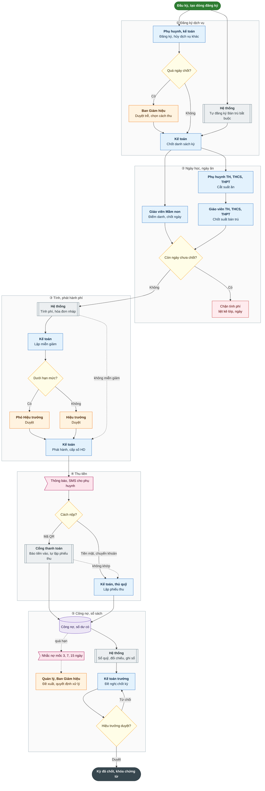

### Sơ đồ 2. Trạng thái hóa đơn, phiếu thu, phiếu chi và hạn mức phê duyệt

Hóa đơn học phí (trạng thái lưu `draft`, `issued`; trạng thái thu tính khi đọc):

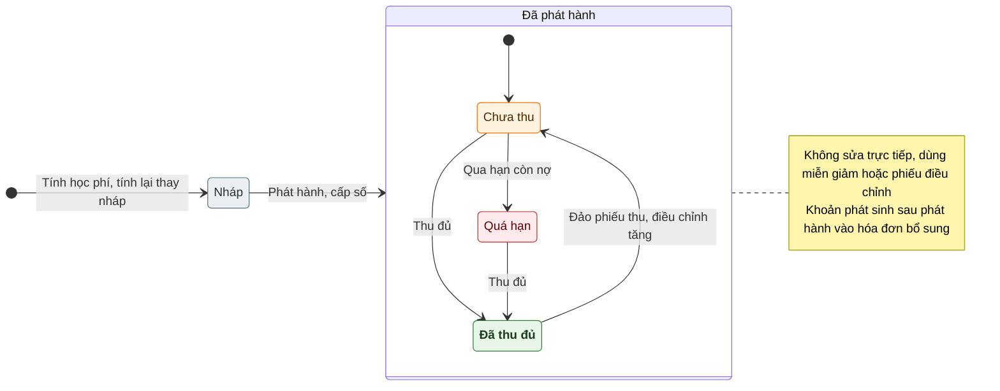

Phiếu thu (phát hành ngay khi lập, không có nháp) và phiếu chi:

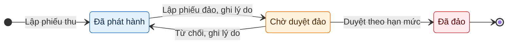

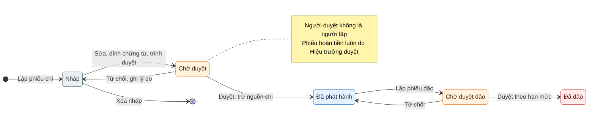

Quyết định cấp duyệt theo hạn mức (dùng chung cho `payment`, `receipt_reversal`, `payment_reversal`, `invoice_adjustment`, `tuition_discount`, `purchase_request`; `payroll` lấy hạn mức của Trường chính):

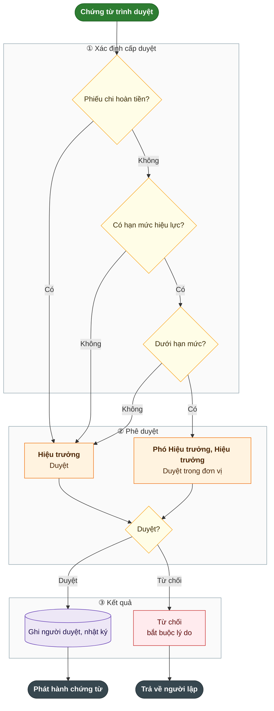

### Sơ đồ 3. Chấm công, nghỉ phép và tính lương

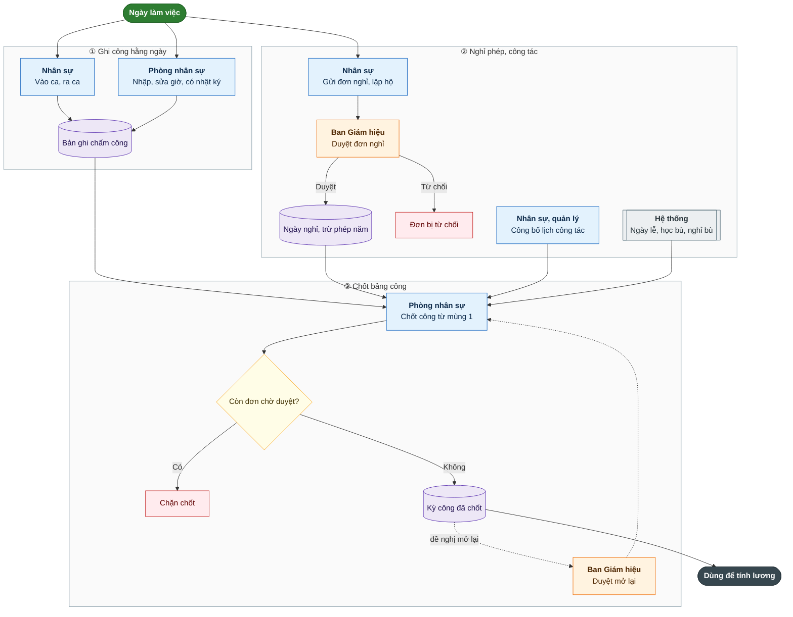

### Sơ đồ 3 (tiếp). Tính, duyệt và chi lương

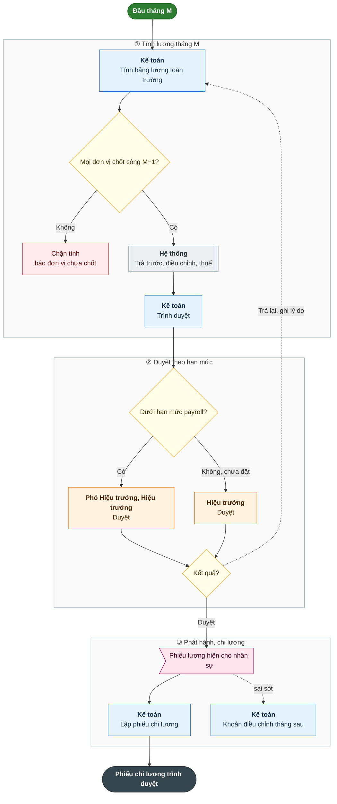

### Sơ đồ 4. Kiểm thực ba bước và truy xuất nguồn gốc

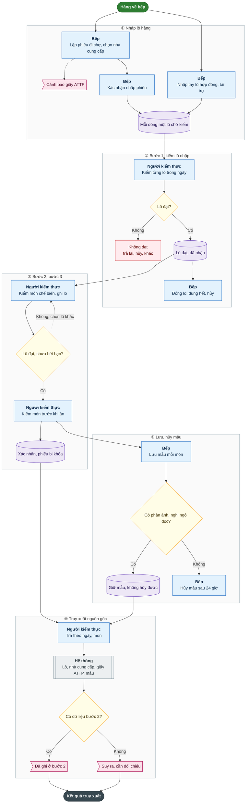

### Sơ đồ 5. Đăng hoạt động, duyệt và công bố cho phụ huynh

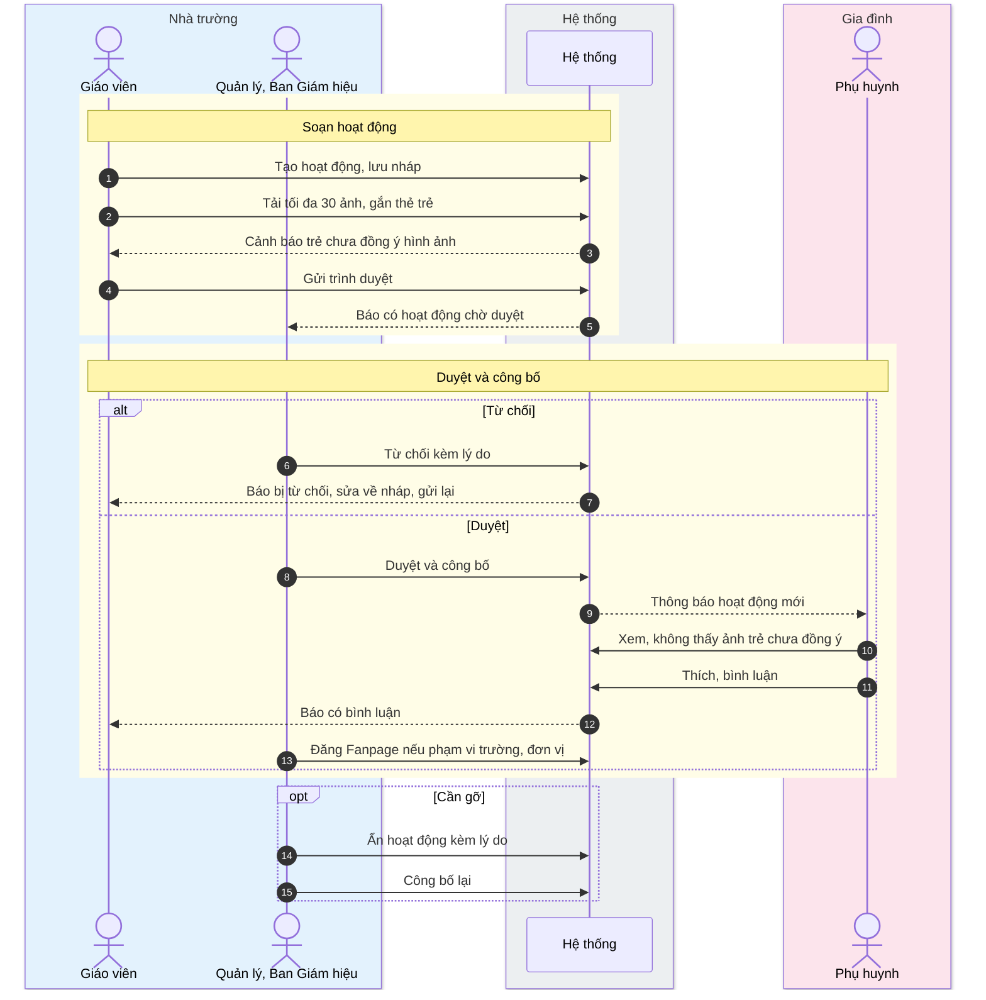

### Sơ đồ 6. Tuyển sinh nội bộ

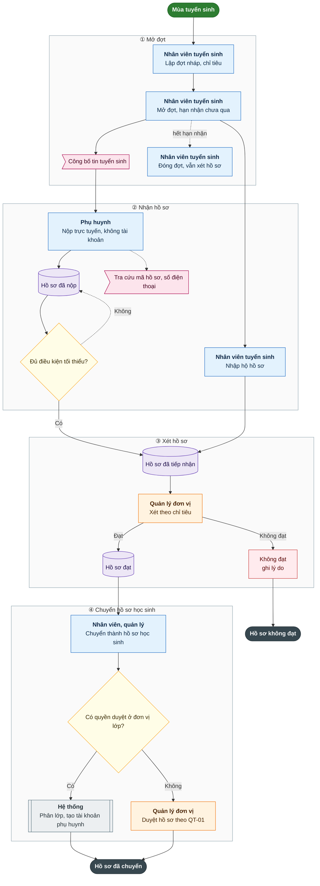

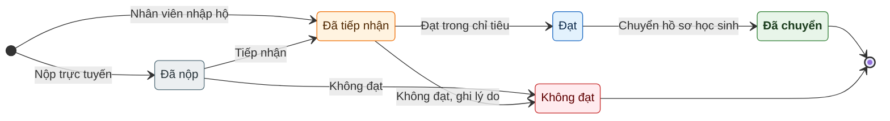

### Sơ đồ 7. Đề nghị mua hàng, phiếu mua hàng và nợ nhà cung cấp

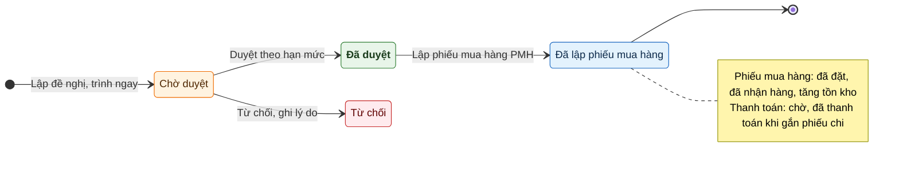
