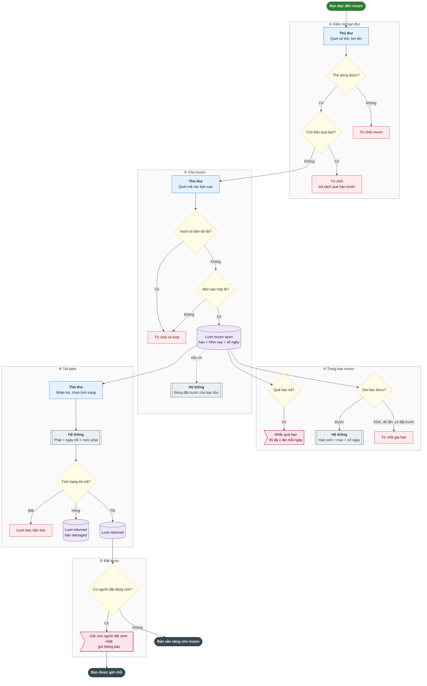
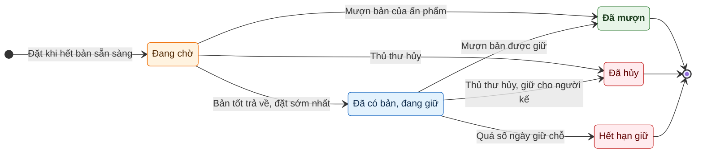
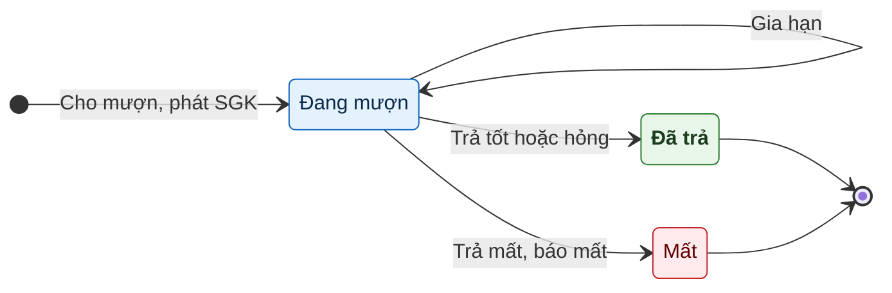
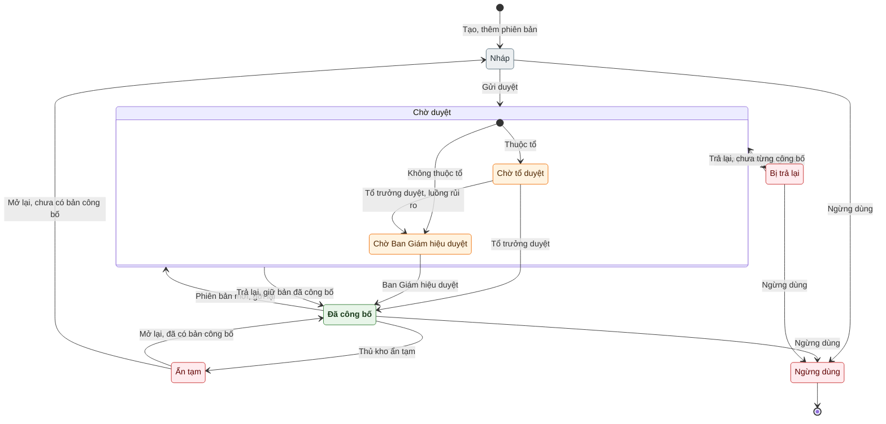
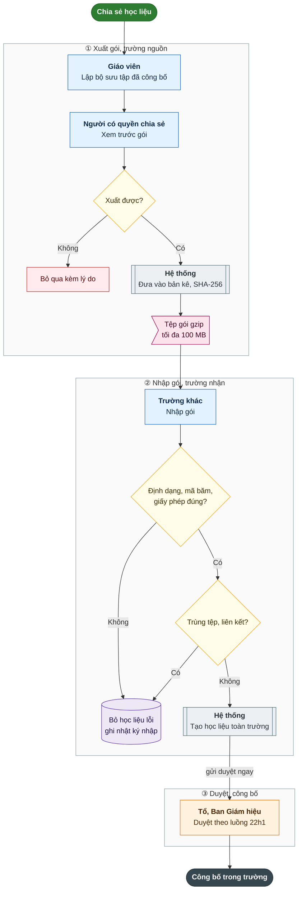
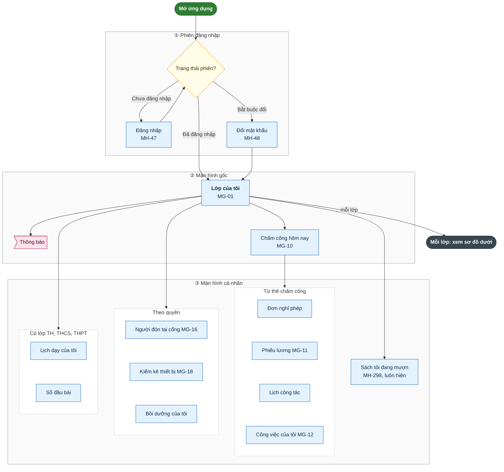
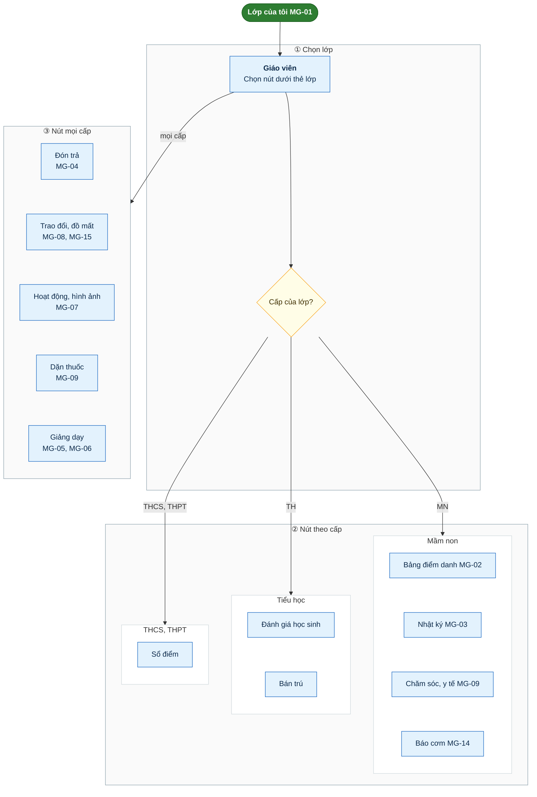
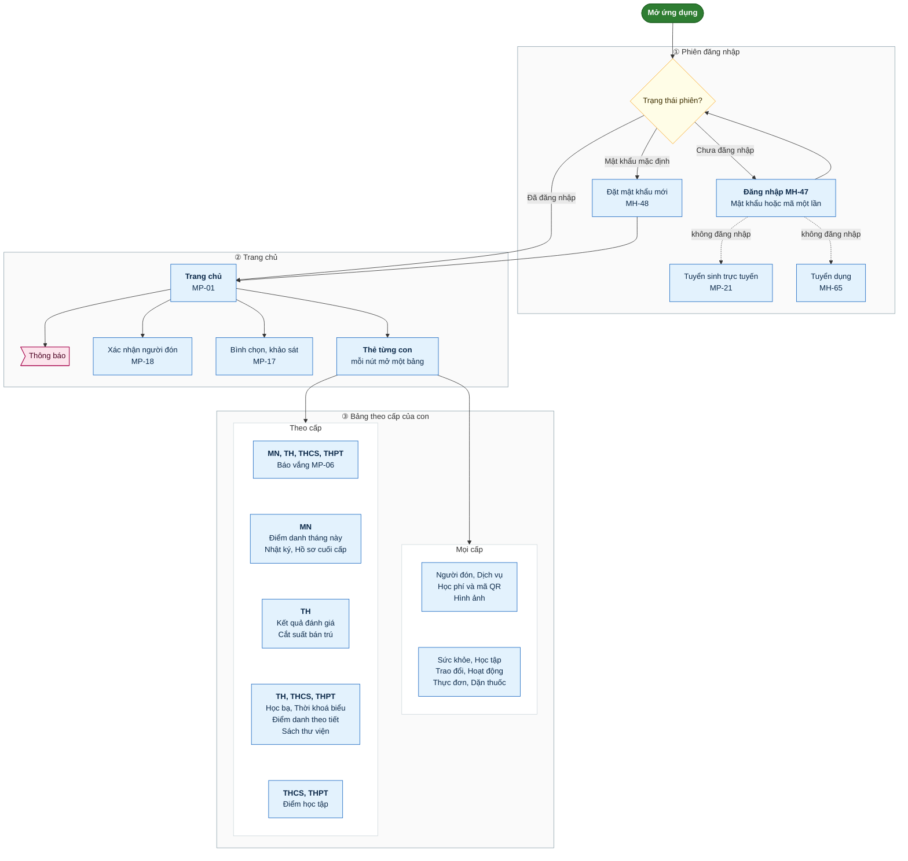

# 34.6. THƯ VIỆN, KHO HỌC LIỆU, ỨNG DỤNG GIÁO VIÊN VÀ ỨNG DỤNG PHỤ HUYNH

- Mô tả: Phân hệ 2.20, 2.21 và mục 3 ứng dụng giáo viên, ứng dụng phụ huynh theo màn hình
- Phiên bản: 1.0
- Ngày cập nhật: 2026-10-25
- Trạng thái: Chờ phê duyệt
- Thuộc: [Tài liệu 34, tổng hợp chức năng hệ thống](00_MUC_LUC.md)
- Nguồn: mã và tài liệu trên nhánh `main` ngày 2026-10-25 (sau PR 165, 166, 167, 169). Khi tài liệu và mã lệch nhau, mô tả theo mã; chỗ lệch ghi ở [phụ lục](07_MA_TRAN_VAI_TRO_VA_PHU_LUC.md)

Mỗi phân hệ mô tả theo cùng khuôn: mục đích, cấp học, vai trò và mã quyền, căn cứ pháp lý, chức năng và màn hình, quy tắc nghiệp vụ, dữ liệu và tệp xuất, liên kết, kiểm thử e2e. Số mục menu, đường dẫn theo `packages/shared/src/portal-menu.ts`. Sơ đồ quy trình ở cuối tệp.

## 2.20. Thư viện (`library`)

- Mục đích: quản lý thư viện sách của trường: danh mục ấn phẩm và bản sao có số đăng ký cá biệt, thẻ bạn đọc (cán bộ, học sinh), mượn, trả, gia hạn, báo mất, đặt trước, nhắc quá hạn, phát và thu sách giáo khoa theo lớp, kiểm kê kho, báo cáo thống kê và chỉ tiêu theo chuẩn thư viện. Phần DT-22 phần 22a (YCTD-181, phiên bản 0.122.0, PR 147).
- Cấp học áp dụng: phân hệ **không đặt `levels`** trong `packages/shared/src/portal-menu.ts`, nên hiện ở mọi cấp (kể cả trường chỉ có Mầm non). Cấp có học sinh được mượn sách do thiết lập 4.1 quyết định (`library_settings.student_levels`, mặc định `TH`, `THCS`, `THPT`; Mầm non chỉ cán bộ mượn). Ứng dụng phụ huynh hiện "Sách thư viện" theo `LEVEL_FEATURES.library_loans` = `TH`, `THCS`, `THPT` (cố định trong mã). Ứng dụng giáo viên hiện "Sách tôi đang mượn" ở mọi cấp.
- Đối tượng, vai trò dùng:
  - Tra cứu danh mục, xem sách mình đang mượn: VT-02 Hiệu trưởng, VT-15 Phó Hiệu trưởng, VT-03 Quản lý đơn vị, VT-04 đến VT-12, VT-16, VT-17 (tệp định danh `0090_add_library_permissions`).
  - Quản lý thư viện: VT-02, VT-15, VT-03; trường có thủ thư thì gán quyền quản lý cho nhóm người dùng của thủ thư ở 1.1 Nhóm người dùng (chưa có vai trò thủ thư cố định).
  - VT-14 Phụ huynh bị loại khỏi phân hệ ở 1.2 Phân quyền nhóm (`role_workspace_exclusions`), chỉ xem sách con đang mượn trên ứng dụng phụ huynh.
  - Quyền chính (mã trong mã nguồn `PERMISSION_CODES.schoolLibraryView`, `schoolLibraryManage`, đặt tên khác `libraryManage` = `P14.library.manage` của kho nội dung Mầm non để tránh nhầm):
    - `P02.library.view`: xem thiết lập, danh sách và chi tiết ấn phẩm, tệp tài liệu số, `GET /library/my-loans`; mục menu 1.1.
    - `P02.library.manage`: mọi thao tác ghi (thiết lập, phân loại, ấn phẩm, bản sao, thanh lý, tem mã, sổ đăng ký, tệp số), bạn đọc, mượn trả, đặt trước, sách giáo khoa, kiểm kê, báo cáo, in thẻ; mục menu 1.2 đến 4.1.
    - Không cần quyền: `GET /library/children/{id}/loans` (máy chủ kiểm tra người gọi là phụ huynh của học sinh).
  - Phạm vi đơn vị: mượn, trả, gia hạn, đặt trước, nhắc quá hạn kiểm tra `OrganizationScopes` theo đơn vị của bạn đọc.
- Căn cứ pháp lý: mã và YCTD-181 **chưa ghi số hiệu văn bản cụ thể**. Tài liệu 32 mục 13.2 nêu văn bản dự kiến: Luật Thư viện 2019 và văn bản hướng dẫn, thông tư về tiêu chuẩn thư viện cơ sở giáo dục phổ thông (Thông tư 16/2022/TT-BGDĐT là văn bản hiện hành về tiêu chuẩn thư viện cơ sở giáo dục mầm non, phổ thông; mã chưa dẫn). Chỉ tiêu theo chuẩn có bộ mã cố định nhưng **ngưỡng để trống**, chờ đọc văn bản gốc.

### Chức năng và màn hình

| Mục menu (số, tên) | Đường dẫn | Chức năng, thao tác và nút chính | Mã màn hình |
|---|---|---|---|
| 1.1. Ấn phẩm và bản sao | `/library/titles` | Tìm theo từ khóa (nhan đề, tác giả, ISBN, chủ đề), phân loại, khối; bảng "Danh sách ấn phẩm"; Thêm ấn phẩm, Sửa ấn phẩm, Ngừng dùng, Dùng lại; chi tiết: bảng "Bản sao của ấn phẩm", Thêm bản sao, Đánh dấu hỏng, Đánh dấu tốt, Thanh lý, In tem mã; Tài liệu số (tải lên, tải xuống, xóa); Sổ đăng ký cá biệt (Excel), (PDF) | MH-291 |
| 1.2. Bạn đọc | `/library/readers` | Bảng "Danh sách bạn đọc" (lọc loại, trạng thái, tên hoặc số thẻ); Đồng bộ thẻ; Khóa thẻ (có lý do), Mở khóa; In thẻ (n); Lịch sử mượn | MH-292 |
| 2.1. Mượn, trả, đặt trước | `/library/circulation` | Thẻ Mượn, Trả, Đặt trước; Cho mượn (n), Nhận trả, Gia hạn, Báo mất, Nhắc quá hạn, Đặt trước, Hủy đặt trước | MH-293 |
| 2.2. Phát và thu sách giáo khoa | `/library/textbooks` | Bộ sách theo khối (Thêm bộ sách, Sửa bộ sách, Ngừng dùng, Dùng lại); Phát sách (chọn lớp, bộ sách); Thu sách (bảng sách giáo khoa lớp còn giữ, chọn dòng, tình trạng) | MH-294 |
| 3.1. Kiểm kê | `/library/stocktakes` | Mở đợt kiểm kê (tên, kệ hoặc cả kho); Quét, xem; Đóng đợt kiểm kê; Xem kết quả; Đánh dấu mất bản thiếu, Thanh lý bản thiếu | MH-295 |
| 3.2. Báo cáo thư viện | `/library/reports` | Số liệu tổng, kho theo phân loại, khối, tình trạng; lượt mượn theo tháng, lớp; ấn phẩm, bạn đọc tích cực; quá hạn; chỉ tiêu theo chuẩn; Xuất báo cáo tổng hợp (Excel), Báo cáo tổng hợp (PDF), Sổ mượn trả (Excel), Sách quá hạn (Excel), (PDF) | MH-296 |
| 4.1. Quy định mượn và phân loại | `/library/settings` | Cấp có học sinh được mượn; số ngày giữ chỗ; quy định mượn của cán bộ, học sinh; chỉ tiêu (ngưỡng, bật tắt); Lưu quy định; phân loại ấn phẩm (thêm, Sửa tên, Cho mượn về hoặc Chuyển đọc tại chỗ, Ngừng dùng, Dùng lại) | MH-297 |
| Ứng dụng giáo viên "Sách tôi đang mượn" | (ứng dụng) | Số thẻ, từng bản kèm hạn trả, số ngày quá hạn | MH-298 |
| Ứng dụng phụ huynh "Sách thư viện" | (ứng dụng) | Sách con đang mượn kèm hạn trả | MH-299 |

**1.1. Ấn phẩm và bản sao (MH-291).**
- Người chỉ có `P02.library.view` thấy dòng "Bạn chỉ có quyền tra cứu danh mục sách." và không có nút ghi.
- Bộ lọc: từ khóa, phân loại, khối, trạng thái (đang dùng, ngừng dùng; máy chủ còn nhận `subject_id`, `school_level`). Phân trang 50 dòng, tối đa 200.
- Cột: nhan đề, tác giả, phân loại, khối, kệ, số bản (tốt và hỏng), sẵn sàng (tốt, không đang mượn, không đang giữ chỗ).
- Biểu mẫu ấn phẩm: Nhan đề, Tác giả, Nhà xuất bản, Năm xuất bản, ISBN (nhập tay), phân loại, cấp, Khối, Chủ đề, Ngôn ngữ (mặc định `vi`), Kệ, Mô tả. Ô môn học chưa có trên giao diện.
- Chi tiết ấn phẩm: bảng bản sao (số đăng ký, tình trạng, kệ, nguồn, ngày nhập, đang mượn), ô chọn tất cả; "Thêm bản sao": Số bản thêm (1 đến 500), nguồn (mua, tặng, được cấp), Giá (đồng), Ngày nhập, Kệ (trống thì theo ấn phẩm). Số đăng ký cá biệt cấp liên tiếp dạng `SH-000001` từ bộ đếm `library_counters`.
- "Thanh lý": hộp xác nhận có lý do, báo không hoàn tác được. "In tem mã": tệp PDF khổ A4 dọc 3 cột × 10 dòng, mỗi tem có mã QR của số đăng ký, nhan đề, tác giả, kệ.
- Tài liệu số: tải tệp PDF, JPEG, PNG, Word, Excel tối đa 20 MB, tối đa 20 tệp mỗi ấn phẩm (nhận theo chữ ký đầu tệp); tải xuống; Xóa tệp (hộp xác nhận).
- Sổ đăng ký cá biệt: mọi bản sao kể cả đã mất, thanh lý; Excel hoặc PDF.

**1.2. Bạn đọc (MH-292).**
- Cột: chọn, loại (Cán bộ, Học sinh), số thẻ (`TV-000001`), họ tên, lớp, trạng thái (Đang dùng, Đã khóa), đang mượn, quá hạn.
- "Đồng bộ thẻ": cấp thẻ cho mọi cán bộ đang làm và học sinh đang học ở lớp thuộc cấp có học sinh mượn mà chưa có thẻ; khóa thẻ của người đã nghỉ, chuyển trường (không xóa lịch sử).
- "Khóa thẻ" bắt buộc lý do; "Mở khóa" bị từ chối nếu người đó đã nghỉ.
- "In thẻ (n)": PDF A4 dọc 2 cột × 5 dòng, mã QR là số thẻ; tối đa 500 thẻ một lần.
- "Lịch sử mượn": hộp liệt kê nhan đề, số đăng ký, ngày mượn, hạn trả, ngày trả, tình trạng (Đang mượn, Đã trả, Mất), quá hạn, tiền phạt.
- Giao diện chưa có cấp thẻ lẻ từng người (API `POST /library/readers` đã có).

**2.1. Mượn, trả, đặt trước (MH-293).**
- Thẻ "Mượn": tìm bạn đọc bằng số thẻ (quét) hoặc ít nhất 2 ký tự của tên (`GET /library/readers/lookup`); không thấy thì hướng dẫn cấp thẻ ở 1.2 bằng "Đồng bộ thẻ". Ô "Mượn cho lớp (không bắt buộc)"; ô "Quét hoặc nhập mã bản sao rồi nhấn Enter" gom danh sách mã, bỏ từng mã được; Ghi chú; nút "Cho mượn (n)". Kết quả hiện từng bản kèm hạn trả. Tất cả bản cùng thành công hoặc không bản nào.
- Thẻ "Trả": quét mã bản sao, chọn tình trạng khi trả (tốt, hỏng, mất), "Nhận trả"; kết quả hiện số ngày trễ, tiền phạt, "Đã giữ cho …" khi bản được giữ cho người đặt trước. Bảng "Danh sách lượt mượn" lọc Đang mượn, Quá hạn và ô tìm "Nhan đề, mã bản, tên hoặc số thẻ"; mỗi dòng có "Gia hạn", "Báo mất" (hộp có ghi chú). Nút "Nhắc quá hạn" gửi thông báo cho mọi bạn đọc có bản quá hạn.
- Thẻ "Đặt trước": chọn bạn đọc, "Tìm ấn phẩm cần đặt", "Đặt trước"; bảng "Danh sách đặt trước" (bạn đọc, ấn phẩm, ngày đặt, trạng thái, bản giữ, hạn giữ), "Hủy đặt trước".
- Trạng thái lượt mượn trong CSDL: `open`, `returned`, `lost`; "quá hạn" là `open` và `due_on` trước hôm nay (không lưu riêng).
- Trạng thái đặt trước: `waiting` (Đang chờ), `ready` (Đã có bản, đang giữ), `fulfilled` (Đã mượn), `cancelled` (Đã hủy), `expired` (Hết hạn giữ).

**2.2. Phát và thu sách giáo khoa (MH-294).**
- Bộ sách: tên, khối, tối đa 50 đầu sách (ô "Tìm đầu sách để thêm vào bộ"), trạng thái đang dùng, ngừng dùng.
- Phát sách: chọn lớp, bộ sách đang dùng cùng khối với lớp; mỗi học sinh đang học một bản mỗi đầu sách; bỏ qua học sinh đã giữ bản của đầu sách đó; tự cấp thẻ cho học sinh chưa có thẻ; hạn trả là ngày kết thúc năm học; thiếu bản thì phát phần còn đủ và báo đầu sách thiếu bao nhiêu. Lượt mượn có `kind = 'textbook'`.
- Thu sách: bảng "Sách giáo khoa lớp còn giữ" (học sinh, đầu sách, số đăng ký, ngày phát, hạn trả), chọn tất cả dòng, chọn tình trạng từng dòng, thu hàng loạt (`POST /library/loans/return-many`, tối đa 200 dòng, cùng thành công hoặc không dòng nào).

**3.1. Kiểm kê (MH-295).**
- Bảng "Các đợt kiểm kê": đợt, phạm vi (Cả kho hoặc kệ), trạng thái (Đang kiểm kê, Đã đóng), bắt đầu, đã quét; nút "Quét, xem" hoặc "Xem kết quả".
- Màn quét: ô "Quét hoặc nhập mã bản sao rồi nhấn Enter", báo quét trùng; kết quả ba bảng: "Bản thiếu", "Bản thừa (đã quét nhưng đang cho mượn, đã mất hoặc đã thanh lý)", "Bản hỏng"; "Làm mới kết quả".
- "Đóng đợt kiểm kê" (hộp xác nhận). Sau khi đóng: chọn bản thiếu ("Chọn hết bản thiếu", "Bỏ chọn hết"), "Đánh dấu mất bản thiếu" hoặc "Thanh lý bản thiếu" (có lý do).

**3.2. Báo cáo thư viện (MH-296).**
- Thẻ số liệu: Số đầu ấn phẩm, Số bản sách, Học sinh, Cán bộ, giáo viên, Lượt mượn, Đang mượn, Quá hạn, Đã mất.
- Bảng: Kho theo phân loại (số đầu, số bản), Kho theo khối, Kho theo tình trạng, Lượt mượn theo tháng, Lượt mượn theo lớp (10 lớp nhiều nhất), Ấn phẩm mượn nhiều nhất, Bạn đọc tích cực.
- "Chỉ tiêu theo chuẩn thư viện": chỉ tiêu, giá trị, ngưỡng, kết luận (Đạt, Chưa đạt, Chưa kết luận khi chưa đặt ngưỡng hoặc không đo được).
- Tệp xuất: tổng hợp Excel, PDF; sổ mượn trả Excel; sách quá hạn Excel, PDF (`GET /library/reports/export?type=overview|loans|overdue&format=xlsx|pdf`).

**4.1. Quy định mượn và phân loại (MH-297).**
- Ô chọn "Cấp có học sinh được mượn sách" (MN, TH, THCS, THPT); "Số ngày giữ chỗ khi sách đặt trước có bản (1 đến 30)", mặc định 3.
- Bảng "Quy định mượn theo loại bạn đọc": Số bản tối đa (1 đến 100), Số ngày mượn (1 đến 365), Số lần gia hạn (0 đến 10), Phạt mỗi ngày trễ (đồng, 0 đến 1.000.000). Mặc định: cán bộ 10 bản, 30 ngày, 2 lần gia hạn, phạt 0; học sinh 3 bản, 14 ngày, 1 lần gia hạn, phạt 0.
- Bảng "Chỉ tiêu theo chuẩn thư viện": Dùng (bật tắt), Ngưỡng tối thiểu.
- "Phân loại ấn phẩm": Mã (không đổi sau khi tạo), Tên, Hình thức (Cho mượn về, Đọc tại chỗ), Trạng thái. Mặc định: SGK Sách giáo khoa, SGV Sách giáo viên, STK Sách tham khảo, TRUYEN Truyện, sách đọc thêm (cho mượn về); BAO Báo, tạp chí, TLS Tài liệu số (đọc tại chỗ).

### Quy tắc nghiệp vụ

- BR-189 mượn trả:
  - Mỗi bạn đọc một thẻ; thẻ học sinh chỉ cấp khi học sinh đang học ở lớp thuộc cấp có học sinh mượn; cán bộ đã nghỉ, học sinh không còn học thì không cấp thẻ.
  - Chỉ mượn khi thẻ đang dùng và người còn trong trường; bản sao phải ở tình trạng tốt, ấn phẩm đang dùng, phân loại cho mượn về, không có lượt mượn đang mở (chỉ mục duy nhất `library_loans_open_unique`), không đang giữ cho người đặt trước khác.
  - Còn bản quá hạn thì không mượn tiếp. Số bản đang mượn cộng số bản mượn thêm không vượt "Số bản tối đa".
  - Hạn trả = ngày mượn + số ngày mượn của loại bạn đọc. Mã quét được chuẩn hóa (bỏ khoảng trắng, chữ hoa).
  - Gia hạn: không với sách giáo khoa cấp đầu năm; không khi đã gia hạn đủ số lần; không khi ấn phẩm có người đặt trước đang chờ hoặc đang giữ; hạn mới = max(hạn cũ, hôm nay) + số ngày mượn.
  - Trả: tiền phạt = số ngày trễ × mức phạt mỗi ngày của loại bạn đọc (mức 0 là không phạt); trả hỏng đổi bản sao thành `damaged`, trả mất đổi thành `lost` và lượt mượn đóng là `lost`.
  - Báo mất: đóng lượt mượn là mất, bản sao mất; bồi thường chỉ ghi trong ghi chú, không thu tiền ở phân hệ này.
  - Nhắc quá hạn: ghi thông báo `library_overdue` vào hàng đợi chung cho người nhận của bạn đọc (cán bộ: tài khoản của cán bộ; học sinh: phụ huynh); mỗi lượt mượn nhắc tối đa một lần mỗi ngày (`reminded_on`); chỉ bạn đọc trong phạm vi đơn vị của người bấm.
- BR-190 đặt trước:
  - Chỉ đặt khi ấn phẩm đang dùng, cho mượn về, có ít nhất một bản tốt và không còn bản sẵn sàng; mỗi bạn đọc một lượt đặt đang mở cho một ấn phẩm.
  - Khi bản tốt được trả về: lượt giữ quá hạn chuyển `expired`; người đặt sớm nhất (`reserved_at`) chuyển `ready`, được giữ bản đó đến hôm nay + số ngày giữ chỗ, nhận thông báo `library_reservation_ready`.
  - Người đặt mượn bản của ấn phẩm đã đặt thì lượt đặt chuyển `fulfilled`. Hủy lượt đang giữ thì bản được giữ cho người kế tiếp.
- BR-191 sách giáo khoa, kiểm kê, thanh lý:
  - Phát sách bị từ chối khi cấp của lớp chưa bật mượn ở 4.1, bộ sách không cùng khối với lớp, bộ sách chưa có đầu sách.
  - Kiểm kê: bản thiếu là bản không mất, không thanh lý, không đang mượn mà chưa quét; bản thừa là bản quét được nhưng đang mượn, đã mất hoặc đã thanh lý; bản hỏng là bản quét được ở tình trạng hỏng. Đợt đã đóng không quét thêm. Chỉ xử lý bản thiếu của đợt đã đóng.
  - Thanh lý (1 đến 500 bản) cần lý do; bản đang cho mượn không thanh lý; bản đã thanh lý không cho mượn và không sửa tình trạng; sửa tình trạng tay chỉ giữa tốt và hỏng.
- Ấn phẩm còn bản đang cho mượn thì không ngừng dùng được; ấn phẩm đã ngừng dùng không thêm bản sao.
- Chỉ tiêu: giá trị là tỉ số làm tròn 2 chữ số; chia cho 0 thì không đo được; đạt khi giá trị không thấp hơn ngưỡng. Bảy chỉ tiêu: số bản sách giáo khoa trên một học sinh, sách tham khảo trên một học sinh, sách giáo viên và tham khảo trên một giáo viên, tổng số đầu ấn phẩm đang dùng, số bản sách trên một học sinh, tỉ lệ bạn đọc có mượn trong năm học (%), số tài liệu số.
- Mọi thao tác ghi có nhật ký kiểm toán (`writeAuditLog`); tệp xuất ghi nhật ký xuất.

### Dữ liệu, báo cáo và tệp xuất

- CSDL năm học (tệp `database/school-year/migrations/0100_create_library.ts`), 15 bảng: `library_settings` (một dòng), `library_loan_rules`, `library_categories`, `library_titles`, `library_title_files`, `library_copies` (số đăng ký, nguồn `purchase`, `donation`, `supplied`, giá, ngày nhập, tình trạng `good`, `damaged`, `lost`, `disposed`), `library_readers` (`staff`, `student`; `active`, `locked`), `library_loans` (`regular`, `textbook`; `open`, `returned`, `lost`; tiền phạt, tình trạng khi trả, người nhận), `library_reservations`, `library_textbook_sets`, `library_textbook_set_titles`, `library_stocktakes`, `library_stocktake_items`, `library_indicators`, `library_counters`.
- Quyền ở CSDL định danh `0090_add_library_permissions`. Số hệ thống 0040 giữ sẵn nhưng không dùng.
- Chuyển năm học (bước `library`, `library-transition.ts`): chép thiết lập, quy định mượn, chỉ tiêu, phân loại, ấn phẩm (giữ môn nếu môn còn), tệp số, mọi bản sao (kể cả mất, thanh lý), thẻ của người còn trong năm mới, lượt mượn đang mở, đặt trước đang chờ hoặc đang giữ, bộ sách giáo khoa, bộ đếm số. Lượt mượn đã đóng, đợt kiểm kê ở lại năm cũ.
- Tệp xuất: tem mã QR (PDF), thẻ bạn đọc (PDF), sổ đăng ký cá biệt (Excel, PDF), báo cáo tổng hợp (Excel, PDF), sổ mượn trả (Excel), sách quá hạn (Excel, PDF).
- Thông báo qua hàng đợi chung: `library_overdue`, `library_reservation_ready`. Không có tác vụ nền định kỳ; nhắc quá hạn do người dùng bấm.

### Liên kết với phân hệ khác

- Hồ sơ học sinh (`children`, `class_enrollments`, `classes`), nhân sự (`staff`), cơ cấu cấp học (DT-19), môn học (`subjects`, 20a), năm học (ngày kết thúc năm học là hạn sách giáo khoa).
- Thông báo (hàng đợi chung) tới cán bộ và phụ huynh.
- Ứng dụng giáo viên (Sách tôi đang mượn), ứng dụng phụ huynh (Sách thư viện).
- Không dùng chung với `library_items`, `library_albums`, `coloring_pages` (kho nội dung Mầm non của phân hệ Hoạt động, quyền `P14.library.manage`) và `asset_loans` (mượn thiết bị).
- Chưa nối: minh chứng sang 22f Bảo đảm chất lượng, Việc của tôi của thủ thư.

### Kiểm thử e2e

- `tests/e2e/120-library.spec.ts` (CT-22a-9: thêm ấn phẩm, bản sao; đồng bộ thẻ; mượn, trả; báo cáo; ứng dụng giáo viên, phụ huynh).
- Kiểm thử đơn vị `apps/api/src/library/library.test.ts` (CT-22a-1 đến CT-22a-8).
- Số phân hệ ở `58-system-admin-full-so.spec.ts`.

## 2.21. Kho học liệu (`learning-resources`)

- Mục đích: kho học liệu số của trường có giấy phép bắt buộc và kiểm duyệt phân luồng theo rủi ro: học liệu tệp, liên kết ngoài, kế hoạch bài dạy tham chiếu; phiên bản; bộ sưu tập; báo lỗi; thống kê; danh mục loại, giấy phép, chủ đề (22h1, YCTD-183, phiên bản 0.125.0, PR 156). Câu hỏi, đề, ma trận của ngân hàng 22g1 hiện trong kho bằng tham chiếu; rubric; gói chia sẻ liên trường bản chạy nội bộ (22h2, YCTD-184, phiên bản 0.126.0, PR 160).
- Cấp học áp dụng: phân hệ không đặt `levels`, dùng cho mọi cấp; cấp, khối, môn là metadata của từng học liệu. Không có trên ứng dụng giáo viên, phụ huynh.
- Đối tượng, vai trò dùng (tệp định danh `0092_add_learning_resource_permissions`, `0093_add_learning_resource_share_permission`):
  - `P09.learning-resource.use`: dùng kho (tải lên, tìm, xem, tải về, bộ sưu tập, báo lỗi, rubric, câu hỏi trong kho): VT-02, VT-15, VT-03 đến VT-12, VT-16, VT-17.
  - `P09.learning-resource.review`: duyệt bước tổ (tổ trưởng, chỉ học liệu của tổ mình): VT-17.
  - `P09.learning-resource.approve`: duyệt bước Ban Giám hiệu: VT-02, VT-15.
  - `P09.learning-resource.manage` (thủ kho): danh mục, xử lý báo lỗi, ẩn tạm, mở lại, ngừng dùng mọi học liệu, thống kê toàn trường, thấy mọi học liệu: VT-02, VT-15.
  - `P09.learning-resource.share`: xuất, nhập gói chia sẻ: VT-02, VT-15.
  - Điều khiển `learning-resources` và `resource-sharing` yêu cầu một trong các quyền trên ở mọi điểm cuối; điểm cuối riêng thêm quyền: danh mục loại, giấy phép, sửa chủ đề, xử lý báo lỗi cần `manage`; duyệt cần `review` hoặc `approve`; thống kê cần `review`, `approve` hoặc `manage`; gói cần `share`.
  - VT-14 Phụ huynh bị loại khỏi phân hệ.
- Căn cứ pháp lý: bộ giấy phép mặc định theo Creative Commons 4.0, CC0 1.0, văn bản do cơ quan nhà nước ban hành (YCTD-183); nguyên tắc không đưa nội dung có bản quyền vào mã, dữ liệu mẫu (tài liệu 32 mục 13.2). Mã không dẫn số hiệu văn bản quy phạm.

### Chức năng và màn hình

| Mục menu (số, tên) | Đường dẫn | Chức năng, thao tác và nút chính | Mã màn hình |
|---|---|---|---|
| 1. Tìm học liệu | `/learning-resources` | Biểu mẫu tìm (từ khóa, loại, cấp, môn), Tìm; bảng kết quả, Mở; chi tiết: phiên bản (Tải về hoặc Mở liên kết), lượt xem, tải; Gửi báo lỗi | MH-302 |
| 2. Học liệu của tôi | `/learning-resources/mine` | Bảng học liệu của tôi; Tạo học liệu; chi tiết: Tải tệp lên, Thêm liên kết, Gửi duyệt, Ngừng dùng, lý do bị trả lại, lịch sử duyệt | MH-303 |
| 3. Duyệt học liệu | `/learning-resources/review` | Bảng học liệu chờ chính người dùng duyệt; ô Ý kiến duyệt; Duyệt, Trả lại | MH-304 |
| 4. Bộ sưu tập | `/learning-resources/collections` | Lập bộ sưu tập (tên, phạm vi); thêm học liệu, Lên, Xuống, Bỏ; Xoá bộ sưu tập; Xuất danh sách (Excel) | MH-305 |
| 5. Báo lỗi học liệu | `/learning-resources/reports` | Bảng báo lỗi; thủ kho Xử lý: trả lời, Ẩn tạm học liệu, Đã xử lý, Không chấp nhận | MH-306 |
| 6. Thống kê kho | `/learning-resources/statistics` | Tổng, đã công bố, chờ duyệt, quá hạn duyệt, giấy phép sắp hết hiệu lực; bảng theo môn, khối, loại, giấy phép, tổ, đóng góp theo giáo viên; lượt xem, tải, số báo lỗi | MH-307 |
| 7. Danh mục kho | `/learning-resources/settings` | Loại học liệu (thêm bước Ban Giám hiệu duyệt); giấy phép (Chặn công bố, Thêm giấy phép); chủ đề (Thêm chủ đề) | MH-308 |
| 8. Câu hỏi, đề trong kho | `/learning-resources/questions` | Lọc loại (câu hỏi, đề, ma trận), tìm, mức nhận thức; Mở ở ngân hàng; Thêm vào bộ sưu tập; thống kê sử dụng câu hỏi, chỗ trống chủ đề | MH-309 |
| 9. Rubric | `/learning-resources/rubrics` | Danh sách rubric; Lập rubric (mức, tiêu chí, trọng số, mô tả), Thêm tiêu chí, Lưu rubric; Sửa, Nhân bản, In (PDF), Lưu trữ, Mở lại | MH-310 |
| 10. Gói chia sẻ liên trường | `/learning-resources/packages` | Xuất gói (chọn bộ sưu tập, tên trường nguồn, xem trước xuất được và bỏ qua kèm lý do), Nhập gói (tệp gói, kết quả, học liệu bỏ qua), Lịch sử nhập gói | MH-311 |

**1. Tìm học liệu (MH-302).** Tìm theo từ khóa, loại, cấp, khối, môn, chủ đề, giấy phép (API nhận đủ; giao diện có từ khóa, loại, cấp, môn). Kết quả: tiêu đề, loại, môn và khối, giấy phép, người đóng góp, trạng thái, "Mở". Người khác chỉ thấy bản đã công bố (phạm vi toàn trường, hoặc phạm vi tổ khi cùng tổ), không thấy lịch sử duyệt. Xem và tải của người khác được ghi lượt (`learning_resource_usage`). Biểu mẫu "Báo lỗi học liệu": loại lỗi (Sai nội dung, Lỗi tệp, Nghi vi phạm bản quyền), mô tả, "Gửi báo lỗi".

**2. Học liệu của tôi (MH-303).** Biểu mẫu "Thêm học liệu": tiêu đề (1 đến 300 ký tự), mô tả, loại (bắt buộc), phạm vi xem (Cá nhân, Tổ chuyên môn, Toàn trường; "Liên trường (chưa bật)" bị máy chủ từ chối), cấp, khối, môn (từ danh mục môn của năm học, lưu mã và tên), chủ đề (giáo viên thêm được chủ đề mới), tuần dạy (1 đến 60), từ khóa (tối đa 30), tác giả, ngôn ngữ, thời lượng, giấy phép, nơi cấp phép khi giấy phép cần, nguồn gốc, người chịu trách nhiệm, ngày hết hiệu lực giấy phép. Chi tiết: ô tệp và "Tải tệp lên", địa chỉ và tiêu đề liên kết và "Thêm liên kết", "Gửi duyệt", "Ngừng dùng". Kế hoạch bài dạy tham chiếu có API (`POST /learning-resources/{id}/lesson-plans`), giao diện chỉ hiện dữ liệu thô.

**3. Duyệt học liệu (MH-304).** Chỉ hiện học liệu chờ chính người dùng duyệt (bước tổ: tổ trưởng cùng tổ; bước trường: Ban Giám hiệu). Trả lại bắt buộc ý kiến.

**4. Bộ sưu tập (MH-305).** Phạm vi chia sẻ cá nhân, tổ, trường. Danh sách thay một lần theo thứ tự gửi lên (tối đa 500, không trùng). Từ 22h2 bộ sưu tập chứa thêm câu hỏi, đề, ma trận (bảng năm học `resource_collection_questions`).

**5. Báo lỗi (MH-306).** Thủ kho thấy mọi báo lỗi; người khác thấy báo lỗi mình gửi và báo lỗi về học liệu của mình. Trạng thái `open`, `resolved` (Đã xử lý), `rejected` (Không chấp nhận); xử lý một lần; có thể ẩn tạm học liệu cùng lúc.

**6. Thống kê kho (MH-307).** Tổ trưởng xem tổ mình; Ban Giám hiệu, thủ kho xem toàn trường. Quá hạn duyệt là chờ duyệt quá 7 ngày (`LEARNING_RESOURCE_REVIEW_DAYS`); giấy phép sắp hết hiệu lực trong 30 ngày.

**7. Danh mục kho (MH-308).** Loại mặc định: Kế hoạch bài dạy, Bài trình chiếu, Video (thêm bước Ban Giám hiệu), Phiếu học tập, Tài liệu tham khảo, Hình ảnh, Đề kiểm tra dạng tệp, Loại khác. Giấy phép mặc định: SELF tự biên soạn, CC-BY, CC-BY-SA, CC-BY-NC, CC-BY-NC-SA, CC-BY-ND, CC0, PERMISSION (có xin phép, phải ghi nơi cấp phép, thêm bước Ban Giám hiệu), STATE (văn bản cơ quan nhà nước), UNKNOWN (không rõ, chỉ xem cá nhân).

**8. Câu hỏi, đề trong kho (MH-309).** Đọc thẳng `questions`, `exams`, `exam_matrices` của 22g1 ở năm học hiện hành; trạng thái của 22g1; số đề, số bài, độ khó từ lịch sử dùng câu; liên kết sang 8.1, 8.2, 8.4 của nhóm "Kiểm tra, đánh giá". Thống kê: câu dùng được theo môn, chủ đề, mức nhận thức; học liệu đã công bố theo môn; chỗ trống chủ đề.

**9. Rubric (MH-310).** 2 đến 6 mức, điểm tăng dần; 1 đến 20 tiêu chí, trọng số (mặc định 1), mô tả từng mức; điểm tối đa = tổng trọng số × điểm mức cao nhất; phạm vi cá nhân hoặc toàn trường; nối câu tự luận của ngân hàng. In PDF.

**10. Gói chia sẻ liên trường (MH-311).** Xuất một bộ sưu tập thành tệp gzip chứa bản kê JSON (định dạng `school-management.resource-package/1`, mã gói, tên trường nguồn, metadata, mã giấy phép, nguồn gốc, mã băm SHA-256 và nội dung base64 từng tệp hoặc địa chỉ liên kết), tối đa 100 MB. Nhập gói có kiểm; nhật ký nhập ở `resource_package_imports`.

### Quy tắc nghiệp vụ

- BR-196 (22h1):
  - Tệp nhận PDF, JPEG, PNG, GIF, Word, Excel, PowerPoint, MP4 theo chữ ký đầu tệp, tối đa 50 MB; tên tệp chuẩn hóa (bỏ đường dẫn, ký tự điều khiển, ký tự cấm, tối đa 200 ký tự). Liên kết ngoài chỉ `http`, `https`, tối đa 2000 ký tự, chỉ lưu địa chỉ và tiêu đề.
  - Kế hoạch bài dạy chỉ của chính người sở hữu, tham chiếu không sao chép.
  - Mỗi lần thêm tệp, liên kết, kế hoạch bài dạy là một phiên bản mới (`learning_resource_versions`, có SHA-256); không thêm phiên bản khi đang chờ duyệt, đã ngừng dùng hoặc đang ẩn tạm.
  - Gửi duyệt khi: có phiên bản; phạm vi không phải cá nhân; có giấy phép đang dùng, không bị chặn, không "chỉ cá nhân"; giấy phép có xin phép thì ghi nơi cấp phép; học liệu đã công bố thì phiên bản hiện tại phải mới hơn bản đã công bố.
  - Phân luồng: người sở hữu thuộc tổ thì vào `pending_unit`, không thuộc tổ thì vào thẳng `pending_school`; thêm bước Ban Giám hiệu (`needs_school_review`) khi loại do trường đặt, loại video, phiên bản là liên kết, hoặc giấy phép có xin phép.
  - Người duyệt không duyệt học liệu của mình. Trả lại phải có lý do; học liệu đã công bố mà bản nộp lại bị trả thì trở về `published`, bản đã công bố vẫn dùng.
  - Sửa metadata khi nháp, bị trả lại, hoặc đã công bố mà giữ nguyên phạm vi; chỉ người sở hữu sửa.
  - Thủ kho ẩn tạm, mở lại (mở lại về `published` nếu đã có bản công bố, không thì `draft`); người sở hữu hoặc thủ kho ngừng dùng (giữ lịch sử).
  - Bộ sưu tập chỉ chứa học liệu người lập thấy được, chỉ người lập sửa, xóa.
- BR-197 (22h2):
  - Câu hỏi, đề, ma trận chỉ nằm ở ngân hàng 22g1; không sao chép, không luồng duyệt thứ hai. Câu dùng được ai dùng kho cũng thấy; câu chưa duyệt chỉ người soạn và người thẩm định; đề chỉ người ra đề, người thẩm định, người quản lý đề, kể cả trong bộ sưu tập.
  - Rubric: người lập sửa; ai thấy thì nhân bản thành bản cá nhân; người lập hoặc thủ kho lưu trữ; chỉ nối câu tự luận.
  - Gói xuất chỉ chứa học liệu đã công bố dạng tệp hoặc liên kết, giấy phép không bị chặn, không "chỉ cá nhân"; không có người sở hữu, người chịu trách nhiệm hay dữ liệu cá nhân; kế hoạch bài dạy tham chiếu và câu hỏi không vào gói.
  - Nhập gói kiểm định dạng, mã băm từng tệp, giấy phép có trong danh mục của trường; loại trùng theo mã băm tệp hoặc địa chỉ liên kết đã có; học liệu nhập thuộc người nhập, phạm vi toàn trường, gửi duyệt ngay theo luồng 22h1, ghi nguồn gốc gói.
- Việc của tôi có nguồn `learning_resources`: học liệu chờ tôi duyệt, học liệu của tôi bị trả lại, báo lỗi đang chờ xử lý (thủ kho).
- Không gọi AI, không gọi dịch vụ ngoài; liên kết ngoài không tải về, không nhúng.

### Dữ liệu, báo cáo và tệp xuất

- CSDL hệ thống (`0042_create_learning_resources`): `resource_types`, `resource_licenses`, `resource_topics`, `learning_resources`, `learning_resource_versions`, `resource_collections`, `resource_collection_items`.
- CSDL năm học (`0102_create_learning_resource_activity`): `learning_resource_events` (hành động `submit`, `unit_approve`, `school_approve`, `return`, `publish`, `hide`, `restore`, `retire`), `learning_resource_reports`, `learning_resource_usage` (`view`, `download`); (`0103_create_resource_questions_and_rubrics`): `resource_collection_questions`, `rubrics`, `resource_package_imports`.
- Tệp xuất: danh sách bộ sưu tập (Excel), rubric (PDF), gói chia sẻ (tệp gzip). Tệp học liệu ở kho tệp chung (`FileStorage`, khóa qua `storageKey`).

### Liên kết với phân hệ khác

- Môn học năm học (`subjects`), kế hoạch bài dạy (`lesson_plans`), tổ chuyên môn (người duyệt bước tổ), ngân hàng câu hỏi, ma trận, đề (22g1) và lịch sử dùng câu (22g2), Việc của tôi.
- Chia sẻ liên trường thật (mạng lưới, đồng bộ) chờ DT-SaaS; giá trị phạm vi `network` lưu sẵn, chưa bật.

### Kiểm thử e2e

- `tests/e2e/122-learning-resources.spec.ts` (CT-22h1-7: thêm học liệu có giấy phép, tải tệp, tổ trưởng duyệt, tìm, bộ sưu tập, báo lỗi, thủ kho xử lý, thống kê).
- `tests/e2e/123-resource-sharing.spec.ts` (CT-22h2-6: câu hỏi của ngân hàng trong kho, bộ sưu tập, rubric, nhập gói chia sẻ chờ duyệt).
- Kiểm thử đơn vị `learning-resources.test.ts`, `resource-sharing.test.ts`; số phân hệ (21) ở `58-system-admin-full-so.spec.ts`.

## 3. Ứng dụng giáo viên và ứng dụng phụ huynh

Hai ứng dụng là ứng dụng React một trang, ưu tiên điện thoại (Q-84), chỉ gọi API, không chứa quy tắc nghiệp vụ (QU-09). Điều hướng bằng trạng thái trong bộ nhớ: không có đường dẫn riêng cho từng màn hình, không có thanh điều hướng dưới cùng. Cả hai có dải "Bản trình diễn" (`DemoBanner`) và ô chọn tài khoản mẫu ở màn hình đăng nhập khi máy chủ là bản trình diễn (MH-229). Chức năng theo cấp học đọc từ bảng `LEVEL_FEATURES` (`packages/shared/src/level-features.ts`); lớp, con chưa có cấp (máy chủ cũ, chưa xếp lớp) coi là Mầm non.

| Chức năng (`LevelFeature`) | Cấp | Dùng ở |
|---|---|---|
| `daily_attendance` điểm danh theo ngày | MN | Giáo viên: mở bảng điểm danh; phụ huynh: Điểm danh tháng này, Báo vắng |
| `daily_journal` nhật ký | MN | Nhật ký (cả hai ứng dụng) |
| `daily_care` chăm sóc hằng ngày | MN | Giáo viên: Chăm sóc và y tế; phụ huynh: khối chăm sóc trong Sức khỏe |
| `meal_report` báo cơm | MN | Giáo viên: Báo cơm |
| `growth` cân đo theo tháng tuổi | MN | Phụ huynh: Sức khỏe |
| `final_year_record` hồ sơ cuối cấp | MN | Phụ huynh: Hồ sơ cuối cấp |
| `boarding_meal` bán trú | TH | Giáo viên: Bán trú; phụ huynh: Cắt suất bán trú |
| `period_timetable` thời khóa biểu theo tiết | TH, THCS, THPT | Giáo viên: Lịch dạy của tôi; phụ huynh: Thời khoá biểu |
| `student_assessment` đánh giá Thông tư 27/2020 | TH | Giáo viên: Đánh giá học sinh; phụ huynh: Kết quả đánh giá |
| `library_loans` sách thư viện | TH, THCS, THPT | Phụ huynh: Sách thư viện |
| `period_attendance` sổ đầu bài, điểm danh tiết | TH, THCS, THPT | Giáo viên: Sổ đầu bài; phụ huynh: Điểm danh theo tiết, Báo vắng |
| `learning_record` học bạ số | TH, THCS, THPT | Phụ huynh: Học bạ |
| `student_scores` sổ điểm Thông tư 22/2021 | THCS, THPT | Giáo viên: Sổ điểm; phụ huynh: Điểm học tập |

### 3.1. Ứng dụng giáo viên

`apps/teacher`. Dùng cho VT-07 Giáo viên chủ nhiệm, VT-08 Giáo viên bộ môn, VT-09 Nhân viên y tế, VT-10 Nhân viên bếp, VT-17 Tổ trưởng chuyên môn, VT-18 Bảo vệ và mọi nhân sự có tài khoản (chấm công, nghỉ phép, phiếu lương, công việc).

**Đăng nhập và phiên** (`session/api-client.ts`, `session/session.tsx`): đăng nhập bằng "Số điện thoại hoặc tên đăng nhập" và "Mật khẩu" (`POST /api/v1/auth/login`), làm mới phiên (`POST /auth/refresh`), thông tin người dùng (`GET /auth/me`), đăng xuất (`POST /auth/logout`). Phiên đang kiểm tra hiện khung chờ; chưa đăng nhập về MH-47; bắt buộc đổi mật khẩu (lần đầu, sau khi đặt lại, mật khẩu hết hạn) về MH-48 (`POST /auth/change-password`). Ứng dụng không có màn hình đổi mật khẩu tự chọn ngoài trường hợp bắt buộc.

**Điều hướng:** màn hình gốc là "Lớp của tôi" (MG-01). Nút ở đầu trang mở màn hình của cá nhân; nút dưới mỗi lớp mở màn hình của lớp đó. Mọi màn hình con có nút "Quay lại" về MG-01.

| Màn hình | Cấp học | Chức năng, thao tác, nút | API gọi | Mã MG |
|---|---|---|---|---|
| Đăng nhập (`LoginScreen`) | Mọi cấp | Số điện thoại hoặc tên đăng nhập, Mật khẩu, Đăng nhập; chọn tài khoản mẫu (bản trình diễn) | `POST /auth/login` | MH-47 |
| Đổi mật khẩu (`ChangePasswordScreen`) | Mọi cấp | Mật khẩu hiện tại, Mật khẩu mới, lưu | `POST /auth/change-password` | MH-48 |
| Lớp của tôi (`ClassesScreen`) | Mọi cấp | Lớp đang phân công, xếp theo cấp và ghi tên cấp khi dạy nhiều cấp; sĩ số theo thuật ngữ cấp (trẻ, học sinh); nút cá nhân và nút theo lớp; Đăng xuất | `GET /classes?mine=true&status=active`, `GET /auth/me` | MG-01 |
| Thông báo (`NotificationsPanel`) | Mọi cấp | Mười thông báo gần nhất, bấm để đánh dấu đã đọc | `GET /notifications`, `POST /notifications/{id}/read` | (P19-04) |
| Chấm công hôm nay (`CheckInCard`) | Mọi cấp | Vào ca, Ra ca; liên kết Đơn nghỉ phép, Phiếu lương, Lịch công tác, Công việc của tôi | `GET /me/attendance-logs?month=`, `POST /me/attendance-logs/check-in`, `/check-out` | MG-10 |
| Đơn nghỉ phép (`LeaveScreen`) | Mọi cấp | Số ngày phép còn lại; Gửi đơn nghỉ (Từ ngày, Đến ngày, nửa ngày, Lý do); Hủy đơn chờ duyệt | `GET /me/leave-requests`, `POST /leave-requests`, `POST /leave-requests/{id}/cancel` | MG-10 |
| Lịch công tác (`WorkScheduleList`) | Mọi cấp | Lịch nghỉ, lịch công tác đã công bố tháng này và tháng sau | `GET /me/work-schedules?month=` | MG-10 (mã trong mã nguồn ghi MG-12) |
| Phiếu lương (`PayslipsScreen`) | Mọi cấp | Phiếu đã duyệt, từng dòng kèm căn cứ | `GET /me/payslips` | MG-11 |
| Công việc của tôi (`WorkScreen`) | Mọi cấp | Việc được giao, việc cá nhân; cập nhật phần trăm; Thêm việc cá nhân; Kết quả đánh giá | `GET /tasks?view=mine`, `POST /tasks`, `POST /tasks/{id}/updates`, `GET /me/evaluations` | MG-12 |
| Xác nhận người đón tại cổng (`GateCheckScreen`) | Mọi cấp | Tìm trẻ trong đơn vị được gán, đối chiếu người được ủy quyền, xác nhận đón | `GET /org-units`, `GET /pickup-directory`, `POST /children/{id}/pickups` | MG-16 |
| Kiểm kê thiết bị (`StocktakeScreen`) | Mọi cấp | Chọn đợt đang kiểm kê, tiến độ, Quét mã QR (máy ảnh), Mã tem, Tra mã, tình trạng hoặc số đếm, Ghi kết quả | `GET /equipment-stocktakes?status=counting`, `GET /equipment-stocktakes/{id}`, `GET /equipment-qr/{mã}`, `POST /equipment-stocktakes/{id}/scan` | MG-18 |
| Bồi dưỡng của tôi (`TrainingScreen`) | Mọi cấp | Số tiết so với định mức; Khoá đang mở đăng ký (Đăng ký); Khoá đã đăng ký và kết quả; Chứng nhận của tôi (mã tra cứu) | `GET /training/mine`, `GET /training/courses?status=open`, `POST /training/courses/{id}/registrations` | Không có (cổng MH-282) |
| Lịch dạy của tôi (`MyTimetableScreen`) | TH, THCS, THPT | Tiết theo thứ: giờ, lớp, môn, phòng | `GET /timetables/mine` | Không có |
| Sách tôi đang mượn (`MyLibraryScreen`) | Mọi cấp | Số thẻ, bản đang mượn, hạn trả, số ngày quá hạn | `GET /library/my-loans` | MH-298 |
| Sổ đầu bài (`ClassLogScreen`) | TH, THCS, THPT | Ngày dạy, Tiết dạy trong ngày; Ghi tiết dạy (Tên bài, Nội dung, Nhận xét tiết, Xếp loại tiết), Điểm danh học sinh; Lưu tiết, Ký sổ; sơ đồ chỗ ngồi (chỉ xem) | `GET /class-logs/mine?date=`, `PUT /class-logs`, `POST /class-logs/{id}/sign` | Không có (cổng MH-265) |
| Bảng điểm danh (`AttendanceScreen`) | MN | Chọn ngày, trạng thái từng trẻ, ghi chú; Lưu điểm danh; Chốt điểm danh ngày; sửa ngày đã chốt có lý do; lưu tạm khi mất mạng | `GET /classes/{id}/attendance?date=`, `PUT /classes/{id}/attendance`, `POST /classes/{id}/attendance/lock` | MG-02 |
| Đón trả (`PickupScreen`) | Mọi cấp | Danh sách đón trả hôm nay (Chưa bàn giao, Đã bàn giao, Không có mặt); chọn người đón, ảnh bàn giao tùy chọn, Bàn giao; trạng thái chờ phụ huynh xác nhận; Tải lại | `GET /classes/{id}/pickups?date=`, `POST /children/{id}/pickups`, `POST /files` | MG-04 |
| Nhật ký (`JournalScreen`) | MN | Ghi ăn, ngủ, vệ sinh, tâm trạng, hoạt động từng trẻ; Lưu nhật ký; công bố cả lớp; sửa đã công bố có lý do | `GET /classes/{id}/journals?date=`, `PUT /children/{id}/journals/{ngày}`, `POST /classes/{id}/journals/publish` | MG-03 |
| Chăm sóc và y tế (`CareScreen`) | MN | Nhiệt độ, Tình trạng, Chăm sóc đặc biệt; Sự kiện y tế (Triệu chứng, Đã xử lý) | `GET /children?class_id=`, `POST /daily-care-logs`, `POST /medical-events` | MG-09 |
| Trao đổi và đồ bị mất (`MessagesScreen`) | Mọi cấp | Luồng tin của phụ huynh trong lớp, số chưa đọc, Trả lời, nhắn phụ huynh một trẻ; phiếu đồ bị mất, Đồ nhặt được, đánh dấu tìm thấy, đóng phiếu | `GET/POST /message-threads`, `/message-threads/{id}/messages`, `/read`, `GET/POST /lost-items`, `/lost-items/{id}/found`, `/close` | MG-08, MG-15 |
| Hoạt động và hình ảnh (`ActivityScreen`) | Mọi cấp | Tạo hoạt động (tiêu đề, ngày, nội dung, danh mục), tải ảnh, gắn thẻ trẻ, cảnh báo trẻ chưa đồng ý hình ảnh; Gửi duyệt hoạt động này | `GET/POST /activities`, `POST /activities/{id}/media`, `POST /activities/{id}/submit`, `GET /activity-categories` | MG-07 |
| Báo cơm (`MealReportScreen`) | MN | Ngày, Số suất mỗi bữa (mặc định số có mặt), Ghi chú cho bếp, gửi | `GET /classes/{id}/meal-report?date=`, `POST /classes/{id}/meal-report` | MG-14 |
| Sổ điểm (`ScoreScreen`) | THCS, THPT | Chọn học kỳ, môn được phân công; điểm thường xuyên, giữa kỳ, cuối kỳ (môn nhận xét: Đạt, Chưa đạt); Lưu điểm | `GET /scores/classes/{id}`, `GET/PUT /scores/classes/{id}/subjects/{môn}` | Không có (MH-275) |
| Đánh giá học sinh (`AssessmentScreen`) | TH | Chọn kỳ, môn; mức đạt, điểm kiểm tra định kỳ, nhận xét; chủ nhiệm thêm Phẩm chất, năng lực; Lưu đánh giá | `GET /assessment/classes/{id}`, `PUT /assessment/classes/{id}/subjects/{môn}`, `PUT /assessment/classes/{id}/competencies` | Không có |
| Bán trú (`BoardingScreen`) | TH | Danh sách ăn của ngày; Cắt suất, Bỏ cắt suất; chốt số suất cho bếp | `GET /boarding/classes/{id}/roster?date=`, `POST /boarding/classes/{id}/cuts`, `/close` | Không có |
| Dặn thuốc (`MedicationScreen`) | Mọi cấp | Yêu cầu dặn thuốc và ảnh thuốc; nhận thuốc (Thuốc thực nhận), từ chối (lý do); Cho uống hôm nay, ghi liều, bỏ liều (lý do) | `GET /medication-requests?class_id=`, `POST /medication-requests/{id}/receive`, `/reject`, `GET /medication-schedules`, `POST /medication-administrations`, `GET /files/{id}` | MG-09 |
| Giảng dạy (`TeachingScreen`) | Mọi cấp | Bài học (tạo), Giáo án (soạn, gửi duyệt, góp ý); Thời khóa biểu tuần này; Lịch hoạt động 14 ngày tới (lập, công bố); Tiến độ học tập theo học kỳ (ghi, công bố) | `POST /lessons`, `GET/POST /lesson-plans`, `/lesson-plans/{id}/submit`, `GET /classes/{id}/timetable`, `/activity-schedules`, `/publish`, `/children/{id}/progress`, `/publish` | MG-05, MG-06 |

**Mô tả chi tiết các màn hình**

**MG-01 Lớp của tôi.** Thứ tự từ trên xuống: Thông báo; thẻ Chấm công hôm nay; tiêu đề "Lớp của tôi"; các nút cá nhân hiện có điều kiện:
- "Xác nhận người đón tại cổng" khi có phân công kèm quyền `P04.pickup.gate-confirm` (thường VT-18); truyền danh sách đơn vị được gán.
- "Kiểm kê thiết bị" khi có `P13.equipment.stocktake`.
- "Bồi dưỡng của tôi" khi có `P09.training.use`.
- "Lịch dạy của tôi" khi có ít nhất một lớp thuộc cấp có `period_timetable`.
- "Sách tôi đang mượn" luôn hiện.
- "Sổ đầu bài" khi có ít nhất một lớp thuộc cấp có `period_attendance`.
Mỗi lớp là một thẻ (tên lớp, tên cấp khi dạy nhiều cấp, sĩ số). Lớp Mầm non bấm vào thẻ để mở bảng điểm danh; lớp cấp khác thẻ không bấm được. Nút theo lớp: Đón trả, Nhật ký (MN), Chăm sóc và y tế (MN), Trao đổi và đồ bị mất, Hoạt động và hình ảnh, Báo cơm (MN), Sổ điểm (THCS, THPT), Đánh giá học sinh (TH), Bán trú (TH), Dặn thuốc, Giảng dạy. Chưa được phân công lớp nào và không có quyền cổng thì hiện "Bạn chưa được phân công lớp nào.".

**MG-10 Chấm công hôm nay.** Chỉ hiện khi tài khoản gắn hồ sơ nhân sự. Hiện "Chưa vào ca" hoặc giờ vào, ra. "Vào ca" tắt khi đã vào; "Ra ca" tắt khi chưa vào; cả hai tắt khi nhân sự không còn làm. Giờ lấy theo máy chủ, cần mạng, không lưu tạm. "Lịch công tác" mở, đóng danh sách ngay trong thẻ.

**MG-02 Bảng điểm danh.** Trạng thái: Có mặt, Nghỉ có báo, Nghỉ không báo, Đi muộn, Về sớm, Muộn và về sớm; ghi chú từng trẻ; hiện báo vắng của phụ huynh. Tóm tắt tổng số, chưa đánh dấu, số suất ăn. Ngày đã chốt (`locked`) chỉ sửa khi máy chủ cho (`can_edit`) và phải nhập "Lý do sửa điểm danh đã chốt". Mất mạng thì lưu tạm trên thiết bị (`attendance/offline-queue.ts`), có mạng lại tự gửi lần lượt; máy chủ chống trùng theo trẻ và ngày; bản bị từ chối vì nghiệp vụ thì bỏ khỏi hàng đợi và báo giáo viên.

**MG-04 Đón trả.** Chỉ làm việc với ngày hôm nay. Người đón chọn từ danh sách được ủy quyền; người ngoài danh sách tạo yêu cầu chờ phụ huynh xác nhận (Chờ phụ huynh xác nhận, Phụ huynh đã xác nhận, Phụ huynh từ chối). Ảnh bàn giao tải lên `POST /files`.

**MG-16 Xác nhận người đón tại cổng.** Bảo vệ chọn đơn vị, tìm trẻ theo tên (`/pickup-directory`), xem danh sách người được ủy quyền, ghi xác nhận; người ngoài danh sách thì báo giáo viên chủ nhiệm xử lý.

**MG-03 Nhật ký.** Ghi từng trẻ theo ngày rồi công bố cả lớp; sửa nhật ký đã công bố phải ghi lý do.

**MG-09 Chăm sóc và y tế; Dặn thuốc.** Ghi sự kiện y tế thì phụ huynh nhận thông báo ngay. Dặn thuốc: khi đơn vị bật "không có nhân viên y tế" thì giáo viên chủ nhiệm nhận, từ chối thuốc, ghi liều, bỏ liều kèm lý do; khi tắt thì máy chủ trả lỗi không có quyền và màn hình chỉ để xem.

**MG-08, MG-15 Trao đổi và đồ bị mất.** Không làm thời gian thực, bấm "Tải lại" để thấy tin mới.

**MG-07 Hoạt động và hình ảnh.** Gửi duyệt hoặc lưu nháp; trẻ chưa đồng ý hình ảnh được cảnh báo, hình đó không công bố; xem trạng thái và lý do từ chối.

**MG-14 Báo cơm.** Khi chưa chốt điểm danh, mặc định số có mặt đã lưu; chốt điểm danh rồi thì số suất lấy theo điểm danh.

**Sổ điểm (THCS, THPT), Đánh giá học sinh (TH).** Chỉ môn được phân công; máy chủ kiểm tra phân công, hạn nhập, khoá số liệu.

**Bán trú (TH).** Danh sách ăn là học sinh đăng ký bán trú trừ học sinh cắt suất; giáo viên cắt suất thay phụ huynh; "Chốt" báo số suất cho bếp; ngày đã chốt không cắt, bỏ cắt được.

**Sổ đầu bài (TH, THCS, THPT).** Các tiết tôi dạy trong ngày theo thời khóa biểu đang áp dụng. Mở một tiết: tên bài, nội dung, nhận xét, xếp loại tiết theo nhãn của cấp (A đến D), điểm danh từng học sinh (mặc định có mặt, có báo vắng thì vắng có phép); Lưu tiết, Ký sổ. THCS, THPT: tiết nhóm ghi "Nhóm n" và danh sách là học sinh của nhóm; xếp loại bắt buộc khi ký, tiết C, D phải nhận xét nếu cấp bật; khối sơ đồ chỗ ngồi chỉ xem.

**Giảng dạy (MG-05, MG-06).** Duyệt giáo án của tổ (MG-17) chỉ làm trên cổng quản trị.

**Kiểm kê thiết bị (MG-18).** Lập đợt, duyệt, chốt chênh lệch làm trên cổng quản trị.

**Sách tôi đang mượn (MH-298).** Chưa có thẻ thì hiện "Bạn chưa có thẻ thư viện. Liên hệ thủ thư để được cấp thẻ."; không mượn sách nào thì "Bạn không mượn sách nào.". Điểm cuối cần `P02.library.view` hoặc `P02.library.manage`; VT-18 Bảo vệ không có quyền này nên nút hiện nhưng gọi API bị từ chối.

**Kiểm thử e2e (ứng dụng giáo viên):** `11-attendance`, `12-pickups`, `20-staff-attendance`, `21-leave`, `22-payroll`, `27-journals`, `29-work-schedules`, `30-health`, `34-activities`, `35-interactions`, `36-teaching`, `37-work`, `73-equipment-stocktake`, `85-multi-level-apps` (CT-19e-5: giáo viên dạy hai cấp, lớp Tiểu học có "Đón trả", ghi tên cấp, sĩ số "1 học sinh", không có nút chỉ của Mầm non), `88-boarding-conduct`, `89-timetables`, `90-student-assessments`, `91-class-logs`, `99-secondary-class-records`, `120-library`, `121-teacher-training`. Chưa thấy spec mở màn hình Sổ điểm trên ứng dụng giáo viên.

### 3.2. Ứng dụng phụ huynh

`apps/parent`. Dùng cho VT-14 Phụ huynh; phạm vi chỉ bản ghi của con mình (máy chủ kiểm tra quan hệ phụ huynh).

**Đăng nhập, kích hoạt** (`LoginScreen`, `ActivationScreen`, `session/api-client.ts`):
- Ô "Cách đăng nhập": bằng mật khẩu (Số điện thoại, Mật khẩu; `POST /auth/login`) hoặc bằng mã một lần gửi qua tin nhắn (Số điện thoại, "Gửi mã" `POST /auth/otp/request`, "Mã đăng nhập", Đăng nhập `POST /auth/otp/login`) (XT-01, Q-24).
- Khối "Trang công khai": nút "Tuyển sinh trực tuyến" (MP-21, mở trang công khai, địa chỉ `#tuyen-sinh`) và liên kết "Tuyển dụng giáo viên và nhân viên" (MH-65, địa chỉ `#tuyen-dung`).
- Tài khoản đăng nhập bằng mật khẩu mặc định (do nhà trường tạo) phải kích hoạt: màn hình "Đặt mật khẩu mới" (Mật khẩu hiện tại, Mật khẩu mới, Nhập lại mật khẩu mới, "Lưu mật khẩu", "Đăng xuất"; `POST /auth/change-password`) (MH-48, PQ-06, AC-89, AC-203).
- Chọn con: ứng dụng **không có bước chọn con**; trang chủ hiện mọi con đang học (`GET /children?page_size=50&status=active`), mỗi con một thẻ có nút riêng. Con học nhiều cấp thì thẻ ghi "<tên cấp> · <lớp>", tên cấp lấy từ cấu hình trường (`GET /portal-context/school-levels`).

**Trang chủ (`HomeScreen`)**: lời chào "Xin chào, <tên>"; Thông báo (`NotificationsPanel`); "Yêu cầu xác nhận người đón" của các con (`PickupConfirmations`); "Bình chọn và khảo sát đang mở" (`PollsPanel`); danh sách thẻ con; Đăng xuất. Mỗi nút trên thẻ con mở hoặc đóng một bảng ngay dưới thẻ (một bảng mỗi lúc).

| Màn hình, bảng | Cấp học của con | Chức năng, thao tác, nút | API gọi | Mã MP |
|---|---|---|---|---|
| Đăng nhập (`LoginScreen`) | Mọi cấp | Mật khẩu hoặc mã một lần, Gửi mã, Đăng nhập; Tuyển sinh trực tuyến; Tuyển dụng | `POST /auth/login`, `/auth/otp/request`, `/auth/otp/login` | MH-47 |
| Kích hoạt (`ActivationScreen`) | Mọi cấp | Đặt mật khẩu mới, Lưu mật khẩu, Đăng xuất | `POST /auth/change-password` | MH-48 |
| Tuyển sinh trực tuyến (`AdmissionsScreen`) | Không đăng nhập | Tin tuyển sinh đợt đang mở; Nộp hồ sơ (họ tên trẻ, ngày sinh, dị ứng, họ tên, số điện thoại phụ huynh, ghi chú), nhận mã hồ sơ; Tra cứu (mã hồ sơ, số điện thoại) | `GET /public/admissions`, `POST /public/admission-applications`, `GET /public/admission-applications/lookup` | MP-21 |
| Tuyển dụng (`RecruitmentScreen`) | Không đăng nhập | Tin tuyển dụng còn hạn; nộp hồ sơ kèm tệp ảnh hoặc PDF tối đa 10 MB | `GET /public/job-posts`, `POST /public/job-posts/{id}/applications` | MH-65 |
| Trang chủ (`HomeScreen`) | Mọi cấp | Lời chào, thông báo, xác nhận người đón, bình chọn, thẻ con | `GET /auth/me`, `GET /children` | MP-01 |
| Thông báo (`NotificationsPanel`) | Mọi cấp | Mười thông báo gần nhất, bấm đánh dấu đã đọc | `GET /notifications`, `POST /notifications/{id}/read` | MP-16 |
| Bình chọn (`PollsPanel`) | Mọi cấp | Bình chọn, biểu quyết, khảo sát đang mở; gửi phiếu một lần (lựa chọn, điểm 1 đến 5, câu trả lời); kết quả khi công bố; bình luận, thích | `GET /polls?open=true`, `/polls/{id}`, `POST /polls/{id}/responses`, `GET /polls/{id}/results`, `/interaction-comments`, `/interaction-likes` | MP-17 |
| Xác nhận người đón (`PickupConfirmations`) | Mọi cấp | Yêu cầu người đón ngoài danh sách: Xác nhận người đón, Từ chối | `GET /pickup-confirmations`, `POST /pickup-confirmations/{id}/{quyết định}` | MP-18 |
| Báo vắng (`AbsenceForm`) | MN, TH, THCS, THPT (có `daily_attendance` hoặc `period_attendance`) | Từ ngày, Đến ngày, Lý do, Gửi báo vắng; báo sau giờ học tính báo muộn | `POST /absences` | MP-06 |
| Điểm danh tháng này | MN | Ngày và trạng thái điểm danh trong tháng | `GET /children/{id}/attendance?month=` | MP-02 |
| Nhật ký (`JournalPanel`) | MN | Nhật ký đã công bố theo tháng | `GET /children/{id}/journals?month=` | MP-03 |
| Người đón (`AuthorizedPickupsPanel`) | Mọi cấp | Danh sách người được ủy quyền; Thêm người đón (họ tên, quan hệ, số điện thoại, hiệu lực đến ngày); Hủy ủy quyền | `GET/POST /children/{id}/authorized-pickups`, `/authorized-pickups/{id}` | MP-18 |
| Dịch vụ (`ServicesPanel`) | Mọi cấp | Đăng ký, hủy dịch vụ theo tháng (sau ngày chốt chờ Ban Giám hiệu duyệt); đăng ký học hè | `GET /service-registrations/periods`, `GET /children/{id}/service-registrations`, `POST /service-registrations`, `/cancel`, `POST /summer-registrations` | MP-12 |
| Học phí (`InvoicesPanel`, `PaymentQr`) | Mọi cấp | Hóa đơn đã phát hành, Xem chi tiết, số còn phải nộp, số dư có, Đã thu đủ, Lịch sử đã nộp; Thanh toán bằng mã QR (tài khoản ảo dùng một lần, số tiền, nội dung; VNPay thì nút mở trang thanh toán và mã QR của địa chỉ) | `GET /invoices?child_id=`, `/invoices/{id}`, `/children/{id}/debt`, `/children/{id}/receipts`, `/invoices/{id}/payment-qr` | MP-11 |
| Hình ảnh (`PhotoConsentPanel`) | Mọi cấp | Đồng ý, rút đồng ý sử dụng hình ảnh; lịch sử | `GET/POST /children/{id}/photo-consent` | MP-01, MP-18 (mã nguồn ghi MP-09) |
| Sức khỏe (`HealthPanel`) | Mọi cấp; chăm sóc hằng ngày, tăng trưởng chỉ MN | Chỉ số và kết quả khám; Sự kiện y tế, Đã biết; Chăm sóc hằng ngày 30 ngày; Báo cáo sức khỏe (từ ngày, đến ngày, Yêu cầu báo cáo) | `GET /children/{id}/health`, `POST /medical-events/{id}/acknowledge`, `/health-report-requests` | MP-08 |
| Học tập (`LearningPanel`) | Mọi cấp | Thời khóa biểu tuần này, lịch hoạt động sắp tới, tiến độ học tập đã công bố | `GET /children/{id}/learning` | MP-04, MP-05 |
| Trao đổi (`InteractionsPanel`) | Mọi cấp | Nhắn giáo viên chủ nhiệm; Góp ý (có thể ẩn danh); Báo mất đồ, theo dõi, hủy phiếu | `/message-threads`, `/messages`, `/read`, `POST /feedbacks`, `/lost-items` | MP-09, MP-10, MP-19 |
| Hoạt động (`ActivitiesPanel`) | Mọi cấp | Hoạt động của lớp kèm ảnh, thích, bình luận; Tin tức; Hoạt động ngoại khóa: đăng ký, Thôi tham gia | `GET /activities?child_id=`, `/activities/{id}/like`, `/comments`, `/activity-media/{id}/file`, `GET /news?child_id=`, `/extracurricular-activities`, `/registrations`, `/extracurricular-registrations/{id}/withdraw` | MP-14, MP-16, MP-20 |
| Thực đơn (`MenuPanel`) | Mọi cấp | Thực đơn tuần đã duyệt theo độ tuổi của lớp, buffet theo dịp; ô "Tuần có ngày" | `GET /children/{id}/menus?week_start_date=` | MP-15 |
| Học bạ (`LearningRecordPanel`) | TH, THCS, THPT | Học bạ đã kí (tải PDF), khen thưởng đã duyệt (tải giấy khen có mã tra cứu), hoàn thành chương trình | `GET /learning-records/children/{id}`, `/learning-records/{id}/file`, `/awards/{id}/certificate` | Không có (MH-288) |
| Kết quả đánh giá (`AssessmentPanel`) | TH | Kỳ đã khoá: mức đạt từng môn, điểm kiểm tra định kỳ, phẩm chất, năng lực, kết quả cuối năm, nhận xét | `GET /assessment/children/{id}` | Không có |
| Điểm học tập (`ScorePanel`) | THCS, THPT | Học kỳ đã khoá: điểm từng môn, trung bình, xếp loại học tập, rèn luyện; cả năm khi học kỳ II khoá | `GET /scores/children/{id}` | Không có (MH-276) |
| Cắt suất bán trú (`BoardingPanel`) | TH | Ngày không ăn, Lý do, báo cắt suất, bỏ cắt suất | `GET /boarding/children/{id}/cuts?month=`, `POST /boarding/children/{id}/cuts`, `DELETE .../cuts/{ngày}` | Không có |
| Sách thư viện (`LibraryPanel`) | TH, THCS, THPT | Sách con đang mượn kèm hạn trả | `GET /library/children/{id}/loans` | MH-299 |
| Dặn thuốc (`MedicationPanel`) | Mọi cấp | Gửi yêu cầu (tên thuốc, liều lượng, giờ cho uống, dùng từ ngày, đến ngày, tình trạng dị ứng, ghi chú, ít nhất một ảnh thuốc); trạng thái, liều đã cho uống, bỏ liều, Đã biết | `POST /files`, `GET/POST /medication-requests`, `POST /medication-administrations/{id}/acknowledge` | MP-07 |
| Thời khoá biểu (`TimetablePanel`) | TH, THCS, THPT | Bản đang áp dụng của lớp, theo thứ | `GET /children/{id}/timetable` | Không có |
| Điểm danh theo tiết (`PeriodAttendancePanel`) | TH, THCS, THPT | Số tiết theo trạng thái, các tiết vắng, đi muộn trong tháng | `GET /children/{id}/period-attendance?month=` | Không có (MH-266) |
| Hồ sơ cuối cấp (`FinalYearPanel`) | MN | Hồ sơ con lớp cuối cấp: Xác nhận, Đề xuất sửa (nội dung), tải ảnh giấy tờ, đồng ý nhập học; Hỗ trợ tuyển sinh (nội dung, thư điện tử nhận trả lời, Gửi yêu cầu) | `GET /parent/final-year-records`, `/confirm`, `/propose`, `/files`, `/consent`, `/parent/admission-support`, `/final-year-records/files/{id}` | MP-22 |

**Mô tả chi tiết các màn hình**

- **Thẻ con.** Nút luôn có ở mọi cấp: Người đón, Dịch vụ, Học phí, Hình ảnh, Sức khỏe, Học tập, Trao đổi, Hoạt động, Thực đơn, Dặn thuốc. Nút theo cấp như bảng trên. Báo vắng hiện ở con Mầm non và con cấp phổ thông (dùng chung báo vắng theo ngày); Điểm danh tháng này, Nhật ký, Hồ sơ cuối cấp chỉ Mầm non; Học bạ, Thời khoá biểu, Điểm danh theo tiết, Sách thư viện ở Tiểu học, THCS, THPT; Kết quả đánh giá, Cắt suất bán trú chỉ Tiểu học; Điểm học tập chỉ THCS, THPT.
- **Báo vắng (MP-06).** Gửi một khoảng ngày; máy chủ trả từng ngày học; ngày nào không được báo trước giờ học thì báo "tính là báo muộn vì sau giờ bắt đầu học".
- **Học phí (MP-11).** Mở nhanh nhiều hóa đơn thì chỉ hiện chi tiết lần mở sau cùng. Mã QR thanh toán số còn phải nộp qua tài khoản ảo dùng một lần, trả xong mã hết hiệu lực (YCTD-57); cổng VNPay trả địa chỉ trang thanh toán (YCTD-92).
- **Dịch vụ (MP-12).** Đăng ký theo tháng; sau ngày chốt thì yêu cầu chờ Ban Giám hiệu duyệt; đăng ký học hè.
- **Sức khỏe (MP-08).** Con ngoài Mầm non không có khối "Chăm sóc hằng ngày" và tăng trưởng theo tháng tuổi (e2e 85 kiểm tra).
- **Cắt suất bán trú.** Báo từ hôm nay trở đi; báo cho hôm nay phải trước giờ vào học, sau đó nhờ giáo viên chủ nhiệm; ngày lớp đã chốt suất thì không sửa; ngày cắt suất không tính tiền ăn.
- **Sách thư viện (MH-299).** Sách giáo khoa cấp đầu năm có hạn là hết năm học; con chưa có thẻ thì chưa mượn sách nào.
- **Trao đổi (MP-09, MP-10, MP-19).** Không thời gian thực; bấm tải lại để thấy trả lời.
- **Hồ sơ cuối cấp (MP-22).** Hồ sơ do nhà trường lập; nhãn "Nhà trường đã duyệt"; tải ảnh giấy khai sinh, thông tin cư trú, minh chứng trước hạn điều chỉnh.

**Kiểm thử e2e (ứng dụng phụ huynh):** `07-parent-sign-in` (Hiệu trưởng đặt mật khẩu mặc định và tạo tài khoản phụ huynh, phụ huynh đăng nhập lần đầu và đặt mật khẩu mới; phụ huynh đăng nhập bằng mã một lần), `09-children`, `11-attendance`, `12-pickups`, `14-registrations`, `15-invoices`, `16-receipts`, `18-online-payments`, `27-journals`, `28-child-lifecycle`, `30-health`, `31-medication`, `32-kitchen`, `34-activities`, `35-interactions`, `40-admissions`, `41-recruitment`, `85-multi-level-apps` (CT-19e-5: con Mầm non và con Tiểu học ở hai thẻ có tên cấp, con Tiểu học có Báo vắng, Học phí, không có nút chỉ của Mầm non, Sức khỏe không có "Chăm sóc hằng ngày"; tin tức có cấp nhận), `86-multi-level`, `88-boarding-conduct`, `89-timetables`, `90-student-assessments`, `91-class-logs`, `92-learning-records`, `97-secondary-timetables`, `120-library`. Chưa thấy spec mở "Điểm học tập" trên ứng dụng phụ huynh.

## Sơ đồ quy trình

### Thư viện: mượn, trả, đặt trước, quá hạn

Cách đọc: "Thẻ dùng được" là thẻ đang dùng và người còn trong trường; "Bản sao hợp lệ" là bản tốt, ấn phẩm đang dùng, cho mượn về, chưa ai mượn, không giữ cho người khác.

### Kho học liệu: đóng góp, duyệt, công bố, chia sẻ liên trường

Cách đọc: khung "Chờ duyệt" gồm hai bước, vào bước nào theo phân luồng; "Ngừng dùng" do người sở hữu hoặc thủ kho làm; "luồng rủi ro" là loại do trường đặt, video, liên kết hoặc giấy phép có xin phép.

Cách đọc: không xuất được là kế hoạch bài dạy tham chiếu, giấy phép bị chặn hoặc chỉ cá nhân; xuất được là tệp hoặc liên kết có giấy phép hợp lệ. Học liệu nhập thuộc người nhập.

### Điều hướng ứng dụng giáo viên

### Điều hướng ứng dụng giáo viên: màn hình theo lớp

### Điều hướng ứng dụng phụ huynh

