# 49.2. QUẢN LÝ GIÁO DỤC (NHÓM 1 ĐẾN 6), CƠ SỞ VẬT CHẤT, TUYỂN SINH ĐẦU CẤP, BÁO CÁO SỐ LIỆU, KÍ HỒ SƠ

- Mô tả: Phân hệ 2.1 (nhóm 1 đến 6), 2.2, 2.3, 2.4, 2.5
- Phiên bản: 1.0
- Ngày cập nhật: 2026-10-25
- Trạng thái: Chờ phê duyệt
- Thuộc: [Tài liệu 49, tổng hợp chức năng hệ thống](00_MUC_LUC.md)
- Nguồn: mã và tài liệu trên nhánh `main` ngày 2026-10-25 (sau PR 165, 166, 167, 169, 170). Khi tài liệu và mã lệch nhau, mô tả theo mã; chỗ lệch ghi ở [phụ lục](07_MA_TRAN_VAI_TRO_VA_PHU_LUC.md)

Mỗi phân hệ mô tả theo cùng khuôn: mục đích, cấp học, vai trò và mã quyền, căn cứ pháp lý, chức năng và màn hình, quy tắc nghiệp vụ, dữ liệu và tệp xuất, liên kết, kiểm thử e2e. Số mục menu, đường dẫn theo `packages/shared/src/portal-menu.ts`. Sơ đồ quy trình ở cuối tệp.

## 2.1. Quản lý giáo dục (`education`), nhóm 1 đến 6

- Mục đích: quản lý hồ sơ trường, đơn vị (phân hiệu, điểm trường), lớp học, nhân sự, học sinh và các nghiệp vụ chăm sóc, nuôi dưỡng hằng ngày (cân đo, hoàn thành chương trình, thực đơn, sức khỏe, thuốc, điểm danh, bán trú, nề nếp); công cụ hỗ trợ (thống kê, mật khẩu mặc định, chuyển hồ sơ lên năm học mới, văn thư lưu trữ, danh sách trúng tuyển); khai báo cơ sở vật chất. Bố cục menu theo hệ thống của Sở (DT-15 phần 15a, tài liệu 47 mục 3), giữ đúng số mục của Sở; số trống (1.5, 3.1.4, 4.1.4, 4.1.7, 4.1.9, 4.1.12, 5.9) là mục Sở có nhưng hệ thống gộp hoặc chưa làm.
- Tên phân hệ đổi theo cấp: `portal-menu.ts` khai báo `label: 'Quản lý giáo dục Mầm non'` (tên dự phòng) và `levelTitle: 'Quản lý giáo dục'`. Hàm `portalWorkspacesForLevels(activeLevels)` (portal-menu.ts) đặt tên:
  - Người dùng đang làm việc ở đúng một cấp: "Quản lý giáo dục <tên hiển thị của cấp>", ví dụ "Quản lý giáo dục Mầm non", "Quản lý giáo dục Trung học cơ sở".
  - Chọn "Tất cả" (nhiều cấp): chỉ "Quản lý giáo dục".
  - Tên cấp lấy từ bảng `school_levels` (CSDL system, migration 0023; mặc định MN "Mầm non" bật, TH, THCS, THPT tắt), sửa ở thẻ "Cấp học của trường" của 1.4 (MH-258, quyền `P01.school-level.manage`). Cấp làm việc của người dùng lưu qua `PUT /api/v1/auth/me/working-school-level`; cổng quản trị đọc bằng `useWorkingSchoolLevels()` (`apps/portal/src/school-levels/working-level.tsx`), trước khi tải xong dùng cây Mầm non.
  - Mục, nhóm không thuộc cấp đang làm việc bị bỏ; nhóm rỗng bị bỏ.
  - Chỗ hiện tên phân hệ đều lấy tên đặt theo cấp, không đọc thẳng `label` (YCTD-388): ô chọn phân hệ, hộp chọn trang của Truy cập nhanh (`QuickAccess.tsx`, tên lấy từ `navigation-registry.tsx`), Tất cả chức năng, Tìm chức năng theo cấp đang làm việc; 1.2 Phân quyền nhóm theo phần mềm (`RoleWorkspacesPage.tsx`) và 1.3 theo các cấp trường đã bật (`useEnabledLevelWorkspaces`). Lúc ngữ cảnh trường đang tải, `portalWorkspacesWithoutLevelName` chỉ hiện "Quản lý giáo dục". Trang Hướng dẫn mô tả quy tắc này, không ghi cứng tên Mầm non.
- Cấp học áp dụng: phân hệ không giới hạn cấp. Mục gắn cấp: 4.3, 4.4 chỉ Mầm non (`preschool`); 4.8 chỉ Tiểu học (`primary`); 4.9 Tiểu học, THCS, THPT. Nhóm 7, 8 do phần khác mô tả.
- Đối tượng, vai trò dùng: VT-02 Hiệu trưởng, VT-15 Phó Hiệu trưởng, VT-03 Quản lý đơn vị, VT-06 Nhân sự, VT-07 Giáo viên chủ nhiệm (qua cổng quản trị và ứng dụng giáo viên), VT-09 Nhân viên y tế, VT-10 Nhân viên bếp, VT-11 Nhân viên kho và mua hàng, VT-04 Kế toán (công nợ đầu kỳ), VT-14 Phụ huynh (báo vắng, dặn thuốc, đón trả, cắt suất qua ứng dụng phụ huynh), VT-18 Bảo vệ (xác nhận người đón tại cổng).
- Quyền chính (mã thật trong `packages/shared/src/index.ts`; điều kiện hiện menu ở `packages/shared/src/menu-permissions.ts`; phần lớn route không gắn decorator mà kiểm tra phạm vi trong service):
  - Trường, đơn vị, cấu hình: `P01.school-profile.manage`, `P01.view`, `P01.org-unit.manage`, `P01.setting.manage`, `P01.school-level.manage`, `P01.integration.manage`, `P01.academic-year.manage`, `P01.catalog.manage`, `P01.room.manage`.
  - Lớp: `P02.class.manage`; nhập Excel lớp và học sinh `P01.import.children`; nhập nhân sự `P01.import.staff`.
  - Nhân sự: `P07.staff.view`, `P07.staff.manage`, `P07.contract.view`, `P07.professional-standard.assess`, `P07.professional-standard.manage`.
  - Học sinh: `P02.view`, `P02.edit`, `P02.child.manage`, `P02.approve`, `P02.national-id.view`, `P02.child-group.manage`, `P02.authorized-pickup.manage`.
  - Chăm sóc: `P10.health.manage`, `P10.medical-event.record`, `P10.daily-care.record`, `P10.medicine.manage`, `P10.medication.administer`, `P10.medicine-purchase.approve`, `P12.kitchen.manage`, `P12.menu.approve`, `P12.meal-report.submit`, `P12.food-safety.inspect`, `P04.attendance.manage`, `P04.pickup.gate-confirm`, `P04.boarding.manage`, `P02.conduct.record`, `P02.conduct.manage`, `P02.program-completion.manage`, `P02.program-completion.approve`.
  - Báo cáo, thống kê, xuất: `P17.report.growth`, `P17.report.kitchen`, `P17.report.attendance`, `P17.report.emis`, `P17.report.facilities`, `P17.child-statistics.view`, `P17.staff-statistics.view`, `P17.data.export`.
  - Tài khoản: `P01.account.manage`, `P01.account.manage-in-unit`; lưu trữ: `P09.archive.view`, `P09.archive.manage`, `P09.archive.export`; công nợ đầu kỳ `P05.opening-debt.import`; trúng tuyển `P02.entry-intake.view`, `P02.entry-intake.manage`, `P02.entry-intake.transfer`.
- Căn cứ pháp lý (mã hoặc tài liệu có dẫn): Thông tư 26/2018/TT-BGDĐT (chuẩn nghề nghiệp giáo viên mầm non) và Thông tư 25/2018/TT-BGDĐT (chuẩn hiệu trưởng cơ sở giáo dục mầm non) cho 3.2; Nghị định 69/2024/NĐ-CP (mã định danh điện tử của tổ chức, 12 chữ số) cho 1.1; chuẩn tăng trưởng WHO 2006 (0 đến 60 tháng) và tham chiếu WHO 2007 (61 đến 84 tháng) cho 4.3; Quyết định 1246/QĐ-BYT năm 2017 (kiểm thực ba bước, lưu mẫu thức ăn) cho an toàn thực phẩm của 4.5; Thông tư 02/2010/TT-BGDĐT sửa đổi bởi Thông tư 34/2013/TT-BGDĐT, Thông tư 13/2020/TT-BGDĐT cho nhóm 6. Mã không dẫn Luật Lưu trữ hay thông tư về văn thư cho 5.10.

### Chức năng và màn hình

| Mục menu (số, tên) | Đường dẫn | Chức năng, thao tác và nút chính | Mã màn hình |
|---|---|---|---|
| 1.1. Hồ sơ trường | `/school-profile` | Sáu thẻ: Thông tin chung, Thông tin khác, Trường có yếu tố nước ngoài, Kết nối internet, Hạ tầng thiết bị ứng dụng CNTT (khoảng 57 trường), Tài khoản văn phòng điện tử; nút Ghi; hồ sơ lưu theo năm học | MH-79 |
| 1.2. Quản lý phân hiệu | `/branches` | Lưới phân hiệu: Thêm mới, Sửa, Ngừng sử dụng, Dùng lại | MH-90 |
| 1.3. Quản lý điểm trường | `/school-sites` | Như 1.2 cho điểm trường (cùng thành phần `SchoolSitesPage`) | MH-91 |
| 1.4. Cấu hình trường | `/settings` | Cấu hình trường, tài khoản, đăng nhập và bảo mật, cấu hình theo đơn vị, cấp học của trường, bật nề nếp; nút Ghi | MH-30, MH-258 |
| 1.6. Tài khoản đồng bộ của Bộ, của Sở | `/sync-accounts` | Hai thẻ Bộ GD&ĐT, Sở GD&ĐT; Ghi, Xóa thông tin | MH-100 |
| 1.7. Rà soát thông tin kiểm định CLGD | `/accreditation-review` | Lấy dữ liệu (tính, chưa lưu), Ghi | MH-123 |
| 1.8. Tách trường | `/school-splits` | Lập, sửa, xóa yêu cầu tách; Xác nhận đi, Hủy xác nhận, Đánh dấu đã tiếp nhận, Xuất hồ sơ | MH-124 |
| 2.1. Hồ sơ lớp học | `/classes` | Thêm, Sửa, Xóa lớp, Thay đổi hàng loạt, Giải thể lớp, mở lại, phân công giáo viên trong lớp, Xuất Excel | MH-03 |
| 2.2. Nhập lớp học từ Excel | `/class-imports` | Tải mẫu (kèm dữ liệu), tra cứu danh mục, chọn cột, tải lên, ghi, xuất file lỗi | MH-92 |
| 3.1.1. Hồ sơ cán bộ, giáo viên | `/staff` | Thêm mới, Thay đổi, Xóa, Đồng bộ hồ sơ lên CSDL Bộ (tệp 75 cột), Xuất file lỗi, Xuất Excel | MH-12 |
| 3.1.2. Nhân sự phân hiệu | `/staff-branches` | Gán phân hiệu, Bỏ gán, Lấy theo phân hiệu giảng dạy | MH-108 |
| 3.1.3. Nhập nhân sự từ Excel | `/staff-imports` | Mẫu 75 cột của Bộ và mẫu nhập nhân sự cũ; tra cứu danh mục; xuất file lỗi | MH-109 |
| 3.1.5. Xác thực số định danh nhân sự | `/staff-identity` | Xác thực, Đánh dấu đã xác thực, Đánh dấu sai thông tin | MH-110 |
| 3.2. Đánh giá chuẩn nghề nghiệp | `/professional-standards` | Tự đánh giá, mở phiếu năm học, đánh giá, chốt phiếu, danh mục tiêu chí, nhập mức từ Excel, thống kê | MH-74 |
| 3.3. Phân công phụ trách lớp | `/class-assignments` | Thêm mới phân công, Kết thúc phân công, xuất | MH-93 |
| 3.4. Khai báo tuần | `/school-weeks` | Sửa tuần học (hiển thị, tuần đệm, tên tuần đệm); Ghi | MH-125 |
| 3.5. Biến động nhân sự | `/staff-movements` | Bốn thẻ chuyển đến, chuyển đi, đi thỉnh giảng, đến thỉnh giảng; Tiếp nhận, Duyệt, Từ chối, Xác nhận, Xem và in PDF | MH-111 |
| 4.1.1. Quản lý hồ sơ học sinh | `/children` | Thêm mới, Sửa, Gửi duyệt, Duyệt, Từ chối, Chuyển lớp, Chuyển đơn vị, Thôi học, Cập nhật hàng loạt, Cấp mã định danh Bộ, Xóa nháp, Xuất Excel, xuất tệp 82 cột | MH-02 |
| 4.1.2. Nhập học sinh từ Excel | `/student-imports` | Nhập mẫu 82 cột "Trẻ từ CSDL ngành", ô "Đồng ý cập nhật dữ liệu học sinh" | MH-116 |
| 4.1.3. Sắp xếp học sinh | `/student-order` | Sắp xếp A đến Z lớp đã chọn hoặc tất cả lớp, Ghi thứ tự | MH-117 |
| 4.1.5. Điện thoại nhận tin của phụ huynh | `/sms-phones` | Chọn người nhận tin theo trẻ, Sửa hàng loạt theo quan hệ, nhập Excel | MH-118 |
| 4.1.6. Nhóm học sinh | `/child-groups` | Lập nhóm, thêm học sinh theo lớp, bỏ khỏi nhóm, ngừng dùng | MH-73 |
| 4.1.8. Thu thập, xác thực số định danh | `/national-ids` | Đánh dấu, bỏ đánh dấu xác thực, tải mẫu, tải lên, Biến động cư trú | MH-119 |
| 4.1.10. Tài khoản học và thi | `/learning-accounts` | Khởi tạo, Cấp lại mật khẩu, Tải danh sách tài khoản | MH-120 |
| 4.1.11. Cập nhật địa danh hành chính | `/administrative-units` | Chuyển địa danh mới, bảng đối chiếu, nhập Excel | MH-94 |
| 4.1.13. Nhập dữ liệu khác từ Excel | `/imports` | Nhập công nợ đầu kỳ | MH-40 |
| 4.2. Biến động học sinh | `/student-movements` | Lọc khoảng ngày, tổng theo loại, Chuyển lớp hàng loạt, đề nghị chuyển đi, tiếp nhận chuyển đến | MH-85 |
| 4.3.1. Nhập kết quả sức khỏe nuôi dưỡng (MN) | `/growth` | Lập đợt, nhập cân đo, Tính và lưu, Tải tệp mẫu, Nhập từ Excel, biểu đồ tăng trưởng | MH-75 |
| 4.3.2. Tổng hợp cân nặng, chiều cao (MN) | `/growth-report` | Tổng hợp theo đợt, tháng, học kỳ, so sánh đợt, Xuất Excel | MH-76 |
| 4.4. Hoàn thành chương trình (MN) | `/program-completion` | Ghi kết quả lớp 5 đến 6 tuổi, Xác nhận, Hủy xác nhận, Xuất Excel | MH-72 |
| 4.5. Thực đơn bữa ăn | `/kitchen` | Thực đơn tuần, suất ăn, món và nguyên liệu, phiếu đi chợ, buffet, báo cáo | MH-18, MH-19, MH-38 |
| 4.6.1. Nhập thông tin sức khỏe học sinh | `/student-health` | Ghi theo học kỳ, Lấy dữ liệu từ 4.3, Xuất Excel | MH-114 |
| 4.6.2. Y tế học đường | `/health` | Đợt khám, sự kiện y tế, yêu cầu báo cáo, tiêu chuẩn sức khỏe | MH-16 |
| 4.6.3. Thuốc và dặn thuốc | `/medicines` | Dặn thuốc, cho uống hôm nay, danh mục thuốc, mua thuốc, cấp thuốc | MH-17 |
| 4.7. Điểm danh | `/attendance` | Lưu điểm danh, Chốt điểm danh ngày, Mở lại ngày đã chốt | MH-51 |
| 4.8. Bán trú (TH) | `/boarding` | Danh sách suất theo lớp và ngày, Chốt số suất, Mở lại | chưa có mã MH (tài liệu 14 ghi đoạn YCTD-159) |
| 4.9. Nề nếp, thi đua lớp (TH, THCS, THPT) | `/conduct` | Ghi điểm, Xếp hạng, Tiêu chí, Đội sao đỏ | chưa có mã MH (đoạn YCTD-171) |
| 5.1. Thống kê lớp, nhân sự, học sinh | `/statistics` | Ba thẻ thống kê lớp, nhân sự, học sinh | MH-77 |
| 5.2. Thống kê nhân sự | `/staff-statistics` | Thống kê theo danh mục Bộ và chuẩn nghề nghiệp | MH-112 |
| 5.3. Thống kê học sinh | `/student-statistics` | Sáu phần thống kê, xuất Excel | MH-115 |
| 5.4. Mã định danh, mật khẩu mặc định | `/default-passwords` | Ba loại tài khoản Trường, Giáo viên, Học sinh; Tạo mật khẩu | MH-121 |
| 5.5. Tiến độ xác thực số định danh học sinh | `/national-id-progress` | Tổng hợp, theo lớp, hồ sơ nghi trùng | MH-122 |
| 5.6. Tiến độ xác thực số định danh nhân sự | `/staff-identity-progress` | Theo đơn vị hoặc bộ phận, danh sách trùng số | MH-113 |
| 5.7. Chuyển hồ sơ lên năm học mới | `/year-rollover` | Thực hiện, Hủy | MH-126 |
| 5.8. Thống kê hồ sơ chưa nhập đủ | `/missing-profiles` | Hồ sơ học sinh (5.8) hoặc nhân sự (5.9), số thiếu theo trường thông tin | MH-78 |
| 5.10.1. Hồ sơ tài liệu | `/archive-records` | Thêm, sửa, xóa hồ sơ, tệp đính kèm, người giải quyết, xuất | MH-95 |
| 5.10.2. Phông lưu trữ | `/archive-fonds` | Thêm, sửa, xóa phông | MH-96 |
| 5.10.3. Thông tin lưu trữ | `/archive-holdings` | Khai báo khối lượng lưu trữ theo phông, giai đoạn | MH-97 |
| 5.10.4. Báo cáo lưu trữ | `/archive-report` | Báo cáo theo phông, giai đoạn, xuất | MH-98 |
| 5.11. Danh sách trúng tuyển Tuyển sinh đầu cấp | `/admitted-students` | Bước 1 Xếp lớp, Bước 2 Chuyển sang hồ sơ học sinh | MH-157 |
| 6.1. Thực trạng và nhu cầu đầu tư phòng học, nhà công vụ | `/facility-investments` | Lấy số liệu từ khai báo phòng, Ghi, Xuất Excel | MH-128 |
| 6.2. Nhập liệu cơ sở vật chất | `/facility-input` | Mở cùng màn hình 1.1 của phân hệ Cơ sở vật chất (xem mục 2.2) | MH-80 |

#### Nhóm 1. Trường học

- 1.1 Hồ sơ trường (`facilities/SchoolProfilePage.tsx`, API `GET/PUT /school-profile`): sáu thẻ, năm thẻ đầu theo `SCHOOL_PROFILE_SECTIONS` (`packages/shared/src/facilities.ts`). Thẻ Thông tin chung có Mã định danh, Mã định danh điện tử (12 chữ số theo NĐ 69/2024), mã số thuế, loại hình (`ownership_type`), loại trường (`institution_type`), mức chuẩn quốc gia (`national_standard_level`). Xem cần `P01.school-profile.manage` hoặc `P17.report.emis`; ghi cần `P01.school-profile.manage`. Số liệu hồ sơ trường là nguồn cho EMIS và kí hồ sơ trường.
- 1.2, 1.3 Phân hiệu, điểm trường (`org-units/SchoolSitesPage.tsx`): cột Mã, Tên, Địa chỉ, Khoảng cách đến cơ sở chính (km), Diện tích (m²), Điện thoại, Trạng thái (Đang dùng, Ngừng sử dụng). Lọc trạng thái, tìm theo tên, mã. Nút Thêm mới, Sửa (biểu mẫu "Thông tin chung"), Ngừng sử dụng, Dùng lại. Khi chưa có Trường chính trang báo "Chưa có Trường chính. Hãy tạo Trường chính ở màn hình Cây đơn vị trước.". API `org-units` (GET tự kiểm tra phạm vi; POST, PATCH, PUT `:id/levels` cần `P01.org-unit.manage`; xuất cần `P17.data.export`).
- 1.4 Cấu hình trường (`settings/SettingsPage.tsx`): khối "Cấu hình trường" (Tên trường hiển thị, để trống thì lấy tên Trường chính; Tên đơn vị hành chính; công tắc "Cân nặng, chiều cao" `underweight_growth_calculation`); khối "Cấu hình tài khoản" (số ngày tự khóa, phút hiệu lực OTP, số lần nhập sai OTP, số lần gửi OTP mỗi giờ, mật khẩu mặc định của phụ huynh chỉ lưu dạng băm); khối "Đăng nhập và bảo mật" (ngưỡng captcha, lịch sử mật khẩu, đường dây nóng); bảng "Cấu hình theo đơn vị" có cột Mục cấu hình, Đang áp dụng, Nguồn (Riêng của đơn vị, Theo Trường chính, Mặc định), Giá trị riêng, Kế thừa. Thêm thẻ Cấp học của trường (MH-258) và khối bật nề nếp, thi đua lớp. Khóa cấu hình ở `settings/setting-definitions.ts` (ví dụ `max_class_size`, `school_display_name`, `school_start_time`, `no_medical_staff`). Ghi cần `P01.setting.manage`; cấu hình đăng nhập do dịch vụ identity (`auth/settings`).
- 1.6 Tài khoản đồng bộ (`accounts/SyncAccountsPage.tsx`): hai thẻ Bộ (`moet`) và Sở (`doet`), nhãn Đã lưu hoặc Chưa lưu, "Đồng bộ được" hoặc "Chưa đồng bộ được", ô mật khẩu "Để trống để giữ mật khẩu đã lưu", nút Xóa thông tin (hộp thoại "Xóa tài khoản đồng bộ"). Mật khẩu mã hóa AES-256-GCM, không bao giờ trả về. Chưa kết nối API của Bộ (cổng `MinistrySyncGateway` bản nội bộ). Quyền `P01.integration.manage`.
- 1.7 Rà soát kiểm định CLGD (`school/AccreditationReviewPage.tsx`): các trường Tên, Mã trường, Loại hình, Cấp học (cố định "Mầm non"), chuẩn quốc gia (năm, ngày, mức độ), kiểm định (năm, ngày, cấp độ), số lớp, phòng học, phòng bộ môn, diện tích đất và sàn, số học sinh, hai tỷ lệ trên học sinh, thời điểm đăng ký, Ghi chú (tối đa 500). "Lấy dữ liệu" chỉ tính, báo "Đã lấy dữ liệu, kiểm tra rồi bấm Ghi để lưu"; "Ghi" lưu vào `accreditation_reviews` (một dòng mỗi năm học).
- 1.8 Tách trường (`school/SchoolSplitsPage.tsx`): lưới "Danh sách yêu cầu tách hồ sơ" với cột Mã yêu cầu, Trường đến, Mã trường đến, Lý do, Số học sinh, Số nhân sự, Trạng thái, Ngày xác nhận đi, Ngày tiếp nhận, Ghi chú tiếp nhận. Trạng thái `draft` "Chưa xác nhận", `confirmed` "Đã xác nhận đi", `received` "Đã tiếp nhận". Nút Tạo, Sửa yêu cầu (chọn "Học sinh tách đi", "Nhân sự tách đi"), Xóa, Xác nhận đi, Hủy xác nhận, Đánh dấu đã tiếp nhận, Xuất hồ sơ (tệp 82 cột học sinh hoặc 75 cột nhân sự theo mẫu Bộ). Không truyền dữ liệu đi (`SchoolSplitTransport` bản nội bộ). Quyền `P01.school-profile.manage`, xuất cần thêm `P17.data.export`.

#### Nhóm 2. Lớp học

- 2.1 Hồ sơ lớp học (`classes/ClassesPage.tsx`): cột Phân hiệu, Điểm trường, Mã lớp, Tên lớp, Khối, Nhóm lớp (nhà trẻ, mẫu giáo), Nhóm tuổi, Thứ tự, GVCN, Số học sinh, Học 2 buổi/ngày, Lớp mẫu giáo ghép 2 hoặc 3 độ tuổi, Lớp ghép, Ghép vào lớp, Lớp bán trú, Lớp giải thể, Phòng học, Sĩ số tối đa. Lọc Đơn vị, Khối, Nhóm lớp, Nhóm tuổi, Học 2 buổi, Bán trú, Lớp ghép, Trạng thái. Nút Thêm, Sửa, Xóa lớp (chỉ khi chưa có dữ liệu tham chiếu), "Thay đổi N lớp đã chọn", Giải thể lớp (một hoặc nhiều), mở lại; khung giáo viên của lớp (Chủ nhiệm hoặc Bộ môn, Môn dạy). API `classes` (ghi cần `P02.class.manage`).
- 2.2 Nhập lớp học từ Excel (`imports/ClassImportsPage.tsx`, `ImportSection type="classes"`): cột cơ bản Mã đơn vị, Mã lớp, Tên lớp, Mã bậc học, Sĩ số tối đa (1 đến 200), Mã phòng, thêm bảy cột của Sở (Nhóm tuổi, Thứ tự, Học 2 buổi/ngày, ghép độ tuổi, Lớp ghép, Ghép vào lớp, Lớp bán trú). Lớp đã có (cùng mã đơn vị, mã lớp) được cập nhật. Quyền theo `permissionOfImport`: `P01.import.children`.

#### Nhóm 3. Nhân sự

- 3.1.1 Hồ sơ cán bộ, giáo viên (`staff/StaffPage.tsx`): cột Mã định danh Bộ GD&ĐT, Mã nhân sự, Họ tên, Ngày sinh, Giới tính, Trạng thái (Đang làm việc, Đã nghỉ việc), Dân tộc, Điện thoại, Vị trí việc làm, Nhóm chức vụ, Hình thức hợp đồng, Trình độ, Phòng ban, Chức danh, Đảng viên, Ngày vào làm, Số định danh, Tài khoản, Đơn vị, Xã đặc biệt khó khăn, Xác thực số định danh, tài khoản ngân hàng, mã số thuế, số hợp đồng, hợp đồng đến ngày, lương thỏa thuận (các cột hợp đồng chỉ hiện khi có `P07.contract.view`). Lọc Trạng thái, Vị trí, Đảng viên, Tuổi từ, đến, Mã định danh Bộ, Xã đặc biệt khó khăn, Xác thực. Nút "Thêm mới cán bộ, giáo viên", Thay đổi, Xóa (hộp thoại "Hồ sơ không xóa được"), "Đồng bộ hồ sơ lên CSDL Bộ" (sinh tệp 75 cột kèm trang kiểm tra dữ liệu, trường tự nộp), Xuất file lỗi.
- 3.1.2 Nhân sự phân hiệu: gán nhân sự vào phân hiệu, điểm trường (bảng `staff_branch_assignments`), chỉ dùng cho thống kê, không đổi phạm vi quyền.
- 3.1.3 Nhập nhân sự từ Excel: mẫu 75 cột của Bộ và mẫu cũ; quyền `P01.import.staff`.
- 3.1.5 Xác thực số định danh nhân sự: cột trạng thái `unverified` "Chưa xác thực", `verified` "Đã xác thực", `invalid` "Sai thông tin" (cần ghi chú), Ngày đánh dấu, Người đánh dấu. Bản nội bộ `ManualIdentityVerificationGateway`, chỉ kiểm tra số đủ 12 chữ số, không gửi lên CSDLQG về dân cư.
- 3.2 Đánh giá chuẩn nghề nghiệp (`professional-standards/ProfessionalStandardsPage.tsx`, không có điều kiện menu, mọi nhân sự thấy): khối "Phiếu tự đánh giá của tôi" (Lưu tự đánh giá, Gửi tự đánh giá, Minh chứng); "Mở phiếu đánh giá năm học"; "Thống kê xếp loại"; lưới "Phiếu đánh giá của đơn vị" (Nhân sự, Loại chuẩn, Trạng thái, Xếp loại); màn hình người đánh giá (Lưu đánh giá, Chốt phiếu, Nhận xét chung, "Mức cho mọi tiêu chí"); danh mục tiêu chí (thêm, sửa, đánh dấu trọng yếu, Ngừng dùng, Dùng lại); "Nhập mức đánh giá từ Excel". Trạng thái phiếu `self_assessing` đến `self_submitted` đến `finalized`.
- 3.3 Phân công phụ trách lớp: cột Giáo viên, Vai trò trong lớp (chủ nhiệm, bộ môn), Môn dạy, Lớp, Khối, Đơn vị, Từ ngày; dòng "Chưa phân công"; lọc Đã, Chưa phân công; nút Thêm mới phân công, Kết thúc phân công.
- 3.4 Khai báo tuần (`academic-years/SchoolWeeksPage.tsx`): cột Tuần học, Ngày bắt đầu, Ngày kết thúc, Học kỳ, Hiển thị, Tuần đệm, Tên tuần đệm; nút Ghi ("Đã ghi N tuần"). Năm chưa có lịch thì báo "Lưu lịch năm học ở 2.1 Năm học". Bảng `school_weeks` (CSDL system).
- 3.5 Biến động nhân sự: thẻ `transfer_in` (Chờ tiếp nhận, Đã tiếp nhận, Từ chối), `transfer_out` (Chờ duyệt, Đã duyệt, Từ chối), `guest_out`, `guest_in` (Chờ xác nhận, Đã xác nhận). Trường dữ liệu: tỉnh, xã, trường chuyển từ hoặc đến, Số quyết định, Lý do, "Tệp hồ sơ chuyển (mẫu Bộ)". Nút dòng "Xem và in PDF", Từ chối, "Đánh dấu trường đến đã tiếp nhận". Duyệt chuyển đi chấm dứt việc làm từ ngày chuyển (kết thúc hợp đồng, khóa tài khoản); tiếp nhận chuyển đến tạo hồ sơ nhân sự nháp.

#### Nhóm 4. Học sinh (4.1, 4.2)

- 4.1.1 Quản lý hồ sơ học sinh (`children/ChildrenPage.tsx`): cột Mã định danh Bộ GD&ĐT, Họ tên, Ngày sinh, Giới tính, Dân tộc, Trạng thái, SĐT liên hệ, Khối, Lớp, Điện thoại nhận tin, Học 2 buổi/ngày, Bán trú, Diện chính sách, Khuyết tật, Biết bơi, Số định danh (che), Đơn vị. Lọc Đơn vị, Khối, Lớp, Trạng thái, Giới tính, Diện chính sách, Khuyết tật, Học 2 buổi, Bán trú, Biết bơi, Nhóm học sinh. Nút Thêm mới học sinh, Cập nhật hàng loạt, Cấp mã định danh Bộ (hộp thoại "Ghi mã đã cấp"), Xuất file lỗi, Xóa ("Chỉ xóa được hồ sơ nháp..."). Trạng thái `draft` Nháp, `pending` Chờ duyệt, `active` Đang học, `paused` Tạm nghỉ, `withdrawn` Thôi học, `graduated` Đã tốt nghiệp. Chi tiết hồ sơ có phụ huynh, chọn số nhận tin, sức khỏe nền, gửi duyệt, duyệt (chọn lớp), từ chối, chuyển lớp, chuyển đơn vị, thôi học, đánh dấu con nhân viên.
- 4.1.2 Nhập học sinh từ Excel: mẫu 82 cột "Trẻ từ CSDL ngành", ô "Đồng ý cập nhật dữ liệu học sinh", tra cứu danh mục, xuất file lỗi.
- 4.1.3 Sắp xếp học sinh: ô Lớp; nút "Sắp xếp A–Z lớp đã chọn", "Sắp xếp A–Z tất cả lớp", "Ghi thứ tự"; lưu `class_enrollments.order_number`; sắp theo tên rồi họ tên.
- 4.1.5 Điện thoại nhận tin: cột Mã Bộ, Họ tên, Lớp, SĐT liên hệ, Điện thoại nhận tin; khung phụ huynh từng trẻ (Quan hệ, Họ tên, Nghề nghiệp, SĐT, Nhận tin); "Sửa hàng loạt" theo quan hệ; nhập Excel kiểu `sms_phones`.
- 4.1.6 Nhóm học sinh: cột Tên nhóm, GV phụ trách, Số học sinh, Trạng thái (Đang dùng, Ngừng dùng); nút Lập nhóm học sinh, Thêm học sinh vào nhóm (theo lớp), Bỏ khỏi nhóm. Giáo viên chỉ thấy nhóm mình phụ trách.
- 4.1.8 Thu thập, xác thực số định danh: cột Mã Bộ, Họ tên, Ngày sinh, Lớp, Số định danh, Tình trạng xác thực, Ngày, Người xác thực, Biến động cư trú; nút Đánh dấu đã xác thực, Bỏ đánh dấu, Tải file mẫu, Tải lên. Bản nội bộ `ManualNationalIdVerifier`; đổi số định danh thì phải xác thực lại.
- 4.1.10 Tài khoản học và thi: tên đăng nhập "hs" + mã Bộ, mật khẩu băm scrypt có muối, hiện một lần khi cấp; cột Tình trạng (Đã, Chưa khởi tạo), Ngày cấp, Người cấp, Số lần cấp lại; quyền `P01.account.manage`.
- 4.1.11 Cập nhật địa danh hành chính: danh sách địa chỉ học sinh còn dùng địa danh cũ (trước 2025) kèm xã, phường mới gợi ý; nút "Chuyển", "Chuyển địa danh mới"; "Bảng đối chiếu địa danh" (tỉnh, huyện, xã cũ và mới, mã, Nguồn: Văn bản chính thức hoặc Nhập từ Excel), sửa, xóa dòng, nhập kèm báo cáo dòng lỗi. Bảng `administrative_units`, `administrative_unit_mappings` (CSDL system).
- 4.1.13 Nhập dữ liệu khác: chỉ phần "Công nợ đầu kỳ" (`P05.opening-debt.import`).
- 4.2 Biến động học sinh (`children/StudentMovementsPage.tsx`): ô Từ ngày, Đến ngày; bảng "Số biến động theo loại"; loại `enrolled` Nhập học, `class_transfer` Chuyển lớp, `unit_transfer` Chuyển đơn vị, `withdrawn` Thôi học; cột Ngày, Loại, Mã Bộ, Họ tên, Ngày sinh, Giới tính, Từ, Đến, Lý do. Có "Chuyển lớp hàng loạt" và phần chuyển trường: "Đề nghị chuyển đi" (trường, tỉnh, xã chuyển đến, ngày, lý do) rồi Duyệt hoặc Từ chối; "Tiếp nhận học sinh chuyển đến" từ tệp hồ sơ 82 cột, tạo hồ sơ nháp. Trạng thái đề nghị `pending`, `approved`, `rejected`, `received`.

#### Nhóm 4. Học sinh (4.3 đến 4.9)

- 4.3.1 Nhập kết quả sức khỏe nuôi dưỡng (`growth/GrowthPage.tsx`): lọc Đơn vị, Đợt cân đo, Lớp. Nút Lập đợt (Tên đợt, Ngày cân đo), Tính và lưu, Tải tệp mẫu, Nhập từ Excel, Xem biểu đồ (đường trung vị WHO, ±2SD, ±3SD). Cột STT, Họ tên, Ngày sinh, Giới tính, Tháng tuổi, Cân nặng (kg), Chiều cao (cm), BMI, Kết quả cân nặng, Kết quả chiều cao, Cân nặng theo chiều cao, Kênh tăng trưởng.
- 4.3.2 Tổng hợp cân nặng, chiều cao: lọc "Tổng hợp theo" (đợt, tháng, học kỳ), Đợt, "So sánh với đợt", Học kỳ, Giới tính, Kênh; nút Xem tổng hợp, Xuất Excel; bảng theo khối, theo lớp với cột Số lớp, Số học sinh, Được cân đo, Tỷ lệ cân đo, Được khám định kỳ, SDD nhẹ cân, SDD thấp còi, SDD gầy còm, Thừa cân, Béo phì, Cân nặng cao hơn tuổi, Bình thường cả ba kênh, Nữ; lưới trẻ tìm theo họ tên, lớp.
- 4.4 Hoàn thành chương trình: danh sách lớp (Lớp, Đơn vị, Số học sinh, Hoàn thành, Chưa hoàn thành, Chưa ghi, Tỷ lệ, Xác nhận); lưới trẻ (Họ tên, Ngày sinh, Kết quả `completed` hoặc `not_completed`, Ghi chú tối đa 500); nút "Đánh dấu cả lớp hoàn thành", "Lưu kết quả", "Xác nhận danh sách", "Hủy xác nhận" (hộp thoại "Lý do hủy xác nhận"), "Xuất Excel", "Xuất Excel các lớp".
- 4.5 Thực đơn bữa ăn (`kitchen/KitchenPage.tsx`): thẻ "Thực đơn tuần", "Suất ăn theo ngày", "Suất ăn theo lớp", "Món ăn và nguyên liệu", "Phiếu đi chợ", "Buffet theo dịp", "Báo cáo ăn và bếp" (chỉ khi có `P17.report.kitchen`). Nút Lập thực đơn, Thay đổi, Thêm món, Trình duyệt, Duyệt và công bố, Trả lại (lý do), Nhập từ Excel, Lưu định lượng, Tính và lưu số suất, Lập phiếu, Xác nhận nhập, Hủy phiếu, Gắn phiếu chi, Lập buffet, Duyệt buffet, Hủy buffet. Thực đơn có tên, tháng, tuần (1 đến 60), từ ngày, đến ngày trong một tuần thứ Hai đến Chủ nhật, khối áp dụng (trống là mọi khối); bữa `breakfast`, `lunch`, `snack`. An toàn thực phẩm có đường dẫn riêng `/food-safety/*` (kiểm thực, lưu mẫu, lô, hồ sơ nhà cung cấp, truy xuất).
- 4.6.1 Nhập thông tin sức khỏe học sinh: lọc Lớp, Học kỳ (`first_term`, `second_term`); trường cân nặng (1 đến 150), chiều cao (30 đến 200), ngày đo, thể dục (`passed`, `not_passed`), biết bơi, bệnh về mắt (cận, viễn, loạn thị, đục thủy tinh thể, thoái hóa điểm vàng, khô mắt, lác); nút Ghi, "Lấy dữ liệu từ 4.3", Xuất Excel.
- 4.6.2 Y tế học đường: thẻ Đợt khám (lập, lịch khám theo lớp, ghi kết quả, đóng, công bố kết quả), Sự kiện y tế (mức `mild`, `moderate`, `severe`; phụ huynh xác nhận đã đọc), Yêu cầu báo cáo (lập, gửi), Tiêu chuẩn sức khỏe (theo khoảng tháng tuổi, không chồng lấn). Nhật ký chăm sóc hằng ngày (`P10.daily-care.record`).
- 4.6.3 Thuốc và dặn thuốc: thẻ Dặn thuốc và Cho uống hôm nay (cần `P10.medication.administer`), Danh mục thuốc, Mua thuốc, Cấp thuốc. Yêu cầu dặn thuốc do phụ huynh lập trên ứng dụng (ảnh thuốc, đơn thuốc, giờ uống, ghi chú dị ứng); nhà trường Nhận, Từ chối, ghi từng liều đã cho uống hoặc bỏ qua (kèm lý do), Kết thúc sớm.
- 4.7 Điểm danh (`attendance/AttendancePage.tsx`): lọc Đơn vị, Lớp, Ngày; nhãn "Đã chốt" hoặc "Chưa chốt"; cột Họ tên, Trạng thái, Ghi chú, Báo vắng (kèm dấu "nhập bù"); tổng có số suất ăn. Nút "Lưu điểm danh", "Chốt điểm danh ngày", "Mở lại ngày đã chốt", ô "Lý do sửa hoặc mở lại". Giáo viên dùng màn MG-02 trên ứng dụng giáo viên (lưu, chốt, hàng đợi khi mất mạng; không có mở lại). Đón trả: MG-04 (giao trẻ), MG-16 (bảo vệ kiểm tra tại cổng), MP-18 trên ứng dụng phụ huynh (người được ủy quyền, xác nhận người đón lạ).
- 4.8 Bán trú (TH): chọn đơn vị, lớp, ngày; danh sách học sinh đăng ký suất ăn tháng đó trừ người cắt suất; nút "Chốt số suất", "Mở lại ngày đã chốt" (bắt buộc lý do). Phụ huynh báo cắt suất trên ứng dụng (BoardingPanel), giáo viên trên BoardingScreen.
- 4.9 Nề nếp, thi đua lớp: thẻ Ghi điểm (chọn lớp, tiêu chí, số lần), Xếp hạng (tuần, tháng, học kỳ), Tiêu chí (cộng, trừ, nạp bộ mặc định), Đội sao đỏ (chỉ THCS, THPT).

#### Nhóm 5. Công cụ hỗ trợ

- 5.1 Thống kê (`statistics/StatisticsPage.tsx`): thẻ lớp (theo nhóm tuổi; cấp khác theo khối), nhân sự (trình độ, vị trí, hợp đồng, nhóm chức vụ), học sinh.
- 5.2 Thống kê nhân sự: theo danh mục Bộ (có dòng "Chưa nhập", "(ngoài danh mục)") và bảng xếp loại chuẩn nghề nghiệp của CBQL, GV (Tốt, Khá, Đạt, Chưa đạt theo tiêu chí và chung).
- 5.3 Thống kê học sinh: sáu phần (trẻ trong độ tuổi theo nhóm, lớp; biểu đồ hoàn thành chương trình; diện chính sách theo độ tuổi; biết bơi, bệnh về mắt theo học kỳ; học sinh dân tộc; tìm học sinh thiếu thông tin); xuất Excel ghi `export_logs`.
- 5.4 Mã định danh, mật khẩu mặc định (`students/DefaultPasswordsPage.tsx`): chọn loại Trường (Mã trường, Tên, Mã định danh điện tử), Giáo viên (Mã nhân sự, Mã Bộ, Họ tên, Tên đăng nhập, trạng thái mật khẩu "Mật khẩu tạm, chưa đổi" hoặc "Đã đổi mật khẩu", Nhóm người dùng), Học sinh (dùng lại lưới 4.1.10). Nút "Tạo mật khẩu" hiện "Mật khẩu vừa tạo" một lần; dịch vụ identity `POST /api/v1/users/bulk-reset-password` (chặn khi đang đóng vai người khác). Menu cần `P01.account.manage`.
- 5.5, 5.6 Tiến độ xác thực số định danh: học sinh (tổng hợp, theo lớp với Tổng số, Đã, Chưa xác thực, Tỷ lệ; hồ sơ nghi trùng); nhân sự (theo đơn vị hoặc bộ phận: Tổng số, Đã xác thực, Sai thông tin, Tỷ lệ; danh sách trùng số).
- 5.7 Chuyển hồ sơ lên năm học mới (`academic-years/YearRolloverPage.tsx`): hiện "Năm học đang dùng", ô chọn "Năm học mới" (năm nháp đã có lịch). Nút "Thực hiện" (xác nhận "Chuyển hồ sơ lên năm học ...?", gọi `POST academic-years/:id/open`); "Hủy" (xác nhận "Hủy chuyển hồ sơ lên năm học ...?", gọi `POST :id/cancel-open`; bị khóa kèm "Không hủy được: <lý do>"). Trạng thái lấy từ `GET academic-years/rollover/status`. Quyền `P01.academic-year.manage`.
- 5.8 Hồ sơ chưa nhập đủ: chọn Hồ sơ học sinh (5.8) hoặc Hồ sơ nhân sự (5.9); bảng "Số hồ sơ thiếu theo trường thông tin" dẫn tới "Danh sách hồ sơ thiếu".
- 5.10 Văn thư lưu trữ (`archives/Archive*Page.tsx`): Hồ sơ tài liệu có thẻ Chưa hoàn thành, Hoàn thành, nhãn Quá hạn, Sắp đến hạn; cột Số ký hiệu, Tiêu đề, Phông, Đơn vị (Toàn trường), Người giải quyết, Ngày mở, Thời hạn, Ngày hoàn thành, Thời hạn bảo quản (Vĩnh viễn hoặc 1 đến 100 năm), Số tờ, Tệp (tối đa 10 MB). Phông: Mã phông, Tên phông, Đơn vị, Số dòng thông tin lưu trữ, Số hồ sơ. Thông tin lưu trữ: Phông, Đơn vị, Giai đoạn, Chỉnh lý, Giá trị (Hết, Còn), Thời hạn bảo quản, Số bó, Số hộp, Số mét giá (2 chữ số thập phân), Nơi bảo quản. Báo cáo theo phông và giai đoạn tính bằng mét giá.
- 5.11 Danh sách trúng tuyển (`AdmittedStudentsPage` trong `entry-admissions/EntryIntakePages.tsx`): dùng màn `screen='transfer'`, lọc mặc định "chưa chuyển". Lọc Họ và tên, Số ĐDCN, Chuyển sang hồ sơ học sinh. Ô "Lớp xếp cho học sinh đã chọn" (để trống là bỏ lớp). Cột Họ và tên, Ngày sinh, Giới tính, Số ĐDCN, Đợt tuyển sinh, Điểm trường, Lớp đã xếp, Chuyển sang hồ sơ học sinh, Ghi chú. Nút "Bước 1: Xếp lớp", "Bước 2: Chuyển sang hồ sơ học sinh" (dùng chung hộp thoại với 1.6 Tuyển sinh đầu cấp). Nút cần `P02.entry-intake.transfer`; menu cần một trong ba quyền `P02.entry-intake.*`.

#### Nhóm 6. Cơ sở vật chất

- 6.1 Thực trạng và nhu cầu đầu tư phòng học, nhà công vụ (`FacilityInvestmentsPage`): bảng hai dòng Phòng học, Nhà công vụ cho giáo viên; nút Xuất Excel, "Lấy số liệu từ khai báo phòng" (gợi ý từ phòng loại `group_room`, `teacher_housing` đang dùng), Ghi. Xem cần `P17.report.facilities` hoặc `P01.school-profile.manage`; ghi cần `P01.school-profile.manage` toàn trường.
- 6.2 Nhập liệu cơ sở vật chất: cùng thành phần `FacilityRoomsPage` của 1.1 phân hệ Cơ sở vật chất, TBDH.

### Quy tắc nghiệp vụ

Trường, đơn vị, lớp:
- BR-01: cây đơn vị chỉ có một Trường chính ("Trường đã có Trường chính; cây đơn vị chỉ có một Trường chính"); mã đơn vị duy nhất ("Mã đơn vị đã tồn tại").
- Lớp: sĩ số tối đa 1 đến 200; tối đa 200 lớp mỗi thao tác hàng loạt; "Mã lớp đã có trong đơn vị"; nhóm tuổi, học 2 buổi, ghép độ tuổi, lớp ghép chỉ cho lớp Mầm non; YCTD-111: "Chỉ lớp mẫu giáo mới ghép 2 hoặc 3 độ tuổi", "Lớp không ghép vào chính nó", không ghép nối tiếp ("Lớp đã có lớp ghép vào"); P01-11 "Phòng học thuộc đơn vị khác với lớp".
- BR-02: lớp còn trẻ đang học không đóng được ("chuyển trẻ sang lớp khác trước khi đóng lớp"); lớp đã đóng không phân công thêm giáo viên, không điểm danh.
- BR-04 (`classes/class-capacity.ts`): giới hạn sĩ số = min(sĩ số tối đa của lớp, cấu hình `max_class_size`); khi đủ sĩ số báo "Lớp đã đủ sĩ số, xác nhận để tiếp tục", người dùng xác nhận thì vẫn ghi được. Áp dụng khi duyệt, chuyển lớp, chuyển hồ sơ trúng tuyển.
- Phân công: "Kết thúc phân công cũ trước khi phân công giáo viên khác"; "Bắt buộc nhập môn dạy của giáo viên bộ môn".
- Tách trường (BR-125): chỉ xuất được hồ sơ khi có `P17.data.export`; trạng thái theo thứ tự nháp, đã xác nhận đi, đã tiếp nhận.

Nhân sự:
- BR-122, YCTD-124: mã số thuế khớp `^(\d{10}|\d{12}|\d{10}-\d{3})$`, số tài khoản 6 đến 20 chữ số; "Mã nhân sự đã tồn tại"; "Mã nhân sự hoặc mã định danh Bộ GD&ĐT đã có ở hồ sơ khác"; không xóa hồ sơ đã có dữ liệu liên quan ("cho nghỉ việc bằng chấm dứt hợp đồng"); "Tuổi đến phải từ tuổi từ trở lên".
- Biến động nhân sự: không lập phiếu cho người đã nghỉ việc; mỗi nhân sự tối đa một phiếu chuyển đi đang chờ duyệt; "Biến động này đã được xử lý"; chỉ đánh dấu tiếp nhận cho phiếu chuyển đi đã duyệt. Số định danh, số BHXH lưu mã hóa, hiện 4 số cuối.
- Chuẩn nghề nghiệp (`standard-rating.ts`): Chưa đạt khi có tiêu chí Chưa đạt; Tốt khi mọi tiêu chí từ Khá trở lên, ít nhất 2/3 Tốt và mọi tiêu chí trọng yếu Tốt; Khá khi mọi tiêu chí từ Đạt trở lên, ít nhất 2/3 từ Khá trở lên và mọi tiêu chí trọng yếu từ Khá trở lên; còn lại là Đạt. Tiêu chí trọng yếu mặc định là tiêu chí thuộc tiêu chuẩn 1 và 2. Chuẩn giáo viên (TT 26/2018: 5 tiêu chuẩn, 15 tiêu chí) do người có `P07.professional-standard.assess` đánh giá; chuẩn hiệu trưởng (TT 25/2018: 5 tiêu chuẩn, 18 tiêu chí) và danh mục do `P07.professional-standard.manage`. Không ai đánh giá phiếu của chính mình.

Học sinh:
- Số định danh cá nhân bắt buộc, 12 chữ số, duy nhất ("Số định danh cá nhân đã có trong hồ sơ khác"); "Mã định danh ngành đã gán cho trẻ khác"; kiểm tra trùng họ tên và ngày sinh (`check-duplicate`, QT-01).
- BR-06: gửi duyệt cần khai báo dị ứng và một người liên hệ có số điện thoại ("Hồ sơ chưa đủ điều kiện gửi trình duyệt").
- Duyệt (`P02.approve`) chọn lớp, kiểm tra BR-04, tạo ghi danh lớp và tạo tài khoản phụ huynh qua `identityClient.ensureGuardianAccount`.
- BR-03: chỉ chuyển lớp trẻ đang học. YCTD-108: phụ huynh không có số điện thoại không được chọn làm số nhận tin.
- BR-124: chỉ xóa hồ sơ nháp hoặc bị từ chối (xóa mềm `deleted_at`); mỗi học sinh tối đa một đề nghị chuyển đi đang chờ; duyệt chuyển đi đặt Thôi học với lý do "Chuyển trường", ngày không sau hôm nay; tệp 82 cột cần quyền xem số định danh và quyền xuất.
- Không có kiểm tra giới hạn tuổi nhập học; tuổi chỉ dùng để suy nhóm tuổi theo `grade_levels.age_from_months`.

Cân đo, hoàn thành chương trình (BR-97, BR-100, BR-101):
- Tên đợt cân đo duy nhất trong đơn vị; ngày cân đo không sau hôm nay; đợt đã có số đo không xóa được; trẻ phải thuộc đơn vị, đang học ở ngày đo, sinh trước ngày đo; cân nặng 1 đến 150 kg, chiều cao 30 đến 200 cm; để trống cả hai là xóa số đo; mỗi lần ghi 1 đến 500 dòng; nhập Excel có lỗi thì không ghi dòng nào.
- Công thức (`growth-calc.ts`): tháng tuổi = số ngày tuổi / 30,4375, nội suy tuyến tính bảng LMS, tối đa 84 tháng; Z = ((y/M)^L − 1)/(L·S); với cân nặng và BMI khi |Z| > 3 hiệu chỉnh theo khoảng SD2 đến SD3 (cách của WHO). Phân loại: cân nặng theo tuổi Z < −2 nhẹ cân, Z > +2 cao hơn tuổi; chiều cao theo tuổi Z < −2 thấp còi; cân nặng theo chiều cao (dưới 61 tháng) Z < −2 gầy còm, > +2 thừa cân, > +3 béo phì; từ 61 tháng dùng BMI theo tuổi: < −2 gầy còm, > +1 thừa cân, > +2 béo phì. Z không lưu, tính lại mỗi lần đọc. Cấu hình `underweight_growth_calculation` tắt thì trẻ nhẹ cân không tính vào kênh cân nặng theo chiều cao ở 4.3.2.
- Hoàn thành chương trình chỉ cho lớp có `age_from_months >= 60` ("Chỉ ghi hoàn thành chương trình cho lớp mẫu giáo 5-6 tuổi"); tối đa 200 dòng mỗi lần; lớp đã xác nhận bị khóa; xác nhận cần lớp có trẻ và không còn trẻ chưa ghi ("Còn N trẻ chưa ghi kết quả"); hủy xác nhận cần lý do, ghi nhật ký. Tỷ lệ = hoàn thành / tổng × 100, làm tròn 2 chữ số.

Thực đơn, suất ăn (BR-58, BR-59, BR-83, BR-123):
- Thực đơn `draft` đến `submitted` (bếp, `P12.kitchen.manage`) đến `published` (`P12.menu.approve`, duyệt là công bố); trả lại đưa về `draft` kèm lý do. Chỉ sửa thực đơn nháp; thực đơn chưa có món không trình được. Thông báo `menu_submitted` tới VT-03, `menu_published` tới phụ huynh của đơn vị, `menu_rejected` tới bếp.
- Hai thực đơn cùng tuần không trùng khối; trẻ nhận thực đơn của khối mình, không có thì thực đơn mọi khối.
- Số suất ăn: ưu tiên điểm danh đã chốt, rồi báo cơm của giáo viên chủ nhiệm (`P12.meal-report.submit`), rồi điểm danh đã lưu; lớp không phải Mầm non lấy từ danh sách bán trú. Báo cơm không quá sĩ số; lớp đã chốt điểm danh không báo cơm.
- Định lượng nguyên liệu = định mức một suất × số suất. Hệ thống không tính năng lượng, chất dinh dưỡng; món chỉ có trường "Nhóm chất".
- Phiếu đi chợ: xác nhận nhập tăng tồn và tạo lô thực phẩm, chuyển "chờ thanh toán"; phiếu chi gắn vào phải bằng tổng tiền (BR-28). Buffet nằm trong tiền ăn, không thu riêng (BR-83).
- An toàn thực phẩm: mỗi bước kiểm thực một phiếu mỗi ngày (BR-144); mẫu lưu chỉ hủy sau 24 giờ, mẫu đang giữ không hủy (BR-143); quy tắc lô (BR-146).

Sức khỏe, thuốc (BR-49, BR-63, BR-86, BR-88):
- 4.6.1: dòng để trống toàn bộ là xóa bản ghi; kéo từ 4.3 khi không có số đo báo "Chưa có số đo của học sinh nào trong các đợt cân đo (4.3.1) thuộc học kỳ này"; năm học không khai học kỳ thì tháng 8 đến 12 là học kỳ I, tháng 1 đến 7 là học kỳ II.
- Sự kiện y tế báo phụ huynh trong ứng dụng; mức nặng thêm SMS; phụ huynh xác nhận một lần.
- Dặn thuốc: chỉ phụ huynh lập, trẻ phải đang học; từ ngày không trước hôm nay, tối đa 30 ngày; 1 đến 6 giờ uống dạng HH:MM; 1 đến 5 ảnh thuốc; bắt buộc ghi chú dị ứng. BR-86: cấu hình `no_medical_staff` tắt thì yêu cầu tới nhân viên y tế, bật thì tới giáo viên chủ nhiệm. Mỗi ngày giờ chỉ một liều; không ghi liều cho ngày tương lai hoặc ngoài thời gian dặn; bỏ liều cần lý do và báo phụ huynh. Yêu cầu tự hoàn thành khi số liều đã ghi ≥ (số ngày + 1) × số lần (tính tại lúc ghi liều, không có tác vụ theo giờ).
- Mua thuốc: người duyệt không phải người lập, theo hạn mức (BR-63); cấp thuốc không vượt tồn (P10-05).

Điểm danh, đón trả (BR-12, BR-13, BR-56, BR-91, BR-92, QT-02):
- Người ghi: giáo viên chủ nhiệm đang được phân công, hoặc người có `P04.attendance.manage` trong phạm vi đơn vị.
- Chỉ điểm danh ngày học (BR-91); không điểm danh trước ngày chưa tới; ngày hè chỉ gồm trẻ đăng ký học hè tháng đó (BR-92).
- Trạng thái trẻ: `present`, `absent_notified`, `absent_unnotified`, `late`, `early_leave`, `late_and_early_leave`. Ngày lớp: `open`, `locked`.
- Chốt cần đủ mọi trẻ ("Còn trẻ chưa được điểm danh") và ngày chưa chốt ("Ngày này đã chốt điểm danh"). Sửa ngày đã chốt cần lý do, ngày vẫn chốt, ghi nhật ký trước và sau, báo VT-03. Mở lại cần lý do, báo VT-03.
- Báo vắng: tối đa 31 ngày mỗi lần, bỏ ngày nghỉ, không có ngày học thì báo "Không có ngày học nào trong khoảng đã chọn"; báo trước giờ `school_start_time` (mặc định 07:30) của ngày nghỉ là có báo (`is_advised`), sau giờ đó là báo muộn (BR-13). Báo vắng không có trạng thái, không hủy.
- Đón trả: giao trẻ chỉ giáo viên chủ nhiệm, ngày học, không tương lai, giờ đón không trước giờ điểm danh, trẻ đã được điểm danh có mặt, mỗi trẻ một lần mỗi ngày. Người đón không có trong danh sách ủy quyền (hoặc ủy quyền hết hạn, bị thu hồi) thì tạo yêu cầu xác nhận gửi phụ huynh, chặn đến khi phụ huynh đồng ý (BR-56).

Bán trú, nề nếp:
- Bán trú (YCTD-159): lớp Mầm non bị từ chối ("Lớp Mầm non dùng điểm danh và báo cơm..."); chỉ chốt hôm nay hoặc ngày đã qua; ngày đã chốt phải mở lại mới sửa; phụ huynh chỉ cắt suất từ hôm nay, cắt hôm nay phải trước `school_start_time` ("Đã qua giờ chốt cắt suất hôm nay..."). Mở lại không làm đổi học phí đã tính.
- Nề nếp: trường phải bật ở 1.4 ("Trường chưa bật nề nếp, thi đua lớp ở Cấu hình trường"); điểm gốc 0 đến 1000, mặc định 100; tiêu chí phải đúng cấp của lớp; số lần 1 đến 50; điểm = dấu × điểm tiêu chí × số lần. Người ghi xóa được dòng của mình trong ngày; `P02.conduct.manage` xóa mọi dòng. Điểm tuần = điểm gốc + cộng − trừ (+ điểm tiết học từ sổ đầu bài nếu cấp bật `class_log_settings.conduct_points`); điểm tháng, học kỳ = (điểm gốc × số tuần + tổng) / số tuần, làm tròn 1 chữ số; bằng điểm cùng hạng. Sao đỏ (THCS, THPT) phải là thành viên đang hoạt động, không chấm lớp mình.

Chuyển năm học (BR-89, BR-91, BR-93, YCTD-127):
- Khóa tư vấn Postgres số 91093 ("Đang có thao tác mở năm học khác..."); năm học mới phải có lịch, ngày bắt đầu sau ngày kết thúc năm hiện tại; chạy kiểm tra của mọi bước (BR-89: "Còn trẻ đã thôi học hoặc đã ra trường có công nợ chưa tất toán").
- Hủy chỉ khi: năm là năm hiện tại, có `carried_over_at`, có năm trước đã đóng, chưa có `upper_level_submissions`, và không bảng nào của CSDL mới có `created_at` hoặc `updated_at` sau `carried_over_at` ("Năm học mới đã phát sinh dữ liệu (...)").

Văn thư lưu trữ: tệp tối đa 10 MB; thời hạn bảo quản Vĩnh viễn hoặc 1 đến 100 năm; nhắc hạn trước 3 ngày và quá hạn bằng tác vụ nền.

Trúng tuyển 5.11: xem mục 2.3 (quy tắc chuyển hồ sơ).

### Dữ liệu, báo cáo và tệp xuất

| Nhóm | Bảng chính | CSDL |
|---|---|---|
| Trường, đơn vị | `school_profiles`, `org_units`, `org_unit_levels`, `settings`, `accreditation_reviews`, `school_split_requests`, `school_split_items` | school-year |
| Cấp học, năm học, tuần | `school_levels`, `academic_years`, `academic_year_databases`, `school_weeks` | system |
| Tài khoản đồng bộ | `integration_credentials` | system |
| Cấu hình đăng nhập | `identity_settings` | identity |
| Lớp | `classes`, `class_staff_assignments`, `class_enrollments`, `grade_levels` | school-year |
| Nhân sự | `staff`, `employment_contracts`, `staff_work_history`, `staff_branch_assignments`, `staff_movements`, `professional_standards`, `professional_criteria`, `professional_evaluations`, `professional_evaluation_items` | school-year |
| Học sinh | `children`, `guardians`, `child_guardians`, `health_profiles`, `child_unit_transfers`, `student_transfers`, `child_groups`, `child_group_members`, `student_learning_accounts`, `data_import_jobs` | school-year |
| Địa danh | `administrative_units`, `administrative_unit_mappings` | system |
| Cân đo, hoàn thành | `growth_rounds`, `health_measurements`, `program_completions`, `program_completion_confirmations` | school-year |
| Bếp | `ingredients`, `dishes`, `ingredient_norms`, `menus`, `menu_items`, `menu_import_jobs`, `meal_reports`, `meal_plans`, `food_suppliers`, `market_purchases`, `market_purchase_items`, các bảng `food_*` | school-year |
| Y tế, thuốc | `student_health_records`, `health_standards`, `health_check_campaigns`, `health_check_schedules`, `health_check_results`, `medical_events`, `health_report_requests`, `medicines`, `medication_requests`, `medication_administrations`, `medicine_purchase_requests`, `medicine_purchase_orders`, `medicine_purchase_order_items`, `medicine_issues` | school-year |
| Điểm danh, đón trả | `attendance_records`, `attendance_days`, `absence_records`, `summer_registrations`, `authorized_pickups`, `pickup_confirmation_requests`, `pickup_records` | school-year |
| Bán trú, nề nếp | `boarding_meal_days`, `boarding_meal_cuts`, `conduct_settings`, `conduct_criteria`, `conduct_entries` | school-year |
| Lưu trữ | `archive_fonds`, `archive_holdings`, `archive_records`, `archive_record_files`, `archive_file_deletions` | system |
| Nhật ký xuất | `export_logs` | school-year |

- Tệp xuất: Excel cho lớp, nhân sự, học sinh, cân đo, hoàn thành chương trình, sức khỏe học sinh, thống kê 5.3, lưu trữ, trúng tuyển; tệp 82 cột (học sinh) và 75 cột (nhân sự) theo mẫu CSDL Bộ (`imports/moet-columns.ts`, `moet-export.ts`); PDF phiếu biến động nhân sự. Mọi tệp xuất ghi `export_logs` (BR-74).
- Mẫu nhập Excel: lớp (6 + 7 cột), học sinh (18 cột), mã Bộ, nhân sự, 82 và 75 cột, `sms_phones`, `national_ids`, `student_addresses`, `professional_ratings`, thực đơn, cân đo. Quy trình nhập: tải lên, kiểm tra, ghi (`commit`) chỉ khi không còn dòng lỗi.
- Chuyển năm học: tạo CSDL năm học mới tên `school_year_<năm đầu>_<năm cuối>` (tiền tố có thể đổi bằng `SCHOOL_YEAR_DATABASE_PREFIX`), chạy migration rồi khoảng 31 bước `carryOver` (đơn vị, cấu hình, danh mục, nhân sự và hợp đồng, học sinh trạng thái nháp, chờ duyệt, đang học, tạm nghỉ kèm phụ huynh, sức khỏe, tệp, lớp đang mở, phân công còn hiệu lực, tài khoản học, đăng ký dịch vụ gần nhất, tài chính, chuẩn nghề nghiệp, cơ sở vật chất, tuyển sinh dở dang...). Năm cũ thành `closed`, CSDL cũ chỉ đọc.
- Tác vụ nền: chỉ có việc `archives` (chu kỳ theo `notificationDispatchIntervalSeconds`, mặc định 60 giây: nhắc sắp đến hạn, quá hạn, thử xóa tệp tối đa 20 lần). Thông báo các phân hệ khác qua hàng đợi `queueNotification` do bộ gửi thông báo chung xử lý. Điểm danh, dặn thuốc, cân đo không có tác vụ nền.

### Liên kết với phân hệ khác

- Tài chính: tiền ăn dịch vụ `per_present_day` = đơn giá × số ngày có mặt (Mầm non đếm `attendance_records` trạng thái có mặt, đi muộn, về sớm; cấp khác đếm ngày bán trú đã chốt không cắt suất). Học phí theo tháng chỉ chia theo ngày khi nhập học hoặc nghỉ giữa tháng (BR-23), vắng không giảm học phí. Không có hoàn tiền ăn (BR-14). Tính phí bị chặn khi còn ngày chưa chốt điểm danh (Q-151) hoặc chưa chốt suất bán trú (YCTD-159). Cờ `absent_many` khi trẻ vắng từ 5 ngày.
- Tuyển sinh đầu cấp: 5.11 dùng chung API `entry-intake` với 1.6, 1.7 (mục 2.3). Hồ sơ cuối cấp 1.1 tự lấy từ trẻ lớp năm cuối.
- Báo cáo số liệu (EMIS): lấy dữ liệu từ hồ sơ trường, đơn vị, lớp, học sinh, nhân sự, phòng, cân đo học kỳ, hoàn thành chương trình, chuẩn nghề nghiệp đã chốt.
- Quản lý kí hồ sơ: tạo hồ sơ kí từ hồ sơ trường, lớp, nhân sự, học sinh.
- Quản trị hệ thống: năm học, lịch năm học, tài khoản và quyền; Bếp, kho: tồn thực phẩm, phiếu chi.
- Ứng dụng giáo viên, phụ huynh: điểm danh, báo vắng, đón trả, dặn thuốc, y tế, thực đơn, bán trú.

### Kiểm thử e2e

`02-academic-years`, `05-settings`, `08-classes`, `09-children`, `10-imports`, `11-attendance`, `12-pickups`, `19-staff`, `28-child-lifecycle`, `30-health`, `31-medication`, `32-kitchen`, `45-moet-import`, `46-attendance-report`, `48-standards-groups`, `49-growth-statistics`, `50-facilities-emis`, `51-students-so`, `54-school-classes-so`, `56-administrative-units`, `57-archives`, `58-system-admin-full-so`, `60-staff-full-so`, `61-health-nutrition-so`, `62-students-full-so`, `63-school-classes-full-so`, `77-food-safety`, `83-school-level-menu`, `84-level-reports`, `88-boarding-conduct` (tệp dạng `tests/e2e/<tên>.spec.ts`). Chưa có e2e mở `/default-passwords` và 5.11 `/admitted-students`.

## 2.2. Quản lý cơ sở vật chất, TBDH (`facilities`)

- Mục đích: khai báo phòng, công trình theo khối của Sở, báo cáo cơ sở vật chất, quản lý thiết bị dạy học theo danh mục tối thiểu, nơi để và tem QR, kiểm kê bằng điện thoại, đối sánh danh mục tối thiểu và đánh dấu đã gửi biểu lên cấp trên.
- Cấp học áp dụng: phân hệ không khai báo `levels` nên hiện ở mọi cấp; mô hình dữ liệu hiện chỉ cho Mầm non (nhóm tuổi `nt_3_12`, `nt_12_24`, `nt_24_36`, `mg_3_4`, `mg_4_5`, `mg_5_6`; khối phòng của mầm non; danh mục mẫu duy nhất `MN-TT02-2010`).
- Đối tượng, vai trò dùng: VT-02, VT-15, VT-03, VT-11; kiểm kê thêm VT-07, VT-08 (quét QR trên ứng dụng giáo viên).
- Quyền chính:
  - Xem báo cáo, gửi biểu: `P17.report.facilities` (VT-02, VT-15, VT-03, VT-11).
  - Quản lý thiết bị: `P13.equipment.manage` (VT-02, VT-03, VT-11).
  - Kiểm kê: `P13.equipment.stocktake` (VT-02, VT-15, VT-03, VT-11, VT-07, VT-08).
  - Khai báo phòng: `P01.room.manage`; mức đạt chuẩn, mở khóa biểu: `P01.school-profile.manage` (VT-02).
- Căn cứ pháp lý: Thông tư 02/2010/TT-BGDĐT sửa đổi bởi Thông tư 34/2013/TT-BGDĐT (danh mục đồ dùng, đồ chơi, thiết bị dạy học tối thiểu mầm non); Thông tư 13/2020/TT-BGDĐT (tiêu chuẩn cơ sở vật chất mức độ 1, mức độ 2; ghi chú trong mã cần đối chiếu văn bản hiện hành); Thông tư 19/2018/TT-BGDĐT (mức chuẩn quốc gia trong hồ sơ trường). Kế hoạch 32 mục 18g nêu TT 37/2021, 38/2021, 39/2021 cho Tiểu học, THCS, THPT nhưng tài liệu dự án không có nội dung danh mục, nên mã không có mẫu; từ YCTD-345 ba cấp này chọn được ở 2.1, 2.6, định mức theo khối (K1 đến K12), màn hình ghi "Chưa có danh mục chuẩn, trường tự nhập" và trường tự thêm thiết bị hoặc nhập Excel.

### Chức năng và màn hình

| Mục menu (số, tên) | Đường dẫn | Chức năng, thao tác và nút chính | Mã màn hình |
|---|---|---|---|
| 1.1. Khai báo cơ sở vật chất | `/facility-rooms` | Danh sách phòng, bảng tổng hợp theo khối; Thêm mới, Sửa, Nhập từ Excel, Xuất Excel | MH-80 |
| 1.2. Báo cáo cơ sở vật chất | `/facility-report` | Ba thẻ số liệu, mức đạt chuẩn; Xuất Excel, Xuất PDF; khối gửi lên cấp trên | MH-127 |
| 2.1. Tổng hợp thiết bị dạy học | `/equipment` | Thẻ Tổng hợp, Nhập số hiện có, Danh mục tối thiểu; Xuất Excel | MH-81 |
| 2.2. Thiết bị ngoài danh mục tối thiểu | `/equipment-outside` | Thêm thiết bị ngoài danh mục, nhập Excel | MH-129 |
| 2.3. Gửi thiết bị dạy học lên cấp trên | `/equipment-submission` | Tóm tắt biểu, Xuất tệp gửi, Đánh dấu đã gửi, yêu cầu mở khóa | MH-130 |
| 2.4. Nơi để và tem QR thiết bị | `/equipment-locations` | Khai báo nơi để, gán thiết bị, In tem QR | MH-203 |
| 2.5. Kiểm kê thiết bị | `/equipment-stocktakes` | Lập đợt, quét QR, nộp, duyệt, trả lại, chốt chênh lệch, biên bản | MH-204 |
| 2.6. Đối sánh danh mục tối thiểu | `/equipment-minimum` | Nạp danh mục mẫu, đối sánh, Xuất Excel, PDF | MH-205 |

- 1.1 Khai báo cơ sở vật chất (`FacilityRoomsPage`, dùng chung cho 6.2 của phân hệ Quản lý giáo dục): lọc Đơn vị, Khối phòng; mở rộng tìm kiếm Loại phòng, Hiện trạng; tìm "Tìm theo tên, mã phòng...". Cột Điểm trường, Tên phòng, Loại, Hiện trạng (`permanent` kiên cố, `semi_permanent` bán kiên cố, `temporary` tạm, `borrowed` nhờ, mượn, thuê), Diện tích (m²), Nhóm lớp, Thuộc tính, Trạng thái. Bảng tổng hợp theo khối và hiện trạng. Người có `P01.room.manage` có Thêm mới, Nhập từ Excel, Sửa (biểu mẫu mở dưới dòng, nút "Lưu phòng", ô "Xây dựng mới trong năm", thuộc tính theo loại phòng; bốn trường riêng cho Phòng vệ sinh). Xuất Excel hai trang "Danh sách phòng" và "Tổng hợp"; phòng chưa có khối vào dòng "Chưa phân khối".
- 1.2 Báo cáo cơ sở vật chất: ô Đơn vị (Toàn trường); danh sách "Hoàn thành dữ liệu báo cáo" (Đã đủ, Chưa đủ); thẻ Số liệu phòng, Nhà vệ sinh, Mức độ đạt chuẩn (chọn mức từng khối `not_met`, `level_1`, `level_2` kèm ghi chú, nút "Ghi mức độ đạt chuẩn"); khối gửi lên cấp trên với biểu `facilities-report`.
- 2.1 Tổng hợp thiết bị dạy học: thẻ Tổng hợp lọc Đơn vị, Lớp, mở rộng Nhóm tuổi, Nhóm thiết bị; cột gồm Định mức, Hiện có, Nhu cầu bổ sung năm sau, Thừa, Thiếu, Tỷ lệ đáp ứng; hiện "Tỷ lệ đáp ứng chung" và danh sách lớp chưa có nhóm tuổi. Thẻ "Nhập số hiện có" (cần `P13.equipment.manage`) nhập số lượng theo đơn vị, lớp. Thẻ danh mục: cảnh báo "Danh mục gieo sẵn chỉ là tên ngắn...", Nhập từ Excel, nút dòng Lưu, Ngừng sử dụng, Dùng lại.
- 2.2 Thiết bị ngoài danh mục: biểu mẫu Tên, Đơn vị tính, Nhóm thiết bị (`do_dung`, `thiet_bi_do_choi`, `sach_tai_lieu`), Loại thiết bị, Nhóm tuổi, Lĩnh vực phát triển, Đối tượng sử dụng (trẻ, giáo viên, cả hai), Số lượng một nhóm áp dụng; lưới "Thiết bị ngoài danh mục".
- 2.3 Gửi thiết bị dạy học lên cấp trên: khối "Biểu mẫu gửi" (số thiết bị, số đạt định mức, tỷ lệ chung) và khối gửi lên cấp trên biểu `equipment-summary` (cho phép "Trường không có dữ liệu").
- 2.4 Nơi để và tem QR: thẻ Nơi để (cột Mã, Tên nơi để, Loại `room`, `store`, `position`, Thuộc, Đơn vị, Số thiết bị lô, Trạng thái; nút Thêm nơi để, Sửa, Ngừng dùng, Dùng lại); thẻ Thiết bị và tem QR (lọc Nơi để, Loại; chọn nhiều dòng; "Gán vào nơi để" có lựa chọn "Bỏ nơi để"; In tem QR).
- 2.5 Kiểm kê thiết bị: danh sách đợt (lọc Đơn vị, Trạng thái; cột Mã đợt, Tên đợt, Đơn vị, Nơi kiểm kê, Ngày, Đã kiểm, Trạng thái; nút Lập đợt kiểm kê với Tên, Ngày, Nơi kiểm kê, Tổ kiểm kê, Ghi chú; Mở). Chi tiết: sáu ô tổng (Đã kiểm, Khớp sổ, Thiếu, Thừa, Ngoài sổ, Tỷ lệ sử dụng được); nút Nộp kết quả, Hủy đợt, Duyệt, Trả lại (lý do), Chốt chênh lệch, Biên bản PDF, Biên bản Excel; khối "Quét kiểm kê" và lưới "Đối chiếu kiểm kê". Trên điện thoại dùng `StocktakeScreen` của ứng dụng giáo viên với máy quét QR.
- 2.6 Đối sánh danh mục tối thiểu: khối "Danh mục mẫu" (người quản lý) có ô "Ngừng dùng thiết bị gieo sẵn tạm thời (mã NT..., MG...)" và nút "Nạp danh mục mẫu"; lọc Đơn vị, Cấp học, Kết quả; cột Mã, Tên, Đơn vị tính, Nhóm tuổi, Định mức, Hiện có, Thiếu, Kết quả; Xuất Excel, Xuất PDF.

### Quy tắc nghiệp vụ

- Khai báo phòng: tên tối đa 300 ký tự; nhập Excel phòng cần `P01.room.manage` trên đơn vị của dòng; mã đơn vị và mã phòng đã có thì cập nhật, ô trống giữ giá trị cũ; còn dòng lỗi thì không ghi (YCTD-128).
- Báo cáo cơ sở vật chất: chỉ đếm phòng đang dùng; mức đạt chuẩn của trường là mức thấp nhất của năm khối, để trống đến khi cả năm khối được đánh giá; mức đạt chuẩn chỉ ghi toàn trường ("Mức độ đạt chuẩn đánh giá cho toàn trường..."). Hoàn thành dữ liệu gồm bốn điều kiện: phòng có khối và loại; phòng có hiện trạng và diện tích; nhà vệ sinh khai đối tượng dùng và đạt chuẩn; đủ năm khối được đánh giá. Định dạng xuất chỉ xlsx hoặc pdf.
- Danh mục thiết bị (YCTD-102): chỉ người quản lý thiết bị toàn trường sửa danh mục; mã tự sinh `TT-0001` (trong danh mục tối thiểu) hoặc `NDM-0001` (ngoài danh mục); số lượng tối đa 100 000; mỗi lần ghi 1 đến 500 dòng; nhu cầu bổ sung chỉ nhập ở dòng đơn vị ("Nhu cầu bổ sung nhập ở dòng của đơn vị, không theo lớp"); thiết bị ngừng dùng không ghi số lượng; tài sản đã thanh lý không gắn vào thiết bị.
- Công thức (`equipment-report-calc.ts`): định mức = số lượng × số lớp của nhóm tuổi; định mức theo trẻ thì làm tròn lên theo từng lớp (số lượng × sĩ số); hiện có = số nhập tay + tài sản gắn kèm còn dùng được; tỷ lệ đáp ứng = min(hiện có, định mức) / định mức, tối đa 100%; nhu cầu năm sau mặc định bằng số thiếu.
- Nơi để (YCTD-143, BR-138): mã tối đa 30, tên tối đa 200 ký tự; phòng và nơi để cha cùng đơn vị; tối đa hai cấp ("Nơi để cha phải là phòng hoặc kho không nằm trong nơi khác"); mỗi lần 1 đến 500 thiết bị.
- Mã QR: dạng "TB-" + 10 ký tự Crockford base32, cấp khi in tem lần đầu và giữ nguyên khi in lại, thử tối đa 5 lần khi trùng; QR chỉ chứa mã, máy quét nhận cả URL kết thúc bằng mã hoặc có `?ma=`. Tem A4 3 × 8 (70 × 37 mm), tệp `tem-qr-thiet-bi-*.pdf`.
- Kiểm kê: mã đợt `KKTB...`; chụp sổ (tài sản chưa mất và thiết bị lô) theo toàn đơn vị hoặc một nơi để và các vị trí con; mỗi đơn vị chỉ một đợt đang mở ("Đơn vị đang có đợt kiểm kê ... chưa chốt"). Quét chỉ khi đợt đang kiểm; tài sản đặt tình trạng `good`, `damaged`, `unusable`, `missing`; thiết bị lô nhập số đếm và số dùng được (dùng được ≤ đếm); thiết bị của đơn vị ngoài sổ thành dòng "ngoài sổ". Nộp cần kiểm đủ mọi dòng ("Còn N dòng trong sổ chưa kiểm..."). Chênh lệch = số đếm − số sổ; tỷ lệ dùng được = dùng được / đếm.
- Trạng thái đợt: `counting` đến `submitted` (Nộp) đến `approved` (Duyệt) đến `closed` (Chốt); `submitted` hoặc `approved` trả về `counting` (Trả lại); `counting` sang `cancelled` (Hủy). Chốt: số lô thành số dùng được, cập nhật nơi để thực tế, tài sản hỏng, không dùng được, mất tạo phiếu `asset_damages` (mã HMTS) chờ duyệt (BR-61).
- Danh mục mẫu `MN-TT02-2010`: 515 thiết bị (bỏ 47, đổi tên 2 theo TT 34/2013), mã MNxxyzzz, số lượng theo lớp. Nạp chỉ thêm mã chưa có; khi chọn ô ngừng dùng thì ngừng các thiết bị gieo sẵn chưa có số lượng, tài sản. Đối sánh chỉ xét thiết bị tối thiểu có định mức > 0: đủ khi hiện có ≥ định mức, thiếu khi 0 < hiện có < định mức, không có khi bằng 0; tỷ lệ = số đủ / số thiết bị.
- 6.1: số lượng là số nguyên không âm tối đa 100 000 ("Phải là số nguyên không âm"); kinh phí 0 đến 1e9 triệu đồng; ghi chú tối đa 500.
- Gửi lên cấp trên: xem mục 2.4 (cơ chế dùng chung YCTD-121). Biểu `facilities-report` không có lựa chọn "Trường không có dữ liệu"; biểu `equipment-summary` có. Quyền mở khóa của cả hai là `P01.school-profile.manage`.

### Dữ liệu, báo cáo và tệp xuất

- CSDL school-year: `rooms` (thêm `room_block`, `room_type`, `condition`, `area_m2`, `facility_attributes`), `equipment_items`, `equipment_holdings`, `assets` (thêm `equipment_item_id`, nơi để, `qr_code`), `facility_investments`, `facility_standard_levels`, `facility_import_jobs`, `equipment_locations`, `equipment_stocktakes`, `equipment_stocktake_lines`, `asset_damages`, `school_profiles`, `export_logs` (migration 0049, 0058, 0067).
- CSDL system: `upper_level_submissions`, `upper_level_submission_events`.
- Tệp xuất: Excel phòng (hai trang), báo cáo cơ sở vật chất Excel, PDF; `tong-hop-thiet-bi-day-hoc-*.xlsx` (trang "Tổng hợp thiết bị", "Theo lớp"); tem QR PDF; biên bản kiểm kê PDF, Excel; đối sánh Excel, PDF; tệp gửi lên cấp trên.
- Sang năm học mới (`facilities-transition.ts`): sao nơi để, danh mục; gộp số lượng theo lớp vào dòng đơn vị (tem cấp lớp phải in lại); xóa nhu cầu năm sau; sao hồ sơ trường.
- Không có tác vụ nền.

### Liên kết với phân hệ khác

- Quản lý giáo dục: nhóm 6 mở cùng màn hình; lớp và nhóm tuổi lấy từ 2.1 Hồ sơ lớp học.
- Báo cáo số liệu: 1.2 Báo cáo cơ sở vật chất của EMIS và thẻ "4. Cơ sở vật chất" của biểu đầu năm lấy dữ liệu phòng.
- Kho và tài sản: tài sản gắn thiết bị, phiếu hỏng mất `asset_damages`.
- Ứng dụng giáo viên: kiểm kê bằng điện thoại.

### Kiểm thử e2e

`50-facilities-emis.spec.ts`, `65-facilities-full-so.spec.ts`, `73-equipment-stocktake.spec.ts` (CT-18g-7, có ứng dụng giáo viên).

## 2.3. Tuyển sinh đầu cấp (`entry-admissions`)

- Mục đích: theo trang tuyển sinh đầu cấp của Sở (DT-17 phần 17c, 17d). Gồm hai mạch độc lập: (1) hồ sơ học sinh cuối cấp mầm non (trẻ lớp năm cuối của trường, phía ra) cho phụ huynh xác nhận, nhà trường duyệt; (2) tiếp nhận hồ sơ tuyển sinh vào trường (phía vào), gửi thông báo, chuyển hồ sơ trúng tuyển sang CSDL thành hồ sơ học sinh.
- Cấp học áp dụng: mọi cấp; mục 1.1 chỉ Mầm non (`preschool`).
- Đối tượng, vai trò dùng: VT-02, VT-15, VT-12 Nhân viên tuyển sinh, VT-03 (xem); VT-14 Phụ huynh (xác nhận hồ sơ cuối cấp, đề xuất sửa, đồng ý nhập học, gửi yêu cầu hỗ trợ trên ứng dụng phụ huynh MP-22).
- Quyền chính (packages/shared/src/index.ts; gán vai trò ở migration identity 0050, 0051):
  - Hồ sơ cuối cấp: `P02.final-year.view` (VT-02, VT-15, VT-12, VT-03), `P02.final-year.manage` (VT-02, VT-15, VT-12), `P02.final-year.approve` (VT-02, VT-15).
  - Hỗ trợ tuyển sinh: `P02.admission-support.reply` (VT-02, VT-15, VT-12).
  - Tiếp nhận: `P02.entry-intake.view` (VT-02, VT-15, VT-12, VT-03), `P02.entry-intake.manage` (VT-02, VT-15, VT-12), `P02.entry-intake.transfer` (VT-02, VT-15).
  - Nhóm 3.1, 3.2 cần thêm `P01.account.manage` hoặc `P01.account.manage-in-unit`. Chuyển hồ sơ còn cần `P02.child.manage` trên đơn vị đích (do `ChildrenService.create` kiểm tra).
- Căn cứ pháp lý: mã và tài liệu không dẫn thông tư nào cho tuyển sinh đầu cấp; chỉ dẫn mã nội bộ YCTD-134, YCTD-135, BR-132, BR-133, QT-01.

### Chức năng và màn hình

| Mục menu (số, tên) | Đường dẫn | Chức năng, thao tác và nút chính | Mã màn hình |
|---|---|---|---|
| 1.1. Hồ sơ học sinh cuối cấp mầm non (MN) | `/entry-admissions/final-year` | Lọc, cập nhật, xác nhận, đã chỉnh sửa, duyệt, hủy duyệt, nhập Excel, xuất Excel, PDF, hạn điều chỉnh, tài khoản phụ huynh | MH-142 |
| 1.2. Gửi xác nhận hoàn thành hồ sơ cuối cấp lên cấp trên | `/entry-admissions/completion` | Đánh dấu xác nhận theo lớp; Ghi, Xuất Excel | MH-143 |
| 1.3. Danh sách học sinh đăng ký trường tiên tiến | `/entry-admissions/advanced` | Xác nhận hồ sơ, Không đồng ý, Chưa xác nhận, Xóa, In phiếu, Tải minh chứng | MH-152 |
| 1.4. Tiếp nhận hồ sơ tuyển sinh | `/entry-admissions/intake` | Nhập từ Excel, Lưu dữ liệu, Hủy nhập học, In phiếu đăng ký, Đợt tuyển sinh | MH-153 |
| 1.5. Gửi thông báo tuyển sinh đầu cấp | `/entry-admissions/notices` | Soạn nội dung, Gửi thông báo, nhập Excel, sao chép nội dung | MH-154 |
| 1.6. Chuyển hồ sơ trúng tuyển sang CSDL | `/entry-admissions/transfer` | Cập nhật điểm trường, loại hồ sơ; Chuyển hồ sơ sang CSDL; Bảng kết quả | MH-155 |
| 1.7. Danh sách kết quả chuyển hồ sơ | `/entry-admissions/transfer-results` | Xem kết quả, Hủy nhập học, Xuất Excel | MH-156 |
| 1.8. Thông tin trường tuyển sinh theo bản đồ GIS | `/entry-admissions/school-map` | Cập nhật tọa độ, Xác nhận, Xem vị trí | MH-144 |
| 2.1. Các dịch vụ được đăng ký tại trường | `/entry-admissions/services` | Thêm mới, Sửa, Xóa, Xuất Excel | MH-145 |
| 3.1. Nhóm người dùng | `/entry-admissions/roles` | Chỉ xem nhóm quyền | MH-146 |
| 3.2. Danh sách người dùng | `/entry-admissions/users` | Lọc, Xuất Excel | MH-147 |
| 3.3. Danh sách nhân sự | `/entry-admissions/staff` | Lọc, Xuất Excel | MH-148 |
| 3.4. Danh sách lớp | `/entry-admissions/classes` | Lọc theo khối | MH-149 |
| 4.1. Thống kê hồ sơ cuối cấp | `/entry-admissions/statistics` | Thống kê theo đơn vị, Xuất Excel | MH-150 |
| 5.1. Danh sách hỗ trợ tuyển sinh | `/entry-admissions/support` | Trả lời, Gửi email, Xuất Excel | MH-151 |

- 1.1 Hồ sơ cuối cấp (`FinalYearRecordsPage.tsx`): dòng thông tin hạn điều chỉnh (hoặc "chưa đặt"). Lọc Lớp, Số định danh, Họ và tên, Kiểm dò (Đủ, Thiếu thông tin), Trạng thái định danh, Trạng thái hồ sơ (sáu giá trị), Nguồn đăng ký, Trạng thái duyệt, Có vị trí, Đồng ý nhập học, Xem theo (Alphabet toàn trường, Alphabet lớp). Cột Mã định danh, Họ và tên, Ngày sinh, Giới tính, Mật khẩu, Nơi sinh, Lớp, Số định danh cá nhân (che), Nơi ở hiện tại theo VNeID, Xem vị trí, Thông tin liên hệ, Nội dung kiểm dò, PHHS đề xuất, Trạng thái hồ sơ, Trạng thái duyệt, PHHS đăng ký, Giấy khai sinh, Hình ảnh cư trú trên VNeID, Trường phân tuyến, PH đồng ý nhập học, Minh chứng, Đối tượng, Hình thức ưu tiên, các cột địa chỉ. Nút người quản lý: Cập nhật từ Excel, Xác nhận hồ sơ, Đã chỉnh sửa thông tin, Khởi tạo mật khẩu, Tải danh sách lỗi, Hạn điều chỉnh thông tin; người duyệt: Duyệt hồ sơ, Hủy duyệt hồ sơ; mọi người: Xuất Excel, Thông tin tài khoản, sáu nút PDF (A5 hoặc A4 gập đôi, toàn bộ hoặc hồ sơ chọn, Tách file), In phiếu kê khai, In phiếu thông tin. Nút dòng Cập nhật.
- 1.2: cột Lớp, Tổng số hồ sơ cuối cấp, Số hồ sơ đủ thông tin trên tổng số, Hồ sơ thiếu thông tin, ô Xác nhận hoàn thành, Người xác nhận, Ngày xác nhận; nút Ghi, Xuất Excel. Dòng thông tin nói rõ phần mềm không gửi gì lên cấp trên.
- 1.3: lọc Số định danh, Họ và tên, Trường duyệt, Xã/Phường đồng ý; cột thông tin học sinh, thông tin cuối cấp, cha mẹ, loại trường, tên trường, tiêu chí, kết quả học tập và thành tích, ngày đăng ký, minh chứng, Trạng thái trường, Trạng thái xã/phường (nhập tay), Đồng ý nhập học, Trường, Lớp.
- 1.4 Tiếp nhận (`IntakePage`): lọc Đợt tuyển sinh, Trường cuối cấp, Diện cư trú, Phường, Khu phố, Số ĐDCN, Họ và tên, Ngày sinh; mở rộng Họ tên cha, mẹ, PH đồng ý nhập học, PH nộp Giấy báo nhập học, Phiếu kê khai, Giấy khai sinh. Cột Hồ sơ nhập học hiện mã và nhãn "Phân tuyến", "Tuyển sinh trực tuyến", "Đã chuyển sang CSDL" hoặc "Đã hủy nhập học"; năm cột ô giấy tờ đã nộp (`admission_notice`, `declaration`, `birth_certificate_copy`, `primary_transcript`, `primary_completion`) và hai cột quyết định. Hộp thoại Đợt tuyển sinh chọn Loại hình (`general`, `advanced`, `survey`) và Năm học nhận trẻ.
- 1.5 Thông báo: ô "Nội dung tin nhắn" (tối đa 1000 ký tự); lọc Đợt, Loại hình, Phân tuyến, Có số điện thoại, Đã gửi hoặc Chưa gửi, PH đồng ý nhập học, Phường/Xã, Khu phố, Số ĐDCN, Họ và tên; nút Gửi thông báo, Nhập từ Excel, Nhập từ Excel học sinh ngoài hệ thống, Sao chép nội dung.
- 1.6 Chuyển hồ sơ: hai thẻ. Lọc Đã hoặc Chưa chuyển, Loại hồ sơ, tìm Họ và tên hoặc Số ĐDCN, mở rộng Tỉnh/TP, Phường/Xã, Khu phố, Mã gói tin. Cột Mã học sinh, Họ và tên, Số ĐDCN, Giới tính, Ngày sinh, Chuyển hồ sơ sang CSDL (Đã chuyển, Chưa chuyển hoặc ghi chú lỗi), Tự do, Điểm trường, Xếp lớp, Nơi ở hiện nay. Hộp thoại "Chuyển hồ sơ sang CSDL" có ô "Vẫn chuyển hồ sơ trùng họ tên và ngày sinh..." và hộp thoại "Lớp đã xếp" (Giữ lớp đã xếp, Xóa lớp đã xếp). Thẻ kết quả: Mã học sinh, Họ và tên, Số ĐDCN, Kết quả, Ghi chú, Mã gói tin, Thời gian.
- 1.7: lọc Họ và tên, Mã học sinh, Số ĐDCN, Loại hồ sơ, Mã gói tin, Mã GUID; cột gồm Mã GUID, Trạng thái (Đã chuyển, Đã hủy nhập học); nút Hủy nhập học, Xuất Excel; thẻ "Xem kết quả hủy nhập học".
- 1.8: khối "Thông tin trường" (tên, tọa độ, tỉnh, phường, khu phố, điện thoại, địa chỉ, trạng thái), nút Cập nhật, Xác nhận, Xem vị trí (mở bản đồ ngoài); lưới điểm trường có kinh tuyến, vĩ tuyến, trạng thái kiểm dò.
- 5.1 Hỗ trợ: lọc Họ và tên, Số ĐDCN, Trạng thái (`pending`, `answered`); nút Gửi email (bộ gửi chưa cấu hình), Xuất Excel; dòng Cập nhật để trả lời.

### Quy tắc nghiệp vụ

Hồ sơ cuối cấp (BR-132, YCTD-134):
- Tự tạo: mỗi lần mở danh sách, xuất, thống kê, hệ thống thêm một hồ sơ cho mỗi trẻ đang học ở lớp Mầm non có `grade_levels.age_from_months >= 60`.
- Trạng thái: `parent_pending` "PHHS chưa xác nhận", `awaiting_school_edit` "Chờ đơn vị chỉnh sửa", `awaiting_parent_reconfirm` "Chờ PHHS xác nhận lại", `parent_confirmed` "PHHS đã xác nhận", `school_edited` "Đã chỉnh sửa", `parent_confirmed_after_edit` "PHHS đã xác nhận sau chỉnh sửa". Duyệt `review_status`: `pending`, `approved`.
- Duyệt cần phụ huynh đã xác nhận và đủ năm mục kiểm dò (có số định danh, nơi cư trú đủ phường và tỉnh, số điện thoại liên hệ, giấy khai sinh, minh chứng cư trú); hồ sơ đã duyệt không sửa, không thao tác ("Hồ sơ đã duyệt; hủy duyệt trước khi thay đổi").
- Hạn điều chỉnh lưu ở cấu hình `final_year_edit_deadline` của Trường chính, chỉ người có quyền quản lý toàn trường đặt; quá hạn thì phụ huynh không xác nhận, đề xuất, đính kèm được ("Đã quá hạn điều chỉnh thông tin (dd/mm/yyyy)...").
- Tệp JPEG, PNG, PDF tối đa 10 MB; số điện thoại `^0\d{9,10}$`; số định danh 12 chữ số; nhập Excel có lỗi thì không ghi dòng nào. Mỗi thao tác ghi `final_year_record_events`; "Đã chỉnh sửa thông tin" báo phụ huynh (`final_year_record_edited`). Số định danh trong Excel, PDF chỉ hiện đủ khi có `P02.national-id.view` ở mọi đơn vị của hồ sơ.
- 1.2 chỉ cho lớp năm cuối đang dùng; chỉ là cờ, không gửi đi.

Tiếp nhận và chuyển hồ sơ (BR-133, YCTD-135):
- Hồ sơ hiện ở 1.4: nguồn `routing` (phân tuyến nhập Excel) hoặc trạng thái `passed`, `converted`, `cancelled`.
- Nhập phân tuyến: đợt không đóng; bắt buộc họ tên (tối đa 100), ngày sinh, giới tính, người liên hệ, số điện thoại; số định danh 12 chữ số, không trùng hồ sơ chưa hủy cùng đợt; nhập vào thành `received` (đợt tiên tiến) hoặc `passed` (đợt khác), mã `TS-...`.
- 1.3 chỉ cho đợt `advanced`: Xác nhận đặt `school_review = admitted` và trạng thái `passed`; Không đồng ý, Chưa xác nhận đưa về `received`. Xóa chỉ hồ sơ phân tuyến chưa tạo học sinh. Hủy nhập học ở 1.4 cho hồ sơ chưa chuyển; hồ sơ đã chuyển phải hủy ở 1.7.
- Đủ điều kiện chuyển: `passed`, phụ huynh không từ chối (`admission_decision` khác `declined`), đợt tiên tiến thì trường đã duyệt. Điểm trường và lớp phải đang dùng và thuộc đơn vị của đợt (trừ đợt của Trường chính).
- Chạy chuyển: năm học nhận trẻ của đợt phải đã chọn và trùng năm học hiện tại; mã gói tin `GT-...`; từng hồ sơ cần số định danh, quan hệ người giám hộ, khai báo dị ứng, tệp giấy khai sinh; tạo học sinh qua `ChildrenService.create` (kiểm tra trùng họ tên và ngày sinh theo QT-01 trừ khi chọn "vẫn chuyển"), gửi duyệt (BR-06), nếu giữ lớp và người chạy có quyền duyệt thì duyệt luôn (học sinh `active`, ghi danh lớp, tạo tài khoản phụ huynh). Lỗi duyệt không hoàn tác việc chuyển, ghi chú "Đã tạo hồ sơ học sinh; chưa xếp lớp: ...".
- Hủy nhập học ở 1.7 (mã gói `HN-...`): chỉ khi học sinh chưa phát sinh dữ liệu ở bảng khác ngoài nhóm bảng tạo hồ sơ; nếu đã có thì báo "Hồ sơ học sinh đã phát sinh dữ liệu (...); xử lý bằng thôi học ở Hồ sơ học sinh". Hủy là xóa mềm học sinh, kết thúc ghi danh lớp, xóa khỏi nhóm, hồ sơ tuyển sinh thành `cancelled`; giữ tài khoản phụ huynh.
- Thông báo 1.5: nội dung riêng của người nhận hoặc nội dung soạn chung; người có tài khoản phụ huynh (khớp số điện thoại) nhận `entry_admission_notice` trong ứng dụng và Zalo; còn lại ghi "chưa gửi" (SMS chờ kết nối nhà cung cấp hoặc chưa có số điện thoại).

### Dữ liệu, báo cáo và tệp xuất

- CSDL school-year (migration 0061, 0062, 0040): `final_year_records`, `final_year_record_files`, `final_year_record_events`, `final_year_class_confirmations`, `admission_support_requests`, `school_services`, `admission_campaigns` (`status` `draft`, `open`, `closed`; `program_type`; `target_academic_year_id`), `admission_applications`, `admission_application_files`, `admission_transfer_results` (`kind` `transfer`, `cancel`), `entry_admission_contacts`, `entry_admission_notices`, `entry_admission_notice_recipients`; `org_units` thêm tọa độ, tỉnh, phường, khu phố; ghi tiếp vào `children`, `guardians`, `child_guardians`, `health_profiles`, `class_enrollments`.
- CSDL system: chỉ đọc `academic_years`.
- Trạng thái hồ sơ tuyển sinh `admission_applications.status`: `submitted`, `received`, `passed`, `rejected`, `converted`, `cancelled`; nguồn `online`, `staff`, `routing`; `school_review`, `ward_review`: `pending`, `admitted`, `not_admitted`; loại hồ sơ `account`, `free` (nhập tay, mặc định `free`).
- Tệp xuất: Excel danh sách 1.1, 1.2, 1.4, 1.6, 1.7, 2.1, 3.2, 3.3, 4.1, 5.1; PDF phiếu thông tin, phiếu kê khai (A5, A4 gập đôi, tách file zip); phiếu đăng ký; tệp minh chứng zip; file lỗi nhập `danh-sach-loi-ho-so-cuoi-cap.xlsx`.
- Không có tác vụ nền riêng; thông báo qua hàng đợi chung.

### Liên kết với phân hệ khác

- Quản lý giáo dục: 5.11 là màn xếp lớp và chuyển sang hồ sơ học sinh; học sinh tạo ra đi vào 4.1.1.
- Tuyển sinh nội bộ (`admissions`, phân hệ riêng): dùng chung `admission_campaigns`, `admission_applications`; cũng tạo học sinh qua `POST admission-applications/:id/convert` (quyền `P16.application.manage`, hồ sơ phải `passed`, có lớp đích, số định danh, quan hệ, khai báo dị ứng; gọi cùng `ChildrenService.create`, `submit`, `approve`).
- Quản trị hệ thống: 3.1, 3.2 đọc nhóm quyền, tài khoản; năm học nhận trẻ.
- Ứng dụng phụ huynh: MP-22 Hồ sơ cuối cấp, gửi hỗ trợ tuyển sinh.

### Kiểm thử e2e

`68-entry-admissions.spec.ts` (CT-17c-13), `69-entry-intake.spec.ts` (CT-17d-11); liên quan `40-admissions.spec.ts`, `09-children.spec.ts`.

## 2.4. Báo cáo số liệu (`emis`)

- Mục đích: lập các biểu báo cáo thống kê đầu năm, cuối năm theo hệ thống của Sở (biểu EMIS Mầm non, cơ sở vật chất, sức khỏe, đội ngũ, đề án ngoại ngữ, giáo dục mầm non cuối năm), kiểm tra hoàn thành dữ liệu, xuất tệp và đánh dấu đã gửi lên cấp trên.
- Cấp học áp dụng: 1.1 và 2.1, 2.4 chỉ Mầm non; 1.2, 1.3, 2.2, 2.3 mọi cấp. Báo cáo Tiểu học, THCS, THPT nằm ở mục 7.15, 7.18 của phân hệ Quản lý giáo dục.
- Đối tượng, vai trò dùng: VT-02, VT-15 (có `P17.report.emis`); VT-02 mở khóa, đặt gửi lại.
- Quyền chính: mọi đường dẫn `/emis*` cần `P17.report.emis` với phạm vi toàn trường ("Báo cáo EMIS lập cho toàn trường, cần phạm vi toàn trường"); mở khóa, đặt trạng thái gửi lại cần `P01.school-profile.manage`.
- Căn cứ pháp lý: mã biểu "Biểu 01.ĐN-MN", "Biểu 08.ĐN-NSNN" lấy theo khảo sát hệ thống của Sở (tài liệu 46 mục 10.4); mã và tài liệu không dẫn thông tư về chế độ báo cáo thống kê. Mã có dẫn Thông tư 01/2021/TT-BGDĐT (hạng chức danh), các nghị định về đối tượng chính sách (NĐ 66/2025, NĐ 57/2017, NĐ 105/2020, NĐ 238/2025), Thông tư 26/2018 và 25/2018 (xếp loại chuẩn nghề nghiệp ở 2.2).

### Chức năng và màn hình

| Mục menu (số, tên) | Đường dẫn | Chức năng, thao tác và nút chính | Mã màn hình |
|---|---|---|---|
| 1.1.1. Lập báo cáo đầu năm (MN) | `/emis` | Năm thẻ tính tự động và thẻ Ngân sách nhập tay; Lấy dữ liệu từ hệ thống, Xuất Excel | MH-82 |
| 1.1.2. Gửi báo cáo đầu năm (MN) | `/emis/send` | Chọn hồ sơ, biểu mẫu; Gửi hồ sơ, Xuất file lỗi, Đặt trạng thái gửi lại | MH-141 |
| 1.2. Báo cáo cơ sở vật chất | `/emis/facilities` | Năm thẻ nhập; Lấy dữ liệu, Lấy dữ liệu năm trước, Ghi, Xóa dữ liệu; Gửi dữ liệu | MH-131 |
| 1.3. Báo cáo sức khỏe học sinh đầu năm | `/emis/health` | Một thẻ tính tự động; Xuất Excel; khối gửi | MH-132 |
| 2.1. Báo cáo EMIS cuối năm (MN) | `/emis/end-of-year` | Một thẻ tính tự động; khối gửi | MH-133 |
| 2.2. Báo cáo đội ngũ | `/emis/staff` | Sáu thẻ tính tự động; khối gửi | MH-134 |
| 2.3. Đề án ngoại ngữ | `/emis/foreign-language` | Một thẻ nhập (chỉ tiêu 1 đến 4 tính, 5 nhập tay); khối gửi có "Trường không có dữ liệu" | MH-135 |
| 2.4. Báo cáo giáo dục mầm non cuối năm (MN) | `/emis/preschool-end-of-year` | Lập ở học kỳ II; khối gửi | MH-136 |

- Trang biểu dùng chung (`emis/EmisFormPage.tsx`): tiêu đề "<số mục> <tên>", nút "Lấy dữ liệu từ hệ thống" (1.1.1) hoặc "Lấy dữ liệu" (tải lại thẻ tính), "Xuất Excel", dòng đơn vị hành chính, tên trường, năm học; cảnh báo; khi khóa hiện "Biểu đã đánh dấu đã gửi nên đang khóa...". Thẻ chỉ xem có cột TT, Chỉ tiêu, Mã số, Đơn vị và các cột số (tiêu đề hai dòng khi có nhóm cột). Thẻ nhập có nút "Lấy dữ liệu" (khi có nguồn), "Lấy dữ liệu năm trước" (khi cho phép), "Ghi", "Xóa dữ liệu" (hộp thoại xác nhận), dòng "Ghi lần cuối <ngày giờ>, <người>" hoặc "Thẻ chưa ghi", "Có thay đổi chưa ghi"; tất cả khóa khi biểu bị khóa.
- Khối gửi lên cấp trên (`submissions/UpperLevelSubmissionPanel.tsx`), có ở mọi biểu trừ 1.1.1: cột Biểu mẫu, Hoàn thành dữ liệu (danh sách điều kiện, "Xuất file lỗi" khi chưa đủ), Trạng thái (`draft` Chưa gửi, `sent` Đã gửi, `unlock_requested` Đã gửi yêu cầu mở khóa, `resend` Cần gửi lại), Ngày gửi, Tệp gửi. Nút "Xuất tệp gửi", "Đánh dấu đã gửi" (Ngày gửi, Ghi chú, ô "Trường không có dữ liệu" nếu biểu cho phép), "Gửi yêu cầu mở khóa" (Lý do), "Xử lý yêu cầu mở khóa" (mở khóa hoặc từ chối kèm ghi chú), "Đặt trạng thái gửi lại". Riêng 1.2 có một nút "Gửi dữ liệu" (xuất rồi đánh dấu đã gửi với ngày hôm nay).
- 1.1.1 nội dung: thẻ "1. Trường – Lớp" (Tổng số, Công lập, Tư thục, Dân lập), "2. Trẻ em" (Tổng số, Nữ, Dân tộc thiểu số), "3. Đội ngũ" (Tổng số, Nữ, Dân tộc, phân loại Viên chức, Hợp đồng lao động, HĐLV không xác định thời hạn, HĐLV xác định thời hạn), "4. Cơ sở vật chất" (Tổng số, Kiên cố, Bán kiên cố, Tạm), "5. Ngân sách nhà nước" nhập tay (Dự toán, Ước thực hiện; có lấy dữ liệu năm trước). Mã chỉ tiêu 01 đến 217 cho thẻ 1 đến 4, 1 đến 71 cho Biểu 08; mã 24 đến 55 còn chờ đối chiếu.
- 1.1.2 Gửi báo cáo đầu năm (`EmisSendPage.tsx`): lưới "Hồ sơ cần gửi" năm dòng (Hồ sơ trường, Hồ sơ giáo viên, Hồ sơ lớp, Hồ sơ học sinh, Sức khỏe nuôi dưỡng kỳ I) với cột STT, Chọn, Tên hồ sơ, Tổng số, Số đã gửi thành công, Số cần gửi, Lần gửi cuối, Trạng thái ("Không có hồ sơ", "Đã gửi đủ", "Chưa gửi", "Còn hồ sơ cần gửi"); lưới "Biểu mẫu báo cáo" năm dòng (Biểu 01.ĐN-MN Trường, Nhóm lớp; Trẻ em; Đội ngũ; Phòng học; Biểu 08.ĐN-NSNN) với cột Ngày gửi, Trạng thái, Hoàn thành dữ liệu, Trạng thái dữ liệu. Nút "Gửi hồ sơ", "Xuất file lỗi", "Đặt trạng thái gửi lại" (cần quyền mở khóa), "Hủy" (bỏ chọn).
- 1.2: năm thẻ nhập theo bố cục của Sở: "1. Cơ sở vật chất" (khối A đến F, mã 01 đến 84; cột Tổng số, Kiên cố, Bán kiên cố có Xây dựng mới, Tạm), "2. Nhà vệ sinh", "3. Cơ sở vật chất khác", "4. Thiết bị dạy học" (Số nhóm, lớp; lớp đủ thiết bị tối thiểu; số thiết bị trong danh mục; thiết bị đủ định mức; tỷ lệ), "5. Thông tin khác".
- 1.3: thẻ "Sức khỏe học sinh đầu năm" (Tổng số học sinh, Công lập, Tư thục, Dân lập, Nữ, Dân tộc), mã chỉ tiêu do hệ thống đặt.
- 2.1: thẻ "Báo cáo cuối năm" cột Tổng số, các mục I Trường, II Nhóm lớp, III Trẻ em, VI CBQL, GV, NV.
- 2.2: sáu thẻ 2.2.1, 2.2.2 (Tổng số, Nữ) và 2.2.3 (Tổng số, Tốt, Khá, Đạt, Chưa đạt) cho CBQL và giáo viên, nhân viên.
- 2.3: thẻ "Thống kê số trường, số trẻ" năm chỉ tiêu, cảnh báo "Chỉ tiêu số 5: thầy/cô nhập trực tiếp vào cột Tổng số rồi bấm Ghi".
- 2.4: ở học kỳ I biểu trống với cảnh báo "Biểu lập ở học kỳ II như hệ thống của Sở..."; học kỳ II hiện các thẻ Biểu 1 cũ và "Kết quả giáo dục".

### Quy tắc nghiệp vụ

- Giá trị nhập là số không âm tối đa 1e12 hoặc để trống ("Số không âm"); dòng, cột lạ bị từ chối; thẻ tính tự động không nhập tay ("Thẻ này tính từ dữ liệu của hệ thống, không nhập tay được"). Lấy năm trước cần năm học trước có trên hệ thống và đã ghi thẻ đó. Mã quy tắc YCTD-129.
- Hoàn thành dữ liệu theo biểu (mã thật):
  - 1.1: loại hình trường đã khai, loại trường đã chọn, mọi lớp có nhóm tuổi; có số đo học kỳ I; mọi nhân sự có loại hợp đồng; mọi phòng có hiện trạng; thẻ ngân sách đã ghi.
  - 1.2: mọi thẻ đã ghi. 1.3: loại hình, có đợt cân đo học kỳ I (4.3.1), có kết quả khám học kỳ I (4.6.2).
  - 2.1: loại trường, có số đo học kỳ II, có phiếu chuẩn nghề nghiệp đã chốt. 2.2: mọi nhân sự có trình độ, có phiếu đã chốt. 2.3: thẻ đã ghi. 2.4: đã sang học kỳ II, loại hình, mọi trẻ 5 đến 6 tuổi đã đánh giá hoàn thành chương trình (4.4).
  - Nhãn: `complete` "Đã đầy đủ dữ liệu", `no_data` "Không có dữ liệu", `incomplete` "Chưa đầy đủ dữ liệu".
- Khóa: biểu `sent` hoặc `unlock_requested` thì khóa ghi, lấy dữ liệu, xóa ("Biểu đã đánh dấu đã gửi đang khóa; gửi yêu cầu mở khóa..."). Ở 1.1 khóa theo từng phần (mỗi thẻ một mã phần), biểu khác khóa cả biểu.
- Cơ chế gửi lên cấp trên (YCTD-121, `upper-level-submissions.ts`): chỉ có cổng `ManualUpperLevelGateway` ("Chưa có kết nối với hệ thống của Bộ, Sở: xuất tệp gửi, nộp bằng tay rồi đánh dấu đã gửi"). Đánh dấu đã gửi cần tệp đã xuất khi dữ liệu đủ (trừ khi chọn không có dữ liệu ở biểu cho phép); ngày gửi không ở tương lai. Yêu cầu mở khóa cần lý do và chỉ cho biểu đã gửi; duyệt mở khóa chuyển `resend`, từ chối trở về `sent`.
- 1.1.2 (YCTD-132): không chọn gì thì báo "Chọn ít nhất một hồ sơ hoặc biểu mẫu"; biểu đã gửi phải đặt gửi lại trước; biểu chưa đủ dữ liệu bị từ chối. Mỗi biểu chọn được xuất rồi đánh dấu đã gửi ngày hôm nay, ghi chú "Gửi ở 1.1.2 Gửi báo cáo đầu năm". Hồ sơ cần gửi: trường (thiếu mã định danh trường là lỗi), nhân sự đang làm (thiếu mã định danh Bộ), lớp Mầm non đang mở, học sinh Mầm non đang học (thiếu mã học sinh của Bộ), sức khỏe kỳ I (thiếu số đo kỳ I). Hồ sơ coi là đã gửi khi có dòng `emis_record_submissions` hoặc hồ sơ kí `signing_dossiers` trạng thái `sent` trong năm. Đặt gửi lại xóa dấu của trang này (không xóa dấu ở phân hệ kí) và đặt `resend` cho các biểu.

### Dữ liệu, báo cáo và tệp xuất

- CSDL school-year: `emis_report_values` (khóa `form_code`, `tab_key`, `row_code`, giá trị jsonb, người ghi), `emis_record_submissions`; nguồn tính: `org_units`, `classes`, `children` (`moet_profile`), `health_measurements`, `staff`, `rooms`, `school_profiles`, `professional_evaluations`, `program_completions`.
- CSDL system: `upper_level_submissions` (theo năm học và mã biểu: ảnh chụp dữ liệu, cờ đủ dữ liệu, tệp, ngày gửi, không có dữ liệu, yêu cầu mở khóa), `upper_level_submission_events`, `academic_years`, `academic_year_databases` (đọc năm trước).
- Mười một mã biểu đăng ký gửi: năm phần của 1.1 (`emis-01-school-classes`, `emis-01-children`, `emis-01-staff`, `emis-01-rooms`, `emis-08-budget`) và sáu biểu còn lại.
- Tệp xuất: `emis-dau-nam-*.xlsx`, `emis-co-so-vat-chat-*`, `emis-suc-khoe-dau-nam-*`, `emis-cuoi-nam-*`, `emis-doi-ngu-*`, `emis-de-an-ngoai-ngu-*`, `emis-gdmn-cuoi-nam-*` (mỗi thẻ một trang); `gui-bao-cao-dau-nam-*.xlsx`; `file-loi-bao-cao-dau-nam-*.xlsx` (STT, Hồ sơ hoặc biểu mẫu, Mã, Tên, Lỗi). Tệp gửi lưu ở kho tệp `submission/<id>/<uuid>`. Mọi tệp xuất ghi nhật ký.
- Không có tác vụ nền; xuất đồng bộ.

### Liên kết với phân hệ khác

- Quản lý giáo dục: hồ sơ trường, lớp, học sinh, nhân sự, cân đo 4.3, sức khỏe 4.6, hoàn thành chương trình 4.4, chuẩn nghề nghiệp 3.2.
- Cơ sở vật chất, TBDH: phòng, thiết bị.
- Quản lý kí hồ sơ: hồ sơ đã đánh dấu gửi được tính là đã gửi ở 1.1.2.
- Chuyển năm học: năm học mới không hủy được khi đã có `upper_level_submissions`.

### Kiểm thử e2e

`50-facilities-emis.spec.ts`, `64-emis-reports-so.spec.ts` (CT-16j-8, CT-16j-9), `68-emis-so-indicators.spec.ts` (CT-17a-6, CT-17a-7), `58-export-import-tools.spec.ts`.

## 2.5. Quản lý kí hồ sơ (`signing`)

- Mục đích: theo mục 6 của Sở, bản chạy nội bộ (DT-16 phần 16k): khai báo chứng thư số của trường, tạo hồ sơ điện tử của trường, lớp, nhân sự, học sinh (PDF và XML), kí xác nhận nội bộ, xác nhận hoàn thành và đánh dấu đã gửi. Không có chữ ký số thật: tên mục dùng "Kí hồ sơ" thay "Ký số hồ sơ".
- Cấp học áp dụng: mọi cấp; loại hồ sơ sổ đầu bài (`class_log`) ẩn ở Mầm non.
- Đối tượng, vai trò dùng: VT-02 Hiệu trưởng (kí), VT-15, VT-03 (lập, xác nhận) theo quyền được gán.
- Quyền chính: `P01.signing.view` (xem), `P01.signing.manage` (tạo, kiểm tra thay đổi, hủy, xác nhận hoàn thành, đánh dấu đã gửi), `P01.signing.sign` (kí), `P01.signing.certificate` (chứng thư, con dấu, đồng bộ). Mọi thao tác cần phạm vi toàn trường; hồ sơ nhân sự, học sinh cần thêm `P02.national-id.view` toàn trường.
- Căn cứ pháp lý: mã không dẫn luật giao dịch điện tử, chữ ký số; tệp `dossier-signer.ts` ghi rõ kí nội bộ không có giá trị như văn bản điện tử ký số. Hồ sơ trường dùng mã định danh điện tử theo NĐ 69/2024.

### Chức năng và màn hình

| Mục menu (số, tên) | Đường dẫn | Chức năng, thao tác và nút chính | Mã màn hình |
|---|---|---|---|
| 1.1. Chứng thư số nhà trường | `/signing-certificate` | Khai báo chứng thư, Ghi, Đăng ký kí nội bộ, Hủy đăng ký, ảnh con dấu | MH-137 |
| 2.1. Đồng bộ chứng thư số | `/signing-certificate-sync` | Đánh dấu đã đồng bộ, Đặt lại chưa đồng bộ | MH-138 |
| 2.2. Kí hồ sơ trường, lớp, nhân sự, học sinh | `/signing-dossiers` | Tạo hồ sơ, Kí xác nhận nội bộ, Tải file lỗi, Tải thông tin thay đổi, Hủy hồ sơ, Xem hồ sơ | MH-139 |
| 2.3. Xác nhận hoàn thành và gửi hồ sơ | `/signing-submissions` | Xác nhận hoàn thành, Hủy xác nhận, Đánh dấu đã gửi, Tải tệp gửi | MH-140 |

- 1.1: khối "Thông tin trường" (Mã trường, Tên trường, Email, Website); "Trạng thái" (Trạng thái chữ ký, Hết hiệu lực, Trạng thái đồng bộ với Bộ); "Thông tin chứng thư" (Kiểu chữ ký `remote` hoặc `usb_token`, Nhà phát hành chọn trong VNPT-CA, BkavCA, VIETTEL, Ban Cơ yếu Chính phủ, MISA, Tên đăng nhập, Người đứng tên, Chức danh, Số sê-ri, Hiệu lực từ ngày, đến ngày; nút Ghi); "Ảnh con dấu" (tải lên, Xóa ảnh con dấu); nút "Đăng ký kí nội bộ" (hộp thoại Lý do) hoặc "Hủy đăng ký"; bảng "Lịch sử yêu cầu đăng ký chứng thư số" và "Lịch sử thao tác". Không có ô mật khẩu: máy chủ từ chối `password`, `pin`, `private_key` ("Phần mềm không lưu mật khẩu, mã PIN hay khóa bí mật của chứng thư").
- 2.1: tóm tắt chứng thư; "Đánh dấu đã đồng bộ" (Ngày đồng bộ, Ghi chú) hoặc "Đặt lại chưa đồng bộ"; lịch sử.
- 2.2: thanh thẻ bốn loại (Trường, Lớp, Nhân sự, Học sinh); lọc Khối (lớp, học sinh), Lớp (học sinh); tìm "Tìm theo tên, thông tin, mã hồ sơ". Cột theo loại (trường: Mã trường, Tên trường, Tên hiệu trưởng; lớp: Lớp, Khối; nhân sự: Mã nhân sự, Họ tên, Ngày sinh, Trạng thái nhân sự, Vị trí việc làm; học sinh: Mã học sinh, Tên, Ngày sinh, Lớp, Trạng thái học sinh) rồi Trạng thái, Xem hồ sơ, Tệp hồ sơ, Ngày tạo, Ngày ký, Ghi chú, Ngày thay đổi (ẩn: Mã định danh hồ sơ, Người kí). Nút "Tải file lỗi", "Tải thông tin thay đổi", "Kí xác nhận nội bộ", "Tạo hồ sơ" (Ghi chú); "Đăng nhập và kí" chỉ hiện khi có bộ ký số thật (bản hiện tại không hiện). Dòng: "Hủy hồ sơ" (lý do). Hộp xem "Xem hồ sơ kí": khung thông tin chữ ký, Phóng to, Thu nhỏ, Tải xuống, Tải tệp XML, In, Đóng.
- 2.3: lọc Loại hồ sơ, Trạng thái (`signed`, `completed`, `sent`), nút Tìm kiếm; cột Tên trường, Tên hiệu trưởng, Loại hồ sơ, Đối tượng, Trạng thái, Xem hồ sơ, Tệp hồ sơ, Xác nhận hoàn thành, Trạng thái gửi, Mã định danh hồ sơ, Ghi chú, Ngày xác nhận hoàn thành, Xác nhận gửi, Ngày gửi. Nút "Xác nhận hoàn thành", "Hủy xác nhận hoàn thành", "Đánh dấu đã gửi" (Ngày gửi, Ghi chú); dòng "Tải tệp gửi". Dòng thông tin "Phần mềm không gửi hồ sơ lên cấp trên...".

### Quy tắc nghiệp vụ

- Chứng thư: hiệu lực đến không trước hiệu lực từ; đang đăng ký thì không sửa ("bấm 'Hủy đăng ký' trước khi sửa"); đăng ký cần người đứng tên, nhà phát hành trong danh sách, tên đăng nhập, chứng thư còn hạn; ảnh con dấu PNG hoặc JPEG tối đa 1 MB; đồng bộ cần đã đăng ký, ngày đồng bộ không sau hôm nay. Trạng thái chứng thư `draft`, `registered`, `revoked`; đồng bộ `not_synced`, `synced`.
- Hồ sơ: mã `KHS-000001` theo dãy số; mỗi đối tượng tối đa một hồ sơ chưa hủy ("Đã có hồ sơ chưa hủy..."); mục bắt buộc khi tạo: trường (Tên, Mã trường), lớp (Tên lớp, Khối), nhân sự và học sinh (Họ tên, Ngày sinh, Giới tính); đối tượng thiếu mục ghi vào `signing_create_errors`, đối tượng khác vẫn tạo; tất cả lỗi thì báo "Không tạo được hồ sơ nào...". Mỗi hồ sơ tạo PDF dọc và XML (gốc HO_SO_TRUONG, HO_SO_LOP, HO_SO_NHAN_SU, HO_SO_HOC_SINH). Mầm non không tạo sổ đầu bài.
- Nội dung: trường (Thông tin chung, thông tin từng điểm trường); lớp (Thông tin lớp); nhân sự 12 phần (thông tin chung, vị trí việc làm, phụ cấp, đào tạo, đánh giá phân loại, chuẩn nghề nghiệp, lương, bồi dưỡng, ngoại ngữ, khen thưởng, quan hệ gia đình, công tác); học sinh (Thông tin chung, Thông tin gia đình). Đối tượng tạo được: trường gốc, lớp của năm, nhân sự đang làm, học sinh đã duyệt chưa xóa.
- Kí (`InternalDossierSigner`): chứng thư phải đã đăng ký nội bộ, còn hạn, nhà phát hành hợp lệ; dựng lại PDF và thêm khối "XÁC NHẬN KÍ NỘI BỘ" (người kí, thời điểm, chủ chứng thư, loại, nhà phát hành, sê-ri, mã hồ sơ, SHA-256 của PDF gốc, ảnh con dấu, ghi chú "đây không phải chữ ký số").
- Kiểm tra thay đổi: dựng lại nội dung, so băm, ghi ngày và tóm tắt thay đổi; không sửa hồ sơ.
- Hủy cần lý do ("Nhập lý do hủy hồ sơ"), chỉ từ `created` hoặc `signed`. Đánh dấu gửi: ngày gửi không sau hôm nay, không trước ngày xác nhận hoàn thành. Mỗi lần thao tác tối đa 500 hồ sơ. Mã quy tắc YCTD-130, YCTD-133.

### Dữ liệu, báo cáo và tệp xuất

- CSDL system (migration 0015, 0017): `signing_certificates` (một dòng mỗi trường), `signing_dossiers` (mã, loại, đối tượng, kỳ, trạng thái, ảnh chụp, băm, khóa tệp PDF gốc, PDF đã kí, XML), `signing_events` (certificate_save, certificate_register, certificate_revoke, seal_upload, seal_delete, certificate_sync, certificate_unsync, create, sign, check_changes, cancel, complete, uncomplete, mark_sent), `signing_create_errors`.
- Tệp: PDF gốc, PDF đã kí, XML; Excel file lỗi tạo hồ sơ; Excel sổ đầu bài. Tải tệp và xem hồ sơ nhân sự, học sinh ghi nhật ký xuất.
- Không có tác vụ nền.

### Liên kết với phân hệ khác

- Quản lý giáo dục: dữ liệu hồ sơ trường, lớp, nhân sự, học sinh; sổ đầu bài (nhóm 7, cấp TH trở lên).
- Báo cáo số liệu: hồ sơ `sent` được tính là đã gửi ở 1.1.2.
- Điểm cắm cho kết nối thật sau này: `DossierSigner`, `DossierXmlWriter`, `UpperLevelGateway`.

### Kiểm thử e2e

`66-signing-dossiers.spec.ts` (chứng thư, tạo và kí hồ sơ lớp, xác nhận hoàn thành, đánh dấu đã gửi).

## Sơ đồ quy trình

### Sơ đồ 1. Tuyển sinh đầu cấp và nhập học

Hai mạch không nối dữ liệu với nhau: hồ sơ cuối cấp (phía ra) chỉ dừng ở duyệt và xác nhận hoàn thành; hồ sơ nhập học (phía vào) mới tạo học sinh.

Mạch 1, hồ sơ cuối cấp mầm non:

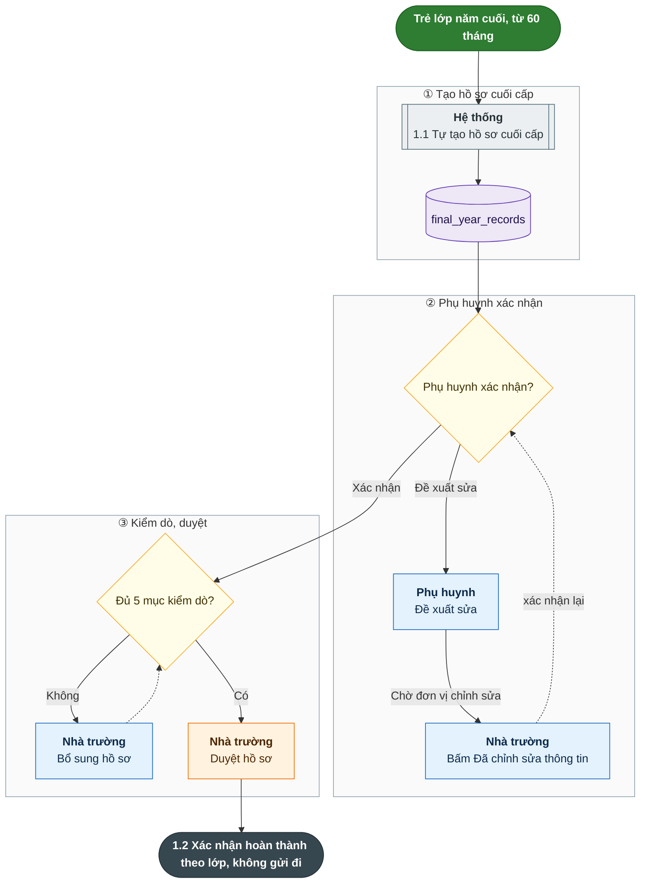

Mạch 2, hồ sơ nhập học:

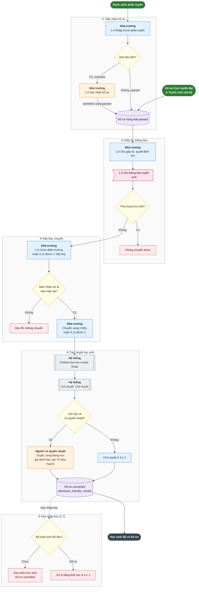

Trạng thái hồ sơ tuyển sinh (`admission_applications.status`):

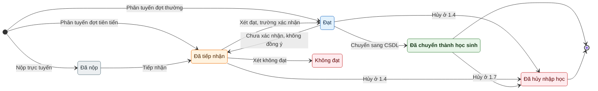

Phân hệ Tuyển sinh nội bộ (`admissions`) cũng tạo học sinh: `POST admission-applications/:id/convert` từ hồ sơ `passed`, gọi cùng chuỗi `ChildrenService.create`, `submit`, `approve`.

### Sơ đồ 2. Điểm danh hằng ngày (Mầm non) và báo vắng, đón trả

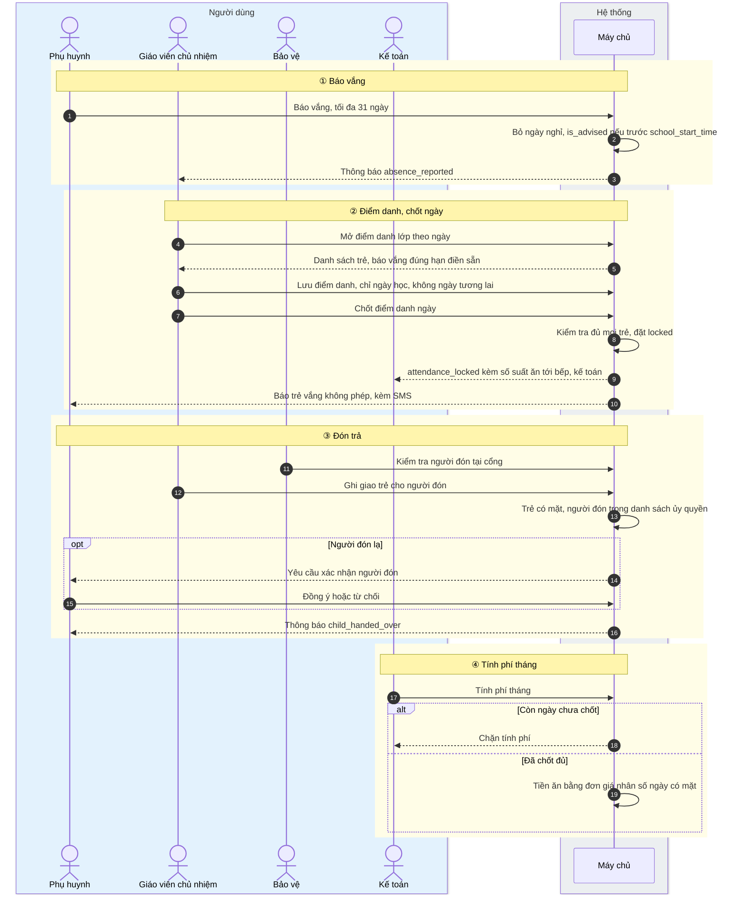

Trạng thái ngày điểm danh của lớp:

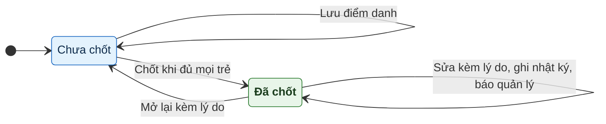

### Sơ đồ 3. Báo cáo EMIS gửi Sở cùng kí hồ sơ

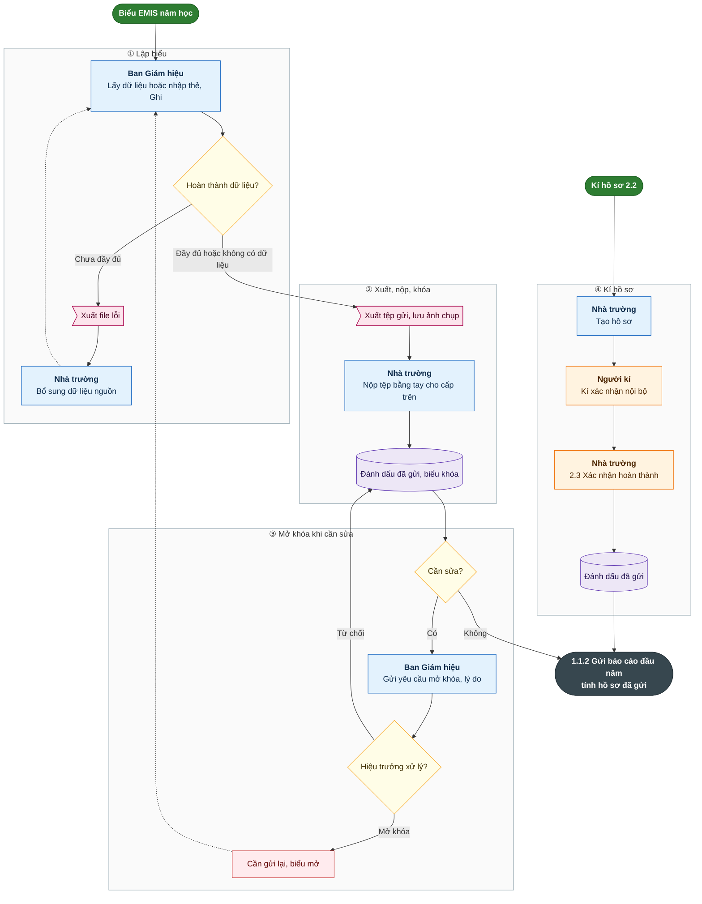

Trạng thái biểu gửi lên cấp trên (`upper_level_submissions.status`):

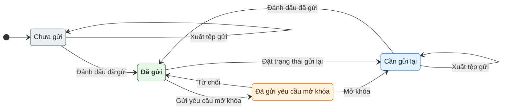

Trạng thái hồ sơ kí (`signing_dossiers.status`):

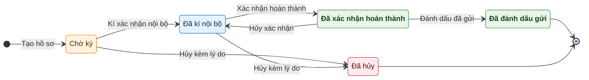

### Sơ đồ 4. Chuyển hồ sơ lên năm học mới

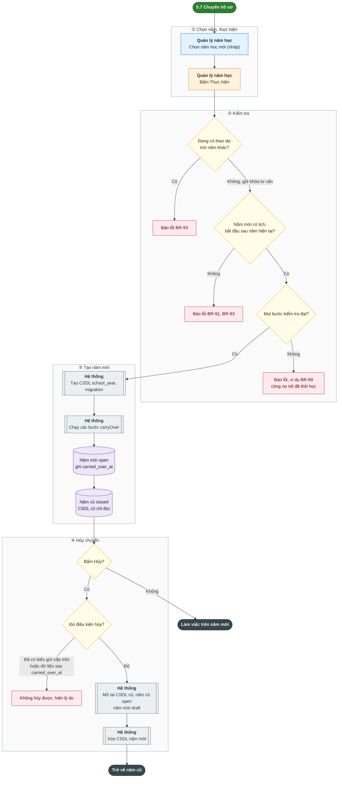

### Sơ đồ 5. Dặn thuốc

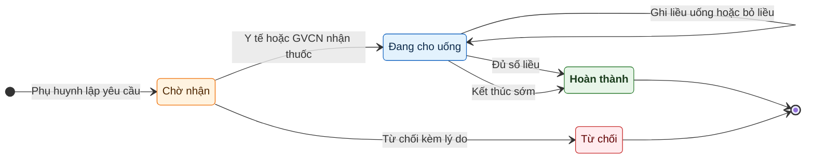

### Sơ đồ 6. Kiểm kê thiết bị

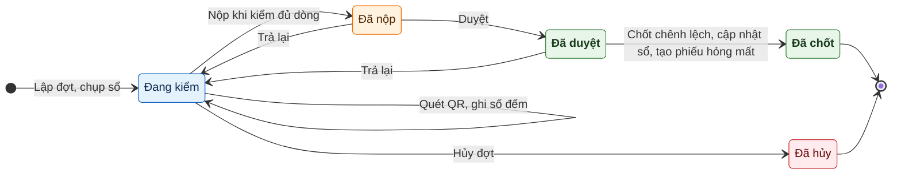
