# 49.4. ĐIỀU HÀNH, QUẢN TRỊ VÀ CHUYÊN MÔN

- Mô tả: Phân hệ 2.6 văn bản và điều hành, 2.7 quản trị hệ thống, 2.15 KPI, 2.16 website, 2.17 hồ sơ chuyên môn, 2.18 thi đua, 2.19 bảo đảm chất lượng
- Phiên bản: 1.0
- Ngày cập nhật: 2026-10-25
- Trạng thái: Chờ phê duyệt
- Thuộc: [Tài liệu 49, tổng hợp chức năng hệ thống](00_MUC_LUC.md)
- Nguồn: mã và tài liệu trên nhánh `main` ngày 2026-10-25 (sau PR 165, 166, 167, 169, 170). Khi tài liệu và mã lệch nhau, mô tả theo mã; chỗ lệch ghi ở [phụ lục](07_MA_TRAN_VAI_TRO_VA_PHU_LUC.md)

Mỗi phân hệ mô tả theo cùng khuôn: mục đích, cấp học, vai trò và mã quyền, căn cứ pháp lý, chức năng và màn hình, quy tắc nghiệp vụ, dữ liệu và tệp xuất, liên kết, kiểm thử e2e. Số mục menu, đường dẫn theo `packages/shared/src/portal-menu.ts`. Sơ đồ quy trình ở cuối tệp.

## 2.6. Quản lý văn bản và điều hành (`documents`)

- Mục đích: quản lý văn bản đến, văn bản đi, giao việc, hồ sơ công việc, lịch đơn vị, phòng họp và báo cáo điều hành của nhà trường, làm theo hệ thống quản lý văn bản và điều hành VNPT iOffice mà các trường công lập TP.HCM đang dùng (quyết định của Eric ngày 2026-10-19, tài liệu 47 mục 9.1). Phân hệ làm trong ba phần của DT-18: 18a văn bản đến và quản trị văn bản (YCTD-138), 18b văn bản đi (YCTD-140), 18c giao việc, hồ sơ công việc, lịch, báo cáo (YCTD-141).
- Cấp học áp dụng: mọi cấp học. Phân hệ không khai báo `levels` trong `portal-menu.ts`; danh mục văn bản có cột cấp học, trống là mọi cấp. Mã không ghi cứng cấp học hay tên trường.
- Đối tượng, vai trò dùng:
  - Mọi cán bộ, nhân viên dùng cổng quản trị: VT-02 Hiệu trưởng, VT-15 Phó Hiệu trưởng, VT-03 Quản lý đơn vị, VT-04 Kế toán, VT-05 Kế toán trưởng, VT-06 Nhân sự, VT-07 Giáo viên chủ nhiệm, VT-08 Giáo viên bộ môn, VT-09 Nhân viên y tế, VT-10 Nhân viên bếp, VT-11 Nhân viên kho và mua hàng, VT-12 Nhân viên tuyển sinh, VT-16 Thủ quỹ, VT-17 Tổ trưởng chuyên môn.
  - Văn thư: VT-02, VT-15, VT-06 (quyền vào sổ văn bản đến, cấp số văn bản đi). Quản trị văn bản: VT-02, VT-06. Người ký, tra cứu: Ban Giám hiệu (VT-02, VT-15).
  - VT-14 Phụ huynh bị loại khỏi phân hệ (bảng `role_workspace_exclusions`, migration định danh 0052).
  - Vai trò trong luồng văn bản (lãnh đạo, xử lý chính, phối hợp, xem để biết), người soạn, người được hỏi ý kiến, người ký, người được giao việc đi theo từng bản ghi, không phải quyền.
- Quyền chính (mã thật trong `packages/shared/src/index.ts`, gán vai trò ở migration định danh 0052, 0054, 0055; tài liệu 08 PQ-78, PQ-80, PQ-81):
  - Văn bản đến: `P09.incoming-document.view` (xem, xử lý văn bản được chuyển cho mình, đánh dấu, theo dõi; 14 vai trò nhân sự), `P09.incoming-document.register` (văn thư: vào sổ, cập nhật, trình lãnh đạo, chuyển trực tiếp, nhận liên thông, kết thúc, lưu hồ sơ, hạn chế xem, in sổ; VT-02, VT-15, VT-06), `P09.incoming-document.search` (tra cứu mọi văn bản không hạn chế xem; VT-02, VT-15), `P09.incoming-document.admin` (quản trị văn bản; VT-02, VT-06).
  - Văn bản đi: `P09.outgoing-document.draft` (soạn dự thảo, lấy ý kiến, trình ký, lấy lại; 14 vai trò), `P09.outgoing-document.sign` (ký, không ký, trả lại; VT-02, VT-15), `P09.outgoing-document.issue` (văn thư cấp số, phát hành, liên thông, công bố, đóng băng, lưu hồ sơ, sổ văn bản đi; VT-02, VT-15, VT-06), `P09.outgoing-document.search` (tra cứu văn bản đi từ khi trình ký; VT-02, VT-15).
  - Giao việc, lịch, hồ sơ, báo cáo: `P09.task.direct` (giao việc theo cây đơn vị, phê duyệt, thu hồi, hủy; VT-02, VT-15, VT-03, VT-06), `P09.schedule.view` (xem lịch đã công bố, lịch họp, đăng ký phòng họp; 14 vai trò), `P09.schedule.manage` (đăng ký, công bố lịch đơn vị, mẫu lịch; VT-02, VT-15, VT-03, VT-06), `P09.meeting-room.manage` (danh mục phòng họp, duyệt đăng ký; VT-02, VT-15, VT-06), `P09.work-file.use` (hồ sơ công việc; 14 vai trò), `P09.document-report.view` (báo cáo; VT-02, VT-15, VT-03, VT-06).
  - Quyền dùng chung của phân hệ khác: `P09.task.assign` (3.1 Công việc và kế hoạch của phân hệ Nhân sự; người có quyền này ở đơn vị xử lý dòng việc giao cho đơn vị, xem việc ở 4.3), `P09.archive.manage` (văn thư lưu trữ tiếp nhận, trả về hồ sơ nộp lưu), `P09.archive.view` (xem hồ sơ hết hạn bảo quản).
  - Cách kiểm tra: bộ bảo vệ ở controller chỉ chặn người không có quyền nào của nhóm (ví dụ `@RequirePermission(...INCOMING_PERMISSIONS)` cho cả controller văn bản đến; `@RequirePermission(REGISTER)` cho thêm mới, nhập liên thông, lấy số kế tiếp; `@RequirePermission(ISSUE)` cho cấp số, gửi, công bố, đóng băng). Quyền văn thư, vai trò trong luồng và phạm vi toàn trường kiểm tra ở dịch vụ: quyền `register`, `search`, `issue` phải ở phạm vi toàn trường (`hasWholeSchool`). Controller giao việc `task-directives` không gắn decorator quyền; dịch vụ kiểm tra `P09.task.direct` khi tạo việc, lấy danh sách chọn, và kiểm tra người xử lý theo từng dòng phân công. Mục menu hiện theo `MENU_PERMISSION_RULES` (`packages/shared/src/menu-permissions.ts`).
- Căn cứ pháp lý: mã và tài liệu YCTD-138, YCTD-140, YCTD-141 không dẫn văn bản pháp lý nào; nghiệp vụ dựa trên khảo sát VNPT iOffice ngày 2026-10-19 (menu, danh sách, biểu mẫu trống) và quyết định của Eric. Không tìm thấy Nghị định 30/2020/NĐ-CP về công tác văn thư trong mã hay `tai_lieu/`. Riêng ký nội bộ dùng chứng thư số nhà trường của phân hệ Quản lý kí hồ sơ (16k, 17b) với điều kiện nhà phát hành chứng thư có trong danh sách của Sở.

### Chức năng và màn hình

| Mục menu (số, tên) | Đường dẫn | Chức năng, thao tác và nút chính | Mã màn hình |
| --- | --- | --- | --- |
| 1.1. Văn bản đến | `/incoming-documents` | Thẻ Chờ xử lý, Đã xử lý; lọc vai trò Xử lý chính, Phối hợp, Xem, Tất cả; tìm, tìm nâng cao; Kết thúc hàng loạt, Lưu hồ sơ hàng loạt, Đánh dấu; Xem mở chi tiết | MH-158, MH-160 |
| 1.2. Quản lý văn bản đến | `/incoming-documents/manage` | Văn thư: thẻ Văn bản vào sổ, Chờ xử lý, Đã xử lý; Thêm mới (biểu mẫu THÔNG TIN VĂN BẢN ĐẾN) | MH-159 |
| 1.3. Văn bản xem để biết | `/incoming-documents/for-information` | Văn bản mình nhận vai Xem để biết | MH-158 |
| 1.4. Văn bản đánh dấu | `/incoming-documents/starred` | Văn bản mình gắn sao; Bỏ đánh dấu | MH-158 |
| 1.5. Văn bản theo dõi | `/incoming-documents/followed` | Văn bản mình theo dõi; Bỏ theo dõi | MH-158 |
| 1.6. Tra cứu văn bản | `/incoming-documents/search` | Tra cứu mọi văn bản không hạn chế xem (quyền tra cứu hoặc văn thư) | MH-158 |
| 1.7. Liên thông văn bản | `/incoming-documents/interconnect` | Thẻ Văn bản chờ vào sổ; Nhập văn bản liên thông; Đánh dấu tiếp nhận, Vào sổ | MH-161 |
| 2.1. Sổ văn bản | `/document-books` | Thẻ Khai báo sổ văn bản đến, Sổ đăng ký văn bản đến, Khai báo sổ văn bản đi, Sổ đăng ký văn bản đi; Thêm mới, Sửa, Xóa sổ; Xuất Excel sổ đăng ký | MH-162, MH-183 |
| 2.2. Đơn vị bên ngoài | `/external-units` | Thêm mới, Sửa, Xóa; tìm theo mã, tên; ô Đang sử dụng | MH-163 |
| 2.3. Khai báo nhóm đơn vị ban hành | `/external-unit-groups` | Tên nhóm, đơn vị trong nhóm chọn bằng ô tích, ghi chú | MH-164 |
| 2.4. Danh mục văn bản | `/document-catalogs` | Thẻ Hình thức văn bản, Độ khẩn, Độ mật, Lĩnh vực; Thêm mới, Sửa, Xóa | MH-165 |
| 2.5. Lãnh đạo nhận văn bản | `/document-leaders` | Chọn nhân sự làm lãnh đạo nhận văn bản, chức vụ in trên phiếu; Ghi | MH-166 |
| 3.1. Văn bản đi | `/outgoing-documents` | Thẻ Dự thảo, Chờ xử lý, Đã xử lý; Thêm mới (biểu mẫu văn bản đi); Xem mở chi tiết | MH-180, MH-181, MH-182 |
| 3.2. Quản lý văn bản đi | `/outgoing-documents/manage` | Văn thư: thẻ Chờ cấp số, Đã ban hành | MH-180 |
| 3.3. Liên thông văn bản đi | `/outgoing-documents/interconnect` | Thẻ Chờ gửi, Đã đánh dấu gửi, Liên thông nội bộ, Tất cả | MH-184 |
| 3.4. Tra cứu văn bản đi | `/outgoing-documents/search` | Tra cứu văn bản đi từ khi trình ký | MH-180 |
| (trang công khai) | `/tra-cuu-van-ban` | Tra cứu mã QR in trên bản đã ký, không cần đăng nhập | MH-185 |
| 4.1. Giao việc | `/directives/new` | Biểu mẫu THÔNG TIN CÔNG VIỆC và PHÂN CÔNG THỰC HIỆN; Tạo công việc | MH-187 |
| 4.2. Công việc cần xử lý | `/directives/inbox` | Lọc mười trạng thái, vai, loại; chi tiết việc: Cập nhật tiến độ, Phân công tiếp, Phê duyệt, Thu hồi, Hủy việc | MH-188 |
| 4.3. Công việc đã giao | `/directives/outbox` | Việc mình giao hoặc là lãnh đạo giao, gồm việc giao ở 3.1 Công việc và kế hoạch | MH-189 |
| 5.1. Hồ sơ cá nhân | `/work-files` | Thêm mới, Sửa, Xóa, Thêm ghi chú, Chia sẻ, Chuyển giao, Kết thúc hồ sơ, Mở lại, Nộp lưu | MH-190 |
| 5.2. Hồ sơ được chia sẻ | `/work-files/shared` | Hồ sơ người khác chia sẻ (Xem hoặc Cập nhật) | MH-191 |
| 5.3. Hồ sơ được chuyển giao | `/work-files/transferred` | Hồ sơ người khác chuyển giao cho mình | MH-192 |
| 5.4. Hồ sơ nộp lưu | `/work-files/archive` | Văn thư lưu trữ: Tiếp nhận lưu trữ, Trả về | MH-193 |
| 5.5. Hồ sơ hết hạn bảo quản | `/work-files/expired` | Hồ sơ đã lưu có thời hạn đã quá năm hết hạn | MH-194 |
| 6.1. Đăng ký lịch đơn vị | `/unit-schedules` | Lịch tuần theo buổi; Thêm, Sửa, Xóa dòng; Công bố lịch tuần; Áp mẫu vào tuần; Xuất PDF | MH-195 |
| 6.2. Lịch họp | `/meeting-schedules` | Thẻ Lịch tuần, Lịch tháng, Tất cả, Lịch của tôi; Xuất Excel, Xuất PDF, In lịch | MH-196 |
| 6.3. Đăng ký phòng họp | `/room-bookings` | Đăng ký sử dụng; Phê duyệt, Từ chối, Hủy đăng ký | MH-197 |
| 6.4. Phòng họp | `/meeting-rooms` | Thêm mới, Sửa, Xóa phòng họp | MH-198 |
| 6.5. Mẫu lịch | `/schedule-templates` | Thêm, Sửa, Xóa mẫu; Thêm dòng, Bỏ dòng | MH-199 |
| 7.1. Báo cáo thực hiện văn bản đến | `/document-reports/incoming` | Lọc Đơn vị, Từ ngày, Đến ngày; Xem báo cáo, Xuất Excel, Xuất PDF | MH-200 |
| 7.2. Báo cáo tổng hợp | `/document-reports/summary` | Thống kê theo đơn vị độc lập | MH-201 |
| 7.3. Thống kê số liệu trong đơn vị | `/document-reports/statistics` | Thống kê theo hình thức, độ khẩn, lĩnh vực, trạng thái | MH-202 |

Quyền hiện mục menu (`menu-permissions.ts`, tiền tố `P09.` lược bớt):

- 1.1, 1.3, 1.4, 1.5: một trong `incoming-document.view`, `.register`, `.search`.
- 1.2, 1.7: `incoming-document.register`. 1.6: `.search` hoặc `.register`.
- 2.1: `incoming-document.admin`, `.register` hoặc `outgoing-document.issue`. 2.2 đến 2.5: `incoming-document.admin`.
- 3.1: một trong bốn quyền văn bản đi. 3.2, 3.3: `outgoing-document.issue`. 3.4: `.search` hoặc `.issue`.
- 4.1: `task.direct`. 4.2: một trong `task.direct`, `work-file.use`, `schedule.view`. 4.3: `task.direct` hoặc `task.assign`.
- 5.1 đến 5.3: `work-file.use`. 5.4: `archive.manage`. 5.5: `archive.view` hoặc `archive.manage`.
- 6.1, 6.5: `schedule.manage`. 6.2, 6.3: một trong `schedule.view`, `schedule.manage`, `meeting-room.manage`. 6.4: `meeting-room.manage`.
- Nhóm 7: `document-report.view`.

Điểm cuối API chính (tiền tố `/api/v1`):

- Văn bản đến: `GET/POST /incoming-documents`, `GET /incoming-documents/next-number`, `POST /incoming-documents/interconnect`, `POST /incoming-documents/complete`, `/archive`, `/flags` (hàng loạt), `GET/PUT/DELETE /incoming-documents/{id}`, `POST .../register`, `/acknowledge`, `/files`, `/transfer`, `/return`, `/refuse`, `/revoke`, `/finish`, `/extension`, `/extension/decide`, `/complete`, `/restrict`, `/reply`, `/unread`, `PUT .../relations`, `GET .../slips/{type}`, `GET .../tasks`.
- Quản trị văn bản: `/document-catalogs`, `/external-units`, `/external-unit-groups`, `/document-leaders`, `/document-staff`, `/document-books`, `/document-books/{id}/register(/export)`, `/document-books/{id}/outgoing-register(/export)`.
- Văn bản đi: `GET/POST /outgoing-documents`, `GET .../recipients`, `GET .../next-number`, `POST .../archive`, `GET/PUT/DELETE /outgoing-documents/{id}`, `POST .../files`, `/consult`, `/consult/end`, `/opinion`, `/submit`, `/revoke`, `/sign`, `/decline`, `/return`, `/issue`, `/send`, `/publish`, `/freeze`, `GET .../slip`, `GET /public/outgoing-documents/verify`.
- Giao việc: `GET /task-directives/options`, `GET/POST /task-directives`, `GET/PATCH /task-directives/{id}`, `POST .../cancel`, `.../assignments`, `.../assignments/{id}/revoke`, `/progress`, `/approve`, `.../files`.
- Hồ sơ, lịch, báo cáo: `/work-files` (và `/items`, `/shares`, `/transfer`, `/close`, `/reopen`, `/submit`, `/accept`, `/return`), `/meeting-rooms`, `/room-bookings` (và `/approve`, `/reject`, `/cancel`), `/unit-schedules` (và `/export`, `/publish`), `/unit-schedule-templates` (và `/apply`), `/document-reports/incoming`, `/summary`, `/statistics`, `/export`.

#### Văn bản đến (nhóm 1)

- Trạng thái văn bản (`IncomingDocumentStatus`, `packages/shared/src/incoming-documents.ts`): `pending_registration` Chờ vào sổ, `registered` Đã vào sổ, `processing` Đang xử lý, `completed` Đã kết thúc.
- Trạng thái dòng luồng xử lý (`IncomingAssignmentStatus`): `pending` Chờ xử lý, `forwarded` Đã chuyển, `done` Đã xử lý, `returned` Đã trả lại, `revoked` Bị lấy lại, `refused` Đã từ chối, `closed` Văn bản đã kết thúc. Vai trò dòng (`IncomingAssignmentRole`): `leader` Lãnh đạo, `main` Xử lý chính, `coordinate` Phối hợp, `view` Xem để biết. Gia hạn của dòng: `requested`, `approved`, `rejected`.
- Nguồn văn bản: `manual` (văn thư vào sổ), `interconnect` (nhập văn bản nhận qua trục), `internal` (liên thông nội bộ từ văn bản đi của trường). Trạng thái liên thông: `received` (đã nhận), `acknowledged` (đã đánh dấu tiếp nhận).
- Danh sách (MH-158, lưới khóa `incoming-documents`): cột Số đến, Ngày đến, Số ký hiệu, Trích yếu (chữ đậm khi chưa đọc, nhãn hạn chế xem, dấu sao), Đơn vị ban hành, Ngày văn bản, Hình thức, Độ khẩn, Độ mật (ẩn), Hạn xử lý (nhãn Quá hạn, Đến hạn), Vai trò, Xử lý chính, Trạng thái, Sổ văn bản (ẩn), Tệp (ẩn). Chú thích màu như iOffice: đỏ hỏa tốc, cam khẩn, xanh chỉ đạo (văn bản đã có lãnh đạo chuyển tiếp), ký hiệu [XLC], [PH], [QH] quá hạn, [ĐH] đến hạn.
- Bộ lọc: tìm theo trích yếu; Tìm kiếm nâng cao theo số ký hiệu, số đến, đơn vị ban hành, từ ngày đến, đến ngày đến, sổ văn bản, hình thức, độ khẩn, chỉ quá hạn, chỉ đến hạn; số dòng mỗi trang 10, 20, 50, 100, 200. Máy chủ phân loại theo `view`: `inbox` (có dòng của mình đang chờ), `processed` (có dòng của mình nhưng không còn dòng chờ), `for_information`, `starred`, `followed`, `registered`, `processing`, `completed` (ba thẻ của 1.2, cần quyền văn thư), `interconnect` (Chờ vào sổ), `search`.
- Thao tác hàng loạt: Kết thúc hàng loạt, Lưu hồ sơ hàng loạt (chọn hồ sơ tài liệu của Văn thư lưu trữ 5.10.1), Đánh dấu, Theo dõi; mỗi văn bản một giao dịch, văn bản lỗi ghi lý do và làm tiếp văn bản khác.
- Biểu mẫu Thêm mới (MH-159): khối Thông tin văn bản (Trích yếu, Số ký hiệu, Đơn vị ban hành chọn danh mục hoặc nhập tên, Ngày văn bản, Hình thức, Độ khẩn, Hạn xử lý, Lĩnh vực); khối Vào sổ (Sổ văn bản, Số đến hiện sẵn số kế tiếp, Ngày đến); khối Thông tin nhận (Độ mật, Thẩm quyền Thường hoặc Không thuộc thẩm quyền, Loại văn bản mới, thu hồi, thay thế, Hình thức chuyển Trao tay, Bưu điện, E-mail, Liên thông, Hình thức sao Bản gốc, Sao y, Sao lục, Trích sao, Có văn bản giấy, File đính kèm với ô Quét tài liệu và Tải tệp tin, Nội dung xử lý có Mẫu nhập); nút Lưu, Đóng. Quét tài liệu chỉ đánh dấu tệp tải lên là tệp quét, không điều khiển máy quét.
- Chi tiết văn bản (MH-160) mở dưới dòng. Thanh Thao tác văn bản hiện nút theo danh sách `actions` máy chủ trả về (hàm `actionsOf`); máy chủ kiểm tra lại ở từng thao tác:
  - Tiếp nhận: Vào sổ, Đánh dấu tiếp nhận văn bản hoặc Hủy đánh dấu tiếp nhận.
  - Chuyển: Trình lãnh đạo hoặc Chuyển lãnh đạo, Chuyển trực tiếp hoặc Chuyển xử lý, Luân chuyển, Lấy lại.
  - Xử lý: Xử lý xong, Trả lại, Từ chối, Xin gia hạn, Đồng ý gia hạn, Không đồng ý.
  - Văn thư, lãnh đạo: Cập nhật thông tin (kèm văn bản liên quan tìm theo trích yếu, tối đa 50), Văn bản trả lời (số ký hiệu, ngày, ghi chú), Lưu hồ sơ, Hạn chế xem hoặc Bỏ hạn chế xem, Kết thúc văn bản, Xóa.
  - Cá nhân: Đánh dấu, Theo dõi, Đánh dấu chưa đọc.
  - In: In phiếu trình, In phiếu xử lý, Phiếu giao nhận.
  - Nối 18c: Tạo công việc (mở 4.1 kèm văn bản), Lưu vào hồ sơ công việc, danh sách việc tạo từ văn bản.
- Bốn thẻ của chi tiết: Thông tin văn bản (các trường, tệp tải về, thêm, xóa), Thông tin nhận (người chuyển, người nhận, vai trò, hạn, ý kiến khi chuyển, ý kiến xử lý, trạng thái, gia hạn), Sơ đồ luồng văn bản (cây người nhận từ văn thư), Lịch sử tham mưu (bảng `incoming_document_events`, ghi cả sự kiện từ phân hệ khác như Tạo công việc, Lưu vào hồ sơ công việc, Nhận văn bản liên thông).
- Hộp thoại chuyển: tìm người nhận, cột XLC, PH, Xem (hoặc Trình khi trình lãnh đạo), hạn từng người, hạn chung, ý kiến. Chế độ `leader` (trình, chuyển lãnh đạo), `transfer` (chuyển xử lý, chuyển trực tiếp), `rotate` (luân chuyển).
- Ai làm gì (theo `actionsOf`):
  - Văn thư (quyền `register` toàn trường, văn bản không hạn chế hoặc mình có trong luồng): Cập nhật, đính kèm khi chưa kết thúc; Vào sổ, Đánh dấu tiếp nhận khi Chờ vào sổ; Xóa khi Chờ vào sổ hoặc Đã vào sổ mà chưa chuyển cho ai; Trình lãnh đạo, Chuyển trực tiếp khi Đã vào sổ.
  - Người có dòng đang chờ với vai lãnh đạo, xử lý chính, phối hợp: chuyển tiếp, Luân chuyển, Trả lại, Xử lý xong; phối hợp thêm Từ chối; xử lý chính thêm Xin gia hạn khi chưa có đề nghị đang chờ.
  - Người đã chuyển: Lấy lại khi mọi người nhận của lần chuyển gần nhất còn chờ, chưa chuyển tiếp.
  - Duyệt gia hạn: người chuyển dòng đó, lãnh đạo trong luồng hoặc văn thư.
  - Kết thúc văn bản: văn thư, lãnh đạo trong luồng, người xử lý chính đang xử lý.
  - Hạn chế xem: văn thư hoặc lãnh đạo trong luồng. Văn bản trả lời, Lưu hồ sơ: văn thư hoặc người xử lý chính.
- Phiếu in PDF: phiếu trình (ý kiến lãnh đạo), phiếu xử lý (tổng hợp ý kiến), phiếu giao nhận (cột ký nhận); mẫu tự đặt vì khảo sát chỉ ghi tên nút.

#### Quản trị văn bản (nhóm 2)

- Sổ văn bản (MH-162, MH-183): ô Năm; sổ có chiều đến (`incoming`) hoặc đi (`outgoing`), tên sổ, đơn vị áp dụng, số bắt đầu (từ 1), ngày áp dụng, ngày kết thúc, STT hiển thị, người theo dõi, người quản trị (`document_book_members`, vai `follower`, `admin`); lưới hiện số văn bản, số đến kế tiếp. Không đổi chiều của sổ đã tạo; sổ đã có văn bản không xóa được. Thẻ Sổ đăng ký văn bản đến (chọn sổ, từ ngày, đến ngày; cột Ngày đến, Số đến, Tác giả, Số ký hiệu, Ngày văn bản, Trích yếu, Nơi nhận, Hình thức, Độ khẩn, Lĩnh vực, Xử lý chính) và Sổ đăng ký văn bản đi (Ngày ban hành, Số, Số ký hiệu, Trích yếu, Người ký, Đơn vị soạn thảo, Số bản, Nơi nhận, Hình thức, Độ khẩn, Lĩnh vực); nút Xuất Excel. Sổ đăng ký che trích yếu văn bản hạn chế xem, văn bản mật.
- Đơn vị bên ngoài (MH-163): Mã đơn vị, Tên đơn vị, Nhóm đơn vị ban hành, Địa chỉ, Điện thoại, Thư điện tử, Mã định danh điện tử, Trạng thái; đơn vị đã ban hành văn bản đến không xóa, chỉ ngừng sử dụng.
- Nhóm đơn vị ban hành (MH-164): tên nhóm, ghi chú, danh sách đơn vị.
- Danh mục văn bản (MH-165): bốn loại `form` Hình thức văn bản, `urgency` Độ khẩn, `secrecy` Độ mật, `field` Lĩnh vực; cột Mã, Tên, Mức (0 đến 2, dùng cho độ khẩn, độ mật), Cấp học, STT hiển thị, Trạng thái. Mục đã dùng ở văn bản không xóa, chỉ bỏ Đang sử dụng.
- Lãnh đạo nhận văn bản (MH-166): bảng nhân sự đang làm việc có tài khoản ở năm học đang dùng, ô Chọn, Họ và tên, Bộ phận, Chức vụ in trên phiếu; nút Ghi. Danh sách này là người nhận khi Trình lãnh đạo (văn bản đến), người ký (văn bản đi) và lãnh đạo giao việc (giao việc).
- Đọc danh sách: mọi người có một quyền văn bản đến đọc được để chọn khi vào sổ, chuyển; ghi cần `P09.incoming-document.admin` toàn trường.

#### Văn bản đi (nhóm 3)

- Trạng thái (`OutgoingDocumentStatus`): `draft` Dự thảo, `consulting` Đang lấy ý kiến, `pending_signature` Chờ ký, `signed` Đã ký, chờ cấp số, `issued` Đã ban hành. Cờ thêm: `frozen` (đóng băng), `published` (đã công bố lên website).
- Trạng thái ý kiến (`OutgoingOpinionStatus`): `pending` Chờ cho ý kiến, `answered` Đã cho ý kiến, `finished` Kết thúc cho ý kiến, `closed` Đã kết thúc lấy ý kiến. Lấy ý kiến theo đợt (`round`).
- Đơn vị nhận (`OutgoingRecipientType`): `external` đơn vị bên ngoài (danh mục 2.2), `internal` đơn vị trong trường (cây đơn vị năm học). Trạng thái gửi (`OutgoingSendStatus`): `pending` Chờ gửi, `sent` Đã đánh dấu gửi, `delivered` Đã chuyển vào văn bản đến.
- Loại tệp (`OutgoingFileKind`): `draft` Dự thảo, `submission` File phiếu trình, `attachment` Văn bản gửi kèm, `signed` Bản đã ký (chỉ hệ thống tạo khi ký).
- Danh sách (MH-180, lưới khóa `outgoing-documents`, 3.2 khóa `outgoing-manage`): cột Số eOffice, Số ký hiệu, Ngày ban hành, Trích yếu (nhãn Ưu tiên, Đã public, Đóng băng), Hình thức, Độ khẩn, Người soạn thảo, Đơn vị soạn thảo (ẩn), Người ký, Trạng thái, Số bản (ẩn), Sổ văn bản (ẩn), Chờ gửi (ẩn). Thẻ theo `view`: `drafts` (mình soạn, còn Dự thảo hoặc Đang lấy ý kiến), `pending` (chờ mình cho ý kiến hoặc chờ mình ký), `processed` (mình đã cho ý kiến, đã ký, hoặc văn bản mình soạn đã qua dự thảo), `to_issue` (Đã ký), `issued`, `search`. Tìm theo trích yếu; Tìm kiếm nâng cao theo số ký hiệu, số đi, người ký, ngày ban hành, sổ, hình thức, độ khẩn, chỉ văn bản đã public.
- Biểu mẫu (MH-181): Số eOffice (phần mềm cấp tăng dần), Số trình ký, Trích yếu, Hình thức, Độ khẩn, Độ mật, Lĩnh vực, Loại văn bản, Phân loại VB ưu tiên, Chèn QR code, Nội dung trình; Người soạn thảo, Đơn vị soạn thảo, Người ký (danh sách lãnh đạo 2.5); Thời gian họp, Địa điểm (thư mời, giấy mời); Đơn vị dự kiến nhận; Văn bản liên quan (Trả lời văn bản đến, Thêm liên quan, Là văn bản gốc); nút Ghi, Đóng.
- Chi tiết (MH-182): thanh Thao tác văn bản đi theo `actionsOf`:
  - Soạn thảo: Cập nhật thông tin, Lấy ý kiến, Kết thúc lấy ý kiến, Trình ký, Lấy lại, Xóa.
  - Góp ý: Cho ý kiến, Kết thúc cho ý kiến.
  - Người ký: Ký, Không ký, Trả lại.
  - Văn thư: Cấp số và phát hành, Trả lại, Public lên cổng TTĐT hoặc Ẩn VB trên cổng TTĐT, Đóng băng hoặc Hủy đóng băng, Lưu hồ sơ.
  - In: In phiếu trình KG (PDF gồm thông tin văn bản, ý kiến góp ý, ý kiến người ký).
  - Thông báo lý do khi văn bản bị trả lại hoặc không ký. Bốn thẻ: Thông tin văn bản (sổ và số, thông tin ký, mã tra cứu, tệp theo loại), Ý kiến góp ý, Thông tin gửi (đơn vị nhận, trạng thái liên thông, Đánh dấu đã gửi, Hủy đánh dấu gửi, Tải bản đã ký để gửi), Lịch sử.
- Ai làm gì:
  - Người tạo, người soạn thảo hoặc văn thư: Cập nhật, đính kèm, Lấy ý kiến khi Dự thảo hoặc Đang lấy ý kiến; Kết thúc lấy ý kiến khi Đang lấy ý kiến; Trình ký khi Dự thảo. Xóa chỉ người tạo, người soạn với văn bản chưa từng trình ký.
  - Người được hỏi ý kiến ở đợt đang mở: Cho ý kiến (sửa được), Kết thúc cho ý kiến.
  - Người soạn: Lấy lại văn bản Chờ ký về Dự thảo.
  - Người ký được trình (có quyền `sign`): Ký, Không ký, Trả lại.
  - Văn thư (`issue` toàn trường): Cấp số và phát hành, Trả lại văn bản Đã ký; với văn bản Đã ban hành: Đóng băng, Hủy đóng băng; khi chưa đóng băng thì Đánh dấu gửi, Public, Lưu hồ sơ. Người soạn cũng Lưu hồ sơ được văn bản đã ban hành chưa đóng băng.
- Hộp thoại Cấp số và phát hành: sổ văn bản đi, số đi (hiện số kế tiếp, sửa được), ký hiệu sau số, ngày ban hành, số bản; số ký hiệu là "số/phần ký hiệu".
- Liên thông văn bản đi (MH-184): dòng thông báo chưa kết nối trục; lưới khóa `outgoing-recipients` cột Số ký hiệu, Ngày ban hành, Trích yếu, Đơn vị nhận, Loại, Mã định danh điện tử (ẩn), Trạng thái liên thông, Gửi lúc, Ghi chú.
- Trang công khai tra cứu (MH-185, `/tra-cuu-van-ban`, API `GET /public/outgoing-documents/verify?code=`): ô Mã tra cứu (12 ký tự, điền sẵn từ QR), nút Tra cứu; hiện số ký hiệu, ngày ban hành, người ký, thời điểm ký, mã băm bản đã ký; trích yếu chỉ hiện với văn bản đã ban hành không mật. Có giới hạn tần suất theo địa chỉ IP.

#### Quản lý công việc (nhóm 4, giao việc)

- Giao việc mở rộng bảng `tasks` sẵn có ở CSDL năm học với loại `task_type = 'directive'`; phân công lưu ở `task_assignments`. Việc loại này không hiện ở 3.1 Công việc và kế hoạch của phân hệ Nhân sự; `/tasks` cũ không đọc, sửa việc loại `directive`.
- Trạng thái dòng phân công (`DirectiveAssignmentStatus`): `todo` Chưa xử lý, `in_progress` Đang xử lý, `pending_approval` Chờ phê duyệt, `done` Đã hoàn thành, `cancelled` Đã thu hồi. Kết quả duyệt `approval_result`: `done`, `not_done`. Trạng thái việc (`tasks.status`): `todo`, `in_progress`, `done`, `cancelled`, tính từ các dòng xử lý chính cấp một (hàm `taskStatusOf`).
- Vai (`DirectiveRole`): `main` Xử lý chính, `coordinate` Phối hợp, `follow` Theo dõi. Đối tượng (`DirectiveTarget`): `unit` Phòng ban (đơn vị, phòng ban), `staff` Cá nhân. Mức độ: Thấp, Bình thường, Quan trọng. Nhắc định kì: Không, Hằng ngày, Hằng tuần, Hằng tháng.
- 4.1 Giao việc (MH-187): khối THÔNG TIN CÔNG VIỆC (Lãnh đạo giao việc, Nội dung nhiệm vụ bắt buộc với dòng đầu là tên việc tối đa 200 ký tự, Văn bản đến khi mở từ văn bản, Văn bản liên quan, Mức độ công việc, Ngày bắt đầu, Số ngày thực hiện, Nhắc việc cho người giao việc, Nhắc việc định kì); khối PHÂN CÔNG THỰC HIỆN là bảng cây đơn vị, phòng ban, cá nhân với ô Vai, Ngày bắt đầu, Ngày hết hạn; nút Tạo công việc. Tệp đính kèm tối đa 50 MB mỗi tệp, 30 tệp.
- 4.2 Công việc cần xử lý (MH-188, lưới khóa `directive-inbox`): ô Vai, Loại (cá nhân, đơn vị), tìm theo nội dung, ô Trạng thái với mười giá trị (`DirectiveStatusFilter`):
  - `open` Chưa hoàn thành, `open_on_time` còn hạn, `open_overdue` quá hạn;
  - `done` Đã hoàn thành, `done_on_time` đúng hạn, `done_late` quá hạn (so ngày hoàn thành giờ Việt Nam với ngày hết hạn);
  - `pending_approval` Chờ phê duyệt;
  - `approved` Đã phê duyệt, `approved_not_done` chưa xử lý xong, `approved_done` duyệt xử lý xong. Cột Nội dung công việc ([QH] khi quá hạn), Vai, Loại, Người giao việc, Mức độ, Ngày bắt đầu, Ngày hết hạn, Trạng thái. Danh sách gồm dòng giao cho cá nhân mình và dòng giao cho đơn vị mình quản lý (quản lý ghi ở cây đơn vị `org_units.manager_user_id` hoặc có `P09.task.assign` ở đơn vị).
- Chi tiết việc: thông tin việc; bảng phân công với nút Cập nhật tiến độ (phần trăm, nội dung), Phân công tiếp (dòng của đơn vị, chỉ cho cá nhân trong đơn vị), Phê duyệt (Duyệt xử lý xong, Chưa xử lý xong), Thu hồi (lý do); Phân công thêm; tệp đính kèm; Lưu vào hồ sơ công việc; lịch sử cập nhật tiến độ (`task_updates`); Sửa, Hủy việc (lý do).
- 4.3 Công việc đã giao (MH-189, lưới khóa `directive-outbox`): cột Nội dung (kèm số dòng chờ phê duyệt), Xử lý chính, Phối hợp, Theo dõi, Mức độ, Hạn, Trạng thái, Loại giao (theo cây đơn vị hoặc 3.1 Công việc và kế hoạch).
- Tác vụ nền `DirectiveJobs` chạy cùng nhịp tiến trình gửi thông báo (mặc định 60 giây; chế độ nhiều trường đăng ký với bộ lập lịch tên `directives`): nhắc định kì người xử lý các dòng chưa xong rồi dời ngày nhắc kế tiếp (`next_reminder_on`); nhắc người giao việc và lãnh đạo giao việc một lần khi còn một ngày đến hạn hoặc đã quá hạn (`assigner_reminded_at`).

#### Hồ sơ công việc (nhóm 5)

- Trạng thái hồ sơ (`WorkFileStatusKey`): `open` Đang cập nhật, `closed` Đã hoàn thành, `submitted` Đã bàn giao, `returned` Bị trả về, `archived` Đã lưu trữ.
- 5.1 (MH-190): ô Năm, tìm theo ký hiệu, tiêu đề; Thêm mới (Số ký hiệu hồ sơ duy nhất trong năm của người giữ, Tiêu đề, Năm hình thành, Mô tả, Đơn vị, Thời hạn bảo quản vĩnh viễn hoặc số năm); cột Số ký hiệu, Tiêu đề, Năm, Người lập hồ sơ, Số thành phần, Thời hạn bảo quản, Trạng thái. Chi tiết: thành phần (văn bản đến mình xem được, công việc mình giao, là lãnh đạo giao hoặc được giao, ghi chú), Thêm ghi chú, Sửa thông tin, Chia sẻ (quyền Xem hoặc Cập nhật), Chuyển giao, Kết thúc hồ sơ, Mở lại, Nộp lưu (chỉnh được thời hạn bảo quản), lịch sử hồ sơ.
- 5.2 thêm cột Quyền, không có Thêm mới; 5.3 thêm cột Chuyển giao từ.
- 5.4 Hồ sơ nộp lưu (MH-193): hồ sơ Đã bàn giao, Bị trả về, Đã lưu trữ; chi tiết có Tiếp nhận lưu trữ (tạo hồ sơ tài liệu ở 5.10 Văn thư lưu trữ, số, ký hiệu hồ sơ lưu trữ), Trả về (lý do).
- 5.5 Hồ sơ hết hạn bảo quản (MH-194): hồ sơ Đã lưu trữ có thời hạn mà năm lưu cộng số năm bảo quản trước năm nay.

#### Quản lý lịch đơn vị (nhóm 6)

- 6.1 Đăng ký lịch đơn vị (MH-195): Tuần trước, Tuần có ngày, Tuần sau, ô Đơn vị (Toàn trường hoặc một đơn vị); nút Công bố lịch tuần, ô Mẫu lịch và Áp mẫu vào tuần, Xuất PDF; bảng thứ Hai đến Chủ nhật theo buổi Sáng, Chiều (Thứ, ngày; Buổi; Giờ; Nội dung kèm nhãn Nháp và trạng thái phòng họp; Chủ trì; Thành phần kèm người tham dự; Địa điểm; Ghi chú), nút Thêm ở từng buổi, Sửa, Xóa. Biểu mẫu dòng: Ngày, Buổi, Giờ bắt đầu, Giờ kết thúc, Nội dung, Chủ trì, Thành phần, Phòng họp, Địa điểm, Người tham dự, Ghi chú. Trạng thái dòng lịch: `draft` (nháp, chỉ người đăng ký lịch của đơn vị thấy), `published` (đã công bố).
- 6.2 Lịch họp (MH-196): thẻ Lịch tuần, Lịch tháng, Tất cả (khoảng ngày tối đa 62 ngày), Lịch của tôi (mình tham dự hoặc mình đăng ký); lọc Đơn vị, Địa điểm (kể cả tên phòng họp), Thành phần; Xuất Excel, Xuất PDF (ghi `export_logs`), In lịch.
- 6.3 Đăng ký phòng họp (MH-197, lưới khóa `room-bookings`): lọc Từ ngày, Đến ngày, Trạng thái, Chỉ đăng ký của tôi; Đăng ký sử dụng (Phòng họp, Tiêu đề, Chủ trì, Thành phần, Ngày, Từ giờ, Đến giờ, Ghi chú); cột Phòng họp, Trạng thái, Thời gian, Tiêu đề, Chủ trì, Người đăng ký, Người duyệt; nút dòng Phê duyệt, Từ chối, Hủy đăng ký. Trạng thái (`RoomBookingStatusKey`): `pending` Chờ phê duyệt, `approved` Phê duyệt, `rejected` Bị từ chối, `cancelled` Đã hủy.
- 6.4 Phòng họp (MH-198): Tên phòng họp, Địa điểm, Sức chứa (1 đến 10000), Trang thiết bị, Đang sử dụng; phòng đã có lượt đăng ký chỉ ngừng sử dụng, không xóa.
- 6.5 Mẫu lịch (MH-199): Tên mẫu, Đơn vị, các dòng theo Thứ, Buổi, Giờ, Nội dung, Chủ trì, Thành phần, Địa điểm; Áp mẫu vào tuần thêm các dòng nháp.

#### Báo cáo (nhóm 7)

- Bộ lọc chung: Đơn vị, Từ ngày, Đến ngày (bắt buộc, tối đa 400 ngày); nút Xem báo cáo, Xuất Excel, Xuất PDF (`GET /document-reports/export?format=`, ghi `export_logs`). Quản lý đơn vị chỉ xem đơn vị được gán; người xử lý thuộc đơn vị theo hồ sơ nhân sự ở năm học đang dùng.
- 7.1 (MH-200): mỗi người xử lý chính một dòng theo ngày đến: Đơn vị, Người xử lý chính, Tổng số, Đã xử lý đúng hạn, Đã xử lý quá hạn, Đang xử lý trong hạn, Đang xử lý quá hạn, Tỷ lệ đúng hạn (%), dòng Tổng cộng. Hạn là hạn của dòng, đã gia hạn thì hạn mới, không có thì hạn văn bản.
- 7.2 (MH-201): theo đơn vị độc lập: văn bản đến xử lý chính (đã xử lý, quá hạn), công việc được giao theo ngày bắt đầu (hoàn thành đúng hạn, quá hạn, đang thực hiện, quá hạn chưa xong), lịch công tác đã công bố.
- 7.3 (MH-202): tổng số văn bản đến, phân công; bảng theo hình thức, độ khẩn, lĩnh vực, trạng thái văn bản đến và trạng thái phân công công việc.

### Quy tắc nghiệp vụ

- BR-134 (văn bản đến, YCTD-138; mã quy tắc lỗi `YCTD-138` trong `INCOMING_RULE_CODE`):
  - Số đến cấp kế tiếp trong sổ, không nhỏ hơn số bắt đầu; số nhập tay phải chưa có trong sổ (`ERR_CONFLICT` "Số đến đã có trong sổ"); khóa theo sổ bằng `pg_advisory_xact_lock` để hai lần vào sổ cùng lúc không trùng số. Ngày đến phải trong ngày áp dụng, ngày kết thúc của sổ.
  - Tệp tối đa 50 MB mỗi tệp (`INCOMING_MAXIMUM_FILE_BYTES`), tối đa 30 tệp mỗi văn bản. Phải có ít nhất một tệp chính (`kind = 'main'`) trước khi chuyển.
  - Trình lãnh đạo chỉ cho người ở danh sách lãnh đạo nhận văn bản. Chuyển xử lý chỉ cho nhân sự đang làm việc có tài khoản; 1 đến 100 người mỗi lần; mỗi người một vai; tối đa một xử lý chính mỗi lần chuyển; không chuyển cho chính mình; không chuyển cho người đang có văn bản này chờ xử lý. Luân chuyển cho đúng một người, giữ vai và hạn của mình.
  - Lần chuyển đầu khi văn bản Đã vào sổ đổi văn bản sang Đang xử lý. Người chuyển tiếp thì dòng của mình thành Đã chuyển.
  - Trả lại, Từ chối bắt buộc ghi ý kiến; dòng của người chuyển về Chờ xử lý; nếu văn thư chuyển và không còn ai chờ thì văn bản về Đã vào sổ. Từ chối chỉ người phối hợp.
  - Lấy lại khi mọi người nhận của lần chuyển gần nhất còn chờ, chưa chuyển tiếp; dòng của người nhận thành Bị lấy lại.
  - Xin gia hạn chỉ xử lý chính, hạn đề nghị sau hạn hiện tại và không trước hôm nay, có lý do; đồng ý thì đổi hạn của dòng (và hạn văn bản khi hạn mới muộn hơn).
  - Kết thúc văn bản đóng mọi dòng còn chờ thành Văn bản đã kết thúc; không có thao tác mở lại.
  - Mở chi tiết là đã đọc; dòng Xem để biết đang chờ thành Đã xử lý khi mở. Đánh dấu chưa đọc chỉ với văn bản đang chờ mình.
  - Hạn chế xem: văn bản chỉ người trong luồng (tạo, vào sổ, đặt hạn chế, được chuyển) xem; người ngoài nhận "Không tìm thấy" như văn bản không có. Độ mật chỉ là nhãn, không tự hạn chế xem.
  - Quá hạn là hạn trước hôm nay; đến hạn là trong 2 ngày tới kể cả hôm nay (`INCOMING_DUE_SOON_DAYS = 2`, giờ Việt Nam); văn bản đã kết thúc không tính.
  - Mục danh mục, đơn vị bên ngoài đã dùng, sổ đã có văn bản không xóa được.
- BR-136 (văn bản đi, YCTD-140):
  - Sửa, đính kèm (tệp dự thảo, phiếu trình, văn bản gửi kèm; 50 MB, 30 tệp), lấy ý kiến khi Dự thảo hoặc Đang lấy ý kiến. Mỗi lần lấy ý kiến từ Dự thảo là một đợt mới; hỏi thêm người trong đợt đang mở được, người đã được hỏi trong đợt thì báo lỗi.
  - Kết thúc lấy ý kiến: ý kiến Đã cho ý kiến thành Kết thúc cho ý kiến, ý kiến Chờ thành Đã kết thúc lấy ý kiến; văn bản về Dự thảo.
  - Trình ký khi Dự thảo, người ký phải ở danh sách lãnh đạo 2.5, có ít nhất một tệp dự thảo.
  - Ký cần chứng thư số nhà trường (bảng `signing_certificates`) đã đăng ký kí nội bộ, còn hiệu lực, nhà phát hành trong danh sách của Sở. Bản đã ký là PDF xác nhận kí nội bộ qua `DossierSigner`: thông tin văn bản, mã băm SHA-256 tệp dự thảo, khối "Xác nhận kí nội bộ", ảnh con dấu, mã QR khi chọn Chèn QR code. Mã tra cứu 12 ký tự lấy từ bảng chữ không có 0, O, 1, I.
  - Không ký, Trả lại cần lý do; văn bản về Dự thảo; trả lại sau khi ký thì xóa bản đã ký, mã tra cứu.
  - Cấp số chỉ văn bản Đã ký; số đi kế tiếp trong sổ đi, không nhỏ hơn số bắt đầu, số nhập tay chưa có trong sổ (`ERR_CONFLICT`), ngày ban hành trong thời gian áp dụng của sổ; khóa theo sổ.
  - Phát hành: mỗi đơn vị nhận trong trường được tạo một văn bản đến Chờ vào sổ (nguồn `internal`, đơn vị ban hành là tên đơn vị gốc của cây đơn vị, kèm bản sao bản đã ký thành tệp chính, văn bản gửi kèm thành tệp liên quan), dòng nhận thành Đã chuyển vào văn bản đến; văn bản đến được trả lời ghi số ký hiệu, ngày ban hành; đơn vị bên ngoài ở Chờ gửi. Lỗi giữa chừng thì xóa các tệp đã sao.
  - Văn bản mật, tối mật không công bố lên website. Đóng băng chặn gửi, công bố, lưu hồ sơ tới khi hủy đóng băng.
- BR-137 (giao việc, lịch, hồ sơ, YCTD-141; mã lỗi `DIRECTIVE_RULE_CODE = 'YCTD-141'`):
  - Việc phải có ít nhất một xử lý chính; tối đa 100 dòng phân công; mỗi đơn vị, phòng ban, cá nhân một vai trong một việc; người nhận trong phạm vi giao việc, cá nhân đang làm việc và có tài khoản; ngày hết hạn không trước ngày bắt đầu, không trước hôm nay, trống thì bằng ngày bắt đầu cộng số ngày thực hiện.
  - Cập nhật tiến độ: chỉ người xử lý dòng (cá nhân được giao hoặc người quản lý đơn vị của dòng); vai Theo dõi không cập nhật; dòng phải ở Chưa xử lý hoặc Đang xử lý và việc chưa xong, chưa hủy. Tiến độ 0 là Chưa xử lý, trên 0 là Đang xử lý; 100 thì xử lý chính thành Chờ phê duyệt (thông báo người giao, lãnh đạo giao), phối hợp thành Đã hoàn thành.
  - Phê duyệt: người giao, lãnh đạo giao việc hoặc người có `P09.task.direct` ở đơn vị của việc; Duyệt xử lý xong thành Đã hoàn thành 100%; Chưa xử lý xong về Đang xử lý, giữ kết quả duyệt.
  - Việc hoàn thành khi mọi dòng xử lý chính cấp một (không tính phân công tiếp, không tính dòng đã thu hồi) đã xong; tiến độ việc là trung bình các dòng đó; hạn việc là hạn muộn nhất.
  - Thu hồi dòng chưa xong; không thu hồi xử lý chính cuối cùng (phải hủy việc). Phân công thêm, phân công tiếp chỉ khi việc chưa xong, chưa hủy; phân công tiếp chỉ dòng đơn vị đang xử lý, chỉ cho cá nhân.
  - Tạo việc từ văn bản đến: người giao phải xem được văn bản; lịch sử văn bản ghi "Tạo công việc".
  - Phòng họp: hai lượt Chờ phê duyệt hoặc Phê duyệt của một phòng không chồng giờ (khóa theo phòng); duyệt kiểm tra lại với lượt đã duyệt; từ chối bắt buộc lý do; người có `P09.meeting-room.manage` đăng ký thì tự duyệt; người đăng ký hoặc người duyệt hủy lượt Chờ hoặc Đã duyệt. Dòng lịch chọn phòng tự tạo lượt đăng ký; đổi giờ, phòng thì hủy lượt cũ; xóa dòng lịch thì hủy lượt phòng.
  - Lịch nháp chỉ người đăng ký lịch của đơn vị thấy; lịch toàn trường cần quyền toàn trường; công bố đổi các dòng nháp của đơn vị trong khoảng ngày thành đã công bố và thông báo người tham dự.
  - Hồ sơ công việc: chỉ chủ hồ sơ sửa (khi Đang cập nhật hoặc Bị trả về), xóa (chưa kết thúc, chưa nộp lưu), chia sẻ, chuyển giao, kết thúc, mở lại, nộp lưu; người được chia sẻ quyền Cập nhật thêm, bỏ thành phần; chỉ nộp lưu hồ sơ đã kết thúc; hồ sơ đã nộp lưu không chuyển giao; tiếp nhận, trả về chỉ hồ sơ Đã bàn giao. Tiếp nhận có thời hạn mà chưa ghi số năm thì lấy 10 năm.

### Dữ liệu, báo cáo và tệp xuất

- CSDL hệ thống (giữ qua các năm học):
  - Migration `0018_create_incoming_document_tables`: `document_catalog_items`, `external_units`, `external_unit_groups`, `external_unit_group_members`, `document_books`, `document_book_members`, `document_leaders`, `incoming_documents`, `incoming_document_files`, `incoming_document_relations`, `incoming_document_assignments`, `incoming_document_flags`, `incoming_document_events` (lịch sử tham mưu).
  - Migration `0019_create_outgoing_document_tables`: `outgoing_documents`, `outgoing_document_files`, `outgoing_document_links`, `outgoing_document_opinions`, `outgoing_document_recipients`, `outgoing_document_events`; `incoming_documents` thêm `outgoing_document_id`, `recipient_org_unit_id`, `recipient_org_unit_name`, nguồn `internal`.
  - Migration `0020_create_unit_schedules_and_work_files`: `meeting_rooms`, `room_bookings`, `unit_schedule_entries`, `unit_schedule_attendees`, `unit_schedule_templates`, `work_files`, `work_file_shares`, `work_file_items`, `work_file_events`.
- CSDL năm học: migration `0065_extend_tasks_for_directives` thêm 11 cột vào `tasks` (lãnh đạo giao việc, ngày bắt đầu, số ngày, nhắc việc, văn bản đến làm căn cứ...), cột `assignment_id` vào `task_updates`, bảng `task_assignments`, `task_files`. Mở năm học mới thì việc chưa xong chuyển kèm phân công và tệp (`work-transition.ts`).
- CSDL định danh: migration `0052`, `0054`, `0055` thêm 14 quyền P09 và loại VT-14 khỏi phân hệ.
- Tệp lưu kho qua `storageKey`: `incoming-documents/<mã văn bản>/<mã tệp>`, `outgoing-documents/...`, `tasks/<mã việc>/<mã tệp>`.
- Tệp xuất: phiếu trình, phiếu xử lý, phiếu giao nhận văn bản đến (PDF, `GET /incoming-documents/{id}/slips/{type}`); sổ đăng ký văn bản đến, đi (Excel, `/document-books/{id}/register/export`, `/outgoing-register/export`, ghi nhật ký xuất); phiếu trình ký văn bản đi (PDF, `/outgoing-documents/{id}/slip`); bản đã ký có mã QR (PDF); lịch họp, lịch tuần (Excel, PDF); ba báo cáo (Excel, PDF).
- Thông báo trong ứng dụng qua hàng đợi thông báo của năm học (chưa có năm học thì bỏ qua): mẫu `outgoing_document`, `task_directive_pending`, `task_directive_approved`, `task_directive_reminder`, `task_cancelled`; người nhận văn bản đến, người tham dự lịch, người đăng ký phòng họp.
- Tác vụ nền: `DirectiveJobs` (nhắc việc). Văn bản đến, đi không có tác vụ nền nhắc hạn.
- Chỗ nối hệ thống ngoài (bản chạy nội bộ): `DocumentExchange` (bản `LocalDocumentExchange`; `acknowledge` báo nhận, `send` gửi trục, hiện không truyền gì), `DossierSigner` (ký nội bộ).

### Liên kết với phân hệ khác

- Quản lý kí hồ sơ (`signing`): chứng thư số nhà trường mục 1.1 là điều kiện ký văn bản đi; `DossierSigner` lập bản đã ký.
- Văn thư lưu trữ (mục 5.10, YCTD-118): Lưu hồ sơ văn bản đến, đi gắn vào hồ sơ tài liệu; hồ sơ công việc nộp lưu thành hồ sơ tài liệu.
- Nhân sự: giao việc dùng chung bảng `tasks` với 3.1 Công việc và kế hoạch (`P09.task.assign`), 4.3 hiện cả việc giao theo quyền cũ; danh sách người nhận lấy nhân sự đang làm việc có tài khoản ở năm học đang dùng; báo cáo tính đơn vị theo hồ sơ nhân sự. 1.5 Lịch công tác của Nhân sự là chức năng riêng, không phải lịch đơn vị 6.1.
- Quản trị hệ thống: cây đơn vị (đơn vị nhận nội bộ, phạm vi giao việc, quản lý đơn vị), năm học, phân quyền nhóm theo menu.
- Website trường (18f): đọc cột `published` của văn bản đi đã ban hành để hiện ở trang văn bản công khai.
- Việc của tôi (18e, `my-work`): gom nguồn `incoming`, `outgoing`, `directives`, `schedules` của phân hệ này.
- Thi đua, khen thưởng (22d): quyết định khen thưởng liên kết văn bản đi (`outgoing_document_id`). Bảo đảm chất lượng (22f): minh chứng chọn văn bản đến hoặc văn bản đi đã ban hành.
- KPI (18d): ô số ký hiệu văn bản ở minh chứng ghi chữ tự do theo tài liệu YCTD-139.

### Kiểm thử e2e

- `tests/e2e/70-incoming-documents.spec.ts` (CT-18a-11): văn thư vào sổ, trình lãnh đạo; lãnh đạo chuyển xử lý; chuyên viên xử lý xong; kết thúc văn bản; sổ văn bản đến, liên thông.
- `tests/e2e/72-outgoing-documents.spec.ts` (CT-18b-10): soạn dự thảo, lấy ý kiến, trình ký, ký nội bộ, cấp số và phát hành, liên thông nội bộ, đánh dấu gửi, tra cứu QR.
- `tests/e2e/72-directives.spec.ts` (CT-18c-13): giao việc, xử lý, phê duyệt; lịch tuần có phòng họp, lịch họp; hồ sơ công việc; báo cáo tổng hợp.
- `tests/e2e/131-tenancy-background.spec.ts`: kiểm việc nền `directives` chạy theo từng trường ở chế độ nhiều trường.
- Không thuộc phân hệ này: `37-work.spec.ts` (3.1 Công việc và kế hoạch, ứng dụng giáo viên), `29-work-schedules.spec.ts` (1.5 Lịch công tác của Nhân sự).
- Kiểm thử đơn vị: `apps/api/src/incoming-documents/incoming-documents.test.ts`, `apps/api/src/outgoing-documents/outgoing-documents.test.ts`, `apps/api/src/work/directives.test.ts`, `apps/api/src/unit-schedules/unit-schedules.test.ts`.

## 2.7. Quản trị hệ thống (`system`)

- Mục đích: quản lý người dùng, nhóm người dùng (vai trò) và quyền; cấu hình nền của trường (năm học, cây đơn vị, phòng ban, chức danh, danh mục dùng chung, phòng học, khối, hạn mức phê duyệt); kết nối với bên ngoài (khóa API đối tác, Fanpage, Zalo); tra nhật ký thao tác; xử lý ý kiến phản hồi; quản lý tệp xuất nền, thông báo hệ thống, ứng dụng liên kết; công cụ quản trị của Hiệu trưởng (đăng nhập thay, xuất toàn bộ dữ liệu) và bản trình diễn.
- Cấp học áp dụng: mọi cấp. Phân hệ `system` trong `packages/shared/src/portal-menu.ts` không ghi `levels`, các mục cũng không ghi `levels`. Một số màn hình có phần theo cấp: lịch năm học riêng của cấp (2.1), khối thuộc cấp và khung chương trình theo cấp (2.5), phạm vi cấp học của tài khoản (1.4).
- Đối tượng, vai trò dùng (tài liệu 08):
  - VT-01 Quản trị nền tảng: `P01.account.manage` (quản lý mọi tài khoản, sửa vai trò và quyền), `P01.feedback.manage`, `P01.announcement.manage`. Không có quyền đăng nhập thay, xuất toàn bộ dữ liệu (PQ-10: không xem dữ liệu nghiệp vụ).
  - VT-02 Hiệu trưởng: có toàn bộ quyền P01 của phân hệ (xem bảng quyền bên dưới).
  - VT-03 Quản lý đơn vị: `P01.account.manage-in-unit` (tài khoản trong đơn vị của mình), `P01.setting.manage`, `P01.room.manage`, quyền xem P01 (`P01.view`).
  - VT-06 Nhân sự: `P01.department.manage` (phòng ban, chức danh).
  - VT-15 Phó Hiệu trưởng: `P01.view`, `P01.edit` theo ma trận gốc (tệp định danh 0003).
  - Mọi người dùng cổng quản trị: xem năm học, cây đơn vị (mục không có điều kiện menu), gửi ý kiến phản hồi, xem "Tệp đã tạo" của mình nếu có `P17.data.export`.
- Quyền chính (mã thật, `PERMISSION_CODES` ở `packages/shared/src/index.ts`, điều kiện menu ở `packages/shared/src/menu-permissions.ts`, quyền gán sẵn ở `database/identity/migrations`):

| Nhóm thao tác | Mã quyền | Vai trò được gán sẵn |
|---|---|---|
| Xem cấu hình, danh mục, nhật ký | `P01.view` | VT-02, VT-15, VT-03 |
| Quản lý mọi tài khoản, nhóm, quyền | `P01.account.manage` | VT-01, VT-02 |
| Quản lý tài khoản trong đơn vị | `P01.account.manage-in-unit` | VT-03 |
| Năm học, lịch năm học, mở năm học | `P01.academic-year.manage` | VT-02 |
| Cây đơn vị | `P01.org-unit.manage` | VT-02 |
| Phòng ban, chức danh | `P01.department.manage` | VT-02, VT-06 |
| Danh mục dùng chung, khối, chương trình | `P01.catalog.manage` | VT-02 |
| Phòng học | `P01.room.manage` | VT-02, VT-03 |
| Hạn mức phê duyệt | `P01.approval-threshold.manage` | VT-02 |
| Cấu hình trường (mục 1.4 của phân hệ Mầm non) | `P01.setting.manage` | VT-02, VT-03 |
| Khóa API cho đối tác | `P01.api-client.manage` (dịch vụ định danh chỉ cho Hiệu trưởng) | VT-02 |
| Kết nối ngoài, tài khoản đồng bộ | `P01.integration.manage` | VT-02 |
| Ý kiến phản hồi | `P01.feedback.manage` | VT-01, VT-02 |
| Thông báo hệ thống, ứng dụng liên kết | `P01.announcement.manage` | VT-01, VT-02 |
| Đăng nhập thay | `P01.account.impersonate` | VT-02 |
| Xuất toàn bộ dữ liệu | `P01.data.export-all` | VT-02 |
| Phạm vi cấp học của tài khoản | `P01.school-level.manage` | VT-02 |
| Xuất Excel lưới, xem Tệp đã tạo | `P17.data.export` | theo ma trận P17 |

- Căn cứ pháp lý: Nghị định 13/2023/NĐ-CP về bảo vệ dữ liệu cá nhân (mã ghi ở tệp hướng dẫn `DOC_TRUOC.txt` của gói toàn bộ dữ liệu; tài liệu 22 BM-67 ghi kèm Luật Bảo vệ dữ liệu cá nhân 2025; xem mục lệch về hiệu lực). Nghị định 69/2024/NĐ-CP (nhắc cập nhật mã định danh điện tử của tổ chức trong hộp Thông báo khi vào trang). Phần còn lại là quy tắc nội bộ theo mã YCTD (YCTD-42, 63, 90, 109, 110, 119, 120, 121, 123, 145) và khảo sát hệ thống của Sở (tài liệu 46, 47).

### Chức năng và màn hình

| Mục menu (số, tên) | Đường dẫn | Chức năng, thao tác và nút chính | Mã màn hình |
|---|---|---|---|
| 1.1. Nhóm người dùng | `/roles` | Lưới nhóm; Thêm mới (mã, tên), Sửa (tên, hiệu lực), Xóa, nút Phân quyền mở 1.3, Xuất Excel | MH-30 (phần vai trò) |
| 1.2. Phân quyền nhóm theo phần mềm | `/role-workspaces` | Chọn nhóm, tích các phân hệ được dùng; Chọn tất cả, Bỏ chọn tất cả, Ghi | MH-99 |
| 1.3. Phân quyền nhóm theo menu | `/role-permissions` | Ma trận quyền theo cây menu đánh số, "Quyền khác"; Ghi | MH-86 |
| 1.4. Danh sách người dùng | `/accounts` | Lưới tài khoản, bộ lọc; Thêm mới, Phân nhóm quyền, Cấp mật khẩu, Lấy danh sách CBQL/GV, Xuất Excel; khung chi tiết: sửa, khóa, mở khóa, đặt lại mật khẩu, gán, gỡ vai trò, Đăng nhập thay; khối Chính sách mật khẩu | MH-30, MH-226 |
| 2.1. Năm học | `/academic-years` | Lưới năm học, tạo năm học mới, lịch năm học (học kỳ, kỳ hè, ngày học), danh sách tuần, đánh dấu tuần nghỉ, mở năm học | MH-43, MH-45 |
| 2.2. Cây đơn vị | `/org-units` | Dạng cây hoặc danh sách phẳng; Tạo Trường chính, Thêm Phân hiệu hoặc Điểm trường, Sửa, Ngừng sử dụng, cấp học của đơn vị | MH-32 |
| 2.3. Phòng ban và chức danh | `/departments` | Hai danh mục theo đơn vị: phòng ban dạng cây, chức danh; Thêm, Sửa, ngừng | MH-49 |
| 2.4. Danh mục dùng chung | `/catalogs` | Chọn loại danh mục; Thêm mới, Sửa, ngừng sử dụng mục | MH-50 |
| 2.5. Phòng học và bậc học | `/rooms` | Ba danh mục: Phòng học, Bậc học (khối), Chương trình; Nạp khối mẫu theo cấp | MH-34 |
| 2.6. Hạn mức phê duyệt | `/approval-thresholds` | Bảng hạn mức theo đơn vị và loại chứng từ; Ghi | MH-33 |
| 3.1. Khóa API cho đối tác | `/api-clients` | Cấp khóa API (phạm vi, căn cứ pháp lý, địa chỉ mạng, ngày hết hạn), thu hồi | MH-42 |
| 3.2. Kết nối ngoài | `/integrations` | Bật, tắt Fanpage, Zalo Official Account; Kiểm tra kết nối; thay khóa làm mới Zalo; liên kết, bỏ liên kết phụ huynh quan tâm Zalo; khóa kết nối riêng của trường và thương hiệu (S3) | MH-71, MH-321, MH-322 |
| 3.3. Nhật ký thao tác | `/audit-logs` | Hai thẻ Nghiệp vụ, Tài khoản và quyền; lọc đối tượng, khoảng ngày | MH-31 |
| 3.4. Ý kiến phản hồi | `/feedback` | Lưới ý kiến của mọi người dùng; nút Xử lý: đổi trạng thái, trả lời | MH-89 (gửi: MH-87, của mình: MH-88) |
| 3.5. Tệp đã tạo | `/generated-files` | Tác vụ xuất nền của chính người dùng; Tải về, Làm mới | MH-101 |
| 3.6. Thông báo hệ thống | `/system-announcements` | Soạn thông báo bật lên khi vào cổng; Thêm mới, Sửa, Xóa | MH-105, MH-107 |
| 3.7. Ứng dụng liên kết | `/app-links` | Danh sách ứng dụng ở lưới ứng dụng trên thanh đầu trang; Thêm ứng dụng, đưa lên, đưa xuống, Bỏ, Ghi | MH-106 |
| 4.1. Đăng nhập thay | `/impersonations` | Nhật ký các lần đăng nhập thay, nút Xem thao tác | MH-225 |
| 4.2. Xuất toàn bộ dữ liệu | `/school-data-export` | Tạo gói dữ liệu (ZIP, tác vụ nền), Làm mới, Tải về | MH-227 |
| 4.3. Bản trình diễn | `/demo-environment` | Trạng thái bản trình diễn, lịch tự đặt lại, danh sách tài khoản trình diễn | MH-228, MH-229 |

Điều kiện hiện mục menu (`MENU_PERMISSION_RULES`): 1.1 đến 1.4 cần `P01.account.manage` hoặc `P01.account.manage-in-unit`; 2.3 cần `P01.view` hoặc `P01.department.manage`; 2.4 cần `P01.view` hoặc `P01.catalog.manage`; 2.5 cần `P01.view`, `P01.room.manage` hoặc `P01.catalog.manage`; 2.6 và 3.3 cần `P01.view`; 3.1 cần `P01.api-client.manage` kèm cổng quyền tài khoản; 3.2 cần `P01.integration.manage`; 3.4 cần `P01.feedback.manage`; 3.5 cần `P17.data.export`; 3.6, 3.7 cần `P01.announcement.manage`; 4.1 cần `P01.account.impersonate`; 4.2 cần `P01.data.export-all`; 4.3 cần `P01.account.manage` hoặc `P01.account.impersonate`. 2.1 và 2.2 không có điều kiện nên mọi người dùng thấy, nút thêm, sửa chỉ hiện khi có quyền quản lý (e2e 02, 03). Máy chủ vẫn kiểm tra quyền ở mọi yêu cầu (AI-12).

**1.1. Nhóm người dùng (`RolesPage`).** Lưới dữ liệu chung, tìm theo mã, tên nhóm. Cột: Mã nhóm, Tên nhóm, Hiệu lực, Là nhóm quản trị (nhóm có `P01.account.manage` hoặc `P01.account.manage-in-unit`), Là nhóm hệ thống, Số người dùng, Số quyền (ẩn mặc định). Nút:
- Thêm mới: biểu mẫu "Thêm nhóm người dùng" (Mã nhóm, Tên nhóm), nút Ghi. Mã nhóm 2 đến 20 ký tự chữ hoa, số, gạch ngang; trùng mã báo lỗi. Nhóm mới có hiệu lực và được dùng mọi phân hệ.
- Sửa: sửa tên (tối đa 200 ký tự) và ô "Nhóm đang có hiệu lực"; mã nhóm chỉ đọc.
- Xóa: qua hộp xác nhận xóa; nhóm hệ thống không có nút Xóa.
- Phân quyền trên dòng: mở 1.3 với `?role=<mã nhóm>`.
- Xuất Excel (người có `P17.data.export`): tệp theo từ khóa và các cột đang hiện, ghi nhật ký xuất (điểm cuối `/account-exports` của máy chủ API).

**1.2. Phân quyền nhóm theo phần mềm (`RoleWorkspacesPage`).** Chọn Nhóm người dùng (mở sẵn qua `?role=`). Khối "Phân hệ của <mã nhóm>" kèm nhãn Nhóm hệ thống, Hết hiệu lực; danh sách ô tích gồm mọi phân hệ của cổng quản trị (`PORTAL_WORKSPACES`, hiện 21 phân hệ); dòng "Đã chọn N/… phân hệ"; nút Chọn tất cả, Bỏ chọn tất cả, Ghi. Người không có `P01.account.manage` chỉ xem. Máy chủ lưu phần bị bỏ vào bảng `role_workspace_exclusions` để phân hệ thêm sau này mặc định hiện với mọi nhóm. Phân hệ chỉ quyết định ô chọn phân hệ và menu hiện gì; quyền thao tác vẫn theo 1.3.

**1.3. Phân quyền nhóm theo menu (`RolePermissionsPage`).** Chọn Nhóm người dùng và Phân hệ (mặc định "Tất cả phân hệ và quyền khác"; ô Phân hệ chỉ lọc hiển thị). Ma trận hiện theo cây menu đánh số của từng phân hệ:
- Mỗi mục lá có ô "Chọn mục <số> <tên>": tích là chọn hết các mã quyền quyết định mục đó hiện (`menuPermissionCodes`); đánh dấu khi đã chọn hết, lưng chừng khi mới chọn một phần. Dưới mục là từng quyền (mô tả, mã) chỉnh riêng được.
- Mục có cổng quyền ghi "Mục chỉ hiện khi nhóm có thêm một trong các quyền: …" (`menuGatePermissionCodes`); quyền ở cổng không được tích kèm.
- Mục không có điều kiện ghi mọi người dùng đều thấy mục này. Một quyền thuộc nhiều mục thì tích ở mục nào cũng đổi ở mọi mục.
- Khối "Quyền khác": quyền không gắn mục menu nào, nhóm theo phân hệ chức năng (`MODULE_NAMES` P01 đến P19), có ô chọn cả nhóm.
- Mục của cấp học trường chưa bật bị ẩn khỏi cây quyền (DT-19 phần 19c).
- Nút Ghi gửi toàn bộ danh sách quyền của nhóm (`PUT /roles/:id/permissions`). Chỉ người có `P01.account.manage` sửa được; VT-03 xem được nhưng không sửa (e2e 52, CT-15e-13). Quyền mới có hiệu lực ở yêu cầu kế tiếp vì máy chủ API hỏi quyền hiện hành mỗi yêu cầu.

**1.4. Danh sách người dùng (`AccountsPage`).** Lưới dữ liệu chung phân trang ở máy chủ (tối đa 200 dòng mỗi trang), chọn nhiều dòng.
- Cột: Tên đăng nhập, Tên hiển thị, Nhóm quyền, Loại tài khoản (Phụ huynh khi chỉ có VT-14; Cán bộ, nhân viên; Chưa có nhóm quyền), Trạng thái, Trạng thái đổi mật khẩu, Mã nhân sự, Mã Bộ, Số điện thoại, Ngày hết hiệu lực, Thời gian đổi mật khẩu, Ngày hết hạn mật khẩu, Đăng nhập gần nhất (một số ẩn mặc định, bật ở "Cấu hình cột hiển thị").
- Mở rộng tìm kiếm: Nhóm quyền, Trạng thái (Đang hoạt động, Đã khóa), Chờ đổi mật khẩu (Chờ đổi mật khẩu, Đã đổi), Tên đăng nhập, Tên nhân sự, Mã định danh (mã nhân sự hoặc mã Bộ; máy chủ API đổi sang danh sách mã tài khoản, quá 200 nhân sự thì báo thu hẹp), Hết hạn mật khẩu từ ngày, đến ngày.
- Thanh công cụ: Thêm mới; Phân nhóm quyền (dòng đã chọn, chỉ người có `P01.account.manage`, gán một nhóm ở một đơn vị cho tối đa 200 tài khoản, tài khoản đã có nhóm đó thì bỏ qua); Cấp mật khẩu (dòng đã chọn, mỗi tài khoản một mật khẩu tạm, bắt buộc đổi lần sau, thu hồi mọi phiên, mật khẩu tạm chỉ hiện một lần trong bảng kết quả, bỏ qua tài khoản của chính mình và ngoài phạm vi kèm lý do); Lấy danh sách CBQL/GV (tạo tài khoản cho nhân sự đang làm việc chưa có tài khoản, tên đăng nhập gợi ý từ mã nhân sự, liên kết vào hồ sơ nhân sự); Xuất Excel (cần `P17.data.export` và quyền tài khoản, ghi nhật ký xuất BR-74).
- Khung bên phải: biểu mẫu "Tạo tài khoản" (họ tên, số điện thoại 10 số bắt đầu bằng 0, tên đăng nhập 3 đến 50 ký tự chữ thường, số, dấu chấm, gạch dưới, ngày hết hiệu lực, vai trò kèm đơn vị). Tài khoản cán bộ nhận mật khẩu tạm hiện một lần; tài khoản chỉ có vai trò phụ huynh dùng mật khẩu mặc định của phụ huynh (PQ-06).
- Chi tiết tài khoản (nút Hồ sơ hoặc bấm dòng): sửa thông tin, Khóa, Mở khóa, Đặt lại mật khẩu (sinh mật khẩu tạm, thu hồi mọi phiên), gán vai trò ở đơn vị, Gỡ vai trò qua hộp xác nhận xóa, phạm vi cấp học của tài khoản (chỉ thu hẹp quyền, mảng trống là mọi cấp), nghỉ việc (chấm dứt tài khoản), nút Đăng nhập thay (người có `P01.account.impersonate`).
- Khối "Chính sách mật khẩu" cuối trang (chỉ người có `P01.account.manage`): số ngày hết hạn mật khẩu, số ngày báo trước (BR-110). Luồng đăng nhập, mật khẩu, mã xác nhận, quên mật khẩu do phần Đăng nhập và tài khoản mô tả.

**2.1. Năm học (`AcademicYearsPage`, `CalendarForm`).**
- Lưới năm học (Tên năm học, Từ ngày, Đến ngày, Trạng thái), tìm theo tên; ô "Tên năm học mới", nút Tạo năm học mới.
- Bấm dòng mở lịch: học kỳ 1, học kỳ 2, kỳ hè, ngày học trong tuần, nút "Lưu lịch năm học".
- Danh sách tuần nhập trực tiếp từng ô; đánh dấu hoặc bỏ đánh dấu tuần nghỉ (số tuần không đổi). Khai báo tuần chi tiết (học kỳ, hiển thị, tuần đệm) ở 3.4 Khai báo tuần của phân hệ Mầm non.
- Trường có cấp ngoài Mầm non chọn được cấp ("Lịch chung cả trường" hoặc từng cấp) để khai báo lịch riêng của cấp, hoặc bỏ lịch riêng cho cấp quay về lịch chung.
- Nút Mở năm học: kiểm tra, tạo cơ sở dữ liệu năm học mới, chuyển dữ liệu, đóng năm đang dùng trong một thao tác.
- Trạng thái năm học: `draft` (chờ mở), `open`, `closed`; năm đã đóng không sửa lịch. Hủy mở năm học (5.7 Chuyển hồ sơ lên năm học mới, phân hệ Mầm non) chỉ khi năm mới chưa phát sinh dữ liệu và còn năm trước để trở lại.

**2.2. Cây đơn vị (`OrgUnitsPage`).** "Cách hiển thị" dạng cây (mặc định) hoặc danh sách phẳng. Danh sách phẳng: lưới tìm theo mã, tên, địa chỉ; lọc Loại đơn vị ở Mở rộng tìm kiếm; cột Mã đơn vị, Tên đơn vị, Loại đơn vị, Địa chỉ, Số điện thoại, Trạng thái (Đang dùng, Ngừng sử dụng). Nút Tạo Trường chính (khi chưa có), Thêm Phân hiệu hoặc Điểm trường, Sửa (biểu mẫu dưới dòng: tên, địa chỉ, số điện thoại), Ngừng sử dụng qua hộp xác nhận (đơn vị không bị xóa). Bảng cấp học của đơn vị (`OrgUnitLevelsPanel`). Xuất Excel danh sách phân hiệu, điểm trường ghi nhật ký xuất.

**2.3. Phòng ban và chức danh (`DepartmentsPage`).** Chọn danh mục Phòng ban hoặc Chức danh, chọn đơn vị. Phòng ban hiện dạng cây theo phòng ban cha (phòng ban cha cùng đơn vị, đang hoạt động, không phải chính nó hoặc con của nó). Chức danh theo đơn vị kèm cấp bậc ghi tự do. Thêm, Sửa, ngừng sử dụng.

**2.4. Danh mục dùng chung (`CommonCatalogPage`).** Loại danh mục do hệ thống định nghĩa: Quan hệ với trẻ, Loại nghỉ phép, Loại hợp đồng, Nhóm tài sản. Ô "Tìm trong <loại danh mục>", Thêm mới, Sửa, ngừng sử dụng (mã, tên, thứ tự). Loại nghỉ phép có ba thuộc tính tính công: trường trả lương, trừ số ngày phép năm, bảo hiểm xã hội chi trả (YCTD-59). Mọi người đăng nhập xem được để chọn mục; chỉ VT-02 tạo, sửa.

**2.5. Phòng học và bậc học (`RoomsAndGradeLevelsPage`).** Ba danh mục:
- Phòng học theo đơn vị (P01-11): mã, tên, khối phòng, loại phòng, hiện trạng, diện tích, thuộc tính theo quy chuẩn; VT-02, VT-03 tạo, sửa trong phạm vi đơn vị.
- Bậc học (khối) toàn trường (P01-12): mã khối không đổi, không trùng kể cả giữa các cấp; khối Mầm non bắt buộc tháng tuổi, khối cấp khác nhập đủ hai hoặc bỏ trống; cấp của khối không đổi sau khi tạo. Nút "Nạp khối mẫu theo cấp" (Tiểu học khối 1 đến 5, THCS 6 đến 9, THPT 10 đến 12; mã đã có thì bỏ qua).
- Chương trình theo cấp: khối áp dụng ghi mã khối cách nhau bởi dấu phẩy, trống là mọi khối của cấp.

**2.6. Hạn mức phê duyệt (`ApprovalThresholdsPage`).** Bảng "Hạn mức theo loại chứng từ" theo đơn vị; mỗi dòng một loại chứng từ (`APPROVAL_DOCUMENT_TYPES`): Phiếu chi, Phiếu đảo phiếu thu, Phiếu đảo phiếu chi, Đề nghị mua hàng, Phiếu điều chỉnh hóa đơn, Miễn giảm học phí, Bảng lương kỳ, Chốt kỳ tài chính. Nhập số tiền (tối đa hai chữ số thập phân), nút Ghi; ô trống là gỡ hạn mức. Có hiệu lực ngay khi lưu.

**3.1. Khóa API cho đối tác (`ApiClientsPage`).** Biểu mẫu "Cấp khóa API": Tên đối tác, Loại đối tác, Phạm vi (`reports`, `finance`, `children`, `staff`), Căn cứ pháp lý (bắt buộc khi có phạm vi `children` hoặc `staff`), Địa chỉ mạng cho phép (cách nhau bằng dấu phẩy), Ngày hết hạn (sau hôm nay). Khóa mới chỉ hiện một lần trong ô "Khóa mới", lưu dạng băm. Lưới: Đối tác, Phạm vi, Căn cứ pháp lý, Địa chỉ mạng cho phép, Hết hạn, Trạng thái, Dùng gần nhất, Khóa (tiền tố); nút Thu hồi có hiệu lực ngay. Đối tác gọi nhóm điểm cuối chỉ đọc `/partner/reports/summary`, `/partner/finance`, `/partner/children`, `/partner/staff` với tiêu đề `x-api-key`; tối đa 60 yêu cầu mỗi phút mỗi khóa; đọc trẻ, phụ huynh, nhân sự, lương luôn ghi nhật ký truy cập dữ liệu kèm khóa và căn cứ pháp lý.

**3.2. Kết nối ngoài (`IntegrationsPage`).** Bật, tắt Fanpage (mã trang, tên trang) và Zalo Official Account (mã OA, tên); khóa truy cập đặt ở cấu hình máy chủ, trang chỉ báo đã có hay chưa. Nút Kiểm tra kết nối (máy chủ gọi Facebook, Zalo, trả tên trang, tên OA hoặc lỗi). Ô "Khóa làm mới Zalo" (hạn 3 tháng) lưu mã hóa ở cơ sở dữ liệu hệ thống, không trả lại, sau khi lưu xóa trắng. Lưới "Phụ huynh quan tâm Zalo" (Số điện thoại, Phụ huynh, Mã người dùng Zalo), tìm tại chỗ; liên kết số điện thoại với mã Zalo; Bỏ liên kết qua hộp xác nhận xóa. Mục 1.6 Tài khoản đồng bộ của Bộ, của Sở (`/sync-accounts`, cùng quyền) nằm ở phân hệ Mầm non.

Từ DT-SaaS phần S3 (YCTD-195, PR 169) trang có thêm hai khối (`SchoolConnectorsPanel`):

- Khóa kết nối riêng của trường (MH-321, BR-211): mỗi kết nối một thẻ (PayOS, SePay, Casso, VNPay, VietQR tĩnh, eSMS, Zalo Official Account, Facebook Page, kho tệp riêng) gồm ô Bật, các ô nhập (ô bí mật là ô mật khẩu, gợi ý bốn ký tự cuối, để trống là giữ giá trị đã lưu), địa chỉ gọi lại của trường cho cổng thanh toán; nút Lưu, Kiểm tra kết nối, Xóa cấu hình. Giá trị lưu mã hóa ở `integration_secrets`, không trả lại. Cổng thanh toán chưa có kiểm tra kết nối thật.
- Thương hiệu của trường (MH-322, BR-213): Tên hiển thị (trống thì dùng tên trường ở Cấu hình trường), Màu chủ đạo `#RRGGBB`, ghi chú biểu trưng lấy từ Cấu hình website; nút Lưu thương hiệu. Trang đăng nhập đọc thương hiệu công khai theo tên miền của trường.

Hai khối dùng quyền `P01.integration.manage`. Chi tiết bộ nối và đổi khóa ở [tệp 01](01_TONG_QUAN_VA_NEN_TANG.md) mục 4.

**3.3. Nhật ký thao tác (`AuditLogsPage`).** Hai thẻ, mỗi thẻ một lưới phân trang ở máy chủ (đến 200 dòng):
- Nghiệp vụ: đọc `GET /audit-logs` của máy chủ API, nhật ký của năm học đang dùng, chỉ trong phạm vi đơn vị của người xem. Mở rộng tìm kiếm: Đối tượng, Từ ngày, Đến ngày; lọc thêm theo mã đối tượng, người thực hiện, đơn vị.
- Tài khoản và quyền: đọc `GET /users/audit-logs` của dịch vụ định danh; chỉ người có `P01.account.manage` xem.
- Cột: Thời điểm, Người thực hiện, Đối tượng, Thao tác, Nội dung thay đổi (chỉ các trường thay đổi giữa giá trị trước và sau, bỏ mã định danh và mốc thời gian).
- Máy chủ API còn có `GET /data-access-logs` (nhật ký truy cập dữ liệu nhạy cảm, BR-73) cùng quyền và bộ lọc.

**3.4. Ý kiến phản hồi (`FeedbackPages`, `FeedbackDialog`).** Người dùng gửi từ nút "Gửi phản hồi" ở chân mọi trang: Đường dẫn trang, Loại ý kiến (góp ý, báo lỗi, yêu cầu), Tiêu đề, Nội dung, Số điện thoại, Thư điện tử, Ảnh chụp màn hình (JPEG, PNG tối đa 5 MB, kiểm tra chữ ký tệp); tối đa 10 ý kiến mỗi giờ mỗi tài khoản. Màn hình 3.4: lưới cột Ngày gửi, Người gửi, Đơn vị, Loại, Tiêu đề, Trang, Trạng thái, ẩn mặc định Người trả lời, Ngày trả lời, Số điện thoại, Thư điện tử; lọc Trạng thái, Loại; nút Xử lý mở chi tiết (kèm ảnh) và khối "Xử lý ý kiến": Trạng thái (Mới, Đang xử lý, Đã xử lý), Trả lời, Ghi. Trả lời mới thì người gửi nhận thông báo trong ứng dụng (BR-109). Người gửi xem lại ở `/my-feedback`.

**3.5. Tệp đã tạo (`GeneratedFilesPage`).** Tác vụ xuất nền của chính người dùng, mới nhất trước. Cột Tệp, Định dạng, Trạng thái (Đang chờ, Đang tạo, Đã tạo xong, Lỗi, Hết hạn), Số dòng, Thời gian tạo, Thời gian xong, Hạn tải về, Ghi chú, Dung lượng (ẩn). Nút Tải về trên dòng đã xong, Làm mới; tự làm mới khi còn tác vụ chờ hoặc đang tạo. Lần xuất lưới vượt 10 000 dòng không báo lỗi mà tạo tác vụ; tác vụ giới hạn 200 000 dòng; tệp giữ 7 ngày rồi xóa khỏi kho tệp.

**3.6. Thông báo hệ thống (`SystemAnnouncementsPage`).** Lưới: Tiêu đề, Từ ngày, Đến ngày ("Không hết hạn" khi trống), Trạng thái (Đang hiển thị, Chưa đến ngày, Hết hiệu lực, Đang tắt), Người soạn. Biểu mẫu "Thông tin thông báo": Tiêu đề (tối đa 200 ký tự), Nội dung (tối đa 5 000), Hiệu lực từ ngày (bắt buộc), Đến ngày (không trước từ ngày), Đang bật; Ghi; Xóa qua hộp xác nhận cần tích đồng ý. Thông báo đang bật và còn hiệu lực hiện trong hộp "Thông báo" khi người dùng vào cổng quản trị (một lần mỗi lần đăng nhập trên một thẻ), cùng nhắc mật khẩu sắp hết hạn và nhắc mã định danh tổ chức theo Nghị định 69/2024/NĐ-CP.

**3.7. Ứng dụng liên kết (`AppLinksPage`).** Bảng nhập mỗi dòng Tên ứng dụng (tối đa 100 ký tự), Đường dẫn (chỉ http, https), Mô tả (tối đa 200); nút đưa lên, đưa xuống, Bỏ, Thêm ứng dụng, Ghi (thay cả danh sách, tối đa 20). Lưới ứng dụng trên thanh đầu trang hiện cho mọi người dùng, mở thẻ mới. Phần mềm không gắn sẵn ứng dụng của bên thứ ba.

**4.1. Đăng nhập thay (`ImpersonationsPage`, `ImpersonateDialog`, `AdministrationBanners`).**
- Bắt đầu ở 1.4: nút "Đăng nhập thay" trong khung chi tiết tài khoản đang hoạt động mở hộp thoại: lời báo phiên 60 phút, mọi thao tác ghi nhật ký, không thao tác mật khẩu, kí số; ô "Lý do đăng nhập thay" (5 đến 500 ký tự); Hủy, Đăng nhập thay. Thành công thì về trang chủ dưới tài khoản đích.
- Khi đang đăng nhập thay: thanh đỏ ở đầu mọi trang "Đang đăng nhập thay tài khoản … (bởi …, đến …). Mọi thao tác đều được ghi nhật ký." và nút "Thoát đăng nhập thay" (về 4.1).
- Màn hình 4.1: lưới tìm theo người, tài khoản, lý do; cột Bắt đầu, Người đăng nhập thay, Tài khoản được đăng nhập thay, Lý do, Trạng thái (Đang đăng nhập thay, Đã thoát, Hết hạn, Đăng xuất), Kết thúc, Địa chỉ IP (ẩn). Nút dòng Xem thao tác mở lưới "Thao tác khi đăng nhập thay": Thời điểm, Thao tác (phương thức), Đường dẫn, Kết quả (mã trạng thái); tối đa 500 dòng.

**4.2. Xuất toàn bộ dữ liệu (`SchoolDataExportPage`).** Lời báo nội dung gói, có dữ liệu cá nhân, hạn tải 48 giờ. Nút "Tạo gói dữ liệu" (khóa khi đang có gói đang tạo), Làm mới. Báo "Đang tạo gói dữ liệu ở chế độ nền; màn hình sẽ báo khi xong" và "Gói dữ liệu đã tạo xong, tải về trước …". Lưới "Gói dữ liệu đã tạo" (50 gói gần nhất): Thời gian tạo, Người tạo, Trạng thái, Số dòng dữ liệu, Dung lượng, Hạn tải về, Số lần tải, Lần tải gần nhất (ẩn), Ghi chú; nút dòng Tải về (chỉ người tạo tải được).

**4.3. Bản trình diễn (`DemoEnvironmentPage`, `DemoRolePicker`).** Máy chủ không phải bản trình diễn thì báo cách tạo. Là bản trình diễn thì hiện: Tạo dữ liệu lúc, Tự đặt lại (chu kỳ giờ, lần tới), Mật khẩu chung (dữ liệu giả công khai), Gửi tin, thanh toán (bị chặn), lưới "Tài khoản trình diễn" (Vai trò, Họ tên giả, Tên đăng nhập, Ứng dụng: Cổng quản trị, Ứng dụng giáo viên, Ứng dụng phụ huynh). Ở trang đăng nhập của cổng quản trị, ứng dụng giáo viên, phụ huynh có khung "Bản trình diễn: chọn vai để vào thử" (mỗi vai một nút); dải vàng "Bản trình diễn" ở đầu mọi trang. Trạng thái đọc từ điểm cuối công khai `GET /public/demo`.

**Điểm cuối chính** (tiền tố `/api/v1`; "định danh" là dịch vụ `apps/identity`, còn lại là máy chủ API `apps/api`):

| Điểm cuối | Dịch vụ | Quyền kiểm tra | Dùng ở |
|---|---|---|---|
| `GET, POST /roles`; `PATCH, DELETE /roles/:id` | định danh | đọc: quyền tài khoản; ghi: `P01.account.manage` | 1.1 |
| `PUT /roles/:id/workspaces` | định danh | `P01.account.manage` | 1.2 |
| `PUT /roles/:id/permissions`; `GET /permissions` | định danh | `P01.account.manage` (ghi) | 1.3 |
| `GET, POST /users`; `GET, PATCH /users/:id` | định danh | quyền tài khoản theo phạm vi | 1.4 |
| `POST /users/:id/reset-password`, `POST /users/bulk-reset-password` | định danh | quyền tài khoản; chặn khi đăng nhập thay | 1.4 |
| `POST /users/:id/roles`, `DELETE /users/:id/roles/:assignmentId`, `POST /users/bulk-roles` | định danh | `P01.account.manage` | 1.4 |
| `GET, PUT /users/:id/school-levels` | định danh | quyền tài khoản | 1.4 |
| `GET /users/audit-logs` | định danh | `P01.account.manage` | 3.3 |
| `GET /account-directory`, `POST /account-directory/export`, `GET /account-directory/staff-without-account`, `POST /account-directory/staff-accounts` | API | quyền tài khoản; xuất thêm `P17.data.export` | 1.4 |
| `POST /account-exports` | API | `P17.data.export` | 1.1 Xuất Excel |
| `/academic-years` (tạo, lịch, tuần, mở, hủy mở) | API | `P01.academic-year.manage` (ghi) | 2.1 |
| `/org-units` (danh sách, cây, cấp học, xuất, tạo, sửa) | API | `P01.org-unit.manage` (ghi), `P17.data.export` (xuất) | 2.2 |
| `/departments`, `/job-titles` | API | `P01.department.manage` (ghi) | 2.3 |
| `GET /catalog-types`, `/catalog-items` | API | `P01.catalog.manage` (ghi) | 2.4 |
| `/rooms`; `/grade-levels`, `/curricula` | API | `P01.room.manage`; `P01.catalog.manage` (ghi) | 2.5 |
| `GET, PUT /approval-thresholds` | API | `P01.view`; `P01.approval-threshold.manage` | 2.6 |
| `GET, POST /api-clients`, `POST /api-clients/:id/revoke` | định danh | chỉ Hiệu trưởng | 3.1 |
| `GET /partner/...` | API | khóa API `x-api-key` theo phạm vi | đối tác |
| `/integrations`, `/integrations/zalo/followers` | API | `P01.integration.manage` | 3.2 |
| `GET /audit-logs`, `GET /data-access-logs` | API | `P01.view` theo phạm vi đơn vị | 3.3 |
| `POST /user-feedback`, `GET /me/user-feedback`; `GET /user-feedback`, `PUT /user-feedback/:id` | API | gửi, xem của mình: mọi người; xử lý: `P01.feedback.manage` | 3.4 |
| `GET /export-jobs`, `GET /export-jobs/:id/file` | API | người đăng nhập, chỉ tác vụ của mình | 3.5 |
| `/system-announcements`, `/app-links` | API | `P01.announcement.manage` (ghi) | 3.6, 3.7 |
| `POST /auth/impersonation`, `POST /auth/impersonation/exit`, `GET /auth/impersonations` | định danh | `P01.account.impersonate` | 4.1 |
| `GET /impersonation-actions` | API | `P01.account.impersonate` | 4.1 |
| `GET, POST /school-data-exports`; `GET /users/data-export` | API; định danh | `P01.data.export-all` | 4.2 |
| `GET /public/demo` | API | công khai | 4.3, trang đăng nhập |

### Quy tắc nghiệp vụ

Người dùng, nhóm, quyền:
- Quyền quản lý tài khoản (PQ-13, `account-authority.ts`): có `P01.account.manage` là quản lý mọi tài khoản, gán vai trò, sửa nhóm và quyền. Có `P01.account.manage-in-unit` (VT-03) chỉ quản lý tài khoản có ít nhất một vai trò và mọi vai trò đều nằm trong đơn vị của mình, không phải vai trò dành cho Hiệu trưởng (`ROLE_CODES_RESERVED_FOR_PRINCIPAL`); gán ở Trường chính là toàn trường.
- Tạo, sửa, xóa nhóm, thay quyền, thay phân hệ chỉ người có `P01.account.manage` ("Chỉ Hiệu trưởng và quản trị nền tảng sửa được vai trò và quyền"). Gán vai trò sau khi tạo chỉ VT-01, VT-02 (CTC-P01-042); gán hoặc gỡ vai trò thu hồi phiên của tài khoản (BM-56).
- Không xóa nhóm hệ thống hoặc nhóm đang có người dùng; không ngừng hiệu lực nhóm hệ thống (để không khóa người quản trị ra ngoài). Mã quy tắc YCTD-120.
- Nhóm hết hiệu lực không cấp quyền, không cấp phân hệ cho người dùng (truy vấn `/auth/me` lọc `roles.is_active`).
- Phân hệ người dùng thấy: phân hệ hiện khi có ít nhất một nhóm còn hiệu lực của tài khoản không bỏ phân hệ đó (`role_workspace_exclusions`).
- Vai trò toàn trường không gắn đơn vị; vai trò khác bắt buộc có đơn vị đang hoạt động (PQ-03); VT-20 Kiểm toán viên cần ngày hết hiệu lực (BM-68).
- Không ai tự sửa, khóa tài khoản của mình qua điểm cuối quản lý (PQ-08). Thao tác hàng loạt nhận 1 đến 200 tài khoản.
- Tạo tài khoản sinh mật khẩu tạm, bắt buộc đổi ở lần đăng nhập đầu (PQ-13, PQ-14); tài khoản chỉ có vai trò phụ huynh dùng mật khẩu mặc định chung (PQ-06, YCTD-43). Mật khẩu tạm không ghi vào nhật ký.
- Mục menu hiện theo `MENU_PERMISSION_RULES` (mã quyền, "một trong", "tất cả", "cổng"); máy chủ vẫn kiểm tra quyền ở mọi yêu cầu bằng `@RequirePermission` và phạm vi đơn vị (`OrganizationScopes`).

Thiết lập:
- Cây đơn vị hai cấp (BR-01, QĐ-23): đúng một Trường chính, không có đơn vị cha; phải tạo Trường chính trước Phân hiệu, Điểm trường; không đổi loại giữa Trường chính và đơn vị cấp 2; không đổi đơn vị cha; không ngừng sử dụng Trường chính; Trường chính không nhập khoảng cách đến cơ sở chính (YCTD-111).
- Năm học (BR-91, BR-93): phải có lịch trước khi mở; năm mới bắt đầu sau khi năm đang dùng kết thúc; mỗi lúc chỉ một thao tác mở năm học; năm đã mở không mở lại; lịch sửa được đến khi năm học đóng, đánh số lại tuần và giữ cờ nghỉ của tuần cùng ngày bắt đầu. Lịch riêng của cấp chỉ ghi học kỳ, tuần, ngày học của cấp (YCTD-152).
- Hạn mức phê duyệt (BR-77, P01-10, YCTD-42): theo đơn vị và loại chứng từ, không kế thừa từ Trường chính. Lưu hạn mức mới thì bản đang hiệu lực chuyển `expired` và tạo bản mới có `effective_from` là hôm nay; gỡ hạn mức thì chỉ chuyển bản cũ sang `expired`. Mỗi lần ghi có nhật ký thao tác.
- Hạn mức dùng ở: phiếu chi (`finance/payments.service.ts`), đảo phiếu thu, đảo phiếu chi, đề nghị mua hàng của kho (`inventory/purchasing.ts`) và mua thuốc (`medicines/medicine-purchases.ts`), miễn giảm và điều chỉnh hóa đơn (`fees/discounts.service.ts`), bảng lương kỳ (`payroll/payroll.service.ts`, hạn mức của Trường chính, so trị tuyệt đối). Công thức chung: chưa đặt hạn mức hoặc số tiền lớn hơn hoặc bằng hạn mức thì Hiệu trưởng phê duyệt; dưới hạn mức thì Phó Hiệu trưởng phê duyệt được.
- Danh mục dùng chung: loại nghỉ phép trừ phép năm thì phải là nghỉ trường trả lương; bảo hiểm chi trả thì trường không trả lương.

Kết nối, nhật ký:
- Khóa API (P01-14, BM-65, BM-66, YCTD-63): chỉ Hiệu trưởng cấp, thu hồi; phạm vi dữ liệu cá nhân cần căn cứ pháp lý; khóa sai, đã thu hồi, hết hạn hoặc gọi từ địa chỉ mạng không được phép bị từ chối.
- Mọi thao tác thay đổi dữ liệu ghi nhật ký thao tác kèm giá trị trước và sau (QU-04, PQ-05): người thực hiện (mã, tên tại thời điểm thao tác), đơn vị, đối tượng (tên bảng, mã bản ghi), thao tác (`create`, `update`, `delete`), dữ liệu trước, dữ liệu sau (JSON), địa chỉ IP, thời điểm. Đang đăng nhập thay thì tên ghi "<tên tài khoản đích> (đăng nhập thay bởi <tên quản trị>)".
- Dịch vụ định danh ghi `identity_audit_logs` cho tài khoản, nhóm, quyền (ví dụ `replace_permissions`, `replace_workspaces`, `impersonate_start`) kèm trước, sau, IP; nhật ký này chỉ VT-01, VT-02 xem (P01-09, YCTD-40).
- Ý kiến phản hồi (YCTD-110, BR-109): tối đa 10 ý kiến mỗi giờ; ảnh JPEG, PNG tối đa 5 MB.

Đăng nhập thay (BR-141, YCTD-145, `impersonation.service.ts`, `impersonation.ts`):
- Chỉ ở cổng quản trị; bắt buộc lý do 5 đến 500 ký tự; không đăng nhập thay lồng nhau; không đăng nhập thay chính mình.
- Tài khoản đích phải đang hoạt động, còn hiệu lực, có vai trò nhân sự (không chỉ là phụ huynh), không phải VT-01, không có quyền đăng nhập thay.
- Không vào tài khoản có quyền cao hơn: vai trò cao nhất của đích phải thấp hơn của người đăng nhập thay theo thứ bậc VT-01 (100), VT-02 (90), VT-15 (70), VT-19 và VT-20 (60), còn lại 50; đích không có quyền quản trị (`P01.account.manage`, `P01.account.impersonate`, `P01.data.export-all`, `P01.api-client.manage`, `P01.integration.manage`, `P01.announcement.manage`, `P01.signing.certificate`) mà người đăng nhập thay không có. Quyền đăng nhập thay chỉ theo đơn vị thì mọi vai trò của đích phải ở các đơn vị đó.
- Phiên đăng nhập thay là phiên mới của tài khoản đích (`login_method = impersonation`), dài tối đa 60 phút (`IMPERSONATION_LIFETIME_MINUTES`), không gia hạn; phiên gốc của quản trị giữ nguyên. Thoát thì đóng phiên đích và cấp lại mã cho phiên gốc; phiên gốc đã hết hạn thì đăng xuất. Đăng xuất khi đang đăng nhập thay thì đăng xuất luôn phiên gốc.
- Trong phiên đăng nhập thay: không đổi, đặt lại, cấp mật khẩu, không sửa chính sách mật khẩu (dịch vụ định danh); không thao tác chứng thư số, kí hồ sơ, kí văn bản đi, không xuất toàn bộ dữ liệu, không xem nhật ký đăng nhập thay (máy chủ API).
- Ghi nhật ký: bảng `impersonations` (người đăng nhập thay, tài khoản đích, lý do, bắt đầu, hạn, kết thúc, lý do kết thúc `exit`, `expired`, `logout`, IP, trình duyệt), `identity_audit_logs` (`impersonate_start`, kết thúc), sự kiện bảo mật `impersonation_started`; mọi thao tác ghi (POST, PUT, PATCH, DELETE) và mọi lần tải, xuất tệp trên máy chủ API ghi `impersonation_actions` (phương thức, đường dẫn không có chuỗi truy vấn, mã kết quả, IP, thời điểm).

Xuất toàn bộ dữ liệu (YCTD-145, `school-data-export.ts`, `school-data-archive.ts`):
- Mỗi người chỉ một gói đang tạo; đang đăng nhập thay thì không tạo được.
- Gói ZIP gồm: `du-lieu/<cơ sở dữ liệu>/<bảng>.csv` cho mọi bảng của cơ sở dữ liệu hệ thống, mọi cơ sở dữ liệu năm học đã mở và dữ liệu tài khoản, vai trò, quyền của dịch vụ định danh (CSV UTF-8 có BOM, ô JSON ghi chuỗi JSON, thời điểm ISO 8601); `tep/<cơ sở dữ liệu>/<bảng>/<mã>-<tên tệp>` tệp đính kèm trong giới hạn 512 MB (phần vượt ghi ở danh sách bỏ qua); `manifest.json` (thời điểm, người tạo, bảng, cột, kiểu, số dòng, cột không xuất, tệp kèm, tệp bỏ qua); `DOC_TRUOC.txt` hướng dẫn đọc gói.
- Không xuất cột bí mật: băm mật khẩu, băm mã làm mới, băm mã một lần, băm và tiền tố khóa API, băm số định danh (chỉ còn 4 số cuối ở cột riêng); bỏ bảng `kysely_migration`.
- Ghi `export_logs` ở năm học đang dùng (BR-74, `contains_personal_data = true`), mỗi lần tải ghi `export_job_downloads`; gói giữ 48 giờ (`SCHOOL_DATA_RETENTION_HOURS`), hết hạn thì xóa khỏi kho tệp.

Bản trình diễn (YCTD-145, `demo-mode.ts`, `demo-seed.ts`):
- Bật bằng một dòng ở bảng `demo_environment` (cơ sở dữ liệu hệ thống) và cấu hình cùng tên ở cơ sở dữ liệu định danh, do lệnh tạo dữ liệu trình diễn ghi; không dùng biến môi trường của trường.
- Khi bật: không gửi SMS, Zalo, không đăng Fanpage, không tạo mã thanh toán thật, không nhận thông báo tiền vào; tin bị chặn chỉ ghi nhật ký máy chủ và vẫn đánh dấu đã gửi để luồng nghiệp vụ chạy như thật.
- Lệnh `demo-command.js reset|schedule --confirm [--interval-hours 24]` chỉ chạy khi cơ sở dữ liệu là bản trình diễn hoặc còn trống (chưa có năm học, chưa có tài khoản ngoài Quản trị nền tảng); không đạt thì dừng, không xóa gì. Đặt lại: xóa cơ sở dữ liệu năm học, tạo lại cơ sở dữ liệu hệ thống, xóa tài khoản, phiên, nhật ký, nhóm tự tạo ở định danh (giữ vai trò, quyền hệ thống), tạo tài khoản trình diễn, chạy máy chủ API trong tiến trình và tạo dữ liệu giả qua chính các điểm cuối.

### Dữ liệu, báo cáo và tệp xuất

| Bảng | Cơ sở dữ liệu | Nội dung |
|---|---|---|
| `users`, `sessions`, `security_events` | identity | Tài khoản, phiên (có `impersonation_id`, `login_method`), sự kiện bảo mật |
| `roles`, `permissions`, `role_permissions`, `user_roles` | identity | Nhóm (`is_system`, `is_active`), mã quyền theo phân hệ, quyền của nhóm, gán nhóm ở đơn vị |
| `role_workspace_exclusions` | identity | Phân hệ nhóm không được dùng (1.2) |
| `identity_audit_logs` | identity | Nhật ký tài khoản và quyền |
| `impersonations` | identity | Các lần đăng nhập thay |
| `api_clients` | identity | Khóa API đối tác (băm khóa, phạm vi, căn cứ pháp lý, địa chỉ mạng, hạn, trạng thái `active`, `revoked`) |
| `academic_years`, `academic_terms`, `school_weeks`, `academic_year_databases`, `academic_year_level_settings` | system | Năm học, học kỳ, tuần, ánh xạ cơ sở dữ liệu năm học, lịch theo cấp |
| `feedback` | system | Ý kiến phản hồi |
| `export_jobs`, `export_job_downloads` | system | Tác vụ xuất nền, lượt tải |
| `system_announcements`, `portal_app_links` | system | Thông báo hệ thống, ứng dụng liên kết |
| `impersonation_actions`, `demo_environment` | system | Thao tác khi đăng nhập thay, dấu bản trình diễn |
| `integration_credentials` | system | Khóa làm mới Zalo (mã hóa) |
| `user_quick_links`, `user_grid_settings` | system | Truy cập nhanh, cấu hình cột lưới theo tài khoản |
| `org_units`, `audit_logs`, `data_access_logs`, `export_logs` | school-year | Cây đơn vị, nhật ký thao tác, nhật ký truy cập dữ liệu, nhật ký xuất |
| `departments`, `job_titles`, `catalog_items`, `approval_thresholds`, `rooms`, `grade_levels` | school-year | Danh mục của mục 2.3 đến 2.6 |
| `integration_settings`, `zalo_followers` | school-year | Cấu hình Fanpage, Zalo; phụ huynh quan tâm Zalo |

Tệp xuất: Excel 1.1 Nhóm người dùng (`/account-exports`), Excel 1.4 Danh sách người dùng (`/account-directory/export`), Excel danh sách phân hiệu, điểm trường (`/org-units/export`), gói ZIP toàn bộ dữ liệu (`du-lieu-truong-<ngày>.zip`). Tác vụ nền: tiến trình xuất nền trong máy chủ API chạy mỗi 15 giây (cấu hình được), nhận tác vụ bằng khóa dòng `for update skip locked`, thử lại tối đa 3 lần, tác vụ chạy quá 30 phút coi là gián đoạn; khi chạy nhiều trường thì bộ lập lịch gọi theo từng trường.

### Liên kết với phân hệ khác

- Mọi phân hệ: quyền và phân hệ của người dùng lấy từ 1.1 đến 1.4; nhật ký thao tác của mọi phân hệ đọc ở 3.3; tác vụ xuất nền của các lưới lớn hiện ở 3.5.
- Tài chính, Kho, Y tế, Lương: dùng hạn mức phê duyệt 2.6 để chọn người duyệt.
- Nhân sự: phòng ban, chức danh (2.3), loại hợp đồng, loại nghỉ phép (2.4); "Lấy danh sách CBQL/GV" tạo tài khoản từ hồ sơ nhân sự; cột Mã nhân sự, Mã Bộ ở 1.4.
- Trẻ, lớp: quan hệ với trẻ (2.4), khối và phòng học (2.5), năm học và lịch (2.1).
- Tương tác, Website: Fanpage, Zalo (3.2).
- Quản lý kí hồ sơ, Văn bản đi: bị chặn khi đăng nhập thay.
- Quản trị nền tảng DT-SaaS: hàm dựng gói ZIP dùng lại cho xuất dữ liệu khi trường rời nền tảng (S2); bản trình diễn dùng cho dùng thử 30 ngày (S5); đăng nhập hỗ trợ (S4) mở rộng đăng nhập thay.
- Đăng nhập và mật khẩu (MFA, SSO, quên mật khẩu, chính sách mật khẩu): xem phần Đăng nhập và tài khoản.

### Kiểm thử e2e

`02-academic-years.spec.ts`, `03-org-units.spec.ts`, `04-accounts.spec.ts`, `05-settings.spec.ts`, `06-catalogs.spec.ts`, `25-api-clients.spec.ts`, `44-integrations.spec.ts`, `47-quick-access.spec.ts`, `52-system-admin-so.spec.ts` (CT-15e-10 đến 15e-14), `53-feedback-password-expiry.spec.ts` (CT-15g-14 đến 15g-16), `58-export-import-tools.spec.ts` (CT-16a-10 Tệp đã tạo), `58-system-admin-full-so.spec.ts` (CT-16d-11 đến 16d-14), `59-portal-shell-login.spec.ts` (CT-16c-19, 16c-20 thông báo hệ thống, ứng dụng liên kết), `76-administration-demo.spec.ts` (đăng nhập thay, gói ZIP, bản trình diễn). Kiểm thử đơn vị: `apps/api/src/demo/administration-18h.test.ts`, `exports/export-tools.test.ts`, `catalogs/catalogs.test.ts`, `feedback/feedback.test.ts`, `portal-shell/portal-shell.test.ts`, `system-admin-so.test.ts`.

## 2.15. Đánh giá KPI (`kpi`)

- Mục đích: chuyển hệ thống KPI riêng của trường vào School Management (DT-18 phần 18d, YCTD-139, phiên bản 0.90.0). Phân hệ quản lý việc của từng cán bộ trong kỳ (giao việc, tự đăng ký, xác nhận, minh chứng, tự đánh giá, chấm), tính điểm theo bộ quy tắc có phiên bản, lập phiếu tự đánh giá, xếp loại, cấp trên kết luận, tham mưu, biểu quyết và khóa kỳ chốt mức xếp loại cuối cùng. Dùng chung nhân sự, đơn vị, phân quyền, thông báo, kho tệp, nhật ký của hệ thống.
- Cấp học áp dụng: mọi cấp (mục `kpi` trong `portal-menu.ts` không đặt `levels`). Cấp học đi vào dữ liệu ở hồ sơ đối tượng (`kpi_profiles.school_level`), danh mục công việc (`kpi_catalog_items.school_level`), vị trí việc làm và số chỉ báo mong đợi của bộ quy tắc 2 (MN 48, TH 65, THCS 66, THPT 66), mẫu quy chế sinh theo cấp học.
- Đối tượng, vai trò dùng (PQ-79, migration định danh `0053_add_kpi_permissions.ts`; Phụ huynh VT-14 bị loại khỏi phân hệ qua `role_workspace_exclusions`):
  - Tham gia `P09.kpi.participate`: VT-02 Hiệu trưởng, VT-15 Phó Hiệu trưởng, VT-03 Quản lý đơn vị, VT-04 đến VT-12, VT-16, VT-17, VT-18. Đăng ký việc, xác nhận hoặc chuyển trả việc được giao, minh chứng, xin gia hạn, tự đánh giá việc và phiếu, đề xuất công việc vào danh mục, tải mẫu của mình.
  - Quản lý `P09.kpi.manage`: VT-02, VT-15, VT-03, VT-17 Tổ trưởng chuyên môn. Giao việc, duyệt đăng ký, giao lại, hủy, duyệt gia hạn, chấm, trả lại làm lại, ủy quyền chấm, kết luận xếp loại, danh mục của đơn vị; trong phạm vi đơn vị được gán.
  - Tham mưu `P09.kpi.advise`: VT-02, VT-15, VT-06 Nhân sự. Đề xuất mức xếp loại toàn trường, xem tổng hợp, sổ trách nhiệm.
  - Biểu quyết `P09.kpi.vote`: VT-02, VT-15.
  - Cấu hình `P09.kpi.configure`: VT-02, VT-06. Bộ quy tắc, kỳ (thêm, sửa, khóa, mở lại), đối tượng đánh giá, danh mục chung, chuyển dữ liệu từ hệ thống cũ.
  - Ngoài mã quyền, mã còn trao thẩm quyền theo quan hệ: cấp trên trực tiếp ghi ở hồ sơ đối tượng (`superior_staff_id`) được duyệt, chấm, kết luận cho người dưới; người được ủy quyền chấm (`evaluator_staff_id`) được chấm việc được ủy quyền. API của thao tác quản lý nhận cả `participate` để người có quan hệ này dùng được.
- Căn cứ pháp lý: bộ quy tắc 2 (mặc định) dành cho viên chức trường công lập theo Nghị định 233/2026/NĐ-CP (ghi trong migration `0064_create_kpi.ts` và mô tả bộ quy tắc). Bộ quy tắc 1 và tiêu chí chung 30 điểm lấy tham số theo Hướng dẫn 06-HD/BTCTU (Mẫu 01-A lãnh đạo, quản lý; Mẫu 01-B cán bộ). Văn bản điều chỉnh hướng dẫn này là tài liệu hạn chế phát tán (tài liệu 47 mục 9.4), tài liệu này chỉ ghi số hiệu.

### Chức năng và màn hình

| Mục menu (số, tên) | Đường dẫn | Chức năng, thao tác và nút chính | Mã màn hình |
|---|---|---|---|
| 1.1. Kỳ đánh giá | `/kpi/periods` | Lưới kỳ; Thêm mới, Sửa (thông tin kỳ, lịch kỳ bốn bước); dòng chi tiết chọn phiên bản từng bộ quy tắc; Khóa kỳ, Mở lại kỳ | MH-167 |
| 1.2. Bộ quy tắc chấm | `/kpi/rule-sets` | Lưới bộ quy tắc; Cấu hình: chọn phiên bản, Lập phiên bản mới, sửa cấu hình JSON của bản nháp, Ban hành, Tải mẫu quy chế (Word) theo cấp học; Tóm tắt cấu hình | MH-168 |
| 1.3. Đối tượng đánh giá | `/kpi/profiles` | Lưới nhân sự đang làm việc kèm hồ sơ đối tượng; chọn nhiều dòng, Gán cho người đã chọn | MH-169 |
| 1.4. Nhập dữ liệu từ hệ thống KPI cũ | `/kpi/legacy-import` | Tệp sao lưu (.db SQLite), Xem trước, Chuyển dữ liệu; khối kết quả số lượng và người không ghép được | MH-170 |
| 2.1. Danh mục công việc chuẩn | `/kpi/catalog` | Số chỉ báo đã nhập theo cấp học; lọc danh mục, đơn vị, bộ quy tắc, trạng thái, cấp học; Thêm mới, Đề xuất công việc, Xuất Excel, Tải tệp mẫu, Nhập từ Excel; trên dòng Duyệt, Không duyệt, Ngừng dùng, Dùng lại | MH-171 |
| 3.1. Việc của tôi | `/kpi/my-tasks` | Chọn kỳ; Đăng ký việc; trên dòng Xác nhận, Chuyển trả, Chi tiết (minh chứng, tệp, tự đánh giá, xin gia hạn) | MH-172 |
| 3.2. Giao việc và duyệt đăng ký | `/kpi/assignments` | Giao việc (chọn nhiều người); Ủy quyền chấm cho, Ủy quyền chấm; trên dòng Duyệt, Không duyệt, Giao lại, Duyệt gia hạn, Không gia hạn, Hủy việc | MH-173 |
| 3.3. Chấm điểm công việc | `/kpi/grading` | Lưới việc chờ chấm hoặc đã chấm; Chấm, Chấm lại, Trả lại làm lại | MH-174 |
| 4.1. Tự đánh giá, xếp loại | `/kpi/my-evaluation` | Tổng hợp điểm, bảng tiêu chí chung có ô Đảm bảo, bảng kết quả từng việc; Tự đề xuất xếp loại, Tự nhận xét; Ghi, Nộp bản tự đánh giá; tải mẫu | MH-175 |
| 4.2. Đánh giá, xếp loại cán bộ | `/kpi/evaluations` | Lưới đối tượng trong phạm vi; Đánh giá, Xem; phiếu: tiêu chí chung (cấp trên), trường hợp loại trừ, mức xếp loại, nhận xét; Kết luận, Trả lại | MH-176 |
| 4.3. Tổng hợp tham mưu | `/kpi/advisory` | Dòng tỷ lệ xuất sắc theo bộ quy tắc, nhóm (cảnh báo khi vượt); ô mức và ghi chú tham mưu từng người; Ghi đề xuất | MH-177 |
| 4.4. Biểu quyết xếp loại | `/kpi/voting` | Phiếu đã kết luận kèm tham mưu đề xuất, kết quả biểu quyết; ô Biểu quyết của tôi; Ghi biểu quyết | MH-178 |
| 5.1. Báo cáo KPI | `/kpi/reports` | Bảng tổng hợp kết quả đánh giá, xếp loại (Excel, PDF, Word); Sổ trách nhiệm chấm, duyệt (Excel); kỳ năm có Phiếu xếp loại năm của từng người (Word) | MH-179 |

Quyền vào trang theo `menu-permissions.ts`: mục 1.1 đến 1.4 cần `P09.kpi.configure`; 2.1 và 5.1 cần một trong `participate`, `manage`, `advise`, `configure`; 3.1, 4.1 cần `participate`; 3.2, 3.3, 4.2 cần `manage`; 4.3 cần `advise`; 4.4 cần `vote`. Mọi trang (trừ 1.2 đến 1.4, 2.1) có ô "Kỳ đánh giá", mặc định là kỳ đang mở mới nhất; kỳ đã khóa ghi "(đã khóa)" và ẩn nút ghi.

Chi tiết các màn hình chính:

- 1.1. Kỳ đánh giá. Cột: Mã kỳ, Tên kỳ, Loại kỳ (Tháng, Quý, Học kỳ, Năm, Khác), Thời gian, Đăng ký và thực hiện, Tự đánh giá, Cấp trên đánh giá, Tham mưu (ẩn mặc định), Bộ quy tắc áp dụng, Trạng thái (Đang mở, Đã khóa). Biểu mẫu kỳ: Mã kỳ, Tên kỳ, Loại kỳ, Từ ngày, Đến ngày và bốn cặp ngày của lịch kỳ (đăng ký và thực hiện, tự đánh giá, cấp trên đánh giá, tham mưu); ngày kết thúc không trước ngày bắt đầu. Kỳ mới tự áp phiên bản đã ban hành mới nhất của mỗi bộ quy tắc đang dùng. Dòng chi tiết của kỳ mở có ô "Phiên bản <bộ quy tắc>" (Không áp dụng hoặc một phiên bản đã ban hành). Kỳ mở có Sửa, Khóa kỳ (hộp xác nhận nói rõ khóa kỳ chốt mức cuối cùng và giữ phiên bản quy tắc, ô Ghi chú); kỳ khóa có Mở lại kỳ (ô Lý do mở lại bắt buộc) và dòng "Khóa bởi ...: ghi chú".
- 1.2. Bộ quy tắc chấm. Cột: Mã, Tên bộ quy tắc, Mô tả, Mặc định, Phiên bản mới nhất, Trạng thái (Đang dùng, Ngừng dùng). Hai bộ mặc định do migration tạo, mỗi bộ có phiên bản 1 đã ban hành: BQT-1 "Bộ quy tắc 1" (chấm theo tiến độ và kết quả) và BQT-2 "Bộ quy tắc 2" (chấm chỉ báo theo thang 6 mức, mặc định). Phần Cấu hình: ô Phiên bản, Lập phiên bản mới (chép từ phiên bản mới nhất hoặc phiên bản chọn; mỗi bộ chỉ một bản nháp), ô "Cấu hình (JSON)" chỉ sửa được ở bản nháp, Ghi (máy chủ kiểm tra cấu hình, báo lỗi theo đường dẫn trường), Ban hành, Xóa bản nháp; ô Cấp học của quy chế và Tải mẫu quy chế (Word). "Tóm tắt cấu hình" hiện sáu khối: cách chấm; hạn và giới hạn; mức xếp loại; mức tiến độ và kết quả hoặc thang mức; trục; hệ số độ khó.
- 1.3. Đối tượng đánh giá. Ô Đơn vị; lưới (ô chọn dòng) cột Mã nhân sự, Họ và tên, Chức danh, Bộ quy tắc (hoặc "Chưa gán"), Nhóm đối tượng, Cấp học, Vị trí việc làm, Cấp trên trực tiếp, Người đứng đầu (ẩn), Không đánh giá (ẩn). Biểu mẫu "Gán đối tượng đánh giá" ghi cho nhiều người cùng lúc: Bộ quy tắc, Nhóm đối tượng (Lãnh đạo, quản lý hoặc Cán bộ, viên chức), Cấp học, Vị trí việc làm (theo danh sách vị trí của bộ quy tắc), Cấp trên trực tiếp, Người đứng đầu, Không đánh giá KPI.
- 1.4. Nhập dữ liệu từ hệ thống KPI cũ. Nhận tệp sao lưu SQLite (nút "Tải bản sao lưu" của hệ thống cũ) tối đa 100 MB, chỉ người cấu hình toàn trường. "Xem trước" chạy đủ các bước rồi hủy toàn bộ thay đổi, trả số lượng; "Chuyển dữ liệu" ghi thật. Chuyển kỳ, danh mục chung, việc từng người (nguồn "Chuyển từ hệ thống cũ") và kết quả đánh giá sang bộ quy tắc 1; trục cũ `TRUC_1..TRUC_6` đổi thành `1..6`. Người ở hệ thống cũ ghép với hồ sơ nhân sự đang làm việc theo họ tên (không phân biệt hoa thường, khoảng trắng), chỉ khi tên là duy nhất; không ghép được thì bỏ qua và liệt kê. Chạy lại không nhân đôi (theo `legacy_id`). Kỳ đã chốt ở hệ thống cũ thì khóa sau khi chuyển.
- 2.1. Danh mục công việc chuẩn. Cột: Mã công việc, Tên công việc, Kết quả đầu ra, Trục, Hệ số độ khó, Thời hạn (ẩn), Cấp học, Vị trí việc làm (ẩn), Bộ quy tắc (hoặc "Mọi bộ"), Thuộc danh mục ("Danh mục chung" hoặc tên đơn vị), Người đề xuất (ẩn), Trạng thái (Đang dùng, Ngừng dùng, Chờ duyệt, Không duyệt). Biểu mẫu: Mã, Tên, Kết quả đầu ra, Trục, Hệ số độ khó, Cấp học, Vị trí việc làm, Minh chứng dự kiến, Thời hạn hoàn thành, Bắt buộc đăng ký (*), Nội dung mật. Người cấu hình sửa danh mục chung; người quản lý sửa danh mục của đơn vị trong phạm vi; cán bộ chỉ xem danh mục chung và của đơn vị mình, bấm "Đề xuất công việc" để thêm vào danh mục đơn vị ở trạng thái Chờ duyệt. Nhập từ Excel theo tệp mẫu: kiểm tra cả tệp, có lỗi thì không ghi dòng nào và cho tải tệp kèm cột nội dung lỗi. Dòng đầu trang hiện số chỉ báo đã nhập so với số mong đợi theo cấp học.
- 3.1. Việc của tôi. Cột: Tên công việc (việc mật có tiền tố "(Mật)"), Trục, Nguồn (Được giao, Tự đăng ký, Phát sinh, Chuyển từ hệ thống cũ), Hạn, Điểm tối đa, Trạng thái, Điểm quy đổi, Số ký hiệu văn bản, Người chấm được ủy quyền; tìm theo tên công việc. "Đăng ký việc" mở biểu mẫu: Chọn từ danh mục, Tên công việc, Trục, Hệ số độ khó (mặc định theo danh mục hoặc mức đầu tiên), Hạn hoàn thành, Nội dung mật. Việc Chờ xác nhận có Xác nhận và Chuyển trả (hỏi lý do). "Chi tiết" hiện lý do chuyển trả, lý do cấp trên trả lại, ghi chú, nhận xét khi chấm; khối minh chứng (Ngày hoàn thành, Số ký hiệu văn bản ghi chữ tự do, Mô tả minh chứng, kết quả, Tệp minh chứng, Đính kèm, Ghi minh chứng); khối tự đánh giá (Tự đánh giá kết quả theo mức của bộ quy tắc, đề xuất thưởng kèm lý do, Nộp kết quả tự đánh giá); khối gia hạn (Xin gia hạn đến ngày, Lý do, Xin gia hạn) hoặc dòng "Đang chờ duyệt gia hạn".
- 3.2. Giao việc và duyệt đăng ký. Lưới (ô chọn dòng) thêm cột Người thực hiện, Đơn vị (ẩn); lọc Trạng thái mặc định "Đang chờ xử lý"; tìm theo tên việc, người thực hiện. "Giao việc" thêm ô Người thực hiện chọn nhiều người. Trên dòng: Chờ duyệt đăng ký có Duyệt, Không duyệt (hỏi lý do); Đã chuyển trả người giao có Giao lại; có đề nghị gia hạn có Duyệt gia hạn, Không gia hạn; việc chưa nộp kết quả có Hủy việc (hỏi lý do). Thanh công cụ: ô "Ủy quyền chấm cho" (danh sách nhân sự hoặc "Thu hồi ủy quyền") và nút Ủy quyền chấm cho các dòng chọn.
- 3.3. Chấm điểm công việc. Lọc Trạng thái: Chờ chấm (mặc định), Đã chấm, Tất cả. Biểu mẫu chấm hiện ngày hoàn thành, số ký hiệu văn bản, minh chứng, tệp, mức tự đánh giá; ô Mức kết quả, Điều chỉnh tiến độ (%) và Lý do điều chỉnh (chỉ bộ chấm theo tiến độ), hệ số độ khó, Xác nhận vượt yêu cầu, Xác nhận thưởng, Nhận xét; nút Chấm và Trả lại làm lại (cần nhận xét).
- 4.1. Tự đánh giá, xếp loại. Dòng tổng hợp: tiêu chí chung, A, B, kết quả nhiệm vụ, thưởng, tổng, mức đề xuất. Bảng tiêu chí chung theo nhóm đối tượng, mỗi tiêu chí có ô Đảm bảo (mặc định đánh dấu). Bảng kết quả từng việc. Ô Tự đề xuất xếp loại, Tự nhận xét; Ghi, Nộp bản tự đánh giá. Nút tải Bảng tính điểm (Excel, PDF), Bản tự đánh giá (Word, PDF), Phiếu theo dõi tháng (Word, PDF; bộ quy tắc 2). Phiếu đã nộp chỉ xem.
- 4.2. Đánh giá, xếp loại cán bộ. Cột: Họ và tên, Đơn vị, Nhóm, Bộ quy tắc (ẩn), Trạng thái (Chưa nộp, Đã nộp chờ cấp trên, Trả lại tự đánh giá lại, Cấp trên đã kết luận), Tiêu chí chung, Kết quả nhiệm vụ, Thưởng (ẩn), Tổng điểm, Tự xếp loại, Cấp trên xếp loại; lọc trạng thái, tìm theo họ tên. Người chưa lập phiếu vẫn hiện với trạng thái Chưa nộp. Phiếu mở ra có cột "Cấp trên: đảm bảo" cho từng tiêu chí, ô chọn Trường hợp loại trừ, ô Mức xếp loại, Nhận xét (lý do khi trả lại); Kết luận, Trả lại.
- 4.3. Tổng hợp tham mưu. Đầu trang là dòng tỷ lệ xuất sắc theo từng phiên bản quy tắc và nhóm (số xuất sắc trên số tối đa, cảnh báo khi vượt). Lưới thêm cột Cấp trên xếp loại, Biểu quyết (đếm theo mức), Tham mưu đề xuất (ô mức và ghi chú); Ghi đề xuất.
- 4.4. Biểu quyết xếp loại. Chỉ phiếu đã kết luận; cột Tham mưu đề xuất, Kết quả biểu quyết, Biểu quyết của tôi (ô mức); Ghi biểu quyết. Mỗi người một phiếu cho mỗi người được đánh giá, ghi lại thì thay phiếu cũ.
- 5.1. Báo cáo KPI. Lưới "Bảng tổng hợp kết quả đánh giá": Họ và tên, Chức vụ (ẩn), Đơn vị, Trạng thái, Tiêu chí chung, Kết quả nhiệm vụ, Thưởng, Tổng điểm, Tự xếp loại (ẩn), Cấp trên, Tham mưu (ẩn), Kết quả xếp loại. Lưới "Trách nhiệm chấm, duyệt": Người quản lý, Đơn vị, Việc phải làm (duyệt hoặc chấm), Tổng số, Đúng hạn, Quá hạn, Hệ thống tự xử lý. Mẫu của từng người tải ở mục 4.1 hoặc 4.2.

### Quy tắc nghiệp vụ

Quy tắc chung (BR-135):

- Mọi tham số chấm là cấu hình của phiên bản bộ quy tắc (`kpi_rule_set_versions.config`), không ghi cứng trong mã. Phiên bản nháp sửa được; đã ban hành thì không sửa, muốn đổi phải lập phiên bản mới. Cấu hình được kiểm tra trước khi ghi: cách chấm là `progress_quality` hoặc `level_scale`; tổng điểm tiêu chí chung của mỗi nhóm `leader`, `staff` phải bằng `general.max`; mã trục, loại công việc, hệ số, mức, xếp loại, loại trừ không trùng, 1 đến 30 ký tự; hạn duyệt, hạn chấm 0 đến 60 ngày; số lần chuyển trả 0 đến 10.
- Phiên bản áp cho một người trong kỳ lấy theo bộ quy tắc ở hồ sơ đối tượng và phiên bản bộ đó trong kỳ (`kpi_period_rule_versions`). Chưa có hồ sơ, hồ sơ "Không đánh giá KPI" hoặc kỳ chưa áp bộ đó thì báo vi phạm quy tắc. Đổi phiên bản trong kỳ đang mở: phiếu chưa nộp chuyển sang phiên bản mới, phiếu đã nộp giữ phiên bản cũ đến khi bị trả lại.
- Kỳ đã khóa thì mọi thao tác ghi báo "Kỳ ... đã khóa, không sửa được dữ liệu đánh giá". Mở lại kỳ bắt buộc ghi lý do.
- Không ai tự giao việc cho mình (phải dùng Đăng ký việc), tự duyệt, tự chấm, tự kết luận, tự biểu quyết mức xếp loại của chính mình.

Việc (`kpi_tasks`) và trạng thái:

- Trạng thái: `pending_approval` Chờ duyệt đăng ký, `assigned` Chờ xác nhận, `returned_to_assigner` Đã chuyển trả người giao, `in_progress` Đang thực hiện, `self_assessed` Chờ chấm, `rework` Trả lại làm lại, `graded` Đã chấm, `rejected` Không duyệt, `cancelled` Đã hủy.
- Giao việc: người quản lý chọn người trong phạm vi (đơn vị được gán, người nhận mình là cấp trên trực tiếp); việc vào trạng thái Chờ xác nhận, hạn xác nhận = bây giờ + `deadlines.approval_days` (mặc định 3 ngày); gửi thông báo trong ứng dụng.
- Tự đăng ký: việc vào Chờ duyệt đăng ký, cùng hạn duyệt; báo cấp trên trực tiếp. Duyệt thì sang Đang thực hiện (người duyệt chỉnh được hệ số độ khó); không duyệt bắt buộc ghi lý do, sang Không duyệt.
- Việc lập trong thời gian đăng ký (đến ngày `register_to` của lịch kỳ, hoặc kỳ không đặt ngày này) là việc đầu kỳ (`in_plan`, tính vào A); lập sau đó là việc phát sinh (nguồn "Phát sinh", chỉ tính vào B).
- Người được giao xác nhận (sang Đang thực hiện) hoặc chuyển trả có lý do, tối đa `deadlines.max_returns` lần (mặc định 1). Người giao sửa việc đã chuyển trả thì việc được giao lại (về Chờ xác nhận, tính lại hạn).
- Người quản lý sửa nội dung, hạn, hệ số, hủy việc chỉ khi việc ở Chờ duyệt đăng ký, Chờ xác nhận, Đã chuyển trả hoặc Đang thực hiện. Hủy cần lý do.
- Xin gia hạn: chỉ việc Đang thực hiện hoặc Trả lại làm lại, trước hạn, hạn mới sau hạn hiện tại, không có đề nghị đang chờ. Duyệt thì hạn mới thay hạn cũ (giữ `original_deadline`).
- Minh chứng: ngày hoàn thành không sau hôm nay; số ký hiệu văn bản là chữ tự do (chưa nối văn bản đi 18b); tệp PDF, JPEG, PNG, Word, Excel nhận theo nội dung, tối đa 10 MB mỗi tệp, 20 tệp mỗi việc; chỉ thêm, xóa khi việc Đang thực hiện hoặc Trả lại làm lại.
- Tự đánh giá việc: chọn mức của bộ quy tắc (mức kết quả hoặc mức thang); đề xuất thưởng phải có lý do. Việc sang Chờ chấm, hạn chấm = bây giờ + `deadlines.grading_days` (mặc định 7 ngày); báo người chấm.
- Người chấm theo thứ tự: người được ủy quyền, người giao, cấp trên trực tiếp; người quản lý trong phạm vi cũng chấm được. Chấm khi việc Chờ chấm, chấm lại khi Đã chấm (kỳ còn mở). Điều chỉnh tiến độ bắt buộc ghi lý do. Trả lại làm lại cần lý do, chỉ khi Chờ chấm.
- Ủy quyền chấm vượt cấp: chỉ người quản lý đơn vị của người thực hiện; người được ủy quyền phải có tài khoản đang làm việc, không phải người thực hiện; không ủy quyền việc đã chấm, đã hủy, không duyệt. Chọn "Thu hồi ủy quyền" thì xóa người chấm được ủy quyền.
- Hạn tự động (không có tiến trình nền; áp khi có người mở danh sách việc, phiếu, tổng hợp, nộp, kết luận hoặc khóa kỳ, tối đa 500 việc mỗi lần): quá hạn duyệt, xác nhận thì việc tự sang Đang thực hiện ("Hệ thống (quá hạn xác nhận)"); quá hạn chấm thì lấy kết quả tự đánh giá làm kết quả chấm, không thưởng, không vượt yêu cầu, ghi "Hệ thống (quá hạn chấm, lấy kết quả tự đánh giá)". Mỗi lần duyệt, chấm (kể cả tự động) ghi một dòng vào `kpi_manager_actions` với đúng hạn hay quá hạn, có tự động hay không.

Công thức tính điểm (`kpi-engine.ts`, làm tròn 2 chữ số):

- Tiến độ (bộ chấm theo tiến độ và kết quả): đếm ngày làm việc chậm sau hạn đến ngày hoàn thành theo lịch năm học (ngày làm việc, ngày làm bù; trừ lễ, nghỉ bù). Bộ quy tắc 1: đúng hạn 100%, chậm 1 đến 3 ngày 80%, 4 đến 5 ngày 60%, trên 5 ngày hoặc chưa hoàn thành 0%. Người chấm điều chỉnh được có lý do.
- Tỷ lệ hoàn thành một việc: bộ `progress_quality` = (tiến độ × trọng số tiến độ + kết quả × trọng số kết quả) / tổng trọng số, tối đa 100 (bộ quy tắc 1: 30% tiến độ, 70% kết quả; mức kết quả q100 100%, q75 75%, q50 50%, q25 25%, q0 0%). Bộ `level_scale` = tỷ lệ của mức (bộ quy tắc 2: Vượt mức yêu cầu 100%, Đạt đầy đủ đúng hạn 80%, Đạt đầy đủ nhưng chậm hạn 60%, Đạt một phần 40%, Đạt thấp phải làm lại 20%, Không thực hiện 0%).
- Điểm thực hiện = điểm chuẩn × tỷ lệ / 100, không vượt điểm chuẩn (điểm chuẩn 10 ở cả hai bộ). Điểm quy đổi tối đa = điểm chuẩn × hệ số độ khó; điểm quy đổi = điểm thực hiện × hệ số, không vượt mức tối đa (bộ quy tắc 1 hệ số 1; 1,1; 1,2; bộ quy tắc 2 hệ số 1). Điểm thưởng = tỷ lệ thưởng × điểm quy đổi khi người chấm xác nhận thưởng (5%).
- Vượt yêu cầu chỉ ghi khi người chấm xác nhận và mức cho phép (bộ 1: tiến độ 100% và kết quả 100%; bộ 2: mức Vượt mức yêu cầu).
- Phiếu: A = tổng điểm quy đổi tối đa của việc đầu kỳ đang tính; B = tổng điểm quy đổi thực tế của việc đã chấm, kể cả phát sinh. Việc được tính là việc ở Đang thực hiện, Chờ chấm, Trả lại làm lại, Đã chấm. Kết quả nhiệm vụ = min(70; 70 × B / A), A = 0 thì 0. Thưởng cộng dồn tối đa 7. Tiêu chí chung = tổng điểm tiêu chí đảm bảo (cấp trên điều chỉnh thì lấy ý cấp trên, không thì lấy tự đánh giá), tối đa 30. Tổng = tiêu chí chung + kết quả nhiệm vụ + thưởng, tối đa 100.
- Tỷ lệ phục vụ xếp loại: % việc đã chấm đúng hạn, % việc vượt yêu cầu, % việc tiến độ 0 hoặc chưa chấm (trên số việc được tính).

Ngưỡng xếp loại (mức đề xuất `suggested_rank`, xét từ mức cao xuống):

| Mức | Bộ quy tắc 1 | Bộ quy tắc 2 |
|---|---|---|
| Hoàn thành xuất sắc nhiệm vụ | Tổng ≥ 90, mọi việc đúng hạn, ít nhất 30% việc vượt yêu cầu | Tổng ≥ 90 |
| Hoàn thành tốt nhiệm vụ | Tổng ≥ 70, mọi việc đúng hạn | Tổng ≥ 70 |
| Hoàn thành nhiệm vụ | Tổng ≥ 50, việc tiến độ 0 không quá 20% | Tổng ≥ 50 |
| Không hoàn thành nhiệm vụ | Còn lại | Còn lại |

- Có trường hợp loại trừ thì mức đề xuất là mức thấp nhất, và cấp trên kết luận cũng phải chọn mức thấp nhất. Bộ 1 có bốn trường hợp (kỷ luật trong kỳ; suy thoái tư tưởng, đạo đức, lối sống; tham nhũng, lãng phí, tiêu cực; đơn vị phụ trách không hoàn thành chỉ tiêu); bộ 2 có một (kỷ luật trong kỳ).
- Tỷ lệ xuất sắc: số người xuất sắc tối đa = làm tròn xuống (tỷ lệ × số người làm gốc). Bộ 1: 20% số người từ Hoàn thành tốt trở lên, không tính người đứng đầu, không tách nhóm. Bộ 2: 20% tổng số người, tách riêng nhóm lãnh đạo và nhóm viên chức.

Phiếu đánh giá (`kpi_evaluations`) và trạng thái:

- Trạng thái: `draft` Chưa nộp, `submitted` Đã nộp chờ cấp trên, `returned` Trả lại tự đánh giá lại, `concluded` Cấp trên đã kết luận. Phiếu tự lập lần đầu khi người dùng mở mục 4.1, kèm tiêu chí chung theo nhóm (mặc định Đảm bảo).
- Cá nhân sửa, Ghi khi phiếu Chưa nộp hoặc bị trả lại; Nộp cần có mức tự đề xuất; báo cấp trên trực tiếp.
- Cấp trên (cấp trên trực tiếp hoặc người quản lý trong phạm vi) trả lại phiếu đã nộp hoặc đã kết luận: xóa mức và điều chỉnh của cấp trên, báo cá nhân. Kết luận khi phiếu Đã nộp hoặc đã kết luận, và không còn việc ở Chờ duyệt đăng ký, Chờ xác nhận, Đã chuyển trả, Chờ chấm.
- Tham mưu ghi mức đề xuất cho phiếu đã kết luận trong phạm vi tham mưu; biểu quyết chỉ cho phiếu đã kết luận trong phạm vi biểu quyết.
- Khóa kỳ (người cấu hình): áp hạn tự động, tính mức cuối cùng của từng phiếu theo thứ tự biểu quyết đa số (hòa thì bỏ), tham mưu, cấp trên, mức đề xuất; nếu số người xuất sắc vượt tỷ lệ ở bộ quy tắc nào thì từ chối khóa và báo "x/y"; đạt thì ghi `final_rank`, khóa kỳ, ghi nhật ký.
- Phiếu xếp loại năm: trung bình tổng điểm của các kỳ tháng nằm trong khoảng ngày của kỳ năm, mức đề xuất theo ngưỡng.

### Dữ liệu, báo cáo và tệp xuất

Bảng ở CSDL năm học (migration `database/school-year/migrations/0064_create_kpi.ts`):

| Bảng | Nội dung |
|---|---|
| `kpi_rule_sets`, `kpi_rule_set_versions` | Bộ quy tắc (mã, tên, mặc định, đang dùng); phiên bản (số, cấu hình JSON, nháp hoặc đã ban hành, người và ngày ban hành) |
| `kpi_profiles` | Hồ sơ đối tượng của nhân sự: bộ quy tắc, nhóm, cấp học, vị trí việc làm, người đứng đầu, cấp trên trực tiếp, không đánh giá |
| `kpi_periods`, `kpi_period_rule_versions` | Kỳ, loại kỳ, lịch kỳ, khóa và mở lại; phiên bản của từng bộ trong kỳ |
| `kpi_catalog_items` | Danh mục chung (đơn vị trống) và của đơn vị; mã duy nhất trong mỗi danh mục (trừ dòng không duyệt) |
| `kpi_tasks`, `kpi_task_files` | Việc, nguồn, trạng thái, hạn, ủy quyền, gia hạn, minh chứng, tự đánh giá, kết quả chấm; tệp minh chứng (bảng `files`, mục đích `kpi_evidence`) |
| `kpi_evaluations`, `kpi_evaluation_criteria` | Phiếu: điểm, A, B, mức đề xuất, tự xếp loại, cấp trên, tham mưu, mức cuối; tiêu chí chung (tự đánh giá, cấp trên) |
| `kpi_votes` | Biểu quyết (một phiếu mỗi người biểu quyết cho mỗi phiếu đánh giá) |
| `kpi_manager_actions` | Sổ trách nhiệm duyệt, chấm: hạn, ngày làm, đúng hạn, tự động |

Tệp xuất (`kpi-reports.ts`, mỗi lần xuất ghi nhật ký xuất theo BR-74; việc mật chỉ in "(Nội dung mật)"; tệp Word dựng trực tiếp, phông Times New Roman cỡ 13):

| Mẫu | Định dạng | Nơi tải |
|---|---|---|
| Bảng tính điểm KPI của một người (việc theo trục, điểm chuẩn, hệ số, tiến độ, kết quả, điểm quy đổi, A, B) | Excel, PDF | 4.1, 4.2 |
| Bản tự đánh giá, xếp loại của cá nhân (tiêu chí chung theo nhóm, kết quả nhiệm vụ, mức tự đề xuất, nhận xét) | Word, PDF | 4.1, 4.2 |
| Phiếu theo dõi, đánh giá tháng (chỉ báo, mức, điểm, ví dụ tính điểm) | Word, PDF | 4.1, 4.2 |
| Phiếu xếp loại chất lượng năm | Word, PDF (trang 5.1 tải Word) | 5.1, kỳ loại Năm |
| Bảng tổng hợp kết quả đánh giá, xếp loại của đơn vị | Excel, PDF, Word | 5.1 |
| Sổ trách nhiệm chấm, duyệt | Excel | 5.1 |
| Quy chế đánh giá, xếp loại của đơn vị sinh từ cấu hình, theo cấp học | Word | 1.2 |
| Tệp mẫu và tệp xuất danh mục công việc | Excel | 2.1 |

Thông báo trong ứng dụng (mẫu `kpi`): được giao việc, có việc chờ duyệt, đã duyệt, không duyệt, chuyển trả, giao lại, hủy, đề nghị gia hạn và kết quả, có việc chờ chấm, đã chấm, trả lại làm lại, được ủy quyền chấm, phiếu chờ kết luận, phiếu bị trả lại.

### Liên kết với phân hệ khác

- Nhân sự, đơn vị (`staff`, `org_units`), phạm vi tổ chức (`OrganizationScopes`), lịch năm học (`SchoolCalendar`) để đếm ngày làm việc chậm.
- Thông báo (`queueNotification`), kho tệp, nhật ký thay đổi và nhật ký xuất.
- Việc của tôi (Hồ sơ chuyên môn, 18e): nguồn `KpiWorkSource` gom việc chờ xác nhận, việc đang làm chờ minh chứng và tự đánh giá, phiếu tự đánh giá chưa nộp, việc chờ duyệt, chờ chấm của người quản lý.
- Thi đua, khen thưởng (22d): đọc `final_rank` (hoặc mức cấp trên khi phiếu đã kết luận) của kỳ gắn với đợt để đối chiếu điều kiện danh hiệu (BR-148).
- Văn bản đi (18b): số ký hiệu văn bản ở minh chứng hiện là chữ tự do, chỗ nối văn bản đi để dành.

### Kiểm thử e2e

- `tests/e2e/71-kpi.spec.ts`: CT-18d-19, Hiệu trưởng gán đối tượng, lập kỳ, thêm việc vào danh mục chung, giao việc; giáo viên xác nhận, ghi số ký hiệu văn bản, tự đánh giá; Hiệu trưởng chấm; giáo viên nộp bản tự đánh giá; Hiệu trưởng kết luận, khóa kỳ, xem bảng tổng hợp và tải tệp.
- Kiểm thử máy chủ `apps/api/src/kpi/kpi.test.ts` (CT-18d-1 đến CT-18d-18): công thức, tỷ lệ xuất sắc, kiểm tra cấu hình, phiên bản, đối tượng, danh mục và nhập Excel, giao việc, đăng ký, minh chứng, ủy quyền và quá hạn chấm, tự đánh giá, kết luận, bộ quy tắc 2, tham mưu, biểu quyết, khóa kỳ, mẫu báo cáo, chuyển dữ liệu cũ.

## 2.16. Website trường (`website`)

- Mục đích: website công khai của từng trường trên tên miền riêng (DT-18 phần 18f, YCTD-144, phiên bản 0.94.0). Cán bộ soạn tin tức, thông báo, trang giới thiệu, cơ cấu tổ chức, nội dung công khai theo quy định, thư viện ảnh trong cổng quản trị; nội dung qua duyệt mới đăng. Trang công khai do máy chủ API dựng HTML, chọn trường theo tên miền của yêu cầu; có trang văn bản công khai (lấy từ văn bản đi), tuyển sinh, thời khóa biểu, liên hệ. Có chế độ trình diễn và nội dung mẫu.
- Cấp học áp dụng: mọi cấp (mục `website` không đặt `levels`). Cấp học của trường (đọc từ bảng `school_levels`, cột `website_settings.school_levels` giữ làm dự phòng) quyết định nhóm công khai hiện trên trang: mầm non Điều 6, 7; phổ thông Điều 8, 9 của Thông tư 09/2024/TT-BGDĐT.
- Đối tượng, vai trò dùng (PQ-83, migration định danh `0058_add_website_permissions.ts`; Phụ huynh VT-14 bị loại khỏi phân hệ):
  - Soạn `P14.website.edit`: VT-02 Hiệu trưởng, VT-15 Phó Hiệu trưởng, VT-03 Quản lý đơn vị, VT-12 Nhân viên tuyển sinh. Soạn bài, album, gửi duyệt, xem thư liên hệ.
  - Duyệt `P14.website.approve`: VT-02, VT-15. Duyệt và đăng, trả lại, gỡ bài và album; xử lý thư liên hệ. Người duyệt cũng soạn được.
  - Cấu hình `P14.website.configure`: VT-02. Thông tin website, biểu trưng, ảnh đầu trang, tên miền, chế độ trình diễn, nội dung mẫu. Quản trị nền tảng VT-01 không có quyền nghiệp vụ (PQ-10).
  - Trang công khai: người ngoài, không cần tài khoản.
- Căn cứ pháp lý: Thông tư 09/2024/TT-BGDĐT quy định công khai trong hoạt động của cơ sở giáo dục (bảng `website_disclosure_categories`: Điều 4 đến Điều 9 và Chương III báo cáo thường niên).

### Chức năng và màn hình

| Mục menu (số, tên) | Đường dẫn | Chức năng, thao tác và nút chính | Mã màn hình |
|---|---|---|---|
| 1.1. Thông tin website | `/website/settings` | Thông tin hiện trên website, Ghi; biểu trưng, ảnh đầu trang (tải, xóa); Tạo nội dung mẫu, Xóa nội dung mẫu | MH-206 |
| 1.2. Tên miền | `/website/domains` | Hướng dẫn trỏ tên miền; Thêm tên miền; trên dòng Đánh dấu đã trỏ hoặc Bỏ đánh dấu, Ngừng dùng hoặc Dùng lại, Xóa | MH-207 |
| 2.1. Tin tức | `/website/news` | Lưới bài; Thêm mới; biểu mẫu bài; Ghi, Gửi duyệt, Duyệt và đăng, Trả lại, Gỡ xuống, Xóa; lịch sử | MH-208 |
| 2.2. Thông báo | `/website/announcements` | Như Tin tức | MH-209 |
| 2.3. Giới thiệu, cơ cấu tổ chức | `/website/pages` | Hai khối Giới thiệu, Cơ cấu tổ chức, mỗi khối một bài (không ghim) | MH-210 |
| 2.4. Công khai theo quy định | `/website/disclosures` | Như Tin tức, thêm Nhóm công khai (*) và Năm học | MH-211 |
| 2.5. Thư viện ảnh | `/website/albums` | Lưới album; Thêm mới; ảnh (Tải ảnh lên album, Làm ảnh bìa, Xóa, chú thích); ô xác nhận cha mẹ đồng ý; nút như Tin tức | MH-212 |
| 3.1. Nội dung chờ duyệt | `/website/review` | Bài và album chờ duyệt; mở ra có Duyệt và đăng, Trả lại | MH-213 |
| 3.2. Thư liên hệ | `/website/contacts` | Lọc trạng thái; xem thư; Đã xử lý (Cách xử lý bắt buộc) | MH-214 |
| Trang công khai (ngoài menu) | Gốc tên miền của trường | Trang chủ, Giới thiệu, Cơ cấu tổ chức, Tin tức, Thông báo, Văn bản, Tuyển sinh, Công khai, Thời khóa biểu (khi bật), Thư viện ảnh, Liên hệ | MH-215 |

Quyền vào trang: 1.1, 1.2 cần `P14.website.configure`; 2.1 đến 2.5 và 3.2 cần `edit` hoặc `approve`; 3.1 cần `approve`.

Chi tiết các màn hình chính:

- 1.1. Thông tin website. Ô: Tên website (*), Khẩu hiệu, Giới thiệu ngắn ở trang chủ, Địa chỉ, Điện thoại, Thư điện tử, Giờ làm việc, Đường dẫn bản đồ, Trang mạng xã hội, Đường dẫn nộp hồ sơ tuyển sinh, Chân trang, Màu chủ đạo (#RRGGBB, mặc định #1d4ed8), Cấp học của trường (ít nhất một), Trang thời khóa biểu (bật, tắt), Chế độ trình diễn. Đường dẫn phải bắt đầu http:// hoặc https://. Biểu trưng và ảnh đầu trang: JPEG, PNG, WebP tối đa 10 MB, ảnh mới thay ảnh cũ. Khối nội dung mẫu: Tạo nội dung mẫu (chỉ khi bật chế độ trình diễn, chưa có nội dung mẫu), Xóa nội dung mẫu. Nội dung mẫu là chữ chung chung, không có tên trường, tên người, số liệu thật.
- 1.2. Tên miền. Khối "Hướng dẫn trỏ tên miền" (tạo bản ghi DNS về máy chủ, khi có hiệu lực bấm "Đánh dấu đã trỏ"; máy chủ web tự xin chứng chỉ HTTPS ở lần truy cập đầu). Khối Thêm tên miền: Tên miền (*), Loại (Tên miền chính; Tên miền phụ, chuyển về tên miền chính; Tên miền trình diễn), Ghi chú. Lưới cột Tên miền, Loại, Trạng thái (Đang dùng, Ngừng dùng), Trỏ tên miền (ngày, người đánh dấu), Ghi chú.
- 2.1. Tin tức (2.2, 2.4 dùng cùng khung). Lưới cột Tiêu đề (biểu tượng ghim), Năm học (ẩn, chỉ trang công khai), Trạng thái (Nháp, Chờ duyệt, Đã đăng, Đã gỡ), Ngày đăng, Người soạn, Cập nhật (ẩn); tìm theo tiêu đề, lọc Trạng thái. Biểu mẫu bài: Tiêu đề (*), Tóm tắt, Nhóm công khai (*) và Năm học (chỉ 2.4), Ghim lên đầu ("Hiện trước các bài khác"), Nội dung (ô soạn có thanh định dạng, nút Liên kết hỏi địa chỉ https). Sau khi ghi lần đầu có khối Ảnh bìa (ảnh mới thay ảnh cũ) và Tệp đính kèm (ảnh, PDF, Word, Excel tối đa 20 MB, 20 tệp mỗi bài; nút Xóa). Nút hiện theo trạng thái và quyền: Ghi và Gửi duyệt khi Nháp hoặc Đã gỡ; Duyệt và đăng, Trả lại (hộp "Lý do trả lại *") khi Chờ duyệt và có quyền duyệt; Gỡ xuống (hộp "Lý do gỡ *") khi Đã đăng; Xóa khi chưa từng đăng và không chờ duyệt. Dưới bài là lịch sử (tạo, sửa, gửi duyệt, đăng, trả lại, gỡ, xóa).
- 2.3. Giới thiệu, cơ cấu tổ chức. Hai bài cố định loại `page` (khóa `intro`, `organization`), mỗi khóa một bài; chưa có thì Ghi để tạo. Trang Cơ cấu tổ chức công khai còn liệt kê đơn vị từ `org_units` (chỉ tên đơn vị, không có dữ liệu người).
- 2.5. Thư viện ảnh. Lưới cột Tên album, Ngày sự kiện, Số ảnh, Trạng thái, Ngày đăng, Người tạo. Album: Tên album (*), Ngày sự kiện, Mô tả; lưới ảnh (Làm ảnh bìa, Xóa, Chú thích ảnh), Tải ảnh lên album (JPEG, PNG, WebP tối đa 10 MB, 200 ảnh mỗi album; ảnh đầu tiên làm bìa, xóa ảnh bìa thì lấy ảnh còn lại đầu tiên); ô "Tôi xác nhận ảnh có trẻ đã được cha mẹ đồng ý đăng công khai trên website", sau khi xác nhận hiện tên người xác nhận.
- 3.1. Nội dung chờ duyệt. Cột Loại (Tin tức, Thông báo, Trang giới thiệu, Công khai theo quy định, Album), Tiêu đề, Người gửi duyệt, Ngày gửi; bấm dòng mở bài hoặc album với Duyệt và đăng, Trả lại.
- 3.2. Thư liên hệ. Lọc Trạng thái (Chưa xử lý, Đã xử lý); cột Ngày gửi, Người gửi, Liên lạc (điện thoại, thư điện tử), Tiêu đề, Trạng thái; bấm dòng xem nội dung; người duyệt bấm Đã xử lý và ghi Cách xử lý (*).
- Trang công khai (MH-215). HTML dựng ở máy chủ, không có JavaScript, chính sách bảo mật nội dung chặn script và khung nhúng. Đầu trang có biểu trưng, tên, khẩu hiệu; dải "Trang trình diễn" khi bật chế độ trình diễn hoặc vào bằng tên miền trình diễn. Đường dẫn: `/` trang chủ (5 tin, 3 thông báo mới nhất, album), `/gioi-thieu`, `/co-cau-to-chuc`, `/tin-tuc` và `/tin-tuc/<slug>`, `/thong-bao` và `/thong-bao/<slug>`, `/van-ban` (tìm theo số ký hiệu, trích yếu; bảng Số ký hiệu, Ngày ban hành, Trích yếu, Người ký, Tệp; 20 dòng mỗi trang) và `/van-ban/<id>/tep`, `/tuyen-sinh` (đợt tuyển sinh đang mở, liên kết nộp hồ sơ), `/cong-khai` và `/cong-khai/<slug>`, `/thoi-khoa-bieu` (khi bật), `/thu-vien-anh` và `/thu-vien-anh/<slug>` (12 mục mỗi trang), `/lien-he` (biểu mẫu Họ và tên (*), Số điện thoại, Thư điện tử, Tiêu đề (*), Nội dung (*), nút Gửi liên hệ), `/tep/<id>`, `/robots.txt`, `/sitemap.xml`.

Nơi dựng trang công khai: `apps/api/src/website/website-public.ts` (dịch vụ và hai controller `public/website`, `public/site`), `website-render.ts` (khung trang, kiểu chữ, màu), `website-html.ts` (lọc HTML, chuẩn hóa tên miền). Máy chủ web Caddy (`deploy/caddy/Caddyfile`, `deploy/profiles/production/caddy/Caddyfile`) chuyển mọi đường dẫn của tên miền trường sang `/api/v1/public/site{path}` kèm `X-Website-Root: 1`; cấp chứng chỉ theo yêu cầu (`on_demand_tls`) sau khi hỏi `GET /api/v1/public/website/domain-check?domain=...`. Ở chế độ nhiều trường (DT-SaaS), điểm kiểm tra hỏi danh mục tên miền của nền tảng.

### Quy tắc nghiệp vụ

Theo BR-139 và mã:

- Tên miền lưu ở CSDL, chữ thường, các nhãn chữ không dấu, số, gạch ngang, có ít nhất một dấu chấm; không có http://, cổng, địa chỉ IP. Mỗi trường một tên miền chính đang dùng (chỉ mục duy nhất có điều kiện); thêm hoặc đổi sang chính khi đã có tên miền chính khác thì báo phải đổi tên miền kia thành phụ hoặc ngừng dùng trước.
- Chỉ tên miền đang dùng có trang và được cấp chứng chỉ; tên miền lạ trả trang 404 "Tên miền này chưa được đăng ký cho website trường nào". Tên miền phụ chuyển hướng 301 về tên miền chính (giữ đường dẫn). Đánh dấu đã trỏ là ghi tay, hệ thống không kiểm tra DNS và trạng thái này không chặn phục vụ trang.
- Chế độ trình diễn hoặc tên miền trình diễn: hiện dải "Trang trình diễn", `robots.txt` không cho lập chỉ mục. Nội dung mẫu (`is_sample`) chỉ tạo khi bật chế độ trình diễn, chỉ hiện khi bật.
- Trạng thái bài và album: `draft` Nháp, `pending` Chờ duyệt, `published` Đã đăng, `unpublished` Đã gỡ. Chuyển trạng thái: gửi duyệt từ Nháp hoặc Đã gỡ sang Chờ duyệt; duyệt và đăng từ Chờ duyệt sang Đã đăng (ghi ngày đăng lần đầu); trả lại từ Chờ duyệt về Nháp kèm lý do; gỡ từ Đã đăng sang Đã gỡ kèm lý do. Đăng lại bài đã gỡ phải gửi duyệt lại.
- Chỉ sửa, đính kèm, xóa tệp khi Nháp hoặc Đã gỡ. Chờ duyệt báo "người duyệt trả lại thì mới sửa được"; Đã đăng báo "gỡ xuống trước khi sửa".
- Gửi duyệt là quyền soạn; duyệt, trả lại, gỡ cần `P14.website.approve` (người chỉ có quyền soạn bị từ chối 403).
- Gửi duyệt bài cần nội dung (có chữ hoặc có ảnh); bài công khai theo quy định được gửi khi chỉ có tệp đính kèm. Bài công khai phải chọn nhóm công khai đang dùng. Album cần ít nhất một ảnh và xác nhận ảnh có trẻ đã được cha mẹ đồng ý.
- Chỉ xóa nội dung chưa từng đăng và không đang chờ duyệt; đã từng đăng chỉ gỡ. Xóa bài, album xóa luôn tệp của nó.
- Nội dung HTML lọc theo danh sách thẻ cho phép trước khi lưu và lọc lại khi hiện: giữ thẻ định dạng văn bản, bảng, liên kết http, https, mailto, tel và ảnh https; bỏ script, iframe, form, thuộc tính style, sự kiện, `javascript:`; liên kết ngoài mở thẻ mới, không gửi nguồn. Đường dẫn bài (slug) là tên không dấu nối gạch ngang, thêm đuôi ngẫu nhiên.
- Loại tệp nhận theo nội dung tệp, không theo đuôi: ảnh JPEG, PNG, WebP tối đa 10 MB; tệp đính kèm thêm PDF, Word, Excel tối đa 20 MB.
- Trang công khai chỉ hiện nội dung đã đăng; văn bản đi đã ban hành (`issued`) và đã đánh dấu công bố (`published`); tệp của nội dung đã đăng; không hiện dữ liệu cá nhân của trẻ (tuyển sinh chỉ có đợt và tin, cơ cấu tổ chức chỉ có đơn vị).
- Nhóm công khai theo cấp học của trường: Thông tin chung (Điều 4), Thu, chi tài chính (Điều 5), Báo cáo thường niên (Chương III) cho mọi trường; Điều 6, 7 cho mầm non; Điều 8, 9 cho phổ thông.
- Thư liên hệ: bắt buộc họ tên, tiêu đề, nội dung và số điện thoại hoặc thư điện tử; kiểm tra định dạng; ô bẫy ẩn `website` có chữ thì coi như gửi tự động, bỏ qua mà vẫn báo đã nhận; mỗi địa chỉ mạng tối đa 10 lần gửi mỗi giờ (bộ giới hạn chung với tuyển sinh công khai; đọc trang tối đa 60 yêu cầu mỗi phút). Gửi xong chuyển hướng 303 về `/lien-he?da-gui=1`.
- Mọi thao tác soạn, duyệt, cấu hình, tên miền, xử lý thư ghi vào `website_events`.

### Dữ liệu, báo cáo và tệp xuất

Bảng ở CSDL hệ thống (migration `database/system/migrations/0021_create_website_tables.ts`; cấp học dùng `school_levels` từ 0023, 0025):

| Bảng | Nội dung |
|---|---|
| `website_settings` | Một dòng thông tin website: tên, khẩu hiệu, liên hệ, đường dẫn, màu, cấp học, bật thời khóa biểu, chế độ trình diễn, biểu trưng, ảnh đầu trang |
| `website_domains` | Tên miền, loại (`primary`, `alias`, `demo`), đang dùng, ngày và người đánh dấu đã trỏ, ghi chú |
| `website_posts` | Bài: loại (`news`, `announcement`, `page`, `disclosure`), khóa trang, nhóm và năm học công khai, slug, tiêu đề, tóm tắt, HTML đã lọc, ghim, trạng thái, các mốc gửi, đăng, gỡ, nội dung mẫu |
| `website_albums` | Album: slug, tên, mô tả, ngày sự kiện, ảnh bìa, xác nhận cha mẹ đồng ý, trạng thái và các mốc như bài |
| `website_files` | Ảnh bìa, tệp đính kèm, ảnh album, biểu trưng, ảnh đầu trang; mã băm SHA-256, khóa kho tệp, chú thích, thứ tự |
| `website_disclosure_categories` | Bảy nhóm công khai theo Thông tư 09/2024/TT-BGDĐT, căn cứ điều, cấp (`MN`, `PT` hoặc mọi cấp) |
| `website_contact_messages` | Thư liên hệ: người gửi, liên lạc, tiêu đề, nội dung, `new` hoặc `handled`, cách xử lý |
| `website_events` | Lịch sử thao tác theo đối tượng (bài, album, thông tin, tên miền, thư) |

Trang công khai còn đọc `outgoing_documents`, `outgoing_document_files` (CSDL hệ thống, văn bản đi 18b), đợt tuyển sinh đang mở (dịch vụ tuyển sinh công khai), `org_units`, và `timetable_versions`, `timetable_lessons` (CSDL năm học, bản thời khóa biểu đã ban hành có ngày áp dụng gần nhất không sau hôm nay của từng cấp). Không có tệp xuất Excel hay báo cáo riêng; có `sitemap.xml` cho máy tìm kiếm.

### Liên kết với phân hệ khác

- Văn bản đi (18b): văn bản đã ban hành và đánh dấu công bố hiện ở trang Văn bản, tải được tệp.
- Tuyển sinh (YCTD-86, 17c, 17d): trang Tuyển sinh lấy đợt đang mở và đường dẫn nộp hồ sơ ở thông tin website.
- Thời khóa biểu (DT-20 phần 22c1): trang Thời khóa biểu theo lớp, thứ, tiết, môn, giáo viên khi bật.
- Cấp học của trường (DT-19 phần 19a): chọn nhóm công khai.
- Đơn vị tổ chức: trang Cơ cấu tổ chức. Nền tảng nhiều trường (DT-SaaS): kiểm tra tên miền qua danh mục của nền tảng, mỗi lần đọc lấy đúng CSDL của trường trong ngữ cảnh.

### Kiểm thử e2e

- `tests/e2e/75-school-website.spec.ts`: Hiệu trưởng ghi thông tin website, thêm tên miền trình diễn (`*.localhost`) và đánh dấu đã trỏ; nhân viên tuyển sinh soạn tin tức, album có xác nhận cha mẹ đồng ý rồi gửi duyệt; Hiệu trưởng duyệt và đăng; trang công khai theo tên miền hiện dải trình diễn, tin, album; người ngoài gửi thư liên hệ, Hiệu trưởng đánh dấu đã xử lý.
- Kiểm thử máy chủ `apps/api/src/website/website.test.ts` (CT-18f-1 đến CT-18f-10): lọc HTML, tên miền, luồng trạng thái, chọn trang theo tên miền, album và đồng ý của cha mẹ, văn bản công khai, nhóm công khai theo cấp, thư liên hệ, chế độ trình diễn, nội dung chưa đăng không lộ.

## 2.17. Hồ sơ chuyên môn (`professional-records`)

- Mục đích: gom về một phân hệ các việc chuyên môn của cán bộ, giáo viên: danh sách việc đang chờ của chính người dùng ở mọi phân hệ (Việc của tôi), kho hồ sơ chuyên môn theo năm học có đợt nộp, hạn nộp và luồng duyệt theo thư mục, kế hoạch giáo dục lập từ thư viện mẫu và duyệt nhiều bước, hồ sơ bồi dưỡng giáo viên (khoá, đăng ký, kết quả, số tiết, chứng chỉ, chứng nhận có mã tra cứu, năng lực số). Phần 18e (YCTD-142), 22i (YCTD-147) của DT-18 và 22e (YCTD-182) của DT-22; mô hình kho hồ sơ, Việc của tôi lấy theo mô tả công khai của GIKIDI Nhà Trường (tài liệu 47 mục 9.1), không chép nguyên văn.
- Cấp học áp dụng: mọi cấp (mục menu không khai báo `levels`). Danh mục thư mục mặc định có bản riêng cho Mầm non và bản chung cho Tiểu học, THCS, THPT (`PROFESSIONAL_DEFAULT_FOLDERS`). Thư viện mẫu kế hoạch giáo dục mặc định hiện chỉ có Mầm non (7 mẫu); Tiểu học, THCS, THPT có sáu khung rỗng (YCTD-345: tài liệu dự án không có nội dung mẫu, mỗi khung một mục trống, trường tự thêm mục hoặc tự tạo mẫu) (`EDUCATION_PLAN_DEFAULT_TEMPLATES`).
- Đối tượng, vai trò dùng: VT-02 Hiệu trưởng, VT-15 Phó Hiệu trưởng, VT-17 Tổ trưởng chuyên môn, VT-03 đến VT-12, VT-16 (cán bộ, giáo viên, nhân viên dùng cổng quản trị). Trưởng nhóm công tác (cờ `is_leader` trong nhóm) duyệt thay tổ trưởng cho hồ sơ, kế hoạch của nhóm mà không cần quyền riêng. Phụ huynh (VT-14) không có quyền. Quyền chính (PQ-84, PQ-86, PQ-98, `packages/shared/src/index.ts`):
  - Việc của tôi: không cần quyền, mọi tài khoản đăng nhập (mỗi nguồn tự kiểm tra quyền).
  - Kho hồ sơ: `P09.professional-record.use` (tải, nộp hồ sơ cá nhân, hồ sơ tổ, nhóm mình, xem hồ sơ trường đã duyệt); `P09.professional-record.review` (VT-17, duyệt cấp tổ của tổ mình); `P09.professional-record.approve` (VT-02, VT-15, duyệt cấp trường, kí nội bộ, thống kê trong phạm vi đơn vị); `P09.professional-record.manage` (VT-02, VT-15, thư mục, nhóm công tác, đợt nộp, khóa năm học, hồ sơ trường).
  - Kế hoạch giáo dục: `P09.education-plan.use` (lập, trình), `P09.education-plan.review` (VT-17, bước tổ trưởng), `P09.education-plan.approve` (VT-15, VT-02, bước Phó Hiệu trưởng), `P09.education-plan.finalize` (VT-02, bước Hiệu trưởng, kí nội bộ), `P09.education-plan.manage` (VT-02, VT-15, thư viện mẫu, kế hoạch của trường, tiến độ).
  - Bồi dưỡng: `P09.training.use` (đăng ký khoá, chứng chỉ, tự đánh giá năng lực số của mình), `P09.training.review` (VT-17, duyệt cấp tổ, xem hồ sơ, xác nhận năng lực số tổ mình), `P09.training.manage` (VT-02, VT-15, khoá, duyệt cuối, kết quả, chứng nhận, danh mục, hồ sơ toàn trường).
  - Bộ bảo vệ ở controller chỉ chặn người không có quyền nào của nhóm (`@RequirePermission(...PROFESSIONAL_PERMISSIONS)`, `...EDUCATION_PLAN_PERMISSIONS`, `...TRAINING_PERMISSIONS`); quyền theo chủ hồ sơ, tổ, nhóm, phạm vi đơn vị kiểm tra ở dịch vụ. Điều kiện hiện mục menu ở `packages/shared/src/menu-permissions.ts`.
- Căn cứ pháp lý (theo mã và tài liệu):
  - Bồi dưỡng: Thông tư 19/2019/TT-BGDĐT (quy chế bồi dưỡng thường xuyên, sửa đổi bởi Thông tư 17/2022/TT-BGDĐT); Thông tư 17/2019/TT-BGDĐT (chương trình bồi dưỡng thường xuyên giáo viên phổ thông) và 12/2019/TT-BGDĐT (giáo viên mầm non): định mức mặc định 120 tiết mỗi năm, ba chương trình; Thông tư 18/2026/TT-BGDĐT (khung năng lực số giáo viên, 6 miền, 3 mức). Ghi ở migration hệ thống `0041_create_training_catalogs.ts` và cột `training_settings.legal_basis`; tên miền mặc định lấy theo bản tóm tắt, trường đối chiếu toàn văn rồi sửa danh mục.
  - Kho hồ sơ: chú thích danh mục thư mục mặc định dựa trên hồ sơ thường dùng theo Điều lệ trường mầm non, Điều lệ trường phổ thông (mã không ghi số hiệu).
  - Kế hoạch giáo dục: mẫu mặc định do Claude tự đặt, mã ghi rõ không chép nguyên văn văn bản hướng dẫn nào; mã không dẫn Công văn 5512/BGDĐT-GDTrH. Chuẩn nghề nghiệp giáo viên (Thông tư 20/2018) không dùng ở phân hệ này (đánh giá chuẩn ở mục 3.2 phân hệ Giáo dục, `/professional-standards`).

### Chức năng và màn hình

| Mục menu (số, tên) | Đường dẫn | Chức năng, thao tác và nút chính | Mã màn hình |
|---|---|---|---|
| 1. Việc của tôi | `/my-work` | Gom việc đang chờ từ 14 nguồn; thẻ Tất cả, Quá hạn, Sắp đến hạn; ô Phân hệ kèm số; tìm chữ; nút Mở đến màn hình xử lý; số việc trên menu và nút đầu trang | MH-216 |
| 2.1. Hồ sơ cá nhân | `/professional-records` | Lọc thư mục, trạng thái, tìm; Thêm hồ sơ, Xóa; chi tiết: tải phiên bản, Nộp hồ sơ, Nộp lại, Rút lại, duyệt, Trả lại | MH-217 |
| 2.2. Hồ sơ tổ, nhóm | `/professional-records/groups` | Như 2.1, biểu mẫu có ô Tổ, nhóm (tổ chuyên môn của tôi hoặc nhóm công tác) | MH-218 |
| 2.3. Hồ sơ trường | `/professional-records/school` | Như 2.1; chỉ người quản lý kho thêm; hồ sơ trường đã duyệt mọi cán bộ xem | MH-219 |
| 3.1. Đợt nộp hồ sơ | `/professional-rounds` | Thẻ Đang mở, Đã đóng, Tất cả; Thêm đợt nộp, Sửa, Nhắc chưa nộp, Đóng đợt, Mở lại; chi tiết đợt: Nộp hồ sơ cho đợt này, tình trạng nộp | MH-221 |
| 3.2. Duyệt hồ sơ | `/professional-records/review` | Thẻ Chờ tôi duyệt, Tôi đã duyệt; Tổ trưởng duyệt, Duyệt hoặc Duyệt và kí, Trả lại | MH-220 |
| 3.3. Thống kê nộp hồ sơ | `/professional-records/statistics` | Tổng phải nộp, đúng hạn, trễ, chưa nộp; theo đợt, theo tổ | MH-222 |
| 4.1. Thư mục và luồng duyệt | `/professional-folders` | Khóa năm học, Mở khóa năm học; chọn cấp học, Nạp danh mục mặc định; Thêm thư mục, Sửa, Xóa | MH-223 |
| 4.2. Nhóm công tác | `/professional-work-groups` | Thêm nhóm, Sửa; vai trò từng nhân sự: Không tham gia, Thành viên, Trưởng nhóm | MH-224 |
| 5.1. Kế hoạch của tôi | `/education-plans` | Kế hoạch cá nhân, nhóm lớp; Lập kế hoạch, Sao chép từ năm trước; chi tiết: Ghi nội dung, Trình duyệt, Trình lại, Rút lại, Xuất Word, Xuất PDF, Tải bản đã kí, So sánh | MH-230 |
| 5.2. Kế hoạch tổ, nhóm | `/education-plans/groups` | Như 5.1 với kế hoạch của tổ, nhóm; tổ trưởng, trưởng nhóm lập | MH-231 |
| 5.3. Kế hoạch của trường | `/education-plans/school` | Như 5.1; Ban Giám hiệu lập; nút Tạo kế hoạch công việc | MH-232 |
| 5.4. Duyệt kế hoạch | `/education-plans/review` | Thẻ Chờ tôi duyệt, Tôi đã xử lý; Duyệt, Trả lại | MH-233 |
| 5.5. Tiến độ duyệt kế hoạch | `/education-plans/progress` | Lọc mẫu, Xuất Excel; số theo trạng thái, theo mẫu, theo tổ, kế hoạch đang chờ (số ngày chờ) | MH-234 |
| 5.6. Thư viện mẫu kế hoạch | `/education-plan-templates` | Chọn cấp học, Nạp mẫu mặc định; Thêm mẫu, Sửa, Xóa | MH-235 |
| 6.1. Bồi dưỡng của tôi | `/training/mine` | Số tiết so với định mức; khoá đang mở (Đăng ký); khoá của tôi (Huỷ đăng ký); chứng chỉ của tôi (Thêm chứng chỉ, Tải chứng nhận, Xoá); năng lực số của tôi (Gửi tự đánh giá, gợi ý bồi dưỡng) | MH-282 |
| 6.2. Khoá bồi dưỡng | `/training/courses` | Bảng khoá; Tạo khoá bồi dưỡng; chi tiết: Đóng đăng ký, Mở lại đăng ký, Kết thúc khoá, Duyệt, Không duyệt, Ghi kết quả, Cấp chứng nhận, Tải chứng nhận (PDF), Thu hồi, Cấp lại | MH-283 |
| 6.3. Hồ sơ bồi dưỡng | `/training/records` | Năm học, định mức, tiến độ khoá; hoàn thành định mức theo tổ; hồ sơ theo cá nhân | MH-284 |
| 6.4. Năng lực số | `/training/competency` | Thẻ kỳ; bản đồ năng lực (giáo viên theo miền, ô dưới ngưỡng tô đỏ nhạt, dòng trung bình); Xác nhận | MH-285 |
| 6.5. Danh mục bồi dưỡng | `/training/settings` | Căn cứ; Thiết lập (định mức tiết, ngưỡng gợi ý, đơn vị cấp); chuyên đề; khung năng lực số (mức, miền, Thêm miền) | MH-286 |
| Trang công khai | `/tra-cuu-chung-nhan?ma=...` | Ô mã tra cứu, nút Tra cứu; kết quả còn hiệu lực hoặc đã thu hồi | MH-287 |

**1. Việc của tôi (`/my-work`).**

- Máy chủ `MyWorkService` (`apps/api/src/my-work/my-work.ts`) gọi song song mọi nguồn khai báo ở `MY_WORK_SOURCE_TYPES` (`my-work-sources.ts`); nguồn lỗi chỉ ghi nhật ký và trả về `failed_sources`, màn hình báo nguồn chưa đọc được để người dùng mở phân hệ đó.
- Sắp xếp: việc quá hạn trước, rồi việc có hạn theo hạn tăng dần, rồi việc không hạn theo thời điểm nhận mới nhất.
- Quá hạn khi hạn đã qua; sắp đến hạn khi còn trong `MY_WORK_DUE_SOON_DAYS` = 2 ngày.
- Điểm cuối `GET /my-work` (lọc `source`, `state` = `overdue` hoặc `due_soon`, `q` tối đa 200 ký tự, tìm trong tiêu đề, chi tiết, loại việc) và `GET /my-work/count` (tổng, số quá hạn, số theo nguồn).
- Cổng lấy đủ danh sách một lần rồi lọc ở máy khách để số theo nguồn luôn là số toàn bộ; làm mới mỗi 60 giây.
- Lưới cột Phân hệ, Việc cần làm, Nội dung, Chi tiết, Hạn (nhãn Quá hạn, Sắp đến hạn), Nhận lúc (ẩn mặc định), nút Mở.
- Số việc hiện cạnh mục menu "1. Việc của tôi" và nút "Việc của tôi" ở đầu trang cạnh chuông thông báo (`MyWorkBadge.tsx`): nền đỏ khi có việc quá hạn, quá 99 ghi "99+", số đặt `aria-hidden` để tên mục giữ đúng số thứ bậc.
- Các nguồn có trong mã:

| Mã nguồn | Nhãn | Việc gom (đường dẫn mở) |
|---|---|---|
| `incoming` | Văn bản đến | Dòng phân công của tôi đang chờ (trình lãnh đạo, xử lý chính, phối hợp, xem để biết); văn thư: văn bản liên thông chờ vào sổ, đề nghị gia hạn chờ quyết định |
| `outgoing` | Văn bản đi | Chờ tôi cho ý kiến, chờ tôi ký, dự thảo của tôi bị trả lại; văn thư: văn bản đã ký chờ cấp số |
| `directives` | Giao việc | Việc giao cho tôi hoặc đơn vị tôi quản lý chưa xong (trừ vai theo dõi), kết quả chờ tôi phê duyệt, việc của Quản lý công việc (`/work`) |
| `schedules` | Lịch, phòng họp | Đăng ký phòng họp chờ duyệt |
| `kpi` | Đánh giá KPI | Việc chờ xác nhận, chờ minh chứng, phiếu tự đánh giá chưa nộp; người chấm: đăng ký chờ duyệt, kết quả chờ chấm, gia hạn, phiếu chờ cấp trên; việc quá hạn duyệt, hạn chấm không hiện |
| `professional` | Hồ sơ chuyên môn | Hồ sơ chờ tôi duyệt (nhãn theo trạng thái), hồ sơ của tôi bị trả lại, đợt nộp đang mở tôi chưa nộp (hạn là hạn nộp của đợt; đợt theo tổ chỉ hiện cho tổ trưởng) |
| `education_plans` | Kế hoạch giáo dục | Kế hoạch chờ tôi duyệt ở bước hiện tại, kế hoạch của tôi bị trả lại |
| `teaching` | Kế hoạch bài dạy | Kế hoạch bài dạy chờ tổ trưởng, chờ quản lý đơn vị duyệt |
| `signing` | Kí hồ sơ | Hồ sơ năm học hiện hành chờ kí, cho người có quyền kí |
| `leave` | Nghỉ phép | Đơn nghỉ phép chờ duyệt trong phạm vi đơn vị, trừ đơn của mình (BR-40) |
| `food_safety` | Bán trú, an toàn thực phẩm | Lô chờ kiểm tra trước chế biến, mẫu lưu đủ 24 giờ chờ hủy, lô sắp hết hạn dùng, giấy tờ nhà cung cấp sắp hết hạn (30 ngày) |
| `emulation` | Thi đua, khen thưởng | Hồ sơ chờ tiếp nhận, đăng ký chờ duyệt, phúc khảo chờ giải quyết, phiên bỏ phiếu còn hồ sơ chưa bỏ phiếu, hồ sơ bị trả lại |
| `training` | Bồi dưỡng giáo viên | Đăng ký chờ duyệt (tổ trưởng: của tổ mình, chờ duyệt; Ban Giám hiệu: chờ duyệt và tổ đã duyệt), chứng chỉ của tôi sắp hết hạn (60 ngày) |
| `learning_resources` | Kho học liệu | Học liệu chờ tôi duyệt, học liệu của tôi bị trả lại, báo lỗi đang mở |

Nguồn chỉ đọc, không ghi dữ liệu; năm học chưa mở thì các nguồn hồ sơ, kế hoạch, bồi dưỡng trả rỗng thay vì báo lỗi.

**2.1 đến 2.3. Kho hồ sơ.**

- Cùng một thành phần `DocumentList` với tham số `view` = `mine`, `groups`, `school` (máy chủ `GET /professional-documents?view=...`).
- Bộ lọc: Thư mục (cây thụt lề theo cấp), Trạng thái, ô "Hồ sơ cá nhân của mọi người trong phạm vi" (chỉ Ban Giám hiệu, tham số `all=true`), tìm theo tên hồ sơ, người nộp.
- Cột: Tên hồ sơ, Thư mục, Người nộp, Đợt nộp, Phiên bản, Nộp lúc (nhãn Nộp trễ), Trạng thái (nhãn Đã kí nội bộ), Đơn vị, Người duyệt.
- Danh sách tối đa 500 dòng.
- Nút Thêm hồ sơ mở biểu mẫu Thư mục, Đợt nộp (chỉ đợt đang mở của thư mục), Tên hồ sơ, Mô tả, ở 2.2 thêm ô Tổ, nhóm.
- Nút Xóa chỉ hiện với hồ sơ của mình chưa nộp lần nào.
- Bấm dòng mở khung chi tiết (`DocumentPanel`): thông tin, luồng duyệt, bản đã kí (Tải bản đã kí), danh sách phiên bản (tải từng tệp), ô Tải phiên bản mới kèm ghi chú, nút Nộp hồ sơ (hoặc Nộp lại khi bị trả lại), Rút lại, Tổ trưởng duyệt, Duyệt (hoặc Duyệt và kí khi thư mục cần kí), Trả lại (ô Ý kiến, Lý do), lịch sử sự kiện.
- Khi năm học đã khóa, đầu trang có thông báo khóa.

Trạng thái thật của hồ sơ (`PROFESSIONAL_STATUS_LABELS`, ràng buộc ở migration `0066`): `draft` Chưa nộp, `pending_leader` Chờ tổ trưởng duyệt, `pending_approval` Chờ Ban Giám hiệu duyệt, `approved` Đã duyệt, `returned` Bị trả lại. Không có trạng thái "đã nộp" riêng: nộp chuyển thẳng sang bước chờ đầu tiên. Sự kiện lịch sử (`professional_document_events.action`): `create`, `upload`, `submit`, `leader_approve`, `approve`, `return`, `sign`, `withdraw`.

Luồng duyệt (cột `approval_flow` của thư mục, chụp vào hồ sơ lúc tạo): `none` Không duyệt (lưu kho), `leader` Tổ trưởng duyệt, `two_level` Tổ trưởng duyệt, Ban Giám hiệu duyệt. Bước đầu khi nộp (`firstStep`):

- luồng `none`: nộp là `approved` ngay;
- có bước tổ trưởng khi hồ sơ không phải của trường, thuộc một tổ (`department_id`) hoặc nhóm công tác (`work_group_id`), và người nộp không phải tổ trưởng của tổ đó hay trưởng nhóm: sang `pending_leader`;
- còn lại (người nộp là tổ trưởng, hồ sơ của trường, hồ sơ không thuộc tổ, nhóm): sang `pending_approval`. Lưu ý mã áp quy tắc này cho cả luồng `leader`: hồ sơ luồng một cấp mà bỏ bước tổ trưởng sẽ chờ Ban Giám hiệu duyệt.

Chuyển trạng thái sau khi nộp:

- Tổ trưởng duyệt (`POST /professional-documents/:id/leader-approve`): luồng `leader` thì thành `approved` (kí nếu cần), luồng `two_level` thì sang `pending_approval`.
- Ban Giám hiệu duyệt (`/approve`): thành `approved`, kí nếu thư mục cần kí.
- Trả lại (`/return`, bắt buộc ghi chú) từ bước nào cũng về `returned`; nộp lại xóa thông tin bước đã duyệt của lần trước.
- Rút lại (`/withdraw`) chỉ khi hồ sơ của mình đang `pending_leader`, về `draft`; đã sang bước Ban Giám hiệu thì không rút được.

**3.1. Đợt nộp hồ sơ.**

- Lưới cột Đợt nộp, Thư mục, Nộp theo (Cá nhân hoặc Tổ, nhóm), Đơn vị, Mở từ, Hạn nộp (nhãn Đã quá hạn khi đợt còn mở mà qua hạn), Đúng hạn / trễ / chưa nộp, Của tôi (tình trạng của mình), Trạng thái.
- Biểu mẫu Thêm đợt nộp, Sửa: Tên đợt, Nộp theo, Thư mục (cá nhân thì thư mục nhánh cá nhân, theo tổ thì nhánh tổ, nhóm), Đơn vị (trống là toàn trường), Tổ áp dụng (trống là mọi tổ), Ngày mở đợt, Hạn nộp (dạng `YYYY-MM-DDTHH:mm` giờ Việt Nam), Yêu cầu.
- Nút dòng: Sửa, Nhắc chưa nộp, Đóng đợt (đợt đang mở), Mở lại (đợt đã đóng).
- Chi tiết đợt: nút "Nộp hồ sơ cho đợt này" hoặc khối hồ sơ của tôi, lưới tình trạng nộp (Người nộp hoặc Tổ, Tổ, Đơn vị, Nộp lúc, Tình trạng, Trạng thái hồ sơ).
- Tình trạng mỗi đối tượng: `missing` chưa có hồ sơ, `draft` đã tạo chưa nộp, `on_time` nộp đúng hạn, `late` nộp trễ.
- Đối tượng phải nộp: đợt cá nhân là nhân sự đang làm việc có tài khoản thuộc đơn vị, tổ của đợt; đợt theo tổ là các tổ chuyên môn (phòng ban) đang dùng của đơn vị hoặc danh sách tổ của đợt.
- Tổ trưởng (có quyền review) chỉ xem tình trạng người trong tổ mình.

**3.2. Duyệt hồ sơ.**

- `view=review`.
- Thẻ "Chờ tôi duyệt": hồ sơ `pending_leader` của tổ mình (tổ trưởng, hồ sơ không thuộc nhóm công tác), `pending_leader` của nhóm mình làm trưởng nhóm, `pending_approval` trong phạm vi đơn vị của quyền approve; không gồm hồ sơ của chính mình.
- Thẻ "Tôi đã duyệt" (`processed=true`): hồ sơ có `leader_user_id` hoặc `approved_by` là mình.

**3.3. Thống kê nộp hồ sơ.**

- Chỉ người có quyền manage hoặc approve, theo phạm vi đơn vị.
- Dòng tổng lượt phải nộp, đúng hạn, trễ, chưa nộp; lưới theo đợt nộp (Phải nộp, Đúng hạn, Nộp trễ, Chưa nộp gồm cả `draft`, Tỷ lệ đúng hạn làm tròn một chữ số thập phân); lưới theo tổ (người không thuộc tổ ghi "Chưa thuộc tổ").
- Tối đa 100 đợt gần nhất.

**4.1. Thư mục và luồng duyệt.**

- Khối Khóa năm học (nút Khóa năm học, Mở khóa năm học; ghi người khóa, thời điểm).
- Ô Cấp học và nút Nạp danh mục mặc định.
- Lưới cột Nhánh, Thư mục, Thư mục cha, Luồng duyệt, Kí nội bộ, Cấp học, Số hồ sơ, Trạng thái.
- Biểu mẫu: Nhánh, Thư mục cha, Tên (tối đa 200), Mô tả, Luồng duyệt, Kí nội bộ khi duyệt, Cấp học, Thứ tự, Trạng thái (Đang dùng, Ngừng dùng).
- Nút Xóa chỉ hiện khi thư mục chưa có hồ sơ.
- Danh mục mặc định Mầm non: 6 thư mục cá nhân (ví dụ "Kế hoạch giáo dục năm, tháng, tuần" hai cấp có kí; "Sổ theo dõi trẻ" không duyệt), 3 thư mục tổ, 3 thư mục trường không duyệt.
- Các cấp phổ thông: 6 thư mục cá nhân (kế hoạch giáo dục của giáo viên, kế hoạch bài dạy, sổ dự giờ, sổ chủ nhiệm, sổ theo dõi đánh giá học sinh, hồ sơ bồi dưỡng thường xuyên), 3 thư mục tổ, 3 thư mục trường.

**4.2. Nhóm công tác.**

- Nhóm ngoài tổ chuyên môn (ví dụ nhóm dự án), thuộc một đơn vị.
- Lưới cột Nhóm công tác, Đơn vị, Trưởng nhóm, Số thành viên, Trạng thái; biểu mẫu Đơn vị, Tên nhóm, Mô tả, Trạng thái và chọn vai trò từng nhân sự: Không tham gia, Thành viên, Trưởng nhóm.
- Nhóm dùng chung cho kho hồ sơ và kế hoạch giáo dục.

**5.1 đến 5.3. Kế hoạch giáo dục.**

- Danh sách theo `view` (`mine` gồm kế hoạch cá nhân và nhóm lớp, `groups`, `school`); lọc mẫu, trạng thái, tìm theo tên kế hoạch, người lập.
- Cột Tên kế hoạch, Mẫu, Kì, Phiên bản, Trạng thái, Đơn vị, Người duyệt.
- Nút Lập kế hoạch (chọn mẫu đúng loại của màn hình; mẫu nhóm lớp thì chọn nhóm, lớp mình được phân công), Sao chép từ năm trước (lưới kế hoạch năm trước: Kế hoạch năm trước, Mẫu, Người lập, Trạng thái; chọn rồi đặt tên, nhóm lớp năm nay; nút Sao chép kế hoạch), Xóa (chưa trình lần nào).
- Khung chi tiết (`PlanPanel`): thông tin, các bước duyệt (ví dụ "Tổ trưởng → Phó Hiệu trưởng"), ô nhập theo từng mục (mục văn bản; mục bảng có Thêm dòng, Xóa dòng), Ghi nội dung, Trình duyệt hoặc Trình lại, Rút lại, Duyệt, Trả lại, Xuất Word, Xuất PDF, Tải bản đã kí, Tạo kế hoạch công việc (kế hoạch đã duyệt), So sánh (với một phiên bản đã trình hoặc bản năm trước, hiện dòng thêm, bớt theo mục), lịch sử.
- Trạng thái (`EDUCATION_PLAN_STATUS_LABELS`): `draft` Đang soạn, `pending` Chờ duyệt (kèm `current_step`, nhãn hiện "Chờ <bước>"), `approved` Đã duyệt, `returned` Bị trả lại.
- Loại kế hoạch: `school`, `group`, `class`, `personal`; kì: `year`, `semester`, `month`, `week`, `none`.

**5.4. Duyệt kế hoạch.** Thẻ "Chờ tôi duyệt" (kế hoạch `pending` mà người dùng giữ quyền bước hiện tại, không phải kế hoạch của mình) và "Tôi đã xử lý". Duyệt (ô Ý kiến), Trả lại (bắt buộc lý do).

**5.5. Tiến độ duyệt kế hoạch.**

- Chỉ Ban Giám hiệu (phạm vi của manage, approve hoặc finalize).
- Lọc mẫu; dòng tổng; số chờ từng bước; lưới theo mẫu (Đang soạn, Chờ duyệt, Bị trả lại, Đã duyệt, Tổng, Tỉ lệ đã duyệt), theo tổ, danh sách kế hoạch đang chờ (Kế hoạch, Chờ bước, Số ngày chờ).
- Xuất Excel (`GET /education-plans/progress/export`, định dạng `xlsx` mặc định hoặc `pdf`).

**5.6. Thư viện mẫu kế hoạch.**

- Chọn cấp học, Nạp mẫu mặc định (mã mẫu đã có thì bỏ qua; cấp chưa có mẫu mặc định báo "Chưa có mẫu mặc định cho cấp học này; trường tự thêm mẫu").
- Lưới cột Mẫu kế hoạch, Mã, Cấp học, Loại, Các bước duyệt, Kí nội bộ, Lưu vào kho, Số mục, Số kế hoạch.
- Biểu mẫu: thông tin mẫu (mã, tên, loại, kì, mô tả), các bước duyệt chọn trong Tổ trưởng, Phó Hiệu trưởng, Hiệu trưởng, Kí nội bộ, Thư mục lưu kho (thư mục của kho hồ sơ), các mục (mã, tên, loại văn bản hoặc bảng, gợi ý, cột nhập mỗi dòng "mã | tên" hoặc "mã | tên | ngày").
- Xóa chỉ khi mẫu chưa có kế hoạch.
- Mọi người có quyền kế hoạch giáo dục xem; sửa cần manage.
- Bảy mẫu Mầm non mặc định: `MN-TRUONG-NAM` (trường, Phó Hiệu trưởng rồi Hiệu trưởng, có kí), `MN-LOP-NAM` (nhóm lớp, tổ trưởng rồi Phó Hiệu trưởng, có kí), `MN-LOP-THANG`, `MN-LOP-TUAN` (tổ trưởng), `MN-TO-NAM` (tổ, Phó Hiệu trưởng rồi Hiệu trưởng, có kí), `MN-TO-DU-GIO` (Phó Hiệu trưởng), `MN-CA-NHAN-BDTX` (kế hoạch bồi dưỡng thường xuyên cá nhân, tổ trưởng rồi Phó Hiệu trưởng).

**6.1. Bồi dưỡng của tôi.**

- Dòng số tiết đã có so với định mức năm, số còn thiếu.
- Khối "Khoá đang mở đăng ký" (nút Đăng ký).
- Bảng "Khoá của tôi" (trạng thái đăng ký, kết quả, tiết ghi nhận, Huỷ đăng ký khi đang chờ duyệt).
- Bảng "Chứng chỉ của tôi" (loại, nơi cấp, ngày cấp, hết hạn, số tiết, mã tra cứu, Tải chứng nhận, Xoá chứng chỉ nhập tay).
- Biểu mẫu "Thêm chứng chỉ" (tên, nơi cấp, ngày cấp, ngày hết hạn không trước ngày cấp, số tiết 0 đến 1000, ghi chú).
- Khối "Năng lực số của tôi": thẻ kỳ (Học kỳ I, Học kỳ II, Cả năm), chọn mức từng miền, Gửi tự đánh giá, danh sách gợi ý chuyên đề theo khoảng trống.
- Ứng dụng giáo viên có màn hình "Bồi dưỡng của tôi" (`apps/teacher/src/screens/TrainingScreen.tsx`).

**6.2. Khoá bồi dưỡng.**

- Bảng khoá (tên, chuyên đề, thời gian, số tiết, số đăng ký, trạng thái, Mở).
- Biểu mẫu "Tạo khoá bồi dưỡng": tên, chuyên đề (danh mục), đơn vị tổ chức (Trường tổ chức hoặc Cấp trên, đơn vị ngoài tổ chức), hình thức (Tập trung, Trực tuyến ở hệ thống ngoài, Tự học có kiểm tra), ngày bắt đầu, kết thúc, số tiết (1 đến 1000), số buổi (1 đến 200), chỉ tiêu, hạn đăng ký, cấp chứng nhận của trường (chỉ khoá trường tổ chức).
- Trạng thái khoá: `open` Đang mở đăng ký, `closed` Đã đóng đăng ký, `completed` Đã kết thúc (nút Đóng đăng ký, Mở lại đăng ký, Kết thúc khoá; mã cho đổi tự do giữa ba trạng thái).
- Chi tiết khoá: Ban Giám hiệu thấy mọi đăng ký, tổ trưởng thấy của tổ mình, giáo viên thấy của mình; bảng "Đăng ký khoá" có Duyệt, Không duyệt, ô số buổi có mặt, kết quả (Đạt, Không đạt), tiết ghi nhận, nhận xét, nút Ghi kết quả; Cấp chứng nhận, Tải chứng nhận (PDF cả khoá, mỗi chứng nhận một trang), Thu hồi (có lý do), Cấp lại.
- Trạng thái đăng ký: `pending` Chờ duyệt, `team_approved` Tổ đã duyệt, `approved` Đã duyệt, `rejected` Không duyệt, `cancelled` Đã huỷ.

**6.3. Hồ sơ bồi dưỡng.**

- Tổ trưởng (tổ mình) hoặc Ban Giám hiệu (cả trường, lọc theo tổ).
- Dòng năm học, định mức, tiến độ "x/y khoá đã kết thúc".
- Bảng "Hoàn thành định mức theo tổ".
- Bảng "Hồ sơ bồi dưỡng theo cá nhân": số khoá đạt, tiết từ khoá, tiết từ chứng chỉ, tổng, còn thiếu, chứng chỉ sắp hết hạn.

**6.4. Năng lực số.**

- Thẻ kỳ; bảng "Bản đồ năng lực số" mỗi giáo viên một dòng, mỗi miền một cột, ô dưới ngưỡng tô đỏ nhạt, dòng trung bình; nút Xác nhận mở khối xác nhận (mức xác nhận từng miền, lý do khi đổi mức).
- Trạng thái bản tự đánh giá: `submitted` (đã gửi), `confirmed` (đã xác nhận).

**6.5. Danh mục bồi dưỡng.**

- Chỉ `P09.training.manage`.
- Dòng căn cứ pháp lý; khối Thiết lập (định mức tiết năm 0 đến 1000, mặc định 120; ngưỡng gợi ý năng lực 1 đến 10, mặc định 2; đơn vị cấp in trên chứng nhận, trống thì lấy tên trường); bảng, biểu mẫu chuyên đề (mã, tên, chương trình 1 đến 3, số tiết mặc định, miền năng lực gắn kèm, đang dùng hoặc ngừng); khung năng lực số (bảng mức, bảng miền, Thêm miền).
- Bộ mặc định: chuyên đề BD-1, BD-2, BD-3 (40 tiết mỗi chương trình), BD-NLS-1 đến BD-NLS-6 (10 tiết, chương trình 3, gắn từng miền); 6 miền NLS-1 đến NLS-6; 3 mức Cơ bản, Thành thạo, Nâng cao.

**Trang tra cứu chứng nhận (công khai).**

- `GET /public/training-certificates/verify?code=...`, mã 12 chữ in hoa và chữ số, giới hạn tần suất (`AdmissionsRateLimiter`), tìm ở mọi năm học, chỉ trả tên người, khoá, đơn vị cấp, ngày cấp, số tiết, trạng thái còn hiệu lực hoặc đã thu hồi.

### Quy tắc nghiệp vụ

Kho hồ sơ (BR-140, YCTD-142, `apps/api/src/professional-records/professional-records.ts`):
- Kho nằm ở cơ sở dữ liệu năm học nên tự tách theo năm. Ba nhánh: `personal` (chủ hồ sơ là người tạo, cần quyền use và hồ sơ nhân sự đang làm việc), `group` (tổ chuyên môn của chính mình hoặc nhóm công tác mình là thành viên), `school` (chỉ người quản lý kho trong phạm vi đơn vị; không gắn đơn vị thì lấy đơn vị trường chính).
- Thư mục cha phải tồn tại, cùng nhánh, không chọn chính nó hay thư mục con làm cha; không đổi nhánh của thư mục đã tạo; thư mục có thư mục con, hồ sơ hoặc đợt nộp thì chỉ chuyển Ngừng dùng, không xóa. Nạp mặc định bỏ qua thư mục cùng nhánh, cùng tên ở gốc. Thư mục ngừng dùng không nhận hồ sơ, đợt nộp mới.
- Đợt nộp: chỉ người quản lý (phạm vi đơn vị của đợt); thư mục đang dùng, đúng nhánh theo cách nộp; hạn nộp không trước 0 giờ ngày mở đợt; tổ áp dụng phải tồn tại; đợt đã có hồ sơ thì không đổi thư mục hay cách nộp. Tạo đợt gửi thông báo trong ứng dụng cho mọi đối tượng ("Đợt nộp hồ sơ chuyên môn mới"); Nhắc chưa nộp chỉ khi đợt còn mở, gửi cho người chưa nộp hoặc mới tạo nháp (đợt theo tổ gửi vai trò VT-17 của đơn vị có tổ chưa nộp), ghi `reminded_at`.
- Mỗi đối tượng một hồ sơ trong một đợt (cá nhân theo `owner_staff_id`, tổ theo `department_id` hoặc `work_group_id`); trùng thì báo "Đã có hồ sơ của đợt nộp này; mở hồ sơ đó để tải phiên bản mới". Đợt phải thuộc đúng thư mục và đang mở khi tạo hồ sơ.
- Hạn nộp: nộp lần đầu (`submitted_at` trống) sau `due_at` của đợt thì `submitted_late = true`, lịch sử ghi "nộp trễ hạn". Đợt đã đóng chặn nộp lần đầu nhưng vẫn nhận nộp lại hồ sơ bị trả lại.
- Phiên bản: mỗi lần tải tệp là một phiên bản mới, giữ phiên bản cũ, lưu mã băm SHA-256; chỉ chủ hồ sơ (với hồ sơ tổ, nhóm: tổ trưởng, trưởng nhóm; hồ sơ trường: người quản lý) tải khi `draft` hoặc `returned`; tối đa 50 phiên bản; tệp tối đa 20 MB (`PROFESSIONAL_MAXIMUM_FILE_BYTES`), loại PDF, JPEG, PNG, Word, Excel nhận dạng theo nội dung. Phải có ít nhất một phiên bản mới được nộp.
- Sửa hồ sơ khi `draft` hoặc `returned`; xóa chỉ hồ sơ của mình chưa nộp lần nào.
- Duyệt: tổ trưởng chỉ duyệt hồ sơ `pending_leader` của tổ mình (quyền review và cùng phòng ban), trưởng nhóm duyệt hồ sơ của nhóm; Ban Giám hiệu duyệt `pending_approval` trong phạm vi đơn vị của quyền approve; không ai duyệt, trả lại hồ sơ của chính mình. Cập nhật có điều kiện trạng thái để chặn hai người xử lý cùng lúc ("Hồ sơ vừa được người khác xử lý").
- Kí nội bộ: thư mục cần kí thì bước duyệt cuối lập bản PDF đã kí qua `DossierSigner` (khối xác nhận ghi người kí, thời điểm kí, mã băm tệp phiên bản cuối); cần chứng thư số nhà trường đã đăng ký kí nội bộ (`signing_certificates.status = 'registered'`), còn hiệu lực, nhà phát hành thuộc danh sách của Sở; lỗi ghi thì xóa tệp đã kí vừa lưu. Sự kiện `sign` ghi "Kí số" hoặc "Kí xác nhận nội bộ".
- Khóa năm học (`professional_record_settings.locked`): chặn thêm, sửa, tải, nộp, rút, duyệt, trả lại hồ sơ, tạo và sửa đợt nộp; chỉ người quản lý toàn trường khóa, mở khóa; có nhật ký thay đổi.
- Quyền xem theo kho (`visibleCondition`): hồ sơ của mình; hồ sơ nhánh tổ của tổ mình; mọi hồ sơ của tổ mình nếu có quyền review; hồ sơ nhánh tổ của nhóm mình là thành viên; mọi hồ sơ của nhóm mình làm trưởng nhóm; hồ sơ trường đã duyệt (mọi người có quyền phân hệ); mọi hồ sơ trong phạm vi đơn vị của quyền approve hoặc manage (toàn trường thì thấy hết). Ngoài phạm vi báo "Hồ sơ này nằm ngoài phạm vi của bạn".
- Thông báo trong ứng dụng (mẫu `professional_record`): nộp vào bước tổ trưởng thì báo trưởng nhóm hoặc vai trò VT-17 của đơn vị; vào bước Ban Giám hiệu thì báo VT-02, VT-15 của đơn vị; duyệt xong hoặc trả lại thì báo chủ hồ sơ.
- Chuyển năm học: chép cây thư mục (cha trước con, giữ mã định danh) và nhóm công tác kèm thành viên còn trong danh sách nhân sự; hồ sơ, đợt nộp ở lại năm cũ; năm mới chưa khóa.

Kế hoạch giáo dục (BR-142, YCTD-147, `apps/api/src/education-plans/education-plans.ts`):
- Lập kế hoạch: cần hồ sơ nhân sự đang làm việc; kế hoạch cá nhân do chính giáo viên; nhóm lớp do giáo viên được phân công ở lớp (người quản lý chọn mọi lớp trong phạm vi); tổ do tổ trưởng của tổ mình hoặc trưởng nhóm công tác; trường do người quản lý. Mẫu ngừng dùng không lập được. Kế hoạch chụp mục, bước duyệt, cờ kí của mẫu lúc tạo; sửa mẫu tăng số hiệu mẫu, không đổi kế hoạch đã lập.
- Giới hạn nội dung: 30 mục, 10 cột, 300 dòng mỗi mục bảng, mục văn bản 20.000 ký tự, ô 2.000 ký tự. Sửa khi `draft` hoặc `returned` (kiểm tra phiên bản để chặn ghi đè). Xóa khi chưa trình lần nào.
- Trình: nội dung không được rỗng; mỗi lần trình tạo một phiên bản trong `education_plan_versions`, tối đa 100 lần. Bước duyệt tính theo thứ tự cố định Tổ trưởng, Phó Hiệu trưởng, Hiệu trưởng trong các bước mẫu chọn; bỏ bước tổ trưởng khi kế hoạch của trường hoặc không thuộc tổ, nhóm; bỏ mọi bước mà chính người lập giữ quyền. Không còn bước nào thì trình là duyệt xong (kiểm tra chứng thư trước nếu cần kí).
- Giữ quyền bước: tổ trưởng như kho hồ sơ (quyền review cùng tổ, hoặc trưởng nhóm); Phó Hiệu trưởng là quyền approve trong phạm vi đơn vị; Hiệu trưởng là quyền finalize trong phạm vi đơn vị.
- Duyệt: chỉ người giữ quyền bước hiện tại, không phải người lập; người duyệt giữ cả quyền các bước kế tiếp thì bỏ luôn các bước đó (Hiệu trưởng duyệt thay Phó Hiệu trưởng). Rút lại khi đang chờ và chưa có bước nào duyệt trong lần trình hiện tại. Trả lại phải có lý do, về `returned`.
- Bước cuối: kí nội bộ khi mẫu cần kí (chứng thư đã đăng ký, còn hiệu lực, nhà phát hành thuộc danh sách; đang đăng nhập thay thì không kí, YCTD-145); dựng PDF, nếu mẫu chỉ định thư mục lưu kho đang dùng thì tạo một hồ sơ `approved` trong `professional_documents` với phiên bản là bản PDF (bản đã kí nếu có), ghi `archived_document_id`. Thư mục nhánh tổ cần kế hoạch có tổ hoặc nhóm.
- Thông báo người duyệt của bước đang chờ: trưởng nhóm, vai trò VT-17, VT-15 hoặc VT-02 của đơn vị; trả lại, duyệt xong thì báo người lập.
- Sao chép từ năm trước: được sao chép kế hoạch của mình, của tổ mình (tổ trưởng), của trường (người quản lý); mẫu năm nay cùng mã định danh thì dùng mục, bước duyệt của mẫu năm nay và giữ nội dung các mục trùng mã, không còn mẫu thì giữ mục của bản cũ; bản năm trước lưu kèm để so sánh.
- Kế hoạch công việc: chỉ từ kế hoạch đã duyệt, mỗi kế hoạch một lần, người lập phải có hồ sơ nhân sự; dòng bảng có ô kiểu ngày thành đầu việc (tối đa 100), người phụ trách là người lập; mục văn bản đầu tiên làm mục tiêu; tạo nháp ở Quản lý công việc (P09-03).
- Chuyển năm học: chép thư viện mẫu giữ mã định danh; thư mục lưu kho không còn thì bỏ liên kết; kế hoạch ở lại năm cũ.
- Kế hoạch giáo dục không kiểm tra khóa năm học của kho hồ sơ.

Bồi dưỡng giáo viên (BR-186, YCTD-182, `apps/api/src/training/training.ts`):
- Chỉ phần quản trị: không làm lớp học trực tuyến, khoá học điện tử, bài thi trực tuyến.
- Đăng ký: cần hồ sơ cán bộ đang làm việc; khoá `open`, chưa quá hạn đăng ký, còn chỉ tiêu (đếm đăng ký `pending`, `team_approved`, `approved`); đã có đăng ký còn hiệu lực thì báo trùng; đăng ký lại được sau khi huỷ hoặc không được duyệt (đưa dòng cũ về `pending`). Huỷ chỉ người đăng ký, chỉ khi `pending`.
- Duyệt: tổ trưởng (quyền review, cùng phòng ban) chỉ duyệt `pending` của tổ mình thành `team_approved` hoặc `rejected`; Ban Giám hiệu (manage) duyệt `pending` hoặc `team_approved` thành `approved` hoặc `rejected`. Bước tổ là tùy chọn.
- Kết quả: chỉ ghi cho đăng ký `approved`; 1 đến 1000 dòng mỗi lần; số buổi có mặt không quá số buổi của khoá; tiết ghi nhận: đạt mà để trống thì bằng số tiết của khoá, không đạt thì 0.
- Chứng nhận do trường cấp (`staff_certificates.kind = 'school'`): chỉ khoá trường tổ chức có bật cấp chứng nhận; người đạt chưa có chứng nhận còn hiệu lực; mã tra cứu 12 ký tự; mã QR dẫn tới trang tra cứu trên cổng của trường lấy theo nguồn gửi yêu cầu; PDF khổ A4 ngang như giấy khen của 22d. Thu hồi phải có lý do, chỉ chứng nhận do trường cấp chưa thu hồi; cấp lại là thu hồi bản đang hiệu lực rồi cấp bản mới mã mới. Chứng nhận do trường cấp không xoá được; chỉ in chứng nhận còn hiệu lực.
- Chứng chỉ nhập tay (`kind = 'manual'`): giáo viên tự thêm của mình; thêm cho cán bộ khác cần manage; xoá do người có chứng chỉ hoặc Ban Giám hiệu.
- Giờ bồi dưỡng: tổng tiết năm học = tổng `credited_periods` của đăng ký `approved` có kết quả `passed` cộng `periods` của chứng chỉ nhập tay có ngày cấp trong khoảng ngày của năm học; so với định mức `annual_required_periods` (mặc định 120). Chứng chỉ còn hạn trong 60 ngày (`CERTIFICATE_EXPIRY_WARNING_DAYS`) là sắp hết hạn.
- Năng lực số: tự đánh giá theo kỳ (`term_1`, `term_2`, `year`), phải đủ mọi miền đang dùng; đã xác nhận thì giáo viên không sửa. Tổ trưởng (tổ mình) hoặc Ban Giám hiệu xác nhận, không tự xác nhận bản của mình; đổi mức phải có lý do (tối đa 500 ký tự). Mức hiệu lực của miền là mức xác nhận, chưa có thì mức tự đánh giá; miền có mức nhỏ hơn ngưỡng `competency_gap_level` thì gợi ý các chuyên đề đang dùng gắn miền đó, theo quy tắc, không dùng AI.
- Danh mục (thiết lập, chuyên đề, miền) chỉ Ban Giám hiệu có quyền manage sửa; mã chuyên đề, mã miền không trùng.
- Bồi dưỡng không gửi thông báo trong ứng dụng; việc chờ hiện qua Việc của tôi.

### Dữ liệu, báo cáo và tệp xuất

| Bảng | CSDL | Nội dung |
|---|---|---|
| `professional_folders` | Năm học (migration 0066) | Cây thư mục: nhánh, cha, tên, cấp học, luồng duyệt, cần kí, thứ tự, trạng thái |
| `professional_work_groups`, `professional_work_group_members` | Năm học (0066) | Nhóm công tác theo đơn vị, thành viên, cờ trưởng nhóm |
| `professional_rounds` | Năm học (0066) | Đợt nộp: thư mục, cách nộp, đơn vị, danh sách tổ, ngày mở, hạn nộp, trạng thái `open`, `closed`, lần nhắc |
| `professional_documents` | Năm học (0066) | Hồ sơ: nhánh, chủ, tổ, nhóm, đơn vị, trạng thái, luồng duyệt chụp lại, cần kí, phiên bản hiện tại, nộp lúc, nộp trễ, người duyệt từng bước, ghi chú trả lại, tệp đã kí |
| `professional_document_versions`, `professional_document_events` | Năm học (0066) | Phiên bản (tệp, mã băm, ghi chú); lịch sử sự kiện |
| `professional_record_settings` | Năm học (0066) | Một dòng: khóa năm học |
| `education_plan_templates`, `education_plans`, `education_plan_versions`, `education_plan_events` | Năm học (0069) | Mẫu (mục JSON, bước duyệt, cần kí, thư mục lưu kho); kế hoạch (loại, kì, lớp, tổ, nhóm, trạng thái, bước hiện tại, bước còn lại, bản năm trước, kế hoạch công việc, hồ sơ lưu kho); phiên bản mỗi lần trình; lịch sử |
| `training_settings`, `training_topics`, `digital_competency_domains`, `digital_competency_levels` | Hệ thống (0041) | Danh mục dùng chung mọi năm học |
| `training_courses`, `training_registrations` | Năm học (0101) | Khoá; đăng ký kèm duyệt tổ, duyệt trường, buổi có mặt, kết quả, tiết ghi nhận |
| `staff_certificates` | Năm học (0037, mở rộng ở 0101) | Chứng chỉ nhập tay, từ khoá, chứng nhận do trường cấp; mã tra cứu, thu hồi |
| `digital_competency_assessments`, `digital_competency_scores` | Năm học (0101) | Bản tự đánh giá theo kỳ; mức tự đánh giá, mức xác nhận, lý do |

Tệp và báo cáo: tệp hồ sơ, bản đã kí, bản lưu kho của kế hoạch nằm ở bảng `files` mục đích `professional_record`, khóa lưu trữ `professional-records/...`; xuất kế hoạch Word (`.docx`), PDF (`GET /education-plans/:id/export`); bản kế hoạch đã kí (`/signed-file`); tiến độ duyệt kế hoạch Excel hoặc PDF; chứng nhận bồi dưỡng PDF từng bản hoặc cả khoá (`training-documents.ts`, pdfmake); thống kê nộp hồ sơ và hồ sơ bồi dưỡng chỉ xem trên màn hình. Không có tác vụ nền riêng; thông báo đi qua hàng đợi thông báo chung (`queueNotification`).

### Liên kết với phân hệ khác

- Việc của tôi đọc trực tiếp bảng của Văn bản đến, Văn bản đi, Giao việc và Quản lý công việc, Lịch phòng họp, KPI, Kế hoạch bài dạy, Kí hồ sơ, Nghỉ phép, Bán trú an toàn thực phẩm, Thi đua khen thưởng, Kho học liệu số.
- Kí nội bộ dùng chứng thư số và `DossierSigner` của Quản lý kí hồ sơ (16k, 17b, mục 1.1 đăng ký chứng thư); kế hoạch giáo dục chặn kí khi đang đăng nhập thay (Quản trị, YCTD-145).
- Kế hoạch giáo dục dùng nhóm công tác, thư mục kho hồ sơ (lưu bản đã duyệt) và tạo kế hoạch công việc nháp ở Quản lý công việc.
- Thi đua, khen thưởng (22d) và Bảo đảm chất lượng (22f) lấy minh chứng từ `professional_documents` của kho hồ sơ.
- Hồ sơ nhân sự (`staff`, `departments` là tổ chuyên môn), cơ cấu đơn vị (`org_units`), phân công lớp (`class_staff_assignments`), phạm vi đơn vị của quyền (`organizationScopes`).
- Bước chuyển năm học (`academic-year-transition`) gọi bước `professional-records` rồi `education-plans`.
- Ứng dụng giáo viên: màn hình Bồi dưỡng của tôi (đăng ký khoá, xem chứng nhận).

### Kiểm thử e2e

- `tests/e2e/74-professional-records.spec.ts` (CT-18e-10: nạp thư mục mặc định, mở đợt nộp; giáo viên nộp từ Việc của tôi; tổ trưởng, Ban Giám hiệu duyệt; thống kê).
- `tests/e2e/78-education-plans.spec.ts` (CT-22i-10: nạp thư viện mẫu; giáo viên lập, nhập nội dung, trình kế hoạch tháng; tổ trưởng duyệt từ Việc của tôi; tiến độ duyệt).
- `tests/e2e/121-teacher-training.spec.ts` (CT-22e-7: khoá bồi dưỡng, đăng ký trên ứng dụng, duyệt, kết quả, chứng nhận có mã tra cứu; năng lực số và gợi ý).
- `tests/e2e/79-emulation.spec.ts` dùng Việc của tôi để tiếp nhận hồ sơ thi đua. `47-quick-access.spec.ts` không kiểm Việc của tôi.
- Kiểm thử đơn vị: `professional-records.test.ts`, `education-plans.test.ts`, `training.test.ts` trong `apps/api/src`.

## 2.18. Thi đua, khen thưởng (`emulation`)

- Mục đích: quản lý thi đua, khen thưởng cán bộ, giáo viên, nhân viên của trường theo đợt (phong trào) thi đua: danh mục danh hiệu và hình thức khen thưởng do trường cấu hình, phát động đợt, đăng ký thi đua đầu năm, hồ sơ đề nghị lấy kết quả KPI (18d) làm đầu vào và minh chứng từ kho hồ sơ chuyên môn (18e), hội đồng thi đua bỏ phiếu kín trên phần mềm, công bố kết quả, phúc khảo và khiếu nại có hạn, quyết định khen thưởng của trường hoặc tờ trình đề nghị cấp trên (nối văn bản đi 18b), sổ khen thưởng nhiều năm có mã tra cứu công khai, giấy khen có mã QR, báo cáo đợt. Phần 22d của DT-18, YCTD-148, phiên bản 0.99.0, PR 127. Không dùng cho học sinh (thi đua lớp, khen thưởng học sinh là phần khác ở DT-20, DT-21).
- Cấp học áp dụng: mọi cấp. Mục menu không đặt `levels` trong `portal-menu.ts`; danh mục mặc định dùng chung mọi cấp; cột `emulation_titles.school_level` có sẵn nhưng nạp mặc định để trống.
- Đối tượng, vai trò dùng (migration định danh `0062_add_emulation_permissions.ts`, PQ-88):
  - `P09.emulation.use` (tham gia): VT-02 Hiệu trưởng, VT-15 Phó Hiệu trưởng, VT-03 đến VT-12, VT-16 Thủ quỹ, VT-17 Tổ trưởng chuyên môn. Đăng ký thi đua, lập hồ sơ đề nghị của mình (VT-17 lập cho tổ mình), bỏ phiếu khi là thành viên hội đồng, gửi phúc khảo, khiếu nại, xem sổ khen thưởng của mình (tổ trưởng: của tổ).
  - `P09.emulation.manage` (thường trực hội đồng): VT-02, VT-15. Danh mục danh hiệu, đợt, duyệt đăng ký, tiếp nhận và trả lại hồ sơ, hội đồng, phiên họp, đóng phiên, công bố kết quả, giải quyết phúc khảo, khiếu nại, lập dự thảo quyết định, tờ trình, ghi kết quả cấp trên, sổ theo dõi (nhập tay năm trước), báo cáo đợt.
  - `P09.emulation.decide`: VT-02. Ban hành quyết định khen thưởng, tờ trình đề nghị cấp trên.
  - Tạo dự thảo văn bản đi cần thêm `P09.outgoing-document.draft`.
  - VT-14 Phụ huynh bị loại khỏi phân hệ (`role_workspace_exclusions`, khóa `emulation`).
  - Quyền vào trang (`menu-permissions.ts`): mọi quyền của phân hệ vào 1.1, 1.2, 2.1, 3.2, 3.3, 5.1, 6.1; chỉ `manage` hoặc `decide` vào 2.2, 3.1, 4.1, 5.2. Trang `/tra-cuu-khen-thuong` công khai, không cần đăng nhập.
  - Mã quyền được khai trong `PERMISSION_CODES` (`packages/shared/src/index.ts`: `emulationUse`, `emulationManage`, `emulationDecide`); controller gắn `@RequirePermission(...EMULATION_PERMISSIONS)` ở mức lớp, thao tác quản lý gắn thêm `@RequirePermission(MANAGE)`, ban hành gắn `@RequirePermission(DECIDE)`; service kiểm tra lại (`assertManage`, `canDecide`).
- Căn cứ pháp lý (theo mã và YCTD-148): Luật Thi đua, khen thưởng năm 2022 (Điều 22, 23, 24); Nghị định 368/2026/NĐ-CP ngày 25/9/2026 (Điều 5: tỉ lệ Chiến sĩ thi đua cơ sở không quá 10% số đạt Lao động tiên tiến); Thông tư 25/2026/TT-BNV (nêu ở YCTD-148, chưa đọc toàn văn phụ lục mẫu biểu). Mã không nhắc Nghị định 98/2023/NĐ-CP hay thông tư thi đua riêng của ngành giáo dục. Mọi mô tả danh hiệu mặc định ghi "Trường đối chiếu tiêu chuẩn với văn bản hiện hành trước khi dùng".

### Chức năng và màn hình

| Mục menu (số, tên) | Đường dẫn | Chức năng, thao tác và nút chính | Mã màn hình |
|---|---|---|---|
| 1.1. Đợt thi đua | `/emulation/campaigns` | Danh sách đợt; Thêm đợt thi đua; chi tiết: Sửa, Phát động, Kết thúc đợt, Tải thông báo phát động (PDF), (Word); Xóa đợt đang soạn | MH-241 |
| 1.2. Đăng ký thi đua | `/emulation/registrations` | Chọn đợt; thẻ Đăng ký của tôi, Mọi đăng ký (quản lý); khung đăng ký mới; quản lý chọn dòng rồi Duyệt đăng ký, Trả lại; Xóa đăng ký của mình | MH-242 |
| 2.1. Hồ sơ đề nghị của tôi | `/emulation/nominations` | Lập hồ sơ đề nghị; chi tiết hồ sơ: Ghi hồ sơ, Nộp hồ sơ, Rút hồ sơ, Thêm minh chứng, Tải tệp, Bỏ; Tải báo cáo thành tích (Word), (PDF); Gửi phúc khảo; Xóa hồ sơ chưa nộp lần nào | MH-243 |
| 2.2. Tiếp nhận hồ sơ | `/emulation/nominations/review` | Mọi hồ sơ đã nộp; Tiếp nhận, Trả lại hồ sơ (bắt buộc lý do) | MH-244 |
| 3.1. Hội đồng và phiên họp | `/emulation/council` | Thành viên hội đồng (Bỏ, Ghi hội đồng); Mở phiên bỏ phiếu; Đóng phiên, tính kết quả; Công bố kết quả bình xét; các phiên đã họp: Xem kết quả, Tải biên bản | MH-245 |
| 3.2. Bỏ phiếu bình xét | `/emulation/voting` | Mỗi phiên đang mở mà người dùng là thành viên một phiếu: chọn Đồng ý, Không đồng ý, Không biểu quyết cho từng hồ sơ; Ghi phiếu | MH-246 |
| 3.3. Phúc khảo, khiếu nại | `/emulation/appeals` | Thẻ Tôi đã gửi, Cần giải quyết (quản lý); gửi khiếu nại của đợt đã công bố; quản lý nhập trả lời, Chấp nhận, Không chấp nhận | MH-247 |
| 4.1. Quyết định khen thưởng | `/emulation/decisions` | Lập quyết định, tờ trình; chi tiết: Tải dự thảo (Word), (PDF), Tạo dự thảo văn bản đi, Ban hành, Ghi kết quả (cấp trên), Tải giấy khen; Xóa dự thảo | MH-248 |
| 5.1. Sổ theo dõi khen thưởng | `/emulation/history` | Lọc đối tượng, danh hiệu, tên; tóm tắt "Đạt nhiều năm"; Xuất Excel; Nhập khen thưởng năm trước (quản lý); Giấy khen; Xóa dòng nhập tay | MH-249 |
| 5.2. Báo cáo đợt thi đua | `/emulation/reports` | Chọn đợt; bảng kết quả theo danh hiệu; Xuất Excel | MH-250 |
| 6.1. Danh hiệu và hình thức khen thưởng | `/emulation/titles` | Thêm danh hiệu, Nạp danh mục mặc định, Sửa, Xóa | MH-251 |
| (trang công khai) | `/tra-cuu-khen-thuong?ma=` | Ô mã tra cứu, nút Tra cứu; kết quả: trường, người hoặc tổ được khen, danh hiệu, năm học, số, ngày quyết định, cấp khen | MH-252 |

**1.1. Đợt thi đua (MH-241).**
- Lưới (khóa `emulation-campaigns`): Mã, Đợt thi đua, Loại, Hạn đăng ký, Hạn nộp hồ sơ, Số đăng ký, Số hồ sơ (không tính hồ sơ đang soạn), Trạng thái.
- Biểu mẫu "Thông tin đợt": Mã đợt (không trùng), Tên đợt thi đua, Loại (Thi đua thường xuyên (năm học) hoặc Thi đua theo chuyên đề, đợt), Nội dung phát động, Kỳ đánh giá KPI làm đầu vào (chọn từ `kpi_periods`), Hạn đăng ký thi đua, Hạn nộp hồ sơ đề nghị, Số ngày nhận phúc khảo, khiếu nại (1 đến 60, mặc định 7).
- Khối "Danh hiệu, hình thức khen thưởng của đợt": chọn trong danh mục đang dùng.
- Bốn trạng thái: Đang soạn, Đã phát động, Đã công bố kết quả bình xét, Đã kết thúc.
- Nút Phát động: đổi trạng thái, gửi thông báo trong ứng dụng "Phát động thi đua" cho mọi nhân sự đang làm việc có tài khoản (tối đa 2000 người).
- Nút Kết thúc đợt: chỉ khi đã công bố và không còn phúc khảo, khiếu nại chờ.
- Tải thông báo phát động (PDF), (Word): văn bản gồm tên trường, tên đợt, nội dung, năm học, hạn đăng ký, hạn nộp hồ sơ, danh sách danh hiệu của đợt.
- Xóa: chỉ đợt Đang soạn.

**1.2. Đăng ký thi đua (MH-242).**
- Chọn đợt; thẻ Đăng ký của tôi và Mọi đăng ký (chỉ người quản lý, người ban hành).
- Khung "Đăng ký thi đua mới": danh hiệu của đợt; đối tượng Cá nhân (mặc định chính mình, người quản lý chọn nhân sự bất kì) hoặc Tập thể (tổ trưởng chỉ chọn tổ mình, quản lý chọn mọi tổ); "Nội dung cam kết, chỉ tiêu phấn đấu" (tối đa 4000 kí tự); nút Đăng ký.
- Lưới (khóa `emulation-registrations`): Cá nhân, tập thể; Đối tượng; Danh hiệu đăng ký; Cam kết; Người đăng ký; Trạng thái (Chờ duyệt, Đã duyệt, Trả lại).
- Người quản lý chọn nhiều dòng rồi bấm Duyệt đăng ký hoặc Trả lại (trả lại bắt buộc lý do, gửi thông báo "Đăng ký thi đua bị trả lại" cho người đăng ký).
- Người đăng ký sửa cam kết khi chưa duyệt (sửa thì về Chờ duyệt), Xóa khi chưa duyệt và chưa có hồ sơ đề nghị nối vào.

**2.1. Hồ sơ đề nghị của tôi (MH-243).** Lọc đợt, trạng thái. Lưới: Cá nhân, tập thể; Danh hiệu đề nghị; Đợt (ẩn mặc định); Xếp loại KPI; Điểm tiêu chí; Điều kiện không đạt (số điều kiện "Không đạt"); Người lập; Tỉ lệ đồng ý; Trạng thái. Nút Lập hồ sơ đề nghị (chọn đợt, danh hiệu, cá nhân hoặc tổ). Hồ sơ hiện người lập, người được đề nghị, tổ trưởng của tổ được đề nghị. Chi tiết hồ sơ (`NominationPanel`):
- Kết quả KPI của kỳ gắn với đợt và bảng "Điều kiện của danh hiệu" (mỗi dòng Đạt, Không đạt, Chưa đối chiếu được, kèm diễn giải).
- "Nội dung hồ sơ đề nghị": Tóm tắt thành tích (tối đa 20.000 kí tự; khi lập lấy sẵn cam kết của đăng ký đã duyệt), Sáng kiến, giải pháp; khối "Tự chấm theo tiêu chí" (từng tiêu chí có trọng số, điểm tối đa, điểm tổng thang 100); nút Ghi hồ sơ.
- "Minh chứng (kho hồ sơ chuyên môn)": chọn hồ sơ trong kho 18e của người được đề nghị (hồ sơ của chính người đó) hoặc của tổ, ghi chú; Thêm minh chứng, Tải tệp (bản đã kí nếu có, không thì phiên bản mới nhất), Bỏ; tối đa 30 minh chứng.
- Nút Nộp hồ sơ, Rút hồ sơ (khi đã nộp, chưa tiếp nhận); Tải báo cáo thành tích (Word), (PDF).
- Sau công bố: kết quả bỏ phiếu (đồng ý, không đồng ý, không biểu quyết, tỉ lệ), các phúc khảo đã gửi, ô "Nội dung phúc khảo" và nút Gửi phúc khảo khi còn hạn.

**2.2. Tiếp nhận hồ sơ (MH-244).** Lưới như 2.1 cho mọi hồ sơ khác Đang soạn. Chi tiết có thêm nút Tiếp nhận (hồ sơ Đã nộp) và ô "Lý do trả lại" với nút Trả lại hồ sơ (hồ sơ Đã nộp hoặc Đã tiếp nhận nhưng chưa đưa ra phiên bỏ phiếu). Trả lại gửi thông báo cho người lập.

**3.1. Hội đồng và phiên họp (MH-245).**
- Chọn đợt.
- Khối "Thành viên hội đồng thi đua, khen thưởng": chọn nhân sự đang làm việc có tài khoản, chức danh Chủ tịch hội đồng, Phó Chủ tịch hội đồng, Thư ký hội đồng, Ủy viên; Bỏ; Ghi hội đồng (tối đa 30 thành viên, sắp theo chức danh).
- Khối "Phiên họp bình xét": số hồ sơ chờ bình xét, ô thời gian, Địa điểm, nội dung; nút Mở phiên bỏ phiếu (tắt khi không có hồ sơ chờ); nút Công bố kết quả bình xét.
- Phiên đang mở: số thành viên đã bỏ phiếu trên tổng số (không hiện số phiếu từng lựa chọn), ô Số thành viên có mặt, Kết luận của hội đồng, nút Đóng phiên, tính kết quả.
- Khối "Các phiên đã họp": thời gian, địa điểm, số hồ sơ; Xem kết quả (bảng "Kết quả bỏ phiếu": đồng ý, không đồng ý, không biểu quyết, tỉ lệ, kết quả từng hồ sơ); Tải biên bản (PDF).

**3.2. Bỏ phiếu bình xét (MH-246).** Mỗi phiên đang mở mà người dùng là thành viên hiện một "Phiếu bình xét": bảng hồ sơ (cá nhân, tập thể, danh hiệu, xếp loại KPI, điểm, số điều kiện không đạt) và ba lựa chọn Đồng ý, Không đồng ý, Không biểu quyết; nút Ghi phiếu (ghi lại thì đè phiếu cũ). Mỗi thành viên chỉ thấy lựa chọn của chính mình.

**3.3. Phúc khảo, khiếu nại (MH-247).** Thẻ Tôi đã gửi, Cần giải quyết (quản lý). Khung "Nội dung khiếu nại" gửi khiếu nại chung của đợt đã công bố (ghi hạn). Lưới: Loại (Phúc khảo kết quả bình xét, Khiếu nại), Hồ sơ, Nội dung, Người gửi, Hạn, Trạng thái (Chờ giải quyết, Chấp nhận, Không chấp nhận), Trả lời. Người quản lý nhập trả lời rồi bấm Chấp nhận hoặc Không chấp nhận; người gửi nhận thông báo.

**4.1. Quyết định khen thưởng (MH-248).**
- Lưới (khóa `emulation-decisions`): Loại (Quyết định khen thưởng của trường, Tờ trình đề nghị cấp trên khen thưởng), Trích yếu, Đợt, Số hồ sơ, Số, ký hiệu, Ngày ban hành, Trạng thái (Dự thảo, Đã ban hành).
- Khung "Lập quyết định khen thưởng": đợt (đã công bố), Loại, Trích yếu, Căn cứ, Người ký (tên, chức vụ); khối "Hồ sơ được hội đồng thông qua" để đánh dấu chọn; nút Lập, Hủy.
- Chi tiết, "Danh sách khen thưởng": người, tổ, danh hiệu, trạng thái hồ sơ, mã tra cứu; Tải giấy khen (sau ban hành).
- Tải dự thảo (Word), (PDF); Tạo dự thảo văn bản đi (cần quyền soạn văn bản đi, mỗi quyết định một lần; hiện trạng thái, số, ngày của văn bản đi đã nối).
- Khối "Ban hành": số, ký hiệu, ngày (tự lấy từ văn bản đi đã phát hành nếu có); nút Ban hành (chỉ người có `P09.emulation.decide`).
- Khối "Kết quả của cấp trên" (tờ trình đã ban hành): số, ngày, cấp khen, đánh dấu hồ sơ được khen; nút Ghi kết quả.
- Xóa: chỉ dự thảo.

**5.1. Sổ theo dõi khen thưởng (MH-249).**
- Đọc sổ khen thưởng của mọi năm học có cơ sở dữ liệu (năm cũ chưa có bảng thì bỏ qua).
- Lọc đối tượng, danh hiệu, tìm theo tên; tóm tắt "Đạt nhiều năm" (người, tổ đạt cùng danh hiệu nhiều năm).
- Lưới (khóa `emulation-history`): Năm học, Cá nhân, tập thể, Tổ, bộ phận, Danh hiệu, hình thức, Số quyết định, Ngày, Cấp khen, Nguồn (Quyết định hoặc Nhập tay), Mã tra cứu (ẩn mặc định).
- Nút Xuất Excel; Giấy khen (từng dòng); Xóa (chỉ dòng nhập tay của năm học hiện tại).
- Nút Nhập khen thưởng năm trước (quản lý): Năm học (ví dụ 2024-2025) và năm bắt đầu, cá nhân hoặc tổ, Danh hiệu, hình thức, Số quyết định, Ngày quyết định, Cấp khen, ghi chú.
- Người không quản lý chỉ thấy của mình; tổ trưởng thấy thêm của tổ mình.

**5.2. Báo cáo đợt thi đua (MH-250).** Chọn đợt; số cán bộ, giáo viên, nhân viên đang làm việc; số phúc khảo, khiếu nại (tổng, chờ, chấp nhận, không chấp nhận). Bảng "Kết quả theo danh hiệu": Danh hiệu, hình thức; Đối tượng; Đăng ký; Đăng ký được duyệt; Hồ sơ đề nghị; Hội đồng thông qua; Không thông qua; Đã khen thưởng. Nút Xuất Excel.

**6.1. Danh hiệu và hình thức khen thưởng (MH-251).**
- Lưới (khóa `emulation-titles`): Mã, Tên, Loại (Danh hiệu thi đua, Hình thức khen thưởng), Đối tượng (Cá nhân, Tập thể), Cấp quyết định (Trường quyết định, Đề nghị cấp trên), KPI tối thiểu, Năm liên tục, Tỉ lệ tối đa, Phiếu tối thiểu, Số tiêu chí, Phiên bản (ẩn), Trạng thái.
- Khối "Thông tin": mã, tên, Tiêu chuẩn, mô tả, Loại, Đối tượng, Cấp quyết định, cấp học.
- Khối "Điều kiện": mức xếp loại KPI tối thiểu (mã của bộ quy tắc 18d, ví dụ `good`, `excellent`), cần sáng kiến, danh hiệu tiền đề và số năm liên tục (0 đến 10), tỉ lệ tối đa và danh hiệu gốc, tỉ lệ phiếu đồng ý tối thiểu (1 đến 100%, mặc định 50), điểm tiêu chí tối thiểu.
- Khối "Tiêu chí, trọng số": mỗi dòng "mã | tên | trọng số | điểm tối đa", tối đa 20 tiêu chí, trọng số trên 0 đến 100, điểm tối đa trên 0 đến 1000.
- Khối "Hiển thị": thứ tự, Trạng thái (đang dùng, ngừng dùng).
- Nút Thêm danh hiệu, Nạp danh mục mặc định (báo số tạo mới, số bỏ qua), Sửa, Xóa. Người chỉ có quyền tham gia chỉ xem.

Danh mục mặc định (`EMULATION_DEFAULT_TITLES`, nạp lại bỏ qua mã đã có):

| Mã | Tên | Loại, đối tượng | Cấp quyết định | Điều kiện mặc định |
|---|---|---|---|---|
| LDTT | Lao động tiên tiến | Danh hiệu, cá nhân | Trường | KPI từ `good`, điểm từ 70 |
| CSTDCS | Chiến sĩ thi đua cơ sở | Danh hiệu, cá nhân | Trường | KPI `excellent`, điểm từ 85, tối đa 10% số LDTT |
| CSTD-TINH | Chiến sĩ thi đua cấp tỉnh | Danh hiệu, cá nhân | Cấp trên | KPI `excellent`, cần sáng kiến, 3 năm liên tục đạt CSTDCS, điểm từ 90 |
| TT-LDTT | Tập thể lao động tiên tiến | Danh hiệu, tập thể | Trường | Điểm từ 70 |
| TT-LDXS | Tập thể lao động xuất sắc | Danh hiệu, tập thể | Cấp trên | Điểm từ 85 |
| GK-CN | Giấy khen của Hiệu trưởng (cá nhân) | Khen thưởng, cá nhân | Trường | Không |
| GK-TT | Giấy khen của Hiệu trưởng (tập thể) | Khen thưởng, tập thể | Trường | Không |
| BK-TINH | Bằng khen của Chủ tịch Ủy ban nhân dân cấp tỉnh | Khen thưởng, cá nhân | Cấp trên | KPI `excellent` |

Mọi danh hiệu mặc định có tỉ lệ phiếu đồng ý tối thiểu 50%. Tiêu chí cá nhân: kết quả thực hiện nhiệm vụ (trọng số 40), phẩm chất, đạo đức, kỷ luật (20), tham gia phong trào (20), học tập, bồi dưỡng, sáng kiến (20); tiêu chí tập thể: hoàn thành nhiệm vụ (50), phong trào (30), nội bộ đoàn kết (20); mỗi tiêu chí tối đa 10 điểm.

**Trang tra cứu công khai (MH-252).** `/tra-cuu-khen-thuong?ma=` gọi `GET /public/emulation-awards/verify?code=`: mã 12 chữ cái và chữ số (tự viết hoa), có giới hạn tần suất theo địa chỉ (`AdmissionsRateLimiter`), tìm ở mọi năm học; chỉ trả tên người hoặc tổ, danh hiệu, loại, năm học, số và ngày quyết định, cấp khen, tên trường.

### Quy tắc nghiệp vụ

- Danh mục (BR-147): là cấu hình của trường, chỉ người quản lý thêm, sửa, xóa; mã không trùng; danh hiệu tiền đề đi cùng số năm liên tục (ràng buộc CSDL), tỉ lệ tối đa đi cùng danh hiệu gốc, cả hai phải là mã có trong danh mục và khác chính nó. Danh hiệu đã có hồ sơ không đổi mã, đối tượng; đã dùng ở đợt, đăng ký hoặc hồ sơ thì không xóa (chuyển ngừng dùng). Sửa tiêu chí, tỉ lệ phiếu, mức KPI, số năm liên tục hoặc danh hiệu tiền đề thì tăng số hiệu (`revision`); sửa điểm tối thiểu, tỉ lệ tối đa không tăng.
- Đợt: chỉ xóa đợt Đang soạn; đợt Đã kết thúc không sửa; đợt đã phát động vẫn sửa hạn, nội dung, thêm danh hiệu, nhưng không bỏ danh hiệu đã có đăng ký hoặc hồ sơ. Danh hiệu chọn cho đợt phải đang dùng.
- Đăng ký (BR-147): chỉ trong đợt Đã phát động, danh hiệu thuộc đợt và đúng đối tượng; quá hạn đăng ký chỉ người quản lý thêm được; cá nhân đăng ký cho mình, tổ trưởng (VT-17) cho tổ mình, người quản lý cho mọi người, mọi tổ; một đăng ký mỗi danh hiệu mỗi đối tượng trong đợt (chỉ mục duy nhất `campaign_id, title_id, coalesce(staff_id, department_id)`).
- Hồ sơ đề nghị (BR-147): lập trong đợt Đã phát động, trước hạn nộp (người quản lý được sau hạn); một hồ sơ mỗi danh hiệu mỗi đối tượng trong đợt; khi lập tự nối đăng ký đã duyệt cùng danh hiệu, đối tượng; hồ sơ chụp lại mã, tên, số hiệu, tiêu chí và tỉ lệ phiếu của danh hiệu lúc lập. Chỉ người lập (hoặc người quản lý) sửa, nộp, rút; chỉ sửa khi Đang soạn hoặc Bị trả lại; điểm tự chấm không quá điểm tối đa của tiêu chí; nộp bắt buộc có tóm tắt thành tích; chỉ xóa hồ sơ Đang soạn chưa nộp lần nào (đã rút về Đang soạn thì không xóa).
- Điểm tiêu chí (`emulationScore`): tổng (điểm / điểm tối đa × trọng số) chia tổng trọng số, quy về thang 100, làm tròn hai chữ số; tổng trọng số không bắt buộc bằng 100.
- Kiểm tra điều kiện (BR-148): chạy lại mỗi lần xem hồ sơ Đang soạn, Bị trả lại; chụp lại vào `eligibility` lúc nộp và lúc tiếp nhận. Các điều kiện:
  - Đăng ký đầu năm đã duyệt: chỉ với danh hiệu thi đua (`kind = title`) của đợt thường xuyên.
  - Mức KPI (cá nhân): xếp loại cuối của kỳ KPI gắn với đợt (`final_rank`, hoặc `superior_rank` khi đánh giá đã kết luận) so theo thứ tự xếp loại của bộ quy tắc 18d; chưa chọn kỳ, chưa có kết quả hoặc bộ quy tắc không có mức yêu cầu thì "Chưa đối chiếu được".
  - Sáng kiến: phải nêu khi danh hiệu cần.
  - Điểm tiêu chí: không thấp hơn điểm tối thiểu.
  - Số năm liên tục: đếm năm học liền trước năm đang xét có danh hiệu tiền đề trong sổ khen thưởng của mọi năm học (kể cả dòng nhập tay), đối chiếu theo mã nhân sự, mã tổ giữ nguyên qua năm học.
  - Tỉ lệ tối đa: số hồ sơ của danh hiệu ở trạng thái Đã tiếp nhận, Thông qua, Đã trình cấp trên, Đã khen thưởng (cộng chính hồ sơ đang xét nếu chưa ở các trạng thái đó) không quá phần nguyên của (số hồ sơ danh hiệu gốc ở các trạng thái đó × tỉ lệ / 100).
  - Điều kiện không đạt không chặn nộp, tiếp nhận; chỉ là thông tin cho hội đồng (YCTD-148 hạn chế: tỉ lệ tối đa chỉ cảnh báo, chưa tách trường hợp không tính vào tỉ lệ).
- Tiếp nhận, trả lại: chỉ tiếp nhận hồ sơ Đã nộp; trả lại hồ sơ Đã nộp hoặc Đã tiếp nhận chưa đưa ra phiên, bắt buộc lý do; trả lại xóa ngày tiếp nhận. Rút hồ sơ chỉ khi Đã nộp, chưa tiếp nhận.
- Hội đồng (BR-149): tối đa một Chủ tịch (có thành viên thì phải có Chủ tịch); thành viên là nhân sự đang làm việc có tài khoản; không đổi hội đồng khi đang có phiên bỏ phiếu; đợt Đã kết thúc không đổi. Thành viên hội đồng xem được hồ sơ của đợt từ khi hồ sơ được tiếp nhận.
- Phiên họp và bỏ phiếu (BR-149):
  - Mở phiên khi đợt Đã phát động hoặc Đã công bố, đã có hội đồng, không có phiên đang bỏ phiếu (chỉ mục duy nhất một phiên `voting` mỗi đợt) và có hồ sơ Đã tiếp nhận chưa vào phiên; mọi hồ sơ đó được đưa vào phiên; số thành viên (`member_count`) chụp lúc mở; thông báo cho thành viên.
  - Bỏ phiếu kín: chỉ thành viên hội đồng của đợt, phiên đang mở, hồ sơ thuộc phiên; ghi lại thì đè phiếu cũ; không bỏ phiếu khi đang đăng nhập thay (`impersonation`). Trong phiên chỉ hiện số thành viên đã bỏ phiếu; số phiếu từng lựa chọn, tỉ lệ chỉ hiện sau khi đóng phiên. Bảng `emulation_votes` ghi người bỏ phiếu nhưng API không trả phiếu của người khác.
  - Đóng phiên (người quản lý): Không biểu quyết = số thành viên − đồng ý − không đồng ý (thành viên không bỏ phiếu tính là không biểu quyết); tỉ lệ đồng ý = đồng ý / tổng số thành viên hội đồng × 100, làm tròn hai chữ số (`agreePercent`, không tính trên số có mặt); đạt khi tỉ lệ ≥ tỉ lệ tối thiểu đã chụp ở hồ sơ thì Hội đồng thông qua, không thì Hội đồng không thông qua. Số có mặt không quá số thành viên. Dựng biên bản PDF (thành phần, kết quả từng hồ sơ, kết luận, chữ ký Chủ tịch, Thư ký) lưu ở kho tệp mục đích `professional_record`.
  - Kết quả bỏ phiếu ở hồ sơ chỉ hiện cho người lập sau khi đợt công bố (người quản lý thấy ngay).
- Công bố (BR-149): khi đợt Đã phát động hoặc Đã công bố, không còn phiên đang bỏ phiếu và có hồ sơ đã có kết quả; hạn phúc khảo = ngày công bố + số ngày của đợt; thông báo kết quả cho người lập. Công bố lại (sau bỏ phiếu lại) tính lại hạn từ hôm đó.
- Phúc khảo, khiếu nại (BR-150): chỉ gửi khi đợt Đã công bố và chưa quá hạn; phúc khảo do người lập, người được đề nghị hoặc tổ trưởng của tổ được đề nghị gửi cho hồ sơ Thông qua hoặc Không thông qua; khiếu nại có thể gắn hồ sơ hoặc chung của đợt, ai có quyền cũng gửi được; mỗi hồ sơ chỉ một phúc khảo, khiếu nại chờ. Chấp nhận phúc khảo đưa hồ sơ chưa vào quyết định về Đã tiếp nhận, chờ bình xét, xóa số phiếu, tỉ lệ, ghi "Phúc khảo được chấp nhận" vào ghi chú hội đồng để bỏ phiếu lại ở phiên sau. Không kết thúc đợt khi còn phúc khảo, khiếu nại chờ.
- Quyết định, tờ trình (BR-150):
  - Lập sau khi đợt Đã công bố; quyết định của trường chỉ gồm hồ sơ Thông qua của danh hiệu "Trường quyết định", tờ trình chỉ gồm danh hiệu "Đề nghị cấp trên"; hồ sơ không ở hai quyết định, không có phúc khảo chờ. Dự thảo sửa, xóa được; đã ban hành thì không.
  - Tạo dự thảo văn bản đi (18b): chọn biểu mẫu văn bản có tên bắt đầu "Quyết định" hoặc "Tờ trình", bật chèn QR, đính kèm tệp Word của quyết định loại dự thảo; trình ký, cấp số, phát hành làm ở phân hệ văn bản đi.
  - Ban hành: chỉ người có `P09.emulation.decide`; số, ngày lấy theo văn bản đi đã phát hành nếu có, không thì bắt buộc nhập; quyết định phải có hồ sơ. Quyết định của trường: hồ sơ thành Đã khen thưởng, ghi sổ `emulation_awards` mỗi dòng một mã tra cứu 12 kí tự (`verificationCode`), cấp khen là tên trường. Tờ trình: hồ sơ thành Đã trình cấp trên. Thông báo cho người lập.
  - Kết quả cấp trên (người quản lý, một lần cho tờ trình đã ban hành): nhập số, ngày, cấp khen và hồ sơ được khen; hồ sơ được khen thành Đã khen thưởng và ghi sổ, hồ sơ còn lại thành Cấp trên không khen.
- Giấy khen: PDF có mã QR trỏ tới trang tra cứu trên cổng của trường theo nguồn của yêu cầu (không ghi cứng tên miền; không có nguồn thì chỉ in mã); nhãn "Giấy khen" cho hình thức khen thưởng, "Giấy chứng nhận" cho danh hiệu thi đua; người quản lý, người ban hành, người được khen hoặc tổ trưởng của tổ được khen tải được.
- Sổ khen thưởng nhập tay: chỉ người quản lý; không nhập năm học sau năm hiện tại; chỉ xóa dòng nhập tay (dòng từ quyết định giữ ở sổ).
- Chuyển năm học (`emulationTransitionStep`): chép danh mục danh hiệu sang năm mới giữ mã định danh; đợt, hồ sơ, sổ ở lại năm cũ và được đọc lại khi xét số năm liên tục, khi xem sổ, khi tra cứu.
- Lỗi nghiệp vụ dùng mã quy tắc `YCTD-148` (`EMULATION_RULE_CODE`); mọi thao tác ghi nhật ký kiểm toán cho danh mục, đợt, hồ sơ, hội đồng, quyết định, sổ.

### Dữ liệu, báo cáo và tệp xuất

- CSDL năm học, migration `database/school-year/migrations/0070_create_emulation.ts`: `emulation_titles` (danh mục, `criteria` jsonb, `revision`), `emulation_campaigns` (đợt, `title_ids` uuid[], `kpi_period_id`, hạn, `appeal_days`, `appeal_deadline`, trạng thái `draft, launched, published, closed`), `emulation_registrations` (`pending, accepted, returned`), `emulation_nominations` (hồ sơ, tiêu chí và tỉ lệ phiếu chụp lại, `scores`, `total_score`, KPI chụp lại, `eligibility`, số phiếu, `meeting_id`, `decision_id`; chín trạng thái), `emulation_nomination_evidence` (nối `professional_documents`), `emulation_council_members`, `emulation_meetings` (`voting, closed`, `minutes_file_id`), `emulation_votes` (khóa chính phiên, hồ sơ, thành viên), `emulation_appeals` (`review, complaint`; `pending, accepted, rejected`), `emulation_decisions` (`decision, proposal`; `draft, issued`; `outgoing_document_id` không khóa ngoại vì văn bản đi ở CSDL hệ thống; `upper_*`), `emulation_awards` (`source` `decision` hoặc `manual`, `lookup_code` duy nhất).
- CSDL định danh: `0062_add_emulation_permissions.ts` (ba quyền, loại VT-14).
- Tệp xuất: thông báo phát động (Word, PDF); báo cáo thành tích của hồ sơ (Word, PDF); biên bản họp hội đồng (PDF, lưu kho tệp); dự thảo quyết định, tờ trình (Word, PDF); giấy khen (PDF có QR); sổ theo dõi khen thưởng (Excel `so-theo-doi-khen-thuong`); báo cáo đợt (Excel `bao-cao-thi-dua-<mã đợt>`).
- Thông báo trong ứng dụng (mẫu `emulation`): phát động, đăng ký bị trả lại, hồ sơ bị trả lại, mở phiên bỏ phiếu, kết quả bình xét, kết quả phúc khảo, khiếu nại, quyết định khen thưởng hoặc đã trình cấp trên.
- Việc của tôi (nguồn `emulation`): phiên còn hồ sơ chưa bỏ phiếu (thành viên hội đồng, nối `/emulation/voting`); hồ sơ chờ tiếp nhận, đăng ký chờ duyệt, phúc khảo, khiếu nại chờ giải quyết (người quản lý); hồ sơ bị trả lại (người lập).
- Không có tác vụ nền riêng.
- API chính (`apps/api/src/emulation/emulation.controller.ts`, tài liệu 17):
  - `GET emulation/overview` (năm học, nhân sự của tôi, tổ, cờ quyền, danh sách nhân sự, tổ, kỳ KPI để chọn).
  - Danh mục: `GET, POST emulation/titles`, `POST emulation/titles/defaults`, `PUT, DELETE emulation/titles/:id`.
  - Đợt: `GET, POST emulation/campaigns`, `PUT, DELETE emulation/campaigns/:id`, `POST .../:id/launch`, `.../:id/publish`, `.../:id/close`, `GET .../:id/launch-document`.
  - Hội đồng, phiên: `GET, PUT emulation/campaigns/:id/council`, `POST .../:id/meetings`, `GET emulation/voting`, `GET emulation/meetings/:id`, `PUT .../:id/votes`, `POST .../:id/close`, `GET .../:id/minutes`.
  - Báo cáo: `GET emulation/campaigns/:id/report`, `GET .../:id/report/export`.
  - Đăng ký: `GET, POST emulation/registrations`, `POST emulation/registrations/review`, `PUT, DELETE emulation/registrations/:id`.
  - Hồ sơ: `GET, POST emulation/nominations`, `GET, PUT, DELETE emulation/nominations/:id`, `POST .../:id/submit`, `.../:id/withdraw`, `.../:id/accept`, `.../:id/return`, `GET .../:id/evidence-options`, `POST .../:id/evidence`, `DELETE, GET .../:id/evidence/:evidenceId(/file)`, `GET .../:id/report`.
  - Phúc khảo: `GET, POST emulation/appeals`, `POST emulation/appeals/:id/resolve`.
  - Quyết định: `GET, POST emulation/decisions`, `GET, PUT, DELETE emulation/decisions/:id`, `GET .../:id/document`, `POST .../:id/outgoing`, `.../:id/issue`, `.../:id/upper-result`.
  - Sổ: `GET emulation/history`, `GET emulation/history/export`, `POST emulation/history`, `DELETE emulation/history/:id`, `GET emulation/awards/:id/certificate`.
  - Công khai: `GET public/emulation-awards/verify?code=`.

### Liên kết với phân hệ khác

- KPI cán bộ (18d): kỳ KPI làm đầu vào, đọc `kpi_evaluations`, thứ tự xếp loại của bộ quy tắc.
- Kho hồ sơ chuyên môn (18e): minh chứng của hồ sơ đề nghị, tải bản đã kí hoặc phiên bản mới nhất.
- Văn bản đi (18b): tạo dự thảo kèm tệp Word; số, ngày ban hành lấy từ văn bản đi đã phát hành; dùng chung cách sinh mã tra cứu.
- Nhân sự, tổ chuyên môn (`staff`, `departments`), Thông báo, Việc của tôi, chuyển năm học.
- Về sau dùng lại mẫu giấy khen và mã tra cứu cho khen thưởng học sinh (DT-20, DT-21), chứng nhận bồi dưỡng (22e); kết quả bồi dưỡng là đầu vào tùy chọn (tài liệu 47).

### Kiểm thử e2e

- `tests/e2e/79-emulation.spec.ts`: CT-22d-10 "phát động, đăng ký, hồ sơ đề nghị, hội đồng bỏ phiếu kín, quyết định khen thưởng, tra cứu giấy khen".
- Kiểm thử đơn vị `apps/api/src/emulation/emulation.test.ts` (CT-22d-1 đến CT-22d-9; tài liệu 11 AC-720 đến AC-724).

## 2.19. Bảo đảm chất lượng (`quality-assurance`)

- Mục đích: tổ chức tự đánh giá chất lượng giáo dục của trường theo bộ tiêu chuẩn kiểm định cấu hình được (tiêu chuẩn, tiêu chí, chỉ báo theo mức): đợt tự đánh giá có hội đồng và nhóm công tác, phiếu đánh giá từng tiêu chí, minh chứng có mã và bốn trạng thái, kế thừa minh chứng năm trước, kế hoạch cải tiến chuyển thành kế hoạch công việc, báo cáo tự đánh giá Word, PDF, theo dõi hiệu lực công nhận và ghi kết quả vào mục 1.7 Rà soát thông tin kiểm định CLGD. Phần 22f của DT-18, YCTD-149, phiên bản 0.100.0, PR 128.
- Cấp học áp dụng: mọi cấp (menu không đặt `levels`); bộ tiêu chuẩn có cột `school_level`. Bộ mẫu nạp sẵn chỉ có Mầm non (`MN-KDCL`); Tiểu học, THCS, THPT chưa có bộ mẫu, trường tự thêm bộ. Mục 1.7 vẫn ở phân hệ Quản lý giáo dục Mầm non.
- Đối tượng, vai trò dùng (migration định danh `0063_add_quality_assurance_permissions.ts`, PQ-89):
  - `P09.quality.use`: VT-02, VT-15, VT-03 đến VT-12, VT-16, VT-17. Chỉ thấy đợt mình là thành viên hội đồng hoặc thành viên, trưởng nhóm công tác; soạn, nộp phiếu và thêm, sửa minh chứng cho tiêu chí giao cho nhóm mình; thành viên hội đồng xem mọi phiếu của đợt.
  - `P09.quality.manage`: VT-02, VT-15. Bộ tiêu chuẩn, đợt, hội đồng, nhóm công tác, duyệt, trả lại, mở lại phiếu, kế thừa minh chứng, kế hoạch cải tiến, công nhận, ghi vào 1.7. Mã còn đòi phạm vi toàn trường (`organizationScopes.resolveStaff(...).wholeSchool`); có quyền nhưng phạm vi một đơn vị thì không phải người quản lý.
  - VT-14 bị loại khỏi phân hệ (khóa `quality-assurance`).
  - Controller `@Controller('quality')` gắn `@RequirePermission(...QUALITY_PERMISSIONS)`; thao tác quản lý gắn `@RequirePermission(MANAGE)`; `menu-permissions.ts` cho mọi trang `/quality/*` mở với `use` hoặc `manage`.
- Căn cứ pháp lý: Thông tư 19/2018/TT-BGDĐT (kiểm định chất lượng giáo dục và công nhận đạt chuẩn quốc gia đối với trường mầm non) và các văn bản sửa đổi, bổ sung, là căn cứ của bộ mẫu Mầm non (chỉ nạp tên tiêu chuẩn, tiêu chí, gợi ý minh chứng; nội dung chỉ báo trường tự nhập). Mã và tài liệu không nêu Thông tư 17/2018/TT-BGDĐT, 18/2018/TT-BGDĐT. Mã mức độ, cấp độ của 1.7 theo Thông tư 19/2018/TT-BGDĐT (17e).

### Chức năng và màn hình

| Mục menu (số, tên) | Đường dẫn | Chức năng, thao tác và nút chính | Mã màn hình |
|---|---|---|---|
| 1.1. Đợt tự đánh giá | `/quality/assessments` | Lập đợt tự đánh giá, Xóa; chi tiết năm thẻ: Thông tin chung, Hội đồng, Nhóm công tác, Tiến độ tiêu chí, Kết quả và báo cáo | MH-253 |
| 1.2. Phiếu đánh giá tiêu chí | `/quality/reports` | Thẻ Phiếu của nhóm tôi, Tất cả phiếu; chi tiết phiếu: Ghi phiếu, Nộp phiếu, Duyệt phiếu, Trả lại, Mở lại phiếu | MH-254 |
| 1.3. Minh chứng | `/quality/evidences` | Lọc đợt, tiêu chí, trạng thái, tìm; Thêm minh chứng, Sửa, Xóa, tải tệp lên, Xem tệp, Xuất danh mục minh chứng | MH-255 |
| 2.1. Theo dõi công nhận | `/quality/recognition` | Khung theo mục 1.7 của năm học; lưới kết quả công nhận của các đợt đã hoàn thành | MH-256 |
| 2.2. Bộ tiêu chuẩn đánh giá | `/quality/frameworks` | Chọn cấp học, Nạp bộ tiêu chuẩn mẫu; Thêm bộ tiêu chuẩn, Sửa, Xóa; cây tiêu chuẩn, tiêu chí, chỉ báo với Thêm, Sửa, Xóa từng cấp | MH-257 |

**1.1. Đợt tự đánh giá (MH-253).** Lưới: Tên đợt, Bộ tiêu chuẩn, Quyết định thành lập hội đồng, Thời gian, Phiếu đã duyệt (đã duyệt/tổng), Minh chứng, Trạng thái (Đang chuẩn bị, Đang đánh giá, Đã hoàn thành), Mức tự đánh giá. Người quản lý thấy mọi đợt, người khác chỉ thấy đợt mình thuộc hội đồng hoặc nhóm. Biểu mẫu "Thông tin đợt": Bộ tiêu chuẩn (đang dùng, có tiêu chí), Tên đợt, Số quyết định thành lập hội đồng, Ngày quyết định, Ngày bắt đầu, Ngày kết thúc (bắt đầu không sau kết thúc); khối "Báo cáo tự đánh giá": Đặt vấn đề, Kết luận chung (mỗi ô tối đa 20.000 kí tự). Lập đợt thì tạo sẵn một phiếu cho mỗi tiêu chí. Năm thẻ chi tiết:
- Thông tin chung: Sửa (đợt chưa hoàn thành), Bắt đầu đánh giá (đợt Đang chuẩn bị), Kế thừa minh chứng năm trước (đợt chưa hoàn thành).
- Hội đồng: thành viên chọn trong nhân sự đang làm việc, chức danh Chủ tịch, Phó Chủ tịch, Thư kí, Ủy viên, nhiệm vụ; Bỏ; Ghi hội đồng (tối đa 100 thành viên, một Chủ tịch).
- Nhóm công tác: Tên nhóm, Trưởng nhóm, thành viên, ô chọn tiêu chí phân công; Bỏ nhóm; Ghi nhóm công tác (tối đa 30 nhóm; mỗi tiêu chí chỉ một nhóm; ghi lại thay toàn bộ nhóm, tiêu chí không thuộc nhóm nào thì bỏ phân công).
- Tiến độ tiêu chí: lưới Tiêu chí, Tên tiêu chí, Nhóm công tác (hoặc "Chưa phân công"), Phiếu (trạng thái), Tự đánh giá (mức), Minh chứng (số).
- Kết quả và báo cáo: tổng hợp số tiêu chí theo mức (chưa đạt, Mức 1...), "Mức gợi ý của trường"; ô "Mức của trường do hội đồng kết luận" và nút Hoàn thành đợt (đợt Đang đánh giá); Mở lại đợt (đợt Đã hoàn thành); Xuất báo cáo Word, Xuất báo cáo PDF; Tạo kế hoạch cải tiến (nhãn "Đã có kế hoạch công việc cải tiến" khi đã tạo); khối "Kết quả đánh giá ngoài, công nhận": Cấp độ được công nhận, Số quyết định công nhận, Ngày công nhận, Hiệu lực đến (trống: 5 năm); nút Ghi kết quả, Cập nhật vào 1.7.

**1.2. Phiếu đánh giá tiêu chí (MH-254).** Thẻ "Phạm vi phiếu": Phiếu của nhóm tôi, Tất cả phiếu (quản lý: mọi phiếu; thành viên hội đồng: mọi phiếu của đợt mình). Chọn đợt. Lưới: Tiêu chí, Tên tiêu chí, Nhóm công tác, Trạng thái (Đang soạn, Chờ duyệt, Đã duyệt, Bị trả lại), Tự đánh giá, Đợt (ẩn). Chi tiết phiếu:
- Khối "Chỉ báo": chỉ báo theo mức, đánh dấu đạt; hệ thống tính mức gợi ý.
- Khối "Nội dung đánh giá": mô tả hiện trạng, điểm mạnh, điểm yếu (mỗi ô tối đa 20.000 kí tự).
- Khối "Kế hoạch cải tiến chất lượng": mỗi việc gồm nội dung, người phụ trách (nhân sự đang làm việc), thời hạn, nguồn lực; Thêm việc cải tiến (tối đa 30 việc).
- Ô Tự đánh giá (Chưa đạt, Mức 1 đến số mức của bộ); danh sách minh chứng của tiêu chí (mã theo tiêu chí và minh chứng dùng chung).
- Nút Ghi phiếu, Nộp phiếu (thành viên nhóm được phân công); Duyệt phiếu, ô "Lý do trả lại" và Trả lại, Mở lại phiếu (người quản lý).

**1.3. Minh chứng (MH-255).**
- Lọc đợt, tiêu chí, trạng thái, tìm theo mã, tên, số.
- Lưới (khóa `quality-evidences`): Mã minh chứng, Tên minh chứng, Số, ngày ban hành, Nơi ban hành, Tiêu chí (kèm tiêu chí dùng chung), Trạng thái (Chưa có, Đang thu thập, Đã đủ, Cần cập nhật), Nguồn (Tệp tải lên, Kho hồ sơ chuyên môn, Văn bản đến, Văn bản đi, Chưa có tệp), Kế thừa (mã cũ, năm học cũ).
- Biểu mẫu "Minh chứng": Tiêu chí, Số hộp (trống: theo số tiêu chuẩn), Tên minh chứng, Số, kí hiệu, Ngày ban hành, Nơi ban hành, Mô tả, Trạng thái, Nguồn và ô "Hồ sơ, văn bản nguồn" (tìm theo tên, số, trích yếu), tiêu chí dùng chung (tối đa 100).
- Nút Thêm minh chứng, Sửa, Xóa, tải tệp lên, Xem tệp (tệp tải lên hoặc bản đã kí, phiên bản mới nhất của hồ sơ kho; văn bản đến, đi mở ở phân hệ văn bản), Xuất danh mục minh chứng (Excel hoặc CSV).

**2.1. Theo dõi công nhận (MH-256).** Khung "Theo mục 1.7 Rà soát thông tin kiểm định CLGD của năm học": cấp độ, ngày công nhận kiểm định, hiệu lực đến (ngày công nhận + 5 năm), nhãn Còn hiệu lực, Sắp hết hiệu lực (còn ≤ 365 ngày), Hết hiệu lực; Chuẩn quốc gia (mức độ, ngày, năm); nếu chưa có bản rà soát thì báo "Chưa có bản rà soát 1.7 của năm học". Lưới "Kết quả công nhận của các đợt": Đợt tự đánh giá, Bộ tiêu chuẩn, Tự đánh giá, Được công nhận, Quyết định, Ngày công nhận, Hiệu lực đến, Hiệu lực (nhãn).

**2.2. Bộ tiêu chuẩn đánh giá (MH-257).**
- Chọn cấp học, Nạp bộ tiêu chuẩn mẫu (cấp chưa có bộ mẫu thì báo lỗi; nạp lại bỏ qua mã bộ đã có).
- Lưới (khóa `quality-frameworks`): Mã, Tên bộ tiêu chuẩn, Cấp học, Số mức, Tiêu chuẩn, tiêu chí, chỉ báo (số lượng), Trạng thái, Căn cứ (ẩn).
- Biểu mẫu "Bộ tiêu chuẩn": Mã, Tên, Cấp học, Số mức đạt của tiêu chí (1 đến 4, mặc định 3), Căn cứ, Trạng thái; nút Thêm bộ tiêu chuẩn, Sửa, Xóa.
- Chi tiết là cây: Thêm tiêu chuẩn; Thêm tiêu chí cho tiêu chuẩn (mã, tên, Gợi ý minh chứng); Thêm chỉ báo cho tiêu chí (Mức, mã, nội dung); Sửa, Xóa từng cấp.
- Bộ mẫu Mầm non `MN-KDCL` "Kiểm định chất lượng giáo dục trường mầm non", ba mức: năm tiêu chuẩn (1 Tổ chức và quản lý nhà trường, 10 tiêu chí; 2 Cán bộ quản lý, giáo viên và nhân viên, 3 tiêu chí; 3 Cơ sở vật chất và thiết bị dạy học, 6 tiêu chí; 4 Quan hệ giữa nhà trường, gia đình và xã hội, 2 tiêu chí; 5 Hoạt động và kết quả nuôi dưỡng, chăm sóc và giáo dục trẻ, 4 tiêu chí), tổng 25 tiêu chí, chưa có chỉ báo.
- Người chỉ có quyền tham gia chỉ xem.

### Quy tắc nghiệp vụ

- Bộ tiêu chuẩn (BR-151): mã bộ duy nhất; mã tiêu chuẩn, tiêu chí duy nhất trong bộ; mã chỉ báo duy nhất trong tiêu chí và mức; mức chỉ báo không vượt số mức của bộ; tiêu chí đã có phiếu được soạn hoặc minh chứng không xóa (phiếu còn trống của đợt chưa xong thì xóa kèm); bộ đã có đợt không xóa (chuyển ngừng dùng); bộ ngừng dùng không lập đợt mới; thêm tiêu chí vào bộ thì đợt chưa xong dùng bộ đó có thêm phiếu; nạp bộ mẫu bỏ qua mã đã có.
- Đợt (BR-152): ba trạng thái. Chỉ đổi bộ tiêu chuẩn khi đợt Đang chuẩn bị và chưa có minh chứng; đợt Đã hoàn thành không sửa thông tin, hội đồng, nhóm, phiếu, minh chứng (mở lại trước); chỉ xóa đợt Đang chuẩn bị chưa có minh chứng.
- Bắt đầu đánh giá: hội đồng có Chủ tịch và mọi tiêu chí đã phân công cho nhóm công tác.
- Phiếu (BR-152): chỉ thành viên, trưởng nhóm của nhóm được phân công tiêu chí (hoặc người quản lý) soạn, nộp; chỉ khi đợt Đang đánh giá và phiếu Đang soạn hoặc Bị trả lại; chỉ báo phải thuộc tiêu chí; người phụ trách việc cải tiến phải đang làm việc; mức không vượt số mức của bộ. Nộp cần đủ hiện trạng, điểm mạnh, điểm yếu và mức tự đánh giá. Duyệt hoặc trả lại chỉ phiếu Chờ duyệt (trả lại bắt buộc lý do, tối đa 2000 kí tự); mở lại phiếu Đã duyệt đưa về Bị trả lại. Phân hệ không gửi thông báo, chưa có nguồn Việc của tôi.
- Mức đạt của tiêu chí: 0 là "Chưa đạt", 1 đến 4 là "Mức 1" đến "Mức 4"; chưa chọn là "Chưa đánh giá". Mức gợi ý theo chỉ báo (`suggestCriterionLevel`): đạt mức L khi mọi chỉ báo của các mức 1 đến L đều đạt, dừng ở mức đầu tiên có chỉ báo chưa đạt hoặc ở chỗ mức bị ngắt quãng; tiêu chí không có chỉ báo thì không gợi ý, người đánh giá tự chọn.
- Kết luận mức của trường (`summarizeQualityLevels`): đếm số tiêu chí theo mức; mức gợi ý của trường = mức thấp nhất của các tiêu chí, chỉ khi mọi tiêu chí đã có mức. Hội đồng chốt mức bằng tay ở bước Hoàn thành đợt; hệ thống không tự xếp mức theo quy định riêng của từng cấp học.
- Hoàn thành đợt: đợt Đang đánh giá, mọi phiếu Đã duyệt, bắt buộc chọn mức của trường (API nhận 0 đến 4, service chặn khi lớn hơn số mức của bộ cộng 1). Mở lại đợt về Đang đánh giá, xóa thời điểm hoàn thành.
- Minh chứng (BR-153): mã `Hn-a.b-c` (`formatEvidenceCode`): n là số hộp (mặc định số tiêu chuẩn, 1 đến 99), a.b là mã tiêu chí, c là số thứ tự tăng dần trong tiêu chí hai chữ số; khóa dòng đợt khi thêm để không trùng số; mã duy nhất trong đợt. Chỉ thành viên nhóm của tiêu chí hoặc người quản lý thêm, sửa, xóa; đợt Đã hoàn thành thì không. Nguồn: hồ sơ của kho hồ sơ chuyên môn năm học này, văn bản đến đã vào sổ, văn bản đi đã phát hành (ô chọn kho hồ sơ chỉ liệt kê hồ sơ đã duyệt); ghi lại nhãn nguồn (số, ngày, trích yếu). Không chọn nguồn "Tệp tải lên" khi tạo; tạo trước rồi tải tệp. Tệp PDF, JPEG, PNG, Word, Excel tối đa 20 MB, nhận dạng theo nội dung tệp; tải tệp lên thì nguồn thành tệp tải lên và trạng thái Chưa có tự thành Đã đủ. Đổi nguồn khác thì bỏ tệp.
- Kế thừa minh chứng năm trước: lấy đợt gần nhất cùng bộ tiêu chuẩn (bộ chuyển năm giữ mã định danh) ở năm học liền trước; giữ mã cũ (`inherited_code`, `inherited_year_name`), giữ số thứ tự cũ khi còn trống, trạng thái Cần cập nhật; tệp tải lên dùng lại cùng tệp ở kho (tạo dòng `files` mới); hồ sơ kho năm trước chỉ giữ nhãn; văn bản đến, đi giữ liên kết; minh chứng đã kế thừa (cùng mã cũ) bỏ qua.
- Kế hoạch cải tiến (BR-153): đợt đã bắt đầu, tạo một lần mỗi đợt; lấy việc có người phụ trách và thời hạn của các phiếu Đã duyệt; mỗi đơn vị của người phụ trách một kế hoạch công việc nháp tên "Kế hoạch cải tiến chất lượng: <tên đợt>" (`PlansService.createDraftFromModule`); tối đa 200 đầu việc; người phụ trách nghỉ việc thì chặn.
- Công nhận: chỉ ghi khi đợt Đã hoàn thành; hiệu lực đến = ngày ghi ở quyết định, trống thì ngày công nhận + 5 năm (`recognitionValidUntil`); sắp hết hiệu lực khi còn ≤ 365 ngày. Cập nhật vào 1.7 cần cấp độ được công nhận từ 1, ngày công nhận và bản rà soát 1.7 (`accreditation_reviews`) của năm học đã có; ghi `accreditation_level`, `accreditation_date`, `accreditation_year`.
- Chuyển năm học (`qualityAssuranceTransitionStep`): chép bộ tiêu chuẩn, tiêu chuẩn, tiêu chí, chỉ báo giữ mã định danh; đợt, phiếu, minh chứng ở lại năm cũ.
- Lỗi nghiệp vụ dùng mã `YCTD-149`; mọi thay đổi ghi nhật ký kiểm toán.

### Dữ liệu, báo cáo và tệp xuất

- CSDL năm học, migration `0071_create_quality_assurance.ts`: `quality_frameworks` (`max_level` 1 đến 4, `school_level`, `legal_basis`), `quality_standards`, `quality_criteria` (`evidence_hint`), `quality_indicators` (`level` 1 đến 4), `quality_assessments` (`draft, in_progress, completed`, `introduction`, `conclusion`, `self_level`, `external_level`, `recognition_*`, `work_plan_ids`), `quality_council_members`, `quality_work_groups`, `quality_work_group_members`, `quality_criterion_reports` (`draft, submitted, approved, returned`; `indicator_results`, `improvement_actions` jsonb; duy nhất theo đợt và tiêu chí), `quality_evidences` (`box`, `sequence`, `code`, bốn trạng thái, năm loại nguồn, `system_document_id` không khóa ngoại), `quality_evidence_criteria` (minh chứng dùng chung).
- CSDL năm học, bảng của phân hệ khác được ghi: `accreditation_reviews` (mục 1.7, 17e); kế hoạch công việc của Quản lý công việc. CSDL định danh: `0063_add_quality_assurance_permissions.ts`.
- Báo cáo tự đánh giá (Word, PDF, `bao-cao-tu-danh-gia-<id>`): danh sách Hội đồng tự đánh giá; Phần I Cơ sở dữ liệu lấy từ bản rà soát 1.7 của năm học; Phần II Tự đánh giá (A. Đặt vấn đề; B. từng tiêu chuẩn, tiêu chí: bảng chỉ báo, hiện trạng, điểm mạnh, điểm yếu, kế hoạch cải tiến, mức, mã minh chứng; C. Kết luận chung, số tiêu chí theo mức, mức của trường); Phần III Phụ lục (bảng tổng hợp kết quả, danh mục mã minh chứng); chữ ký Chủ tịch hội đồng. Thành viên hội đồng, nhóm xuất được.
- Danh mục mã minh chứng của đợt: Excel hoặc CSV.
- Tệp minh chứng lưu kho tệp khóa `storageKey('quality-evidences', ...)`, mục đích `professional_record`. Không có tác vụ nền, không có thông báo.
- API chính (`@Controller('quality')`, `quality-assurance.controller.ts`):
  - `GET quality/overview` (cờ quyền, danh sách nhân sự, tên năm học trước).
  - Bộ tiêu chuẩn: `GET, POST quality/frameworks`, `POST quality/frameworks/defaults`, `GET, PUT, DELETE quality/frameworks/:id`, `POST quality/frameworks/:id/standards`, `PUT, DELETE quality/standards/:id`, `POST quality/standards/:id/criteria`, `PUT, DELETE quality/criteria/:id`, `POST quality/criteria/:id/indicators`, `PUT, DELETE quality/indicators/:id`.
  - Đợt: `GET, POST quality/assessments`, `GET, PUT, DELETE quality/assessments/:id`, `PUT .../:id/council`, `PUT .../:id/groups`, `POST .../:id/start`, `.../:id/complete`, `.../:id/reopen`, `PUT .../:id/recognition`, `POST .../:id/recognition/apply`, `POST .../:id/inherit-evidences`, `POST .../:id/work-plan`, `GET .../:id/report?format=`, `GET .../:id/evidences/export`.
  - Phiếu: `GET quality/reports`, `GET, PUT quality/reports/:id`, `POST .../:id/submit`, `.../:id/approve`, `.../:id/return`, `.../:id/reopen`.
  - Minh chứng: `GET quality/evidence-sources`, `GET, POST quality/evidences`, `PUT, DELETE quality/evidences/:id`, `POST, GET quality/evidences/:id/file`.
  - Công nhận: `GET quality/recognition`.

### Liên kết với phân hệ khác

- Quản lý giáo dục Mầm non, mục 1.7 Rà soát thông tin kiểm định CLGD (17e): đọc làm Phần I của báo cáo, ghi cấp độ, ngày, năm công nhận; trang 2.1 đọc hiệu lực.
- Kho hồ sơ chuyên môn (18e), Văn bản đến (18a), Văn bản đi (18b): nguồn minh chứng.
- Quản lý công việc (P09-03): kế hoạch cải tiến thành kế hoạch công việc nháp; người có quyền quản lý kế hoạch của đơn vị kích hoạt để giao việc.
- Nhân sự (`staff`), cây đơn vị (`org_units`), chuyển năm học. Thư viện (22a) dự kiến ghi kết quả đo chuẩn thư viện làm minh chứng (chưa làm).

### Kiểm thử e2e

- `tests/e2e/80-quality-assurance.spec.ts`: CT-22f-9 "nạp bộ tiêu chuẩn; lập đợt, hội đồng, nhóm công tác, bắt đầu; giáo viên soạn, nộp phiếu, thêm minh chứng; Hiệu trưởng duyệt phiếu".
- Kiểm thử đơn vị `apps/api/src/quality-assurance/quality-assurance.test.ts` (CT-22f-1 đến CT-22f-8; tài liệu 11 AC-725 đến AC-730).

## Sơ đồ quy trình

### Văn bản đến: trạng thái văn bản

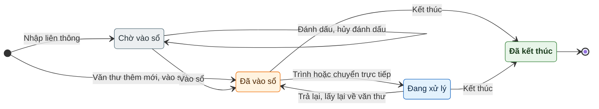

### Văn bản đến: trạng thái một dòng trong luồng xử lý

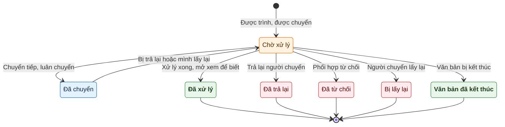

### Văn bản đến: luồng nghiệp vụ

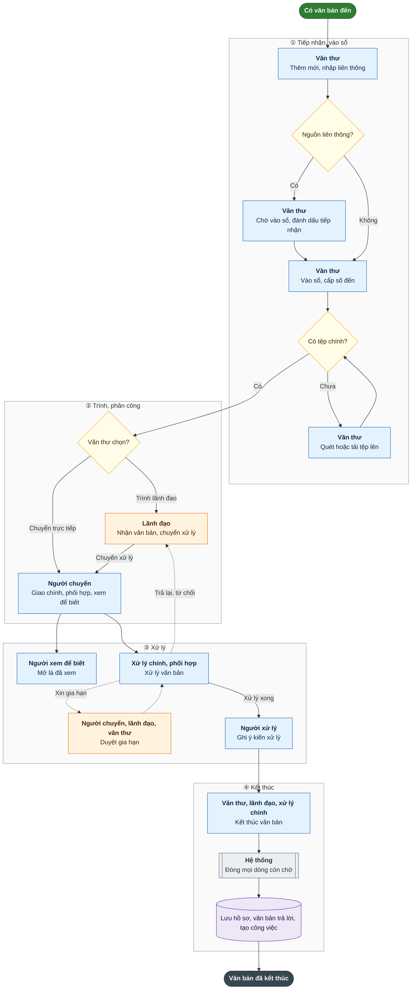

### Văn bản đi: trạng thái văn bản

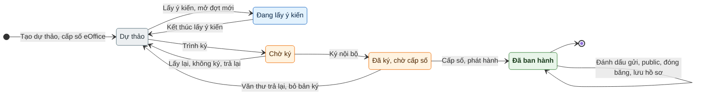

### Văn bản đi: cấp số, phát hành và liên thông

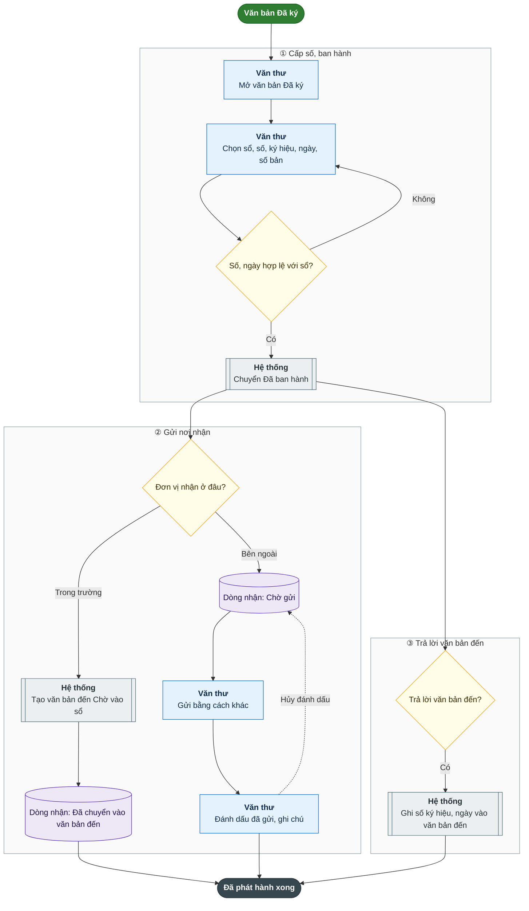

### Giao việc: trạng thái dòng phân công

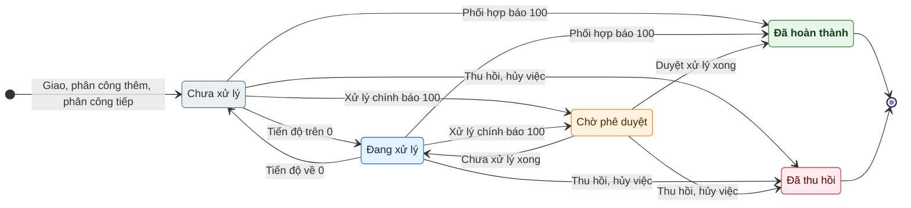

### Giao việc: luồng nghiệp vụ

Mã không có bước "nhận việc" riêng: dòng ở Chưa xử lý là đã giao tới người nhận (có thông báo); lần cập nhật tiến độ đầu tiên đưa dòng sang Đang xử lý.

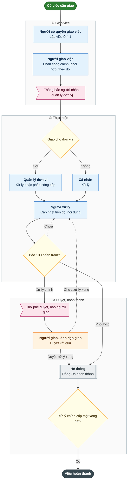

### Hồ sơ công việc: trạng thái hồ sơ

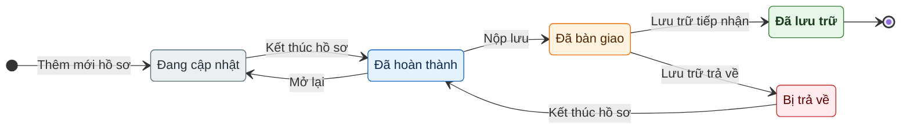

### Đăng ký phòng họp: trạng thái lượt đăng ký

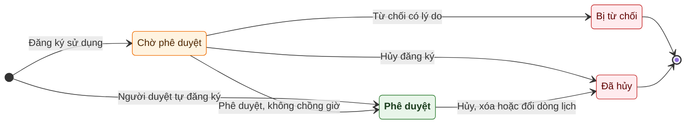

### Luồng đăng nhập thay

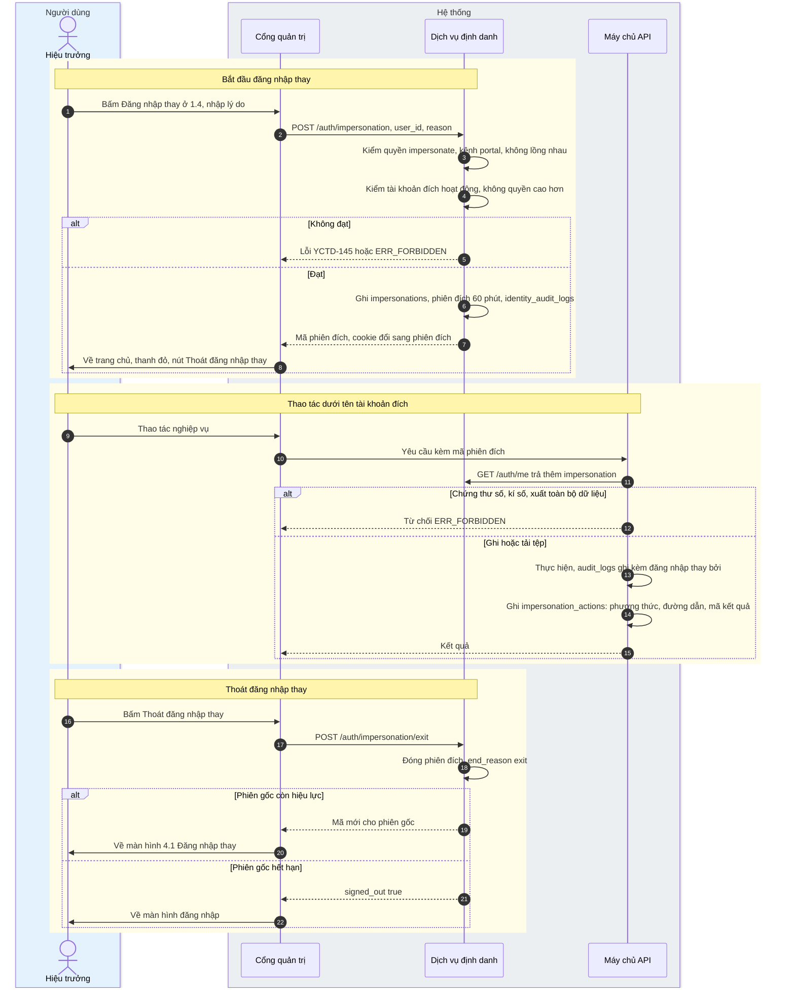

### Luồng xuất toàn bộ dữ liệu

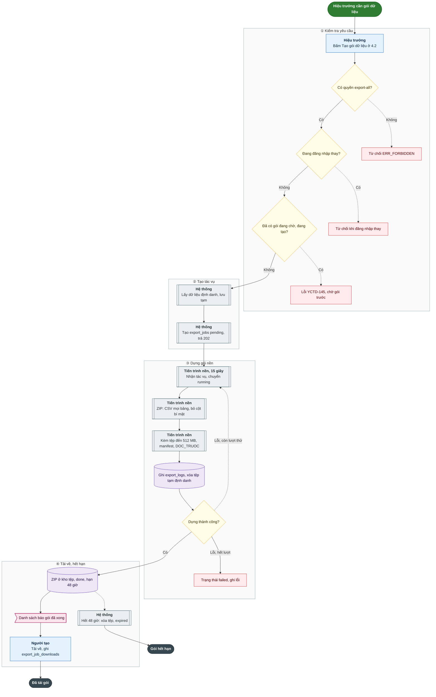

### Cấu trúc người dùng, nhóm, quyền, phân hệ, menu

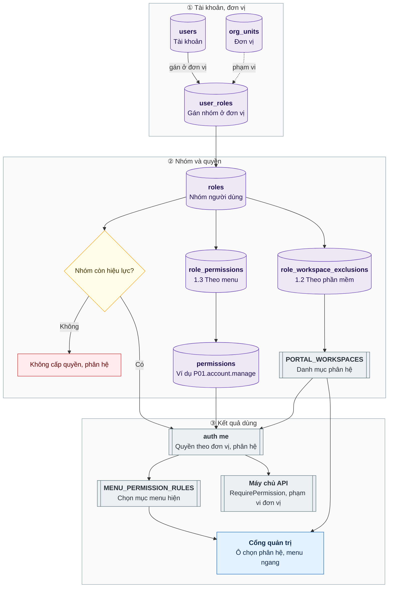

### Sơ đồ KPI: từ giao việc đến biểu quyết và khóa kỳ

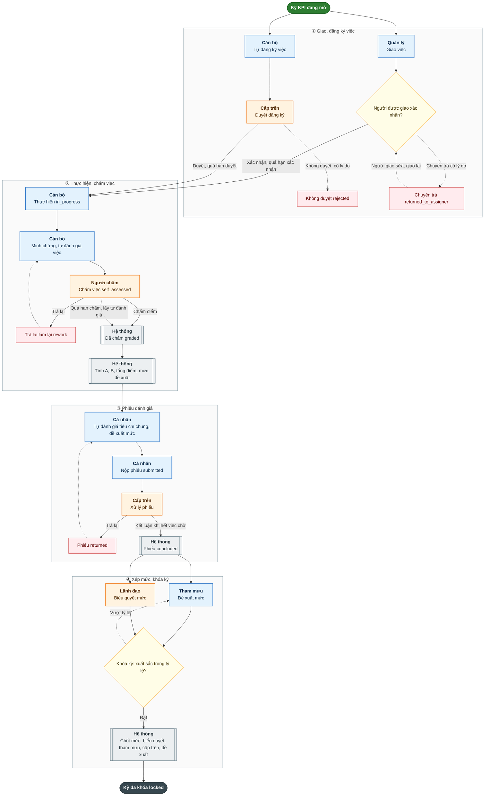

### Trạng thái việc KPI

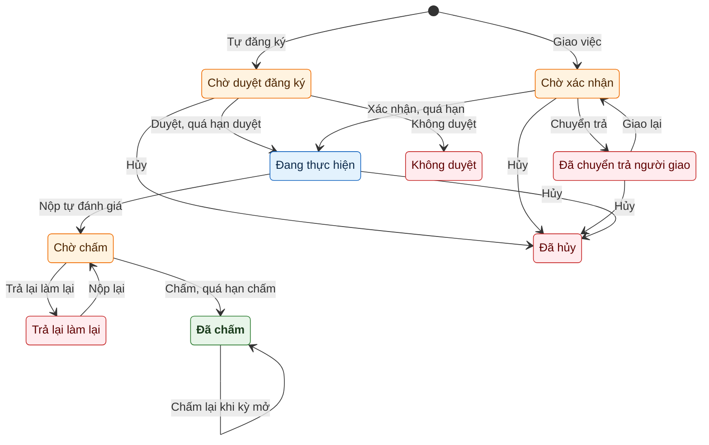

### Trạng thái phiếu đánh giá KPI

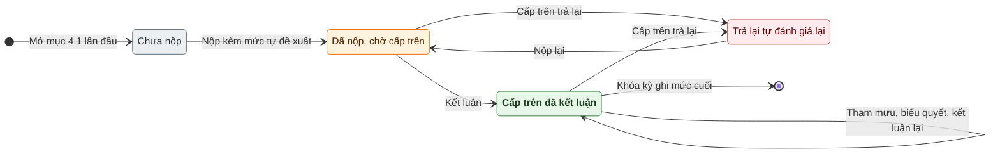

### Duyệt nội dung website

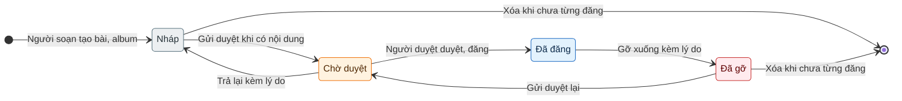

### Phục vụ trang công khai theo tên miền

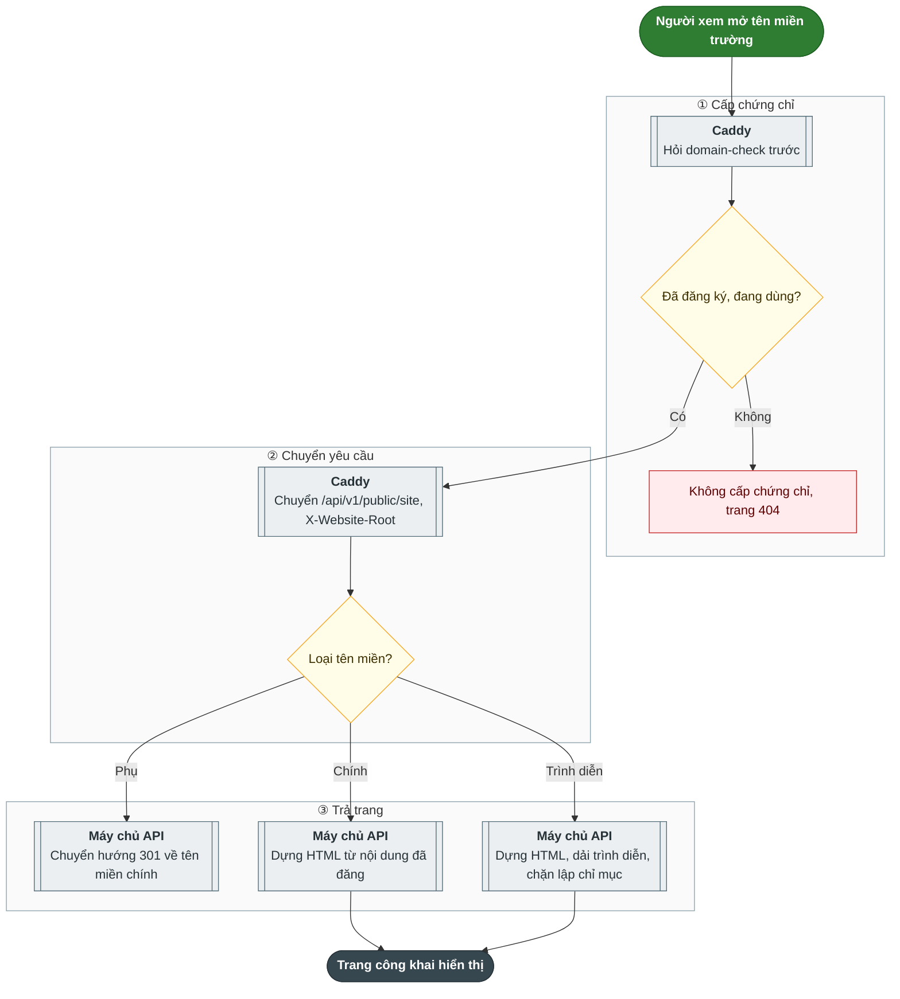

### Duyệt hồ sơ chuyên môn theo luồng duyệt của thư mục

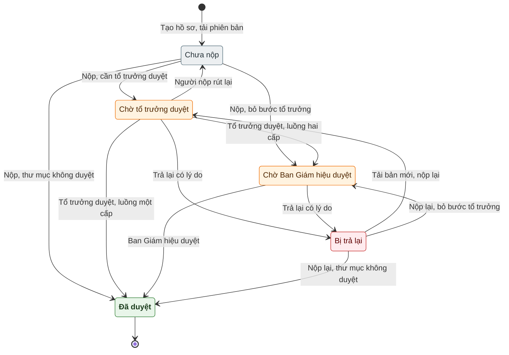

### Bước đầu khi nộp hồ sơ chuyên môn

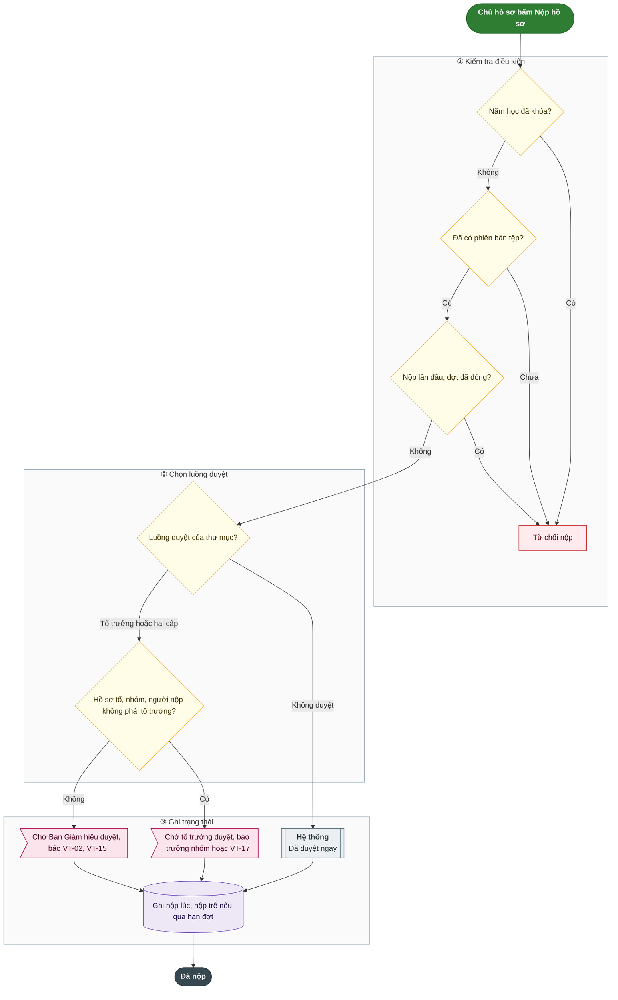

### Duyệt kế hoạch giáo dục nhiều bước

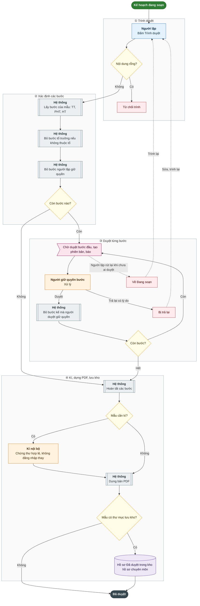

### Trạng thái đăng ký khoá bồi dưỡng

```mermaid
stateDiagram-v2
  direction LR
  classDef nhap fill:#eceff1,stroke:#546e7a,color:#263238
  classDef cho fill:#fff3e0,stroke:#ef6c00,color:#4e2600
  classDef dang fill:#e3f2fd,stroke:#1565c0,color:#0d2a4a
  classDef xong fill:#e8f5e9,stroke:#2e7d32,color:#1b3d1d,font-weight:bold
  classDef huy fill:#ffebee,stroke:#c62828,color:#5f0000

  state "Chờ duyệt" as pending
  state "Tổ đã duyệt" as team_approved
  state "Đã duyệt" as approved
  state "Không duyệt" as rejected
  state "Đã huỷ" as cancelled

  [*] --> pending : Giáo viên đăng ký, khoá mở, còn hạn, còn chỉ tiêu
  pending --> team_approved : Tổ trưởng duyệt cấp tổ
  pending --> approved : Ban Giám hiệu duyệt
  team_approved --> approved : Ban Giám hiệu duyệt
  pending --> rejected : Tổ trưởng, Ban Giám hiệu không duyệt
  team_approved --> rejected : Ban Giám hiệu không duyệt
  pending --> cancelled : Người đăng ký huỷ
  rejected --> pending : Đăng ký lại
  cancelled --> pending : Đăng ký lại
  approved --> [*] : Ghi kết quả, tính tiết, cấp chứng nhận

  class pending cho
  class team_approved cho
  class approved xong
  class rejected huy
  class cancelled huy
```

### Tính giờ bồi dưỡng và gợi ý theo năng lực số

```mermaid
flowchart TD
  classDef batdau fill:#2e7d32,stroke:#1b5e20,color:#ffffff,font-weight:bold
  classDef ketthuc fill:#37474f,stroke:#263238,color:#ffffff,font-weight:bold
  classDef nguoi fill:#e3f2fd,stroke:#1565c0,color:#0d2a4a
  classDef heth fill:#eceff1,stroke:#546e7a,color:#263238
  classDef duyet fill:#fff3e0,stroke:#ef6c00,color:#4e2600
  classDef hoi fill:#fffde7,stroke:#f9a825,color:#3e2f00
  classDef bao fill:#fce4ec,stroke:#ad1457,color:#4a0020
  classDef chan fill:#ffebee,stroke:#c62828,color:#5f0000
  classDef dulieu fill:#ede7f6,stroke:#5e35b1,color:#1f0f4d

  subgraph P1["① Nguồn tiết"]
    A[("Đăng ký Đã duyệt, kết quả Đạt")]:::dulieu
    C[("Chứng chỉ nhập tay trong năm học")]:::dulieu
    B[["<b>Hệ thống</b><br/>Tiết ghi nhận, trống lấy tiết khoá"]]:::heth
    D[["<b>Hệ thống</b><br/>Số tiết của chứng chỉ"]]:::heth
    A --> B
    C --> D
  end

  subgraph P2["② So định mức"]
    E[["<b>Hệ thống</b><br/>Tổng tiết năm học"]]:::heth
    F{"Đủ định mức, mặc định 120?"}:::hoi
    G>"Hiện số tiết còn thiếu ở 6.1, 6.3"]:::bao
    E --> F
    F -->|"Thiếu"| G
  end

  subgraph P3["③ Gợi ý theo năng lực số"]
    H["<b>Giáo viên</b><br/>Tự đánh giá năng lực số theo kỳ"]:::nguoi
    I{"Đã xác nhận?"}:::hoi
    J[["<b>Hệ thống</b><br/>Lấy mức xác nhận"]]:::heth
    K[["<b>Hệ thống</b><br/>Lấy mức tự đánh giá"]]:::heth
    L{"Mức nhỏ hơn ngưỡng?"}:::hoi
    M>"Gợi ý chuyên đề gắn miền đó"]:::bao
    H --> I
    I -->|"Có"| J --> L
    I -->|"Chưa"| K --> L
    L -->|"Có"| M
  end

  S1(["Tổng hợp tiết năm học"]):::batdau
  S2(["Kỳ tự đánh giá năng lực số"]):::batdau
  S1 --> A
  S1 --> C
  S2 --> H
  B --> E
  D --> E

  style P1 fill:#fafafa,stroke:#90a4ae
  style P2 fill:#fafafa,stroke:#90a4ae
  style P3 fill:#fafafa,stroke:#90a4ae
```

### Thi đua: từ đăng ký đến quyết định khen thưởng

```mermaid
flowchart TD
  classDef batdau fill:#2e7d32,stroke:#1b5e20,color:#ffffff,font-weight:bold
  classDef ketthuc fill:#37474f,stroke:#263238,color:#ffffff,font-weight:bold
  classDef nguoi fill:#e3f2fd,stroke:#1565c0,color:#0d2a4a
  classDef heth fill:#eceff1,stroke:#546e7a,color:#263238
  classDef duyet fill:#fff3e0,stroke:#ef6c00,color:#4e2600
  classDef hoi fill:#fffde7,stroke:#f9a825,color:#3e2f00
  classDef bao fill:#fce4ec,stroke:#ad1457,color:#4a0020
  classDef chan fill:#ffebee,stroke:#c62828,color:#5f0000
  classDef dulieu fill:#ede7f6,stroke:#5e35b1,color:#1f0f4d

  S(["Đợt thi đua mới"]):::batdau

  subgraph P1["① Lập, phát động đợt"]
    A["<b>Quản lý</b><br/>Lập đợt, chọn danh hiệu, kỳ KPI"]:::nguoi
    B>"<b>Quản lý</b><br/>Phát động đợt"]:::bao
    A --> B
  end

  subgraph P2["② Đăng ký, hồ sơ"]
    C["<b>Cá nhân, tổ trưởng</b><br/>Đăng ký thi đua"]:::nguoi
    D{"Quản lý duyệt đăng ký?"}:::hoi
    E["<b>Người đề nghị</b><br/>Lập hồ sơ, nối đăng ký đã duyệt"]:::nguoi
    F["<b>Người đề nghị</b><br/>Tự chấm, minh chứng kho 18e"]:::nguoi
    G["<b>Người đề nghị</b><br/>Nộp, chụp KPI và điều kiện"]:::nguoi
    H{"Quản lý tiếp nhận?"}:::hoi
    C --> D
    D -.->|"Trả lại"| C
    D -->|"Duyệt"| E
    E --> F --> G --> H
    H -.->|"Trả lại có lý do"| F
  end

  KT0(["Hồ sơ chờ bình xét"]):::ketthuc

  S --> A
  B --> C
  B --> E
  H -->|"Tiếp nhận"| KT0

  style P1 fill:#fafafa,stroke:#90a4ae
  style P2 fill:#fafafa,stroke:#90a4ae
```

### Thi đua: bình xét đến quyết định khen thưởng

```mermaid
flowchart TD
  classDef batdau fill:#2e7d32,stroke:#1b5e20,color:#ffffff,font-weight:bold
  classDef ketthuc fill:#37474f,stroke:#263238,color:#ffffff,font-weight:bold
  classDef nguoi fill:#e3f2fd,stroke:#1565c0,color:#0d2a4a
  classDef heth fill:#eceff1,stroke:#546e7a,color:#263238
  classDef duyet fill:#fff3e0,stroke:#ef6c00,color:#4e2600
  classDef hoi fill:#fffde7,stroke:#f9a825,color:#3e2f00
  classDef bao fill:#fce4ec,stroke:#ad1457,color:#4a0020
  classDef chan fill:#ffebee,stroke:#c62828,color:#5f0000
  classDef dulieu fill:#ede7f6,stroke:#5e35b1,color:#1f0f4d

  S0(["Hồ sơ đã tiếp nhận"]):::batdau

  subgraph P1["① Phiên bỏ phiếu"]
    I[("Hồ sơ chờ bình xét")]:::dulieu
    J["<b>Quản lý</b><br/>Mở phiên, đưa hồ sơ chờ vào"]:::nguoi
    K["<b>Thành viên hội đồng</b><br/>Bỏ phiếu kín"]:::duyet
    L[["<b>Quản lý, hệ thống</b><br/>Đóng phiên, tỉ lệ đồng ý"]]:::heth
    I --> J --> K --> L
  end

  subgraph P2["② Kết quả, phúc khảo"]
    M{"Đạt ngưỡng của danh hiệu?"}:::hoi
    N["Hội đồng thông qua"]:::duyet
    O["Hội đồng không thông qua"]:::chan
    P>"Công bố kết quả, mở phúc khảo"]:::bao
    Q{"Phúc khảo được chấp nhận?"}:::hoi
    M -->|"Đạt"| N --> P
    M -->|"Không đạt"| O --> P
    P --> Q
  end

  subgraph P3["③ Quyết định khen"]
    R{"Cấp quyết định?"}:::hoi
    S2["<b>Quản lý</b><br/>Dự thảo quyết định trường"]:::nguoi
    T["<b>Quản lý</b><br/>Dự thảo tờ trình cấp trên"]:::nguoi
    U["<b>Hiệu trưởng</b><br/>Ban hành"]:::duyet
    W>"Đã trình cấp trên"]:::bao
    X["<b>Quản lý</b><br/>Ghi kết quả của cấp trên"]:::nguoi
    R -->|"Trường"| S2 --> U
    R -->|"Cấp trên"| T --> U
    U -->|"Tờ trình"| W --> X
  end

  KT1(["Đã khen thưởng, ghi sổ có mã"]):::ketthuc
  KT2(["Cấp trên không khen"]):::ketthuc

  S0 --> I
  L --> M
  Q -.->|"Có"| I
  Q -->|"Không"| R
  U -->|"Quyết định"| KT1
  X -->|"Cấp trên khen"| KT1
  X -->|"Không khen"| KT2

  style P1 fill:#fafafa,stroke:#90a4ae
  style P2 fill:#fafafa,stroke:#90a4ae
  style P3 fill:#fafafa,stroke:#90a4ae
```

### Trạng thái đợt thi đua

```mermaid
stateDiagram-v2
  direction LR
  classDef nhap fill:#eceff1,stroke:#546e7a,color:#263238
  classDef cho fill:#fff3e0,stroke:#ef6c00,color:#4e2600
  classDef dang fill:#e3f2fd,stroke:#1565c0,color:#0d2a4a
  classDef xong fill:#e8f5e9,stroke:#2e7d32,color:#1b3d1d,font-weight:bold
  classDef huy fill:#ffebee,stroke:#c62828,color:#5f0000

  state "Đang soạn" as draft
  state "Đã phát động" as launched
  state "Đã công bố kết quả" as published
  state "Đã kết thúc" as closed

  [*] --> draft
  draft --> launched : Phát động
  draft --> [*] : Xóa
  launched --> published : Công bố khi hết phiên bỏ phiếu
  published --> published : Công bố lại sau bỏ phiếu lại
  published --> closed : Kết thúc khi hết phúc khảo chờ
  closed --> [*]

  class draft nhap
  class launched dang
  class published dang
  class closed xong
```

### Trạng thái hồ sơ đề nghị

```mermaid
stateDiagram-v2
  classDef nhap fill:#eceff1,stroke:#546e7a,color:#263238
  classDef cho fill:#fff3e0,stroke:#ef6c00,color:#4e2600
  classDef dang fill:#e3f2fd,stroke:#1565c0,color:#0d2a4a
  classDef xong fill:#e8f5e9,stroke:#2e7d32,color:#1b3d1d,font-weight:bold
  classDef huy fill:#ffebee,stroke:#c62828,color:#5f0000

  state "Đang soạn" as draft
  state "Đã nộp, chờ tiếp nhận" as submitted
  state "Bị trả lại" as returned
  state "Đã tiếp nhận, chờ bình xét" as accepted
  state "Hội đồng thông qua" as passed
  state "Hội đồng không thông qua" as failed
  state "Đã trình cấp trên" as proposed
  state "Đã khen thưởng" as awarded
  state "Cấp trên không khen" as not_awarded

  [*] --> draft
  draft --> submitted : Nộp hồ sơ
  submitted --> draft : Rút hồ sơ
  submitted --> accepted : Tiếp nhận
  submitted --> returned : Trả lại
  accepted --> returned : Trả lại khi chưa vào phiên
  returned --> submitted : Nộp lại
  accepted --> passed : Đóng phiên, đạt ngưỡng
  accepted --> failed : Đóng phiên, không đạt
  passed --> accepted : Chấp nhận phúc khảo
  failed --> accepted : Chấp nhận phúc khảo
  passed --> awarded : Quyết định của trường
  passed --> proposed : Ban hành tờ trình
  proposed --> awarded : Cấp trên khen
  proposed --> not_awarded : Cấp trên không khen

  class draft nhap
  class submitted cho
  class returned huy
  class accepted cho
  class passed dang
  class failed huy
  class proposed cho
  class awarded xong
  class not_awarded huy
```

### Đợt tự đánh giá bảo đảm chất lượng

```mermaid
flowchart TD
  classDef batdau fill:#2e7d32,stroke:#1b5e20,color:#ffffff,font-weight:bold
  classDef ketthuc fill:#37474f,stroke:#263238,color:#ffffff,font-weight:bold
  classDef nguoi fill:#e3f2fd,stroke:#1565c0,color:#0d2a4a
  classDef heth fill:#eceff1,stroke:#546e7a,color:#263238
  classDef duyet fill:#fff3e0,stroke:#ef6c00,color:#4e2600
  classDef hoi fill:#fffde7,stroke:#f9a825,color:#3e2f00
  classDef bao fill:#fce4ec,stroke:#ad1457,color:#4a0020
  classDef chan fill:#ffebee,stroke:#c62828,color:#5f0000
  classDef dulieu fill:#ede7f6,stroke:#5e35b1,color:#1f0f4d

  S(["Năm học cần tự đánh giá"]):::batdau

  subgraph P1["① Lập đợt"]
    A["<b>Ban Giám hiệu</b><br/>Chọn bộ tiêu chuẩn, lập đợt"]:::nguoi
    B[["<b>Hệ thống</b><br/>Tạo một phiếu mỗi tiêu chí"]]:::heth
    C["<b>Ban Giám hiệu</b><br/>Lập hội đồng có một Chủ tịch"]:::nguoi
    D["<b>Ban Giám hiệu</b><br/>Lập nhóm, phân tiêu chí cho nhóm"]:::nguoi
    E{"Có Chủ tịch, phân công đủ?"}:::hoi
    A --> B --> C --> D --> E
    E -.->|"Chưa"| D
  end

  subgraph P2["② Đánh giá tiêu chí"]
    F["<b>Ban Giám hiệu</b><br/>Bắt đầu đánh giá"]:::nguoi
    G[["<b>Hệ thống</b><br/>Kế thừa minh chứng năm trước"]]:::heth
    H["<b>Nhóm công tác</b><br/>Chỉ báo, hiện trạng, cải tiến, chọn mức"]:::nguoi
    I["<b>Nhóm công tác</b><br/>Thêm minh chứng Hn-a.b-c"]:::nguoi
    J["<b>Nhóm công tác</b><br/>Nộp phiếu"]:::nguoi
    F -.->|"nếu có"| G
    F --> H
    G --> I
    H --> I
    H --> J
  end

  subgraph P3["③ Duyệt phiếu"]
    K["<b>Ban Giám hiệu</b><br/>Duyệt phiếu"]:::duyet
    L{"Mọi phiếu đã duyệt?"}:::hoi
    K -->|"Duyệt"| L
  end

  subgraph P4["④ Chốt kết quả"]
    M[["<b>Hệ thống</b><br/>Gợi ý mức thấp nhất các tiêu chí"]]:::heth
    N["<b>Hội đồng</b><br/>Chốt mức trường, Hoàn thành đợt"]:::duyet
    O>"Báo cáo tự đánh giá Word, PDF"]:::bao
    P[["<b>Hệ thống</b><br/>Kế hoạch cải tiến thành kế hoạch nháp"]]:::heth
    M --> N
    N --> O
    N --> P
  end

  subgraph P5["⑤ Công nhận"]
    Q["<b>Ban Giám hiệu</b><br/>Ghi kết quả đánh giá ngoài"]:::nguoi
    R{"Cấp độ từ 1, có bản rà soát 1.7?"}:::hoi
    SS[["<b>Hệ thống</b><br/>Cập nhật cấp độ, ngày vào 1.7"]]:::heth
    T[("Lưu ở đợt, hiệu lực 5 năm")]:::dulieu
    Q --> R
    R -->|"Có"| SS
    R -->|"Không"| T
  end

  KT(["Đã ghi công nhận"]):::ketthuc

  S --> A
  E -->|"Đủ"| F
  J --> K
  K -.->|"Trả lại có lý do"| H
  L -.->|"Chưa"| H
  L -->|"Rồi"| M
  N --> Q
  N -.->|"Mở lại đợt"| F
  SS --> KT
  T --> KT

  style P1 fill:#fafafa,stroke:#90a4ae
  style P2 fill:#fafafa,stroke:#90a4ae
  style P3 fill:#fafafa,stroke:#90a4ae
  style P4 fill:#fafafa,stroke:#90a4ae
  style P5 fill:#fafafa,stroke:#90a4ae
```

### Trạng thái phiếu đánh giá tiêu chí

```mermaid
stateDiagram-v2
  direction LR
  classDef nhap fill:#eceff1,stroke:#546e7a,color:#263238
  classDef cho fill:#fff3e0,stroke:#ef6c00,color:#4e2600
  classDef dang fill:#e3f2fd,stroke:#1565c0,color:#0d2a4a
  classDef xong fill:#e8f5e9,stroke:#2e7d32,color:#1b3d1d,font-weight:bold
  classDef huy fill:#ffebee,stroke:#c62828,color:#5f0000

  state "Đang soạn" as draft
  state "Chờ duyệt" as submitted
  state "Đã duyệt" as approved
  state "Bị trả lại" as returned

  [*] --> draft
  draft --> submitted : Nộp đủ nội dung và mức
  submitted --> approved : Duyệt phiếu
  submitted --> returned : Trả lại có lý do
  returned --> submitted : Nộp lại
  approved --> returned : Mở lại khi đợt đang đánh giá

  class draft nhap
  class submitted cho
  class approved xong
  class returned huy
```
