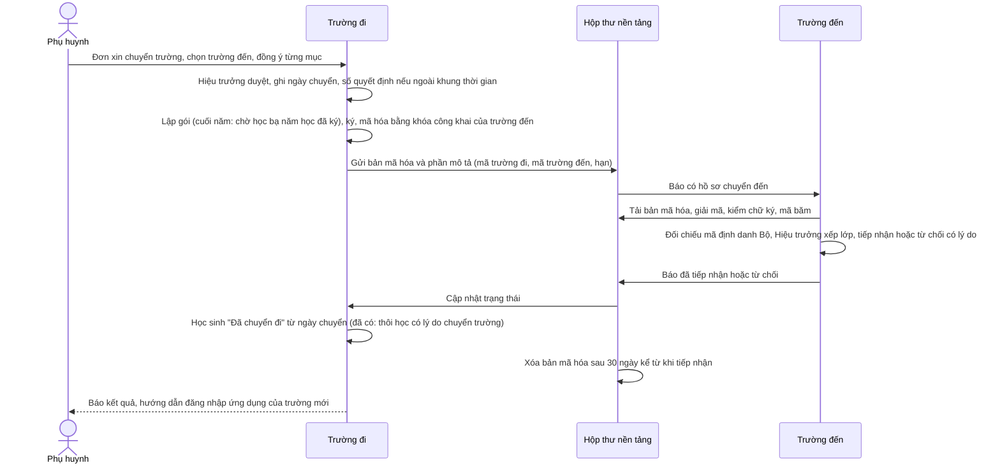
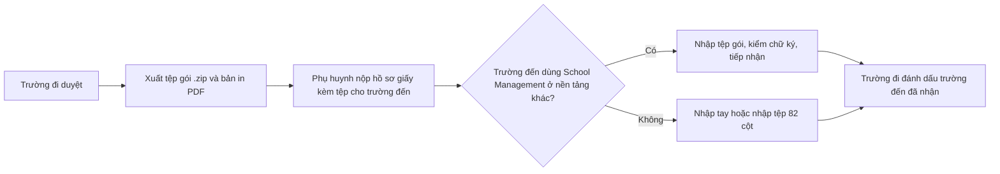
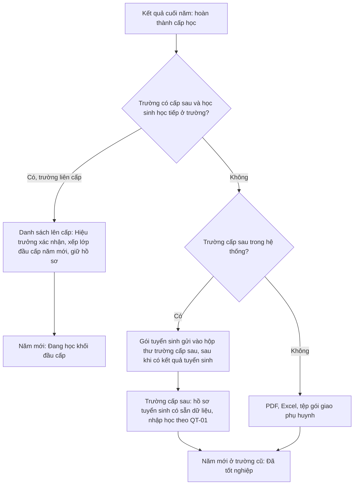

# YCTD-390: Liên thông dữ liệu học sinh khi chuyển trường, chuyển cấp

Ngày 2026-10-30. Mức: **Lớn** (thêm bảng ở cơ sở dữ liệu nền tảng, đổi luồng chuyển năm học, đổi phân quyền giữa trường, chạm nhiều module: học sinh, học bạ, tuyển sinh, tốt nghiệp, ứng dụng phụ huynh, cổng vận hành). Eric duyệt phương án, bản mẫu MH-650 đến MH-659 và danh sách lát ngày 2026-10-30. Lát L0 (tài liệu này) không đổi mã nguồn.

Bản mẫu: `index.html` cùng thư mục (mười màn hình, nút chọn cỡ 1366, 1024, 390).

Ký hiệu nguồn: **[Mã]** đọc từ mã nguồn; **[Văn bản]** đọc từ văn bản gốc; **[Thứ cấp]** từ trang tổng hợp pháp luật, chưa đối chiếu văn bản gốc; **[Đề xuất]** chưa có, cần Eric duyệt.

---

## 1. Tóm tắt

1. Hiện chỉ có "chuyển đi" một chiều: trường đi duyệt, học sinh thành thôi học, xuất tệp 82 cột hoặc PDF hồ sơ. Trường đến nhập tệp 82 cột thành hồ sơ nháp. **Không có học bạ, kết quả học tập, sức khỏe, khen thưởng trong tệp; không có đồng ý của phụ huynh; không có kênh nào giữa hai trường cùng hệ thống.** [Mã]
2. Trường liên cấp đang làm sai: học sinh hoàn thành tiểu học bị đặt "Đã tốt nghiệp" khi sang năm mới dù trường có THCS. [Mã]
3. Không có tiếp nhận học lại; học sinh quay lại thành hồ sơ mới, mất lịch sử. Lên lớp đầu năm làm tay. [Mã]
4. Đề xuất một **gói chuyển trường** định dạng `school-management.student-transfer/1` (cùng kiểu với gói khoá học `course-package/1` đã có), dùng cho mọi trường hợp đi khỏi trường:
   - trong hệ thống: trường đi gửi gói đã ký, mã hóa bằng khóa của trường đến vào **hộp thư chuyển trường** ở cơ sở dữ liệu nền tảng; nền tảng chỉ giữ bản mã hóa, không đọc được;
   - ngoài hệ thống: cùng gói dưới dạng tệp, kèm bản in PDF cho thủ tục giấy.
5. Lên cấp trong trường liên cấp không cần gói: sửa bước chuyển năm học để học sinh đi tiếp sang cấp sau, giữ nguyên hồ sơ.
6. Thủ tục với Bộ (csdl.moet.gov.vn) vẫn làm tay vì chưa có giao diện lập trình; hệ thống nhắc việc, xuất tệp và ghi người làm, ngày làm.

## 2. Căn cứ

### 2.1. Chuyển trường

| Văn bản | Nội dung dùng | Mức |
|---|---|---|
| Văn bản hợp nhất 07/VBHN-BGDĐT ngày 03/8/2022 (Quyết định 51/2002/QĐ-BGDĐT sửa bởi Thông tư 50/2021/TT-BGDĐT): chuyển trường và tiếp nhận học sinh THCS, THPT | Hồ sơ: đơn do cha mẹ hoặc người giám hộ ký; học bạ bản chính; giấy chứng nhận trúng tuyển lớp 10 (THPT); giấy giới thiệu do Hiệu trưởng trường đi cấp; giấy giới thiệu của Ủy ban nhân dân xã (THCS) hoặc Sở (THPT) khi chuyển tỉnh | [Văn bản] qua Công văn 755/SGDĐT-GDPT ngày 09/9/2025 của Sở Lào Cai dẫn lại; chưa đọc toàn văn văn bản hợp nhất |
| Thông tư 28/2020/TT-BGDĐT, Điều lệ trường tiểu học | Hồ sơ tiểu học: đơn; học bạ bản chính; thông tin tài liệu học tập, tiến độ chương trình, bảng tổng hợp kết quả đánh giá; kế hoạch giáo dục cá nhân của học sinh khuyết tật. Hiệu trưởng trường đến quyết định | [Văn bản] qua Công văn 755 Lào Cai; Điều 35, 36 và thời hạn 03 ngày làm việc: [Thứ cấp] |
| Thông tư 10/2025/TT-BGDĐT ngày 12/6/2025 (phân quyền chính quyền địa phương hai cấp) | Chuyển trường THCS ngoài tỉnh do Chủ tịch Ủy ban nhân dân xã quyết định; THPT ngoài tỉnh do Giám đốc Sở | [Văn bản] qua Công văn 755 Lào Cai |
| Công văn 755/SGDĐT-GDPT Sở Lào Cai ngày 09/9/2025 | Thời gian chuyển: 15/01 đến 30/01 (hết học kỳ I) hoặc trong hè; ngoài thời gian do Chủ tịch xã (TH, THCS) hoặc Giám đốc Sở (THPT) quyết định. Xin học lại: trong hè, đơn, học bạ, bằng cấp dưới. THCS nộp qua Cổng dịch vụ công quốc gia. Trường báo cáo chuyển trường cuối học kỳ I và cuối năm | [Văn bản] (tệp gốc của Sở). Khung thời gian là của Lào Cai, tỉnh khác có thể khác |
| Thông tư 42/2021/TT-BGDĐT, Điều 10 | Mã định danh học sinh duy nhất, không đổi, dùng mọi cấp; học sinh chuyển đi thì trường đi cập nhật trạng thái hồ sơ điện tử, trường đến cập nhật theo mã định danh | Số hiệu, Điều 10: [Văn bản] qua báo cáo csdl-moet; câu về chuyển đi: [Thứ cấp] |

Kết luận cho thiết kế: **học bạ bản chính bằng giấy vẫn là hồ sơ bắt buộc**. Gói số giúp trường đến nhập dữ liệu, không thay giấy tờ cho đến khi Bộ ban hành học bạ số chính thức (báo cáo csdl-moet ghi "CSDL học bạ số, văn bằng số dự kiến xong 2026", chưa có văn bản).

### 2.2. Bảo vệ dữ liệu cá nhân

**Nghị định 13/2023/NĐ-CP đã hết hiệu lực từ 01/01/2026** (Điều 42 Nghị định 356/2025/NĐ-CP, ghi ở `tai_lieu/48_HO_SO_PHAP_LY/00_MUC_LUC.md`). Căn cứ hiện hành, đã đọc trong bộ hồ sơ pháp lý của dự án:

| Điều | Áp dụng |
|---|---|
| Khoản 2 Điều 24 Luật Bảo vệ dữ liệu cá nhân 91/2025/QH15 | Trẻ từ đủ 7 tuổi: cần đồng ý của cả trẻ và người đại diện |
| Điều 19 Luật 91/2025 | Trường hợp xử lý không cần đồng ý. **Chưa xác định** điểm nào áp dụng cho việc trường đi gửi hồ sơ chuyển trường bắt buộc; cần luật sư xác nhận (câu hỏi Q2) |
| Điều 7 Nghị định 356/2025/NĐ-CP | Nội dung thỏa thuận chuyển giao dữ liệu cá nhân (giữa hai bên kiểm soát: trường đi và trường đến) |
| Khoản 2 Điều 37 Luật 91/2025 | Nền tảng là bên xử lý, chỉ xử lý theo chỉ dẫn của trường; hộp thư chuyển trường là việc xử lý theo chỉ dẫn của hai trường |

## 3. Hiện trạng [Mã]

| Mảng | Hiện có | Tệp |
|---|---|---|
| Cấu trúc dữ liệu | Mỗi trường ba loại cơ sở dữ liệu: định danh, hệ thống, mỗi năm học một cơ sở dữ liệu. Mỗi trường có khóa mã hóa, khóa băm số định danh riêng, nên băm số định danh **không so được giữa hai trường** | `database/platform/migrations/0002_create_schools.ts:71-103` |
| Biến động 4.2 | Danh sách dựng từ lịch sử: nhập học, chuyển lớp, chuyển đơn vị, thôi học. Chú thích ghi rõ "chưa liên thông với trường khác" | `apps/api/src/children/student-movements.ts:14-27` |
| Chuyển đi | `student_transfers` (đi, đến; chờ duyệt, đã duyệt, từ chối, đã nhận; tên trường đến là chữ tự do). Hiệu trưởng (quyền `childApprove`) duyệt thì học sinh thành thôi học. Hồ sơ: PDF hoặc tệp 82 cột, chỉ có hồ sơ và gia đình | `apps/api/src/student-records/student-transfers.ts:173-371`, `moet-child-file.ts` |
| Chuyển đến | Nhập tệp 82 cột, tạo hồ sơ nháp, rồi duyệt nhập học như thường. Học sinh đã có hồ sơ (trùng băm số định danh) thì từ chối | `student-transfers.ts:371`, `apps/api/src/imports/moet-imports.ts:262-276` |
| Thôi học | Đặt `withdrawn`, ngày, lý do; hủy đăng ký dịch vụ; báo giáo viên, kế toán. Không có bước duyệt riêng, không có đồng ý | `apps/api/src/children/child-lifecycle.ts:214-317` |
| Tạm nghỉ | Trạng thái `paused` có trong lược đồ, không chức năng nào đặt | `database/school-year/schema.ts:655` |
| Học lại | Không có. Học sinh thôi học không sang năm mới; quay lại thành hồ sơ mới | — |
| Chuyển năm học | Chép hồ sơ, phụ huynh, sức khỏe nền, tài khoản học và thi, lớp đang học sang cơ sở dữ liệu năm mới, giữ nguyên định danh. Điểm, đánh giá, điểm danh, khám sức khỏe, khen thưởng ở lại năm cũ. Lên lớp làm tay bằng chuyển lớp | `apps/api/src/children/children-transition.ts:6,92` |
| Lên lớp, lưu ban | `completion_results`: lên lớp, hoàn thành cấp, chờ rèn luyện hè hoặc kiểm tra lại, ở lại lớp; có `next_grade_level` nhưng chưa dùng để xếp lớp năm mới | `apps/api/src/learning-records/learning-records.ts:1587`, `packages/shared/src/student-records.ts:81-92` |
| Hoàn thành cấp | Sang năm mới: học sinh `level_completed` thành `graduated`. Khi cấp sau khác cấp hiện tại thì coi là lớp cuối, **kể cả khi trường có cấp sau** | `learning-records-transition.ts:30-54`, `learning-records.ts:709` |
| Học bạ | `learning_records` một bản mỗi năm học, nội dung JSON, ký nội bộ (khối xác nhận và mã băm SHA-256, chưa là chữ ký số), xuất PDF. Chép sang năm mới. Không có xuất JSON, XML, không nhập học bạ trường khác | `learning-records.ts:1630-1695`, `apps/api/src/signing/dossier-signer.ts` |
| THCS lên THPT | `transfer_dossiers` (đã chuẩn bị, đã gửi) chỉ là dấu trạng thái, không sinh tệp | `apps/api/src/graduation/graduation.ts:1181-1250` |
| Mầm non lên Tiểu học | Hồ sơ cuối cấp có xác nhận của phụ huynh, `admission_consent`, PDF, Excel; không gửi cho trường nào. Tuyển sinh đầu cấp nhận danh sách phân tuyến bằng Excel, chuyển hồ sơ trúng tuyển thành học sinh | `apps/api/src/entry-admissions/final-year-records.ts`, `entry-intake-transfer.ts` |
| Mã định danh Bộ | `children.moet_student_code`, nhập tay; số định danh mã hóa, 4 số cuối, đánh dấu xác thực tay. Không có kết nối csdl.moet | `student-records.ts:159`, `national-ids.ts` |
| Tài khoản phụ huynh, học sinh | Theo từng trường: `users.phone` duy nhất trong cơ sở dữ liệu định danh của một trường. Không có danh tính chung trên nền tảng | `database/identity/migrations/0002_create_account_tables.ts:11` |
| Giữa các trường | Không có giao diện lập trình nào cho trường này đọc trường kia. Chỉ có số liệu tổng hợp cho cấp trên (có đồng ý, ẩn nhóm nhỏ) | `apps/api/src/parent-org/parent-org.ts` |
| Kỷ luật học sinh | Không có bảng. Khuyết tật chỉ nằm trong `moet_profile` | — |

## 4. Nguyên tắc thiết kế [Đề xuất]

1. **Trường là bên kiểm soát dữ liệu; hai trường không đọc dữ liệu của nhau.** Thứ duy nhất đi giữa hai trường là gói đã được Hiệu trưởng trường đi duyệt. Trường đến không có quyền tra cứu học sinh của trường khác.
2. **Gói là bản chụp tĩnh, ký và mã hóa.** Nền tảng chuyển, không mở. Mất kết nối, trường đi tắt, gói vẫn nguyên.
3. **Học sinh đi, sổ sách ở lại.** Dữ liệu tài chính, điểm danh từng ngày, nhật ký, tin nhắn ở trường cũ. Phụ huynh vẫn xem học bạ, biên lai của các năm đã học ở trường cũ.
4. **Mã định danh Bộ là khóa đối chiếu.** Thiếu mã thì đối chiếu họ tên, ngày sinh, họ tên mẹ (cách CSDL ngành dò trùng); trùng thì người tiếp nhận chọn, không tự gộp.
5. **Một định dạng cho trong và ngoài hệ thống.** Khác nhau chỉ ở đường đi (hộp thư hay tệp).
6. **Công nợ không chặn chuyển trường.** Chỉ cảnh báo ở trường đi. Quy tắc BR-89 (không mở năm mới khi học sinh đã đi còn nợ) giữ nguyên.
7. **Không sửa dữ liệu đã chốt.** Học bạ đã ký đi nguyên bản, trường đến lưu chỉ đọc.

## 5. Các trường hợp và luồng

### 5.1. Bảng ai làm gì

| Mã | Trường hợp | Ai khởi tạo | Ai duyệt | Đồng ý của cha mẹ | Đường đi dữ liệu |
|---|---|---|---|---|---|
| C1 | Chuyển trường giữa năm, trong hệ thống | Phụ huynh nộp đơn ở ứng dụng, hoặc trường lập theo đơn giấy hay đơn trên Cổng dịch vụ công | Hiệu trưởng trường đi duyệt gửi; Hiệu trưởng trường đến tiếp nhận (THCS, THPT ngoài tỉnh: ghi số quyết định của xã hoặc Sở) | Đơn của cha mẹ là bắt buộc; đồng ý thêm cho mục không bắt buộc; trẻ từ đủ 7 tuổi cũng đồng ý | Gói qua hộp thư nền tảng |
| C2 | Chuyển trường cuối năm, trong hệ thống | Như C1, nộp trong hè | Như C1 | Như C1 | Gói gửi sau khi học bạ năm học đã ký; trường đến nhận vào năm học mới |
| C3 | Chuyển sang trường ngoài hệ thống | Như C1 | Hiệu trưởng trường đi | Như C1 | Tệp gói và bản in PDF giao phụ huynh hoặc gửi trường đến; trường đi đánh dấu "trường đến đã nhận" khi có xác nhận |
| C4 | Từ ngoài hệ thống chuyển đến | Phụ huynh nộp hồ sơ giấy cho trường đến | Hiệu trưởng trường đến | Đơn giấy | Nhập tệp gói (nếu trường đi dùng định dạng này), tệp 82 cột (đã có), hoặc nhập tay và tải bản quét học bạ |
| L1 | Mầm non lên Tiểu học, khác trường | Trường mầm non lập hồ sơ cuối cấp (đã có), phụ huynh xác nhận | Trường tiểu học tiếp nhận theo tuyển sinh đầu cấp | Đã có `admission_consent` ở hồ sơ cuối cấp | Gói tuyển sinh (tập con của gói chuyển trường) gửi cho trường trúng tuyển nếu trong hệ thống; ngoài hệ thống: PDF, Excel như hiện tại |
| L2 | Tiểu học lên THCS, khác trường | Trường tiểu học, sau khi chốt hoàn thành chương trình | Trường THCS tiếp nhận | Như L1 | Gói tuyển sinh có học bạ tiểu học |
| L3 | THCS lên THPT, khác trường | Trường THCS, sau xét tốt nghiệp và có kết quả tuyển sinh lớp 10 | Trường THPT tiếp nhận | Như L1 | Nâng `transfer_dossiers` từ dấu trạng thái thành gói thật |
| L4 | Lên cấp trong trường liên cấp | Bước chuyển năm học | Hiệu trưởng xác nhận danh sách lên cấp | Không cần: cùng bên kiểm soát dữ liệu | Không có gói; học sinh đi tiếp trong cơ sở dữ liệu năm mới |
| L5 | Lên cấp, trường mới đã duyệt trúng tuyển trên cổng tuyển sinh (bổ sung theo Eric ngày 2026-10-30) | **Trường mới**: hồ sơ tuyển sinh "Đạt" hoặc "Trúng tuyển" sinh **yêu cầu chuyển hồ sơ** gửi trường cũ | Hiệu trưởng trường cũ xác nhận chuyển (hoặc từ chối có lý do: không khớp học sinh, chưa hoàn thành cấp); trường mới không cần tiếp nhận lại vì đã duyệt ở tuyển sinh | Đơn tuyển sinh của phụ huynh ở trường mới có ô đồng ý lấy hồ sơ từ trường cũ; phụ huynh xác nhận thêm ở ứng dụng trường cũ (Q8) | Yêu cầu và gói đều qua hộp thư nền tảng; trường cũ ngoài hệ thống: in giấy đề nghị chuyển hồ sơ |
| R1 | Lưu ban | Giáo viên chủ nhiệm ghi kết quả "ở lại lớp" (đã có) | Hiệu trưởng xác nhận kết quả cuối năm (đã có) | Không | Học sinh sang năm mới, xếp vào khối cũ |
| R2 | Thôi học | Trường, theo đơn hoặc quyết định | Hiệu trưởng (`childApprove`, đã có) | Đơn của cha mẹ (ghi nhận, không bắt buộc trong hệ thống) | Hồ sơ ở lại, trạng thái thôi học; nhắc cập nhật trạng thái trên CSDL ngành |
| R3 | Học lại cùng trường | Phụ huynh hoặc học sinh nộp đơn xin học lại | Hiệu trưởng | Đơn | Lấy lại hồ sơ cũ từ cơ sở dữ liệu năm học trước của chính trường, giữ định danh và lịch sử |
| R4 | Học lại ở trường khác | Như C4 | Như C4 | Như C4 | Như C4; nếu trường cũ trong hệ thống thì trường cũ lập gói theo đơn của phụ huynh như C1 |

### 5.2. Sơ đồ C1, C2: chuyển trường trong hệ thống



Phụ huynh rút đơn được trước khi trường đến tiếp nhận; gói trong hộp thư bị thu hồi. Trường đến không trả lời quá hạn thì nhắc Hiệu trưởng hai bên; trường đi hủy gửi được.

Cuối năm (C2): đề nghị lập trong năm học cũ, học sinh vẫn được chuyển năm học sang năm mới ở trường đi cho đến ngày chuyển; trường đến tiếp nhận vào năm học mới. Lý do: học bạ năm cũ cần ký xong, và trường đến thường mở năm mới trước khai giảng.

### 5.3. Sơ đồ C3, C4: ngoài hệ thống



Tệp gói ngoài hệ thống **mã hóa bằng mật khẩu** do trường đi sinh, in trên bản in PDF giao phụ huynh (không gửi kèm tệp). Trường đến nhập mật khẩu khi nhập tệp.

### 5.4. Sơ đồ lên cấp



Gói tuyển sinh chỉ gửi cho trường **đã nhận học sinh** (danh sách trúng tuyển hoặc phân tuyến trường đến nhập, hoặc phụ huynh chọn trường đến ở ứng dụng). Không phát gói cho nhiều trường để trường chọn.

### 5.4a. Sơ đồ L5: trường mới duyệt trên cổng tuyển sinh, yêu cầu trường cũ chuyển hồ sơ

Hiện có: tuyển sinh đầu cấp nhận hồ sơ trực tuyến, hồ sơ do nhân viên nhập, hồ sơ phân tuyến nhập từ Excel; hồ sơ "Đạt" chuyển thành học sinh qua QT-01 (`apps/api/src/entry-admissions/entry-intake.ts:61`, `entry-intake-transfer.ts`; BR-133). Hồ sơ tuyển sinh không có trường cũ, mã định danh Bộ dạng có cấu trúc. [Mã]

```mermaid
sequenceDiagram
    actor PH as Phụ huynh
    participant TM as Trường mới (cổng tuyển sinh)
    participant NT as Hộp thư nền tảng
    participant TC as Trường cũ
    PH->>TM: Hồ sơ tuyển sinh: chọn trường cũ trong danh bạ, mã định danh Bộ, đồng ý lấy hồ sơ từ trường cũ
    TM->>TM: Duyệt trúng tuyển (hoặc nhập danh sách phân tuyến có mã định danh Bộ)
    TM->>NT: Yêu cầu chuyển hồ sơ (mã định danh Bộ, họ tên, ngày sinh, mã hồ sơ tuyển sinh), mã hóa bằng khóa của trường cũ
    NT->>TC: Báo có yêu cầu
    TC->>TC: Khớp học sinh theo mã định danh Bộ và ngày sinh; kiểm hoàn thành cấp hoặc hồ sơ cuối cấp đã duyệt
    TC->>PH: Ứng dụng phụ huynh trường cũ: xác nhận chuyển hồ sơ cho trường mới (Q8)
    PH->>TC: Xác nhận (hoặc ký giấy, trường bấm "Xác nhận thay phụ huynh" kèm bản quét)
    TC->>TC: Hiệu trưởng xác nhận chuyển hoặc từ chối có lý do
    TC->>NT: Gói tuyển sinh, mã hóa bằng khóa của trường mới
    NT->>TM: Gói gắn vào hồ sơ tuyển sinh; khi nhập học (QT-01) dữ liệu của gói điền sẵn
    TC->>TC: Năm mới: học sinh "Đã tốt nghiệp" (đã có); ghi "Đã chuyển hồ sơ cho …"
```

Quy tắc đề xuất:
1. Trường mới chỉ gửi yêu cầu cho hồ sơ đã "Đạt" hoặc "Trúng tuyển", có mã định danh Bộ, có đồng ý lấy hồ sơ của phụ huynh. Mỗi hồ sơ tuyển sinh một yêu cầu đang chờ.
2. Yêu cầu chỉ mang đủ để khớp: mã định danh Bộ, họ tên, ngày sinh, mã hồ sơ tuyển sinh, tên trường mới. Trường cũ không khớp được thì trả "không tìm thấy học sinh", không cho biết thêm.
3. Trường cũ không tự gửi khi chưa có người xác nhận; giới hạn số yêu cầu một trường gửi trong ngày để chặn dò hồ sơ (đề xuất 200, cấu hình ở cổng vận hành).
4. Trường cũ trả lời trong hạn (đề xuất 5 ngày làm việc); quá hạn nhắc Hiệu trưởng hai bên. Trường mới vẫn nhập học được khi chưa có gói: điền tay, gói đến sau thì bổ sung (không ghi đè ô đã sửa tay, hiện chỗ khác nhau để người nhập chọn).
5. Trường cũ ngoài hệ thống: trường mới in giấy đề nghị chuyển hồ sơ (PDF) cho phụ huynh mang đến, hoặc chờ tệp gói.
6. Cùng cơ chế dùng cho chuyển trường trong năm khi đơn nộp ở trường đến (Q9): trường đến duyệt, gửi yêu cầu; trường đi lấy xác nhận của phụ huynh, Hiệu trưởng trường đi xác nhận, gửi gói chuyển trường như C1.
7. Trường cũ không chuyển khi chưa có xác nhận của phụ huynh (trên ứng dụng hoặc bản quét giấy). Quá hạn thì nhắc phụ huynh và Hiệu trưởng hai bên.

### 5.5. Học lại, lưu ban, thôi học

- **Lưu ban:** giữ như hiện tại; thêm xếp lớp năm mới theo `next_grade_level` (cùng việc với lên lớp tự động, câu hỏi Q6).
- **Thôi học:** giữ chức năng hiện có; thêm lý do theo danh mục `LD_THOI_HOC` của CSDL ngành và việc cần làm "cập nhật trạng thái trên CSDL ngành".
- **Học lại cùng trường:** chức năng mới "Tiếp nhận học lại": tìm hồ sơ đã thôi học ở các năm học trước của chính trường (cùng khóa băm nên so được số định danh), chép sang năm học đang dùng, giữ định danh, trạng thái quay về "Đang học" sau khi Hiệu trưởng duyệt. Học bạ các năm trước đi theo.
- **Tạm nghỉ:** trạng thái có sẵn nhưng chưa dùng. Không thuộc phạm vi đề xuất này; ghi vào khoảng trống.

## 6. Dữ liệu đi theo và dữ liệu ở lại

| Nhóm | Bảng nguồn | Chuyển trường (C1 đến C3) | Lên cấp khác trường (L1 đến L3) | Liên cấp, lưu ban, học lại cùng trường |
|---|---|---|---|---|
| Hồ sơ cá nhân, gia đình, cha mẹ, người giám hộ, diện chính sách | `children`, `moet_profile`, `guardians`, `child_guardians` | Đi theo, bắt buộc | Đi theo, bắt buộc | Giữ |
| Mã định danh Bộ | `children.moet_student_code` | Đi theo, bắt buộc | Đi theo, bắt buộc | Giữ |
| Số định danh cá nhân | `national_id_encrypted` | Đi theo, mã hóa trong gói; trường đến tính lại băm bằng khóa của mình | Như cột trước | Giữ |
| Học bạ các năm đã ký | `learning_records` (bản đã ký và tệp PDF) | Đi theo, bắt buộc, nguyên bản | Đi theo, bắt buộc (TH, THCS); Mầm non không có | Giữ |
| Kết quả học kỳ đang học, tiến độ chương trình, tài liệu học tập | `subject_results`, `competency_results`, `term_ratings`, `subject_term_results` | Đi theo, bắt buộc khi chuyển giữa năm (bảng tổng hợp) | Không | Giữ ở năm cũ |
| Điểm thành phần từng bài | `score_entries` | Ở lại (bảng tổng hợp đủ cho trường đến) | Ở lại | Giữ ở năm cũ |
| Rèn luyện, hạnh kiểm cả năm, kết quả lên lớp | `term_ratings.conduct`, `completion_results` | Đi theo (trong học bạ và bảng tổng hợp) | Đi theo | Giữ |
| Điểm thi đua nề nếp theo lớp | `conduct_entries` | Ở lại | Ở lại | Giữ ở năm cũ |
| Môn lựa chọn, cụm chuyên đề (THPT) | `child_elective_subjects`, `child_subject_combinations` | Đi theo, bắt buộc (trường đến xếp lớp có nhiều môn trùng nhất) | Không | Giữ |
| Khuyết tật, kế hoạch giáo dục cá nhân | `moet_profile`, `special_needs_note` | Đi theo, bắt buộc với học sinh khuyết tật | Đi theo khi có | Giữ |
| Sức khỏe nền: dị ứng, bệnh mạn tính, chiều cao, cân nặng gần nhất, tiêm chủng | `health_profiles`, chỉ số gần nhất | Đi theo khi phụ huynh đồng ý | Như cột trước | Giữ |
| Khám sức khỏe, sự cố y tế, chăm sóc hằng ngày | `health_check_*`, `medical_events`, `daily_care_logs` | Ở lại | Ở lại | Giữ ở năm cũ |
| Khen thưởng | `student_awards`, `student_award_titles` | Đi theo khi phụ huynh đồng ý (khen thưởng cuối năm đã có trong học bạ) | Như cột trước | Giữ |
| Kỷ luật | Chưa có bảng | Khi có: chỉ kỷ luật còn hiệu lực, khi phụ huynh đồng ý | Không | — |
| Ảnh học sinh | `files` | Khi phụ huynh đồng ý | Khi phụ huynh đồng ý | Giữ |
| Đồng ý chụp ảnh, người đưa đón | `photo_consent_histories`, `authorized_pickups` | Ở lại (trường đến xin lại) | Ở lại | Giữ |
| Học phí, công nợ, hóa đơn, biên lai, dịch vụ | Tài chính | Ở lại | Ở lại | Theo luồng chuyển năm hiện có |
| Điểm danh, đơn nghỉ | `attendance_records`, `absence_records` | Ở lại; tổng số ngày nghỉ đã có trong học bạ | Ở lại | Giữ ở năm cũ |
| Tin nhắn, thông báo, sổ liên lạc, nhật ký thao tác | — | Ở lại | Ở lại | Giữ |
| Bài làm, bài thi trực tuyến | — | Ở lại | Ở lại | Giữ |
| Tài khoản phụ huynh | Cơ sở dữ liệu định danh của trường | Không chuyển; trường đến tạo tài khoản theo số điện thoại trong gói (Q3) | Như cột trước | Giữ |
| Tài khoản học và thi của học sinh | `student_learning_accounts` | Khóa ở trường đi từ ngày chuyển; trường đến cấp mới | Như cột trước | Giữ |
| Hồ sơ cuối cấp, giấy tờ tuyển sinh | `final_year_*` | Không | Đi theo (giấy khai sinh, ảnh thông tin cư trú) khi phụ huynh đã xác nhận | — |

"Bắt buộc" là hồ sơ chuyển trường theo văn bản ở mục 2.1. Phụ huynh không bỏ được mục bắt buộc; nếu không đồng ý thì không gửi gói, trường in hồ sơ giấy như hiện nay.

## 7. Thiết kế gói chuyển trường

### 7.1. Cấu trúc

Tệp `.zip` mã hóa (trong hệ thống: mã hóa bằng khóa công khai của trường đến; ngoài hệ thống: bằng mật khẩu in trên bản PDF). Bên trong:

```
manifest.json            định dạng, phiên bản, mã gói, loại (chuyen-truong | tuyen-sinh), trường đi (mã Bộ, tên), trường đến,
                         ngày lập, người duyệt, danh sách phần kèm mã băm SHA-256, phạm vi đồng ý (mục, người đồng ý, ngày)
hoc-sinh.json            hồ sơ, gia đình, mã định danh Bộ, số định danh (trường riêng), diện chính sách, khuyết tật
hoc-tap.json             bảng tổng hợp học kỳ đang học, tiến độ chương trình, môn lựa chọn, kết quả lên lớp
hoc-ba/<năm học>.json    nội dung học bạ (đúng `learning_records.content`)
hoc-ba/<năm học>.pdf     bản đã ký nguyên bản
suc-khoe.json            khi có đồng ý
khen-thuong.json         khi có đồng ý
ke-hoach-ca-nhan.pdf     khi có
ho-so-82-cot.xlsx        tệp theo mẫu CSDL ngành, cho trường đến dùng phần mềm khác
chu-ky.json              chữ ký của manifest bằng khóa ký của trường đi; chỗ nối `DossierSigner` để thay bằng chữ ký số thật
```

Bản in PDF đi kèm (không nằm trong tệp mã hóa): giấy giới thiệu chuyển trường, danh sách giấy tờ, mã gói, mật khẩu (ngoài hệ thống), mã QR chứa mã gói và mã băm để trường đến đối chiếu.

### 7.2. Quy tắc

1. Định dạng `school-management.student-transfer/1`; đổi cấu trúc thì tăng số; trường đến đọc được mọi phiên bản cũ còn hỗ trợ.
2. Gói tuyển sinh dùng cùng định dạng, `loai = tuyen-sinh`, ít phần hơn.
3. Một học sinh tối đa một gói đang chờ (giữ quy tắc một đề nghị chuyển đi chờ duyệt của BR-124).
4. Giới hạn kích thước 50 MB (học bạ 12 năm và tệp quét).
5. Nhập lại cùng mã gói không tạo hồ sơ thứ hai.
6. Mã băm từng phần sai hoặc chữ ký sai thì từ chối cả gói.
7. Trường đến không nhận phần trường mình không có chức năng (ví dụ trường Mầm non nhận học bạ): lưu tệp, không dựng bảng.

### 7.3. Thành phần trên nền tảng (cơ sở dữ liệu `platform`)

| Bảng | Nội dung | Không chứa |
|---|---|---|
| `school_transfer_keys` | Khóa công khai mã hóa và khóa công khai ký của từng trường, phiên bản, ngày đổi khóa. Khóa riêng nằm ở trường, bọc bằng khóa gốc như các khóa hiện có | — |
| `school_transfer_settings` | Trường có nhận hồ sơ chuyển trường trong hệ thống không; hiện tên, mã Bộ, xã, cấp trong danh bạ | — |
| `transfer_mailbox` | Mã gói, trường đi, trường đến, loại (gói chuyển trường, gói tuyển sinh, **yêu cầu chuyển hồ sơ**; yêu cầu nối với gói trả lời), trạng thái (đã gửi, đã tải, đã tiếp nhận, từ chối, thu hồi, hết hạn), khóa lưu trữ bản mã hóa, mã băm, hạn, thời điểm | Tên, ngày sinh, mã định danh học sinh hay mọi dữ liệu cá nhân dạng rõ |

Trường đến chỉ gọi được: danh sách gói gửi cho mình, tải bản mã hóa của gói gửi cho mình, báo kết quả. Trường đi chỉ thấy trạng thái gói mình gửi. Danh bạ trường không có dữ liệu học sinh. Bản mã hóa xóa sau 30 ngày kể từ khi tiếp nhận, từ chối hoặc thu hồi, hoặc sau 90 ngày không ai tải.

### 7.4. Ở cơ sở dữ liệu năm học của trường

- Mở rộng `student_transfers`: mã gói, mã trường đối tác (mã Bộ), trường đối tác trong hệ thống hay không, nguồn đề nghị (ứng dụng phụ huynh, đơn giấy, Cổng dịch vụ công), số quyết định, phạm vi đồng ý, trạng thái gói, hạn trả lời.
- Bảng mới `student_transfer_consents`: người đồng ý (phụ huynh, học sinh từ đủ 7 tuổi), mục, thời điểm, kênh, rút lại.
- Bảng mới `received_transfer_packages`: gói đã nhận, mã băm, phần đã nhập, bản PDF học bạ lưu chỉ đọc gắn với học sinh.
- Học bạ nhận từ trường khác hiện ở màn hình học bạ của học sinh với nhãn "Do trường … cấp".

## 8. Liên hệ với CSDL ngành của Bộ

- Chưa có giao diện lập trình (báo cáo csdl-moet ngày 2026-10-30, mục 6.3); không tự động hóa giao diện csdl.moet bằng tài khoản của trường.
- Mỗi lần chuyển đi, chuyển đến, thôi học, học lại sinh **việc cần làm trên CSDL ngành** ở trường: nội dung, mã định danh Bộ, người làm, ngày làm (đánh dấu tay, cùng mẫu "gửi lên cấp trên" của 16a).
- Trường đến cần mã định danh Bộ để tiếp nhận trên CSDL ngành; gói luôn mang mã này. Học sinh chưa có mã thì cảnh báo ở cả hai trường.
- Báo cáo số học sinh chuyển đến, chuyển đi, học lại cuối học kỳ I và cuối năm (Công văn 755 Lào Cai yêu cầu báo cáo xã hoặc Sở) lấy từ `student_transfers`.
- Khi Bộ mở kết nối hoặc ban hành học bạ số chính thức: gói thêm phần theo chuẩn Bộ; không đổi luồng.

## 9. Bảo vệ dữ liệu cá nhân

1. Trường đi chỉ gửi mục bắt buộc và mục phụ huynh đồng ý; đồng ý lưu theo mục, có thời điểm, rút lại được trước khi gửi.
2. Trẻ từ đủ 7 tuổi: ghi đồng ý của trẻ (phụ huynh xác nhận đã hỏi, hoặc học sinh xác nhận trên tài khoản học sinh).
3. Mã hóa đầu cuối: nền tảng không giải mã được gói. Người vận hành nền tảng không có quyền tải bản mã hóa.
4. Nhật ký ở cả hai trường: lập, duyệt, gửi, tải, tiếp nhận, từ chối, xuất tệp, ai, lúc nào. Xuất tệp gói ngoài hệ thống cần quyền `dataExport` và `nationalIdView` như hồ sơ chuyển trường hiện có.
5. Thỏa thuận chuyển giao dữ liệu giữa hai trường (Điều 7 Nghị định 356/2025): đề xuất thêm một điều vào điều khoản sử dụng dành cho trường bật "nhận hồ sơ chuyển trường trong hệ thống", để luật sư rà.
6. Kiểm thử bảo mật bắt buộc: trường A không gọi được gói gửi cho trường B; trường không giải mã được gói không phải của mình; người vận hành không đọc được nội dung.

## 10. Khoảng trống so với hiện trạng

| Số | Khoảng trống | Xử lý ở lát |
|---|---|---|
| K1 | Không có định dạng gói; hồ sơ chuyển đi chỉ có hồ sơ cá nhân | L1 |
| K2 | Không có kênh gửi giữa hai trường trong hệ thống; tên trường đến là chữ tự do | L2 |
| K3 | Không ghi đồng ý của phụ huynh, của trẻ từ đủ 7 tuổi khi chuyển trường | L3 |
| K4 | Phụ huynh không nộp được đơn ở ứng dụng | L3 |
| K5 | Tài khoản phụ huynh, học sinh theo từng trường, không đi theo | L3 (theo Q3) |
| K6 | Trường liên cấp đặt học sinh hoàn thành cấp là "Đã tốt nghiệp" dù trường có cấp sau | L4 |
| K7 | `transfer_dossiers` (THCS lên THPT) chỉ là dấu trạng thái; hồ sơ cuối cấp Mầm non không gửi được cho trường tiểu học | L4 |
| K7a | Trường mới duyệt trúng tuyển nhưng không có cách đề nghị trường cũ chuyển hồ sơ; hồ sơ tuyển sinh không có trường cũ, mã định danh Bộ, đồng ý lấy hồ sơ | L4 |
| K8 | Không có học lại; học sinh quay lại mất lịch sử | L5 |
| K9 | Lên lớp đầu năm làm tay dù đã tính `next_grade_level` | L5 nếu Eric đồng ý (Q6) |
| K10 | Không có việc cần làm trên CSDL ngành gắn với biến động, không có báo cáo chuyển trường | L6 |
| K11 | Không có bảng kỷ luật học sinh | Ngoài phạm vi; ghi đề xuất riêng |
| K12 | `paused` (tạm nghỉ) không dùng | Ngoài phạm vi; ghi đề xuất riêng |
| K13 | Chữ ký học bạ, gói là ký nội bộ, chưa là chữ ký số | Giữ chỗ nối `DossierSigner`; ngoài phạm vi |
| K14 | Danh sách biến động 4.2 chưa có chuyển đến, chuyển đi giữa trường | L2 |

## 11. Bản mẫu

Tệp `index.html`, chạy trên trình duyệt, chọn màn hình và cỡ ở thanh trên. Mã màn hình MH-650 đến MH-659 theo thứ tự số 1 đến 10:

| Số | Màn hình | Vai trò |
|---|---|---|
| 1 | MH-650 Trường đi: 4.2 Biến động học sinh, thẻ Chuyển đi (thêm thẻ Chuyển đến, Học lại) | Hiệu trưởng, Phó hiệu trưởng, Quản lý đơn vị |
| 2 | MH-651 Trường đi: chi tiết đề nghị, chọn thành phần gói, cảnh báo công nợ, duyệt và gửi | Hiệu trưởng |
| 3 | MH-652 Trường đến: hộp hồ sơ chuyển đến (gói trong hệ thống, tệp gói, hồ sơ giấy), hạn trả lời | Hiệu trưởng |
| 4 | MH-653 Trường đến: xem gói, kiểm chữ ký, đối chiếu mã định danh, xếp lớp, tạo tài khoản phụ huynh, tiếp nhận hoặc từ chối | Hiệu trưởng |
| 5 | MH-654 Phụ huynh: đơn xin chuyển trường, tìm trường đến, đồng ý từng mục, đồng ý của con | Phụ huynh |
| 6 | MH-655 Phụ huynh: theo dõi trạng thái, rút đơn | Phụ huynh |
| 7 | MH-656 Trường liên cấp: danh sách lên cấp ở bước chuyển năm học | Hiệu trưởng |
| 8 | MH-657 Trường mới: hồ sơ trúng tuyển, gửi yêu cầu chuyển hồ sơ cho trường cũ, theo dõi trả lời | Nhân viên tuyển sinh, Hiệu trưởng |
| 9 | MH-658 Trường cũ: yêu cầu chuyển hồ sơ đến, khớp học sinh, xác nhận hoặc từ chối | Hiệu trưởng |
| 10 | MH-659 Phụ huynh (ứng dụng trường cũ): xác nhận cho trường cũ chuyển hồ sơ (Q8) | Phụ huynh |

Màu theo cổng quản trị đã duyệt (#12304F, #1F4E8C, Be Vietnam Pro). Khi viết mã giao diện, dùng biến dùng chung của hướng thiết kế lại toàn bộ (YCTD-384) đã có ở `main` lúc đó, không chép màu của bản mẫu. Điện thoại: bảng đổi thành thẻ, thanh bên thành nút menu; máy tính bảng: thanh bên thu gọn.

## 12. Danh sách lát

| Lát | Nội dung | Chạy được sau lát | Phụ thuộc |
|---|---|---|---|
| L0 | Phiếu YCTD-390 (tệp mảnh), đặc tả và bản mẫu ở `tai_lieu/ban_mau/yctd-390/`, quy tắc bảo mật BM-240 đến BM-244 ở `22`, dòng `03`, `27`. Quy tắc nghiệp vụ `07`, luồng `09`, chức năng `10`, tiêu chí `11`, màn hình `14`, dữ liệu `16`, API `17`, kịch bản `21` cấp mã ở từng lát có mã | Tài liệu duyệt | Eric trả lời các câu hỏi |
| L1 | Định dạng gói: dựng, đọc, kiểm, ký nội bộ, mã hóa bằng mật khẩu. Trường đi: chọn thành phần, xuất tệp gói và bản in PDF từ đề nghị chuyển đi hiện có. Trường đến: nhập tệp gói, đối chiếu, tiếp nhận vào lớp, lưu học bạ nhận được | Chuyển trường ngoài hệ thống (C3, C4) chạy đủ; xem trước bằng hai trường trên máy | — |
| L2 | Nền tảng: khóa của trường, danh bạ trường, hộp thư; trường đi gửi thẳng, trường đến nhận ở hộp; trạng thái hai chiều; 4.2 có chuyển đến, chuyển đi; nhắc quá hạn | C1, C2 chạy đủ giữa `tc-demo` và một trường thử thứ hai | L1 |
| L3 | Ứng dụng phụ huynh: đơn, đồng ý theo mục, đồng ý của con, theo dõi, rút đơn; tài khoản phụ huynh ở trường đến theo Q3; khóa tài khoản học sinh ở trường đi | Phụ huynh tự nộp | L2 |
| L4 | Lên cấp: sửa bước chuyển năm cho trường liên cấp (danh sách lên cấp, Hiệu trưởng xác nhận); gói tuyển sinh từ hồ sơ cuối cấp Mầm non, từ hoàn thành tiểu học, từ `transfer_dossiers` THCS; hồ sơ tuyển sinh thêm trường cũ, mã định danh Bộ, đồng ý lấy hồ sơ; trường mới gửi yêu cầu chuyển hồ sơ, trường cũ xác nhận và trả gói, gói điền sẵn khi nhập học (L5 ở mục 5.4a) | L1 đến L5 (trường hợp) | L2 |
| L5 | Tiếp nhận học lại cùng trường (lấy hồ sơ năm cũ, giữ định danh); lý do thôi học theo danh mục Bộ; (theo Q6) xếp lớp năm mới theo kết quả lên lớp, lưu ban | R1 đến R4 | — (song song L2 được) |
| L6 | Việc cần làm trên CSDL ngành gắn với từng biến động; báo cáo chuyển trường cuối học kỳ I, cuối năm; e2e trọn luồng; cập nhật `25`, `27` | Nghiệm thu | L1 đến L5 |

Mỗi lát dừng ở điểm xem trước trên bản nhiều trường ở máy (cổng 3100, 3101, 5190). Tệp dễ đụng phiên khác: `apps/parent` (phiên thiết kế lại giao diện), `academic-years` (không phiên nào đang sửa); gộp `main` trước mỗi lát.

Ước lượng: khoảng 6 đến 8 phiên làm việc, rủi ro lớn nhất là L2 (khóa và hộp thư nền tảng) và L4 (đổi bước chuyển năm đang chạy với dữ liệu trường).

## 13. Quyết định của Eric ngày 2026-10-30

| Số | Câu hỏi | Quyết định |
|---|---|---|
| Q1 | Phạm vi | Đủ bảy lát L0 đến L6 |
| Q2 | Căn cứ gửi hồ sơ bắt buộc | Nghĩa vụ pháp luật; xin đồng ý cho mục thêm; chờ luật sư xác nhận trước khi bật trên trường thật |
| Q3 | Tài khoản phụ huynh | Hướng đích: danh tính phụ huynh chung trên nền tảng, làm ở **đợt riêng**. Đợt này L3 tạm: trường đến tạo tài khoản theo số điện thoại trong gói; khi có danh tính chung thì gộp |
| Q4 | Mã hóa gói | Đầu cuối bằng khóa của trường đến |
| Q5 | Lên cấp liên cấp | Hiệu trưởng xác nhận danh sách ở bước chuyển năm |
| Q6 | Xếp lớp năm mới theo kết quả lên lớp, lưu ban | Làm ở L5: gợi ý khối mới, người quản lý xác nhận lớp |
| Q7 | Trạng thái khi tiếp nhận | Đang học ngay khi Hiệu trưởng tiếp nhận |

Bổ sung ngày 2026-10-30, trường hợp L5:

| Số | Câu hỏi | Quyết định |
|---|---|---|
| Q8 | Trường mới yêu cầu thì phụ huynh có phải xác nhận thêm ở trường cũ không | **Có**: phụ huynh xác nhận ở ứng dụng của trường cũ (MH-659) rồi Hiệu trưởng trường cũ mới chuyển. Phụ huynh không dùng ứng dụng: ký giấy, trường cũ bấm "Xác nhận thay phụ huynh" kèm bản quét, cùng cách hồ sơ cuối cấp (BR-132); Eric duyệt cùng bản mẫu |
| Q9 | Trường đến khởi tạo yêu cầu cả với chuyển trường trong năm | **Có**: phụ huynh nộp đơn ở trường đến, trường đến duyệt rồi yêu cầu trường đi chuyển hồ sơ; phụ huynh xác nhận ở trường đi như Q8 |

Eric duyệt bản mẫu mười màn hình (MH-650 đến MH-659), cách "Xác nhận thay phụ huynh" ở Q8 và danh sách lát ngày 2026-10-30. Còn chờ: luật sư trả lời câu hỏi ở mục 16.

### Câu hỏi ban đầu

| Số | Câu hỏi | Đề xuất |
|---|---|---|
| Q1 | Phạm vi đợt này | Đủ bảy lát |
| Q2 | Căn cứ gửi hồ sơ bắt buộc | Gửi theo nghĩa vụ pháp luật (không xin đồng ý cho mục bắt buộc), xin đồng ý cho mục thêm; chờ luật sư xác nhận Điều 19 Luật 91/2025 trước khi bật trên trường thật |
| Q3 | Tài khoản phụ huynh khi con chuyển trường trong hệ thống | A: trường đến tạo tài khoản theo số điện thoại trong gói, giữ mô hình mỗi trường một cơ sở dữ liệu định danh |
| Q4 | Mã hóa gói trong hệ thống | Mã hóa đầu cuối bằng khóa của trường đến |
| Q5 | Lên cấp trong trường liên cấp | Hiệu trưởng xác nhận danh sách ở bước chuyển năm |
| Q6 | Xếp lớp năm mới theo kết quả lên lớp, lưu ban | Làm trong L5 (đề xuất, chọn lớp gợi ý theo `next_grade_level`, người quản lý xác nhận) |
| Q7 | Trường đến tiếp nhận thì hồ sơ ở trạng thái nào | Đang học ngay khi Hiệu trưởng tiếp nhận (Hiệu trưởng là người quyết định theo quy định), bỏ bước nháp, chờ duyệt |

## 14. Nguồn

- Mã nguồn `main` ở commit 9edc3577.
- Báo cáo khảo sát nghiệp vụ csdl.moet.gov.vn ngày 2026-10-30 (lưu ngoài kho). Báo cáo truong.hcm.edu.vn chưa có khi viết đặc tả này; khi có, đối chiếu thủ tục chuyển trường của Sở Thành phố Hồ Chí Minh ở mục 2.1.
- Công văn 755/SGDĐT-GDPT ngày 09/9/2025 của Sở Giáo dục và Đào tạo Lào Cai: https://storage-edu.vnpt.vn/edu-lci/6608/NAMHOC2526/CVSOGDĐT/14.755 Hướng dẫn chuyển trường của Sở Giáo dục.pdf
- Thông tư 50/2021/TT-BGDĐT, hồ sơ chuyển trường THCS, THPT [Thứ cấp]: https://lsvn.vn/don-gian-ho-so-chuyen-truong-thcs-thpt-tu-150220221643194147.html
- Thủ tục chuyển trường tiểu học [Thứ cấp]: https://luatvietnam.vn/tin-phap-luat/thu-tuc-chuyen-truong-cho-hoc-sinh-tieu-hoc-230-27414-article.html
- Mã định danh học sinh [Thứ cấp]: https://luatvietnam.vn/tin-van-ban-moi/ma-dinh-danh-cua-hoc-sinh-su-dung-thong-nhat-o-tat-ca-cap-hoc-186-35077-article.html
- Bộ hồ sơ pháp lý của dự án: `tai_lieu/48_HO_SO_PHAP_LY/00_MUC_LUC.md`, `02_THOA_THUAN_XU_LY_DU_LIEU.md`.

## 15. Phiếu yêu cầu thay đổi (ghi ở tệp mảnh `thay_doi_cho_gom/YCTD-390-lien-thong-hoc-sinh-l0.md`)

### YCTD-390: Liên thông dữ liệu học sinh khi chuyển trường, chuyển cấp – 2026-10-30

- Lý do: Eric nêu ngày 2026-10-30 việc liên thông dữ liệu học sinh khi chuyển trường, chuyển cấp chưa rõ; hiện chỉ có chuyển đi một chiều bằng tệp 82 cột, không có học bạ, đồng ý của phụ huynh, kênh giữa hai trường; trường liên cấp đặt học sinh hoàn thành cấp là "Đã tốt nghiệp".
- Nội dung thay đổi: gói chuyển trường `school-management.student-transfer/1` ký, mã hóa; hộp thư chuyển trường ở cơ sở dữ liệu nền tảng (nền tảng không đọc được nội dung); trường đến hoặc trường mới gửi yêu cầu chuyển hồ sơ, phụ huynh xác nhận ở trường cũ; đơn xin chuyển trường và đồng ý theo mục ở ứng dụng phụ huynh; lên cấp trong trường liên cấp; gói tuyển sinh khi lên cấp khác trường; tiếp nhận học lại; xếp lớp năm mới theo kết quả lên lớp; việc cần làm trên CSDL ngành. Làm theo lát L0 đến L6 (mục 12).
- Yêu cầu bị thay đổi: quyết định ngày 2026-10-16 (tài liệu `47` mục 7, nguyên tắc 1) đưa "biến động liên trường" vào nhóm bản chạy nội bộ; nay trường trong hệ thống gửi gói thật cho nhau, trường ngoài hệ thống vẫn dùng tệp. BR-124 (tiếp nhận chuyển đến tạo hồ sơ nháp) đổi thành tiếp nhận tạo hồ sơ Đang học khi Hiệu trưởng tiếp nhận (Q7). Bước chuyển năm học (`learning-records-transition.ts`) không đặt "Đã tốt nghiệp" cho học sinh lên cấp trong trường liên cấp (Q5).
- Thành phần bị ảnh hưởng (dự kiến): học sinh (4.1, 4.2), học bạ, kết quả cuối năm, tuyển sinh đầu cấp, xét tốt nghiệp, chuyển năm học, ứng dụng phụ huynh, ứng dụng học sinh, cổng vận hành, cơ sở dữ liệu nền tảng; tài liệu `07`, `08`, `09`, `10`, `11`, `14`, `16`, `17`, `21`, `22`, `27`, `48`.
- Dữ liệu, API, quyền bị ảnh hưởng (dự kiến): nền tảng thêm `school_transfer_keys`, `school_transfer_settings`, `transfer_mailbox`; năm học mở rộng `student_transfers`, thêm `student_transfer_consents`, `received_transfer_packages`, hồ sơ tuyển sinh thêm trường cũ, mã định danh Bộ, đồng ý lấy hồ sơ; điểm cuối mới giữa trường và nền tảng chỉ trả gói gửi cho đúng trường. Lát L0 không đổi dữ liệu, API, quyền.
- Ảnh hưởng chức năng cũ: không ở lát L0. Từ L1: chuyển đi, tiếp nhận chuyển đến bằng tệp 82 cột, thôi học, chuyển năm học, học bạ, tuyển sinh đầu cấp giữ hành vi cũ ngoài các điểm ghi ở "Yêu cầu bị thay đổi".
- Kiểm thử cần thực hiện: lát L0 chỉ đổi tài liệu, chạy `node scripts/gom-thay-doi.mjs --kiem`; từ L1 chạy lại kiểm thử chuyển đi, chuyển đến (CT-16g-11), thôi học, chuyển năm học, học bạ, tuyển sinh đầu cấp, xét tốt nghiệp, e2e đa cấp 86.
- Mức: Lớn. Người phê duyệt: Eric, ngày 2026-10-30 (phương án Q1 đến Q9, bản mẫu MH-650 đến MH-659, danh sách lát).
- Trạng thái: Đã phê duyệt

## 16. Câu hỏi cho luật sư (đưa vào PL-15 khi gom, sau các câu của YCTD-389)

1. Trường gửi hồ sơ chuyển trường bắt buộc (hồ sơ, mã định danh, học bạ, kết quả học tập, kế hoạch giáo dục cá nhân) cho trường đến theo đơn của cha mẹ: thuộc trường hợp nào của Điều 19 Luật 91/2025/QH15 (không cần đồng ý), hay vẫn cần đồng ý theo khoản 2 Điều 24 với trẻ từ đủ 7 tuổi?
2. Hai trường cùng dùng nền tảng trao đổi gói qua hộp thư của nền tảng: có cần thỏa thuận chuyển giao dữ liệu cá nhân theo Điều 7 Nghị định 356/2025/NĐ-CP giữa hai trường cho từng lần, hay một điều khoản chung trong điều khoản sử dụng là đủ?
3. Nền tảng chỉ giữ bản mã hóa không đọc được trong tối đa 90 ngày: có phải ghi việc này trong thỏa thuận xử lý dữ liệu (PL-02) như một hoạt động xử lý riêng không?

## 17. Mã đã cấp, mã cấp sau

- Đã cấp ở lát L0: YCTD-390; MH-650 đến MH-659 (bản mẫu); BM-240 đến BM-244 (`22_BAO_MAT.md`).
- Cấp ở lát có mã (L1 đến L6): quy tắc nghiệp vụ (`07`), chức năng (`10`), tiêu chí nghiệm thu (`11`), kịch bản kiểm thử (`21`), bảng và migration (`16`), điểm cuối (`17`), lấy số tiếp theo trên `main` lúc làm lát.
